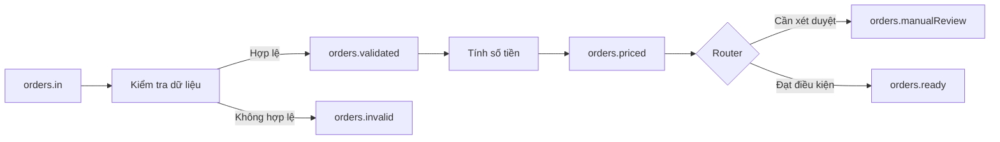
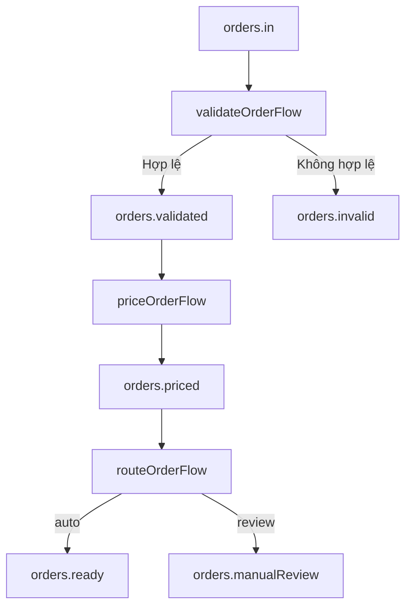
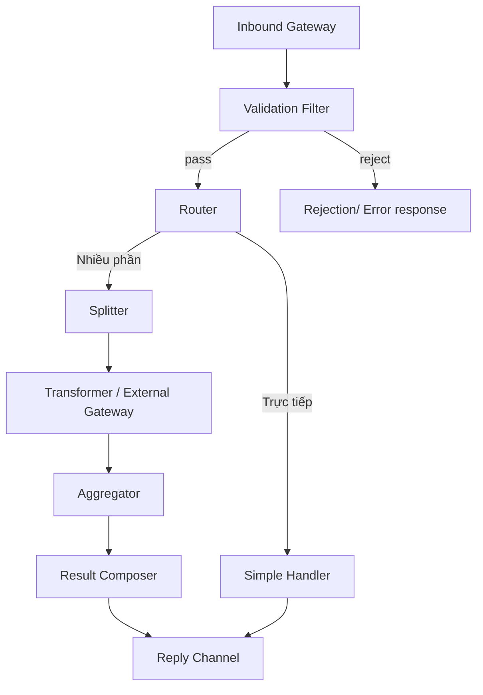

# Độ dài flow và khả năng đọc

## 1. Vì sao độ dài flow lại quan trọng?

Trong kiến trúc **Pipes and Filters**, dữ liệu đi qua một chuỗi các bước xử lý nhỏ (*filter*), được nối với nhau bằng các đường truyền (*pipe*). Mỗi bước có một trách nhiệm: xác thực đầu vào, làm sạch dữ liệu, biến đổi định dạng, định tuyến, gọi dịch vụ, ghi kết quả hoặc xử lý lỗi.

Spring Integration hiện thực cách tổ chức này bằng **message**, **channel** và **endpoint**. Java DSL cho phép diễn đạt cả chuỗi xử lý trong một phương thức `IntegrationFlow`. Khi flow lớn dần, một đoạn code ban đầu dễ hiểu có thể trở thành tập hợp dài các lời gọi `.filter(...)`, `.transform(...)`, `.route(...)`, `.handle(...)`, `.aggregate(...)` và nhiều lambda lồng nhau. Code vẫn chạy, nhưng người bảo trì khó trả lời:

- Message hiện mang payload kiểu gì và cần những header nào?
- Nhánh nào xử lý dữ liệu hợp lệ, nhánh nào nhận message bị loại?
- Một lỗi sẽ truyền về người gửi, đi vào error channel hay được retry?
- Thao tác nào chạy trên thread ban đầu, thao tác nào thực hiện ở thread khác?
- Điểm nào có thể tạo độ trễ, làm mất message, chờ reply hoặc tích lũy trạng thái?
- Sửa một bước có thể ảnh hưởng đến những bước nào phía sau?

Bài này thuộc chương **Pipes and filters** trong module **SPRING_INTEGRATION_PATTERN**. Mục tiêu học triển khai Enterprise Integration Patterns với Spring Integration là xây dựng các luồng thông điệp ít phụ thuộc, dễ mở rộng; thực hành Router, Filter, Transformer, Splitter, Aggregator, Gateway, retry, error channel, correlation và kiểm thử các nhánh xử lý. **Khả năng đọc flow** là điều kiện thực tế để các pattern này được sử dụng đúng: một flow có thể ngắn về số dòng nhưng vẫn khó hiểu nếu che giấu hành vi quan trọng.

Sau bài học, bạn có thể đánh giá độ phức tạp của flow, quyết định giữ một flow hay chia nhỏ, chọn ranh giới channel phù hợp, đặt tên thể hiện nghiệp vụ, và bảo toàn hành vi khi refactor.

## 2. “Flow dài” không chỉ là nhiều dòng code

Không có con số cố định như “trên 10 bước là phải chia”. Chiều dài đáng quan tâm là **số quyết định một người phải giữ trong đầu để hiểu và sửa flow an toàn**.

Xét hai trường hợp:

1. Flow có tám Transformer thuần túy, đều chuyển dữ liệu theo một hợp đồng rõ, không có nhánh hay I/O: có thể vẫn dễ đọc.
2. Flow có bốn bước, nhưng một lambda gọi HTTP, bắt exception, tự retry, đổi correlation header và quyết định routing: tuy ngắn về số dòng, flow này khó kiểm chứng và có nhiều trách nhiệm.

Có thể đánh giá qua các chiều sau:

| Chiều đánh giá | Dấu hiệu độ phức tạp tăng | Câu hỏi kiểm tra |
| --- | --- | --- |
| **Số biến đổi dữ liệu** | Payload đổi kiểu nhiều lần, không thấy schema giữa các bước | Sau mỗi bước, payload là gì? |
| **Số nhánh** | Router, Filter, nhánh lỗi, nhánh timeout đan xen | Có thể vẽ đủ đường đi của một message không? |
| **Ranh giới thread** | `ExecutorChannel`, `QueueChannel` hoặc poller xuất hiện giữa chuỗi | Caller còn chờ kết quả không? Exception về đâu? |
| **I/O và trạng thái** | HTTP/JMS/AMQP Gateway, Aggregator, retry, giao dịch | Bước nào có thể chờ, phát lại, giữ group hoặc lỗi một phần? |
| **Header và correlation** | Nhiều bước đọc/ghi `correlationId`, `replyChannel`, `errorChannel` | Có vô tình làm mất metadata cần cho downstream không? |
| **Độ gắn kết nghiệp vụ** | Một flow kiểm tra đơn hàng, tính phí, gửi email, ghi báo cáo | Các bước có cùng một mục tiêu và cùng lý do thay đổi không? |
| **Khả năng kiểm thử** | Muốn kiểm tra một luật phải khởi động mọi adapter | Có thể kiểm tra luật nghiệp vụ riêng với broker/HTTP không? |

Một flow dễ đọc thường cho phép người đọc nắm được **đường đi chính trước**, rồi mở từng bước khi cần tìm hiểu chi tiết. Tên của channel và handler phải giúp trả lời câu hỏi *“message đang ở giai đoạn nào?”*.

## 3. Cách nhìn một flow như một bản đồ xử lý



Sơ đồ có **một đường đi chính** và các nhánh có tên rõ ràng. Người đọc dễ xác định điểm cần kiểm tra nếu đơn hàng không được định giá hoặc bị định tuyến nhầm.

Trong Spring Integration:

- **Message** chứa payload và headers.
- **Message channel** kết nối các endpoint và mang message giữa chúng.
- **Filter/Transformer/Router/Service Activator/Gateway/Aggregator** là các endpoint thực hiện công việc.
- **IntegrationFlow** mô tả cách kết nối các thành phần. Một `IntegrationFlow` không nhất thiết trùng với toàn bộ nghiệp vụ từ đầu đến cuối.

Một ứng dụng có thể dùng **một IntegrationFlow cho cả tuyến** hoặc **nhiều IntegrationFlow nối nhau qua các named channel**. Hai cách đều có thể tạo cùng đường đi message. Điều quan trọng là hợp đồng và hành vi quan sát được, bao gồm ranh giới thread và error handling.

### 3.1. Đừng trộn lẫn “bước nghiệp vụ” và “bước kỹ thuật”

Ví dụ “kiểm tra đơn hàng” là một bước nghiệp vụ; bên trong có thể bao gồm kiểm tra số lượng, mã sản phẩm, tenant và giới hạn giá trị. Nếu tất cả luật này được triển khai thành các lambda độc lập trong một DSL dài, người đọc phải dò từng điều kiện để hiểu ý nghĩa.

Thay vào đó, có thể đặt một hàm `isValidOrder(...)` hoặc một service chuyên trách. Flow hiển thị *ý định nghiệp vụ*; phần hiện thực của luật nằm trong lớp có thể kiểm thử riêng.

Ngược lại, không nhất thiết biến mọi lời gọi `.transform(...)` một dòng thành một service riêng. Chia nhỏ quá mức có thể làm tăng số file, số bean và số đường nối mà không tăng tính rõ ràng.

## 4. Dấu hiệu một flow nên được tổ chức lại

| Dấu hiệu | Tác động | Hướng cải thiện |
| --- | --- | --- |
| Một `@Bean IntegrationFlow` chứa nhiều công đoạn độc lập | Thay đổi nghiệp vụ A có thể ảnh hưởng việc cấu hình B | Chia theo giai đoạn có tên như `validateOrders`, `priceOrders`, `routeOrders`. |
| Lambda nhiều tầng vừa gọi mạng vừa xử lý exception | Khó đọc retry và quy tắc phát lỗi | Chuyển I/O vào service/gateway riêng, khai báo retry/error path phù hợp. |
| Payload đổi kiểu mà không ghi rõ | Dễ lỗi cast, transformer nhận sai payload | Dùng DTO/record có tên và phép biến đổi typed. |
| Router trả về chuỗi bí ẩn `"a"`, `"b"` | Nhánh khó hiểu và khó tìm handler | Đặt tên nhánh theo nghiệp vụ, ánh xạ sang channel cụ thể. |
| Dùng quá nhiều channel không tên | Khó tìm điểm để tap/debug | Tạo named channel cho những ranh giới có ý nghĩa. |
| Dùng quá nhiều named channel chỉ để chuyển bước nhỏ | Topology bị phân mảnh; khó theo dõi | Giữ các filter/transformer liên quan trong cùng flow. |
| Kết hợp retry, transaction và business validation trong một callback | Khó kiểm soát message trùng và phạm vi rollback | Tách chính sách hạ tầng khỏi luật nghiệp vụ; ghi rõ phạm vi retry. |
| Muốn test một điều kiện phải gọi HTTP/broker thật | Test chậm, khó chẩn đoán khi fail | Đưa logic thuần thành hàm hoặc service; integration test tại boundary. |

Một nguyên tắc hữu ích: **tách khi mỗi phần có hợp đồng đầu vào/đầu ra, vòng đời lỗi hoặc lý do thay đổi đủ rõ**. Không chia chỉ để mỗi file có ít dòng.

## 5. Ví dụ ban đầu: flow chứa quá nhiều chi tiết

Bài toán: nhận `OrderCommand`, loại đơn hàng không hợp lệ, chuẩn hóa mã đơn, tính tiền và đưa đơn lớn sang bước xét duyệt.

Các kiểu dữ liệu minh họa:

```java
import java.math.BigDecimal;

record OrderCommand(
        String orderId,
        int quantity,
        BigDecimal unitPrice) {}

record PricedOrder(
        String orderId,
        BigDecimal amount) {}
```

Đầu tiên có thể viết mọi thứ trong một flow:

```java
@Bean
public IntegrationFlow longOrderFlow() {
    return IntegrationFlow.from("orders.in")
        .filter(OrderCommand.class,
            order -> order.orderId() != null
                && !order.orderId().isBlank()
                && order.quantity() > 0
                && order.unitPrice() != null
                && order.unitPrice().signum() >= 0,
            spec -> spec.discardChannel("orders.invalid"))
        .transform(OrderCommand.class,
            order -> new OrderCommand(
                order.orderId().strip(),
                order.quantity(),
                order.unitPrice()))
        .transform(OrderCommand.class,
            order -> new PricedOrder(
                order.orderId(),
                order.unitPrice().multiply(
                    BigDecimal.valueOf(order.quantity()))))
        .route(PricedOrder.class,
            priced -> priced.amount()
                    .compareTo(new BigDecimal("1000")) >= 0
                        ? "review" : "auto",
            spec -> spec
                .channelMapping("review", "orders.manualReview")
                .channelMapping("auto", "orders.ready"))
        .get();
}
```

*Đoạn trên giả định các import và cấu hình Spring Integration đã có, cùng consumer của các channel đầu ra. Đây là cấu trúc minh họa, chưa phải ứng dụng đầy đủ có persistence hoặc error policy.*

Flow trên chưa nhất thiết là vấn đề: chỉ có một nhánh lọc, hai bước biến đổi và một Router. Nhưng nếu sau đó có thêm xác thực tenant, gọi cổng thanh toán, chờ Gateway, retry, ghi audit, cập nhật kho và phát event, mọi thay đổi sẽ tích tụ ở cùng một method. Nhìn từ code, khó biết đoạn nào là *validation*, *normalization*, *pricing* và *routing*.

Có hai mức refactor hợp lý:

1. **Giữ một IntegrationFlow, đặt tên logic** bằng các hàm hoặc service có kiểu rõ ràng.
2. **Chia thành nhiều IntegrationFlow**, kết nối bằng named channel khi các giai đoạn là ranh giới nghiệp vụ hoặc vận hành thực sự.

Chọn mức đơn giản nhất mà vẫn giải quyết vấn đề đang có.

## 6. Refactor mức 1: một flow, các bước mang tên

Dùng method riêng để làm nổi bật chủ đích. Đây là cách phù hợp khi toàn bộ chuỗi vẫn là một bước xử lý nhất quán, cùng thread, cùng chính sách lỗi:

```java
import java.math.BigDecimal;

import org.springframework.context.annotation.Bean;
import org.springframework.context.annotation.Configuration;
import org.springframework.integration.config.EnableIntegration;
import org.springframework.integration.dsl.IntegrationFlow;

@Configuration
@EnableIntegration
public class ReadableOrderFlow {

    @Bean
    public IntegrationFlow orderFlow() {
        return IntegrationFlow.from("orders.in")
            .filter(OrderCommand.class,
                ReadableOrderFlow::isValid,
                spec -> spec.discardChannel("orders.invalid"))
            .transform(OrderCommand.class,
                ReadableOrderFlow::normalize)
            .transform(OrderCommand.class,
                ReadableOrderFlow::price)
            .route(PricedOrder.class,
                ReadableOrderFlow::route,
                spec -> spec
                    .channelMapping("review", "orders.manualReview")
                    .channelMapping("auto", "orders.ready"))
            .get();
    }

    static boolean isValid(OrderCommand order) {
        return order.orderId() != null
            && !order.orderId().isBlank()
            && order.quantity() > 0
            && order.unitPrice() != null
            && order.unitPrice().signum() >= 0;
    }

    static OrderCommand normalize(OrderCommand order) {
        return new OrderCommand(
            order.orderId().strip(),
            order.quantity(),
            order.unitPrice());
    }

    static PricedOrder price(OrderCommand order) {
        return new PricedOrder(
            order.orderId(),
            order.unitPrice().multiply(
                BigDecimal.valueOf(order.quantity())));
    }

    static String route(PricedOrder order) {
        return order.amount().compareTo(new BigDecimal("1000")) >= 0
                ? "review" : "auto";
    }
}
```

*`OrderCommand` và `PricedOrder` là hai record đã khai báo ở mục 5. Cấu hình dùng các channel đầu ra do ứng dụng cung cấp.*

Ở cách này, dòng DSL đọc gần như câu nghiệp vụ: **lọc → chuẩn hóa → định giá → định tuyến**. Unit test cho `isValid`, `normalize`, `price` và `route` không cần Spring context. Nếu luật giá cả phát triển thành nhiều nhánh, có thể chuyển riêng `price` sang `PricingService`. Flow không cần biết chi tiết công thức giá.

### Quy tắc đặt tên

- Đặt tên hành động theo kết quả: `validateOrder`, `calculatePrice`, `routeByRisk`; tránh `step1` hoặc `process`.
- Tên channel mô tả **trạng thái message**: `orders.validated`, `orders.priced`, `orders.ready`.
- Tên hàm pure transformation mô tả thay đổi payload và tốt nhất có kiểu trả về rõ.
- Tên service cho side effect mô tả việc thực hiện: `reserveInventory`, `chargePayment`, `persistOrder`.
- Các nhánh error/timeout có tên riêng, tránh gửi nhiều loại lỗi không tương đồng vào một channel chung rồi đoán ý nghĩa qua payload.

Tên không thay thế hợp đồng: luôn ghi rõ payload, headers quan trọng và quy tắc khi không thỏa điều kiện.

## 7. Refactor mức 2: chia flow theo ranh giới nghiệp vụ

Khi validation, pricing và routing có chính sách kiểm thử/triển khai riêng, có thể dùng nhiều IntegrationFlow liên kết qua named channel:



Một cấu hình Java DSL sử dụng các kiểu `OrderCommand` và `PricedOrder` ở trên:

```java
import java.math.BigDecimal;

import org.springframework.context.annotation.Bean;
import org.springframework.context.annotation.Configuration;
import org.springframework.integration.channel.QueueChannel;
import org.springframework.integration.config.EnableIntegration;
import org.springframework.integration.dsl.IntegrationFlow;

@Configuration
@EnableIntegration
public class ModularOrderFlows {

    @Bean
    public IntegrationFlow validateOrders() {
        return IntegrationFlow.from("orders.in")
            .filter(OrderCommand.class,
                ModularOrderFlows::isValid,
                spec -> spec.discardChannel("orders.invalid"))
            .transform(OrderCommand.class,
                ModularOrderFlows::normalize)
            .channel("orders.validated")
            .get();
    }

    @Bean
    public IntegrationFlow priceOrders() {
        return IntegrationFlow.from("orders.validated")
            .transform(OrderCommand.class,
                ModularOrderFlows::price)
            .channel("orders.priced")
            .get();
    }

    @Bean
    public IntegrationFlow routeOrders() {
        return IntegrationFlow.from("orders.priced")
            .route(PricedOrder.class,
                ModularOrderFlows::route,
                spec -> spec
                    .channelMapping("review", "orders.manualReview")
                    .channelMapping("auto", "orders.ready"))
            .get();
    }

    // QueueChannel ở ba đích chỉ để test/demo có thể poll kết quả.
    // Production thường sẽ có service activator hoặc adapter nhận.
    @Bean("orders.invalid")
    public QueueChannel invalidOrders() {
        return new QueueChannel();
    }

    @Bean("orders.manualReview")
    public QueueChannel manualReviewOrders() {
        return new QueueChannel();
    }

    @Bean("orders.ready")
    public QueueChannel readyOrders() {
        return new QueueChannel();
    }

    static boolean isValid(OrderCommand order) {
        return order.orderId() != null
            && !order.orderId().isBlank()
            && order.quantity() > 0
            && order.unitPrice() != null
            && order.unitPrice().signum() >= 0;
    }

    static OrderCommand normalize(OrderCommand order) {
        return new OrderCommand(
            order.orderId().strip(),
            order.quantity(),
            order.unitPrice());
    }

    static PricedOrder price(OrderCommand order) {
        return new PricedOrder(
            order.orderId(),
            order.unitPrice().multiply(
                BigDecimal.valueOf(order.quantity())));
    }

    static String route(PricedOrder order) {
        return order.amount().compareTo(new BigDecimal("1000")) >= 0
                ? "review" : "auto";
    }
}
```

### Điều gì đã thay đổi?

- **Validation flow** có trách nhiệm kiểm tra và chuẩn hóa; message không hợp lệ đi vào `orders.invalid`.
- **Pricing flow** chỉ định giá từ `OrderCommand` sang `PricedOrder`.
- **Routing flow** chỉ quyết định nhánh xử lý, không chứa công thức giá hoặc luật validation.
- `orders.validated` và `orders.priced` trở thành **ranh giới có tên**, hữu ích khi quan sát topology, logging hoặc thay đổi ownership.
- Các channel kết quả trong ví dụ là `QueueChannel` cho phép kiểm thử đọc kết quả bằng `receive(timeout)`. Trong sản phẩm thực tế, cần consumer hoặc outbound adapter phù hợp, cấu hình capacity và deadline.

**Điểm rất quan trọng:** Việc chia thành ba `IntegrationFlow` **không tự chuyển sang xử lý bất đồng bộ**. Nếu các channel trung gian là `DirectChannel` (thường được tạo khi chỉ tham chiếu tên channel mà chưa khai báo bean riêng), handler có thể vẫn chạy trong cùng thread với sender. Chỉ khi chọn kênh hoặc endpoint phù hợp như `ExecutorChannel`, `QueueChannel` với poller, adapter hoặc Gateway thì ranh giới thực thi mới thay đổi. Trước và sau refactor, phải kiểm chứng hành vi về thread, timeout và truyền exception.

### Khi nào giữ một flow sẽ tốt hơn?

Không chia chỉ vì muốn có nhiều file/bean. Nếu hai Transformer liên tiếp cùng thực hiện một quy tắc chuẩn hóa, đều thuần túy và thường thay đổi cùng nhau, để chúng trong một flow có thể dễ hiểu hơn. Chia chỉ thực sự giúp ích khi xuất hiện hợp đồng hoặc chính sách độc lập. Việc chia nhỏ quá mức tạo thêm nhiều tên channel, nơi cấu hình endpoint và lớp trung gian mà người đọc phải lần theo.

## 8. Thiết kế ranh giới channel có chủ đích

Một **ranh giới kiến trúc** nên trả lời được: *message trông như thế nào ở đây, ai chịu trách nhiệm xử lý tiếp và có bảo đảm gì khi gửi thành công?*

| Tình huống | Lựa chọn có thể phù hợp | Điều cần ghi rõ |
| --- | --- | --- |
| Chuỗi filter/transformer nhẹ cần thực thi trực tiếp | `DirectChannel` hoặc chuỗi DSL trực tiếp | Handler lỗi sẽ làm gì với thread gửi? |
| Consumer chạy độc lập bằng pool thread | `ExecutorChannel` | Task được enqueue vào executor không đồng nghĩa với xử lý xong. |
| Cần tách producer và polling consumer trong cùng ứng dụng | `QueueChannel` | Capacity, timeout khi đầy, cách poll, xử lý khi ứng dụng dừng. |
| Sender và receiver phải chờ nhau để bàn giao | `RendezvousChannel` | Không có buffer; sender có thể bị chặn đến timeout. |
| Cần lưu bền vững, nhiều instance hoặc giao tiếp qua tiến trình | Adapter AMQP/JMS/Kafka hoặc store thích hợp | Ack, retry, ordering, idempotency, schema và lỗi mạng. |
| Cần tổng hợp nhiều kết quả | Aggregator và MessageGroupStore | Correlation, release strategy, nhóm đến trễ, timeout và cleanup. |

Named channel hữu ích cho debug, nhưng nó cũng là **hợp đồng giữa hai phần của flow**. Khi đổi `DirectChannel` sang `QueueChannel`, bạn không chỉ thay cách đặt tên; bạn đã thay đổi thời điểm hoàn tất `send`, thread xử lý tiếp theo và cách lỗi được báo về. Một refactor chỉ nhằm làm ngắn file nên tránh những thay đổi runtime như vậy nếu không có yêu cầu.

### Ghi rõ hợp đồng tại boundary

Có thể dùng một bảng ngắn ngay trong tài liệu module:

| Boundary | Payload | Headers cần giữ | Consumer | Lỗi |
| --- | --- | --- | --- | --- |
| `orders.in` | `OrderCommand` | `requestId`, `tenantId` đã xác thực | Validation | Trả lỗi đầu vào hoặc đưa vào nhánh từ chối |
| `orders.validated` | `OrderCommand` đã chuẩn hóa | `requestId`, `tenantId` | Pricing | Error flow của pricing |
| `orders.priced` | `PricedOrder` | `requestId`, `tenantId` | Router | Error flow của routing |
| `orders.ready` | `PricedOrder` | `requestId`, `tenantId` | Persistence/adapter | Retry có idempotency |
| `orders.manualReview` | `PricedOrder` | `requestId`, `tenantId` | Review worker | SLA và trạng thái chờ duyệt |

`requestId` và `tenantId` ở bảng là header ví dụ do ứng dụng tạo và xác thực; Spring Integration không tự cam kết mọi nghiệp vụ đều có các header đó. Khi cần routing/aggregation, còn phải bảo toàn các header điều khiển của Spring Integration như `correlationId` hoặc `sequenceSize` theo chính sách của endpoint.

## 9. Đọc hiểu một flow có Router, Splitter và Aggregator

Flow phức tạp thường không chỉ là chuỗi tuyến tính:



Để tránh một method Java DSL dài hàng chục bước, có thể chia thành các *giai đoạn có nghĩa*:

- **Ingress:** nhận request, xác thực và chuẩn hóa payload.
- **Dispatch:** Router chọn xử lý đơn giản hoặc pipeline phức tạp.
- **Fan-out:** Splitter tạo nhiều message con và Gateway gọi các dịch vụ.
- **Fan-in:** Aggregator ghép kết quả sau khi đủ điều kiện.
- **Completion:** tạo payload phản hồi, kiểm soát header, phát sang reply channel.
- **Recovery:** xử lý timeout, retry và lỗi theo chính sách của từng bước.

Đây là **các giai đoạn khái niệm**, không bắt buộc mỗi giai đoạn là một `IntegrationFlow` riêng. Chỉ biến chúng thành flow riêng khi làm rõ dependency, ownership và cách kiểm thử.

### Với Splitter/Aggregator, đừng đổi cấu trúc một cách máy móc

Splitter thường gắn các header `correlationId`, `sequenceNumber`, `sequenceSize` để Aggregator ghép lại. Nếu refactor thêm Filter, Router hoặc Transform giữa Splitter và Aggregator:

1. Bảo đảm mọi message cần ghép cuối cùng đến đúng Aggregator.
2. Không làm mất hoặc ghi đè correlation/sequence cần thiết.
3. Nếu Filter loại message, điều kiện release dựa trên `sequenceSize` có thể không được đáp ứng.
4. Retry một message con phải tránh làm một phần được tính hai lần.
5. Gateway request/reply và Aggregator group timeout là hai cơ chế độc lập; phải quản lý deadline end-to-end.

Tách thành nhiều bean không có nghĩa semantics của sequence được giữ tự động khi chuyển qua nhiều giao thức. Với các hop AMQP/JMS/Kafka, cần xác định cách header được ánh xạ và đảm bảo consumer có đủ metadata.

## 10. Làm cho flow dễ đọc khi xảy ra lỗi

Một flow đọc tốt khi chạy đúng nhưng **khó chẩn đoán khi có lỗi** vẫn chưa đạt yêu cầu. Mỗi nhánh quan trọng nên có một câu trả lời rõ cho câu hỏi “lỗi được xử lý ở đâu?”.

| Bối cảnh | Hành vi cần phân biệt |
| --- | --- |
| Filter loại message | Không nhất thiết là exception; có thể là quyết định nghiệp vụ có `discardChannel`. |
| Handler trên `DirectChannel` ném exception | Exception có thể lan trong thread của sender. |
| Handler ở polling endpoint hoặc executor ném exception | Lỗi phát sinh ngoài thread gửi, có thể đi qua error channel theo cấu hình. |
| HTTP/AMQP/JMS outbound lỗi | Cần chính sách retry, timeout và nhánh lỗi phù hợp adapter; có thể đã phát request trước khi nhận lỗi. |
| Aggregator chờ thiếu message | Không tự là exception ngay; cần group timeout, metric và chính sách xử lý partial/expiry. |
| Gateway hết thời gian chờ reply | Không đồng nghĩa downstream đã hủy xử lý; reply muộn cần quy tắc riêng. |

**Phân tách retry theo đơn vị có thể thực hiện lại an toàn.** Ví dụ retry phép gọi HTTP có thể làm phát lại lệnh thanh toán; cần idempotency key và chính sách quyết định có retry khi không rõ kết quả. Khi refactor một handler thành flow riêng, phạm vi retry có thể đổi nếu advice/configuration đi cùng endpoint cũ không được chuyển đúng.

Đừng biến mọi nhánh lỗi thành cùng một kênh `errors` nếu không thể phân biệt nguyên nhân. Có thể giữ error flow tập trung, nhưng event lỗi nên mang thông tin về stage, correlation, loại lỗi, retry count và trạng thái xử lý; dữ liệu nhạy cảm cần được redaction.

## 11. Kiểm thử để bảo đảm refactor giữ nguyên hành vi

Trước khi chia hoặc đổi cấu trúc flow, hãy xác định **hành vi quan sát được**:

- Với input hợp lệ, payload kết quả, routing và header nghiệp vụ phải như cũ.
- Với input không hợp lệ, message phải đi đúng nhánh discard/rejection.
- Với lỗi tại một endpoint, exception/error message và retry phải được xử lý đúng thread và đúng nơi.
- Với Splitter/Aggregator, kết quả ghép phải giữ correlation và điều kiện release.
- Với Gateway, deadline gửi request và chờ reply phải phù hợp.
- Với side effect, không được vô tình tăng số lần ghi dữ liệu hoặc phát event.

Ví dụ JUnit 5 + AssertJ có thể kiểm tra flow đã chia ở mục 7, sử dụng `QueueChannel` ở hai nhánh kết quả:

```java
import static org.assertj.core.api.Assertions.assertThat;

import java.math.BigDecimal;

import org.junit.jupiter.api.Test;
import org.springframework.beans.factory.annotation.Autowired;
import org.springframework.beans.factory.annotation.Qualifier;
import org.springframework.integration.channel.QueueChannel;
import org.springframework.messaging.Message;
import org.springframework.messaging.MessageChannel;
import org.springframework.messaging.support.MessageBuilder;
import org.springframework.test.context.junit.jupiter.SpringJUnitConfig;

@SpringJUnitConfig(ModularOrderFlows.class)
class ModularOrderFlowsTest {

    @Autowired
    @Qualifier("orders.in")
    MessageChannel input;

    @Autowired
    @Qualifier("orders.ready")
    QueueChannel ready;

    @Autowired
    @Qualifier("orders.manualReview")
    QueueChannel manualReview;

    @Autowired
    @Qualifier("orders.invalid")
    QueueChannel invalid;

    @Test
    void validSmallOrderIsPricedAndReady() {
        Message<OrderCommand> request = MessageBuilder.withPayload(
            new OrderCommand("  O-42  ", 2, new BigDecimal("30")))
            .setHeader("requestId", "req-42")
            .build();

        assertThat(input.send(request)).isTrue();

        Message<?> result = ready.receive(0);
        assertThat(result).isNotNull();
        assertThat(result.getPayload()).isEqualTo(
            new PricedOrder("O-42", new BigDecimal("60")));
        assertThat(result.getHeaders().get("requestId"))
            .isEqualTo("req-42");

        assertThat(manualReview.receive(0)).isNull();
        assertThat(invalid.receive(0)).isNull();
    }

    @Test
    void invalidOrderGoesToDiscardChannel() {
        OrderCommand order = new OrderCommand(
            "O-43", 0, new BigDecimal("30"));

        assertThat(input.send(
            MessageBuilder.withPayload(order).build())).isTrue();

        Message<?> rejected = invalid.receive(0);
        assertThat(rejected).isNotNull();
        assertThat(rejected.getPayload()).isEqualTo(order);
        assertThat(ready.receive(0)).isNull();
    }

    @Test
    void largeOrderIsRoutedForManualReview() {
        OrderCommand order = new OrderCommand(
            "O-44", 2, new BigDecimal("600"));

        assertThat(input.send(
            MessageBuilder.withPayload(order).build())).isTrue();

        Message<?> result = manualReview.receive(0);
        assertThat(result).isNotNull();
        assertThat(result.getPayload()).isEqualTo(
            new PricedOrder("O-44", new BigDecimal("1200")));
        assertThat(ready.receive(0)).isNull();
    }
}
```

Các kiểm thử trên xác minh logic và wiring nội bộ; không thay cho integration test với database, HTTP API hoặc broker thật. Khi thay đổi loại channel hoặc endpoint để xử lý đồng thời, cần test riêng khả năng ordering, timeout, xử lý lỗi ở thread khác và shutdown.

### Điều gì đáng kiểm tra trước và sau refactor?

| Đặc tính | Cách xác minh |
| --- | --- |
| Topology | Các message từ một channel có đến đúng handler/nhánh không? |
| Payload | Đúng kiểu, giá trị, schema sau từng ranh giới chính? |
| Header | `requestId`, tenant, trace, correlation và reply channel có còn đúng? |
| Thread | Log tên thread hoặc test đồng bộ khi đổi loại channel. |
| Lỗi | Kiểm tra cả exception trực tiếp và error flow bất đồng bộ. |
| Retry | Đúng số lần, backoff, không tạo side effect trùng ngoài dự kiến. |
| Latency | Đo thời gian end-to-end; việc chia thành nhiều boundary không tạo bottleneck mới. |

## 12. Quan sát và debug một flow có nhiều phần

Với flow dài, debug bằng cách đặt breakpoint tại từng lambda là tốn thời gian. Một topology có tên tốt giúp điều tra theo *stage* và *correlation*.

**Gợi ý thực hành:**

1. Đặt tên flow, channel và endpoint theo chức năng. Tên `orders.priced` có ý nghĩa hơn `channel7`.
2. Gắn correlation ID nghiệp vụ (ví dụ `requestId`) tại ingress đáng tin cậy, giữ nó qua các bước cần truy vết. Không nhầm với `MessageHeaders.ID` có thể đổi khi message được tạo lại.
3. Đo số message vào/ra mỗi stage, tỷ lệ bị loại, số lần retry, thời gian xử lý và timeout.
4. Với Splitter/Aggregator, theo dõi số group mở, tuổi nhóm và số message chờ.
5. Dùng logging ở boundary quan trọng, ghi **tên stage, correlation và trạng thái**, hạn chế log payload/header nhạy cảm.
6. Dùng các tính năng quan sát/metrics, tracing hoặc Message History mà phiên bản Spring Integration của dự án hỗ trợ. Những tính năng này có thể cần bật cấu hình và có chi phí vận hành; không mặc định rằng mọi message đều đã có trace hoàn chỉnh.

Một hệ thống chạy trên nhiều thread cần trace context phù hợp khi chuyển qua executor, poller hoặc transport. Chỉ truyền header `requestId` là hữu ích cho log nghiệp vụ, nhưng không tự biến nó thành distributed tracing đầy đủ.

## 13. Cân bằng giữa nhiều flow nhỏ và một flow lớn

Để chọn cách tổ chức, hãy cân nhắc song song ba tiêu chí:

| Tiêu chí | Giữ gần nhau khi… | Tách ra khi… |
| --- | --- | --- |
| **Lý do thay đổi** | Các bước cùng thuộc một quy tắc nghiệp vụ | Hai phần được sửa, triển khai hoặc sở hữu độc lập. |
| **Hợp đồng** | Chỉ là biến đổi nội bộ, không cần consumer khác biết | Output là một trạng thái business có schema rõ, được nhiều nơi sử dụng. |
| **Chính sách vận hành** | Cùng thread, cùng error/retry/transaction policy | Có I/O chậm, poller riêng, timeout hoặc retry khác biệt. |

Không nhất thiết phải chia tại mọi Router. Nếu một Router chỉ điều hướng đến hai handler nhỏ, có thể giữ routing và handler trong một flow rõ ràng. Ngược lại, một nhánh gọi nhiều hệ thống, có transaction và retry riêng thường xứng đáng là flow khác.

**Mục tiêu của modularity là giảm số chi tiết cần hiểu trong một lần**, không phải tăng số lượng bean. Một bài thực hành tốt là yêu cầu người khác mở flow và kể lại đường đi của message bằng các tên giai đoạn, không cần đọc nội dung từng lambda. Nếu họ vẫn phải nhảy qua hàng chục file để biết một phép transform đơn giản, cấu trúc đang bị chia quá vụn.

### Checklist review trước khi chốt cấu trúc

- [ ] Có thể mô tả flow bằng một câu nghiệp vụ ngắn.
- [ ] Có thể vẽ đường đi chính và tất cả nhánh quan trọng.
- [ ] Tên stage, channel và handler nói rõ mục đích.
- [ ] Payload và header bắt buộc tại các boundary được xác định.
- [ ] Ranh giới đồng bộ/bất đồng bộ và timeout được hiểu đúng.
- [ ] Có nơi xử lý message bị Filter loại, lỗi handler, reply trễ và timeout.
- [ ] Có thể kiểm thử nghiệp vụ thuần mà không khởi động toàn bộ hạ tầng.
- [ ] Việc chia flow không vô tình đổi retry, transaction, routing hoặc correlation.
- [ ] Có cách quan sát số message, thời gian xử lý, lỗi và backlog.
- [ ] Mỗi phần tách ra có một lý do rõ ràng để tồn tại.

## 14. Bài tập áp dụng

### Bài 1 — Đọc một flow chưa có tên giai đoạn

Cho pipeline gồm: xác thực input → chuẩn hóa payload → kiểm tra hạn mức → gọi inventory service → tính phí vận chuyển → ghi đơn hàng → phát event → gửi email. Vẽ sơ đồ Pipes and Filters và đề xuất cách phân chia thành giai đoạn. Với mỗi boundary, ghi payload, header và chính sách lỗi cần giữ.

**Câu hỏi:** Có cần tách “chuẩn hóa payload” thành flow riêng không? Khi nào trả lời là có, khi nào là không?

### Bài 2 — Refactor mà không đổi hành vi

Từ ví dụ ở mục 5, thực hiện hai phiên bản: một flow dùng các method có tên, và ba flow nối qua named channel. Kiểm thử hai phiên bản với cùng input:

- Đơn hàng hợp lệ tổng tiền thấp đi vào nhánh `orders.ready`.
- Đơn hàng hợp lệ tổng tiền cao đi vào `orders.manualReview`.
- Đơn hàng số lượng bằng 0 đi vào `orders.invalid`.
- Header `requestId` được giữ trên message đầu ra.

So sánh số dòng DSL, số nơi phải mở file để hiểu flow và độ dễ cô lập lỗi.

### Bài 3 — Thay channel và phân tích hậu quả

Từ phiên bản ba flow, thử thay `orders.priced` từ `DirectChannel` sang `QueueChannel` có polling consumer. Trước khi chạy, dự đoán sự khác nhau về thread gửi, thời điểm `send` trả về, cách truyền exception và ordering. Thiết kế test để xác minh các dự đoán.

**Điểm cần nhớ:** thay loại channel là thay đổi hành vi runtime, không phải refactor thuần túy.

### Bài 4 — Splitter/Aggregator và correlation

Một đơn hàng có bốn dòng được Splitter phát thành bốn message. Sau đó Filter loại một dòng không hợp lệ và Aggregator vẫn đợi đủ bốn phần. Hãy:

1. Xác định lý do Aggregator không release.
2. Đề xuất hợp đồng release phù hợp khi có phần bị loại.
3. Giữ correlation nhất quán qua Router/Transformer.
4. Thiết kế lỗi/timeout khi service xử lý một dòng không phản hồi.
5. Đề xuất cách chia thành các flow đọc được nhưng vẫn giữ semantics.

### Bài 5 — Review flow của người khác

Lấy một flow thực tế có Router, Gateway, retry hoặc Aggregator. Viết lại dưới dạng bảng:

| Giai đoạn | Input | Output | Channel/endpoint | Lỗi và timeout | Cách kiểm thử |
| --- | --- | --- | --- | --- | --- |
| Ingress | … | … | … | … | … |
| Validation | … | … | … | … | … |
| Processing | … | … | … | … | … |
| Completion | … | … | … | … | … |

Đề xuất tối đa hai thay đổi cấu trúc có giá trị nhất và giải thích vì sao chúng cải thiện khả năng đọc hoặc khả năng kiểm thử. Không dùng số dòng làm lý do duy nhất.

## 15. Những điều cần ghi nhớ

**Độ dài flow là một tín hiệu, không phải luật cứng.** Flow dễ đọc khi logic nghiệp vụ có tên rõ, đường đi message có thể theo dõi, các nhánh lỗi/timeout được mô tả và ranh giới channel có hợp đồng cụ thể.

Tăng khả năng đọc theo thứ tự hợp lý: **đặt tên logic → tách hàm/service thuần → xác định boundary thật sự → chia IntegrationFlow khi có lý do về nghiệp vụ hoặc vận hành**. Refactor cấu trúc phải giữ nguyên hành vi của payload, headers, correlation, retry, thread và transaction, trừ khi yêu cầu thay đổi đã được chủ động xác định.

Trong kiến trúc Pipes and Filters của Spring Integration, giá trị lớn nhất của một flow không nằm ở việc chỉ dùng một method ngắn, mà ở chỗ người bảo trì có thể hiểu đúng ý nghĩa mỗi message và kiểm chứng được hệ thống làm gì ở từng bước.

## Tài liệu tham khảo

- [Spring Integration Reference — Java DSL](https://docs.spring.io/spring-integration/reference/dsl.html)
- [Spring Integration Reference — Message Channels](https://docs.spring.io/spring-integration/reference/channel.html)
- [Spring Integration Reference — Message Routing](https://docs.spring.io/spring-integration/reference/router.html)
- [Spring Integration Reference — Message Filtering](https://docs.spring.io/spring-integration/reference/filter.html)
- [Spring Integration Reference — Message Transformation](https://docs.spring.io/spring-integration/reference/transformer.html)
- [Spring Integration Reference — Error Handling](https://docs.spring.io/spring-integration/reference/error-handling.html)
- [Spring Integration Reference — Aggregator](https://docs.spring.io/spring-integration/reference/aggregator.html)
- [Enterprise Integration Patterns — Pipes and Filters](https://www.enterpriseintegrationpatterns.com/patterns/messaging/PipesAndFilters.html)

Ví dụ dùng khái niệm Java DSL của Spring Integration phiên bản hiện đại. Khi áp dụng vào dự án cụ thể, đối chiếu các overload, endpoint options, channel semantics và cấu hình test với phiên bản Spring Integration/Spring Framework thực tế.
