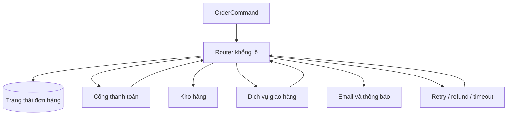
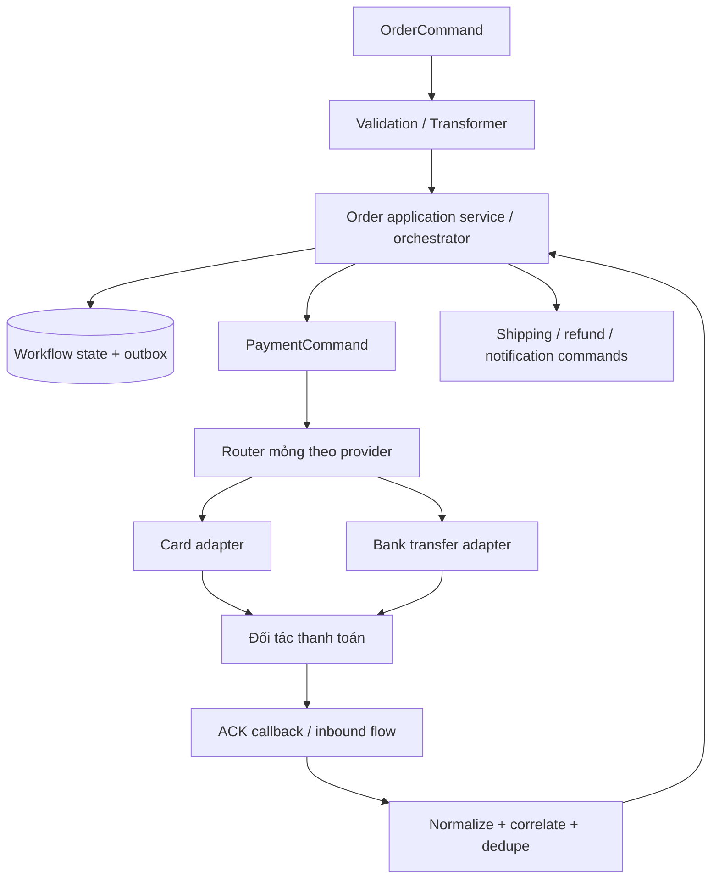
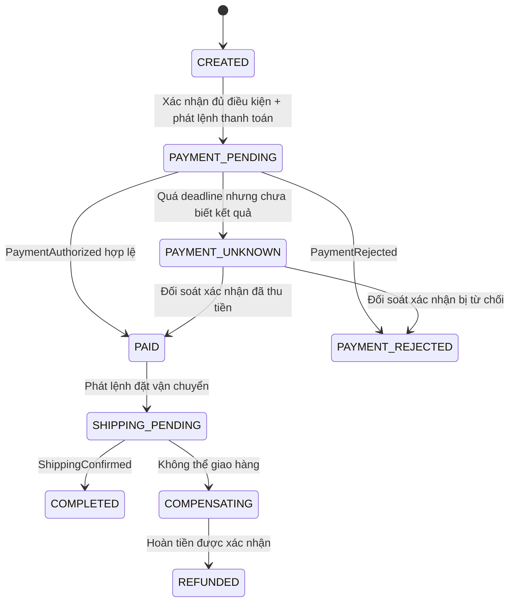

# Dùng router thay cho business orchestration quá lớn

## 1. Vấn đề: một Router trở thành nơi điều khiển toàn bộ nghiệp vụ

Trong module **SPRING_INTEGRATION_PATTERN**, chúng ta học cách triển khai Enterprise Integration Patterns bằng Spring Integration nhằm xây dựng các luồng thông điệp ít phụ thuộc, dễ mở rộng, dễ kiểm thử và có thể quan sát. Router, Filter, Transformer, Splitter, Aggregator, Gateway, retry, error channel và correlation đều là những công cụ quan trọng. Tuy nhiên, **dùng Router để điều phối toàn bộ quy trình nghiệp vụ** là một lỗi kiến trúc rất dễ xuất hiện khi số nhánh xử lý tăng dần.

Giả sử hệ thống thương mại điện tử có luồng xử lý đơn hàng:

1. Kiểm tra đơn hàng và tồn kho.
2. Chọn cổng thanh toán phù hợp.
3. Chờ kết quả thanh toán.
4. Đặt hàng ở đơn vị vận chuyển.
5. Gửi email xác nhận.
6. Khi lỗi xảy ra, hoàn tiền hoặc trả lại tồn kho.
7. Khi callback tới muộn, tra cứu trạng thái để tránh xử lý trùng.

Ban đầu, một Router chỉ phân loại đơn theo `paymentMethod`. Sau vài lần bổ sung tính năng, các nhánh `if/else` bắt đầu gọi dịch vụ tồn kho, ghi database, thử lại thanh toán, chờ callback, hoàn tác giao dịch và gửi email. Từ đó, Router không còn là bộ chọn đường đi của message: nó trở thành một bộ điều phối nghiệp vụ ẩn trong tầng tích hợp.

### Mục tiêu bài học

Sau bài này, bạn có thể:

- Giải thích ranh giới trách nhiệm của Router trong Spring Integration.
- Nhận diện Router có quá nhiều nhánh, tác động phụ và quy tắc trạng thái.
- Tách **quyết định định tuyến message** khỏi **quyết định chuyển trạng thái nghiệp vụ**.
- Chọn cơ chế thích hợp cho điều phối theo bước, xử lý lỗi, retry, correlation và workflow kéo dài.
- Thiết kế một Router mỏng, kết hợp application service hoặc workflow orchestrator và kiểm thử độc lập.

## 2. Router làm gì, và không nên gánh việc gì?

**Router** nhận message, tính một hoặc nhiều điểm đến dựa trên đặc điểm của message rồi chuyển message tới channel thích hợp. Ví dụ: message có `eventType=PAYMENT_AUTHORIZED` được gửi đến nhánh nhận kết quả thanh toán; `eventType=PAYMENT_REJECTED` đến nhánh xử lý từ chối.

Một Router tốt thường trả lời câu hỏi:

> **Message hiện tại nên đi đến kênh xử lý nào?**

Nó không nên tự phải trả lời toàn bộ các câu hỏi sau trong một phương thức:

- Đơn hàng **được phép** chuyển từ `PENDING` sang `PAID` vào lúc này không?
- Hai ACK trùng nhau có thể tạo hai lần giao hàng không?
- Thanh toán thành công nhưng đặt vận chuyển thất bại thì hoàn tiền ra sao?
- Sau restart, bước nào còn dang dở và cần chạy lại?
- Quy trình chờ tối đa bao lâu, ai đánh dấu timeout, ai đối soát?
- Một sự kiện đến sai thứ tự có được lưu để xử lý sau không?

Các câu hỏi đó thuộc về **quy tắc miền nghiệp vụ**, trạng thái của quy trình, transaction, idempotency hoặc chính sách phục hồi. Router có thể **đưa một message tới thành phần quyết định các việc này**, nhưng không nên chứa tất cả logic ấy.

| Thành phần | Trách nhiệm chính | Ví dụ trong xử lý đơn hàng |
| --- | --- | --- |
| **Router** | Chọn một hoặc nhiều channel đích | Chuyển `CARD` sang adapter thẻ, `BANK` sang adapter chuyển khoản. |
| **Filter** | Giữ hoặc loại message theo điều kiện đơn giản | Chặn event không thuộc loại được hỗ trợ hoặc không hợp lệ về cấu trúc. |
| **Transformer** | Chuyển hình dạng dữ liệu | Chuyển payload callback từ đối tác thành `PaymentAuthorized` nội bộ. |
| **Gateway** | Cung cấp giao diện request/reply cho caller | Service gọi hệ thống tích hợp qua method Java, với hợp đồng timeout/lỗi rõ ràng. |
| **Aggregator** | Gom nhiều message có correlation và release strategy | Chờ các kết quả độc lập đã đủ điều kiện hoàn tất một bước. |
| **Application service / orchestrator** | Áp quy tắc chuyển trạng thái và phát hành lệnh kế tiếp | Chỉ phát lệnh tạo vận đơn sau khi xác nhận thanh toán hợp lệ. |
| **Workflow/state machine bền vững** | Theo dõi tiến độ nhiều bước, deadline, phục hồi và bù trừ | Khôi phục đơn còn chờ khi ứng dụng restart. |

Một Router có thể chứa nhiều mapping mà vẫn hợp lý, miễn là mỗi mapping thể hiện **quy tắc định tuyến** rõ ràng. Số dòng không phải tiêu chí duy nhất; vấn đề lớn hơn là **trách nhiệm bị trộn lẫn**.

## 3. Dấu hiệu Router đã biến thành orchestration

Những biểu hiện cần xem lại:

1. **Route gọi database hoặc API bên ngoài**: xác định channel phụ thuộc việc ghi trạng thái, trừ tồn kho hoặc gọi thanh toán.
2. **Cây điều kiện lồng sâu**: `if/else` xét phương thức thanh toán, vùng giao hàng, trạng thái giao dịch, số lần retry, deadline, cờ cấu hình và nhiều trường không liên quan đến chọn kênh.
3. **Route thay đổi trạng thái**: một lời gọi `route()` vô tình làm đơn từ `PENDING` sang `PAID` hoặc phát sinh lệnh hoàn tiền.
4. **Route phụ thuộc lịch sử vô hình**: cùng một message nhưng trả đường đi khác vì bộ nhớ cache/mutable flag cục bộ thay đổi.
5. **Lỗi xử lý lẫn lộn**: trong Router có `try/catch` để retry mạng, sleep, tự gửi vào dead-letter và quyết định rollback.
6. **Khó thử riêng**: muốn kiểm tra một mapping đơn giản lại phải dựng database, broker, cổng thanh toán và nhiều mock.
7. **Không thể khôi phục**: khi ứng dụng restart, Router không biết quy trình đã thanh toán nhưng chưa tạo vận đơn.
8. **Một channel chứa “mọi thứ”**: message bị định tuyến vòng lại Router sau mỗi bước chỉ để Router đọc một chuỗi trạng thái tự đặt rồi tìm hành động kế tiếp.

### Ví dụ phản diện: Router thực hiện tác động phụ

Đoạn sau là **mã minh họa anti-pattern**, cố ý gom nhiều trách nhiệm để chỉ ra lỗi; các dependency là giao diện giả định, không phải ví dụ ứng dụng hoàn chỉnh:

```java
@Router(inputChannel = "incomingOrders")
public String chooseNextStep(OrderCommand command) {
    // Lỗi 1: thay đổi dữ liệu ngay trong quá trình quyết định channel.
    inventoryService.reserve(command.orderId());

    if ("CARD".equals(command.paymentMethod())) {
        // Lỗi 2: gọi API có side effect từ Router.
        PaymentResponse response = paymentClient.charge(command);
        if (response.accepted()) {
            orderRepository.markPaid(command.orderId());
            return "shippingRequests";
        }
        // Lỗi 3: tự quyết định bù trừ trong Router.
        inventoryService.release(command.orderId());
        return "paymentRejected";
    }

    if ("BANK".equals(command.paymentMethod())) {
        // Lỗi 4: Router phải biết cả timeout và tiến độ nghiệp vụ.
        orderRepository.markWaitingForTransfer(command.orderId());
        return "pendingBankTransfers";
    }

    throw new IllegalArgumentException("Unsupported payment method");
}
```

Hệ quả là cùng một message có thể gây ra nhiều tác động trước khi Router trả về channel. Nếu downstream gửi thất bại và upstream retry toàn bộ việc xử lý, các thao tác giữ hàng hoặc thanh toán có thể được lặp lại. Nếu cổng thanh toán báo timeout, Router không biết giao dịch đã xử lý thành công ở đối tác hay chưa. Nếu có thêm refund hoặc fraud review, những luật đó lại được lồng vào cùng phương thức.

Đặc biệt, **thất bại khi route tới channel** không đồng nghĩa giao dịch nghiệp vụ bên ngoài đã rollback. Java exception không tự đảo ngược một lệnh gửi HTTP hoặc giao dịch ở hệ thống khác.

## 4. Sơ đồ nguyên nhân và thiết kế thay thế

### 4.1. Thiết kế có vấn đề



Router đồng thời thực thi nghiệp vụ, phân luồng, nhận callback và điều khiển lỗi. Nhiều phụ thuộc cùng thay đổi sẽ buộc một component trung tâm thay đổi theo.

### 4.2. Thiết kế tách trách nhiệm



Trong thiết kế mới:

- **Orchestrator** biết đơn đang ở bước nào và luật nào cho phép chuyển sang bước tiếp theo.
- **Router** chỉ biết loại message hoặc provider, chuyển đến adapter tương ứng.
- **Adapter** thực thi giao tiếp với hệ thống ngoài, chuyển lỗi kỹ thuật thành kết quả/exception có hợp đồng rõ.
- **State store/outbox/inbox** làm nguồn sự thật cho workflow cần sống qua restart.
- **Flow của ACK** xác định correlation và loại bỏ trùng trước khi áp một chuyển trạng thái.

Tùy độ phức tạp, orchestrator có thể là một application service đơn giản, một state machine hoặc một workflow engine. Không cần triển khai workflow engine chỉ vì có vài lệnh `if/else`; cần chọn mức trừu tượng theo thời lượng, quy mô và yêu cầu phục hồi của quy trình.

## 5. Thiết kế một Router đúng vai trò trong Spring Integration

### 5.1. Chọn khóa định tuyến ổn định và có tập giá trị rõ ràng

Trong ví dụ thanh toán, ta xác định:

- `provider` có giá trị `CARD` hoặc `BANK`, do bước xác thực/chuẩn hóa tạo ra.
- `commandId` xác định một lần yêu cầu, dùng làm correlation key cho ACK.
- `orderId` xác định đơn hàng nghiệp vụ.
- Quy tắc chuyển đơn sang `PAID` nằm trong orchestrator, **không** nằm trong Router.

Đối với nhiều ứng dụng, Router tốt có thể dựa vào một header do bước phía trước phân loại. Tránh để client tự gửi **tên channel Spring** tùy ý rồi dùng tên ấy làm điểm đến mà không có whitelist/mapping.

### 5.2. Java configuration: routing thuần theo header

Ví dụ bên dưới minh họa Spring Integration Java DSL với các channel xác định trước. Phương thức `paymentRouterFlow()` chỉ lấy header `paymentProvider` để chọn channel; nó không gọi database, không quyết định đã thanh toán hay chưa và không tự retry.

```java
import org.springframework.context.annotation.Bean;
import org.springframework.context.annotation.Configuration;
import org.springframework.integration.channel.DirectChannel;
import org.springframework.integration.config.EnableIntegration;
import org.springframework.integration.dsl.IntegrationFlow;
import org.springframework.messaging.Message;
import org.springframework.messaging.MessageChannel;

@Configuration
@EnableIntegration
public class PaymentRoutingConfig {

    @Bean
    public MessageChannel paymentDispatchInput() {
        return new DirectChannel();
    }

    @Bean
    public MessageChannel cardPaymentRequests() {
        return new DirectChannel();
    }

    @Bean
    public MessageChannel bankPaymentRequests() {
        return new DirectChannel();
    }

    @Bean
    public MessageChannel unsupportedPaymentRequests() {
        return new DirectChannel();
    }

    @Bean
    public IntegrationFlow paymentRouterFlow() {
        return IntegrationFlow.from("paymentDispatchInput")
                .route(Message.class,
                        m -> m.getHeaders().get("paymentProvider", String.class),
                        mapping -> mapping
                                .channelMapping("CARD", "cardPaymentRequests")
                                .channelMapping("BANK", "bankPaymentRequests")
                                .defaultOutputChannel("unsupportedPaymentRequests"))
                .get();
    }
}
```

Với message đầu vào đã được xác thực và chuẩn hóa:

```java
import org.springframework.integration.IntegrationMessageHeaderAccessor;
import org.springframework.integration.support.MessageBuilder;
import org.springframework.messaging.Message;

record PaymentCommand(String commandId, String orderId, long amountMinor) {}

PaymentCommand command =
        new PaymentCommand("cmd-2026-001", "order-42", 750_000L);

Message<PaymentCommand> message = MessageBuilder.withPayload(command)
        .setHeader("paymentProvider", "CARD")
        .setHeader(IntegrationMessageHeaderAccessor.CORRELATION_ID,
                   command.commandId())
        .build();

// Gửi message vào bean paymentDispatchInput từ application service.
// Router chọn cardPaymentRequests dựa trên paymentProvider.
```

Các channel `cardPaymentRequests` và `bankPaymentRequests` được tiêu thụ bởi service activator/adapter tương ứng. Một adapter có thể nhận `PaymentCommand` rồi submit lệnh tới hệ thống ngoài. Không cần đặt logic kiểm tra trạng thái đơn hàng vào Router; application service có thể kiểm tra trạng thái trước khi phát `PaymentCommand`.

Ở nhánh không hỗ trợ, cần **một consumer thật** cho `unsupportedPaymentRequests` để tạo lỗi theo hợp đồng hoặc chuyển message vào luồng xử lý ngoại lệ. Đặt default channel nhưng không có subscriber có thể dẫn tới lỗi gửi message trên `DirectChannel`.

### 5.3. Hiểu đúng default route, channel resolution và lỗi gửi

Theo tài liệu Spring Integration:

- `channelMapping` ánh xạ một **routing key** thành channel, tách tên nghiệp vụ khỏi tên hạ tầng.
- Khi không có điểm đến được xác định, Router mặc định phát sinh lỗi nếu không có đường mặc định hợp lệ.
- `defaultOutputChannel` dùng để xử lý những key không có mapping. Cách ứng xử với một mapping đã khai báo nhưng channel không tồn tại còn phụ thuộc `resolutionRequired` và `channelKeyFallback`; đừng giả định mọi trường hợp đều tự rơi về default channel.
- `resolutionRequired` mặc định là `true`; các lỗi không phân giải được channel có thể trở thành `MessagingException`.
- `nullChannel` là đường chủ động loại bỏ message. Không nên dùng nó làm default cho giao dịch quan trọng nếu chưa có quy định nghiệp vụ rõ ràng.
- `ignoreSendFailures` có thể làm lỗi gửi channel bị bỏ qua; cần hiểu hậu quả khi message có tác động nghiệp vụ.

Trong bài thực hành, hãy cấu hình **đường unsupported tường minh** và kiểm tra trường hợp provider không hợp lệ. Với hệ thống cần audit, message không có route phải được ghi nhận và có trạng thái kết quả phù hợp, thay vì bị âm thầm nuốt mất.

## 6. Application service chịu trách nhiệm điều phối nghiệp vụ

Một đơn hàng có thể chuyển qua các trạng thái sau:



Đây là **state machine nghiệp vụ do ứng dụng định nghĩa**, không phải các trạng thái tự động do Spring Integration Router quản lý. Các trạng thái được lưu để trả lời: “Lệnh gì đã thực thi, hiện đang ở bước nào, có được phép phát tiếp không?”.

### 6.1. Quy tắc chuyển trạng thái có điều kiện

Giả sử callback `PaymentAuthorized(commandId, eventId, orderId)` được chuẩn hóa về message nội bộ. Application service cần:

1. Tìm tác vụ thanh toán theo `commandId`, kiểm tra `orderId` thuộc đúng tác vụ.
2. Phát hiện `eventId` đã xử lý (idempotency) để không tạo lệnh vận chuyển hai lần.
3. Chỉ cho phép chuyển từ `PAYMENT_PENDING` sang `PAID` khi xác nhận hợp lệ.
4. Trong cùng transaction, lưu trạng thái mới và sự kiện cần phát (outbox).
5. Sau commit, worker gửi sự kiện ra broker. Nếu gửi lại, bên nhận phải xử lý trùng an toàn.

Ví dụ câu lệnh cập nhật có điều kiện:

```sql
UPDATE order_process
SET state = 'PAID',
    updated_at = CURRENT_TIMESTAMP,
    version = version + 1
WHERE order_id = :orderId
  AND payment_command_id = :commandId
  AND state = 'PAYMENT_PENDING';
```

Nếu số dòng cập nhật bằng 0, service phải đọc lại trạng thái để phân biệt event trùng, event sai khóa hoặc một trạng thái đã thay đổi. Không được tự động tạo vận đơn nếu không xác nhận được chuyển trạng thái hợp lệ. Việc kiểm tra/ghi dấu `eventId` nên cùng transaction với thay đổi trạng thái và outbox để tránh race giữa các callback trùng.

### 6.2. Pseudocode của application service

Đoạn sau là **pseudocode Java theo lớp ứng dụng** để minh họa ranh giới trách nhiệm; các phương thức repository/transaction là hợp đồng phải được triển khai:

```java
@Transactional
public void handlePaymentAuthorized(PaymentAuthorized event) {
    if (inbox.alreadyProcessed(event.eventId())) {
        return; // ACK được giao lại, không sinh lệnh mới.
    }

    OrderProcess process = orders.lockByCommandId(event.commandId());
    process.assertMatchesOrder(event.orderId());

    if (process.state() == OrderState.PAYMENT_PENDING) {
        process.markPaid();
        orders.save(process);
        outbox.append(new ShippingRequested(
                process.orderId(), process.nextShippingCommandId()));
    } else {
        // Event tới trễ hoặc sai trạng thái: ghi nhận/đối soát theo nghiệp vụ.
        audit.recordUnexpectedPaymentEvent(event, process.state());
    }

    inbox.markProcessed(event.eventId());
}
```

Trong ví dụ này, Router chỉ làm nhiệm vụ **chuyển `PaymentAuthorized` tới application service**. Tất cả điều kiện thay đổi trạng thái, chống trùng và phát hành lệnh tiếp theo nằm ở lớp dễ thử và dễ quản lý transaction.

Không đánh đồng việc một method mang annotation `@Transactional` với transaction xuyên nhiều HTTP service. Nếu đã gọi cổng thanh toán bên ngoài, database rollback tại ứng dụng **không hoàn tác được** tác động ở bên đối tác. Cần cơ chế bù trừ (compensation), idempotency và đối soát.

## 7. Retry, lỗi và bù trừ cần được phân định

Một Router khổng lồ thường dùng cùng một `catch (Exception)` để vừa retry kết nối, vừa hoàn tiền, vừa đánh dấu đơn thất bại. Điều này nguy hiểm vì ba nhóm lỗi có ý nghĩa khác nhau.

| Tình huống | Xử lý phù hợp | Không nên làm trong Router |
| --- | --- | --- |
| Lỗi kết nối tạm thời tới provider | Retry có giới hạn ở adapter, với idempotency key và retry policy rõ | Lặp gọi `charge()` vô hạn trong `route()`. |
| Provider trả kết quả từ chối nghiệp vụ | Chuyển thành event `PaymentRejected` và cập nhật state hợp lệ | Coi là exception kỹ thuật rồi tự động retry thanh toán. |
| Client timeout nhưng provider có thể đã thu tiền | Đánh dấu trạng thái chưa rõ, tra cứu/đối soát | Tự kết luận thất bại và phát lệnh thanh toán lại ngay. |
| Thanh toán thành công, đặt vận chuyển lỗi | Orchestrator quyết định retry vận chuyển hoặc hoàn tiền | Tự gọi refund trong nhánh router thiếu lịch sử trạng thái. |
| Callback trùng | Inbox/idempotency và cập nhật có điều kiện | Phát lại shipping event mỗi lần nhận callback. |
| Không có channel tương ứng | Fail fast hoặc gửi vào nhánh unsupported và audit | Gửi mặc định vào `nullChannel` làm mất dấu giao dịch. |
| Exception bất đồng bộ | Error flow/error channel phù hợp với điểm vào | Giả định exception luôn lan về caller HTTP. |

Spring Integration có cơ chế advice (ví dụ retry advice), error channel và gateway để bao bọc các bước tích hợp. Dùng chúng cho **lỗi truyền tải/kỹ thuật**, phối hợp với quy tắc nghiệp vụ do orchestrator quản lý.

### 7.1. Saga và compensation

Khi quy trình đi qua nhiều dịch vụ và mỗi bước có transaction riêng, mô hình **Saga** hữu ích để thiết kế hành động bù trừ. Ví dụ:

```text
ReserveInventory  --> ChargePayment --> CreateShipment
       |                   |                 |
       +----- thất bại <---+                 |
       |                                     |
       +<-------- Shipment thất bại ---------+

Compensation có thể gồm:
- RefundPayment (nếu đã charge)
- ReleaseInventory (nếu đã reserve)
```

Không phải mọi thao tác đều đảo ngược ngay được; hoàn tiền có thể kéo dài và có lỗi riêng. Orchestrator cần lưu **đã hoàn thành bước nào**, **bù trừ nào đang chạy** và **kết quả xác nhận**. Chọn Saga choreography (mỗi service phản ứng với event) hoặc orchestration (một bộ điều phối đưa lệnh) theo đặc điểm hệ thống; Router trong Spring Integration không tự biến thành một Saga engine.

## 8. Những pattern khác hỗ trợ workflow nhưng không thay thế mọi phần

Để luồng ít phụ thuộc và có thể theo dõi, nên kết hợp pattern đúng phạm vi:

| Bài toán | Pattern/cơ chế | Lưu ý |
| --- | --- | --- |
| Message cần đến adapter nào? | Router | Mapping rõ ràng, không chèn side effect vào hàm route. |
| Payload đối tác không cùng schema nội bộ | Transformer | Giữ correlation/event ID trong quá trình chuyển đổi. |
| Không chấp nhận một message sai cấu trúc | Filter hoặc validation step | Với flow request/reply, quyết định rõ có trả lỗi hay im lặng. |
| Một lệnh cần chạy qua giao diện Java | Gateway | Cấu hình deadline và lỗi; reply có thể không tới. |
| Cần đợi đủ các kết quả độc lập | Aggregator + correlation/release strategy | Xem xét MessageStore nếu nhóm phải sống qua restart. |
| Cần chờ ACK rất ngắn trong cùng tiến trình | Thread Barrier | Chờ thread; không tự có persistent workflow. |
| Cần retry gọi provider | Retry advice tại adapter | Có giới hạn và idempotency; tránh nhân đôi side effect. |
| Lỗi xảy ra từ async executor/listener | Error channel | Tách lỗi kỹ thuật khỏi event từ chối nghiệp vụ. |
| Tác vụ kéo dài qua restart | Workflow state + outbox/inbox/reconciler | Có deadline, chuyển trạng thái nguyên tử và Status API/callback. |

Đừng chuyển một Router lớn thành **một chuỗi Router lớn khác** chỉ để giảm số dòng mỗi phương thức. Hãy xác định ranh giới giữa **định tuyến**, **thi hành lệnh**, **chuyển trạng thái** và **phục hồi** trước khi phân chia các component.

## 9. Correlation, concurrency và thông điệp trùng

Trong workflow có callback bất đồng bộ, Router không đủ để ghép kết quả về đúng thao tác:

- `orderId`: danh tính đơn hàng.
- `commandId`: danh tính lệnh được phát đi, phù hợp để correlate ACK.
- `eventId`: danh tính sự kiện nhận, phục vụ deduplication.
- `traceId`: mục đích quan sát xuyên service; không nhất thiết duy nhất cho một lệnh.
- `idempotencyKey`: cam kết giữa hệ thống gửi và nhận để xử lý retry/redelivery an toàn.

Các ID có thể trùng giá trị trong bài toán nhỏ nhưng cần thiết kế theo **vòng đời và vai trò khác nhau**. Đừng dùng `MessageHeaders.ID` của request để mong callback ngoài tiến trình tự có cùng ID.

### 9.1. Cạnh tranh trạng thái

Hai callback `PaymentAuthorized` và `PaymentRejected` có thể đến gần nhau, hoặc ACK đến cùng lúc với timeout worker. Nếu Router kiểm tra `if (currentState == PENDING)` rồi gọi nhiều dịch vụ tiếp theo mà không khóa/update nguyên tử, cả hai thread có thể nhìn thấy trạng thái cũ và tạo kết quả trái ngược.

Đưa quyết định vào transaction với optimistic locking hoặc cập nhật có điều kiện; kiểm tra số dòng ảnh hưởng và xử lý trường hợp thắng/thua. Nếu kết quả đến sau deadline, nên lưu dấu và đối soát theo chính sách, tránh xóa thông điệp quan trọng chỉ vì đến muộn.

### 9.2. Flow không đồng nghĩa transaction xuyên hệ thống

Một integration flow có thể kết nối `DirectChannel` đồng bộ, `ExecutorChannel` bất đồng bộ hoặc các queue/broker. Việc một message đi qua các bước trên hình vẽ **không bảo đảm** chúng nằm trong cùng transaction, chạy cùng thread hay luôn giữ thứ tự. Mỗi ranh giới bất đồng bộ cần có hợp đồng giao nhận, lỗi, correlation và idempotency riêng.

## 10. Kiểm thử đúng ranh giới trách nhiệm

Khi Router đủ mỏng, test phần chọn route trở nên rất rẻ. Có thể kiểm tra mapping bằng Spring Integration Test hoặc chạy một flow với các channel đích dùng `QueueChannel` trong cấu hình test. Trong một test thuần, tách hàm phân loại thành phần không có side effect:

```java
public final class PaymentRouteClassifier {
    public String classify(String paymentProvider) {
        if (paymentProvider == null) {
            return "UNSUPPORTED";
        }
        return switch (paymentProvider) {
            case "CARD" -> "CARD";
            case "BANK" -> "BANK";
            default -> "UNSUPPORTED";
        };
    }
}
```

```java
import static org.junit.jupiter.api.Assertions.assertEquals;
import org.junit.jupiter.api.Test;

class PaymentRouteClassifierTest {
    private final PaymentRouteClassifier classifier = new PaymentRouteClassifier();

    @Test
    void routesKnownProviderWithoutSideEffects() {
        assertEquals("CARD", classifier.classify("CARD"));
        assertEquals("BANK", classifier.classify("BANK"));
    }

    @Test
    void unknownProviderGoesToExplicitUnsupportedBranch() {
        assertEquals("UNSUPPORTED", classifier.classify("CRYPTO"));
        assertEquals("UNSUPPORTED", classifier.classify(null));
    }
}
```

Nếu áp dụng classifier này vào Java DSL ở mục 5, có thể route theo `classifier.classify(provider)` và bổ sung `channelMapping("UNSUPPORTED", "unsupportedPaymentRequests")`. Đây là **phương án thay thế việc dùng default channel**, nhất quán với mục tiêu xử lý key không hỗ trợ tường minh.

### 10.1. Ma trận kiểm thử

| Thành phần | Trường hợp | Điều cần xác nhận |
| --- | --- | --- |
| Router | `CARD` / `BANK` | Mỗi message đi vào đúng một adapter tương ứng, không có side effect nghiệp vụ trong lựa chọn. |
| Router | Thiếu provider hoặc provider lạ | Flow báo lỗi/đường unsupported rõ ràng, không âm thầm mất message. |
| Router | Channel đích khai báo sai | Lỗi phân giải/gửi được quan sát; không mặc định coi routing thành công. |
| Orchestrator | `PAYMENT_PENDING -> PAID` | Chỉ phát `ShippingRequested` khi transition hợp lệ. |
| Orchestrator | Callback trùng `eventId` | Không tạo hai lệnh vận chuyển. |
| Orchestrator | ACK sau deadline | Ghi dấu và đối soát, không tự nhận một trạng thái sai. |
| Orchestrator | Shipping thất bại sau khi thanh toán | Chạy chính sách retry/compensation có kiểm soát. |
| Gateway | Không nhận reply | Caller có timeout/lỗi được định nghĩa, không treo vô thời hạn. |
| Async error flow | Adapter ném exception | Error event được ghi nhận ở đúng điểm vào; không biến thành “route khác” tùy tiện. |
| Recovery | Restart khi lệnh đang chờ | State/outbox vẫn đủ dữ liệu để tiếp tục hoặc đối soát. |

Với lỗi kỹ thuật, hãy kiểm thử tại ranh giới adapter và error channel. Với nghiệp vụ, kiểm thử transition, idempotency và tính bền vững bằng transaction/repository thật ở mức tích hợp phù hợp. Đừng lạm dụng mock Router để thay cho việc kiểm chứng trạng thái quy trình.

## 11. Lộ trình refactor Router đang quá lớn

Nếu hệ thống đã có một Router tích lũy nhiều trách nhiệm, nên thay đổi theo từng bước có thể kiểm chứng:

1. **Vẽ hiện trạng**: liệt kê mọi routing key, channel đích, lời gọi side effect, trạng thái bị cập nhật, xử lý lỗi và retry trong Router.
2. **Phân loại quyết định**: giữ lại predicate chọn channel thuần; đánh dấu mọi lệnh làm thay đổi state hoặc gọi hệ thống ngoài.
3. **Đặt hợp đồng message**: định nghĩa `commandId`, `eventId`, `correlationId`, các event và command được hỗ trợ. Không để tên channel trở thành API công khai của nghiệp vụ.
4. **Tách adapter**: chuyển lời gọi provider sang Service Activator hoặc integration flow chuyên trách; cài retry/error policy tại ranh giới đó.
5. **Tách state transition**: chuyển quy tắc nghiệp vụ sang application service có transaction, idempotency và outbox nếu cần phục hồi.
6. **Thiết kế timeout/compensation**: mỗi bước quan trọng có deadline, trạng thái chưa rõ và hành động đối soát; không coi timeout là thất bại chắc chắn.
7. **Viết test trước khi thay luồng**: ghi lại kết quả kỳ vọng của các nhánh hiện có, nhất là callback trùng, provider lạ và lỗi giữa các bước.
8. **Chuyển nhánh dần dần**: giữ mapping ổn định trong giai đoạn đầu, chuyển từng provider/loại event sang handler mới, theo dõi lỗi và metrics trước khi bỏ logic cũ.

Mục tiêu không phải làm Router có ít dòng nhất, mà là làm **phạm vi thay đổi dễ dự đoán**: thêm provider mới chủ yếu thêm adapter và mapping; đổi quy tắc hoàn tiền chủ yếu sửa orchestrator; đổi broker chủ yếu sửa transport và consumer.

## 12. Vận hành: xem được quyết định định tuyến và tiến độ nghiệp vụ

Một Router mỏng giúp log rõ ràng hơn. Nên phân biệt hai loại sự kiện:

```text
event=message_routed   commandId=cmd-2026-001 provider=CARD target=cardPaymentRequests
event=provider_ack     commandId=cmd-2026-001 eventId=ack-001 result=AUTHORIZED
event=state_transition orderId=order-42 from=PAYMENT_PENDING to=PAID
event=command_emitted  orderId=order-42 command=ShippingRequested
```

Đây là ví dụ log do ứng dụng chủ động phát, không phải định dạng log mặc định của Spring Integration. Các trường cần nhất quán để trace được luồng và audit được quyết định nghiệp vụ. Không đưa dữ liệu thanh toán, token hoặc PII nhạy cảm vào log; tránh dùng `commandId` làm nhãn metrics có cardinality quá lớn.

Các nhóm số liệu cần quan sát: tỷ lệ message không có route, lỗi resolve channel, lỗi gửi adapter, độ trễ provider, số đơn đang chờ, tỷ lệ retry, timeout, callback trùng, bù trừ đang mở và lượng event outbox chưa phát. Nếu Router có nhiều lỗi nhưng orchestrator không ghi state rõ ràng, hệ thống rất khó phân biệt “message đi sai kênh” và “đơn bị kẹt sau thanh toán”.

## 13. Bài thực hành: sửa một Router điều phối đơn hàng

Cho bài toán: đơn hàng có `paymentMethod=CARD/BANK`, phải xác nhận thanh toán trước khi gọi shipping, và đôi khi nhận callback lặp hoặc đến muộn. Hãy thực hiện:

1. Viết bảng phân biệt **routing rule** và **business transition rule**; ghi rõ ai sở hữu mỗi quy tắc.
2. Tạo `PaymentCommand` với `commandId`, `orderId` và `paymentProvider`; dùng Header Enricher hoặc bước chuẩn hóa để đặt `paymentProvider` vào message header.
3. Cấu hình Router chỉ chọn `cardPaymentRequests` hoặc `bankPaymentRequests`; tạo một nhánh xử lý unsupported.
4. Viết adapter gửi lệnh ra provider; thiết kế retry có giới hạn và idempotency key.
5. Tạo application service nhận `PaymentAuthorized` và `PaymentRejected`, cập nhật state có điều kiện và phát `ShippingRequested` qua outbox.
6. Gửi hai callback cùng `eventId` và chứng minh shipping command chỉ được phát một lần.
7. Mô phỏng timeout giữa lúc provider xử lý và ACK tới; ghi trạng thái chưa rõ, sau đó đối soát.
8. Kiểm thử trường hợp shipping thất bại sau khi payment thành công và nêu thứ tự các bước compensation.
9. Thêm log tại Router, adapter và orchestrator để phân biệt lỗi routing với lỗi nghiệp vụ.

**Câu hỏi tự đánh giá**

- Một Router có 30 mapping đơn giản nhưng không gọi dịch vụ ngoài có nhất thiết là lỗi kiến trúc không? Vì sao?
- Nếu Router vừa trả channel vừa gọi `paymentClient.charge()`, retry message có thể gây điều gì?
- Tại sao trạng thái `PAID` phải được quyết định trong transaction của application service?
- Khi nào Aggregator hữu ích hơn một chuỗi Router lặp qua lại?
- Vì sao một lệnh HTTP thanh toán timeout không thể tự động bị coi là giao dịch thất bại?
- Khi xử lý nhiều instance, correlation, idempotency và outbox giải quyết những vấn đề khác nhau nào?

## 14. Tài liệu tham khảo

- [Spring Integration Reference — Router Implementations](https://docs.spring.io/spring-integration/reference/router/implementations.html): cách dùng HeaderValueRouter, Java DSL, các loại Router và mapping channel.
- [Spring Integration Reference — Common Router Parameters](https://docs.spring.io/spring-integration/reference/router/common-parameters.html): `default-output-channel`, `resolution-required`, `ignore-send-failures` và `channelKeyFallback`.
- [Spring Integration Reference — Messaging Gateways](https://docs.spring.io/spring-integration/reference/gateway.html): giao diện request/reply, timeout và truyền exception.
- [Spring Integration Reference — Aggregator](https://docs.spring.io/spring-integration/reference/aggregator.html): correlation, release strategy, quản lý nhóm message và sự khác biệt với Router.

> **Ghi nhớ:** **Router quyết định message đi đâu; orchestrator quyết định nghiệp vụ được phép làm gì tiếp theo và vì sao.** Giữ Router thuần về định tuyến, đặt state transition và idempotency trong application service, giao tiếp ngoài qua adapter, và xử lý retry/error/timeout theo đúng ranh giới. Khi quy trình kéo dài hoặc cần phục hồi sau restart, lưu tiến độ bền vững thay vì giấu nó trong cây nhánh Router.
