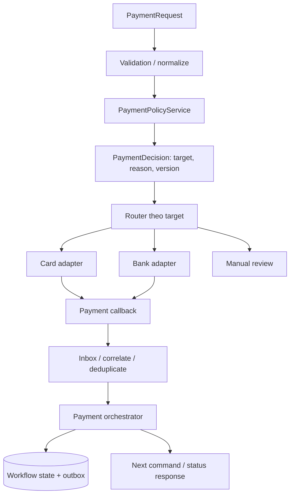

# Đặt logic nghiệp vụ trong expression

## 1. Bối cảnh và lỗi thường gặp

Trong **SPRING_INTEGRATION_PATTERN**, chúng ta học triển khai Enterprise Integration Patterns với Spring Integration để tạo các luồng thông điệp ít phụ thuộc, dễ mở rộng và dễ kiểm thử. Các thành phần Router, Filter, Transformer, Splitter, Aggregator, Gateway, retry, error channel và correlation phối hợp xử lý các thông điệp đi qua nhiều nhánh. Spring Integration hỗ trợ **Spring Expression Language (SpEL)** để mô tả một số thao tác ngắn gọn ngay trong cấu hình luồng.

Ví dụ, một Router chỉ cần đọc header `paymentProvider` để chuyển message sang adapter tương ứng:

```java
.route("headers['paymentProvider']", r -> r
        .channelMapping("CARD", "cardRequests")
        .channelMapping("BANK", "bankRequests")
        .defaultOutputChannel("unsupportedProviderRequests"))
```

Đây là cách dùng expression phù hợp: đọc một thuộc tính có ý nghĩa rõ ràng và quyết định **điểm đến kỹ thuật** của message. Vấn đề bắt đầu khi expression dần trở thành nơi kiểm tra hạn mức tín dụng, quyết định trạng thái đơn hàng, ghi database, gọi cổng thanh toán, hoàn tiền hoặc tự điều phối retry. Khi đó, một dòng SpEL có thể che giấu cả quy trình nghiệp vụ mà không thể kiểm thử, giao dịch và theo dõi một cách rõ ràng.

**Lỗi được phân tích trong bài:** đưa những quyết định hoặc tác động nghiệp vụ quan trọng vào expression của Router, Filter, Transformer, Header Enricher, Service Activator hay các điểm cấu hình tương tự, thay vì đặt chúng vào các lớp ứng dụng/miền có hợp đồng và khả năng kiểm thử độc lập.

### Mục tiêu học tập

Sau bài này, bạn có thể:

1. Nhận biết expression nào chỉ xử lý dữ liệu thông điệp, expression nào đang giấu logic nghiệp vụ.
2. Giải thích rủi ro khi một SpEL expression gọi bean có side effect, tự cập nhật trạng thái hoặc điều khiển retry.
3. Chuyển chính sách nghiệp vụ thành Java service có kiểu dữ liệu, lỗi và test rõ ràng.
4. Dùng expression cho việc định tuyến/biến đổi đơn giản, kết hợp Service Activator, Router và Gateway đúng vai trò.
5. Thiết kế correlation, idempotency, xử lý lỗi, logging và kiểm thử cho quy trình chứa nhiều bước bất đồng bộ.

## 2. Expression có vai trò gì trong Spring Integration?

Spring Integration cho phép sử dụng SpEL ở nhiều thành phần. Tùy endpoint và phiên bản thư viện, expression có thể đọc `payload`, `headers`, gọi method hoặc tham chiếu bean thông qua `@beanName`. Trong những trường hợp thích hợp, expression giúp giảm mã Java dành riêng cho thao tác cấu hình đơn giản.

| Thành phần | Ví dụ expression ngắn | Mục đích hợp lý |
| --- | --- | --- |
| Router | `headers['paymentProvider']` | Đọc khóa định tuyến, map sang channel. |
| Filter | `payload.amountMinor > 0` | Kiểm tra một điều kiện dữ liệu đơn giản tại biên, nếu discard/error contract rõ ràng. |
| Transformer | `payload.trim()` | Chuẩn hóa giá trị đơn giản, không thay đổi trạng thái nghiệp vụ. |
| Header Enricher | `payload.commandId` | Gắn header correlation từ một giá trị đã xác thực. |
| Service Activator có expression | `@formatter.format(payload)` | Gọi hàm format thuần, nhỏ và có hợp đồng rõ, nếu kiểu kết quả được kiểm soát. |

**SpEL không bị cấm trong luồng tích hợp.** Điều cần tránh là **trách nhiệm nghiệp vụ vượt quá khả năng mô tả và quản lý** của một biểu thức nhúng trong cấu hình.

### 2.1. Phân biệt ba tầng quyết định

| Tầng | Câu hỏi chính | Nơi nên thực hiện |
| --- | --- | --- |
| Thao tác dữ liệu/kỹ thuật | Header nào mang loại sự kiện? Message cần đi channel nào? | Router/Filter/Transformer; expression ngắn có thể đủ. |
| Chính sách nghiệp vụ | Đơn hàng có được phê duyệt? Khách hàng có đủ điều kiện? | Domain policy hoặc application service, kết quả có kiểu và có test. |
| Điều phối quy trình | Sau khi thanh toán thành công cần bước nào? Lỗi vận chuyển có hoàn tiền không? | Application orchestrator, state machine hoặc workflow bền vững khi cần. |

Một biểu thức chỉ đọc dữ liệu vẫn có thể chứa **quy tắc nghiệp vụ**. Ví dụ, `payload.amountMinor > 10000000 && payload.customerTier == 'VIP'` dùng để quyết định **tự động duyệt tín dụng** là chính sách nghiệp vụ cần được đặt tên, kiểm thử, phiên bản hóa và audit. Không phải cứ không ghi database thì logic đó đã phù hợp để nhét vào SpEL.

## 3. Ví dụ anti-pattern: một biểu thức nhỏ che giấu side effect lớn

Giả sử team muốn route yêu cầu thanh toán sang bước tạo vận đơn nếu cổng thanh toán báo thành công. Họ cấu hình một expression như sau:

```spel
@paymentClient.charge(payload.commandId, payload.amountMinor)
    ? 'shippingRequests'
    : 'paymentFailed'
```

Đây là **phản ví dụ**, không phải mẫu cấu hình nên sử dụng. Expression gọi `paymentClient.charge(...)`, nghĩa là việc **chọn channel** đồng thời kích hoạt một giao dịch tiền thật ở dịch vụ khác.

Vấn đề xuất hiện khi:

- Endpoint được gọi lại sau retry/redelivery; thao tác charge có thể bị lặp.
- Cổng thanh toán đã charge nhưng kết nối bị timeout; expression có thể ném lỗi mà không biết kết quả thực sự.
- Message đi tới `shippingRequests` nhưng downstream lỗi; rollback transaction nội bộ không hoàn tác giao dịch tại đối tác.
- Đội ngũ khó phân biệt lỗi **định tuyến** với lỗi **thanh toán** vì cả hai xảy ra trong quá trình đánh giá expression.
- Chính sách cho phép charge, hạn mức, yêu cầu phê duyệt và bù trừ không có tên/hợp đồng độc lập.

Một biểu thức khác không trực tiếp gọi dịch vụ ngoài nhưng vẫn chứa chính sách ẩn:

```spel
payload.riskScore < 40
  && payload.amountMinor <= 5000000
  && headers['customerTier'] == 'GOLD'
    ? 'autoApprove'
    : 'manualReview'
```

Nếu các ngưỡng trên quyết định **phê duyệt giao dịch**, chúng cần được biểu đạt như một chính sách nghiệp vụ có version, có test ở giá trị biên và có dấu vết giải thích. Nếu chỉ là phân tuyến sau khi một thành phần đã tạo `ApprovalDecision`, Router có thể route dựa trên `decision.status`, không cần biết cách chính sách tính kết quả.

### 3.1. Anti-pattern khác: expression quá dài và khó đọc

```spel
payload != null
  && payload.customer != null
  && payload.customer.active
  && payload.items != null
  && payload.items.size() > 0
  && payload.totalMinor > 0
  && headers['region'] != null
  && @creditPolicy.isAllowed(payload.customer.id, payload.totalMinor)
  && @promotionService.consumeVoucher(payload.voucherCode)
```

Ở đây kiểm tra cấu trúc thông điệp, quy tắc tín dụng và tiêu thụ voucher đã bị trộn thành một điều kiện Filter. Nếu một nhánh trả `false`, bạn khó biết lý do: dữ liệu thiếu, khách hàng không đủ điều kiện hay voucher hết lượt? Với `consumeVoucher()`, một predicate còn có **side effect**: message có thể bị chặn sau khi voucher đã được sử dụng.

Trong một Filter, hãy xác định rõ message bị loại là **dữ liệu không hợp lệ**, **từ chối nghiệp vụ** hay **lỗi hệ thống**. Ba kết quả đó không nhất thiết cùng đi một nhánh discard.

## 4. Những hậu quả khó thấy khi logic nghiệp vụ nằm trong SpEL

### 4.1. Không còn ranh giới transaction rõ ràng

SpEL có thể gọi method trên bean, nhưng việc một method xuất hiện trong expression không tự tạo ra một transaction nghiệp vụ đầy đủ. Nếu method đó gọi dịch vụ ngoài, commit database và publish message, bạn phải xét riêng transaction boundary của từng bước. Exception trong Router hoặc Filter **không tự rollback** những thao tác đã thành công ở hệ thống khác.

### 4.2. Retry có thể lặp side effect

Một Retry Advice thường thực thi lại handler khi handler ném lỗi. Nếu handler đánh giá lại expression chứa `charge()`, `reserve()`, `sendEmail()` hoặc `consumeVoucher()`, mỗi lần retry có thể thực hiện lại những thao tác đó. Cần idempotency key, trạng thái của lệnh và chính sách retry phù hợp với từng loại lỗi.

### 4.3. Lỗi biểu thức trở thành lỗi runtime của luồng

Expression được đánh giá khi message đi qua endpoint, nên những vấn đề như property không tồn tại, giá trị `null`, kiểu không tương thích hoặc bean không có trong context có thể chỉ lộ ra với dữ liệu cụ thể. Spring Integration có thể bọc các lỗi đánh giá trong các exception của hệ thống messaging. Với `DirectChannel` đồng bộ, lỗi thường lan về bên gửi; với executor, poller hoặc listener bất đồng bộ, cần xem `errorChannel`/error flow tương ứng.

### 4.4. Kiểm thử khó và ít ý nghĩa

Nếu chính sách phê duyệt chỉ là chuỗi SpEL trong cấu hình, muốn kiểm tra mọi ngưỡng và trường hợp ngoại lệ có thể phải khởi tạo Spring context, message headers, endpoint và bean liên quan. Một Java service thuần cho phép kiểm tra chính sách độc lập, không cần khởi chạy integration flow.

### 4.5. Dữ liệu quan sát không giải thích được quyết định

Log “routed to manualReview” chưa nói vì sao giao dịch bị đưa vào kiểm tra. Nên tạo một kết quả có kiểu, chứa `decisionId`, `reasonCode` và `policyVersion`, rồi cho Router dựa trên kết quả ấy. Như vậy có thể audit, tra cứu và phân tích thay đổi chính sách theo thời gian.

### 4.6. Khó quản lý thay đổi và review

Expression dễ bị viết thành những chuỗi dài trong annotation, XML, properties hoặc Java DSL. Khi thay đổi một ngưỡng, reviewer có thể khó nhận thấy quy tắc miền nào bị ảnh hưởng. Sửa expression trong cấu hình runtime cũng cần quy trình kiểm thử và phát hành tương ứng với mức độ rủi ro nghiệp vụ.

### 4.7. Nguy cơ khi expression đến từ đầu vào không tin cậy

SpEL có khả năng truy cập thuộc tính và gọi method tùy evaluation context. Không được coi **một chuỗi expression do người dùng gửi đến** là dữ liệu thông thường rồi đem đánh giá trực tiếp trong context có quyền truy cập bean/service. Nếu có nhu cầu cấu hình quy tắc động, hãy dùng tập phép toán được giới hạn, validation, allowlist và sandbox/evaluation context phù hợp; không cho payload của message tự trở thành đoạn chương trình SpEL.

## 5. Kiến trúc đề xuất: “quyết định” có tên, “định tuyến” đơn giản

Một hướng thiết kế dễ kiểm thử là biến quyết định nghiệp vụ thành **giá trị dữ liệu có kiểu**, rồi để Router chỉ chọn nhánh dựa trên giá trị đó.



Những trách nhiệm chính:

1. **Validation** xác nhận dữ liệu đầu vào đủ và đúng kiểu; lỗi dữ liệu cần phản hồi rõ ràng.
2. **Policy service** trả `PaymentDecision`, có thể kèm lý do và phiên bản chính sách; phương thức quyết định nên thuần khi phù hợp.
3. **Router** chỉ ánh xạ `decision.target` sang một channel định sẵn.
4. **Adapter** giao tiếp với cổng thanh toán, kiểm soát timeout và retry kỹ thuật.
5. **Orchestrator** ghi trạng thái, chống trùng, quyết định lệnh kế tiếp và bù trừ dựa trên các sự kiện nghiệp vụ.

Tùy độ phức tạp, application service có thể gộp một vài bước ở trên. Mục tiêu là **nêu rõ nơi nào chịu trách nhiệm cho một quyết định**, không phải tạo thật nhiều lớp chỉ để tăng số lượng interface.

## 6. Ví dụ Java: tách chính sách khỏi Router

Ví dụ sau minh họa một quy tắc đơn giản để chọn nhánh thanh toán. Nó không thực hiện charge ngay khi route; kết quả quyết định được biểu diễn bằng kiểu dữ liệu và có mã lý do để kiểm tra.

### 6.1. Kiểu dữ liệu của yêu cầu và kết quả

```java
public enum PaymentRoute {
    CARD,
    BANK,
    MANUAL_REVIEW
}

public record PaymentRequest(
        String commandId,
        String orderId,
        long amountMinor,
        String paymentProvider,
        boolean requiresReview) {
}

public record PaymentDecision(
        String commandId,
        String orderId,
        PaymentRoute target,
        String reasonCode,
        String policyVersion) {
}
```

`commandId` xác định một lần xử lý lệnh, có thể được dùng để correlate ACK; `orderId` là danh tính nghiệp vụ. `reasonCode` giải thích nguyên nhân chọn nhánh; `policyVersion` hỗ trợ audit khi quy tắc thay đổi.

### 6.2. Policy service: thuần, dễ kiểm thử

```java
import java.util.Locale;
import org.springframework.stereotype.Service;

@Service
public class PaymentPolicyService {

    public PaymentDecision decide(PaymentRequest request) {
        if (request == null
                || request.commandId() == null || request.commandId().isBlank()
                || request.orderId() == null || request.orderId().isBlank()
                || request.amountMinor() <= 0) {
            throw new IllegalArgumentException("PaymentRequest không hợp lệ");
        }

        if (request.requiresReview()) {
            return decision(request, PaymentRoute.MANUAL_REVIEW, "REQUIRES_REVIEW");
        }

        String provider = request.paymentProvider();
        if (provider == null || provider.isBlank()) {
            return decision(request, PaymentRoute.MANUAL_REVIEW, "MISSING_PROVIDER");
        }

        return switch (provider.toUpperCase(Locale.ROOT)) {
            case "CARD" -> decision(request, PaymentRoute.CARD, "CARD_SELECTED");
            case "BANK" -> decision(request, PaymentRoute.BANK, "BANK_SELECTED");
            default -> decision(request, PaymentRoute.MANUAL_REVIEW, "UNSUPPORTED_PROVIDER");
        };
    }

    private PaymentDecision decision(PaymentRequest request,
                                      PaymentRoute target,
                                      String reason) {
        return new PaymentDecision(
                request.commandId(), request.orderId(), target, reason, "v1");
    }
}
```

Trong bài thực hành, `MANUAL_REVIEW` là nhánh xử lý chính thức của ví dụ; trong sản phẩm thật, thiếu provider có thể cần bị từ chối ngay tại validation tùy hợp đồng API. Quy tắc trên vẫn có chủ đích minh họa là **thuần**: gọi `decide()` không ghi database hay gọi cổng thanh toán.

### 6.3. Service Activator tạo quyết định, Router chỉ chuyển channel

```java
import org.springframework.integration.annotation.Router;
import org.springframework.integration.annotation.ServiceActivator;
import org.springframework.stereotype.Component;

@Component
public class PaymentDecisionEndpoint {
    private final PaymentPolicyService policy;

    public PaymentDecisionEndpoint(PaymentPolicyService policy) {
        this.policy = policy;
    }

    @ServiceActivator(
            inputChannel = "incomingPaymentCommands",
            outputChannel = "paymentDecisions")
    public PaymentDecision classify(PaymentRequest request) {
        return policy.decide(request);
    }
}

@Component
public class PaymentDispatchRouter {
    @Router(inputChannel = "paymentDecisions")
    public String route(PaymentDecision decision) {
        return switch (decision.target()) {
            case CARD -> "cardPaymentRequests";
            case BANK -> "bankPaymentRequests";
            case MANUAL_REVIEW -> "manualReviewRequests";
        };
    }
}
```

Các tên `incomingPaymentCommands`, `paymentDecisions`, `cardPaymentRequests`, `bankPaymentRequests` và `manualReviewRequests` là **channel được ứng dụng phải khai báo/nối với consumer tương ứng**. Đây là ví dụ hai endpoint độc lập, không phải toàn bộ cấu hình chạy được nếu chưa tạo channel, các adapter và Spring context. Có thể sử dụng `DirectChannel` cho đoạn đồng bộ hoặc loại channel khác theo yêu cầu thực tế.

Mỗi endpoint có nhiệm vụ kiểm chứng được: policy chọn `PaymentDecision` theo quy tắc, Router map `PaymentRoute` sang channel, adapter mới thực thi lời gọi đến nhà cung cấp. Nếu cần ghi trạng thái đã chọn hoặc phát hành lệnh, application orchestrator quản lý transaction/outbox trong bước được định nghĩa rõ.

## 7. Ví dụ Spring Integration DSL: giữ expression ở mức kỹ thuật

Trong một flow chỉ cần chọn adapter theo header đã được **xác thực và chuẩn hóa**, SpEL vẫn là cách cấu hình gọn:

```java
import org.springframework.context.annotation.Bean;
import org.springframework.context.annotation.Configuration;
import org.springframework.integration.config.EnableIntegration;
import org.springframework.integration.dsl.IntegrationFlow;

@Configuration
@EnableIntegration
public class TechnicalRoutingFlow {

    @Bean
    public IntegrationFlow paymentProviderRouting() {
        return IntegrationFlow.from("validatedPayments")
                .route("headers['paymentProvider']", r -> r
                        .channelMapping("CARD", "cardRequests")
                        .channelMapping("BANK", "bankRequests")
                        .defaultOutputChannel("unsupportedProviderRequests"))
                .get();
    }
}
```

Đây là trường hợp SpEL hữu ích: expression chỉ **đọc header để tính routing key**. Không có `@paymentClient.charge()`, không ghi trạng thái và không quyết định nghiệp vụ “thanh toán đã thành công”.

**Lưu ý khi triển khai:** các channel đích cần tồn tại và có subscriber/consumer. Nếu dùng `DirectChannel` nhưng không có subscriber, việc gửi có thể thất bại; nếu route key không được hỗ trợ, nhánh mặc định phải được xử lý có chủ đích. Ứng dụng nên định nghĩa danh sách provider được cho phép thay vì lấy tên channel tùy ý từ input bên ngoài.

### 7.1. Khi nào SpEL dài hơn vài dòng vẫn chấp nhận được?

Không có giới hạn số ký tự tuyệt đối. Một expression có nhiều phép đọc null-safe nhưng chỉ tính một routing key **ổn định, không có side effect**, được kiểm thử rõ và dễ đọc, có thể vẫn hợp lý. Nhưng khi tên biểu thức không còn nói được mục đích, khi luật nghiệp vụ thay đổi thường xuyên hoặc khi cần ghi lý do quyết định, hãy tách nó thành hàm Java có tên.

Ví dụ, thay vì nhét biểu thức chấm điểm rủi ro dài vào Router:

```text
Policy service:
  evaluateRisk(payment) -> RiskDecision(reason, policyVersion, routeTarget)

Router:
  route(decision.routeTarget) -> manualReviewRequests | cardPaymentRequests
```

Như vậy thêm tiêu chí chấm điểm không bắt Router, kênh vận chuyển hay cổng thanh toán phải biết chi tiết chính sách.

## 8. Validation, Filter và từ chối nghiệp vụ

Một điểm gây nhầm lẫn là dùng `Filter` với SpEL để loại thông điệp theo một điều kiện mà thực ra là **quyết định từ chối nghiệp vụ**.

Giả sử Filter chứa:

```spel
payload.amountMinor <= 10000000 && payload.customerRank != 'BLOCKED'
```

Nếu `false`, message có thể bị discard hoặc không sinh reply, tùy cấu hình. Nhưng với ứng dụng thanh toán, “bị từ chối” thường phải được ghi trạng thái, trả reason code và phát event để caller biết nguyên nhân. Chỉ bỏ message ở Filter có thể khiến client phải chờ Gateway timeout mà không biết giao dịch bị từ chối hay message đã mất.

Nên tách:

- **Validation kỹ thuật**: payload thiếu trường bắt buộc, sai schema hoặc kiểu; trả lỗi nhập liệu có cấu trúc.
- **Chính sách nghiệp vụ**: hạn mức, blacklist, điều kiện phê duyệt; tạo `Approved`/`Rejected`/`ManualReview` cùng lý do.
- **Routing**: chuyển message có kết quả rõ ràng đến handler hoặc channel tương ứng.

Một Filter vẫn hợp lý để bỏ các event không quan tâm (ví dụ heartbeat khi pipeline chỉ cần business event), miễn là việc discard **được xác định trước** và không làm mất giao dịch quan trọng.

## 9. Trạng thái nghiệp vụ, retry và correlation ở luồng bất đồng bộ

Expression thuần giúp luồng dễ hiểu hơn, nhưng bản thân nó không giải quyết các vấn đề reliability. Một quy trình gồm nhiều bước nên có hợp đồng về:

| Khái niệm | Mục đích | Ví dụ |
| --- | --- | --- |
| `commandId` | Định danh lệnh/attempt cần theo dõi | `pay-cmd-002` |
| `correlationId` | Ghép callback/ACK với request hoặc nhóm message | Thường bằng `commandId` ở bước thanh toán. |
| `eventId` | Phát hiện event giao lại/trùng | `ack-event-918` |
| `idempotencyKey` | Tránh side effect lặp khi retry/redelivery | `charge-order-42` |
| `policyVersion` | Giải thích phiên bản luật đã tạo quyết định | `risk-v3` |
| `workflowState` | Biết bước hiện tại, deadline và khả năng phục hồi | `PAYMENT_PENDING`, `PAID`, `UNKNOWN`. |

### 9.1. Không đưa retry trực tiếp vào expression

Không nên dùng SpEL gọi một method tự thử lại nhiều lần, ngủ chờ hoặc đệ quy. Retry thuộc ranh giới gọi adapter, có giới hạn, phân loại lỗi và idempotency. Khi provider timeout, giao dịch có thể đã hoàn thành; retry vô điều kiện có thể gây trùng thao tác.

### 9.2. Không cập nhật trạng thái trong predicate

Một method dùng trong expression để trả boolean nhưng đồng thời thay đổi database là khó đoán. Nếu bước tiếp theo không chạy, dữ liệu đã đổi. Thay vào đó, orchestrator thực hiện transition có điều kiện trong transaction và phát command/outbox event sau khi đã có quyết định.

Ví dụ minh họa ý tưởng cập nhật nguyên tử:

```sql
UPDATE payment_process
SET state = 'AUTHORIZED',
    updated_at = CURRENT_TIMESTAMP,
    version = version + 1
WHERE command_id = :commandId
  AND state = 'PAYMENT_PENDING';
```

Sau `UPDATE`, ứng dụng **kiểm tra số dòng bị ảnh hưởng**. Nếu bằng 0, cần xác định ACK trùng, ACK tới sai trạng thái, timeout đã xử lý hoặc lệnh không tồn tại. Đừng phát lệnh giao hàng chỉ vì message mang chữ `AUTHORIZED` nếu transition chưa hợp lệ.

### 9.3. ACK có correlation đúng không đồng nghĩa nghiệp vụ thành công

Một Barrier có thể giải phóng request khi nhận trigger đúng `correlationId` dù payload là `PaymentRejected`. Router và expression chỉ chuyển dữ liệu; service nghiệp vụ mới giải thích kết quả và cập nhật trạng thái. Nếu workflow kéo dài hoặc phải phục hồi sau restart, cần durable state, inbox/outbox và cơ chế đối soát; Thread Barrier không tự lưu thread chờ bền vững.

## 10. Xử lý lỗi expression và lỗi nghiệp vụ đúng chỗ

Có thể dùng một bảng phân loại trước khi quyết định nơi bắt lỗi:

| Dấu hiệu | Bản chất | Nơi xử lý gợi ý |
| --- | --- | --- |
| SpEL đọc thuộc tính không tồn tại hoặc kiểu sai | Lỗi mapping/configuration hoặc dữ liệu đầu vào chưa được chuẩn hóa | Validation/Transformer, sửa cấu hình; ghi lỗi kỹ thuật. |
| Router không resolve được channel | Lỗi định tuyến kỹ thuật | Nhánh unsupported/error flow, kiểm tra mapping và channel. |
| Payment policy từ chối giao dịch | Kết quả nghiệp vụ hợp lệ | Domain/application service tạo `Rejected` và reason code. |
| Payment adapter mất kết nối | Lỗi kỹ thuật có thể hồi phục | Retry advice có giới hạn; ghi trace/correlation. |
| Gateway hết hạn chờ reply | Chưa nhận reply trong deadline | Trả trạng thái chưa xác nhận, đối soát khi cần. |
| Callback trùng | Redelivery bình thường trong nhiều giao thức | Inbox/idempotency, không làm side effect hai lần. |
| Thanh toán xong nhưng shipping thất bại | Lỗi workflow đa bước | Orchestrator xử lý retry/compensation, không đổi expression Router. |

Với các channel đồng bộ như `DirectChannel`, exception có thể quay về caller. Với `ExecutorChannel`, QueueChannel poller hoặc inbound adapter, exception xuất hiện ở thread khác, nên cấu hình error flow hoặc `errorChannel` đúng điểm vào. Không giả định mọi lỗi sẽ thành một exception đồng bộ ở Gateway.

Hạn chế bắt tất cả exception trong expression và biến thành `false`: việc đó khiến lỗi hệ thống trông giống “không đạt điều kiện nghiệp vụ”. Nếu fallback là cần thiết, hãy nêu rõ loại lỗi, retryability và trạng thái của request sau fallback.

## 11. Kiểm thử từng lớp: expression, policy, route và orchestration

Khi chính sách nằm trong Java service, có thể kiểm thử nhanh mà không cần khởi động Spring context cho mọi trường hợp.

### 11.1. Unit test cho chính sách

Ví dụ với `PaymentPolicyService` ở mục 6:

```java
import static org.junit.jupiter.api.Assertions.*;
import org.junit.jupiter.api.Test;

class PaymentPolicyServiceTest {
    private final PaymentPolicyService policy = new PaymentPolicyService();

    @Test
    void cardGoesToCardAdapterWithReason() {
        PaymentDecision decision = policy.decide(
                new PaymentRequest("cmd-1", "order-1", 200_000L, "CARD", false));

        assertEquals(PaymentRoute.CARD, decision.target());
        assertEquals("CARD_SELECTED", decision.reasonCode());
        assertEquals("v1", decision.policyVersion());
    }

    @Test
    void flaggedPaymentNeedsManualReviewEvenForKnownProvider() {
        PaymentDecision decision = policy.decide(
                new PaymentRequest("cmd-2", "order-2", 200_000L, "CARD", true));

        assertEquals(PaymentRoute.MANUAL_REVIEW, decision.target());
        assertEquals("REQUIRES_REVIEW", decision.reasonCode());
    }

    @Test
    void invalidRequestIsExplicitlyRejectedByValidation() {
        assertThrows(IllegalArgumentException.class,
                () -> policy.decide(
                        new PaymentRequest("cmd-3", "order-3", 0L, "BANK", false)));
    }
}
```

Những test này kiểm tra **kết quả nghiệp vụ** trực tiếp. Chúng không cần broker, Router, database hay Gateway để xác nhận policy.

### 11.2. Unit test cho Router

```java
import static org.junit.jupiter.api.Assertions.assertEquals;
import org.junit.jupiter.api.Test;

class PaymentDispatchRouterTest {
    private final PaymentDispatchRouter router = new PaymentDispatchRouter();

    @Test
    void routesOnlyByDecisionTarget() {
        assertEquals("cardPaymentRequests", router.route(
                new PaymentDecision("c1", "o1", PaymentRoute.CARD, "CARD_SELECTED", "v1")));
        assertEquals("manualReviewRequests", router.route(
                new PaymentDecision("c2", "o2", PaymentRoute.MANUAL_REVIEW, "REQUIRES_REVIEW", "v1")));
    }
}
```

Đối với SpEL đơn giản, một integration test có thể gửi message với header `paymentProvider=CARD/BANK/UNKNOWN` và xác nhận Router DSL đưa message vào đúng channel. Bổ sung trường hợp thiếu header, null payload, channel chưa có subscriber và exception ở adapter để thấy rõ nhánh lỗi thực tế.

### 11.3. Test cho orchestration và vận hành

| Tình huống | Điều cần khẳng định |
| --- | --- |
| Hai lần gọi policy cùng input | Cùng decision/reason; không tạo side effect ẩn. |
| Giá trị biên của luật nghiệp vụ | Quyết định và reason code đúng tại ngưỡng. |
| Provider lạ/thiếu header | Route vào nhánh unsupported hoặc lỗi rõ, không mất message âm thầm. |
| Lỗi đánh giá expression kỹ thuật | Error flow quan sát được; không nhầm thành “payment rejected”. |
| Callback ACK trùng `eventId` | Database không cập nhật và không phát next command hai lần. |
| Timeout sau khi đã gửi lệnh tới provider | Trạng thái chưa rõ được ghi nhận, có cách đối soát. |
| Restart lúc workflow đang chờ | State bền vững cho phép tiếp tục; không phụ thuộc expression hay thread cũ. |
| Lỗi adapter sau khi policy ra quyết định | Tách được bản ghi policy decision và lỗi gửi command. |

Test các phép tính nghiệp vụ trong lớp Java thuần, các điểm chuyển trạng thái với repository/transaction phù hợp và luồng routing bằng Spring Integration Test. Không cần mock mọi endpoint để thử một điều kiện nhỏ; ngược lại, không nên chỉ unit test policy rồi bỏ qua khả năng message mất header khi đi qua nhiều adapter.

## 12. Quan sát được lý do nghiệp vụ, không chỉ kết quả SpEL

Một luồng chuẩn nên log **quyết định** và **việc định tuyến** thành hai sự kiện riêng. Ví dụ:

```text
event=policy_evaluated commandId=cmd-2 policy=v1 decision=MANUAL_REVIEW reason=REQUIRES_REVIEW
event=message_routed  commandId=cmd-2 source=paymentDecisions target=manualReviewRequests
event=provider_called  commandId=cmd-1 provider=CARD
event=provider_result  commandId=cmd-1 result=AUTHORIZED
event=state_changed    commandId=cmd-1 from=PAYMENT_PENDING to=AUTHORIZED
```

Đây là các log mẫu ứng dụng cần tự phát, không phải định dạng log mặc định của Spring Integration. Không ghi số thẻ, token hoặc PII nhạy cảm; tránh dùng `commandId` làm nhãn metric có cardinality cao.

Nên theo dõi tỷ lệ `MANUAL_REVIEW`, các `reasonCode` phổ biến, tỷ lệ expression evaluation error, thiếu header, channel không có subscriber, thời gian thực thi policy, timeout từ provider, callback trùng và backlog của workflow. Nếu expression phức tạp bất thường, có thể đo thêm độ trễ xử lý và phân bố exception tại endpoint ấy trước khi refactor.

## 13. Quy trình refactor expression nghiệp vụ đang tồn tại

Khi phát hiện một expression quá tải, có thể xử lý theo thứ tự sau:

1. **Liệt kê các expression** gắn với Router, Filter, Transformer, Enricher và Service Activator trong phạm vi flow đang xem xét.
2. **Phân loại từng thao tác**: đọc dữ liệu, tính routing key, policy nghiệp vụ, gọi dịch vụ ngoài, ghi trạng thái, retry, tạo sự kiện.
3. **Ghi nhận hợp đồng hiện tại** với input/output, kết quả khi `null`, exception, timeout và retry. Viết test bảo vệ những hành vi quan trọng trước khi sửa.
4. **Tách các side effect** sang adapter/application service có method tên rõ, policy retry và idempotency.
5. **Tách policy** thành phương thức Java trả decision có kiểu; thêm `reasonCode`/`policyVersion` nếu cần audit.
6. **Giữ expression ngắn** cho mục tiêu integration: đọc header, map tới channel, chuyển đổi trường dữ liệu rõ ràng.
7. **Chuẩn hóa message contract**: header correlation, event ID, command ID, dữ liệu cần cho downstream và cách chuyển exception.
8. **Kiểm tra nhánh lỗi và dữ liệu trùng** bằng integration test, sau đó so sánh metrics trước/sau khi triển khai.

**Dấu hiệu refactor thành công:** thay đổi hạn mức phê duyệt chỉ sửa/test policy; thêm provider mới chủ yếu thêm adapter và mapping; thay đổi quy tắc bù trừ chỉ sửa orchestration; lỗi kỹ thuật tại channel không bị ghi thành quyết định “từ chối nghiệp vụ”.

## 14. Bài thực hành: tách quy tắc phê duyệt khỏi expression

Cho hệ thống bán hàng dùng một Filter SpEL để tự động duyệt thanh toán nếu giá trị đơn dưới một ngưỡng, khách hàng đạt cấp `GOLD` và không có dấu hiệu gian lận. Hiện tại Filter còn gọi bean `@promotionService.consumeVoucher(...)` ngay trong điều kiện. Hãy:

1. Chỉ ra các phần nào là kiểm tra cấu trúc dữ liệu, phần nào là chính sách nghiệp vụ và phần nào là side effect cần transaction/idempotency.
2. Định nghĩa `ApprovalDecision` có `status`, `reasonCode` và `policyVersion`; viết `ApprovalPolicyService.evaluate()` không gọi database hoặc hệ thống ngoài.
3. Tạo một endpoint chuyển request thành `ApprovalDecision`, rồi dùng Router đơn giản gửi đến `approvedRequests`, `manualReviewRequests` hoặc `rejectedRequests`.
4. Đưa việc giữ/tiêu thụ voucher sang application service với transaction và cách xử lý trùng rõ ràng. Nếu voucher đã tiêu thụ nhưng bước sau thất bại, xác định chính sách bù trừ.
5. Viết unit test ở các giá trị sát ngưỡng, thiếu thông tin khách hàng, bị chặn, voucher không hợp lệ và phiên bản quy tắc khác nhau.
6. Viết integration test kiểm tra các message đi vào đúng channel, đồng thời giữ nguyên `commandId`/`correlationId` qua các bước.
7. Mô phỏng lỗi adapter, retry/redelivery và callback trùng; kiểm chứng không giữ voucher hoặc phát lệnh hai lần.
8. Thêm log sự kiện `policy_evaluated` và `message_routed` riêng, đo cả kết quả nghiệp vụ lẫn lỗi kỹ thuật.

**Câu hỏi tự đánh giá**

- Vì sao một expression `@paymentClient.charge(payload)` trong Router có thể nguy hiểm dù cú pháp SpEL hợp lệ?
- Một expression đọc `headers['type']` và chọn channel có phải lúc nào cũng sai? Điều kiện để nó phù hợp là gì?
- Tại sao một Filter trả `false` không đủ để biểu diễn đầy đủ quyết định từ chối nghiệp vụ?
- Vì sao retry một handler có expression side effect cần có idempotency?
- Nếu client cần biết lý do `MANUAL_REVIEW`, nên lưu kết quả nào thay vì chỉ log tên channel?
- Khi expression throws exception trên thread bất đồng bộ, bạn sẽ tìm lỗi ở đâu và kiểm tra cấu hình nào?

## 15. Tài liệu tham khảo

- [Spring Integration Reference — Spring Expression Language (SpEL)](https://docs.spring.io/spring-integration/reference/spel.html): cơ chế dùng expression trong integration components và context khi đánh giá.
- [Spring Integration Reference — Router Implementations](https://docs.spring.io/spring-integration/reference/router/implementations.html): Router, key, mapping và Java DSL.
- [Spring Integration Reference — Filter](https://docs.spring.io/spring-integration/reference/filter.html): discard channel, ném exception và hành vi khi message không được chấp nhận.
- [Spring Integration Reference — Transformer](https://docs.spring.io/spring-integration/reference/transformer.html): chuyển đổi message và trách nhiệm của Transformer.
- [Spring Integration Reference — Error Handling](https://docs.spring.io/spring-integration/reference/error-handling.html): xử lý exception ở luồng đồng bộ và bất đồng bộ.
- [Spring Framework Reference — Spring Expression Language](https://docs.spring.io/spring-framework/reference/core/expressions.html): cú pháp SpEL, truy cập thuộc tính, method, bean và evaluation context.

> **Ghi nhớ:** Expression phù hợp để **diễn đạt thao tác kỹ thuật nhỏ, rõ và không có side effect**. Những quy tắc ảnh hưởng đến tiền, trạng thái đơn hàng, quyền phê duyệt, retry và bù trừ cần được đặt trong service hoặc workflow có tên, hợp đồng, kiểm thử và khả năng audit. Hãy để integration expression đọc và chuyển message; để code nghiệp vụ quyết định ý nghĩa của message.
