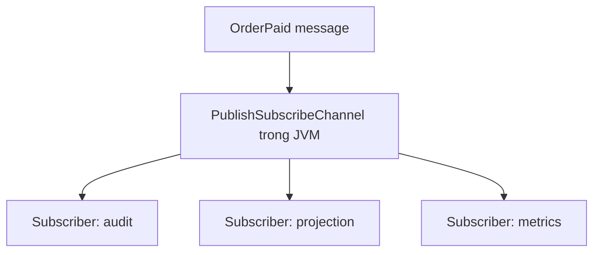
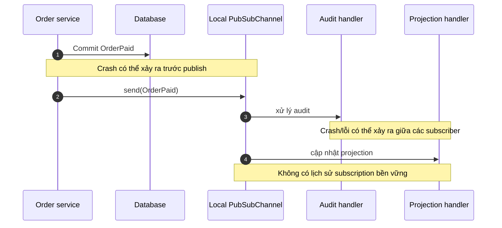
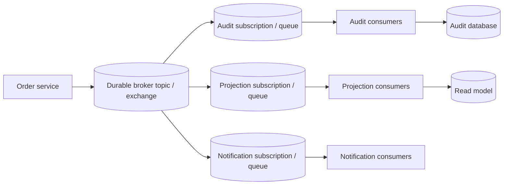
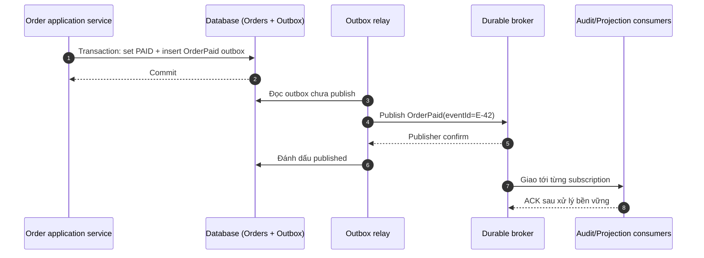
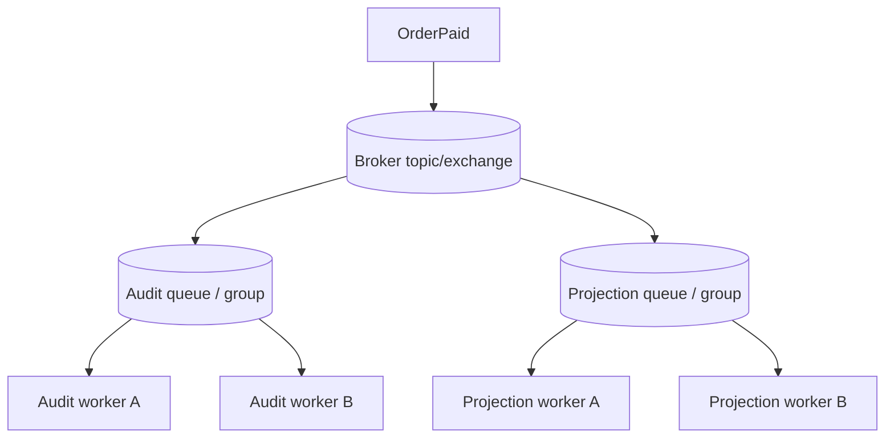

# Dùng publish-subscribe nhưng cần durable delivery

## 1. Vấn đề: broadcast thành công nhưng một subscriber đã bỏ lỡ sự kiện

Trong module **SPRING_INTEGRATION_PATTERN**, chúng ta triển khai *Enterprise Integration Patterns* với Spring Integration để xây dựng luồng thông điệp ít phụ thuộc, dễ mở rộng; thực hành Router, Filter, Transformer, Splitter, Aggregator, Gateway, retry, error channel, correlation và kiểm thử, quan sát các nhánh xử lý.

Một lỗi thường gặp là sử dụng **`PublishSubscribeChannel` trong bộ nhớ** để phân phối sự kiện cho nhiều nơi, rồi mặc nhiên kỳ vọng rằng mọi nơi sẽ nhận được sự kiện **kể cả khi ứng dụng hoặc consumer tạm ngừng**. Đây là sự nhầm lẫn giữa hai khái niệm:

- **Publish-subscribe** mô tả cách **phân phối một message cho nhiều subscriber**.
- **Durable delivery** mô tả việc **lưu và giao lại message theo một hợp đồng độ tin cậy** khi consumer không sẵn sàng, tiến trình restart hoặc có lỗi giữa đường.

Ví dụ, sau khi đơn hàng được thanh toán, hệ thống phát `OrderPaid` cho ba nhánh:

1. Ghi audit bắt buộc theo quy định.
2. Cập nhật projection phục vụ tra cứu trạng thái đơn hàng.
3. Cập nhật một metric nội bộ không quá quan trọng.

Nếu ba nhánh đều đăng ký với một `PublishSubscribeChannel` trong cùng JVM, sự kiện có thể đến đủ cả ba khi ứng dụng hoạt động bình thường. Tuy nhiên, khi process chết sau khi ghi trạng thái thanh toán và **trước khi phát message**, không có bản ghi bền vững nào trong channel để gửi lại. Nếu một subscriber lỗi sau khi subscriber khác đã xử lý, không có cơ chế mặc định nào bảo đảm **tự phát lại chính xác cho riêng subscriber bị lỗi** sau restart.

Với audit hoặc cập nhật nghiệp vụ bắt buộc, đó là một khoảng trống nghiêm trọng. Với metrics tạm thời, mất một số sự kiện có thể chấp nhận được. **Việc chọn channel phải xuất phát từ yêu cầu giao nhận của từng subscriber**.

### Mục tiêu bài học

Sau bài này, bạn có thể:

- Giải thích `PublishSubscribeChannel` có và không bảo đảm điều gì.
- Phân biệt fan-out trong tiến trình với các subscription/queue bền vững trên broker.
- Nhận diện các cửa sổ mất dữ liệu: trước publish, trong fan-out, sau nhận nhưng trước commit, khi restart.
- Thiết kế transactional outbox, durable subscription, acknowledgement, retry, DLQ và idempotency phù hợp.
- Kiểm thử crash/restart, redelivery, consumer chậm và các luồng xử lý lỗi.

## 2. PublishSubscribeChannel thực sự hoạt động như thế nào?

`PublishSubscribeChannel` là một `SubscribableChannel` của Spring Integration: nó **phát message đến các handler đã đăng ký** trong ứng dụng. Khi không cấu hình `Executor`, handler được gọi trên **thread gửi message**. Khi có `Executor`, việc dispatch có thể diễn ra trên các worker thread riêng. Việc thêm executor thay đổi mô hình chạy và cách quan sát exception; **nó không biến channel thành message broker có lưu trữ**.



Một số thuộc tính và hệ quả cần hiểu:

| Tính năng | Hành vi cần hiểu | Điều không được suy ra |
| --- | --- | --- |
| Fan-out | Một message được dispatch tới nhiều subscriber đăng ký tại thời điểm xử lý | Mỗi subscriber chắc chắn nhận lại message sau restart |
| Không có `Executor` | Dispatch thường chạy trên sender thread; exception downstream có thể lan tới sender | Các side effect của subscriber trước đó được tự rollback |
| Có `Executor` | Dispatch sử dụng executor; lỗi downstream được xử lý bởi `ErrorHandler` | Publisher biết mọi tác vụ xử lý đã commit |
| `errorChannel` | Với đường async và error handler mặc định, error message có thể được gửi vào error channel | Lỗi tự động được retry bền vững hoặc message tự vào DLQ |
| `setMinSubscribers(n)` | Giúp xác định ngưỡng subscriber tối thiểu để `send()` coi việc dispatch là thành công | Xác nhận subscriber đã lưu thành công dữ liệu nghiệp vụ |
| `setApplySequence(true)` | Gắn sequence/correlation headers phù hợp khi downstream cần Aggregator/Resequencer | Tạo durable subscription hoặc replay |

Chẳng hạn, một `send()` trả `true` chỉ diễn đạt kết quả của thao tác gửi theo hợp đồng channel; **không có nghĩa mọi subscriber đã ghi database thành công và có khả năng phục hồi**. Với dispatch bất đồng bộ, publisher thậm chí có thể kết thúc trước khi subscriber xử lý xong.

### 2.1. Message đến khi không có subscriber

Một channel publish-subscribe thông thường **không giữ lại message để chờ một subscriber đăng ký về sau**. Spring Integration có thể cấu hình cách phản ứng khi thiếu subscriber, chẳng hạn yêu cầu subscriber hoặc đặt ngưỡng tối thiểu; nhưng hành vi báo lỗi lúc gửi **không tương đương lưu message để phát lại**.

Lỗi thiết kế thường thấy là tin rằng một consumer tạm dừng triển khai rồi bật lại sẽ nhận được các event từng được phát khi nó chưa đăng ký. Điều này không đúng với một `PublishSubscribeChannel` thuần trong bộ nhớ.

### 2.2. Partial delivery giữa các subscriber

Giả sử audit đã ghi xong nhưng projection ném exception:

```text
Publisher ── OrderPaid #E-42 ──> PublishSubscribeChannel
                                  |-- audit:      ghi OK
                                  |-- projection: EXCEPTION
                                  |-- metrics:    có thể chưa chạy hoặc đã chạy
```

Với dispatch đồng bộ và các mặc định liên quan, exception có thể làm dừng quá trình và lan về caller; kết quả của từng subscriber phụ thuộc thứ tự dispatch và cấu hình. Với executor, các handler có thể chạy độc lập; lỗi cần được quan sát qua cơ chế async error handling. Trong cả hai trường hợp, **không có một transaction phân tán tự động bao trùm mọi subscriber**.

## 3. Thế nào là durable delivery?

Trước khi chọn công nghệ, hãy viết thành hợp đồng cụ thể:

- **Mục tiêu giao nhận:** cho phép mất message (*best effort*), tối đa một lần (*at most once*), hay **ít nhất một lần** (*at least once*)?
- **Phạm vi bền vững:** event phải còn sau khi publisher crash, broker restart, consumer tắt hay khi một deployment mới được triển khai?
- **Ai cần mỗi bản sao:** một consumer trong một nhóm xử lý, hay **mỗi loại nghiệp vụ** phải có bản sao riêng?
- **Khi nào xác nhận:** message được ACK/commit sau khi nhận, sau khi ghi DB, hay sau khi phát sự kiện tiếp theo?
- **Gửi lại:** ai giữ pending message, retry bao lâu, làm gì với message không xử lý được?
- **Thứ tự và độ trễ:** cần thứ tự theo aggregate (`orderId`), replay trong bao lâu, chấp nhận backlog lớn đến mức nào?

| Yêu cầu | Cơ chế thường phù hợp | Ghi chú |
| --- | --- | --- |
| Cập nhật metrics tạm thời trong cùng process | `PublishSubscribeChannel` | Best effort có thể đủ; xác định rõ khả năng mất dữ liệu. |
| Tạm lưu message để một consumer xử lý sau | `QueueChannel` + `MessageStore` bền vững, hoặc durable broker queue | Một message thường được một consumer lấy; chưa phải fan-out cho nhiều nhóm. |
| Mỗi nghiệp vụ độc lập đều cần nhận event | Broker topic/exchange + **subscription/queue riêng cho từng nghiệp vụ** | Phải cấu hình đúng durability, retention và acknowledgement. |
| Không được mất event giữa commit nghiệp vụ và publish | **Transactional outbox** | Lưu event trong cùng DB transaction với thay đổi nghiệp vụ. |
| Broker có thể redeliver; không được thực hiện tác động hai lần | **Inbox/idempotent consumer** | Deduplicate bằng `eventId` ổn định và cập nhật trạng thái nguyên tử. |
| Có nhiều bước, timeout, cần phục hồi sau restart | Workflow state + outbox/inbox + reconciler | Fan-out đơn thuần không thể lưu tiến độ của quy trình. |

Với hệ thống nghiệp vụ, mục tiêu thực tế phổ biến là **at least once + xử lý idempotent**. Đòi hỏi *exactly once* phải nói rõ **phạm vi bảo đảm**: ngay cả khi một broker hỗ trợ giao dịch nội bộ, các side effect ở HTTP service và database bên ngoài thường cần cơ chế deduplication/transaction bổ sung.

## 4. Bốn cửa sổ lỗi mà local publish-subscribe không giải quyết



| Cửa sổ lỗi | Hậu quả | Điều cần bổ sung nếu event là bắt buộc |
| --- | --- | --- |
| **1. DB commit, chưa publish** | Dữ liệu `PAID` đã lưu, event không tồn tại ở channel | Outbox ghi cùng transaction với thay đổi trạng thái |
| **2. Đang fan-out, process crash** | Một subscriber đã xử lý, subscriber khác chưa | Durable subscription riêng và redelivery |
| **3. Consumer nhận xong, chưa commit DB** | Nếu nguồn ACK quá sớm, event có thể bị xem là đã xử lý dù dữ liệu chưa lưu | ACK sau khi xử lý bền vững; transaction/inbox phù hợp |
| **4. Consumer commit xong, chưa ACK nguồn** | Broker có thể giao lại event, dẫn đến side effect trùng | Idempotent consumer / inbox theo event ID |

Chỉ đổi `DirectChannel` thành `PublishSubscribeChannel`, bật `Executor`, nâng `threadPoolSize` hoặc bật `setApplySequence(true)` không đóng được những cửa sổ này. Chúng thay đổi cách dispatch, không tự lưu được giao dịch liên quan tới một event nghiệp vụ.

### 4.1. Một điểm sai khác giữa “error” và “delivery”

`errorChannel` nhận thông tin lỗi khi flow xử lý thất bại ở những ngữ cảnh thích hợp; nó **không tự bảo đảm mọi bản tin gốc được lưu và giao lại**. Một log `ErrorMessage` giúp chẩn đoán, nhưng nếu business event bắt buộc vẫn cần cơ chế retry/DLQ, lưu trữ và phục hồi tương ứng.

## 5. Ví dụ Java: publish-subscribe trong JVM để thấy rõ ranh giới

Ví dụ sau đăng ký hai subscriber cho `PublishSubscribeChannel`. Chúng cập nhật bộ đếm trong bộ nhớ, phù hợp với demo hoặc telemetry không yêu cầu bền vững. Chúng **không** đại diện cho hệ thống audit nghiệp vụ đáng tin cậy.

```java
import java.util.concurrent.atomic.AtomicInteger;
import org.springframework.context.annotation.Bean;
import org.springframework.context.annotation.Configuration;
import org.springframework.integration.channel.PublishSubscribeChannel;
import org.springframework.integration.config.EnableIntegration;

@Configuration
@EnableIntegration
public class LocalPubSubConfig {

    @Bean
    public PublishSubscribeChannel localOrderEvents() {
        PublishSubscribeChannel channel = new PublishSubscribeChannel();
        channel.setMinSubscribers(1);
        // Không có Executor: subscriber chạy trên thread gửi.
        return channel;
    }

    @Bean
    public AtomicInteger localReceivedMetric() {
        return new AtomicInteger();
    }
}
```

```java
import java.util.concurrent.atomic.AtomicInteger;
import org.springframework.beans.factory.annotation.Qualifier;
import org.springframework.integration.annotation.ServiceActivator;
import org.springframework.stereotype.Component;

record OrderPaid(String eventId, String orderId, long amountMinor) {}

@Component
public class LocalOrderEventSubscribers {
    private final AtomicInteger metric;

    public LocalOrderEventSubscribers(
            @Qualifier("localReceivedMetric") AtomicInteger metric) {
        this.metric = metric;
    }

    @ServiceActivator(inputChannel = "localOrderEvents")
    public void countPaidOrders(OrderPaid event) {
        metric.incrementAndGet();
    }

    @ServiceActivator(inputChannel = "localOrderEvents")
    public void logOrderPaid(OrderPaid event) {
        System.out.println("Local event received: " + event.eventId());
    }
}
```

Như vậy có hai handler đăng ký với một channel. Khi một message được gửi tới `localOrderEvents` lúc cả hai handler đang hoạt động, cả hai có thể xử lý theo cách dispatch của channel. Không nên dùng `AtomicInteger` ở ví dụ để lưu số lượng đơn hàng đã thanh toán: restart sẽ đưa metric cục bộ về giá trị ban đầu.

Một message có thể được tạo và gửi như sau:

```java
import org.springframework.integration.support.MessageBuilder;
import org.springframework.messaging.Message;
import org.springframework.messaging.MessageChannel;

// Ví dụ: bean localOrderEvents được inject vào một service.
OrderPaid event = new OrderPaid("evt-42", "order-42", 125_000L);
Message<OrderPaid> message = MessageBuilder.withPayload(event).build();
boolean handedToChannel = localOrderEvents.send(message);

// handedToChannel không phải chứng nhận delivery bền vững.
```

Đoạn cuối minh họa một phương thức trong application service đã được inject biến `localOrderEvents` kiểu `MessageChannel`; bản thân đoạn mã cần đặt trong lớp/phương thức thích hợp. Các mã trên cho thấy **API đúng vai trò của local channel**, không minh họa broker persistence.

### 5.1. Nếu thêm Executor thì sao?

```java
import java.util.concurrent.Executor;
import org.springframework.context.annotation.Bean;
import org.springframework.integration.channel.PublishSubscribeChannel;

@Bean
public PublishSubscribeChannel asyncLocalOrderEvents(Executor eventExecutor) {
    return new PublishSubscribeChannel(eventExecutor);
}
```

Lúc này việc dispatch phụ thuộc executor; cấu hình lỗi downstream cần xem `ErrorHandler` và `errorChannel`. Với cấu hình mặc định của Spring Integration, khi có executor, `MessagePublishingErrorHandler` có thể gửi lỗi tới error channel từ header hoặc error channel toàn cục. Không có executor, lỗi handler được ném trực tiếp về sender thread; `ErrorHandler` của channel không tham gia.

**Đây vẫn là channel trong tiến trình**. Executor không làm các task đang chờ tự tiếp tục sau khi JVM crash và không lưu một bản sao message riêng cho mỗi subscriber đã ngừng hoạt động.

## 6. Fan-out bền vững: một bản sao cho mỗi nghiệp vụ bắt buộc

Nếu cả **audit** và **projection** đều phải có cơ hội xử lý từng `OrderPaid` kể cả khi consumer tạm dừng, topology cần thể hiện rõ từng subscription:



**Điểm cần ghi rõ trong thiết kế:** “ba subscriber độc lập” là **ba luồng nhận có vị trí lưu tiến độ riêng**. Việc tạo ba instance consumer nhưng dùng chung một queue/consumer group thường chỉ chia tải, không tạo ba bản sao sự kiện.

### 6.1. Ví dụ RabbitMQ/AMQP

Một thiết kế điển hình:

- Publisher gửi `OrderPaid` vào exchange theo routing key có quy ước.
- **Audit queue**, **projection queue**, **notification queue** là các queue bền vững riêng, bind tới exchange đúng routing key.
- Message cần cấu hình persistent delivery theo broker; publisher sử dụng confirm và, khi cần phát hiện không route được, cơ chế return/mandatory.
- Mỗi consumer ACK theo chính sách **sau khi** xử lý đủ bền vững; lỗi có giới hạn retry và đường DLQ/parking queue.

Chỉ đánh dấu queue “durable” mà gửi message không phù hợp về delivery mode hoặc không xác minh publish cũng chưa phải cấu hình độ tin cậy đầy đủ. Các giới hạn lưu trữ, chính sách quorum/classic, TTL và DLX còn tùy hệ broker.

### 6.2. Ví dụ Kafka

Nếu audit và projection **đều phải nhận từng event**, chúng nên dùng **hai consumer group khác nhau**. Nhiều instance trong **cùng một group** chia nhau partition để xử lý, không phải mỗi instance đều nhận mọi record.

Broker lưu record theo retention/compaction và cấu hình replication; consumer theo dõi offset. Chỉ commit offset sau khi dữ liệu downstream đã xử lý theo hợp đồng. Consumer có thể đọc lại khi cần trong phạm vi record còn được broker lưu; **retention không vô hạn**, replay được bao lâu phải đặt rõ.

Kafka cũng không tự đảm bảo cập nhật một database bên ngoài đúng một lần khi consumer restart; vẫn cần idempotent update hoặc thiết kế transaction/inbox phù hợp.

### 6.3. JMS topic và durable subscription

Với JMS broker, topic subscription cần được cấu hình **durable** (hoặc cơ chế bền vững tương đương) và định danh subscription ổn định theo broker/JMS provider nếu muốn nhận lại message khi subscriber tạm ngắt. Subscriber không durable trên một topic không tự nhận lại mọi sự kiện được phát khi nó vắng mặt.

### 6.4. Vì sao persistent QueueChannel không tự thay pub-sub?

`JdbcChannelMessageStore` có thể hỗ trợ lưu message cho channel kiểu queue; điều đó hữu ích để một consumer nhận lại công việc sau restart. Nhưng **một queue không tự tạo một bản sao bền vững cho từng nhóm subscriber độc lập**. Nếu muốn fan-out, cần tạo đường phát đến từng queue bền vững với chính sách lỗi và transaction phù hợp, hoặc dùng broker có durable topic/subscription.

Hãy phân biệt: **độ bền của một message queue** khác với **độ bền của từng subscription trong một luồng broadcast**.

## 7. Đóng cửa sổ mất message trước broker: transactional outbox

Ngay cả khi broker có durable topic, sự kiện vẫn có thể mất nếu ứng dụng commit trạng thái đơn hàng rồi crash **trước khi publish**. Transactional outbox giải quyết đúng cửa sổ này bằng cách ghi business state và outbox event vào **cùng một database transaction**.



Trong thực tế, relay có thể crash **sau khi broker đã nhận event** nhưng **trước khi cập nhật cờ published** trong database. Sau restart, relay sẽ gửi lại. Đây là hành vi **at least once**, cần thiết kế consumer idempotent. Không tuyên bố outbox tạo “exactly once delivery” xuyên database và broker.

### 7.1. Lược đồ SQL minh họa

Ví dụ sau dùng cú pháp PostgreSQL, nhằm minh họa khóa và transaction; tùy cơ sở dữ liệu mà tên kiểu/câu lệnh có thể thay đổi.

```sql
CREATE TABLE orders (
    order_id       TEXT PRIMARY KEY,
    status         TEXT NOT NULL,
    paid_at        TIMESTAMPTZ,
    version        BIGINT NOT NULL DEFAULT 0
);

CREATE TABLE outbox_events (
    event_id       UUID PRIMARY KEY,
    aggregate_id   TEXT NOT NULL,
    event_type     TEXT NOT NULL,
    payload_json   JSONB NOT NULL,
    status         TEXT NOT NULL DEFAULT 'NEW',
    created_at     TIMESTAMPTZ NOT NULL DEFAULT NOW(),
    published_at   TIMESTAMPTZ
);

CREATE INDEX idx_outbox_unpublished
    ON outbox_events (status, created_at);
```

Application service cập nhật `orders` và insert `outbox_events` trong **cùng transaction**. Tình trạng lỗi:

| Thời điểm lỗi | Hệ quả khi có outbox |
| --- | --- |
| Transaction chưa commit thì crash | Cả thay đổi order lẫn outbox đều rollback. |
| Transaction đã commit, relay chưa chạy | Outbox vẫn còn để relay phát sau restart. |
| Broker nhận message, relay chưa đánh dấu published | Relay có thể phát lại, consumer cần dedupe. |
| Consumer đã xử lý, chưa ACK | Broker có thể redeliver, inbox giữ ứng dụng không làm side effect trùng. |

### 7.2. Ví dụ lớp ứng dụng (port/repository cần được triển khai)

```java
import java.util.UUID;
import org.springframework.stereotype.Service;
import org.springframework.transaction.annotation.Transactional;

@Service
public class OrderPaymentService {
    private final OrderRepository orders;
    private final OutboxRepository outbox;

    public OrderPaymentService(OrderRepository orders, OutboxRepository outbox) {
        this.orders = orders;
        this.outbox = outbox;
    }

    @Transactional
    public UUID recordPayment(String orderId, long amountMinor) {
        // Repository triển khai update có điều kiện và kiểm tra state hợp lệ.
        orders.markPaidIfPending(orderId);

        UUID eventId = UUID.randomUUID();
        outbox.insert(eventId, orderId, "OrderPaid",
                new OrderPaidPayload(eventId, orderId, amountMinor));
        return eventId;
    }
}

// Các interface OrderRepository, OutboxRepository và DTO OrderPaidPayload
// là port do dự án định nghĩa và cần có implementation phù hợp.
```

**Điều kiện cần làm rõ khi triển khai:** `markPaidIfPending` phải báo chính xác đã có chuyển trạng thái hay chưa. Chỉ insert outbox `OrderPaid` **khi chuyển trạng thái mới thật sự thành công**; nếu xử lý lại cùng một ACK, không phát lại event nghiệp vụ mới với UUID khác. Nếu gọi service trong cùng database transaction nhưng repository che giấu lỗi và luôn trả thành công, outbox vẫn có thể tạo sự kiện sai.

Outbox relay có thể dùng polling có khóa/lease hoặc cơ chế change data capture (CDC). Khi nhiều relay chạy song song, cần tránh cùng lấy một event không chủ ý, đồng thời chấp nhận khả năng retry dẫn tới bản sao trùng khi lỗi xảy ra sát publisher confirm. Mỗi event cần **`eventId` ổn định** xuyên các lần phát lại.

## 8. Consumer idempotent: xử lý ít nhất một lần mà không làm nghiệp vụ hai lần

Durable delivery thường dẫn tới **redelivery**. Điều đó bình thường: broker có thể giao lại khi consumer đã commit DB nhưng chưa kịp ACK. Vì vậy consumer phải chấp nhận message trùng.

Một mô hình inbox:

```sql
CREATE TABLE consumer_inbox (
    consumer_name TEXT NOT NULL,
    event_id      UUID NOT NULL,
    handled_at    TIMESTAMPTZ NOT NULL DEFAULT NOW(),
    PRIMARY KEY (consumer_name, event_id)
);
```

Consumer xử lý theo logic:

```text
begin database transaction
  insert inbox(consumerName, eventId) nếu chưa có
  nếu eventId đã có: bỏ qua tác động nghiệp vụ
  nếu eventId mới:
      cập nhật read model / audit / trạng thái liên quan
commit database transaction
ACK message ở broker
```

**Quan trọng:** insert inbox và tác động database phải cùng transaction. Không được ghi inbox “đã xử lý” rồi làm side effect sau một thời gian dài không có transaction liên quan; nếu crash giữa hai bước, retry sẽ tưởng đã xử lý dù dữ liệu chưa cập nhật.

Ví dụ SQL PostgreSQL để phát hiện trùng:

```sql
INSERT INTO consumer_inbox (consumer_name, event_id)
VALUES (:consumer, :eventId)
ON CONFLICT DO NOTHING;

-- Nếu số dòng chèn = 1: tiếp tục cập nhật projection trong cùng transaction.
-- Nếu số dòng chèn = 0: duplicate, không áp dụng side effect lần nữa.
```

Với side effect **ngoài database** như gửi email hoặc gọi HTTP API, inbox DB không tự tạo transaction xuyên hệ thống. Tốt hơn là consumer ghi lệnh email vào một **outbox của chính nó**, rồi một sender idempotent thực thi. Nếu bên ngoài hỗ trợ idempotency key, hãy truyền key ổn định theo `eventId` hoặc `commandId`. Nếu không hỗ trợ, cần chấp nhận giới hạn và bổ sung đối soát.

### 8.1. Phân biệt các ID

| Trường | Ý nghĩa | Hướng dẫn |
| --- | --- | --- |
| `eventId` | ID duy nhất cho sự kiện đã phát | Giữ nguyên qua retry/redelivery, dùng làm inbox dedup key. |
| `orderId` | ID của thực thể nghiệp vụ | Dùng để partition/correlation; không đủ để dedupe mọi event của một order. |
| `commandId` | ID của thao tác ra lệnh hoặc attempt | Ghép ACK với lệnh và theo dõi retry. |
| `correlationId` | Liên kết request/ACK hoặc nhóm message | Giữ giá trị nhất quán qua adapters, không thay thế eventId. |
| `traceId` | Quan sát phân tán | Không dùng làm khóa dedupe nếu một trace chứa nhiều event. |

Trong một luồng lớn, `Splitter`, `Aggregator` hoặc `Gateway` có thể thêm/cần các header riêng. Không giả định mọi header Spring Integration sẽ tự được chuyển qua Kafka/RabbitMQ/JMS nếu transport adapter không được cấu hình mapping phù hợp.

## 9. Retry, DLQ và xử lý lỗi theo từng subscription

Mỗi subscriber nghiệp vụ có tính chất và deadline khác nhau. Một event `OrderPaid` có thể cần:

- Audit: lưu bền vững, ưu tiên không mất dấu, retry khi database tạm lỗi.
- Projection: có thể rebuild từ event log, nhưng phải theo dõi offset/checkpoint và tiến độ.
- Notification: gửi có giới hạn retry, tránh gửi trùng và có kênh đối soát.
- Metrics: chấp nhận best effort, không được làm nghẽn luồng thanh toán.

**Phân loại lỗi trước khi retry:**

| Lỗi | Cách xử lý phù hợp |
| --- | --- |
| Database/broker tạm không sẵn sàng | Retry có backoff, giới hạn thời gian, đo số lần thất bại. |
| Payload sai schema không thể parse | Ghi nhận message lỗi, đưa vào DLQ/parking để sửa hoặc can thiệp. |
| Event trùng | Inbox bỏ qua tác động; ACK thành công sau xác nhận dedup. |
| Đích nghiệp vụ từ chối hợp lệ | Tạo kết quả từ chối có cấu trúc, không retry kỹ thuật vô hạn. |
| Consumer xử lý quá chậm | Theo dõi lag, scale trong giới hạn ordering, tối ưu transaction và giới hạn concurrency. |
| Poison message liên tục làm chặn partition/queue | Policy skip/DLQ có audit và quy trình replay an toàn. |

**DLQ không tự giải quyết nghiệp vụ**. Nó là nơi giữ sự kiện đã thất bại theo policy; cần người hoặc một worker sửa nguyên nhân, kiểm tra schema, cho phép replay và theo dõi số lần thử. Cũng không nên cho phép replay tùy ý làm trùng hoàn tiền/giao hàng.

### 9.1. Error channel và retries trong Spring Integration

Trong Spring Integration, exception ở `DirectChannel` đồng bộ thường lan về sender; exception trong luồng có executor/poller/inbound adapter được xử lý theo error flow phù hợp. Với `PublishSubscribeChannel` có executor, `ErrorHandler` mặc định gửi `ErrorMessage` vào `errorChannel` được xác định bởi message hoặc global error channel. Đây là **tuyến quan sát và xử lý exception**, không phải sự bảo đảm broker sẽ giao lại thông điệp gốc.

Khi kết nối với Kafka, AMQP hoặc JMS, hãy cấu hình **acknowledgement và error handler ở adapter/listener** nhất quán với việc ghi dữ liệu. Retry Advice của một handler phía sau không tự tạo durability nếu nguồn message chỉ nằm trong RAM.

## 10. Tránh nhầm fan-out với load balancing

Một số cấu hình “trông như broadcast” nhưng thực chất phân việc:



- **Trong một queue/consumer group**, nhiều worker thường chia việc để tăng thông lượng: mỗi record được giao cho một worker theo cơ chế broker/group, có thể redeliver khi lỗi.
- **Giữa những queue/group khác nhau**, cùng một sự kiện có thể được giao độc lập cho audit và projection.

Nếu hai ứng dụng audit và projection dùng **cùng** Kafka group ID, chúng có thể chia partition cho nhau và bỏ lỡ các record mà bên kia đọc; đó là lỗi topology, không phải Spring Integration Router sai. Nếu hai RabbitMQ consumer dùng **cùng queue** để “mỗi bên nhận tất cả”, chúng cũng thường chia message; cần hai queue có binding phù hợp.

Thêm worker vào một nhóm không thay đổi số bản sao nghiệp vụ cần giao. Xác định rõ **subscriber là một nghiệp vụ**, còn **worker là một instance thực thi** của nghiệp vụ đó.

## 11. Kế hoạch kiểm thử độ bền và fault injection

Không thể chứng minh durability chỉ bằng unit test cho `send()` trả `true`. Cần kiểm tra từng cửa sổ lỗi với broker và database thật hoặc một môi trường tích hợp mô phỏng đúng cơ chế ACK/commit.

| Test case | Thao tác gây lỗi | Kết quả mong đợi |
| --- | --- | --- |
| Local PubSub không có subscriber | Gửi lúc không đăng ký handler | Không có backlog để subscriber tương lai tự replay; chính sách báo thiếu subscriber được kiểm tra. |
| Publisher crash trước outbox commit | Dừng process khi transaction chưa commit | Không có state/order event bị ghi nửa chừng. |
| Crash sau DB commit, trước publish | Dừng relay trước khi gửi | Outbox vẫn còn, relay gửi sau restart. |
| Crash sau publish, trước đánh dấu sent | Dừng relay sau broker confirm | Có thể phát lại cùng `eventId`; consumer dedupe. |
| Audit consumer offline | Dừng audit, để projection vẫn chạy | Audit subscription bền vững giữ event; audit catch-up khi bật lại. |
| Projection consumer offline | Dừng projection, để audit vẫn chạy | Projection nhận lại theo queue/offset của riêng mình. |
| Consumer crash sau DB commit, trước ACK | Chặn ACK rồi restart | Redelivery xảy ra, inbox bảo đảm không tác động hai lần. |
| ACK quá sớm trước DB commit | Cố ý đổi thứ tự ACK để kiểm chứng rủi ro | Test phát hiện nguy cơ mất cập nhật, sửa về ACK sau commit. |
| Poison message | Payload schema không hỗ trợ | Retry có giới hạn, DLQ có record và quy trình replay. |
| Hai consumers cùng group/queue | Khởi động hai worker của một nghiệp vụ | Tải được chia, không bị hiểu nhầm là hai bản sao của mỗi event. |
| Hai nghiệp vụ dùng group/queue riêng | Phát một event hợp lệ | Mỗi nghiệp vụ nhận một cơ hội xử lý độc lập. |
| Broker restart hoặc retention hết | Dừng broker/consumer theo scenario | Đối chiếu đúng khả năng phục hồi và retention đã cấu hình; không giả định replay vô hạn. |

Khi thử concurrency, dùng latch/barrier/hook ở điểm commit, publish, ACK thay vì `Thread.sleep()` ước lượng thứ tự. Kiểm tra **số record trong DB, trạng thái outbox/inbox, lag, số lần side effect, nội dung DLQ**; đừng chỉ đếm số lần callback method được gọi. Ở production, cần test kế hoạch khôi phục có kiểm soát và thao tác replay không tạo side effect trùng.

### 11.1. Các invariants quan trọng

1. Khi đơn chuyển hợp lệ sang `PAID`, một sự kiện nghiệp vụ `OrderPaid` được ghi bền vững cùng transaction.
2. Event đã commit nhưng chưa được broker xác nhận luôn còn khả năng phát lại từ outbox.
3. Audit và projection có định danh subscription/queue riêng; hai worker cùng nghiệp vụ chỉ chia việc.
4. Một `eventId` có thể được nhận nhiều lần nhưng mỗi consumer không áp dụng cùng side effect database hai lần.
5. Không ACK sớm hơn thời điểm hoàn tất phần xử lý bền vững theo hợp đồng.
6. Mỗi message lỗi đều có đường retry, DLQ hoặc trạng thái xử lý minh bạch; không im lặng mất dữ liệu bắt buộc.

## 12. Quan sát và vận hành: biết mất message ở bước nào

Log theo `eventId`, `orderId`, `subscriber` và `traceId` (khi có) tại các mốc:

```text
event=order_paid_committed  eventId=E-42 orderId=O-42 outbox=NEW
event=broker_publish_start eventId=E-42 topic=order-events
event=broker_publish_ok    eventId=E-42 brokerConfirmed=true
event=consumer_received    eventId=E-42 subscriber=audit deliveryAttempt=1
event=consumer_committed   eventId=E-42 subscriber=audit
event=consumer_ack        eventId=E-42 subscriber=audit
event=consumer_received   eventId=E-42 subscriber=projection deliveryAttempt=2
event=consumer_duplicate  eventId=E-42 subscriber=projection
```

Các dòng trên **chỉ là log minh họa do ứng dụng tự phát**, không phải format mặc định của Spring Integration hoặc broker. Thực tế cũng không nhất thiết có đầy đủ cùng thứ tự mọi dòng (ví dụ consumer có thể xử lý lại sau crash).

Nên theo dõi:

- Số lượng outbox event `NEW`/đang retry và tuổi event lâu nhất.
- Publisher confirm failure, unroutable message và thời gian publish tới broker.
- Consumer lag/queue depth/oldest message age theo **mỗi subscription**.
- Tỷ lệ redelivery, duplicate, timeout, retry, DLQ, số event cần replay.
- Độ trễ end-to-end từ `OrderPaid` commit đến lúc audit/projection cập nhật.
- Số lần handler local thiếu subscriber hoặc lỗi bất đồng bộ, nếu vẫn sử dụng local pub-sub.

Để tránh cardinality quá cao, không dùng `eventId` hay `orderId` làm nhãn thống kê cho mọi metric; đưa chúng vào log/trace có cấu trúc với chính sách dữ liệu phù hợp. Cần che dữ liệu cá nhân và payload nhạy cảm.

## 13. Refactor khi hệ thống đã dựa vào PublishSubscribeChannel

Giả sử hệ thống đang có:

```text
orderService.markPaid()
    -> localOrderEvents.send(OrderPaid)
        -> auditHandler
        -> projectionHandler
        -> notificationHandler
```

Một lộ trình chuyển đổi an toàn:

1. **Phân loại subscriber:** audit/projection/notification/metrics có yêu cầu mất dữ liệu, SLA và replay khác nhau; viết hợp đồng cụ thể.
2. **Xác định điểm phát event:** tạo một `OrderPaid` có `eventId` ổn định chỉ khi transition `PENDING -> PAID` hợp lệ.
3. **Thêm outbox:** ghi event cùng transaction với trạng thái đơn hàng, không phụ thuộc gọi `send()` để khẳng định event đã được lưu.
4. **Tạo relay và broker topology:** topic/exchange, queue hoặc consumer group **riêng cho mỗi nghiệp vụ** cần bản sao độc lập.
5. **Cấu hình ACK, retry, DLQ, retention:** kiểm tra những giá trị này theo broker và adapter thực tế, không mặc định queue durable đã đủ.
6. **Thêm inbox/idempotency:** phía audit, projection và notification xử lý được redelivery, cùng một event ID không tạo tác động trùng.
7. **Đưa handler local sang consumer flow:** mỗi flow chịu trách nhiệm xử lý loại event tương ứng rồi ACK nguồn sau commit.
8. **Kiểm thử crash tại từng cửa sổ:** trước publish, sau publish, trước/sau DB commit, trước ACK.
9. **Quan sát và chuyển tải:** theo dõi outbox backlog, consumer lag và side effects trước khi ngừng cơ chế cũ; không đồng thời phát hai đường nếu chưa thiết kế dedupe.

Có thể tiếp tục dùng `PublishSubscribeChannel` **bên trong mỗi consumer service** cho các thao tác best effort như metrics hoặc local notifications. Độ bền nằm ở broker/outbox/inbox và hợp đồng ACK; không cần loại bỏ một EIP hợp lý chỉ vì nó không đáp ứng mọi yêu cầu.

### 13.1. Những giải pháp nhìn giống nhưng chưa đủ

| “Giải pháp” | Vì sao chưa đạt durable fan-out |
| --- | --- |
| Thêm `Executor` cho `PublishSubscribeChannel` | Chuyển sang async dispatch, không lưu backlog khi process dừng. |
| Bật `applySequence` | Chỉ thêm sequence/correlation headers, không bền vững. |
| Tăng `minSubscribers` | Phát hiện thiếu số lượng subscriber ở thời điểm gửi, không replay cho subscriber offline. |
| Đổi sang một `QueueChannel` dùng JDBC | Lưu một queue công việc, không tạo bản sao cho mọi nghiệp vụ. |
| Dùng một RabbitMQ queue cho audit và projection | Các consumer chia message, không fan-out cho từng nhóm. |
| Dùng cùng Kafka consumer group cho mọi microservice | Các service chia partition, có thể không thấy cùng mỗi record. |
| Bật DLQ nhưng không có replay/idempotency | Message lỗi được giữ nhưng quy trình chưa phục hồi, replay có thể tạo trùng. |
| Chỉ bật retry tại handler | Không đóng được cửa sổ DB commit -> publish nếu process crash. |

## 14. Bài thực hành: từ local fan-out sang delivery bền vững

Một hệ thống xử lý thanh toán phát `PaymentSettled` cho audit, cập nhật số dư, gửi email và metrics. Hãy thiết kế lại để **audit và số dư không bỏ lỡ sự kiện**:

1. Viết bảng phân loại bốn subscriber theo yêu cầu durability, SLA, throughput và khả năng replay.
2. Tạo `PaymentSettled(eventId, paymentId, amountMinor, occurredAt)`; dùng `eventId` ổn định khi redelivery, `paymentId` để correlate nghiệp vụ.
3. Đưa việc chuyển trạng thái `SETTLED` và insert outbox event vào cùng một database transaction.
4. Tạo broker topic/exchange với subscription riêng cho `audit` và `balanceProjection`, tùy chọn subscription cho email; metrics có thể vẫn dùng local pub-sub.
5. Viết hai inbox độc lập theo `consumerName + eventId`, cập nhật audit/số dư trong cùng transaction với dấu đã xử lý.
6. Mô phỏng audit offline 10 phút. Cho phát nhiều event và kiểm tra audit catch-up theo cơ chế retention/durable queue đã chọn.
7. Mô phỏng crash sau consumer commit nhưng trước broker ACK; kiểm tra redelivery không nhân đôi số dư.
8. Mô phỏng outbox relay crash sau broker confirm nhưng trước đánh dấu published; kiểm tra event được gửi lại với **cùng** event ID.
9. Cho event sai schema vào DLQ, sửa nguyên nhân và replay bằng cơ chế an toàn.
10. Ghi metrics outbox backlog, consumer lag, số event dedupe, DLQ và độ trễ end-to-end.

**Câu hỏi tự đánh giá**

- Vì sao một `PublishSubscribeChannel` với ba subscriber không tương đương ba durable subscription?
- Khi có `Executor`, `send()` thành công nói lên điều gì và chưa bảo đảm điều gì?
- Vì sao chỉ dùng durable broker vẫn có thể mất sự kiện sau khi DB commit?
- Tại sao crash sau DB commit nhưng trước consumer ACK dẫn tới redelivery?
- Khi audit và projection dùng cùng một Kafka consumer group, mỗi nghiệp vụ có nhận mọi event không?
- Thêm `JdbcChannelMessageStore` vào một queue có tự giải quyết broadcast tới ba nghiệp vụ không?
- Outbox, inbox và idempotency mỗi cơ chế đóng một cửa sổ lỗi nào?
- Phải đo gì để biết một consumer đang offline, chậm hoặc mắc poison message?

## 15. Tài liệu tham khảo

- [Spring Integration Reference — Message Channel Configuration](https://docs.spring.io/spring-integration/reference/channel/configuration.html): `PublishSubscribeChannel`, `Executor`, `ErrorHandler`, `applySequence` và cấu hình subscriber.
- [Spring Integration Reference — Message Channels](https://docs.spring.io/spring-integration/reference/channel.html): các kiểu channel và sự khác nhau giữa publish-subscribe, direct và queue.
- [Spring Integration Reference — JDBC Message Store](https://docs.spring.io/spring-integration/reference/jdbc/message-store.html): `JdbcChannelMessageStore`, persistent queue và giới hạn/phạm vi áp dụng.
- [Spring Integration Reference — Error Handling](https://docs.spring.io/spring-integration/reference/error-handling.html): exception đồng bộ/bất đồng bộ, error flow, global `errorChannel`.
- [RabbitMQ Documentation](https://www.rabbitmq.com/docs): exchanges, queues, publisher confirms, acknowledgements, durability và dead lettering.
- [Apache Kafka Documentation](https://kafka.apache.org/documentation/): topics, partitions, consumer groups, offsets, retention và các tính năng giao nhận.

> **Ghi nhớ:** **Publish-subscribe xác định ai cần nhận một sự kiện; durable delivery xác định liệu họ có thể nhận và xử lý lại sự kiện sau lỗi hay không.** `PublishSubscribeChannel` chỉ phân phối trong tiến trình và không tự lưu backlog/replay. Với event nghiệp vụ bắt buộc, hãy dùng broker có subscription bền vững cho từng nhóm, outbox để không mất event sau DB commit, ACK đúng thời điểm và inbox/idempotency để chịu được redelivery. Kiểm thử crash tại từng điểm mới chứng minh được hợp đồng giao nhận.
