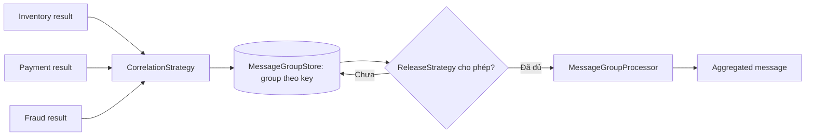
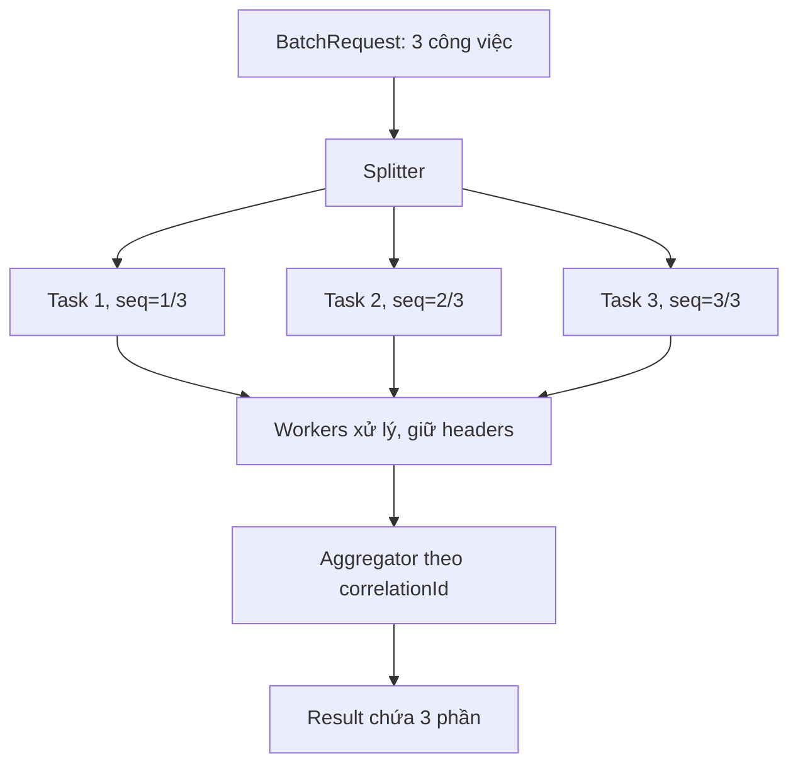

# Aggregator thiếu correlation hoặc release strategy

## 1. Bài toán: các message đã đến nhưng kết quả tổng hợp không xuất hiện

Trong module **SPRING_INTEGRATION_PATTERN**, chúng ta học triển khai Enterprise Integration Patterns bằng Spring Integration để xây dựng luồng message ít phụ thuộc, dễ mở rộng, đồng thời thực hành Router, Filter, Transformer, Splitter, Aggregator, Gateway, retry, error channel, correlation và kiểm thử, theo dõi các nhánh.

Một lỗi thường gặp là thêm `Aggregator` vào cuối pipeline và kỳ vọng rằng nó tự biết **message nào thuộc cùng một công việc** và **khi nào đã nhận đủ để phát kết quả**. Ví dụ, một yêu cầu xử lý đơn hàng cần ba phản hồi độc lập:

- `INVENTORY`: kho còn đủ hàng không?
- `PAYMENT`: thanh toán được chấp nhận không?
- `FRAUD`: kiểm tra rủi ro có thông qua không?

Nếu ba phản hồi không mang khóa tương quan ổn định hoặc Aggregator không có quy tắc xác định “đã đủ”, có thể xảy ra hai loại lỗi nghiêm trọng: **ghép nhầm phản hồi của các đơn khác nhau** và **giữ nhóm message mãi mà không phát output**.

> **Quy tắc cốt lõi:** Một Aggregator cần trả lời ba câu hỏi khác nhau: **gom theo khóa nào** (*CorrelationStrategy*), **khi nào được phát** (*ReleaseStrategy*) và **phát ra nội dung gì** (*MessageGroupProcessor*). Thiếu một hợp đồng rõ ràng ở bất kỳ bước nào đều có thể gây lỗi, dù các message riêng lẻ đã được xử lý thành công.

### Sau bài này, bạn có thể

1. Hiểu cơ chế nhóm message theo `correlationId` và release theo sequence mặc định.
2. Xác định lý do Aggregator không release khi thiếu `sequenceSize`, Filter loại bỏ một phần hoặc callback đến sai nhóm.
3. Cấu hình `CorrelationStrategy` và `ReleaseStrategy` theo quy tắc nghiệp vụ mà không lẫn hai trách nhiệm.
4. Xử lý duplicate, timeout, message đến muộn, lưu trạng thái nhóm và restart.
5. Kiểm thử nhiều nhóm xen kẽ, kết quả thiếu, thứ tự đảo và lỗi bất đồng bộ.

## 2. Ba thành phần quyết định hành vi Aggregator

Spring Integration Aggregator là một **message handler có trạng thái**: các message được tập hợp vào `MessageGroupStore`, đánh giá điều kiện hoàn thành và kết hợp thành một output. Nó thường đứng sau Splitter hoặc các nhánh xử lý song song, nhưng vẫn có thể dùng cho tập hợp sự kiện đến từ nhiều hệ thống.



| Cơ chế | Câu hỏi | Mặc định trong Spring Integration | Dấu hiệu cấu hình sai |
| --- | --- | --- | --- |
| `CorrelationStrategy` | Message thuộc nhóm nào? | Đọc header `IntegrationMessageHeaderAccessor.CORRELATION_ID` | Không tạo được key, hoặc hai đơn hàng bị đưa chung nhóm. |
| `ReleaseStrategy` | Nhóm đã đủ điều kiện phát chưa? | `SimpleSequenceSizeReleaseStrategy` dựa trên thông tin sequence | Nhóm giữ mãi nếu không biết kích thước sequence hoặc số phần không khớp. |
| `MessageGroupProcessor` | Gộp payload/header thành kết quả nào? | `DefaultAggregatingMessageGroupProcessor` tạo payload dạng danh sách các payload | Kết quả thiếu cấu trúc nghiệp vụ hoặc downstream ép sai kiểu. |
| `MessageGroupStore` | Lưu các nhóm và trạng thái của chúng ở đâu? | Thường dùng store trong bộ nhớ nếu không cấu hình riêng | Tích tụ nhóm không hoàn tất; mất dữ liệu nhóm khi tiến trình dừng. |

Trong tài liệu API, hợp đồng của hai strategy chính có dạng:

```java
public interface CorrelationStrategy {
    Object getCorrelationKey(Message<?> message);
}

public interface ReleaseStrategy {
    boolean canRelease(MessageGroup group);
}
```

Đây là **chữ ký khái niệm được trích gọn** để làm rõ trách nhiệm, không phải hai interface mới cần tự định nghĩa trong dự án. `getCorrelationKey()` phải trả một key khác `null`, có `equals()` và `hashCode()` ổn định; `canRelease()` được hỏi lại khi các message mới đến, vì vậy không nên thực hiện side effect nghiệp vụ trong hàm này.

**Correlation không có nghĩa là release.** Hai message có cùng `correlationId` chỉ được đưa vào cùng nhóm; chúng chưa chắc đủ điều kiện để Aggregator phát kết quả. Ngược lại, ba message đủ về số lượng nhưng mang ba key khác nhau cũng sẽ tạo ba nhóm riêng, mỗi nhóm có thể thiếu phần còn lại.

## 3. Lỗi số 1: thiếu hoặc dùng sai correlation key

### 3.1. Header mặc định bị mất trên đường đi

Với Aggregator mặc định, Spring Integration đọc `correlationId` từ headers. Một số flow bắt đầu bằng `Splitter` sẽ tự tạo `CORRELATION_ID`, `SEQUENCE_NUMBER` và `SEQUENCE_SIZE` cho các message con. Tuy nhiên, nếu một adapter hoặc đoạn mã dựng message mới rồi bỏ qua headers, các message đầu ra có thể mất khóa tương quan.

```text
Request order-42
   |
   +-- INVENTORY result: correlationId=order-42
   +-- PAYMENT result:   correlationId=order-42
   +-- FRAUD result:     [không có correlationId]
                          |
                          +--> Không thể ghép vào nhóm order-42 như mong đợi
```

Khi strategy không lấy được key hợp lệ, không nên tạo một giá trị mặc định dùng chung như `"unknown"`: nhiều request không liên quan sẽ bị ghép nhầm vào cùng nhóm. Cách đúng là **phát hiện header thiếu tại ranh giới vào Aggregator**, ghi nhận lỗi và sửa đoạn producer/Transformer đã làm mất key.

### 3.2. Dùng trace ID hoặc business ID không đủ độ phân biệt

`traceId` chủ yếu phục vụ observability; một trace có thể bao gồm nhiều thao tác cần tổng hợp độc lập. `orderId` chỉ xác định đơn hàng và có thể chưa đủ khi một đơn được xử lý lại hoặc có nhiều lần thử song song.

| Ứng viên | Ngữ nghĩa | Có thích hợp làm correlation key? |
| --- | --- | --- |
| `message.getId()` | ID của từng message | Thường **không**: mỗi nhánh tạo một message có ID riêng. |
| `traceId` | Theo dõi request xuyên các service | Chỉ khi được bảo đảm tương ứng đúng một nhóm nghiệp vụ. |
| `orderId` | Thực thể đơn hàng | Có điều kiện; cần chắc chắn không có hai đợt tổng hợp cùng đơn tại một thời điểm. |
| `workflowRunId` / `batchId` | Một phiên tổng hợp cụ thể | Thường phù hợp: cả ba nhánh mang lại cùng ID đã cấp ban đầu. |
| `tenantId + batchId` | Một phiên tổng hợp trong tenant | Hữu ích khi ID có thể trùng giữa các tenant. |

**Tạo key một lần** trước khi tách nhánh; các callback về sau phải trả lại đúng key đó. Nếu khóa được lấy từ payload, dùng một `CorrelationStrategy` thống nhất và kiểm tra kiểu dữ liệu trước khi đưa message vào nhóm.

### 3.3. Cùng giá trị hiển thị nhưng khác kiểu

`"9001"` là `String` còn `9001` là `Integer`. Hai giá trị đó không bằng nhau theo `equals()`. Tương tự, `batch-01` và `BATCH-01` khác nhau nếu bạn không có quy tắc chuẩn hóa cụ thể. Nên thống nhất định dạng key tại điểm nhận dữ liệu ngoài, đồng thời không chuẩn hóa tùy tiện làm hai nhóm khác nhau trở thành một.

## 4. Lỗi số 2: có correlation nhưng không có điều kiện release phù hợp

Ví dụ cả ba message đều có `correlationId=order-42` nhưng không có `sequenceSize`. Aggregator vẫn có thể tạo một nhóm mang key `order-42`, nhưng **release mặc định không biết khi nào đã nhận đủ phần tử**.

Khi dữ liệu đi từ một Splitter có kích thước xác định, các header thường có dạng:

| Payload | `correlationId` | `sequenceNumber` | `sequenceSize` |
| --- | --- | --- | --- |
| `INVENTORY_RESULT` | `batch-42` | `1` | `3` |
| `PAYMENT_RESULT` | `batch-42` | `2` | `3` |
| `FRAUD_RESULT` | `batch-42` | `3` | `3` |

Với sequence hoàn chỉnh và headers đúng, `SimpleSequenceSizeReleaseStrategy` mặc định có thể release nhóm khi đã nhận số phần tử phù hợp. Nhưng dữ liệu từ ba inbound adapter độc lập **không tự nhiên có các sequence headers như Splitter tạo**.

### 4.1. Splitter thường làm đúng việc thiết lập sequence

`Splitter` trong Spring Integration điền các header `CORRELATION_ID`, `SEQUENCE_NUMBER` và `SEQUENCE_SIZE` cho các message con khi biết kích thước tập đầu vào. Nhờ đó, pipeline dạng sau có thể dùng release mặc định:



Điều kiện là các bước xử lý giữa Splitter và Aggregator **giữ đúng correlation và sequence headers**, không tự tạo thông điệp mới làm mất chúng, và không loại một phần tử mà không điều chỉnh chiến lược release.

### 4.2. Iterator/Stream có thể không biết số phần tử

Với một số nguồn tách dạng `Iterator`, `Iterable` hoặc stream mà Splitter không xác định được kích thước, `SEQUENCE_SIZE` có thể được đặt bằng `0`. Khi đó release mặc định theo kích thước sequence **không đủ thông tin để hoàn thành nhóm**.

Các cách xử lý tùy yêu cầu:

- Xác định số phần tử từ nghiệp vụ khi có thể, rồi mang metadata phù hợp.
- Chọn custom `ReleaseStrategy` với điều kiện đầy đủ rõ ràng, ví dụ nhận đủ ba loại kết quả.
- Dùng một event kết thúc nhóm có ID ổn định, kết hợp custom release logic.
- Cấu hình timeout/expiry cho nhóm khi upstream có thể không gửi hết, đồng thời có chính sách thiếu dữ liệu rõ ràng.

Không đặt `releaseStrategy(group -> true)` để “chữa” nhóm bị kẹt; điều đó biến Aggregator thành nơi phát từng message đến, bỏ mất ý nghĩa tổng hợp.

### 4.3. Publish-subscribe và Recipient List Router cần `applySequence`

`PublishSubscribeChannel` và Recipient List Router thường **không tự gắn bộ sequence headers cho fan-out**. Khi các nhánh phản hồi được gom lại bởi Aggregator theo sequence, bật `applySequence=true` ở thành phần fan-out tương ứng, hoặc dùng chiến lược correlation/release tự định nghĩa.

```java
import org.springframework.context.annotation.Bean;
import org.springframework.integration.channel.PublishSubscribeChannel;

@Bean
public PublishSubscribeChannel workBroadcast() {
    PublishSubscribeChannel channel = new PublishSubscribeChannel();
    channel.setApplySequence(true);
    return channel;
}
```

Ở đây `applySequence` cung cấp headers cho việc gom lại các nhánh; **nó không có nghĩa fan-out được lưu bền vững**. Các nhánh có thể lỗi hoặc không gửi kết quả, nên vẫn cần cơ chế timeout và error handling phù hợp.

## 5. Lỗi số 3: Filter hoặc Router làm thiếu phần tử nhưng release vẫn đợi đủ

Giả sử Splitter sinh 4 message (`sequenceSize=4`). Một Filter đặt giữa Splitter và Aggregator loại message thứ ba:

```text
Splitter: 1/4 ----> xử lý --> Aggregator
          2/4 ----> xử lý --> Aggregator
          3/4 ----> Filter bỏ message
          4/4 ----> xử lý --> Aggregator

Aggregator nhận 3 phần; header sequenceSize vẫn là 4.
Release mặc định chờ phần thứ tư, nhưng phần đó đã bị bỏ.
```

Đây là một trong những nguyên nhân phổ biến nhất gây **nhóm tồn đọng**. Sự kiện “Filter đã quyết định bỏ message” không tự sửa `sequenceSize` ở những message còn lại.

Các hướng giải quyết cần phù hợp với nghiệp vụ:

1. **Bỏ trước khi split:** Nếu biết phần tử nào không cần xử lý, loại chúng trong bước chuẩn bị danh sách rồi Splitter tính sequence trên danh sách đã lọc.
2. **Gửi kết quả bù (“skipped”):** Nhánh Filter discard có thể phát message biểu diễn phần đã bị bỏ, giữ cùng correlation/sequence để Aggregator biết toàn bộ nhánh đã kết thúc.
3. **Đổi release strategy:** Nếu điều kiện là “đã nhận kết quả của các nhánh còn hợp lệ”, cần có metadata chính xác về tập nhánh bắt buộc, không phỏng đoán theo số message.
4. **Đặt deadline và xử lý thiếu:** Nếu một nhánh có thể im lặng hoặc mất kết quả, thiết kế timeout cho nhóm và kết quả `INCOMPLETE`/error riêng.

**Không cập nhật `sequenceSize` tùy tiện trong từng nhánh** khi các nhánh chạy bất đồng bộ: hai worker có thể nhìn thấy hai giá trị expected size khác nhau, khiến output được phát quá sớm hoặc không bao giờ phát.

## 6. Ví dụ thiết kế đúng: correlation theo `batchId`, release theo tập nhánh bắt buộc

Giả sử hệ thống nhận ba loại phản hồi `INVENTORY`, `PAYMENT`, `FRAUD` từ các adapter độc lập. Mỗi message mang hai header:

- `batchId`: xác định một lần tổng hợp, chung cho ba nhánh.
- `branch`: tên nhánh đã hoàn tất, nhận một trong ba giá trị cho phép.

Để tránh phụ thuộc `sequenceSize` của các hệ thống ngoài, ta cấu hình chiến lược riêng:

```java
import java.util.HashSet;
import java.util.Set;
import org.springframework.beans.factory.annotation.Qualifier;
import org.springframework.context.annotation.Bean;
import org.springframework.context.annotation.Configuration;
import org.springframework.integration.aggregator.HeaderAttributeCorrelationStrategy;
import org.springframework.integration.channel.DirectChannel;
import org.springframework.integration.channel.QueueChannel;
import org.springframework.integration.config.EnableIntegration;
import org.springframework.integration.dsl.IntegrationFlow;
import org.springframework.messaging.Message;
import org.springframework.messaging.MessageChannel;

@Configuration
@EnableIntegration
public class BatchAggregationConfig {

    private static final Set<String> REQUIRED_BRANCHES =
            Set.of("INVENTORY", "PAYMENT", "FRAUD");

    @Bean
    public MessageChannel aggregationInput() {
        return new DirectChannel();
    }

    @Bean
    public QueueChannel aggregationResults() {
        return new QueueChannel();
    }

    @Bean
    public IntegrationFlow batchAggregationFlow() {
        return IntegrationFlow.from("aggregationInput")
                .aggregate(spec -> spec
                        .correlationStrategy(
                                new HeaderAttributeCorrelationStrategy("batchId"))
                        .releaseStrategy(group -> {
                            Set<String> received = new HashSet<>();
                            for (Message<?> message : group.getMessages()) {
                                Object branch = message.getHeaders().get("branch");
                                if (branch instanceof String name) {
                                    received.add(name);
                                }
                            }
                            return received.containsAll(REQUIRED_BRANCHES);
                        })
                        // Giữ metadata nhóm hoàn tất để xử lý message đến muộn.
                        .expireGroupsUponCompletion(false))
                .channel("aggregationResults")
                .get();
    }
}
```

Đây là ví dụ dùng Java 17+, Spring Integration Java DSL. Những channel đích trong ứng dụng thực tế cần được nối với consumer phù hợp. `QueueChannel` ở đây dùng để đọc kết quả trong bài thực hành; production nên thiết kế consumer, giới hạn bộ nhớ và chính sách persistence đúng yêu cầu.

**Vì sao hai strategy này khác nhau?**

- `HeaderAttributeCorrelationStrategy("batchId")` quyết định message nào được đưa vào **cùng nhóm**.
- `releaseStrategy(group -> ...)` chỉ trả `true` khi trong nhóm có đủ **ba loại phản hồi khác nhau**. Nhóm có ba message `PAYMENT` lặp lại vẫn chưa hoàn thành.
- `MessageGroupProcessor` mặc định trả danh sách payload. Điều kiện release “đủ nhánh” không tự chuyển danh sách thành một `OrderDecision`; downstream cần xử lý ba kết quả và kiểm tra trạng thái thành công/từ chối từng nhánh.

**Điểm cần bổ sung khi triển khai thực tế:** ví dụ chưa thực hiện deduplication. Nếu nhận `PAYMENT` hai lần, nhóm có thể chứa payload lặp và kết quả đầu ra cũng có thể chứa bản sao đó. Nếu một callback lặp có tác động nghiệp vụ, cần dùng `eventId` ổn định, inbox/idempotency và lọc duplicate **trước khi** đưa vào Aggregator, hoặc thiết kế `MessageGroupProcessor` nhận diện bản sao một cách có kiểm soát.

### 6.1. Tạo message đúng hợp đồng

```java
import org.springframework.integration.support.MessageBuilder;
import org.springframework.messaging.Message;

record BranchReply(
        String batchId,
        String branch,
        boolean accepted,
        String detail) {
}

final class BranchReplyMessages {
    private BranchReplyMessages() {}

    static Message<BranchReply> reply(BranchReply payload) {
        return MessageBuilder.withPayload(payload)
                .setHeader("batchId", payload.batchId())
                .setHeader("branch", payload.branch())
                .build();
    }
}
```

`BranchReply` và `BranchReplyMessages` là hai kiểu package-private có thể đặt trong cùng một file Java của bài thực hành. Khi nhận callback từ broker/HTTP, adapter cần kiểm tra `batchId`/`branch` và xây dựng lại headers. **Không giả định Spring headers tự đi xuyên mọi giao thức transport**.

### 6.2. Khi “đủ nhánh” chưa đồng nghĩa nghiệp vụ thành công

Giả sử ba phản hồi đều đã tới, nhưng `PAYMENT.accepted() == false`. Nhóm **vẫn đủ** để release, sau đó application service phải tạo quyết định từ chối, không được phát lệnh giao hàng. Release strategy xác định **thời điểm đủ thông tin**, còn nghiệp vụ quyết định **ý nghĩa của thông tin**.

Đặt side effect như gọi `charge()` hoặc `ship()` trực tiếp trong `canRelease()` là phản mẫu: hàm này được gọi nhiều lần khi nhóm nhận message mới và có thể được gọi lại khi xử lý expiry. Tách kết quả tập hợp khỏi việc chuyển trạng thái nghiệp vụ.

## 7. Kiểu kết quả Aggregator và xử lý sau release

Với `DefaultAggregatingMessageGroupProcessor`, output payload thông thường là một `List` các payload được giữ trong group. Không nên ép kiểu ngay thành `BranchReply` hoặc giả định phần tử luôn ở đúng thứ tự `INVENTORY, PAYMENT, FRAUD`, vì các nhánh có thể về đảo thứ tự.

Một bước downstream có thể chuẩn hóa kết quả theo `branch`:

```java
import java.util.List;
import java.util.Map;
import java.util.Set;
import java.util.function.Function;
import java.util.stream.Collectors;

record BatchDecision(
        String batchId,
        boolean approved,
        Map<String, BranchReply> details) {
}

final class BatchDecisionMapper {
    private BatchDecisionMapper() {}

    static BatchDecision combine(List<BranchReply> replies) {
        if (replies.isEmpty()) {
            throw new IllegalArgumentException("Nhóm chưa có kết quả");
        }
        Map<String, BranchReply> byBranch = replies.stream()
                .collect(Collectors.toMap(
                        BranchReply::branch,
                        Function.identity(),
                        (earlier, later) -> later));

        boolean complete = byBranch.keySet().containsAll(
                Set.of("INVENTORY", "PAYMENT", "FRAUD"));
        boolean accepted = complete
                && byBranch.values().stream().allMatch(BranchReply::accepted);

        String batchId = replies.get(0).batchId();
        return new BatchDecision(batchId, accepted, byBranch);
    }
}
```

Hàm trên minh họa cách **không phụ thuộc thứ tự message**. Nó cần bổ sung chính sách duplicate khi dùng thực tế: chọn bản “đến cuối” có thể không đúng nếu ACK cũ và mới có trạng thái mâu thuẫn. Với dữ liệu quan trọng, nên xác minh `eventId`, phiên bản, thời gian phát và idempotency ở cửa vào; không coi việc ghi đè key trong `Map` là cách xử lý duplicate đầy đủ.

## 8. Group timeout, partial result và message đến muộn

Ngay cả khi chiến lược release đúng, các nhánh có thể không trả kết quả vì broker lỗi, Filter bỏ message hoặc provider không phản hồi. Nếu không có chính sách dọn nhóm, các nhóm chưa hoàn thành sẽ chiếm bộ nhớ/store ngày càng nhiều.

Spring Integration cung cấp những cơ chế quản lý:

| Cơ chế | Mục đích | Điều cần quyết định |
| --- | --- | --- |
| `groupTimeout` | Tác động đến nhóm không nhận message mới trong khoảng chờ | Đây thường là thời gian **không hoạt động**, không tự là SLA tuyệt đối từ lúc khởi tạo workflow. |
| `sendPartialResultOnExpiry` | Khi expiry mà nhóm chưa đủ, có thể phát tập kết quả một phần | Downstream có chấp nhận kết quả thiếu không? Phải phân biệt `PARTIAL` với `COMPLETE`. |
| `discardChannel` | Nhận message bị loại trong các kịch bản liên quan tới group hoàn tất/expiry | Consumer của discard flow làm gì với event đến muộn? |
| `expireGroupsUponCompletion` | Quyết định có xóa ngay metadata nhóm hoàn tất không | Nếu xóa ngay, message cùng key tới sau có thể lập nhóm mới. |
| `MessageGroupStoreReaper` | Quét và expire nhóm tồn đọng/metadata cũ theo lịch | Cần ngưỡng lưu trữ, tần suất quét và chiến lược xử lý dữ liệu chưa đủ. |

**Hành vi mặc định quan trọng:** `expireGroupsUponCompletion=false` giữ metadata của nhóm đã hoàn tất để phát hiện và discard message đến muộn. Nếu cấu hình `true`, group đã hoàn tất bị xóa khỏi store; một message tới sau với **cùng correlation key** có thể tạo **nhóm mới**. Vì vậy cần cân nhắc kỹ khi dùng lại ID.

### 8.1. Không dùng group timeout để che lỗi correlation

Ví dụ group có hai trong ba kết quả:

```text
t=0s  INVENTORY(batch-42) -> nhóm đang đợi
t=1s  PAYMENT(batch-42)   -> nhóm có 2/3
t=2s  FRAUD(batch-99)     -> nhóm batch-99, không giúp batch-42
t=7s  batch-42 hết thời gian không hoạt động -> expiry/partial theo chính sách
```

Nếu chỉ bật `sendPartialResultOnExpiry=true` mà downstream coi mọi output là “đủ dữ liệu”, ứng dụng có thể đánh dấu thanh toán thành công khi chưa có Fraud result. **Partial result phải được nhận diện là không đầy đủ**; có thể phát `BatchIncomplete` hoặc đưa vào error/reconciliation flow tùy yêu cầu.

Một hệ thống có **deadline nghiệp vụ tuyệt đối** (ví dụ hoàn tất trong 10 giây kể từ khi tạo batch) nên lưu `deadlineAt` trong trạng thái workflow và có worker giám sát theo thời gian thực. Không dùng `groupTimeout` dựa trên inactivity như sự bảo đảm duy nhất cho SLA.

### 8.2. Kết quả tới muộn sau nhóm hoàn tất

Nếu `batchId=batch-42` đã release, một ACK trùng/đến muộn cần được xử lý rõ: ghi audit, bỏ theo idempotency, hoặc đối soát nếu nó mâu thuẫn với trạng thái đã chốt. Đừng để nó tạo một batch nghiệp vụ mới chỉ vì nhóm metadata bị xóa và key được tái sử dụng.

## 9. MessageStore, persistence và nhiều instance

Aggregator phải giữ message trong nhóm giữa các lần nhận nên cần `MessageGroupStore`. Không cấu hình store bền vững có thể khiến các nhóm chưa hoàn tất mất đi khi JVM crash/restart. Nếu ứng dụng có yêu cầu tiếp tục sau restart, cân nhắc `JdbcMessageStore` hoặc một implementation lưu bền vững phù hợp với phiên bản Spring Integration đang dùng.

| Hình thức | Khả năng | Giới hạn |
| --- | --- | --- |
| `SimpleMessageStore` trong bộ nhớ | Dễ cấu hình, phù hợp nhóm ngắn và một tiến trình | Không tự khôi phục nhóm sau crash. |
| `JdbcMessageStore`/store bền vững | Có thể lưu message group qua restart nếu tích hợp transaction đúng | Không tự bảo đảm broker ACK, exactly-once hoặc side effect nghiệp vụ bền vững. |
| Shared store cho nhiều JVM | Các node có thể nhìn thấy group chung | Cần cơ chế khóa liên tiến trình phù hợp, chẳng hạn shared `LockRegistry`. |
| Workflow state/outbox/inbox | Lưu quyết định nghiệp vụ và hỗ trợ dedup/recovery | Là trách nhiệm ứng dụng, không tự được Aggregator thay thế. |

Theo tài liệu Spring Integration, thay đổi nhóm được đồng bộ theo correlation key bằng `LockRegistry`. `DefaultLockRegistry` là khóa **trong bộ nhớ**; khi nhiều instance dùng chung `MessageGroupStore`, cần một registry khóa dùng chung để tránh hai node đồng thời thao tác cùng group. Chỉ trỏ cả hai node vào cùng database chưa đủ để đạt tính nhất quán.

Khi kết hợp với Kafka/RabbitMQ/JMS, phải định nghĩa rõ thứ tự commit:

1. Message được nhận từ broker.
2. Aggregator ghi/cập nhật nhóm trong store.
3. Consumer ACK/commit offset theo giao ước bảo đảm.
4. Khi nhóm đủ, hệ thống phát output và xử lý nghiệp vụ tiếp theo.

Trong thực tế, các thao tác trên có thể nằm trong **nhiều ranh giới transaction khác nhau**. Cần test crash tại những điểm quan trọng và dùng idempotency/outbox khi side effect downstream không thể thực hiện nguyên tử với message store.

## 10. Duplicate, retry và thay đổi số lượng phần tử

Một nhầm lẫn khác là xem `group.size() == expected` tương đương “đã nhận đủ các nhánh”. Nếu một callback được giao lại hai lần, số message có thể đạt ngưỡng dù vẫn thiếu một loại kết quả.

```text
Expected: INVENTORY, PAYMENT, FRAUD
Received: INVENTORY, PAYMENT, PAYMENT

group.size() == 3  -> true, nhưng FRAUD chưa có!
distinct(branch)   -> {INVENTORY, PAYMENT}, chưa đủ.
```

`SimpleSequenceSizeReleaseStrategy` có mục tiêu xử lý sequence theo cơ chế mặc định, nhưng không phải hợp đồng chống trùng nghiệp vụ toàn hệ thống. Đặc biệt với các nhánh từ broker, việc một ACK trùng có cùng hoặc khác `sequenceNumber` phải được xử lý bằng chính sách dedup và release phù hợp. Không phụ thuộc duy nhất vào độ lớn của group.

**Hướng xử lý:**

- Gắn `eventId` ổn định và `batchId` cho mỗi message.
- Dedupe tại cửa nhận bằng inbox hoặc constraint theo `consumerName + eventId` khi cần xử lý at-least-once.
- Chọn `ReleaseStrategy` thể hiện **các nhánh bắt buộc đã có kết quả**; nếu có optional branch, quy định riêng.
- Khi retry làm sinh một **attempt mới**, xác định có tạo `batchId` mới không; ACK cũ không được ghép nhầm attempt mới.
- Dùng error channel, DLQ và reconciliation cho thông điệp lỗi; không coi retry thành công chỉ vì message đã gửi vào channel.

Nếu một Filter bỏ bớt message, hãy quyết định rõ đó là **nhánh không bắt buộc**, **đã xử lý thành SKIPPED** hay **lỗi không thể hoàn thành batch**. Mỗi lựa chọn dẫn tới release strategy và kết quả downstream khác nhau.

## 11. Kiểm thử correlation và release với nhiều nhóm xen kẽ

Để kiểm thử nguyên nhân trực tiếp, có thể dùng `BatchAggregationConfig` ở mục 6 và gửi message từ một test Spring context. Vì `DirectChannel` xử lý đồng bộ ở ví dụ, việc gửi input rồi đọc `QueueChannel` là đủ để kiểm tra khi nào nhóm được phát, không cần dùng `Thread.sleep()`.

```java
import static org.junit.jupiter.api.Assertions.*;

import java.util.List;
import java.util.UUID;
import org.junit.jupiter.api.Test;
import org.springframework.beans.factory.annotation.Autowired;
import org.springframework.beans.factory.annotation.Qualifier;
import org.springframework.integration.channel.QueueChannel;
import org.springframework.integration.support.MessageBuilder;
import org.springframework.messaging.Message;
import org.springframework.messaging.MessageChannel;
import org.springframework.test.context.junit.jupiter.SpringJUnitConfig;

@SpringJUnitConfig(BatchAggregationConfig.class)
class BatchAggregationTest {

    @Autowired @Qualifier("aggregationInput")
    MessageChannel input;

    @Autowired @Qualifier("aggregationResults")
    QueueChannel output;

    private void send(String batch, String branch) {
        BranchReply reply = new BranchReply(batch, branch, true, "OK");
        boolean accepted = input.send(MessageBuilder.withPayload(reply)
                .setHeader("batchId", batch)
                .setHeader("branch", branch)
                .build());
        assertTrue(accepted);
    }

    @Test
    void doesNotReleaseUntilAllThreeBranchesOfSameBatchArrive() {
        String a = "A-" + UUID.randomUUID();
        String b = "B-" + UUID.randomUUID();

        send(a, "PAYMENT");
        send(b, "INVENTORY");
        send(a, "INVENTORY");
        send(b, "PAYMENT");

        // Mỗi batch mới có hai nhánh, chưa có FRAUD.
        assertNull(output.receive(0));

        send(a, "FRAUD");
        Message<?> first = output.receive(1_000);
        assertNotNull(first);
        assertInstanceOf(List.class, first.getPayload());
        assertEquals(3, ((List<?>) first.getPayload()).size());

        // Nhóm b vẫn chưa hoàn tất.
        assertNull(output.receive(0));

        send(b, "FRAUD");
        Message<?> second = output.receive(1_000);
        assertNotNull(second);
        assertEquals(3, ((List<?>) second.getPayload()).size());
    }

    @Test
    void duplicateBranchDoesNotCountAsMissingRequiredBranch() {
        String key = "dup-" + UUID.randomUUID();
        send(key, "PAYMENT");
        send(key, "PAYMENT");
        send(key, "INVENTORY");

        // Kích thước nhóm có thể là 3, nhưng còn thiếu FRAUD.
        assertNull(output.receive(0));
    }
}
```

Đoạn test cần các dependency Spring Integration Test/Spring Test và JUnit 5 phù hợp. Các bean đầu vào/đầu ra được khai báo trong `BatchAggregationConfig`. Vì test thứ hai cố tình để lại nhóm chưa hoàn tất trong store in-memory, một bộ kiểm thử thực tế nên tạo context cô lập hoặc dọn state của nhóm sau test để tránh rò rỉ giữa các ca.

### Những trường hợp cần kiểm thử thêm

| Test case | Dữ liệu | Kết quả mong đợi |
| --- | --- | --- |
| Nhóm đúng và đủ | 3 nhánh, cùng `batchId` | Một output khi nhận đủ, không phát sớm. |
| Hai nhóm xen kẽ | `A/INVENTORY`, `B/PAYMENT`, `A/FRAUD`... | Không ghép chéo nhóm; mỗi output thuộc đúng batch. |
| Thiếu correlation key | Một branch không có `batchId` | Đường lỗi/validation nhận biết; không đưa vào nhóm chung giả. |
| Key khác kiểu | `"42"` và `42` | Không được coi là cùng batch nếu chưa chuẩn hóa. |
| Thiếu `sequenceSize` với mặc định | Nhóm không có thông tin kích thước sequence | Không kỳ vọng release mặc định khi chưa có điều kiện đầy đủ. |
| Filter bỏ một phần của sequence | Header `sequenceSize=4`, chỉ 3 message đến | Nhóm không bị coi là đầy đủ; có timeout/skip/strategy đúng. |
| Duplicate branch | Có `PAYMENT` hai lần, thiếu `FRAUD` | Custom release không phát sớm. |
| Nhánh từ chối | Đủ ba loại, `PAYMENT.accepted=false` | Release được nhưng nghiệp vụ tạo kết quả từ chối. |
| Group timeout | Một nhánh không đến | Nhóm hết hạn theo policy, kết quả thiếu được đánh dấu rõ. |
| Message muộn | ACK đến sau group complete | Đi vào discard/đối soát, không tạo quyết định thứ hai. |
| Restart | Store bền vững, ứng dụng dừng giữa batch | Khôi phục state đúng và không nhân đôi side effect. |
| Hai node cùng key | Các nhánh vào hai instance dùng shared store | Lock registry và transaction ngăn race. |

Đừng chỉ kiểm tra số message phát ở output. Với các ca lỗi cần kiểm tra cả group store, discard/error flow, correlation headers và việc có phát tác động nghiệp vụ trùng hay không.

## 12. Error channel và việc quan sát nhóm bị kẹt

Khi không thấy output từ Aggregator, việc đầu tiên không phải tăng timeout, mà là dựng lại **bản đồ message của một batch**:

```text
event=branch_started  batchId=B42 branch=INVENTORY
event=branch_finished batchId=B42 branch=INVENTORY eventId=E1
event=branch_finished batchId=B42 branch=PAYMENT   eventId=E2
event=branch_failed   batchId=B42 branch=FRAUD     error=UPSTREAM_TIMEOUT
event=group_expired   batchId=B42 expected=3 received=2 policy=INCOMPLETE
```

Đây là log **ứng dụng chủ động tạo**, không phải format mặc định của Spring Integration. Nên đo:

- Số nhóm đang mở và **tuổi nhóm lớn nhất** theo loại workflow.
- Tỷ lệ nhóm hoàn tất, timeout/expiry và partial result.
- Phân bố số nhánh thực tế trên mỗi nhóm so với expected.
- Số message thiếu `correlationId`/`batchId` hoặc có key sai kiểu.
- Duplicate theo `eventId`/`branch` và tỷ lệ late-arriving message.
- Thời gian từ message đầu tiên tới khi release, backlog ở `MessageGroupStore`.
- Lỗi từ Router, Filter, Gateway, retry, error channel và các nhánh bất đồng bộ.

Nếu một nhánh xử lý qua `ExecutorChannel`/broker, exception có thể được báo ở một thread khác thay vì trở về caller của Aggregator. Cần xác định error channel ở điểm vào tương ứng và cung cấp **sự kiện thất bại có correlation key** để workflow biết vì sao nhóm không hoàn thành.

### Checklist chẩn đoán một group không release

1. Các message có thực sự đi tới **cùng một Aggregator endpoint** và cùng store không?
2. Key được trích từ đâu? `correlationId` có bị mất hoặc thay kiểu ở một nhánh không?
3. Với default release, `sequenceSize` và `sequenceNumber` có được tạo đúng và giữ nguyên không?
4. Splitter có phát từ `Iterator` với kích thước không biết trước hay không?
5. Filter có loại một phần tử hoặc Router có gửi một nhánh đến channel khác không?
6. Có duplicate khiến kích thước nhóm gây hiểu nhầm không?
7. Có cấu hình expiry, partial result, discard, retry và consumer error phù hợp không?
8. Nếu có nhiều instance, store/lock registry/transaction có thực sự chia sẻ và đồng bộ không?

## 13. Lộ trình refactor Aggregator hiện đang lỗi

Nếu production đang có một Aggregator hay bị treo, sửa có kiểm soát theo thứ tự:

1. **Ghi lại hợp đồng message**: các branch bắt buộc, khóa của một phiên workflow, event ID và số lượng kỳ vọng.
2. **Đo dữ liệu thực tế** tại trước Aggregator: log cả key, kiểu key, sequence headers và tên nhánh.
3. **Phân loại nguồn message**: Splitter biết số phần tử hay inbound callback độc lập; một phần tử có thể bị Filter bỏ không?
4. **Chuẩn hóa correlation** ở biên adapter/Transformer; từ chối message không có key cần thiết.
5. **Chọn release strategy** theo nghĩa “đủ” của nghiệp vụ: số lượng sequence, tập loại kết quả hoặc release event.
6. **Thiết kế tình huống thiếu**: timeout/expiry, partial, error và reconciliation với trạng thái tường minh.
7. **Đưa chống trùng tới cửa vào**, không chỉ kiểm tra `group.size()`.
8. **Chọn MessageStore** theo nhu cầu restart; nếu shared store thì cấu hình lock registry liên node.
9. **Kiểm thử xen kẽ, đến muộn, duplicate, crash**, xác nhận không tạo output sai hoặc lặp tác động nghiệp vụ.
10. **Theo dõi metrics sau triển khai** và dọn metadata nhóm quá hạn theo policy đã định.

Mục tiêu không chỉ làm nhóm “cuối cùng cũng release”, mà phải bảo đảm **đúng batch, đủ thông tin, đúng một quyết định nghiệp vụ theo hợp đồng và có khả năng phục hồi**.

## 14. Bài thực hành: ba nhánh tổng hợp kết quả thẩm định

Thiết kế một hệ thống tạo quyết định cấp tín dụng. Với mỗi `applicationId` có thể có nhiều lần thẩm định, ứng dụng phát ba yêu cầu `IDENTITY`, `CREDIT`, `FRAUD`:

1. Cấp một `reviewRunId` duy nhất cho mỗi lần thẩm định, làm correlation key. Giữ `applicationId` như business ID.
2. Tạo message cho từng nhánh với `reviewRunId` và `branch`; truyền key xuyên RabbitMQ/HTTP bằng metadata đã quy định.
3. Cấu hình Aggregator custom `CorrelationStrategy` theo `reviewRunId` và `ReleaseStrategy` chỉ release khi đủ ba loại kết quả.
4. Dùng hai `reviewRunId` chạy xen kẽ để kiểm tra không trộn kết quả giữa các hồ sơ.
5. Cho hai message `CREDIT` trùng lặp đến trước khi có `FRAUD`; chứng minh không release sớm và đưa thêm `eventId` để dedupe.
6. Cho nhánh `IDENTITY` bị Filter bỏ; thiết kế một `SKIPPED` result hoặc policy fail rõ ràng, tránh nhóm nằm mãi.
7. Cho nhánh `FRAUD` lỗi và không gửi kết quả; triển khai expiry và trạng thái `INCOMPLETE`, bảo đảm không tự duyệt khi thiếu dữ liệu.
8. Thử một ACK `FRAUD` sau khi batch đã hoàn tất; kiểm tra discarded/đối soát không tạo hồ sơ mới sai.
9. Mô phỏng restart với store bền vững và khôi phục nhóm; nếu nhiều instance, kiểm tra cơ chế khóa liên node.
10. Thêm metrics group age, incomplete, duplicate, timeout, release latency và tracing theo `reviewRunId`.

**Câu hỏi tự đánh giá**

- Vì sao hai message cùng `correlationId` chưa chắc làm Aggregator release?
- Tại sao ba message có ba ID ngẫu nhiên không thể được tổng hợp thành một batch đúng?
- Khi nào dùng `sequenceSize` mặc định, khi nào cần custom `ReleaseStrategy`?
- Điều gì xảy ra nếu Filter bỏ phần tử `3/4` của sequence?
- Vì sao `group.size() == 3` có thể sai khi một callback bị giao lại?
- Tại sao `groupTimeout` không nên được xem là deadline nghiệp vụ tuyệt đối?
- Khi `expireGroupsUponCompletion=true`, điều gì có thể xảy ra với một ACK đến muộn cùng key?
- Vì sao shared JDBC MessageStore chưa đủ nếu các node không dùng khóa chung?

## 15. Tài liệu tham khảo

- [Spring Integration Reference — Aggregator](https://docs.spring.io/spring-integration/reference/aggregator.html): `CorrelationStrategy`, `ReleaseStrategy`, sequence mặc định, `MessageGroupStore`, group expiry, timeout và lock registry.
- [Spring Integration Reference — Splitter](https://docs.spring.io/spring-integration/reference/splitter.html): headers `CORRELATION_ID`/`SEQUENCE_NUMBER`/`SEQUENCE_SIZE` và trường hợp Iterator có kích thước không xác định.
- [Spring Integration Reference — Message Channel Configuration](https://docs.spring.io/spring-integration/reference/channel/configuration.html): `PublishSubscribeChannel`, `applySequence`, executor và error handler.
- [Spring Integration Reference — Filter](https://docs.spring.io/spring-integration/reference/filter.html): discard channel và ảnh hưởng khi message bị loại trước Aggregator.
- [Spring Integration Reference — Message Store](https://docs.spring.io/spring-integration/reference/message-store.html): store, persistence và quản lý trạng thái message.

> **Ghi nhớ:** **Correlation quyết định message thuộc nhóm nào; release quyết định nhóm đã đủ chưa.** Dùng đúng sequence headers khi Splitter/fan-out tạo ra tập phần tử đã biết; chọn chiến lược tùy biến nếu nhận callback từ các nguồn độc lập, có Filter hoặc có nhánh tùy chọn. Kết hợp deduplication, group expiry, MessageStore, error flow và kiểm thử nhiều nhóm xen kẽ để Aggregator chỉ phát ra kết quả đúng và có thể vận hành ổn định.
