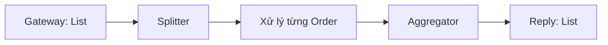
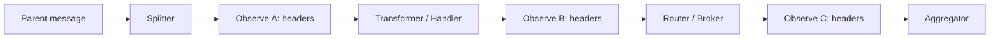
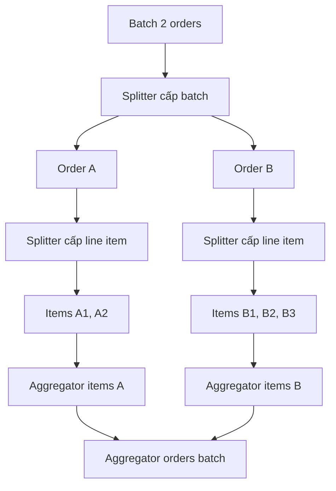

# Lỗi thường gặp: Splitter không truyền sequence metadata

> **Module:** `SPRING_INTEGRATION_PATTERN` — Học triển khai Enterprise Integration Patterns với Spring Integration để xây dựng luồng thông điệp ít phụ thuộc và dễ mở rộng. Thực hành Router, Filter, Transformer, Splitter, Aggregator, Gateway, retry, error channel và correlation, đồng thời kiểm thử, theo dõi các nhánh xử lý.
>
> **Chương:** Lỗi thường gặp  
> **Đề bài:** Splitter không truyền sequence metadata

## 1. Hiện tượng: message con đã xử lý xong nhưng Aggregator không trả kết quả

Một hệ thống nhận danh sách ba đơn hàng và muốn xử lý từng đơn song song, sau đó gom ba kết quả thành một phản hồi:



Trong lúc phát triển, nhóm nhận thấy ba message con đều đi qua handler thành công nhưng Gateway vẫn chờ rồi timeout. Log của Aggregator có thể cho thấy message không vào đúng nhóm hoặc nhóm không đủ điều kiện kết thúc. Một nguyên nhân đáng kiểm tra đầu tiên là **sequence metadata bị thiếu, không nhất quán hoặc mất ở một bước trung gian**.

Sequence metadata gồm các header liên quan đến **cùng một nhóm message** và **thứ tự/thông tin hoàn tất của nhóm**. Khi thiếu chúng, Aggregator mặc định có thể không nhận diện được nhóm hoặc không biết khi nào đủ kết quả để phát ra.

Không phải mọi lỗi Aggregator đều do Splitter: có thể là message bị Filter bỏ, một nhánh lỗi, timeout, cấu hình release strategy, duplicate/redelivery hoặc message group store. Bài này hướng dẫn **chẩn đoán và khắc phục đúng lớp**, thay vì tự thêm một `correlationId` bất kỳ để làm lỗi biến mất tạm thời.

### Kết quả học tập

Sau bài học, bạn có thể:

- Giải thích ý nghĩa `correlationId`, `sequenceNumber`, `sequenceSize` và phân biệt chúng với `MessageHeaders.ID`.
- Nhận diện các tình huống Splitter không phát sinh hoặc downstream làm mất sequence metadata.
- Dùng cấu hình split chuẩn, giữ header khi transform và chỉ định release strategy phù hợp khi không biết trước tổng số phần tử.
- Kiểm tra message thực tế bằng Spring Integration Test/JUnit, không phụ thuộc vào suy đoán log.
- Thiết kế xử lý an toàn cho nested splitting, Router, Filter, retry, error channel và xử lý bất đồng bộ.

## 2. Ba header cốt lõi: correlationId, sequenceNumber, sequenceSize

Khi một message cha được chia thành các phần tử, ta cần biết **mỗi message con thuộc nhóm nào**, **nó ở vị trí nào**, và **nhóm dự kiến có bao nhiêu message**.

| Header | Ý nghĩa | Ví dụ nhóm ba đơn |
|---|---|---|
| `correlationId` | Khóa liên kết các message thuộc cùng một nhóm cần aggregate | `group-abc` |
| `sequenceNumber` | Chỉ số của message trong chuỗi, thông thường bắt đầu từ 1 | 1, 2, 3 |
| `sequenceSize` | Tổng số message dự kiến thuộc chuỗi khi biết được kích thước | 3 |
| `MessageHeaders.ID` | ID của **từng message cụ thể**, không phải mặc định khóa gom nhóm ổn định | ID khác nhau ở từng message con |

Một nhóm có thể có cấu trúc:

| Message | Payload | correlationId | sequenceNumber | sequenceSize |
|---|---|---|---:|---:|
| Child 1 | `order-01` | `group-abc` | 1 | 3 |
| Child 2 | `order-02` | `group-abc` | 2 | 3 |
| Child 3 | `order-03` | `group-abc` | 3 | 3 |

`correlationId` **phải nhất quán giữa các child của cùng một batch** và không được vô tình dùng chung cho hai batch độc lập cần xử lý tách biệt. `sequenceNumber` phân biệt vị trí; `sequenceSize` cho biết số lượng cần đến nếu chiến lược kết thúc dựa trên đếm đủ phần tử.

### Tại sao message ID không thể thay thế correlationId?

Message ID có thể được tạo mới sau Transformer, MessageBuilder hoặc khi deserialize qua broker. Nếu Aggregator dùng ID của **mỗi message con** làm khóa group, ba message con có thể thành **ba nhóm riêng**, không nhóm nào nhận đủ ba phần tử.

Trong Spring Integration, các hằng tên header tương ứng nằm trong `IntegrationMessageHeaderAccessor`. Khi quan sát, ưu tiên đọc bằng hằng thay vì gõ sai tên chuỗi:

```java
import org.springframework.integration.IntegrationMessageHeaderAccessor;
import org.springframework.messaging.Message;

Object groupId = message.getHeaders().get(
        IntegrationMessageHeaderAccessor.CORRELATION_ID);
Object number = message.getHeaders().get(
        IntegrationMessageHeaderAccessor.SEQUENCE_NUMBER);
Object size = message.getHeaders().get(
        IntegrationMessageHeaderAccessor.SEQUENCE_SIZE);
```

**Chú ý:** `sequenceNumber` và `sequenceSize` chỉ có ý nghĩa trong **phạm vi một chuỗi xác định**. Đừng coi các số này là số thứ tự của toàn bộ hệ thống hoặc thứ tự message chắc chắn đến handler khi xử lý đa luồng.

## 3. Splitter tạo metadata như thế nào?

Với Splitter chuẩn của Spring Integration và cấu hình áp dụng sequence headers, framework tạo các message con đồng thời gắn thông tin nhóm. Cấu hình Java DSL đơn giản cho payload dạng `Collection`:

```java
@Bean
public IntegrationFlow splitFlow() {
    return IntegrationFlow.from("batchInput")
            .split()                  // Collection -> từng phần tử
            .channel("partOutput")
            .get();
}
```

Cách split chuẩn này có thể tạo chuỗi message con chứa correlation và sequence metadata để Aggregator ghép lại. **Khi cần chắc chắn về hành vi của phiên bản và loại Splitter cụ thể, phải kiểm chứng message đầu ra bằng test**, nhất là nếu có thay đổi `applySequence`, cấu hình khác mặc định, custom splitter hoặc payload là nguồn phát không biết trước kích thước.

Trong các cấu hình splitter endpoint có hỗ trợ thuộc tính `applySequence`, việc **tắt** tùy chọn này có thể khiến child không có metadata chuỗi như Aggregator kỳ vọng. Khi cần aggregate theo nhóm sau split, hãy giữ/bật chế độ tạo sequence metadata phù hợp và không chỉ dựa vào việc child có payload đúng.

### Sequence size có thể không xác định

Nếu splitter tạo child từ một `List` có 3 phần tử, tổng số message thường có thể xác định là 3. Nhưng khi splitter làm việc với `Iterator`, stream hoặc nguồn sản sinh động chưa biết điểm kết thúc, tổng số child có thể **không xác định tại thời điểm phát từng message**.

Trong các trường hợp đó, `sequenceSize` có thể là giá trị biểu thị **không biết tổng số** (chẳng hạn 0 tùy implementation), hoặc không mang thông tin đủ để release. Điều này **không tương đương** “nhóm có 0 message” và Aggregator mặc định không thể tự đoán lúc nào đã nhận đủ.

Nếu kích thước chưa biết, phải thiết kế một trong các chính sách:

1. Vật liệu hóa nhóm hữu hạn thành collection trước khi split, nếu kích thước vừa phải.
2. Có **end-of-stream/end-of-group marker** và release strategy hiểu marker đó.
3. Dùng `ReleaseStrategy` theo số lượng, thời điểm hoặc điều kiện nghiệp vụ được xác định rõ.
4. Cấu hình timeout/expiry và chính sách xử lý **partial group** nếu nghiệp vụ cho phép, thay vì coi timeout là “đã thành công đầy đủ”.

Không nên gán cố định `sequenceSize=3` chỉ vì dữ liệu test có ba phần tử, trong khi thực tế mỗi batch có độ dài khác nhau.

## 4. Bảng triệu chứng và nguyên nhân dễ nhầm

| Triệu chứng | Khả năng cần kiểm tra | Hướng xử lý |
|---|---|---|
| Aggregator báo không xác định được correlation key | `correlationId` thiếu ở child hoặc bị xóa sau split | Kiểm tra header ngay sau Splitter và trước Aggregator |
| Aggregator tạo nhiều nhóm một phần tử | Mỗi child có correlation ID khác nhau; dùng ID của child làm khóa | Giữ cùng một group key trong batch |
| Có ba child nhưng Aggregator không release | `sequenceSize` không xác định, bị mất, hoặc một child chưa đến | Xem toàn bộ headers, group store và release strategy |
| Child 1 và child 3 đến, child 2 bị mất | Filter, Router không có nhánh, exception, retry thất bại | Có error/timeout/recovery policy; không sửa metadata để che thiếu child |
| Batch A bị gom chung với batch B | Tái sử dụng correlation ID giữa hai batch độc lập | Tạo nhóm riêng và giữ ID ổn định theo batch |
| Dữ liệu bị lặp sau retry/broker redelivery | Duplicates được aggregate như phần tử mới | Idempotency/dedup và chính sách sequence cho message redelivery |
| Lỗi chỉ xảy ra khi bật async | Race, giao hàng không theo thứ tự, timeout hoặc cấu hình store | Test concurrent, kiểm tra group completion và ordering |
| Lỗi chỉ xảy ra khi qua broker/JSON | Chỉ payload được serialize, các header không được mang theo | Dùng envelope/header mapper có kiểm soát |
| Lỗi sau nested Splitter | Metadata của group ngoài bị ghi đè hoặc dùng nhầm ở group trong | Phân biệt từng cấp correlation và khôi phục context ngoài khi gom xong |
| Aggregator release sớm, thiếu dữ liệu | Release timeout/threshold không đúng với contract | Chỉ cho partial result khi có chính sách nghiệp vụ rõ |

Đây là **danh sách giả thuyết chẩn đoán**. Một Aggregator không phát kết quả chưa đủ để kết luận Splitter “không truyền metadata”. Cần lấy bằng chứng về header ở các điểm nối.

## 5. Sai lầm phổ biến nhất: Transformer xây message mới nhưng quên sao chép headers

Giả sử Splitter đã gắn `correlationId`, `sequenceNumber` và `sequenceSize` đúng. Một handler sau đó muốn chuẩn hóa payload thành chữ hoa.

### 5.1. Cách làm sai

```java
import org.springframework.messaging.Message;
import org.springframework.messaging.support.MessageBuilder;

public Message<String> wrongTransform(Message<String> part) {
    String value = part.getPayload().toUpperCase();

    // Sai: chỉ tạo payload mới, không giữ sequence headers.
    return MessageBuilder.withPayload(value).build();
}
```

Trong code này, child được gửi tiếp với các header mới tạo. `correlationId`, `sequenceNumber`, `sequenceSize` ban đầu **không được sao chép**. Aggregator ở phía sau có thể không biết nhóm cần gom.

### 5.2. Cách giữ headers khi biến đổi payload

```java
import java.util.Locale;
import org.springframework.messaging.Message;
import org.springframework.messaging.support.MessageBuilder;

public Message<String> preserveHeaders(Message<String> part) {
    String value = part.getPayload().toUpperCase(Locale.ROOT);

    return MessageBuilder.withPayload(value)
            .copyHeaders(part.getHeaders())
            .build();
}
```

Cách này chuyển tiếp header hiện có trong phạm vi flow nội bộ. Các header quản trị riêng như message `id`/`timestamp` có quy tắc tạo mới/copy của Spring Messaging; điều quan trọng cho Aggregator là **ba header sequence/correlation** cần được giữ đúng.

**Cảnh báo:** khi giao tiếp với hệ thống bên ngoài hoặc chuyển trust boundary, không nên copy vô điều kiện **mọi** header. Một số header có thể chứa security context, reply channel nội bộ hoặc object không serialize được. Hãy xây envelope/mapper với danh sách header được phép, bao gồm các thông tin nhóm cần cho correlation, rồi kiểm chứng lại khi nhận vào Spring Integration.

### 5.3. Không phải mọi Transformer đều làm mất headers

Các Transformer chuẩn trong Spring Integration thường có cơ chế kế thừa/chuyển tiếp headers thích hợp. Không nên thấy Aggregator timeout rồi kết luận mọi `.transform()` đều xóa header. Lỗi thường xuất hiện khi **tự xây `Message` mới** hoặc khi một adapter chỉ truyền payload. Kiểm thử phải khoanh vùng đúng component làm mất metadata.

## 6. Ví dụ end-to-end: Splitter → Transformer → Aggregator

Ví dụ tối giản dùng Spring Integration Java DSL. Đầu vào là `List<String>`, mỗi phần tử được biến đổi thành chữ hoa rồi Aggregator gom lại thành một collection kết quả.

### 6.1. Dependencies và khởi động ứng dụng

Một ứng dụng Spring Boot phù hợp có thể dùng:

```groovy
dependencies {
    implementation "org.springframework.boot:spring-boot-starter-integration"
    testImplementation "org.springframework.boot:spring-boot-starter-test"
}
```

Bật Spring Integration và quét Gateway:

```java
package com.example.splitsequence;

import org.springframework.boot.SpringApplication;
import org.springframework.boot.autoconfigure.SpringBootApplication;
import org.springframework.integration.annotation.IntegrationComponentScan;
import org.springframework.integration.config.EnableIntegration;

@SpringBootApplication
@EnableIntegration
@IntegrationComponentScan
public class SplitSequenceApplication {

    public static void main(String[] args) {
        SpringApplication.run(SplitSequenceApplication.class, args);
    }
}
```

### 6.2. Messaging Gateway

```java
package com.example.splitsequence;

import java.util.List;
import org.springframework.integration.annotation.MessagingGateway;

@MessagingGateway(defaultRequestChannel = "batchInput")
public interface BatchGateway {
    List<String> process(List<String> items);
}
```

Gateway minh họa giao diện request-reply. Nếu Aggregator không đủ điều kiện release, lời gọi có thể không nhận reply trước deadline và phát sinh timeout. Vì thế cần cấu hình thời gian chờ/error policy ở Gateway/caller theo yêu cầu hệ thống, không chờ vô hạn trong production.

### 6.3. IntegrationFlow

```java
package com.example.splitsequence;

import java.util.Locale;
import org.springframework.context.annotation.Bean;
import org.springframework.context.annotation.Configuration;
import org.springframework.integration.dsl.IntegrationFlow;

@Configuration
public class SplitSequenceFlow {

    @Bean
    public IntegrationFlow batchFlow() {
        return IntegrationFlow.from("batchInput")
                .split()
                // Transformer tiêu chuẩn giữ thông tin message cần thiết.
                .transform(String.class,
                        value -> value.toUpperCase(Locale.ROOT))
                .aggregate()
                .get();
    }
}
```

Giả sử Gateway nhận `["a","b","c"]`:

1. Splitter tạo ba child payload `"a"`, `"b"`, `"c"`.
2. Với sequence metadata đúng, các child chia sẻ một correlation key, số thứ tự 1/2/3 và có size 3.
3. Transformer chuẩn hóa payload nhưng không được làm mất correlation/sequence.
4. Aggregator nhận các child thuộc cùng group, xác định đủ thành viên rồi tạo kết quả kết hợp.

**Đây là cấu hình minh họa cho một batch hữu hạn biết kích thước.** Cách Aggregator kết hợp payload và kiểu reply thực tế phụ thuộc processor/phiên bản/cấu hình; khi dùng trong dự án, hãy assert giá trị và kiểu trả về trong integration test. Nếu yêu cầu giữ đúng thứ tự theo sequenceNumber thay vì thứ tự arrival, cần kiểm chứng cơ chế aggregation/resequence phù hợp; đừng giả định processing đồng thời vẫn giữ thứ tự đầu vào.

### 6.4. Khi nào nên dùng Aggregator tùy biến?

Nếu message con có metadata bổ sung (ví dụ subtotal, trạng thái xử lý, retry status), có thể dùng `MessageGroupProcessor` hoặc xử lý trong một Aggregator tùy biến. Khi chọn nhóm và chiến lược release, vẫn phải xác định:

- **CorrelationStrategy:** child nào thuộc cùng một batch?
- **ReleaseStrategy:** khi nào batch hoàn tất?
- **MessageGroupStore:** group còn dở nằm ở đâu nếu xử lý bất đồng bộ, restart hoặc nhiều instance?
- **Expiry/timeout:** khi thiếu child, có trả partial, đánh dấu lỗi hay chuyển điều tra không?
- **Ordering:** nếu business cần thứ tự gốc, có khôi phục theo sequenceNumber không?

Tự viết Aggregator không loại bỏ yêu cầu phải thiết kế correlation.

## 7. Unit/integration test: bắt sequence metadata tại điểm vừa split

Đừng đợi đến khi Aggregator timeout rồi mới nhìn log. Tạo một test *chỉ* chạy Splitter và nhận child bằng `QueueChannel`, sau đó assert ba header.

### 7.1. Một flow chuyên quan sát

Cấu hình dưới đây là **biến thể kiểm thử độc lập**, không gắn song song với `batchFlow` có cùng input channel ở phần 6:

```java
package com.example.splitsequence;

import org.springframework.context.annotation.Bean;
import org.springframework.context.annotation.Configuration;
import org.springframework.integration.channel.QueueChannel;
import org.springframework.integration.dsl.IntegrationFlow;
import org.springframework.messaging.PollableChannel;

@Configuration
public class InspectSplitFlow {

    @Bean
    public PollableChannel inspectParts() {
        return new QueueChannel();
    }

    @Bean
    public IntegrationFlow inspectFlow() {
        return IntegrationFlow.from("inspectInput")
                .split()
                .channel("inspectParts")
                .get();
    }
}
```

Giải pháp này không có Transformer hay Aggregator, nên phù hợp để kiểm tra **metadata được tạo ngay sau Splitter** trước khi điều tra các bước sau.

### 7.2. Test ba child của cùng một group

```java
package com.example.splitsequence;

import static org.junit.jupiter.api.Assertions.*;

import java.util.HashSet;
import java.util.List;
import java.util.Set;
import org.junit.jupiter.api.Test;
import org.springframework.beans.factory.annotation.Autowired;
import org.springframework.beans.factory.annotation.Qualifier;
import org.springframework.boot.test.context.SpringBootTest;
import org.springframework.integration.IntegrationMessageHeaderAccessor;
import org.springframework.messaging.Message;
import org.springframework.messaging.MessageChannel;
import org.springframework.messaging.PollableChannel;
import org.springframework.messaging.support.MessageBuilder;

@SpringBootTest
class SplitSequenceHeadersTest {

    private final MessageChannel inspectInput;
    private final PollableChannel inspectParts;

    @Autowired
    SplitSequenceHeadersTest(
            @Qualifier("inspectInput") MessageChannel inspectInput,
            @Qualifier("inspectParts") PollableChannel inspectParts) {
        this.inspectInput = inspectInput;
        this.inspectParts = inspectParts;
    }

    @Test
    void childrenShareCorrelationAndContainSequence() {
        assertTrue(inspectInput.send(
                MessageBuilder.withPayload(List.of("a", "b", "c"))
                        .build()));

        Set<Object> groupIds = new HashSet<>();
        Set<Integer> positions = new HashSet<>();

        for (int i = 0; i < 3; i++) {
            Message<?> child = inspectParts.receive(1_000);
            assertNotNull(child);

            Object group = child.getHeaders().get(
                    IntegrationMessageHeaderAccessor.CORRELATION_ID);
            Integer number = child.getHeaders().get(
                    IntegrationMessageHeaderAccessor.SEQUENCE_NUMBER,
                    Integer.class);
            Integer total = child.getHeaders().get(
                    IntegrationMessageHeaderAccessor.SEQUENCE_SIZE,
                    Integer.class);

            assertNotNull(group);
            assertNotNull(number);
            assertEquals(3, total);
            groupIds.add(group);
            positions.add(number);
        }

        assertEquals(1, groupIds.size());
        assertEquals(Set.of(1, 2, 3), positions);
    }
}
```

**Điều cần hiểu:** test kiểm tra **cùng group ID, đủ ba sequence numbers và sequence size phù hợp**; không khẳng định ba child bắt buộc đến theo thứ tự 1 → 2 → 3 khi dùng executor/broker. Nó cũng không chứng minh Aggregator xử lý hoàn chỉnh, vì Aggregator không có mặt trong flow kiểm thử này.

Khi chạy test với custom splitter hoặc trả về `Iterator`, nên thay điều kiện `sequenceSize == 3` bằng yêu cầu phù hợp với contract của nguồn, đồng thời kiểm chứng chiến lược release thay thế.

Test dùng `@Autowired` trên constructor để Spring Test inject hai channel. Cần bảo đảm `InspectSplitFlow` được Spring Boot test context phát hiện và không có consumer khác cùng đọc từ `inspectParts` khi chạy test. Cách tổ chức test/application context có thể cần điều chỉnh để phù hợp dự án.

## 8. Chẩn đoán từng hop: header mất ở đâu?

Một cách debug hiệu quả là quan sát **ngay sau Splitter, sau Transformer, sau Router/broker, trước Aggregator**.



Ví dụ một handler chỉ log ba header:

```java
package com.example.splitsequence;

import org.slf4j.Logger;
import org.slf4j.LoggerFactory;
import org.springframework.integration.IntegrationMessageHeaderAccessor;
import org.springframework.messaging.Message;

public final class SequenceDiagnostics {

    private static final Logger log =
            LoggerFactory.getLogger(SequenceDiagnostics.class);

    public void observe(String stage, Message<?> message) {
        Object group = message.getHeaders().get(
                IntegrationMessageHeaderAccessor.CORRELATION_ID);
        Object number = message.getHeaders().get(
                IntegrationMessageHeaderAccessor.SEQUENCE_NUMBER);
        Object total = message.getHeaders().get(
                IntegrationMessageHeaderAccessor.SEQUENCE_SIZE);

        log.debug("stage={} correlation={} seq={}/{}",
                stage, group, number, total);
    }
}
```

Trong log production, cân nhắc hash/ẩn correlation ID khi nó liên quan đến dữ liệu khách hàng; **không log payload nhạy cảm**. Nếu ba header còn nguyên sau Splitter nhưng biến mất sau một custom handler, hãy sửa chính handler đó thay vì tạo metadata tùy tiện ở Aggregator.

### Các câu hỏi debug theo thứ tự

1. Input có thật là collection hữu hạn cần split không? Kích thước đầu vào là bao nhiêu?
2. Child đầu tiên **ngay sau Splitter** có đủ correlation/sequence headers không?
3. Child ở đầu vào Aggregator có còn **giá trị giống trước** không?
4. `correlationId` của các child cùng batch có giống nhau không và có khác batch khác không?
5. `sequenceNumber` có đủ tập vị trí cần thiết, không bị lặp/mất không?
6. `sequenceSize` có xác định không; nếu không, ReleaseStrategy hiện có cơ chế hoàn tất khác không?
7. Có Filter/Router làm mất child hay HTTP retry tạo duplicate không?
8. Aggregator có group timeout, group store hoặc release strategy tùy chỉnh nào đang tác động không?

Đừng chỉ nhìn log “gửi ba message” ở trước Router rồi kết luận Aggregator đã **nhận ba child của cùng một nhóm**. Hãy đo ở đúng đầu vào Aggregator.

## 9. Splitter tự tạo Message và header propagation

Một custom splitter có thể trả về:

- Các **payload objects**: framework tạo child Message tương ứng theo cơ chế Splitter.
- Các **Message objects** đã được người viết xây sẵn: cần xem cách framework và cấu hình xử lý header của message trả về, đồng thời đảm bảo thông tin sequence không bị mất ở bước kế tiếp.

Với custom splitter, **không nên tự động điền một correlationId giống nhau cho tất cả các batch**. Nếu dùng batch ID từ dữ liệu nghiệp vụ làm group key, phải bảo đảm key phân biệt giữa các lần xử lý độc lập và có chính sách xử lý reprocessing/replay.

### Ví dụ về anti-pattern

```java
// Sai: ID group cố định cho mọi đơn hàng có thể trộn các batch.
MessageBuilder.withPayload(item)
        .setHeader("correlationId", "GLOBAL")
        .setHeader("sequenceNumber", 1)
        .setHeader("sequenceSize", 3)
        .build();
```

Nếu nhiều batch cùng vào hệ thống, tất cả child có thể bị trộn dưới `GLOBAL`. Ngoài ra, mọi message đều có sequenceNumber 1 nên không tạo được chuỗi vị trí hợp lệ.

### Nguyên tắc đúng

- Để Splitter chuẩn tự sinh metadata khi khả thi.
- Nếu cần tự xây sequence headers, tạo **một group key riêng cho từng batch**; đánh số child theo một chính sách nhất quán và xác định kích thước đúng.
- Khi sinh child mới từ message đã chia, **giữ header** hoặc chọn lọc các trường nhóm cần thiết.
- Khi xuất qua broker/API, định nghĩa envelope chứa nhóm, vị trí, số lượng hoặc end marker; kiểm tra schema và khả năng deserialize.
- Không dùng message ID của từng child làm key aggregate trừ khi có chủ đích đặc biệt khiến chúng thực sự thuộc một nhóm duy nhất.

## 10. Nested splitting và các lớp correlation

Một batch chứa nhiều đơn hàng; mỗi đơn hàng có nhiều dòng hàng. Ta có hai lần split:



Có **hai ranh giới nhóm độc lập**:

1. Nhóm các *line items* của từng order.
2. Nhóm các *orders* thuộc batch cha.

Nếu splitter cấp trong ghi đè `correlationId`/`sequenceNumber` của splitter cấp ngoài, sau khi aggregate line items ta phải khôi phục hoặc mang theo **context correlation cấp ngoài** để aggregate orders chính xác. Không dùng bừa một bộ header cho hai cấp group.

Một thiết kế rõ ràng là đặt thêm các header nghiệp vụ như `batchId` và `orderId` (đã xác thực/chuẩn hóa) hoặc lưu context nhóm cha trong cấu trúc có chủ đích. Tuy nhiên, **có `batchId` không tự khiến Aggregator mặc định dùng header đó**: nếu muốn group theo batch ID, phải cấu hình `CorrelationStrategy` phù hợp; ReleaseStrategy cũng phải biết khi nào hoàn tất.

Test cần chứng minh:

- Item A1/A2 chỉ thuộc nhóm line items của order A.
- Item B1/B2/B3 chỉ thuộc nhóm order B.
- Kết quả order A và B có metadata cấp batch để được ghép lại.
- Hai batch chạy đồng thời không trộn message giữa các nhóm.

## 11. Router, Filter, retry và message bị mất giữa đường

### 11.1. Router có thể chuyển một số child đi nhánh khác

Nếu Splitter tạo ba child nhưng Router chỉ đưa hai child vào Aggregator, `sequenceSize=3` không thể hoàn tất dựa trên đếm đủ, ngay cả khi **metadata không bị mất**.

Cần xác định mỗi child có một kết quả hợp lệ đi vào Aggregator hay một **kết quả lỗi/skip có chủ đích** cũng được đưa vào nhóm. Nếu nghiệp vụ cho phép loại child, có thể phải điều chỉnh strategy hoàn tất, nhưng không tự ý đổi `sequenceSize` thành 2 ở một child và giữ 3 ở các child khác.

### 11.2. Filter loại một phần tử nhưng Aggregator vẫn chờ đủ

```text
Splitter: seq 1/3, 2/3, 3/3
   -> Filter giữ 1/3 và 3/3, bỏ 2/3
   -> Aggregator đang chờ 3 child
```

Nếu `2/3` bị Filter discard và không có quy tắc bù, Aggregator sẽ không đạt điều kiện đủ ba child. Đây là **lỗi về hợp đồng hoàn tất** giữa Filter và Aggregator, không phải “Splitter không tạo sequence”.

Các cách giải quyết tùy nghiệp vụ: lọc **trước Splitter** để sequenceSize phản ánh tập phần tử còn cần xử lý; hoặc chuyển một kết quả `SKIPPED` vào Aggregator; hoặc dùng ReleaseStrategy riêng cho phép hoàn tất khi đã biết tất cả thành viên không được xử lý. Mỗi cách phải được kiểm thử về dữ liệu thiếu.

### 11.3. Retry và redelivery có thể gây duplicate

Nếu child `2/3` bị timeout nhưng downstream đã thực hiện thành công, broker có thể giao lại nó. Khi Aggregator nhận trùng `2/3`, số message thực tế không còn tương ứng số vị trí duy nhất. Chỉ dựa vào `group.size() == sequenceSize` có thể release sai hoặc release sớm khi một vị trí khác chưa tới.

Cần idempotency/dedup theo **batch + sequenceNumber** (và business ID nếu phù hợp), không tùy tiện bỏ qua cơ chế nhận trùng của broker. Với một số workload, cần một `MessageGroupStore`/ReleaseStrategy hoặc bước xử lý trùng phù hợp.

Retry HTTP trong child handler có thể tạo nhiều outbound attempts. Nếu provider áp quota, mỗi attempt cần permit; sequence metadata chỉ phục vụ **gom nhóm kết quả**, không bảo vệ quota.

### 11.4. Error channel không hoàn tất nhóm tự động

Khi một child handler ném exception, lỗi có thể truyền về caller trong flow đồng bộ hoặc được chuyển thành `ErrorMessage`/adapter error trong flow bất đồng bộ. Aggregator **không tự nhận một child kết quả** chỉ vì lỗi đã được ghi vào `errorChannel`.

Để nhóm không treo mãi, quyết định một trong các chính sách:

- Retry child có giới hạn rồi đưa **kết quả thành công** hoặc **kết quả lỗi có cấu trúc** vào Aggregator.
- Sau deadline, phát **partial result** nếu hợp đồng cho phép và kèm danh sách child thiếu.
- Đánh dấu toàn nhóm thất bại, chuyển DLQ/điều tra, không trả partial như kết quả hoàn chỉnh.

## 12. MessageGroupStore, timeout và môi trường nhiều instance

Aggregator lưu trạng thái các message trong một **group**. Nếu chạy một JVM với store trong bộ nhớ, group dở dang có thể mất sau restart. Nếu nhiều replica nhận các child của cùng batch nhưng Aggregator lưu state riêng, message có thể vào **hai store tách biệt**: không replica nào nhìn thấy đủ nhóm.

| Trường hợp | Hệ quả | Gợi ý |
|---|---|---|
| Store in-memory, restart giữa batch | Group đang chờ có thể mất | Persistent MessageGroupStore khi cần độ bền |
| Hai replica, state local riêng | Các child cùng correlationId bị chia vào hai nhóm cục bộ | Route nhóm cùng partition/consumer hoặc store chung có concurrency control |
| Group timeout quá ngắn | Release partial hoặc hết hạn trước khi child cuối đến | Đặt deadline theo độ trễ thực, xử lý partial rõ ràng |
| Group timeout quá dài | Memory/store phình lớn khi thiếu child | Alert backlog, TTL/expiry và cleanup |
| Broker chỉ serialize payload | Các header group không tồn tại sau receive | Envelope/header mapper bảo tồn correlation và sequence |
| Correlation ID trùng giữa các đợt | Batch cũ/mới dễ bị nhập nhằng | Quản lý uniqueness, lifecycle và completion |

**Timeout không phải chứng cứ mọi phần tử đã xử lý.** Khi thiết kế `groupTimeout`, `expireGroupsUponCompletion`, xử lý late arrivals và các chính sách expiry khác, phải xác định cách một message tới muộn sau khi group đã được đánh dấu hoàn tất. Tùy yêu cầu, có thể loại bỏ, audit, tái đối soát hoặc gửi sang nhánh riêng, tránh tạo một nhóm “mới” với correlation ID cũ mà không chủ đích.

Message Group Store chia sẻ giữa các JVM cũng không tự giải quyết **atomicity, ordering, idempotency và ownership**. Cần kiểm thử concurrency của store/lock và adapter đang dùng.

## 13. Kiểm thử chẩn đoán: các tình huống quan trọng

| Test | Input/setup | Kỳ vọng |
|---|---|---|
| Split List 3 phần tử | `["a","b","c"]` | Một correlation group; sequence 1..3; size 3 |
| Hai batch độc lập | Batch A 2 phần tử, batch B 3 phần tử | Hai correlation groups tách biệt, không trộn |
| Transformer tạo Message mới, không copy header | Cố tình dùng `withPayload().build()` | Test phát hiện metadata biến mất tại hop đó |
| Transformer giữ header | `copyHeaders(part.getHeaders())` | Header group và sequence vẫn nguyên |
| Router rẽ nhiều nhánh | Một child không đi vào Aggregator | Không release đầy đủ; có chính sách missing child |
| Filter discard một child | Split 3 rồi bỏ child 2 | Không tự release như batch hoàn chỉnh nếu chỉ có 2 |
| Retry một child | `seq=2` xuất hiện hai lần | Dedup/ReleaseStrategy tránh đếm trùng thành phần |
| Iterator chưa biết size | Split nguồn động | Có release strategy/end marker thích hợp |
| Nested split hai cấp | Batch → orders → items | Group items và batch không lẫn metadata |
| Async đảo thứ tự | Child 3 đến trước child 1 | Group và completion vẫn đúng; ordering được kiểm tra riêng |
| Restart giữa batch | Store phù hợp nhu cầu bền vững | Không mất group ngoài ý muốn |
| Hai replica | Child cùng group được phân phối | Không bị chia giữa hai store độc lập |
| Group hết timeout | Thiếu child hoặc child tới muộn | Partial/failure/recovery theo chính sách có thể kiểm chứng |

### Các assertion nên có

Với **mọi** child trước Aggregator trong một batch hữu hạn:

1. `correlationId != null`.
2. `sequenceNumber` nằm trong miền từ 1 tới tổng số phần tử đã biết.
3. `sequenceSize` phù hợp với batch; không thay đổi giữa các child của cùng nhóm.
4. Tập `sequenceNumber` duy nhất có đủ số phần tử như mong đợi, sau khi xử lý redelivery theo chính sách.
5. Không có hai batch độc lập vô tình sử dụng chung correlation key.
6. Nếu business cần thứ tự, kết quả cuối được sắp xếp/đối soát theo đúng thứ tự dự kiến, không dựa vào thứ tự hoàn tất của thread.

Với **nguồn không biết trước kích thước**, thay điều kiện thứ 3/4 bằng hợp đồng end marker hoặc release strategy phù hợp; không ép test luôn kỳ vọng size dương.

## 14. Quy trình sửa lỗi theo thứ tự ít rủi ro

1. **Tái hiện bằng batch nhỏ:** dùng ba phần tử và ghi nhận deadline của Gateway/Aggregator.
2. **Quan sát ngay sau Splitter:** kiểm tra correlationId, sequenceNumber, sequenceSize và số message con phát ra.
3. **Quan sát trước Aggregator:** so sánh cùng ba header và count, bao gồm child từ các nhánh lỗi/retry.
4. **Nếu thiếu ngay sau Splitter:** kiểm tra loại Splitter, cấu hình tạo sequence/applySequence, nguồn không biết kích thước và custom message factory.
5. **Nếu mất giữa flow:** sửa Transformer, Handler, Router adapter hoặc broker mapping để giữ header; không chữa tại cuối bằng cách tạo group ID ngẫu nhiên.
6. **Nếu metadata đủ nhưng không release:** kiểm tra Filter/Router discard, child lỗi, duplicate, ReleaseStrategy, group timeout, store và số group thực tế.
7. **Nếu nhiều replica:** kiểm tra group ownership, partitioning, shared store và xử lý concurrent updates.
8. **Bổ sung test hồi quy:** tối thiểu có test headers sau split, preserve headers sau transform, split/aggregate đủ nhóm và các trường hợp thiếu/trùng child.

### Checklist trước khi triển khai

- [ ] Mỗi batch có correlation key duy nhất trong phạm vi cần gom.
- [ ] Các child có sequenceNumber/sequenceSize hợp lệ hoặc có completion strategy thay thế.
- [ ] Mọi hop cần thiết bảo tồn metadata; header mapper ngoài JVM được kiểm thử.
- [ ] Filter/Router/retry không làm mất child âm thầm.
- [ ] Aggregator có groupTimeout, expiry và chính sách partial/failure rõ ràng nếu cần.
- [ ] Group store/partition phù hợp multi-instance và yêu cầu restart.
- [ ] Có metric về group đang mở, tuổi group, partial/failure, late arrival và duplicate.
- [ ] Correlation log không lộ dữ liệu nhạy cảm.

## 15. Bài tập thực hành

**Bài 1 — Bắt lỗi header sau Splitter.** Dùng `InspectSplitFlow` và test `SplitSequenceHeadersTest`. Chạy với collection ba phần tử, quan sát các child và assert đủ correlationId/sequenceNumber/sequenceSize. Giải thích vì sao test không cần khẳng định thứ tự nhận theo thời gian.

**Bài 2 — Transformer làm mất header.** Tạo một handler `wrongTransform()` dùng `MessageBuilder.withPayload(...).build()` sau Splitter. So sánh header trước/sau. Sửa bằng `copyHeaders`, rồi khẳng định ba child đi vào cùng một group ở Aggregator.

**Bài 3 — Filter bỏ một child.** Cho Splitter tạo ba child rồi Filter bỏ phần tử thứ hai. Dự đoán Aggregator mặc định sẽ xử lý thế nào, và chọn một trong các cách: lọc trước split, kết quả `SKIPPED`, hoặc ReleaseStrategy có hiểu missing child. Giải thích trade-off.

**Bài 4 — Iterator không biết tổng số.** Thay collection bằng nguồn phát động. Thiết kế end marker hoặc custom ReleaseStrategy; nêu cách tránh release sớm và cách xử lý khi nguồn kết thúc bất thường.

**Bài 5 — Nested split.** Một batch gồm hai đơn hàng, mỗi đơn có nhiều dòng hàng. Thiết kế hai cấp correlation để Aggregator trong gom items theo order rồi Aggregator ngoài gom orders theo batch. Kiểm thử khi kết quả được xử lý đảo thứ tự.

**Bài 6 — Retry và multi-instance.** Cấu hình child có thể bị broker redelivery và group được xử lý trên hai replica. Đề xuất group ownership/store, chiến lược dedup và idempotency; kiểm tra không mất/nhân đôi kết quả.

### Câu hỏi tự đánh giá

1. `MessageHeaders.ID` khác `correlationId` như thế nào khi dùng Aggregator?
2. Nếu ba message con có cùng correlationId nhưng thiếu sequenceSize, Aggregator biết lúc nào hoàn tất bằng cách nào?
3. Vì sao lỗi có thể do Transformer hoặc broker mặc dù Splitter đã tạo header đầy đủ?
4. Vì sao không nên gán cố định sequenceSize = 3 cho một splitter có batch dài ngắn khác nhau?
5. Một child bị Filter bỏ có làm cho correlationId của hai child còn lại sai không? Vì sao Aggregator vẫn có thể chờ?
6. Khi một child được giao lại hai lần, chỉ đếm tổng số message trong group có an toàn không?
7. Trong nested split, vì sao cần phân biệt group của items với group của orders?
8. Vì sao một shared persistent MessageGroupStore vẫn cần kiểm thử concurrency và late arrivals?

## 16. Tài liệu tham khảo

- [Spring Integration Reference — Splitter](https://docs.spring.io/spring-integration/reference/splitter.html): cơ chế chia message, sequence và correlation.
- [Spring Integration Reference — Aggregator](https://docs.spring.io/spring-integration/reference/aggregator.html): correlation, release strategy và group store.
- [Spring Integration Reference — Message Headers](https://docs.spring.io/spring-integration/reference/message.html): message/header semantics.
- [Spring Integration Reference — Message Routing](https://docs.spring.io/spring-integration/reference/router.html): Router và đường đi message.
- [Spring Integration Reference — Filter](https://docs.spring.io/spring-integration/reference/filter.html): lọc/discard message.
- [Spring Integration Reference — Error Handling](https://docs.spring.io/spring-integration/reference/error-handling.html): xử lý lỗi đồng bộ và bất đồng bộ.
