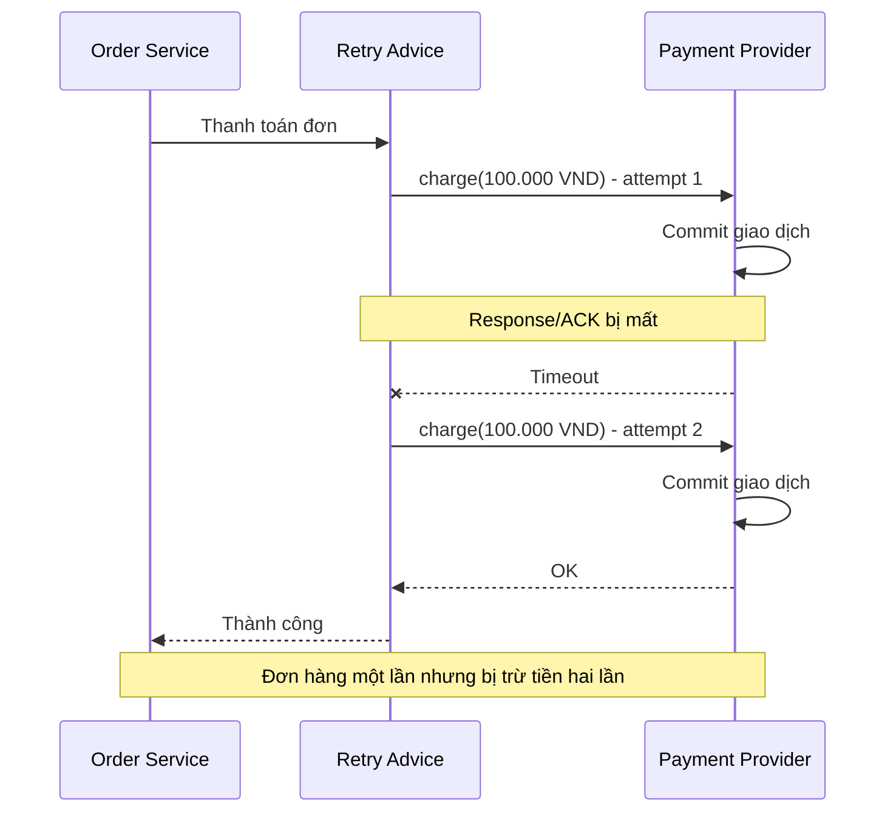
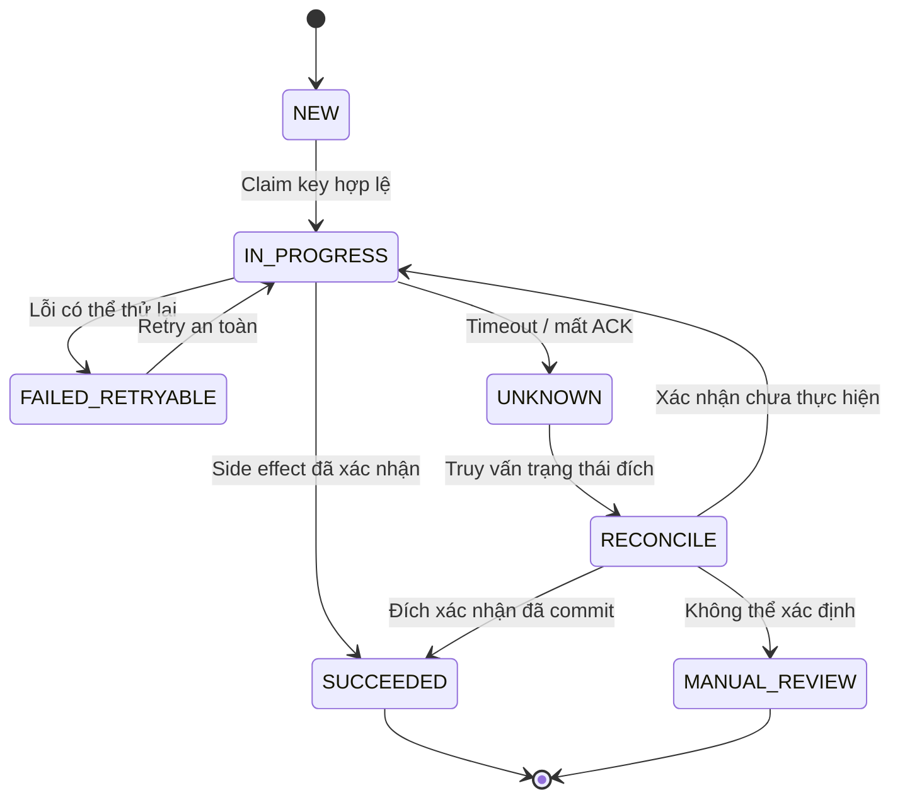
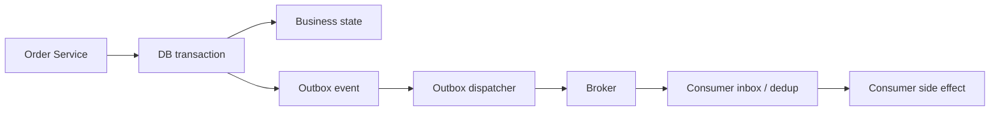

# Lỗi thường gặp: Retry tác dụng phụ nhưng không có idempotency

## 1. Một timeout có thể tạo ra hai giao dịch thành công

Trong Spring Integration, `RequestHandlerRetryAdvice` giúp thử lại một handler sau khi nó ném exception. Đây là công cụ hữu ích đối với lỗi tạm thời, nhưng cũng có thể tạo ra **tác dụng phụ bị thực hiện nhiều lần** nếu handler gọi một hệ thống có thay đổi trạng thái mà không có cơ chế **idempotency** (tính an toàn khi lặp lại cùng yêu cầu).

Hãy xem một flow thanh toán:

```text
Gateway -> Transformer -> Router -> chargePayment -> confirmationChannel
                                  |
                                  +-- retry advice: tối đa 3 attempts
```

Lần đầu, cổng thanh toán **đã trừ tiền** nhưng response bị mất do timeout. Handler ném exception; retry advice gọi lại handler, tạo thêm một lệnh trừ tiền. Cổng thanh toán có thể ghi hai giao dịch, mặc dù khách hàng chỉ đặt một đơn hàng.



Bài **“Retry tác dụng phụ nhưng không có idempotency”** thuộc chương **Lỗi thường gặp** của module `SPRING_INTEGRATION_PATTERN`. Mục tiêu của module là thực hành Enterprise Integration Patterns bằng Spring Integration để xây dựng các luồng message ít phụ thuộc và dễ mở rộng, bao gồm Router, Filter, Transformer, Splitter, Aggregator, Gateway, retry, error channel, correlation và kiểm thử các nhánh xử lý. Bài này tập trung vào một sai lầm có thể gây hậu quả nghiệp vụ nghiêm trọng: **coi retry như thao tác vô hại đối với những lệnh có side effect**.

Sau bài học, bạn có thể:

1. Phân biệt **attempt**, **message delivery**, **logical operation** và tác dụng phụ đã commit.
2. Hiểu vì sao timeout, rollback, redelivery hoặc mất ACK có thể tạo duplicate.
3. Chọn khóa idempotency ổn định và chính sách kiểm tra payload trùng khóa.
4. Dùng unique constraint và transaction để bảo vệ tác dụng phụ **trong cùng database**.
5. Gọi API ngoài bằng idempotency key khi nhà cung cấp hỗ trợ; biết cách xử lý kết quả `UNKNOWN` khi không hỗ trợ.
6. Đánh giá giới hạn của `Idempotent Receiver`, `MetadataStore`, outbox/inbox, retry advice và DLQ.
7. Viết test cho timeout sau commit, gửi trùng đồng thời, lỗi giữa transaction và replay từ dead letter.

## 2. Retry không đồng nghĩa “làm đúng một lần”

**Retry** thực hiện lại một thao tác sau lỗi. **Idempotency** là thuộc tính cho phép nhiều yêu cầu có cùng ý định nghiệp vụ dẫn tới cùng một kết quả có hiệu lực như một yêu cầu, trong phạm vi hợp đồng đã xác định.

Ví dụ:

| Thao tác | Có an toàn khi gọi lại không? | Rủi ro |
| --- | --- | --- |
| Đọc dữ liệu bằng khóa | Thường an toàn nếu không có side effect ẩn | Dữ liệu có thể đổi giữa các lần đọc |
| Gán trạng thái `order.status = PAID` | Có thể idempotent nếu cập nhật có điều kiện | Có thể phát event/notification trùng kèm theo |
| `balance = balance - 100` | **Không** idempotent | Trừ tiền nhiều lần |
| `INSERT` bản ghi không có unique key nghiệp vụ | **Không** idempotent | Tạo nhiều bản ghi cùng ý nghĩa |
| Gửi email/SMS | Không mặc nhiên idempotent | Gửi nhiều thông báo |
| Gửi event vào broker | Không mặc nhiên idempotent | Nhiều bản sao có thể được consumer nhận |
| Gọi API thanh toán có idempotency key | Phụ thuộc **hợp đồng của nhà cung cấp** | Key sai/TTL hết vẫn có thể bị trừ lặp |

Các khái niệm quan trọng:

- **At-least-once delivery:** message có thể được gửi/nhận nhiều lần để tránh bỏ sót, vì vậy consumer phải sẵn sàng xử lý duplicate.
- **At-most-once delivery:** một message có thể bị mất, nhưng cơ chế vận chuyển không chủ động giao lặp.
- **Exactly-once effect:** kết quả nghiệp vụ được bảo vệ để chỉ có **một** tác dụng phụ hợp lệ, không có nghĩa toàn hệ thống chỉ chạy handler đúng một lần.
- **Idempotency key:** định danh **một ý định nghiệp vụ**, được tái sử dụng qua tất cả retry, redelivery và replay thuộc ý định đó.
- **Deduplication:** nhận diện yêu cầu đã gặp; dedup chưa chắc đồng nghĩa tác dụng phụ đã được commit thành công.
- **Correlation ID/trace ID:** hỗ trợ liên kết log và trace; không tự thay thế idempotency key.

`RequestHandlerRetryAdvice` có thể gọi handler nhiều lần trong **cùng lượt xử lý**. Một polling consumer có transaction rollback, Kafka consumer redelivery hoặc việc replay DLQ có thể gọi lại **toàn bộ flow** ở thời điểm khác. Không thể chỉ bật retry advice rồi kết luận hệ thống an toàn với duplicate.

## 3. Các cửa sổ lỗi sinh duplicate

Hãy chia thao tác có side effect thành các mốc:

```text
T0: Consumer nhận message
T1: Bắt đầu thực hiện side effect
T2: Side effect đã commit ở hệ thống đích
T3: Consumer nhận ACK/response
T4: Consumer ghi nhận message hoàn tất
```

| Thất bại ở đâu? | Hệ quả khi retry | Điều kiện an toàn |
| --- | --- | --- |
| Trước T1 | Tác dụng phụ chưa chạy | Retry thường có thể thực hiện, nhưng cần giới hạn |
| Giữa T1 và T2 | Có thể đã/ chưa commit | Không thể mặc định mọi lỗi là “chưa thực hiện” |
| **Giữa T2 và T3** | **Đã commit nhưng caller tưởng thất bại** | Idempotency ở đích hoặc truy vấn trạng thái đáng tin cậy |
| Giữa T3 và T4 | Tác dụng phụ đã hoàn tất nhưng consumer chưa checkpoint | Consumer dedup, transaction/outbox hoặc state replay-safe |
| Sau T4 | Message bị broker giao lặp | Cơ chế nhận biết operation đã xử lý |

Một exception kiểu `SocketTimeoutException` chỉ cho biết **caller không nhận được kết quả đúng thời hạn**, không chứng minh hệ thống đích chưa commit. Đây là lý do “retry mọi timeout” đặc biệt nguy hiểm khi handler gửi tiền, đặt hàng, trừ tồn kho hoặc gửi thông báo.

## 4. Ví dụ sai: retry một side effect không có khóa nghiệp vụ

Đoạn code minh họa một anti-pattern:

```java
import org.springframework.messaging.Message;

final class UnsafePaymentHandler {
    private final PaymentClient paymentClient;

    UnsafePaymentHandler(PaymentClient paymentClient) {
        this.paymentClient = paymentClient;
    }

    void handle(Message<PaymentCommand> message) {
        PaymentCommand command = message.getPayload();
        // LỖI: mỗi lần gọi là một lệnh charge độc lập.
        // Nếu provider commit rồi response timeout, advice sẽ charge lại.
        paymentClient.charge(command.customerId(), command.amount());
    }
}

record PaymentCommand(
        String paymentIntentId, String customerId, long amount) {}

interface PaymentClient {
    void charge(String customerId, long amount);
}
```

Nếu endpoint này được cấu hình `RequestHandlerRetryAdvice`, advice không biết phương thức `charge()` đã tạo tác dụng phụ chưa. Khi gặp exception, nó chỉ biết có lỗi và quyết định gọi lại.

**Những cách sửa sai thường gặp nhưng chưa đủ:**

- “Chỉ retry hai lần”: vẫn có thể trừ tiền **ba lần**.
- “Kiểm tra một biến `processed` trong RAM”: restart hoặc nhiều instance sẽ mất/tranh chấp trạng thái.
- “Dùng `message.getHeaders().getId()` làm khóa”: message mới sinh từ replay/Transformer có thể mang ID khác.
- “Ghi `processed=true` trước khi gọi API”: crash sau khi ghi nhưng trước khi gọi sẽ làm mất nghiệp vụ.
- “Ghi `processed=true` sau khi gọi API”: crash sau khi API commit nhưng trước khi ghi sẽ gây duplicate.
- “Bọc `@Transactional` quanh lệnh gọi HTTP”: database transaction cục bộ **không** rollback được tiền đã trừ ở hệ thống ngoài.

## 5. Thiết kế idempotency key theo ý định nghiệp vụ

Một khóa tốt phải ổn định qua attempts và chỉ đại diện cho **một ý định có hiệu lực**.

Ví dụ `paymentIntentId=pay-order-42-v1` được tạo khi người dùng xác nhận thanh toán đơn hàng #42. Mọi retry, redelivery và replay **của cùng lệnh** phải dùng lại ID đó. Nếu khách hàng chủ động thực hiện lần thanh toán thứ hai (một ý định mới), cần một key mới.

### 5.1. Quy tắc thiết kế khóa

| Quy tắc | Ví dụ đúng | Lỗi nếu bỏ qua |
| --- | --- | --- |
| Ổn định qua retry | Cùng `paymentIntentId` cho 3 attempts | Sinh UUID mới ở mỗi attempt làm dedup vô dụng |
| Có namespace/tenant | `tenantId + operationType + intentId` | Hai tenant có thể vô tình đụng khóa |
| Gắn với một nội dung logic | Cùng key phải có cùng loại thao tác, số tiền, currency... | Một key bị dùng lại với payload khác nhưng bị coi là thành công |
| Có retention đủ dài | Bảo lưu tới hết cửa sổ redelivery/replay có thể xảy ra | TTL quá ngắn, replay cũ có thể chạy lại side effect |
| Không do caller tùy ý quyết định quyền | Server kiểm tra ownership/authorization của intent | Client có thể dùng key của tài khoản khác |
| Không dùng cho metric tag | ID nằm trong audit/log có phân quyền | Gây cardinality cao và có thể lộ dữ liệu |

Nếu cùng idempotency key được gửi với **payload khác**, phải trả về **conflict** hoặc một kết quả xác thực rõ ràng, không âm thầm cho phép tác dụng phụ khác. Có thể so sánh những trường hợp đồng đã canonicalize hoặc lưu request fingerprint. Fingerprint là dữ liệu hỗ trợ kiểm tra nội dung, không phải khóa authorization.

### 5.2. Trạng thái xử lý idempotent

Đối với lời gọi có thể kéo dài, việc khóa đã tồn tại **chưa đủ** để tuyên bố thành công:



Khi request trùng gặp một operation `IN_PROGRESS`, ứng dụng có thể trả `202 Accepted` kèm endpoint tra cứu, đợi có giới hạn hoặc trả conflict/retry-after theo hợp đồng. **Không** trả “thành công” chỉ vì có một row claim. Khi gặp trạng thái `UNKNOWN` từ hệ thống ngoài, không retry mù; cần reconcile hoặc một API idempotent ở đích.

## 6. Trường hợp an toàn hơn: tác dụng phụ trong cùng database

Nếu thao tác và bản ghi dedup nằm **trong một database có transaction**, ta có thể dùng unique constraint để bảo đảm một operation chỉ áp dụng thay đổi trạng thái một lần.

Ví dụ đặt giữ 3 đơn vị hàng tồn kho cho `operationId=res-42`. Dữ liệu minh họa dùng **PostgreSQL**, Java 17, Spring Boot 3.x và Spring Integration 6.x.

### 6.1. Schema bảo vệ duplicate

```sql
CREATE TABLE inventory_stock (
    sku            VARCHAR(64) PRIMARY KEY,
    available      INTEGER NOT NULL CHECK (available >= 0)
);

CREATE TABLE inventory_reservation (
    operation_id   VARCHAR(120) PRIMARY KEY,
    sku            VARCHAR(64) NOT NULL,
    quantity       INTEGER NOT NULL CHECK (quantity > 0),
    created_at     TIMESTAMPTZ NOT NULL DEFAULT now()
);
```

`operation_id` là unique key nghiệp vụ; `sku` và `quantity` lưu lại để so sánh khi cùng operation ID được gửi lại. Đây là bảng **đã thực hiện** reservation, không phải chỉ là bảng “đã nhận message”. Với kết quả API phức tạp, có thể lưu thêm trạng thái/result snapshot đã cam kết.

### 6.2. Service dùng unique constraint và cùng transaction

```java
import java.util.Objects;

import org.springframework.jdbc.core.JdbcTemplate;
import org.springframework.stereotype.Service;
import org.springframework.transaction.annotation.Transactional;

record ReservationCommand(String operationId, String sku, int quantity) {}

record ReservationResult(String operationId, String outcome) {}

record SavedReservation(String sku, int quantity) {}

class IdempotencyConflictException extends RuntimeException {
    IdempotencyConflictException(String message) {
        super(message);
    }
}

class InsufficientStockException extends RuntimeException {
    InsufficientStockException(String message) {
        super(message);
    }
}

@Service
class ReservationService {
    private final JdbcTemplate jdbc;

    ReservationService(JdbcTemplate jdbc) {
        this.jdbc = jdbc;
    }

    @Transactional
    public ReservationResult reserve(ReservationCommand command) {
        Objects.requireNonNull(command.operationId(), "operationId");
        Objects.requireNonNull(command.sku(), "sku");
        if (command.quantity() <= 0) {
            throw new IllegalArgumentException("quantity must be positive");
        }

        // Unique constraint quyết định ai được phép thực hiện operation.
        int inserted = jdbc.update("""
            INSERT INTO inventory_reservation(operation_id, sku, quantity)
            VALUES (?, ?, ?)
            ON CONFLICT (operation_id) DO NOTHING
            """,
            command.operationId(), command.sku(), command.quantity());

        if (inserted == 0) {
            SavedReservation previous = jdbc.queryForObject("""
                SELECT sku, quantity
                FROM inventory_reservation
                WHERE operation_id = ?
                """,
                (rs, row) -> new SavedReservation(
                        rs.getString("sku"), rs.getInt("quantity")),
                command.operationId());

            if (!Objects.equals(previous.sku(), command.sku())
                    || previous.quantity() != command.quantity()) {
                throw new IdempotencyConflictException(
                        "Cùng operationId nhưng nội dung yêu cầu khác");
            }
            return new ReservationResult(
                    command.operationId(), "ALREADY_APPLIED");
        }

        int updated = jdbc.update("""
            UPDATE inventory_stock
               SET available = available - ?
             WHERE sku = ?
               AND available >= ?
            """,
            command.quantity(), command.sku(), command.quantity());

        if (updated != 1) {
            // RuntimeException -> rollback cả INSERT lẫn UPDATE.
            throw new InsufficientStockException(
                    "Không đủ hàng hoặc SKU không tồn tại");
        }
        return new ReservationResult(command.operationId(), "APPLIED");
    }
}
```

**Vì sao cách này chặn duplicate?**

1. Với request đầu tiên, `INSERT` thành công rồi `UPDATE inventory_stock` trừ tồn kho **trong cùng transaction**. Nếu không đủ hàng, transaction rollback cả hai bước.
2. Với request trùng sau khi transaction đầu đã commit, unique constraint làm `INSERT ... ON CONFLICT DO NOTHING` trả 0. Service kiểm tra nội dung trước đó và **không trừ kho lần thứ hai**.
3. Với hai request trùng chạy đồng thời, PostgreSQL dùng unique index/transaction để điều phối tranh chấp key; chỉ transaction giành được quyền insert mới có thể thực hiện `UPDATE`. Request thứ hai đợi/đọc kết quả đã commit theo hành vi cô lập của database.
4. Nếu lần đầu commit xong nhưng phản hồi tới client bị mất, request retry với cùng `operationId` sẽ thấy `ALREADY_APPLIED` thay vì giảm tồn kho lần nữa.

**Các điều kiện không được bỏ qua:** phương thức `@Transactional` phải được gọi qua Spring proxy từ bean khác; cấu hình transaction manager và datasource đúng; cả bảng reservation và inventory sử dụng **cùng transaction**; không gửi HTTP side effect ra ngoài transaction rồi cho rằng transaction này kiểm soát được nó.

Nếu API yêu cầu trả **cùng response như lần đầu**, nên lưu hoặc tái dựng result ổn định. Trong ví dụ, `APPLIED` và `ALREADY_APPLIED` cố ý khác nhau để minh họa; client phải hiểu cả hai đều có nghĩa reservation đã áp dụng một lần.

### 6.3. Ghép service vào một IntegrationFlow

```java
import org.springframework.context.annotation.Bean;
import org.springframework.context.annotation.Configuration;
import org.springframework.integration.annotation.EnableIntegration;
import org.springframework.integration.channel.DirectChannel;
import org.springframework.integration.channel.QueueChannel;
import org.springframework.integration.dsl.IntegrationFlow;
import org.springframework.messaging.MessageChannel;
import org.springframework.messaging.PollableChannel;

@Configuration
@EnableIntegration
class ReservationFlowConfiguration {

    @Bean("reserveInput")
    MessageChannel reserveInput() {
        return new DirectChannel();
    }

    @Bean("reserveResults")
    PollableChannel reserveResults() {
        return new QueueChannel();
    }

    @Bean
    IntegrationFlow reserveFlow(ReservationService reservations) {
        return IntegrationFlow.from("reserveInput")
                .handle(ReservationCommand.class,
                        (command, headers) -> reservations.reserve(command))
                .channel("reserveResults")
                .get();
    }
}
```

Nếu gắn `RequestHandlerRetryAdvice` vào handler trên, việc retry sau **timeout ở phía caller hoặc exception retryable** vẫn không trừ kho thêm vì side effect cùng database đã được bảo vệ. Nhưng tránh retry lỗi `IdempotencyConflictException`, `IllegalArgumentException` hoặc thiếu hàng cố định; retry policy cần phân loại lỗi để không tăng tải vô ích.

## 7. Side effect ngoài database: khóa phải được đích thực thi

Mẫu local transaction ở mục 6 **không đủ** cho thao tác gọi thanh toán, gửi SMS hoặc tạo shipment ở hệ thống ngoài. Một bản ghi `operationId` trong database của ứng dụng không thể nguyên tử với giao dịch phía nhà cung cấp nếu không có một giao thức/contract bổ sung.

### 7.1. Gửi idempotency key cho API có hỗ trợ

Giả sử nhà cung cấp thanh toán cam kết rằng các request có cùng key và cùng tham số được xử lý như một ý định trong thời gian lưu khóa:

```java
interface IdempotentPaymentClient {
    PaymentReceipt charge(
            String idempotencyKey,
            String customerId,
            long amountInMinorUnits,
            String currency);
}

record PaymentReceipt(String providerTransactionId, String state) {}

final class SafePaymentHandler {
    private final IdempotentPaymentClient client;

    SafePaymentHandler(IdempotentPaymentClient client) {
        this.client = client;
    }

    PaymentReceipt handle(PaymentCommand command) {
        // Key đã được tạo/ủy quyền từ ý định thanh toán ở ingress.
        // KHÔNG tạo UUID mới trong mỗi lần handle()/retry.
        return client.charge(
                command.paymentIntentId(),
                command.customerId(),
                command.amount(),
                "VND");
    }
}
```

Ứng dụng phải kiểm tra **hợp đồng cụ thể** của API: key được truyền ở header nào, thời gian giữ key, xử lý request đồng thời, status khi xử lý đang diễn ra và có trả lại response cũ hay không. Không thể mặc định mọi nhà cung cấp đều triển khai idempotency như nhau.

Với một API có cơ chế idempotency chắc chắn, retry sau timeout vẫn dùng **cùng key**. Nếu key đã hết TTL, cần reconcile bằng transaction ID hoặc nguồn sự thật khác **trước khi cho phép retry lại**.

### 7.2. Nếu hệ thống ngoài KHÔNG có idempotency API

Khi response bị timeout, kết quả có thể là `UNKNOWN`. Không có phương pháp chỉ dùng `RetryTemplate` ở client để bảo đảm đúng một lần trừ tiền. Hướng xử lý gồm:

- Truy vấn trạng thái từ provider bằng tham chiếu đơn hàng hoặc operation ID đáng tin cậy.
- Nếu provider có lookup đáng tin cậy, reconcile `SUCCEEDED`/`NOT_FOUND`/`UNKNOWN`; chỉ gọi lại khi có bằng chứng an toàn.
- Nếu không có truy vấn hoặc key phía đích, chuyển sang xử lý đối soát, compensation hoặc manual review theo mức độ rủi ro.
- Không tuyên bố “exactly once” chỉ vì client đã đặt lock hoặc dedup flag.
- Nếu cần tích hợp lâu dài, đàm phán hợp đồng idempotent API hoặc thiết kế một gateway có khả năng quyết định kết quả dựa trên bằng chứng phía đích.

**Quan trọng:** Một database lock chỉ ngăn hai instance của **ứng dụng mình** gọi đồng thời. Nó không làm cho lần gọi trước đã timeout trở nên “chưa commit” ở hệ thống thanh toán.

## 8. Idempotent Receiver pattern và giới hạn của MetadataStore

Spring Integration hỗ trợ **Idempotent Receiver** thông qua `IdempotentReceiverInterceptor` và selector dựa trên `MetadataStore`, chẳng hạn `MetadataStoreSelector`. Pattern giúp nhận diện message trùng theo key đã chọn và xử lý duplicate theo chính sách endpoint.

Nhưng **đặt dấu key vào metadata store và thực hiện side effect ở một hệ thống khác** là hai thao tác có thể không nguyên tử:

```text
Trường hợp A:
    Đánh dấu key=processed
    [crash]
    Chưa thực hiện side effect
    -> duplicate đến sau bị bỏ qua: MẤT NGHIỆP VỤ

Trường hợp B:
    Thực hiện side effect, provider đã commit
    [crash]
    Chưa ghi key=processed
    -> duplicate đến sau xử lý tiếp: TÁC DỤNG PHỤ LẶP
```

Đây là lý do **metadata-store dedup chỉ là một lớp bảo vệ**, không phải bằng chứng exactly-once end-to-end. Nếu key/side effect cùng nằm trong database, cần transaction như mục 6. Nếu side effect nằm bên ngoài, cần hợp đồng idempotency của đích hoặc cơ chế reconcile.

### Khi cấu hình Idempotent Receiver, kiểm tra:

1. **Key extractor:** dùng ID ổn định như `sourceEventId`/`paymentIntentId`, không dùng ID của message mới được tạo trong flow.
2. **Store:** `SimpleMetadataStore` trong RAM không bền qua restart và không phối hợp được nhiều instance; cân nhắc JDBC/Redis/shared store phù hợp triển khai.
3. **Atomic claim:** API store có bảo đảm xử lý nhiều consumer đồng thời đúng không? Đọc rồi ghi theo hai thao tác không nguyên tử có race condition.
4. **Phạm vi side effect:** có transaction chung với dedup marker không? Nếu không, phải có xử lý lỗi giữa hai bước.
5. **Duplicate policy:** discard, đánh dấu duplicate header, trả kết quả cũ hay route sang review? Không tự suy luận tất cả duplicate đều là lỗi.
6. **TTL/cleanup:** key hết hạn có thể cho phép một message replay rất cũ chạy lại; retention phải gắn với redelivery và dữ liệu nghiệp vụ.
7. **Content conflict:** cùng key nhưng payload khác là vấn đề cần báo, không tự trả “đã xử lý”.

Với Reactor, broker, poller hoặc `ExecutorChannel`, việc đổi thread không thay đổi các điều kiện an toàn trên. `ErrorMessage`, retry advice và trace context chỉ giúp xử lý/quan sát; không làm các side effect trở nên idempotent.

## 9. Outbox, inbox và cơ chế chống trùng ở consumer

Khi hệ thống cần vừa lưu database vừa phát event, **Transactional Outbox** giảm nguy cơ “commit DB nhưng mất message” bằng cách ghi business state và outbox record trong cùng transaction:



Tuy nhiên, dispatcher có thể publish cùng outbox event **nhiều lần** nếu broker đã nhận nhưng ACK về dispatcher bị mất. Vì vậy **outbox không tự biến downstream consumer thành exactly-once**.

Một consumer có thể dùng **Inbox/Processed Events**:

```sql
CREATE TABLE processed_event (
    consumer_name VARCHAR(80) NOT NULL,
    source_event_id VARCHAR(120) NOT NULL,
    received_at TIMESTAMPTZ NOT NULL DEFAULT now(),
    PRIMARY KEY (consumer_name, source_event_id)
);
```

Khi xử lý event, consumer cần claim/inbox record và **thay đổi business state trong cùng transaction** nếu cả hai thuộc cùng database. Nếu nhận duplicate, kiểm tra content/contract và trả kết quả phù hợp thay vì chạy side effect lần nữa. Nếu consumer tiếp tục gọi API ngoài thì vẫn cần idempotency phía API như mục 7.

Những điểm cần đối soát:

| Kịch bản | Điều có thể xảy ra | Bảo vệ cần thiết |
| --- | --- | --- |
| DB commit, dispatcher chưa gửi | Outbox tồn đọng | Dispatcher retry, theo dõi oldest outbox age |
| Broker nhận, dispatcher không nhận ACK | Outbox event được gửi lại | Consumer inbox/dedup |
| Consumer commit DB, chưa ACK broker | Broker redelivery | Inbox + business effect cùng transaction |
| Consumer gọi external API, mất response | Không rõ đã commit | External idempotency key/reconcile |
| DLQ replay sau nhiều ngày | Key cũ có thể đã hết TTL | Retention và policy replay phù hợp |

**Không sử dụng trace ID làm inbox key** vì một business event có thể đi qua nhiều trace; dùng ID ổn định do publisher định danh event.

## 10. Retry policy phải biết loại lỗi và giới hạn thời gian

Sau khi bảo vệ side effect, vẫn cần **chọn loại lỗi đáng retry** và hạn chế tải.

| Lỗi | Có nên retry? | Vì sao |
| --- | --- | --- |
| Timeout mạng khi provider có idempotency contract | Có thể, với cùng key và giới hạn | Tránh tạo side effect mới |
| Database transient deadlock / connection issue | Có thể, với transaction rollback và key ổn định | Lỗi thường tạm thời; vẫn phải kiểm tra commit ambiguity |
| Validation sai dữ liệu | Thường không | Retry không sửa payload |
| Cùng key nhưng payload khác | **Không** | Là conflict về hợp đồng idempotency |
| Thiếu tồn kho thực sự | Thường không retry tức thì | Phụ thuộc chính sách chờ nhập kho |
| HTTP 429 | Có theo Retry-After/rate limit | Tránh retry storm |
| Mất ACK sau side effect không idempotent | **Không retry mù** | Không biết trạng thái đích |

Ví dụ cấu hình giới hạn `RequestHandlerRetryAdvice` (minh họa; chỉ an toàn khi handler đã được bảo vệ idempotency):

```java
import org.springframework.context.annotation.Bean;
import org.springframework.integration.handler.advice.RequestHandlerRetryAdvice;
import org.springframework.retry.backoff.ExponentialBackOffPolicy;
import org.springframework.retry.policy.SimpleRetryPolicy;
import org.springframework.retry.support.RetryTemplate;

@Bean
RequestHandlerRetryAdvice safeRetryAdvice() {
    RetryTemplate retry = new RetryTemplate();

    // Tổng cộng tối đa 3 attempts, không phải 3 retries + lần đầu.
    retry.setRetryPolicy(new SimpleRetryPolicy(3));

    ExponentialBackOffPolicy backoff = new ExponentialBackOffPolicy();
    backoff.setInitialInterval(200L);
    backoff.setMultiplier(2.0);
    backoff.setMaxInterval(2_000L);
    retry.setBackOffPolicy(backoff);

    RequestHandlerRetryAdvice advice = new RequestHandlerRetryAdvice();
    advice.setRetryTemplate(retry);
    return advice;
}
```

Đoạn trên là **khung minh họa**: `SimpleRetryPolicy(3)` có thể retry cả lỗi không nên retry theo cấu hình mặc định. Trong production, cần classifier theo **exception cause chain**, exclude lỗi validation/idempotency conflict và có retry budget/time limit theo SLO. Backoff ở trên không có jitter; khi nhiều worker truy cập cùng dependency, nên dùng chiến lược có jitter nếu thư viện/thiết kế hỗ trợ.

### Retry trong Spring Integration có nhiều phạm vi

- **Synchronous advice:** gắn `RequestHandlerRetryAdvice` vào handler, có thể gọi lại handler trong cùng thread.
- **Polling consumer:** rollback có thể dẫn đến redelivery, chạy lại toàn bộ các bước phía trước.
- **Error channel:** việc error được publish đến `errorChannel` phụ thuộc đường xử lý và channel đồng bộ/bất đồng bộ; không phải tất cả exception đều tự tới global error channel.
- **Dead letter/replay:** sau khi hết retry, message có thể được gửi tới kho lỗi để xử lý sau. Replay phải giữ operation ID gốc và nguồn sự thật về outcome.
- **Splitter/Aggregator:** một yêu cầu gốc tạo nhiều fragment; một fragment retry không đồng nghĩa phải lặp lại cả operation nếu trạng thái nhóm đã thay đổi.

Nếu workflow có nhiều nhánh Router, Filter và Transformer, hãy xác định **bước nào có side effect thật** và đặt guard ở chính ranh giới đó. Không mặc định một idempotent filter ở ingress bảo vệ mọi downstream handler nếu có retry, failover hoặc replay độc lập.

## 11. Case study: giữ hàng rồi gửi thông báo

Giả sử flow:

```text
orderInput
  -> validationFilter
  -> routeByWarehouse
  -> reserveInventory (DB)
  -> createShipment   (external HTTP)
  -> sendEmail        (external API)
  -> confirmation
```

Ba side effects cần **ba idempotency contracts riêng**, vì một thao tác có thể hoàn tất còn thao tác sau thất bại:

| Bước | Khóa gợi ý | Bảo vệ | Khi timeout |
| --- | --- | --- | --- |
| Giữ tồn kho | `reservationIntentId` | Unique constraint + cùng DB transaction | Query reservation theo key, không trừ thêm |
| Tạo vận đơn | `shipmentIntentId` | API idempotency key hoặc lookup theo reference | Reconcile trạng thái đơn vận chuyển |
| Gửi email | `notificationIntentId` | Dedup/outbox + provider contract nếu có | Có thể cần chấp nhận at-least-once hoặc kiểm tra trạng thái gửi |

Nếu `reserveInventory` thành công nhưng `createShipment` lỗi:

1. Retry shipment với **cùng shipment key** nếu provider hỗ trợ.
2. Không tự động thực hiện lại reservation chỉ vì whole flow nhận một exception.
3. Nếu shipment không thể thành công, có thể dùng **compensating action** hoàn lại reservation, cũng cần idempotency.
4. Tránh gửi email “đơn hàng hoàn tất” trước khi kết quả nghiệp vụ thực sự được xác nhận.

**Saga/compensation không phải rollback tự động**: compensation cũng có thể thất bại, được retry và gây side effect mới. Cần audit trạng thái từng bước, thứ tự xử lý và khóa cho chính thao tác compensation.

## 12. Theo dõi lỗi retry không có idempotency

Metric giúp phát hiện duplicate và retry storm, nhưng không thay thế kho audit:

| Metric đề xuất | Loại | Ý nghĩa |
| --- | --- | --- |
| `app.eip.handler.attempts` | Counter | Số lần handler thực sự chạy, kể cả retry |
| `app.eip.handler.attempt.errors` | Counter | Những attempts thất bại |
| `app.eip.idempotency.applied` | Counter | Operation mới thực sự áp dụng side effect |
| `app.eip.idempotency.duplicate` | Counter | Duplicate hợp lệ được nhận diện |
| `app.eip.idempotency.conflict` | Counter | Cùng key nhưng nội dung không khớp |
| `app.eip.idempotency.inprogress` | Gauge | Số operation chưa có kết quả cuối cùng |
| `app.eip.external.unknown` | Counter/Gauge theo hợp đồng | Kết quả chưa xác định, cần reconcile |
| `app.eip.reconcile.pending` | Gauge | Operation đang chờ đối soát |
| `app.eip.dlq.pending` | Gauge | Message đang chờ recovery |
| `app.eip.replay.outcomes` | Counter | Kết quả replay (success/error/skipped) |

**Không dùng** `paymentIntentId`, `orderId`, `messageId`, `traceId` hay payload làm metric tags. Tag nên lấy từ danh sách hữu hạn như `flow=orders`, `stage=reserveInventory`, `outcome=duplicate|applied|conflict`.

### Ví dụ PromQL

Nếu ứng dụng chủ động xuất các Counter trên bằng Micrometer/Prometheus, tên exporter thường có dấu gạch dưới và hậu tố `_total`. Hãy kiểm tra tên thật trong exporter:

```promql
sum(rate(app_eip_idempotency_duplicate_total{
  flow="orders"
}[5m]))
```

Tỷ lệ duplicate trên những request đã có kết quả phân loại (không phải tỷ lệ double charge):

```promql
sum(rate(app_eip_idempotency_duplicate_total{
  flow="orders"
}[5m]))
/
clamp_min(
  sum(rate(app_eip_idempotency_duplicate_total{flow="orders"}[5m]))
  +
  sum(rate(app_eip_idempotency_applied_total{flow="orders"}[5m])),
  0.000001
)
```

Các alert hữu ích gồm: số `UNKNOWN` kéo dài, attempt tăng nhưng logical throughput không tăng, conflict tăng, DLQ backlog/oldest age tăng và reconciliation thất bại. **Duplicate detected cao** có thể do broker redelivery hợp lệ, nhưng vẫn cần xác định không có **duplicate side effect**; hai con số này khác nhau.

### Audit event cho một operation

Một chuỗi audit có thể gồm:

```json
[
  {"eventType":"OPERATION_RECEIVED","operationId":"res-42","attempt":1},
  {"eventType":"SIDE_EFFECT_COMMITTED","operationId":"res-42","attempt":1},
  {"eventType":"RESPONSE_LOST","operationId":"res-42","attempt":1},
  {"eventType":"DUPLICATE_DETECTED","operationId":"res-42","attempt":2},
  {"eventType":"RESULT_RETURNED","operationId":"res-42","attempt":2}
]
```

Đây là **schema minh họa**, không phải event tự có của Spring Integration. Bản ghi `RESPONSE_LOST` có thể **không được biết trực tiếp** ở phía server; trong audit thực tế nên ghi những mốc quan sát được và chỉ suy luận sau khi đối soát. Lưu event ở nơi đủ bền, kiểm soát quyền truy cập và tránh để logging lỗi làm mất toàn bộ bằng chứng nghiệp vụ.

## 13. Kiểm thử bắt buộc trước khi bật retry

Chỉ kiểm thử “handler lỗi rồi thành công ở lần hai” là chưa đủ. Cần chủ động mô phỏng **lỗi xảy ra sau side effect**.

### 13.1. Kiểm thử local transaction với PostgreSQL

Giả sử dùng Testcontainers PostgreSQL hoặc database test thật có hỗ trợ `ON CONFLICT`. Sau khi khởi tạo dữ liệu:

```text
inventory_stock(sku="BOOK", available=10)
```

Các assertion cốt lõi:

```java
import static org.assertj.core.api.Assertions.assertThat;
import static org.assertj.core.api.Assertions.assertThatThrownBy;

void duplicateReservationMustNotReduceStockTwice(
        ReservationService service, JdbcTemplate jdbc) {
    ReservationCommand command =
            new ReservationCommand("res-42", "BOOK", 3);

    ReservationResult first = service.reserve(command);
    ReservationResult duplicate = service.reserve(command);

    Integer available = jdbc.queryForObject(
            "SELECT available FROM inventory_stock WHERE sku = ?",
            Integer.class, "BOOK");

    assertThat(first.outcome()).isEqualTo("APPLIED");
    assertThat(duplicate.outcome()).isEqualTo("ALREADY_APPLIED");
    assertThat(available).isEqualTo(7);

    assertThatThrownBy(() ->
            service.reserve(new ReservationCommand("res-42", "BOOK", 4)))
            .isInstanceOf(IdempotencyConflictException.class);
}
```

Đây là **đoạn thân test minh họa**; để chạy trong CI, tạo test fixture PostgreSQL, thực thi schema và gọi qua Spring-managed service proxy. Không bọc cả test bằng transaction rollback chung nếu mục tiêu là kiểm tra hành vi commit qua những lời gọi tách biệt.

### 13.2. Ma trận tình huống cần kiểm chứng

| Ca kiểm thử | Kỳ vọng |
| --- | --- |
| Một operation thành công | Side effect áp dụng đúng một lần |
| Gửi lại cùng key, cùng nội dung | Không làm side effect lần nữa; trả kết quả phù hợp |
| Gửi lại cùng key, **khác** nội dung | Conflict rõ ràng; không áp dụng tác dụng phụ mới |
| Hai worker đồng thời xử lý cùng key | Unique/atomic claim bảo đảm một lần áp dụng |
| Lỗi sau insert dedup nhưng trước update DB | **Rollback cả hai**, retry sau có thể thực hiện thành công |
| DB commit rồi response bị mất | Retry thấy kết quả đã commit, không thay đổi state lần hai |
| HTTP external commit rồi timeout | Retry cùng key nếu provider bảo đảm; nếu không, vào reconcile |
| TTL idempotency hết trước redelivery | Không được thực hiện duplicate; có retention hoặc tra cứu bổ sung |
| Broker redelivery sau consumer commit | Inbox/dedup bảo vệ side effect |
| Replay DLQ sau rollout phiên bản mới | Vẫn giữ business operation ID gốc, kiểm soát schema/rule migration |
| Một fragment của Splitter retry | Không nhân đôi side effect dù fragment/message ID thay đổi |
| Aggregator release lặp do sự cố | Output/side effect phía sau được bảo vệ bằng ID logical group |
| Compensation retry | Thao tác bù cũng có idempotency key độc lập |
| MetadataStore mất dữ liệu khi restart | Test chứng minh không thể chỉ dựa vào RAM để chống duplicate |

### 13.3. Fault injection theo mốc commit

Đặt fault ở **trước side effect**, **sau side effect nhưng trước ACK** và **sau ACK nhưng trước lưu trạng thái consumer**. Khi mô phỏng tác dụng phụ ngoài DB, dùng fake provider có lưu số lượt commit thật và khả năng cố tình trả timeout **sau khi đã commit**.

Một bộ test tốt cần xác nhận cả:

- **Operation outcome:** kết quả nghiệp vụ có đúng không?
- **Number of committed side effects:** side effect được thực hiện chính xác bao nhiêu lần?
- **Retry behavior:** lần nào retry được, lần nào cần dừng/reconcile?
- **Audit/correlation:** có đủ chứng cứ nối các attempts với cùng ý định không?
- **Metrics:** attempts, duplicates, conflicts, unknown/recovery được ghi đúng vị trí không?

Đừng chỉ assert số exception hoặc số lần `channel.send()` được gọi. Những số đo đó không thể chứng minh không bị trừ tiền/trừ kho hai lần.

## 14. Checklist chống lỗi trước production

- [ ] Xác định chính xác handler nào có side effect và phạm vi retry của từng endpoint.
- [ ] Định nghĩa business operation ID/idempotency key **trước** khi vào retry; không tạo key mới ở mỗi attempt.
- [ ] Cùng key chỉ đại diện cho một nội dung nghiệp vụ; kiểm tra conflict khi payload khác.
- [ ] Với cùng database, dùng unique constraint + transaction chung cho dedup record và business update.
- [ ] Với API ngoài, kiểm tra idempotency contract/TTL của nhà cung cấp; có quy trình reconcile khi trạng thái `UNKNOWN`.
- [ ] Không nhầm `IdempotentReceiverInterceptor`/MetadataStore với exactly-once effect xuyên nhiều hệ thống.
- [ ] Với outbox/inbox, chống duplicate ở consumer và xử lý lost ACK sau commit.
- [ ] Retry policy phân loại transient/permanent, giới hạn attempts/backoff/time budget.
- [ ] Dead letter/replay giữ operation ID và có giới hạn redrive; compensation cũng idempotent.
- [ ] Test duplicate đồng thời, crash trước/sau commit, timeout sau side effect và replay sau restart.
- [ ] Có metric riêng cho attempt, duplicate detected, side effect applied, conflict, unknown/reconcile.
- [ ] Không dùng business ID/trace ID/raw payload làm metric tag; dùng audit/log bảo vệ dữ liệu khi cần tra cứu chi tiết.
- [ ] Không dùng một ACK/exception làm bằng chứng duy nhất về side effect thực tế; kiểm tra mốc commit/đối soát.

## 15. Tài liệu tham khảo

- [Spring Integration — Handler Advice và Retry](https://docs.spring.io/spring-integration/reference/handler-advice/classes.html)
- [Spring Integration — Idempotent Receiver](https://docs.spring.io/spring-integration/reference/handler-advice/idempotent-receiver.html)
- [Spring Integration — Error Handling](https://docs.spring.io/spring-integration/reference/error-handling.html)
- [Spring Integration — Transaction Support](https://docs.spring.io/spring-integration/reference/transactions.html)
- [Spring Retry Reference](https://docs.spring.io/spring-retry/reference/)
- [Spring Framework — Declarative Transaction Management](https://docs.spring.io/spring-framework/reference/data-access/transaction/declarative.html)
- [PostgreSQL — INSERT và ON CONFLICT](https://www.postgresql.org/docs/current/sql-insert.html)
- [Enterprise Integration Patterns — Idempotent Receiver](https://www.enterpriseintegrationpatterns.com/patterns/messaging/IdempotentReceiver.html)

**Ghi nhớ:** retry chỉ lặp lại lời gọi; nó **không biết** tác dụng phụ trước đó đã commit hay chưa. Để tránh trừ tiền, giữ hàng hoặc tạo vận đơn trùng, phải dùng **một idempotency key ổn định**, thực thi ràng buộc **ở đúng nơi side effect được commit**, và có quy trình **đối soát trạng thái chưa xác định**. Chỉ khi đó retry, error channel và replay mới hỗ trợ phục hồi mà không biến một lỗi tạm thời thành hai tác dụng phụ thật.
