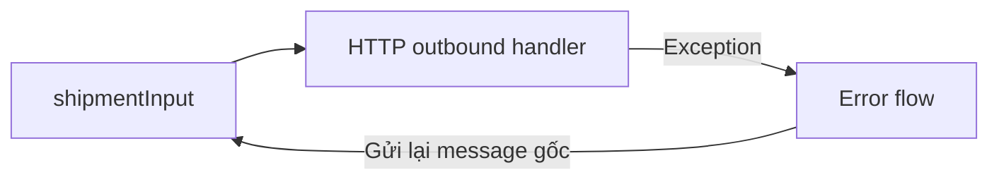
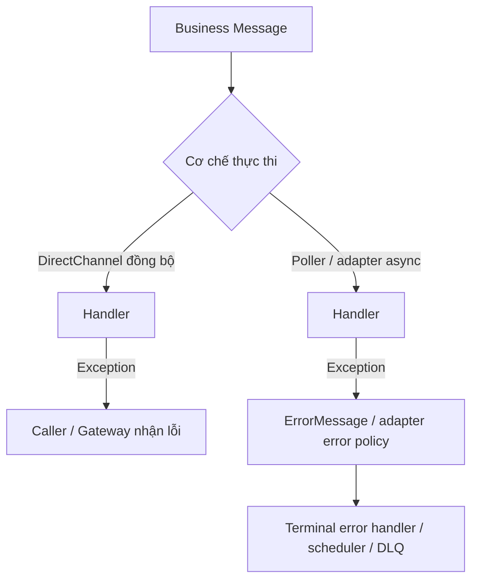
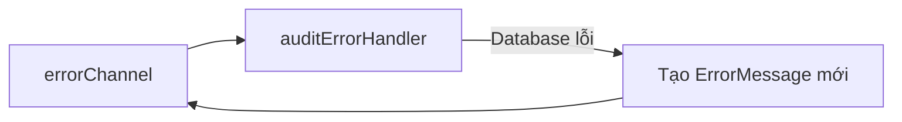
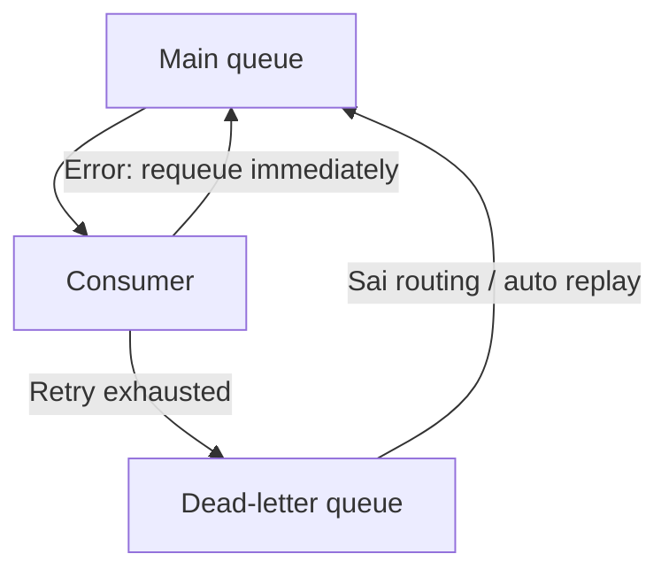
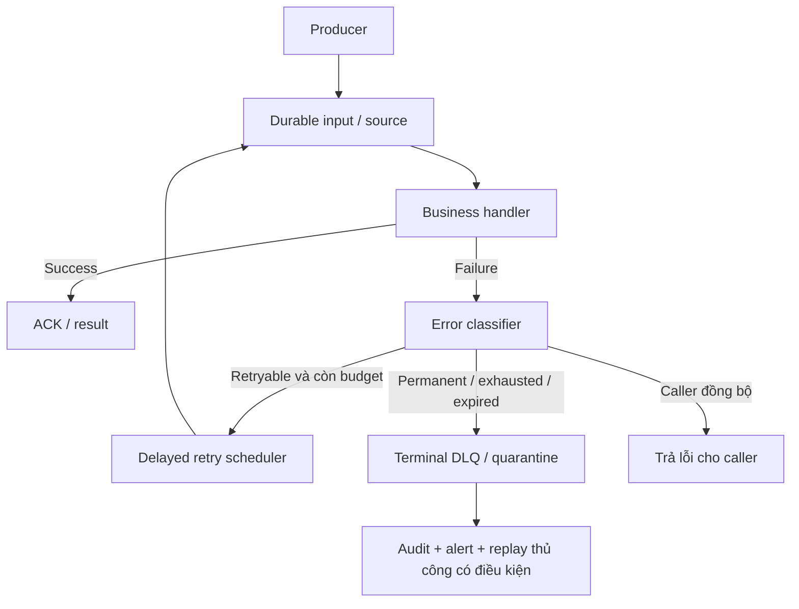

# Lỗi thường gặp: Error flow tự tạo vòng lặp trong Spring Integration

> **Module:** `SPRING_INTEGRATION_PATTERN` — Học triển khai Enterprise Integration Patterns với Spring Integration để xây dựng luồng thông điệp ít phụ thuộc và dễ mở rộng. Thực hành Router, Filter, Transformer, Splitter, Aggregator, Gateway, retry, error channel và correlation, đồng thời kiểm thử, theo dõi các nhánh xử lý.
>
> **Chương:** Lỗi thường gặp  
> **Đề bài:** Error flow tự tạo vòng lặp

## 1. Tình huống: lỗi được xử lý nhưng số message lỗi lại tăng không ngừng

Một luồng tích hợp nhận yêu cầu tạo vận đơn, gọi API của đối tác và xử lý lỗi bằng một error flow. Khi đối tác trả HTTP 503, nhóm phát triển muốn “thử lại ngay” nên chuyển message gây lỗi trở lại channel đầu vào:



Nếu API vẫn lỗi, quy trình cứ quay lại chỗ cũ. Kết quả có thể là:

- Cùng một `businessId` hoặc `correlationId` xuất hiện hàng nghìn lần trong log.
- Lưu lượng request outbound tăng dù chỉ có một message mới từ producer.
- CPU, thread pool, queue hoặc broker backlog tăng bất thường.
- Một lỗi phụ trong error handler lại tạo `ErrorMessage` mới, khiến log lồng nhau.
- Khi lỗi mạng đã hết, hệ thống có thể gửi trùng tác dụng nghiệp vụ do retry không có idempotency.

Đây là lỗi **feedback loop**: đường xử lý lỗi dẫn về một điểm có thể tiếp tục tạo ra chính lỗi đó mà không có điều kiện dừng hoặc lịch phục hồi an toàn.

Bài học trình bày cách nhận diện vòng lặp trong Spring Integration, phân biệt nó với retry có giới hạn, thiết kế error sink *terminal*, xử lý delayed retry và DLQ, đồng thời kiểm thử đường lỗi bằng số lần gọi thực tế thay vì chỉ nhìn log.

## 2. Cần phân biệt bốn loại vòng lặp

| Dạng | Cơ chế tạo vòng lặp | Dấu hiệu thường thấy |
|---|---|---|
| **Error-to-input loop** | Error handler gửi lại message gốc vào cùng input channel gây lỗi | Một message sinh rất nhiều lần gọi cùng handler |
| **Error-handler failure loop** | Handler của error channel tự ném exception, lỗi đó tiếp tục kích hoạt xử lý lỗi | Chuỗi exception/error message lặp hoặc lồng nhau |
| **Unbounded retry loop** | RetryAdvice, scheduler hoặc SDK không có retry budget/backoff phù hợp | Retry liên tục; attempt count tăng không có điểm kết thúc |
| **Broker/DLQ routing loop** | NACK/requeue tức thời hoặc DLQ được route trở lại queue nguồn | Message bị giao lại liên tục; số redelivery tăng |

Một hệ thống có thể mắc **nhiều dạng cùng lúc**. Ví dụ error flow đưa message về broker ngay, broker giao lại, HTTP handler lỗi, rồi error flow phát thêm một event lỗi vào một kênh cũng gặp sự cố.

Để xử lý đúng, cần xác định **ai sở hữu message**, **đường quay về ở đâu**, **điều kiện dừng** và **mỗi attempt có tác dụng phụ nào**.

## 3. ErrorMessage và error channel thực sự hoạt động ra sao?

Spring Integration dùng `Message<?>` cho luồng nghiệp vụ. Khi xử lý không thành công, một số thành phần có thể phát một `ErrorMessage`, trong đó payload là một `Throwable` (thường có thể là `MessagingException`). Exception này có thể mang tham chiếu tới message gây lỗi (*failed message*) để điều tra.

Các khái niệm quan trọng:

- **ErrorMessage:** thông điệp về lỗi, *không phải* message nghiệp vụ đã được sửa.
- **errorChannel:** địa chỉ logic để chuyển ErrorMessage theo cấu hình flow/adapter hoặc error channel mặc định trong các tình huống được hỗ trợ.
- **Failed message:** message liên quan tới exception; cần kiểm tra trước khi lấy lại payload và headers.
- **Recovery:** quyết định nghiệp vụ tiếp theo: trả lỗi, retry có giới hạn, đưa vào DLQ, bù trừ, cảnh báo hoặc chờ xử lý thủ công.

**Không phải mọi exception đều tự động vào global `errorChannel`.**

Với `DirectChannel`, handler thường chạy trên thread của người gửi; exception có thể truyền ngược trực tiếp đến Gateway/caller. Trong luồng bất đồng bộ như executor, poller hoặc inbound adapter, lỗi có thể được bao thành ErrorMessage và gửi tới error channel, hoặc được adapter/broker xử lý theo policy riêng. Chi tiết còn phụ thuộc thành phần, phiên bản và cách cấu hình.



Do đó, khi một error flow “không nhận lỗi”, đừng lập tức nối global errorChannel về đầu vào. Trước hết phải xác nhận **đường exception thực tế**.

### Phân biệt hai loại đối tượng trong handler

Ví dụ handler được gọi khi nhận ErrorMessage:

```java
import org.springframework.messaging.MessagingException;
import org.springframework.messaging.Message;
import org.springframework.messaging.support.ErrorMessage;

public void inspect(ErrorMessage errorMessage) {
    Throwable cause = errorMessage.getPayload();

    Message<?> failed = null;
    if (cause instanceof MessagingException messagingException) {
        failed = messagingException.getFailedMessage();
    }

    // failed có thể null: không suy đoán luôn có message gốc.
    // Log reason/correlation an toàn, KHÔNG tự gửi failed vào input.
}
```

Khi exception bị bọc nhiều lớp hoặc ErrorMessage do adapter khác tạo, message gốc có thể nằm ở một mức khác hay không tồn tại. Hãy dùng API và metadata của adapter đang triển khai, không giả định `getFailedMessage()` lúc nào cũng trả về message.

## 4. Anti-pattern 1: Error flow đẩy lại channel đầu vào

Đây là cấu trúc nguy hiểm:

```text
shipmentInput ──> validate/transform ──> HTTP handler
     ^                                    |
     |                                    | lỗi
     +──────── errorHandler <── errorChannel
                 "gửi lại message gốc"
```

Một cách viết sai về mặt ý tưởng:

```java
// PSEUDOCODE CỐ Ý SAI, không dùng trong production.
void onError(ErrorMessage error) {
    Message<?> failed = findFailedMessage(error);

    // Không có attempt count, backoff, giới hạn thời gian hay DLQ.
    shipmentInput.send(failed);
}
```

Ngay khi lỗi chưa được khắc phục, handler chạy lại và có thể phát ra cùng lỗi. Với `DirectChannel` đồng bộ, cách gọi lồng nhau còn có nguy cơ tăng độ sâu call stack hoặc ném lỗi ngược qua nhiều lớp. Với executor/broker, nó có thể tạo vòng lặp bất đồng bộ kéo dài, khó nhìn ra từ stack trace.

### Vì sao “chuyển lại để retry” là sai?

- Không có **điều kiện dừng**: không giới hạn số lần hoặc tuổi message.
- Không có **thời điểm retry**: nếu lỗi do quota/503 tạm thời thì thử lại ngay thường càng quá tải.
- Không phân loại **transient vs permanent**: payload sai vẫn được retry vô hạn.
- Không có **quyền sở hữu message rõ ràng**: có thể bị mất khi gửi lại thất bại hoặc bị nhân đôi khi ACK không đúng.
- Không có **idempotency**: nếu kết quả HTTP không rõ ràng, retry có thể tạo tác dụng phụ trùng.

**Cách sửa:** không nối trực tiếp error sink về input. Thay bằng một bước **quyết định lỗi** có số lần thử tối đa, thời điểm đủ điều kiện retry, TTL/deadline, bản ghi bền vững và một đường cuối cùng (terminal/DLQ). Sau đó chỉ retry khi scheduler/broker giao lại message theo chính sách rõ ràng.

## 5. Anti-pattern 2: Error handler tự tạo ErrorMessage mới

Giả sử handler của error channel thực hiện lưu audit vào một database. Khi database cũng lỗi, handler lại cố phát một ErrorMessage mới vào **chính error channel**:



Đây là **vòng lặp báo lỗi của chính bộ phận báo lỗi**. Tùy loại channel và cách xử lý exception, hệ thống có thể đệ quy, đẩy thêm task vào executor hoặc lặp qua subscriber. Không nên giả định framework sẽ chặn mọi vòng lặp như vậy.

### Ba nguyên tắc cho terminal error handler

1. **Không phát lại vào nguồn tạo lỗi.** Terminal handler nên ghi nhận kết quả phân loại, audit hoặc chuyển một lần vào DLQ riêng.
2. **Giới hạn sự phức tạp.** Không bắt đầu một chuỗi gọi mạng/DB có retry vô hạn chỉ để ghi log lỗi; nếu dependency audit không khả dụng, có một fallback độc lập và có giới hạn.
3. **Không nuốt lỗi nghiệp vụ quan trọng.** Ghi log xong không đồng nghĩa message đã xử lý thành công hoặc đã lưu vào DLQ. Quyết định ACK/rollback phải theo contract của producer/broker.

Một error sink đơn giản, chỉ ghi log có cấu trúc, thường an toàn hơn một error handler liên tục gửi thêm event qua hệ thống vừa thất bại. Tuy nhiên, **log-only không bảo đảm xử lý cuối cùng** cho đơn hàng/thanh toán; cần một nơi lưu kết quả lỗi bền vững và vận hành được.

## 6. Anti-pattern 3: Retry không giới hạn, không backoff

Retry là thao tác **thử lại có điều kiện**, không phải một đường nối vô tận từ error channel về input.

Hai cách dễ gây vòng nóng:

```text
onError:
    while true:
        attemptAgain()          # Không giới hạn, không backoff
```

```text
HTTP 429 -> retry ngay -> HTTP 429 -> retry ngay -> ...
```

Các tác động:

- Nhiều HTTP attempts có thể được phát ra sau một message nghiệp vụ.
- Local Rate Limiter có thể hết permit, dẫn tới lặp lỗi hết permit thay vì giúp hồi phục.
- Khi nhiều consumer retry đồng thời, xuất hiện *retry storm*.
- Lỗi vĩnh viễn (HTTP 400, schema sai, thiếu credential) không được sửa bằng retry.
- Deadline của Gateway hoặc độ tuổi message có thể bị vượt trước khi có kết quả.

### Chính sách retry an toàn hơn

| Trường hợp | Hành động mặc định hợp lý |
|---|---|
| HTTP 502/503, lỗi mạng tạm thời | Retry có giới hạn + exponential backoff + jitter |
| HTTP 429 remote | Ưu tiên `Retry-After` nếu hợp lệ; delay thay vì retry ngay |
| Local Rate Limiter hết permit | Chờ permit có timeout hoặc schedule retry sau; không vòng nóng |
| HTTP 400/422 dữ liệu không hợp lệ | Không retry mù quáng; trả lỗi hoặc DLQ để sửa dữ liệu |
| HTTP 401/403 | Điều tra authentication/authorization; tránh retry liên tục |
| Lỗi nghiệp vụ không thể sửa | Terminal failure hoặc quy trình bù trừ/điều tra |
| Hết số lần hoặc deadline | DLQ/quarantine + alert/replay theo chính sách |

Một retry policy cần có **attempt counter**, **deadline hoặc TTL**, **retryable classification** và **đường kết thúc**. Đếm retry theo **business operation** hay **outbound attempt** phải được quy định rõ để tránh reset counter mỗi khi đi qua một adapter.

## 7. Anti-pattern 4: Broker requeue và DLQ quay về queue nguồn

Trong hệ thống dùng RabbitMQ, Kafka hoặc broker khác, vòng lặp có thể xảy ra **ngoài Spring Integration**.



Ví dụ:

- Consumer xử lý message không hợp lệ rồi `nack/requeue=true` ngay, không delay, không tăng retry counter.
- Dead-letter exchange/routing key bị cấu hình để gửi trở lại queue nguồn; message cứ chuyển vòng giữa main queue và DLQ.
- Một consumer của DLQ mặc định gửi lại mọi message về main queue dù nguyên nhân chưa được sửa.
- Một scheduled retry copy message mới rồi ACK message cũ, nhưng crash giữa hai bước khiến có nguy cơ mất/nhân đôi nếu không có giao dịch hoặc thiết kế an toàn.

**DLQ không phải nơi tự động “chữa” message**. Nó là nơi giữ message đã được phân loại là cần điều tra, sửa dữ liệu hoặc replay theo chính sách. Nếu replay DLQ vào main queue, phải là thao tác có điều kiện, có kiểm soát phiên bản dữ liệu và retry budget.

**Lưu ý theo broker:** hành vi cụ thể của NACK, dead-letter exchange, delayed queue, visibility timeout và delivery count phụ thuộc sản phẩm/adapter. Không áp dụng một lệnh ACK/NACK giả định chung cho mọi broker.

## 8. Thiết kế đúng: Error flow có điểm kết thúc

Một topology dễ kiểm soát:



Đường `R → Q` **không phải feedback loop vô hạn** nếu mỗi lần quay lại đều:

1. Được ghi nhận bằng **attempt count không thể reset tùy tiện**.
2. Chờ **đến thời điểm hợp lệ**, không requeue tức thời vòng nóng.
3. Tuân theo **deadline/TTL** và số lần thử tối đa.
4. Giữ **idempotency key**/business ID để tránh tác dụng phụ trùng.
5. Có **một điểm dừng** khi lỗi vĩnh viễn, hết retry hoặc quá hạn.

Có thể sử dụng `RequestHandlerRetryAdvice` cho một số attempt ngắn, sau đó đưa message vào scheduled retry/DLQ theo policy. Nếu đã có retry trong Spring Integration, đồng thời bật retry ẩn trong HTTP SDK và broker, tổng số lần thử có thể vượt mức dự kiến do **nhiều tầng retry nhân với nhau**.

### Ước lượng số attempts từ nhiều tầng retry

Nếu Spring Retry cho tối đa 3 attempts và một HTTP SDK âm thầm thử 2 lần cho mỗi lần gọi handler, một business message có thể tạo tối đa **6 HTTP attempts** trước khi broker redelivery. Nếu broker giao lại thêm 4 lần thì về lý thuyết có thể phát tới **24 attempts**, chưa tính logic khác.

Vì vậy, cần **một sơ đồ retry tổng thể**, mô tả rõ chủ sở hữu budget ở từng tầng. Mỗi HTTP attempt phải đi qua quota provider nếu API tính giới hạn theo request thực tế.

## 9. Ví dụ Java: terminal error channel không gửi lại input

Ví dụ sau dùng Spring Boot/Spring Integration để tạo một **error sink chỉ quan sát**. Nó **không tự đăng ký tất cả exception của toàn ứng dụng**; adapter/poller/Gateway muốn dùng phải được cấu hình định tuyến ErrorMessage về `shipmentErrors` theo cơ chế của endpoint đó.

### 9.1. Dependencies và ứng dụng

```groovy
dependencies {
    implementation "org.springframework.boot:spring-boot-starter-integration"
}
```

```java
package com.example.errorloop;

import org.springframework.boot.SpringApplication;
import org.springframework.boot.autoconfigure.SpringBootApplication;
import org.springframework.integration.config.EnableIntegration;

@SpringBootApplication
@EnableIntegration
public class ErrorLoopApplication {

    public static void main(String[] args) {
        SpringApplication.run(ErrorLoopApplication.class, args);
    }
}
```

### 9.2. Error channel tách biệt

```java
package com.example.errorloop;

import org.springframework.context.annotation.Bean;
import org.springframework.context.annotation.Configuration;
import org.springframework.integration.channel.DirectChannel;
import org.springframework.messaging.MessageChannel;

@Configuration
public class ErrorFlowChannels {

    @Bean
    public MessageChannel shipmentErrors() {
        return new DirectChannel();
    }
}
```

`shipmentErrors` là channel được khai báo **dành riêng cho ErrorMessage**. Nó không được nối trở lại `shipmentInput` và không có default output channel trỏ về handler gây lỗi.

### 9.3. Terminal handler chỉ quan sát lỗi, không tạo vòng lặp

```java
package com.example.errorloop;

import org.slf4j.Logger;
import org.slf4j.LoggerFactory;
import org.springframework.integration.annotation.ServiceActivator;
import org.springframework.messaging.MessagingException;
import org.springframework.messaging.Message;
import org.springframework.messaging.support.ErrorMessage;
import org.springframework.stereotype.Component;

@Component
public class TerminalErrorObserver {

    private static final Logger log =
            LoggerFactory.getLogger(TerminalErrorObserver.class);

    @ServiceActivator(inputChannel = "shipmentErrors")
    public void onError(ErrorMessage error) {
        Throwable cause = error.getPayload();

        Message<?> failed = null;
        if (cause instanceof MessagingException messagingException) {
            failed = messagingException.getFailedMessage();
        }

        Object messageId = (failed != null)
                ? failed.getHeaders().getId()
                : "unknown";

        // Không in payload nhạy cảm, không gửi lại vào input channel.
        log.warn("shipment error: failedMessageId={} type={}",
                messageId, cause.getClass().getSimpleName());

        // Demo chỉ ghi log. Production cần kết nối durable DLQ/audit
        // và xác nhận ownership/ACK ở adapter một cách an toàn.
    }
}
```

Tại sao handler này không tự lặp?

- Nó không gọi `shipmentInput.send(...)` để tái thực thi ngay logic gây lỗi.
- Nó không gửi một ErrorMessage mới trở lại `shipmentErrors`.
- Nó không chạy một vòng retry không giới hạn.
- Nó không đánh đồng việc ghi log với xử lý hoàn tất message nghiệp vụ.

**Giới hạn:** Nếu logging backend lỗi hoặc có một interceptor khác ném exception, error handler vẫn có thể thất bại. Cần kiểm soát fallback và tránh để exception của error sink được phát lại vào chính sink đó. Với nghiệp vụ quan trọng, việc ghi log **chưa đủ** để quyết định ACK một message đã thất bại; hãy thiết kế DLQ/persistent error record và error policy riêng cho adapter.

### 9.4. Gửi ErrorMessage thủ công trong test/demo

```java
import org.springframework.messaging.MessageChannel;
import org.springframework.messaging.support.ErrorMessage;

// errorChannel ở đây là bean "shipmentErrors":
boolean accepted = errorChannel.send(
        new ErrorMessage(
                new IllegalStateException("Simulated provider failure")));

if (!accepted) {
    throw new IllegalStateException("Error sink unavailable");
}
```

Đây là cách mô phỏng **đường nhận ErrorMessage** để kiểm thử sink, không phải cách hook tự động mọi lỗi handler. Chỉ khi adapter/flow thật có cấu hình error channel tới `shipmentErrors` thì ErrorMessage do framework phát ra mới đến đây.

## 10. Ví dụ phân loại lỗi và giới hạn retry bằng code thuần

Để tránh một error handler “thấy lỗi là gửi lại ngay”, trước tiên tạo hàm quyết định thuần, có thể unit test độc lập với broker.

### 10.1. Định nghĩa trạng thái quyết định

```java
package com.example.errorloop;

public enum ErrorDecision {
    RETRY_LATER,
    DEAD_LETTER
}
```

```java
package com.example.errorloop;

public record FailureFacts(
        int attemptsSoFar,      // Đã thực sự thử bao nhiêu lần?
        int maxAttempts,        // Tối đa tổng số lần thử.
        long nextAttemptAtMs,   // Mốc thử lại đã tính (backoff).
        long expiresAtMs,       // Deadline nghiệp vụ.
        boolean retryable
) {
    public FailureFacts {
        if (attemptsSoFar < 1 || maxAttempts < 1
                || nextAttemptAtMs < 0 || expiresAtMs < 0) {
            throw new IllegalArgumentException("Invalid retry facts");
        }
    }
}
```

```java
package com.example.errorloop;

public final class FailureClassifier {

    private FailureClassifier() {}

    public static ErrorDecision decide(FailureFacts f, long nowMs) {
        if (!f.retryable()
                || f.attemptsSoFar() >= f.maxAttempts()
                || nowMs >= f.expiresAtMs()
                || f.nextAttemptAtMs() >= f.expiresAtMs()) {
            return ErrorDecision.DEAD_LETTER;
        }
        return ErrorDecision.RETRY_LATER;
    }
}
```

Ý nghĩa:

- Không retry lỗi **không thể phục hồi**.
- Không retry khi đã dùng hết tổng số attempts.
- Không tiếp tục khi message đã hết hạn.
- Không xếp lịch retry tại hoặc sau deadline.
- Khi quyết định `RETRY_LATER`, **không gửi ngay**; phải để scheduler/broker phát lại sau `nextAttemptAtMs`.

`FailureFacts` là dữ liệu nghiệp vụ của demo, không phải record do Spring Integration tự cung cấp. Khi chuyển qua broker, các trường attempts/deadline cần được **lưu bền vững và đáng tin cậy**; không chỉ lấy từ header do caller tùy ý sửa. Nếu business operation đã từng hoàn thành, idempotency/dedup phải ngăn retry gây tác dụng phụ lần nữa.

### 10.2. JUnit 5 kiểm tra điều kiện dừng

```java
package com.example.errorloop;

import static org.junit.jupiter.api.Assertions.assertEquals;
import org.junit.jupiter.api.Test;

class FailureClassifierTest {

    @Test
    void retryableErrorWithBudgetIsDelayed() {
        FailureFacts f = new FailureFacts(
                1, 3, 2_000L, 10_000L, true);
        assertEquals(ErrorDecision.RETRY_LATER,
                FailureClassifier.decide(f, 1_000L));
    }

    @Test
    void retryExhaustionStopsTheLoop() {
        FailureFacts f = new FailureFacts(
                3, 3, 4_000L, 10_000L, true);
        assertEquals(ErrorDecision.DEAD_LETTER,
                FailureClassifier.decide(f, 3_000L));
    }

    @Test
    void permanentErrorNeverRetries() {
        FailureFacts f = new FailureFacts(
                1, 3, 2_000L, 10_000L, false);
        assertEquals(ErrorDecision.DEAD_LETTER,
                FailureClassifier.decide(f, 1_000L));
    }

    @Test
    void expiredMessageNeverRetries() {
        FailureFacts f = new FailureFacts(
                1, 3, 11_000L, 10_000L, true);
        assertEquals(ErrorDecision.DEAD_LETTER,
                FailureClassifier.decide(f, 9_000L));
    }
}
```

Các test này xác minh **logic điều kiện dừng**, không chứng minh hệ thống đã bền vững khi crash hoặc framework đã route ErrorMessage đúng. Muốn kiểm chứng toàn luồng, cần thêm test tích hợp với Gateway, adapter/broker và stub HTTP.

## 11. Pseudocode xử lý lỗi có DLQ và delayed retry

Với broker có hỗ trợ cơ chế retry/delay, ý tưởng:

```text
onDelivery(delivery):
    try:
        result = provider.sendOnce(
            delivery.payload,
            idempotencyKey = delivery.businessOperationId
        )
        persistResult(result)
        broker.ack(delivery)
    catch error:
        classification = classify(error)
        nextAt = calculateBackoffAndRetryAfter(error)
        facts = loadTrustedAttemptBudget(delivery, nextAt)

        if FailureClassifier.decide(facts, now) == RETRY_LATER:
            broker.deferDeliverySafely(delivery, nextAt)
            # Không ACK trước khi message được giữ ở nơi an toàn.
        else:
            broker.deadLetterSafely(delivery, error, facts)
            # Terminal: không tự gửi DLQ -> input ngay.
```

**Đây là pseudocode**, không phải API chuẩn của Spring Integration hay broker. `deferDeliverySafely` và `deadLetterSafely` phải được hiện thực theo cơ chế atomic/transactional/ack của broker cụ thể, sao cho crash giữa “ghi message retry” và “ACK bản gốc” không gây mất message. Redelivery có thể xảy ra; mỗi attempt giữ **idempotency key ổn định**.

Đường error-to-input chỉ được thay bằng **scheduled redelivery có điểm dừng**. Một terminal DLQ phải là một nơi khác với đường retry bình thường; replay từ DLQ cần con người/quy trình phê duyệt và sửa nguyên nhân trước.

## 12. Tại sao retry budget có thể bị reset ngoài ý muốn?

Đây là lỗi thường xuất hiện khi người viết dùng header:

```text
attempt = message.headers["retryAttempt"] or 0
attempt += 1
sendBackToInput(message)
```

Nếu bước tạo Message mới không copy headers, `retryAttempt` biến mất. Lần xử lý tiếp theo lại bắt đầu từ 0, khiến “maxAttempts = 3” **không bao giờ đạt**.

Các nguyên nhân khác:

- Broker adapter chỉ serialize payload, làm mất metadata attempt/deadline.
- Một Router chuyển sang channel khác, nơi retry policy lại tạo `RetryContext` mới.
- Consumer restart và counter chỉ lưu trong RAM.
- Có cả retry trong SDK, RetryAdvice và broker redelivery mà mỗi tầng đếm riêng.
- Một HTTP endpoint nhận lại operation giống nhau nhưng gắn message ID mới.

**Biện pháp:**

1. Dùng business operation ID làm khóa ổn định; dedup/idempotency theo operation.
2. Lưu attempt count/deadline trong dữ liệu tin cậy, có khả năng sống qua restart theo yêu cầu.
3. Đếm **tổng số outbound attempts** trên các tầng và đánh dấu những lỗi retryable rõ ràng.
4. Khi deserialization, kiểm chứng metadata có còn nguyên, có bị caller giả mạo hay reset không.
5. Kết thúc vào DLQ/quarantine khi vượt budget.

Lưu ý: `RetryContext` của Spring Retry có phạm vi theo một lần thực thi retry template; **không tự trở thành attempt counter bền vững qua broker redelivery**.

## 13. Tương tác với Enterprise Integration Patterns khác

| Pattern | Cách vòng lặp hình thành | Cách phòng tránh |
|---|---|---|
| **Router** | Rule mặc định route ErrorMessage về channel nhận business message | Tách rule cho lỗi; route tới terminal/delayed-retry |
| **Filter** | Lỗi sau Filter bị gửi lại upstream, tiếp tục trượt cùng điều kiện | Phân loại lỗi vĩnh viễn; tránh retry dữ liệu không hợp lệ |
| **Transformer** | Tạo Message mới làm mất attempt/deadline/correlation | Bảo toàn metadata đáng tin cậy qua các hop |
| **Splitter** | Một message cha tạo N child; child lỗi retry quay lại trước Splitter và bị nhân N lần nữa | Retry đúng **child/attempt** hoặc chính sách nhóm, tránh tái split không chủ đích |
| **Aggregator** | Một nhóm thiếu child bị timeout; error flow phát lại toàn batch vào Splitter | Chọn recovery theo child/group, bảo vệ duplicate và release strategy |
| **Gateway** | Client timeout rồi gửi lại operation khi xử lý cũ chưa xong | Trả contract rõ ràng; idempotency/correlation |
| **RetryAdvice** | Retry mọi exception (kể cả lỗi quota) với số lần/timeout không phù hợp | RetryPolicy phân loại lỗi, attempts hữu hạn |
| **Rate Limiter** | Hết permit phát lỗi, error flow retry ngay nên tiếp tục hết permit | Delayed retry hoặc bounded wait, giữ quota ở từng HTTP attempt |
| **Error Channel** | ErrorMessage được gửi lại chính error channel hoặc input | Terminal sink tách biệt; không nối một chu trình không có guard |
| **Correlation** | Retry đánh mất business ID hoặc sinh ID mới, tránh được dedup | Giữ ID ổn định và ghi dấu attempt/trace |

### Khi Splitter/Aggregator kết hợp với error flow

Một batch ba phần tử tạo các child có `sequenceNumber=1..3`. Child thứ hai thất bại rồi được error handler gửi lại **toàn bộ batch cha**. Splitter tạo lại cả ba child, khiến child 1 và 3 có thể được gửi lặp dù trước đó đã thành công. Aggregator nhận message trùng, nhóm có thể release sai hoặc timeout nếu metadata các batch không nhất quán.

Thay vì re-run toàn batch một cách mù quáng, hãy chọn **retry per child** có idempotency hoặc quyết định reprocess toàn batch như một nghiệp vụ mới, với kế hoạch dedup/compensation và correlation rõ ràng.

## 14. Quan sát dấu hiệu vòng lặp bằng metric và tracing

Một vòng lặp lỗi thường dễ thấy qua tỷ lệ **nhiều attempts trên một business message**.

| Metric / dấu vết | Dùng để phát hiện |
|---|---|
| `incoming_business_messages_total` | Số message mới hợp lệ từ producer |
| `handler_attempts_total` | Số lần handler được gọi, bao gồm redelivery |
| `outbound_http_attempts_total` | Số request thật đi ra ngoài |
| `error_messages_total{type,flow}` | Tần suất ErrorMessage theo loại |
| `retry_attempts_total` và `retry_exhausted_total` | Số lần retry và tỷ lệ hết budget |
| `redelivery_count` | Message bị broker giao lại nhiều lần |
| `dlq_depth` và `dlq_replayed_total` | Số message lỗi terminal và số lần replay |
| `oldest_message_age_seconds` | Message lỗi bị kẹt lâu |
| `local_rate_limit_rejected_total` | Retry vòng nóng khi thiếu permit |
| `remote_http_429_total` | Provider trả lỗi quota sau khi đã gửi HTTP |

**Dấu hiệu cảnh báo:** Nếu số message mới không tăng nhưng `handler_attempts_total` và `error_messages_total` tăng rất nhanh, có thể đang có lỗi feedback/retry loop.

Khi log/tracing, nên có:

- `businessId` hoặc `operationId` ổn định qua redelivery.
- `messageId`, `correlationId`, `flowName`, `attemptNumber`.
- `errorType`, `errorPhase` (before-send, HTTP, after-send), `decision` (retry-later, terminal).
- `nextAttemptAt`, `deadline` và nơi hiện đang sở hữu message.

Không ghi credential, API key, toàn bộ payload nhạy cảm hoặc exception chi tiết có chứa bí mật ra log không kiểm soát. Với nhiều tenant, tránh tạo nhãn metric theo tenant ID vô hạn.

## 15. Quy trình debug lỗi error flow tự tạo vòng lặp

1. **Chọn một business ID cụ thể** bị lặp. Phân biệt message mới từ producer với redelivery/retry của cùng operation.
2. **Vẽ đường đi thực tế** từ input channel/adapter qua handler, error channel, router, retry scheduler và queue/DLQ.
3. **Xem loại exception và nơi phát lỗi**: đồng bộ trả về caller hay bất đồng bộ đưa vào ErrorMessage/adapter error handling?
4. **Kiểm tra error handler có output không**: có vô tình gửi failed message lại vào input/error channel hoặc một route quay về nguồn?
5. **Kiểm tra RetryAdvice/HTTP SDK/broker**: mỗi tầng tối đa bao nhiêu lần, có backoff/jitter/TTL không, có tầng nào vô hạn không?
6. **Kiểm tra message headers và state**: attempt counter, business ID, correlation, deadline có còn qua transform/serialize/restart không?
7. **Kiểm tra broker bindings và DLQ**: có đường dead-letter/requeue quay về main queue mà không có guard không?
8. **Đếm HTTP attempts thực tế** tại fake provider hoặc logging đủ tin cậy; không chỉ đếm ErrorMessage.
9. **Thêm điều kiện dừng và terminal sink**; nếu đã vượt budget thì DLQ/quarantine, tuyệt đối không tự replay lại ngay.
10. **Chạy lại test với lỗi cố định** (ví dụ luôn trả 503), sau đó với lỗi vĩnh viễn, 429, timeout và crash trước ACK.

### Ma trận chẩn đoán

| Hiện tượng | Nghi ngờ | Xác minh |
|---|---|---|
| Log cùng stack trace tăng cực nhanh | Error-to-input hoặc handler error recursion | Kiểm tra channel edges; giới hạn số handler invocations trong test |
| Queue ready giảm rồi tăng ngay, redelivered tăng | NACK/requeue nóng | Kiểm tra broker adapter policy và delay thật |
| DLQ gần như trống nhưng lỗi lặp mãi | Route DLQ về main hoặc recovery không terminal | Kiểm tra binding/consumer của DLQ |
| Chỉ lặp khi bật retry | RetryPolicy/HTTP SDK nested retry | Đếm outbound attempts trên stub server |
| Attempt header luôn = 1 | Counter mất ở transform/serialization | Assert metadata tại từng hop |
| Một batch sinh nhiều batch con | Retry quay về trước Splitter | Theo dõi correlation và số child được tạo |
| Rate limiter reject dày đặc | Retry ngay khi thiếu permit | Delay tới khi có permit hoặc fail fast đúng contract |
| Thử lại sau HTTP 200 và crash | ACK chưa ghi nhận, at-least-once redelivery | Idempotency key và reconciliation |

## 16. Kiểm thử chống vòng lặp

### 16.1. Điều kiện cần kiểm tra

- Với lỗi vĩnh viễn, **một** business operation phải kết thúc ở trạng thái terminal, không bị retry vô hạn.
- Với lỗi tạm thời luôn xảy ra, số attempts không vượt `maxAttempts` và cuối cùng được đưa tới DLQ/quarantine.
- Với HTTP 429, retry không sớm hơn thời điểm cho phép khi có `Retry-After` hợp lệ.
- Error sink chỉ ghi nhận **một ErrorMessage** đầu vào trong test đơn giản, không tự phát ErrorMessage mới.
- Khi error sink không khả dụng, adapter có fallback/ack policy rõ; message không mất âm thầm.
- Khi broker giao lại sau crash, business operation vẫn có idempotency key cũ và retry budget đúng.
- Khi Splitter tạo N child, lỗi một child không vô tình re-split và gửi lại toàn bộ N child.
- Rate limiter phải được áp dụng cho **mỗi HTTP attempt** thực sự, kể cả các lần retry.

### 16.2. Test error sink không tự lặp

Ví dụ JUnit 5, kiểm chứng một ErrorMessage được đưa vào `DirectChannel` với một subscriber duy nhất:

```java
import static org.junit.jupiter.api.Assertions.assertEquals;
import static org.junit.jupiter.api.Assertions.assertTrue;

import java.util.concurrent.atomic.AtomicInteger;
import org.junit.jupiter.api.Test;
import org.springframework.integration.channel.DirectChannel;
import org.springframework.messaging.support.ErrorMessage;

class ErrorSinkTest {

    @Test
    void terminalSubscriberDoesNotRepublishError() {
        DirectChannel errors = new DirectChannel();
        AtomicInteger observed = new AtomicInteger();

        errors.subscribe(message -> {
            observed.incrementAndGet();
            // Không publish lại vào 'errors' hoặc input channel.
        });

        assertTrue(errors.send(
                new ErrorMessage(new IllegalStateException("simulated"))));

        assertEquals(1, observed.get());
    }
}
```

Test này **không** chứng minh error routing thực của poller/Gateway/broker; nó chỉ chứng minh thiết kế subscriber terminal đơn giản không phát thêm message. Integration test phải chạy trên flow và adapter cụ thể.

### 16.3. Test một luồng lỗi không có đường quay về không kiểm soát

Với fake provider **luôn trả HTTP 503**, hãy kiểm tra:

1. Một business operation chỉ có tối đa N HTTP attempts như chính sách.
2. Trình tự attempt timestamps có khoảng backoff tối thiểu phù hợp; không có retry nóng.
3. Sau N attempts, có đúng một terminal failure record/DLQ theo business key.
4. Sau khi đạt terminal state, không còn attempt mới trong một khoảng quan sát đủ dài.
5. Nếu chủ động replay DLQ, thao tác phải tạo một vòng xử lý có chính sách mới được xác nhận, không tự khởi động vô hạn.
6. Nếu có nhiều replica, counter và key idempotency phải có phạm vi chia sẻ phù hợp.

Ngoài 503, kiểm tra thêm HTTP 400 (dừng ngay), 429 (trì hoãn), timeout sau khi provider xử lý thành công (idempotency), crash sau send trước ACK, và trường hợp audit/DLQ sink cũng bị lỗi.

## 17. Checklist production

- [ ] Error channel/route không gửi vô điều kiện về input channel.
- [ ] Terminal error handler không tự phát ErrorMessage vào chính error channel đó.
- [ ] Mỗi nhóm lỗi có chính sách rõ: retry-later, reject, DLQ, bù trừ hoặc cảnh báo.
- [ ] Retry budget tổng và deadline/TTL không reset do transform, broker hoặc restart.
- [ ] Retry có backoff/jitter và hỗ trợ `Retry-After` cho HTTP 429 theo contract.
- [ ] Không bật nhiều lớp retry ẩn mà chưa tính tổng số attempts.
- [ ] Mỗi outbound attempt đi qua limiter của provider theo đúng quota key.
- [ ] DLQ không được cấu hình auto-replay vô hạn về main queue.
- [ ] ACK/nack/transaction và delayed retry đảm bảo message ownership khi lỗi/crash.
- [ ] Idempotency và correlation ID ổn định cho cùng business operation.
- [ ] Metric phân biệt local quota reject, HTTP 429, handler error, redelivery và exhausted retry.
- [ ] Có integration test chứng minh lỗi vĩnh viễn và lỗi tạm thời cuối cùng đều có điểm dừng.

## 18. Bài tập thực hành

**Bài 1 — Chỉ ra vòng lặp trên sơ đồ.** Một handler nhận message từ `ordersIn`, lỗi được gửi vào `ordersError`, error handler gửi failed message vào `ordersIn`. Hãy vẽ đường đi của một message luôn thất bại và giải thích vì sao nó không có điểm dừng.

**Bài 2 — Sửa error handler.** Từ đoạn anti-pattern ở phần 4, đề xuất một error classifier có `maxAttempts=3`, retry delay và terminal DLQ. Giải thích cách giữ attempt count khi broker serialize/deserialize message.

**Bài 3 — Tạo test cố định lỗi 503.** Fake provider trả 503 ở mọi request, cho phép tối đa ba attempts. Đo số HTTP requests, backoff và đảm bảo không có outbound attempt sau khi chuyển terminal.

**Bài 4 — Lỗi ở chính error sink.** Giả lập database audit không khả dụng. Hãy thiết kế fallback có giới hạn và giải thích vì sao gửi lại ErrorMessage vào cùng channel audit là sai.

**Bài 5 — Broker/DLQ cycle.** Cho consumer NACK/requeue ngay với message dữ liệu sai; quan sát redelivery. Thay bằng một route tới DLQ không tự replay, có mã lỗi và khả năng điều tra thủ công.

**Bài 6 — Splitter và retry.** Một batch gồm 20 child; một child bị lỗi. So sánh retry tại child handler với việc error flow gửi lại batch cha trước Splitter. Đếm số outbound attempts tiềm năng và đề xuất idempotency/correlation phù hợp.

**Bài 7 — Rate Limiter + retry.** Outbound quota 5 attempts/giây, lỗi HTTP 429 yêu cầu `Retry-After: 2`. Thiết kế lịch retry không tạo vòng nóng, bảo đảm từng attempt đi qua limiter và không giữ thread Gateway quá deadline.

### Câu hỏi tự đánh giá

1. Vì sao error handler phát lại failed message vào input channel dễ tạo feedback loop?
2. Một ErrorMessage có phải luôn đồng nghĩa failed message gốc đang nằm trong payload không?
3. Vì sao lỗi từ DirectChannel đồng bộ có thể không xuất hiện ở global errorChannel?
4. Sự khác biệt giữa delayed retry có `maxAttempts` và requeue liên tục là gì?
5. Nếu counter chỉ nằm ở header nhưng Transformer làm mất header, điều kiện dừng retry bị ảnh hưởng thế nào?
6. Nếu DLQ route lại main queue, vì sao tên “DLQ” không tự bảo đảm terminal handling?
7. Vì sao “đã log lỗi” chưa đủ để ACK một đơn hàng quan trọng?
8. Vì sao một API timeout có thể cần idempotency dù rate limiter đã hoạt động đúng?
9. Khi Splitter tạo nhiều child, vì sao gửi lại batch cha có thể gây duplicate?
10. Những metric nào giúp phân biệt error-loop với nhiều message mới thật sự từ producer?

## 19. Tài liệu tham khảo

- [Spring Integration — Error Handling](https://docs.spring.io/spring-integration/reference/error-handling.html): ErrorMessage, error channel và xử lý lỗi theo loại flow.
- [Spring Integration — Message Channels](https://docs.spring.io/spring-integration/reference/channel.html): DirectChannel, PubSub và channel execution semantics.
- [Spring Integration — Request Handler Advice](https://docs.spring.io/spring-integration/reference/handler-advice.html): retry/error advice và cách bọc handler.
- [Spring Integration — Messaging Gateways](https://docs.spring.io/spring-integration/reference/gateway.html): truyền exception và request-reply.
- [Spring Integration — Message Routing](https://docs.spring.io/spring-integration/reference/router.html): Router, điều hướng message theo điều kiện.
- [Spring Integration — Splitter/Aggregator](https://docs.spring.io/spring-integration/reference/splitter.html): fan-out, correlation và xử lý group.
- [Spring Retry](https://github.com/spring-projects/spring-retry): retry policies, backoff và attempt bounds.
