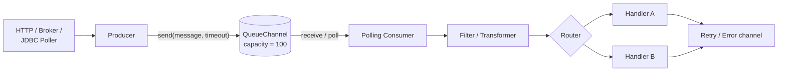
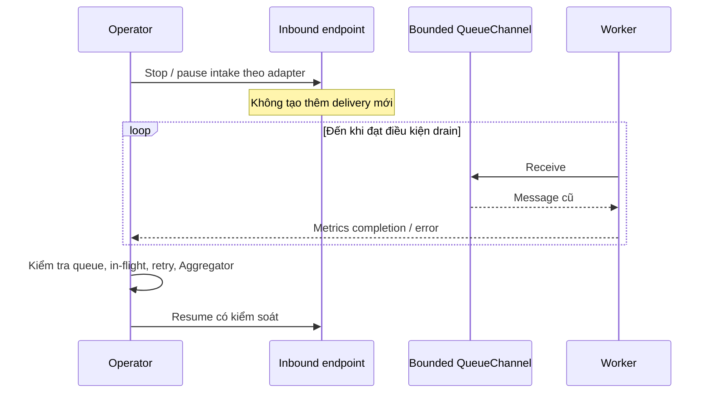

# Queue channel đầy nhưng không có policy

## 1. Vấn đề: giới hạn queue không phải chính sách xử lý quá tải

Trong một hệ thống Spring Integration, `QueueChannel` là kênh **pollable** có thể giữ message chờ một consumer đến lấy. Nó giúp tách nhịp của nơi sản xuất message khỏi nhịp của nơi xử lý. Nhưng nếu producer tạo ra message nhanh hơn consumer, backlog tăng cho đến khi queue hết khả năng tiếp nhận.

Một lỗi thiết kế thường gặp là thêm `new QueueChannel(100)` rồi xem như đã giải quyết xong bài toán tải. Thực ra con số `100` chỉ giới hạn số message chờ **trên kênh đó**. Nó không nói:

- Producer phải làm gì nếu queue đang chứa đủ 100 message?
- Có được chờ không, chờ tối đa bao lâu?
- Message bị từ chối sẽ quay về nguồn, được lưu bền vững hay bị bỏ?
- HTTP caller, broker, polling adapter có nhận được tín hiệu quá tải chính xác không?
- Worker chậm hoặc dừng lâu thì khi nào cần cảnh báo, giảm tốc hoặc mở rộng năng lực?
- Nếu retry/replay, làm sao không xử lý trùng và không phá thứ tự nghiệp vụ?

Bài **“Queue channel đầy nhưng không có policy”** thuộc chương **Lỗi thường gặp** của module **SPRING_INTEGRATION_PATTERN**. Module hướng tới việc thực hành Enterprise Integration Patterns với Spring Integration để xây dựng luồng thông điệp ít phụ thuộc, dễ mở rộng: Router, Filter, Transformer, Splitter, Aggregator, Gateway, retry, error channel và correlation, cùng các kỹ thuật kiểm thử và theo dõi nhánh xử lý.

Sau khi học xong, bạn có thể:

1. Giải thích điều gì xảy ra khi `QueueChannel` có dung lượng hữu hạn bị đầy, khác với queue không giới hạn.
2. Thiết kế **overflow policy** rõ ràng cho từng loại message và từng nguồn.
3. Sử dụng `send(message, timeout)` để không vô tình chờ vô hạn hoặc bỏ qua thông báo không nhận được message.
4. Kết hợp backpressure, retry có giới hạn, lưu bền vững, idempotency và chính sách acknowledgment.
5. Kiểm thử đầy queue, từ chối message, giải phóng dung lượng và resume consumer.
6. Xây dashboard/runbook nhận biết queue gần đầy trước khi hệ thống quá tải dây chuyền.

## 2. Hiểu đúng QueueChannel: producer và consumer có vòng đời riêng

`QueueChannel` là một `PollableChannel`. Producer **send** message vào kênh; consumer **receive** hoặc một polling endpoint sẽ lấy ra theo thời điểm của nó. Khác với `DirectChannel`, send vào queue không đồng nghĩa handler cuối đã hoàn tất.



Một message có thể ở các trạng thái khác nhau:

| Trạng thái | Dữ liệu đang ở đâu? | Điều cần lưu ý |
| --- | --- | --- |
| Chưa được nguồn giao | Broker, bảng DB, file, dịch vụ upstream | Có thể chờ ở nguồn nếu nguồn hỗ trợ giữ backlog |
| Đang chờ gửi | Trong thread producer đang gọi `send` | Thread có thể bị block nếu policy cho phép chờ dung lượng |
| Đã vào queue | Trong `QueueChannel` | Chưa có nghĩa nghiệp vụ đã xử lý hoặc đã lưu bền vững |
| Đã rời queue | Trong worker/handler/executor | Queue size giảm nhưng vẫn có in-flight message |
| Thành công | Đã hoàn tất theo hợp đồng nghiệp vụ | Cần xác định lúc nào được ack/commit |
| Thất bại | Retry, error channel, DLQ hoặc cần redelivery | Phải có policy riêng, không tự giải quyết chỉ vì đã rời queue |

### Bounded và unbounded queue

Tùy cách khởi tạo và backing store, hàng đợi có thể có giới hạn hoặc không. Với `QueueChannel` dựa trên bộ nhớ:

```java
// Có giới hạn số message chờ.
QueueChannel bounded = new QueueChannel(100);

// Mặc định không đặt giới hạn hữu hạn cho queue trong bộ nhớ.
// Không có nghĩa bộ nhớ của JVM là vô hạn.
QueueChannel unbounded = new QueueChannel();
```

**Queue không giới hạn vẫn có thể gây sự cố:** backlog có thể tăng đến mức tiêu hao heap, gây GC pressure hoặc `OutOfMemoryError`. Queue có giới hạn giúp **khống chế dung lượng chờ**, nhưng phải thiết kế hành vi khi đạt giới hạn.

Nếu cần bảo đảm message không mất khi JVM khởi động lại, một `QueueChannel` in-memory không đủ. Hãy cân nhắc nguồn/broker bền vững, `MessageStore` hoặc một giải pháp lưu trữ được thiết kế cho yêu cầu durability.

## 3. Triệu chứng khi đầy nhưng không có policy

Giả sử:

- Queue chứa tối đa 100 message.
- Nguồn tạo khoảng 500 message/giây.
- Worker chỉ xử lý khoảng 100 message/giây.
- Không có giới hạn tốc độ đầu vào hoặc nơi lưu tồn đọng.

Trong trạng thái ổn định đơn giản, backlog có thể tăng với tốc độ xấp xỉ 400 message/giây cho đến khi queue đầy. Với burst, concurrency và thời gian xử lý dao động, tốc độ thực tế có thể khác đáng kể.

Có thể hình dung:

\[
t_{\text{fill}} \approx
\frac{C-Q_0}{\lambda_{\text{in}}-\lambda_{\text{out}}}
\]

Trong đó `C` là capacity, `Q_0` là số message ban đầu, còn `λ_in` và `λ_out` lần lượt là tốc độ vào/ra trung bình trong giai đoạn lượng vào lớn hơn lượng ra. Công thức chỉ là **ước lượng sơ bộ**, không thay thế load test, vì hệ thống có burst, retry, nhiều worker và giới hạn tài nguyên.

Nếu không có policy, các dấu hiệu sau có thể xảy ra:

- Thread gửi message **chờ** quá lâu khi queue không còn chỗ.
- `send(message, timeout)` không chấp nhận message trong thời hạn; caller không kiểm tra kết quả.
- Poller bị chậm hoặc bị block ở đầu ra, làm thay đổi nhịp lấy dữ liệu từ nguồn.
- Inbound HTTP/Gateway timeout; client không biết message đã được nhận hay chưa.
- Broker nhận lại message khi consumer fail/rollback; có thể xảy ra **redelivery và trùng**.
- Một queue được khai báo không giới hạn khiến lượng message giữ trong bộ nhớ tăng không kiểm soát.
- Worker xử lý chậm vì API đối tác lỗi, retry backoff dài hoặc downstream bị nghẽn.
- Monitoring chỉ nhìn queue size mà không nhìn message đang xử lý hay tình trạng của các nhánh sau Router.

**Mấu chốt:** “queue đầy” không nhất thiết là lỗi của `QueueChannel`. Nó có thể là tín hiệu thiết kế năng lực tải không cân bằng hoặc downstream có lỗi. Chính sách quá tải phải định nghĩa **rõ ràng và quan sát được**, thay vì dựa vào hành vi ngầm của thread.

## 4. Cơ chế gửi vào queue và ý nghĩa của timeout

`MessageChannel` có phương thức gửi với timeout:

```java
boolean accepted = ordersBuffer.send(message, 200);
```

Trong đó `200` là thời hạn chờ tính bằng **mili giây**. Khi QueueChannel có capacity hữu hạn và không còn chỗ, send có thể đợi tối đa khoảng thời gian này để một consumer lấy bớt message. Nếu hết thời hạn mà message chưa được chấp nhận, kết quả có thể là `false`; lỗi khác vẫn có thể được báo bằng exception.

Muốn thử gửi mà không chủ động đợi dung lượng:

```java
boolean accepted = ordersBuffer.send(message, 0);
```

Muốn có một cửa sổ chờ hữu hạn, dùng timeout dương được thiết kế theo SLA và theo contract của nguồn. **Không dựa vào timeout mặc định** hoặc viết `send(message)` mà không biết caller/endpoint đang dùng chính sách thời gian nào.

### Không được hiểu sai giá trị trả về

| Kết quả | Có thể kết luận | Không được kết luận |
| --- | --- | --- |
| `send(...) == true` | Channel chấp nhận message theo hợp đồng send | Consumer đã xử lý, DB đã commit hoặc message tồn tại sau restart |
| `send(...) == false` | Message chưa được channel nhận trong điều kiện/thời hạn đó | Message đã được xử lý ở đâu khác hoặc đã tự tới DLQ |
| Ném exception | Có lỗi khi gửi hoặc từ hạ tầng liên quan | Có thể retry vô điều kiện mà không cần xét source/transaction |

Một producer bỏ qua `false` rồi trả HTTP 200 hay ack broker như thể thành công là nguồn mất dữ liệu tiềm ẩn.

### Anti-pattern: gọi send rồi lặng lẽ đi tiếp

```java
// Sai nếu hợp đồng yêu cầu không mất đơn hàng.
ordersBuffer.send(message, 0);
return "ACCEPTED";
```

Đoạn này trả “đã nhận” kể cả khi queue đầy và message không được chấp nhận. Không có đảm bảo framework tự phát `ErrorMessage` vào global `errorChannel` trong trường hợp người gọi bỏ qua boolean.

### Cách xử lý có chủ đích

```java
boolean accepted = ordersBuffer.send(message, 200);

if (!accepted) {
    // Ném lỗi để adapter/caller áp dụng chính sách retry,
    // rollback/nack hoặc phản hồi quá tải.
    throw new MessageDeliveryException(
            message, "ordersBuffer capacity exhausted");
}
```

Nếu source là HTTP, có thể trả trạng thái quá tải phù hợp; nếu là broker/DB poller, cần bảo đảm message **còn ở nguồn hoặc có thể phát lại**. Việc chỉ ném exception không tự bảo đảm rollback/ack đúng: phải kiểm tra hợp đồng từng adapter.

## 5. Chính sách khi queue đầy: phải chọn trước khi chạy production

Không có một lựa chọn phù hợp với tất cả các loại message. Nên xác định ít nhất các chính sách sau:

| Policy | Hành vi khi đầy | Ưu điểm | Rủi ro và điều kiện |
| --- | --- | --- | --- |
| **Reject / fail fast** | Không nhận message, báo lỗi ngay | Rõ ràng, giảm giữ thread | Caller/source phải có khả năng retry hoặc giữ dữ liệu |
| **Wait with bounded timeout** | Đợi có chỗ trong một thời hạn hữu hạn | Hấp thụ burst nhỏ, giảm rejection | Giữ thread, tăng latency; cần timeout và giới hạn concurrency |
| **Backpressure nguồn** | Giảm tốc hoặc tạm dừng lấy message mới | Ngăn backlog lan sang memory | Phải có cơ chế điều tiết ở nguồn và kế hoạch resume |
| **Durable buffering** | Lưu vào broker/store bền vững trước khi xử lý tiếp | Phù hợp với dữ liệu cần giữ qua restart | Phức tạp hơn; cần ack, retry, transaction và capacity |
| **Quarantine/DLQ** | Chuyển message đã phân loại sang nơi xử lý riêng | Giữ bằng chứng để điều tra | Kho lỗi cũng có thể đầy; không dùng để “che” năng lực tải kém |
| **Drop có chủ đích** | Bỏ message theo quy tắc đã công bố | Hữu ích cho telemetry không bắt buộc | Không chấp nhận cho đơn hàng/thanh toán khi mất message là lỗi nghiệp vụ |
| **Load shedding** | Từ chối một lớp tải ưu tiên thấp | Giữ tài nguyên cho luồng quan trọng | Cần quyền ưu tiên, đo lường và cơ chế retry bên upstream |

Các lựa chọn này có thể phối hợp: ví dụ **chờ 100 ms**, sau đó **reject với phản hồi rõ**, đồng thời **giảm tốc intake khi vượt ngưỡng**. Nhưng phải tránh các tầng retry không phối hợp tạo thành retry storm.

### 5.1. Phân loại theo dữ liệu

- **Đơn hàng/thanh toán:** thường không được drop. Ưu tiên durable source, retry/redelivery đúng contract và idempotency.
- **Log/metrics mẫu hóa:** có thể cho phép drop khi quá tải nếu SLA và phép đo loss được định nghĩa rõ.
- **Notification không khẩn cấp:** có thể đưa vào hàng đợi bền vững hoặc giãn tốc độ; cần policy TTL và dedup.
- **Batch đồng bộ:** có thể tạm dừng poller hoặc chia batch nhỏ hơn, nhưng phải giữ checkpoint và thứ tự.
- **Dữ liệu nhiều tenant:** cần quota/fairness để một tenant không chiếm toàn bộ capacity của các tenant khác.

Chỉ đặt `QueueChannel(100)` mà không chỉ định message nào có thể bị từ chối và ai chịu trách nhiệm gửi lại là **chưa có overflow policy**.

## 6. Ví dụ Java DSL: queue có capacity và worker tách biệt

Ví dụ này tạo một `QueueChannel` có capacity bằng 2 để mô phỏng saturation dễ dàng. Worker là polling endpoint riêng, ban đầu stopped để bài test có thể lấp đầy queue trước khi drain.

Giả định Spring Boot 3.x, Java 17+ và Spring Integration version do Spring Boot quản lý.

```gradle
dependencies {
    implementation("org.springframework.boot:spring-boot-starter-integration")
    testImplementation("org.springframework.boot:spring-boot-starter-test")
}
```

Tạo `BoundedQueueConfiguration.java`:

```java
package example.queuepolicy;

import java.time.Duration;

import org.springframework.context.annotation.Bean;
import org.springframework.context.annotation.Configuration;
import org.springframework.integration.channel.QueueChannel;
import org.springframework.integration.config.EnableIntegration;
import org.springframework.integration.dsl.IntegrationFlow;
import org.springframework.integration.dsl.Pollers;

@Configuration
@EnableIntegration
public class BoundedQueueConfiguration {

    // Chỉ 2 message có thể chờ trong queue ở cùng thời điểm.
    @Bean
    public QueueChannel ordersBuffer() {
        return new QueueChannel(2);
    }

    // Kênh kết quả phục vụ test; unbounded, không dùng
    // cấu hình này như queue lưu trữ production.
    @Bean
    public QueueChannel processedOrders() {
        return new QueueChannel();
    }

    @Bean
    public IntegrationFlow ordersWorkerFlow() {
        return IntegrationFlow
                .from("ordersBuffer", spec -> spec
                        .id("ordersWorker")
                        .autoStartup(false)
                        .poller(Pollers.fixedDelay(
                                Duration.ofMillis(100))
                                .maxMessagesPerPoll(1)))
                .channel("processedOrders")
                .get();
    }
}
```

Ở đây:

- `ordersBuffer` chỉ chứa tối đa hai message **chưa được worker lấy**.
- `ordersWorker` là một polling consumer; khi stopped, queue không được drain bởi flow demo này.
- `processedOrders` là đích để test kiểm tra message đã rời queue nguồn. Nó không thay thế việc xác nhận thành công nghiệp vụ thực tế.
- `maxMessagesPerPoll(1)` giới hạn số message mỗi lần poll, giúp dễ quan sát; throughput thực tế còn phụ thuộc lịch poll và thời gian xử lý.
- `autoStartup(false)` không phải giá trị mặc định cho mọi worker; dùng riêng cho bài test và cần chủ động start.

**Vì sao tạo hai queue?** Để phân biệt “đã nhận vào buffer” với “đã được consumer xử lý”. Trong production, nếu buffer đầu ra `processedOrders` không có consumer hoặc store bền vững, nó cũng có thể trở thành điểm nghẽn mới. Việc giải tỏa một queue chỉ chuyển áp lực sang downstream nếu downstream không đủ năng lực.

## 7. Producer có hợp đồng rõ khi hàng đợi đầy

Tạo `OrderIngress.java`:

```java
package example.queuepolicy;

import org.springframework.beans.factory.annotation.Qualifier;
import org.springframework.messaging.Message;
import org.springframework.messaging.MessageChannel;
import org.springframework.messaging.MessageDeliveryException;
import org.springframework.messaging.support.MessageBuilder;
import org.springframework.stereotype.Service;

@Service
public class OrderIngress {

    private static final long OFFER_TIMEOUT_MS = 50L;

    private final MessageChannel ordersBuffer;

    public OrderIngress(
            @Qualifier("ordersBuffer") MessageChannel ordersBuffer) {
        this.ordersBuffer = ordersBuffer;
    }

    public void accept(String orderId) {
        Message<String> message = MessageBuilder
                .withPayload(orderId)
                .setHeader("source", "orders-api")
                .build();

        boolean accepted = ordersBuffer.send(
                message, OFFER_TIMEOUT_MS);

        if (!accepted) {
            // Fail rõ để caller hoặc adapter quyết định retry/nack.
            // Không trả thành công và không lặng lẽ drop.
            throw new MessageDeliveryException(
                    message, "ordersBuffer is full");
        }
    }
}
```

Đây là policy **chờ tối đa 50 ms, sau đó từ chối**. Số `50` chỉ là ví dụ; production phải chọn theo SLA và tải thực tế. Nếu nhiều request chờ 50 ms đồng thời, thread pool vẫn có thể bị tiêu hao. Dùng timeout nhỏ và tối ưu hóa worker không phải lúc nào cũng thay thế được rate limit hoặc một broker bền vững.

Điều quan trọng là nguồn nhận biết được việc send thất bại. Trong API thực, lớp chuyển exception thành HTTP cần có quy tắc rõ, ví dụ:

| Tình huống | Phản hồi gợi ý |
| --- | --- |
| Queue đầy, caller có thể gửi lại | `429 Too Many Requests` nếu áp quota/rate limiting hoặc `503 Service Unavailable` khi quá tải tạm thời |
| Message không hợp lệ về schema | `400 Bad Request`; không retry nguyên request vô hạn |
| Message đã được **ghi bền vững** vào nguồn/broker | `202 Accepted` nếu API có hợp đồng xử lý bất đồng bộ và cơ chế tra cứu |
| Nguồn chưa thể xác định message đã lưu thành công hay chưa | Không hứa “đã nhận”; dùng request ID để đối soát và tránh gửi trùng |

Không dùng `202` chỉ vì `QueueChannel.send()` trả `true` khi queue nằm trong bộ nhớ: message được nhận vào memory không đồng nghĩa đã bền vững qua crash. Nếu HTTP client retry sau `503`, nên có idempotency key để không tạo đơn hàng trùng.

## 8. Kiểm thử saturation, từ chối và drain

Tạo `BoundedQueueTest.java`. Test làm bốn việc: dồn đủ hai message, xác minh message thứ ba bị từ chối, start worker để drain, sau đó gửi lại khi đã có capacity.

```java
package example.queuepolicy;

import static org.assertj.core.api.Assertions.assertThat;
import static org.assertj.core.api.Assertions.assertThatThrownBy;

import org.junit.jupiter.api.Test;
import org.springframework.beans.factory.annotation.Autowired;
import org.springframework.beans.factory.annotation.Qualifier;
import org.springframework.context.ApplicationContext;
import org.springframework.context.Lifecycle;
import org.springframework.integration.channel.QueueChannel;
import org.springframework.messaging.Message;
import org.springframework.messaging.MessageDeliveryException;
import org.springframework.test.context.junit.jupiter.SpringJUnitConfig;

@SpringJUnitConfig({
    BoundedQueueConfiguration.class,
    OrderIngress.class
})
class BoundedQueueTest {

    @Autowired
    OrderIngress ingress;

    @Autowired
    @Qualifier("ordersBuffer")
    QueueChannel ordersBuffer;

    @Autowired
    @Qualifier("processedOrders")
    QueueChannel processedOrders;

    @Autowired
    ApplicationContext context;

    @Test
    void rejectsWhenFullThenAcceptsAfterWorkerDrains() {
        Lifecycle worker = context.getBean(
                "ordersWorker", Lifecycle.class);

        assertThat(worker.isRunning()).isFalse();

        ingress.accept("ORD-001");
        ingress.accept("ORD-002");

        assertThat(ordersBuffer.getQueueSize()).isEqualTo(2);

        assertThatThrownBy(() -> ingress.accept("ORD-003"))
                .isInstanceOf(MessageDeliveryException.class);

        // Message thứ ba không có mặt trong queue.
        assertThat(ordersBuffer.getQueueSize()).isEqualTo(2);

        try {
            worker.start();
            assertThat(worker.isRunning()).isTrue();

            Message<?> first = processedOrders.receive(2_000);
            Message<?> second = processedOrders.receive(2_000);

            assertThat(first).isNotNull();
            assertThat(second).isNotNull();
            assertThat(first.getPayload()).isEqualTo("ORD-001");
            assertThat(second.getPayload()).isEqualTo("ORD-002");

            // Caller vẫn giữ ORD-003 vì lần gửi trước đã thất bại.
            // Đây là một lần gửi mới có chủ đích, không phải retry tự động.
            ingress.accept("ORD-003");

            Message<?> third = processedOrders.receive(2_000);
            assertThat(third).isNotNull();
            assertThat(third.getPayload()).isEqualTo("ORD-003");
        } finally {
            worker.stop();
        }

        assertThat(worker.isRunning()).isFalse();
    }
}
```

Các giả định của test:

- Một consumer duy nhất, queue và context ban đầu rỗng.
- Message không bị tác vụ bên ngoài thêm/xóa.
- Worker xử lý đơn giản, không ném exception.
- `receive(2_000)` có timeout 2 giây để test không chờ vô hạn.
- Lần `ORD-003` đầu tiên bị từ chối; test tự gửi lại sau khi worker có thể tiêu thụ.

**Đọc kết quả đúng:** test chứng minh policy của kênh có capacity và cách phản hồi khi đầy. Nó **không** chứng minh dữ liệu được lưu bền vững, consumer đã hoàn tất side effect nghiệp vụ hoặc mọi request từ nhiều instance sẽ giữ đúng thứ tự.

### 8.1. Kiểm thử cần bổ sung

| Tình huống | Kỳ vọng cần kiểm tra |
| --- | --- |
| Capacity đầy và timeout bằng 0 | Send không nhận message, caller thấy kết quả từ chối |
| Capacity đầy với timeout hữu hạn | Có thể chờ có chỗ; không chờ quá policy |
| Worker dừng giữa lúc tải cao | Backlog tăng; producer xử lý overload đúng cách |
| Worker xử lý ném exception | Error/retry policy được kích hoạt, không ack sai |
| Lưu durable buffer lỗi | Caller không trả thành công giả |
| Hai producer cùng gửi | Không dựa vào `getQueueSize()` làm phép khóa/đặt chỗ |
| Restart ứng dụng với queue in-memory | Chứng minh data loss nếu nguồn không giữ bản sao |
| Client HTTP gửi lại sau timeout | Idempotency ngăn xử lý trùng |
| Backlog tăng sau Router/Splitter | Mỗi nhánh có policy và chỉ số riêng |

## 9. Backpressure từ producer đến nguồn

**Backpressure** nghĩa là hệ thống chậm lại hoặc từ chối có kiểm soát khi downstream không theo kịp. Nó không đơn giản là đặt một queue lớn hơn.

### 9.1. Nguồn pull: polling DB, file hoặc một API

Một poller có thể giảm tốc độ hoặc ngừng nhận mới khi downstream quá tải. Tuy nhiên, thay đổi lịch poll hoặc gọi Control Bus `stop()` chỉ có ý nghĩa nếu **dữ liệu ở nguồn được giữ an toàn**.

Các câu hỏi quan trọng:

1. Poller lấy một bản ghi bằng thao tác destructive (xóa khỏi nguồn) hay chỉ đọc theo checkpoint?
2. Nếu `send()` trả false, adapter có rollback, giữ record để poll lần sau hay đã làm mất dữ liệu?
3. Transaction bao trùm việc lấy nguồn và gửi message hay không?
4. Có thể giảm `maxMessagesPerPoll` và tăng delay theo tải không?
5. Khi source dừng, backlog ở nguồn được lưu bao lâu và có chính sách resume không?

**Không coi hành động “đọc rồi đưa lại vào queue nguồn” là transaction an toàn.** Nếu nguồn hỗ trợ thao tác rollback/redelivery, nên dùng đúng hợp đồng của nó. Với file/DB/broker, thiết kế checkpoint và idempotency riêng.

### 9.2. Nguồn push: HTTP hoặc message broker

Với HTTP, phía nhận không thể “bắt client chờ mãi”. Hãy trả phản hồi quá tải nhất quán, có thể kèm hướng dẫn retry và request ID. Nếu client gửi lại, message phải có khóa idempotency.

Với broker, hãy chọn ack/nack, manual commit, retry queue hoặc pause/resume consumer theo adapter. **Không ack message như đã xử lý nếu ứng dụng chưa giữ được thông tin cần thiết**. Nếu một handler đã tạo side effect rồi timeout trước ack, nguồn có thể redeliver, nên cần chống trùng.

Không dùng `errorChannel` như phép màu: một lời gọi `send` bị từ chối không đồng nghĩa framework đã tự chuyển bản message gốc sang DLQ. Producer hoặc adapter phải xử lý thất bại theo đường đã thiết kế.

### 9.3. Control Bus và trạng thái endpoint

Với một inbound endpoint có lifecycle được quản lý, Control Bus có thể gửi biểu thức như:

```text
@ordersInbound.stop()
@ordersInbound.start()
@ordersInbound.isRunning()
```

Nhưng stop nguồn **không tự làm rỗng QueueChannel** và không hủy mọi công việc in-flight. Sau khi quá tải giảm, cần khởi động lại đúng thứ tự, quan sát trạng thái endpoint và kiểm tra nguồn có replay/backlog hợp lệ không.

Chỉ gửi các biểu thức điều khiển cố định qua kênh có phân quyền; không nhận raw SpEL từ API hoặc broker không tin cậy.

## 10. Làm gì với message không vào được queue?

Một overflow policy phải nối với **quyền sở hữu message**:

| Message đang ở đâu khi send thất bại? | Nguồn có thể làm gì? | Mất dữ liệu xảy ra khi nào? |
| --- | --- | --- |
| HTTP request chưa được chấp nhận | Phản hồi lỗi rõ; client giữ request và retry với idempotency key | Server trả thành công giả hoặc client bỏ request |
| Broker chưa ack | Nack/rollback/đợi redelivery theo adapter | Ack sai trước khi message được lưu an toàn |
| JDBC row còn trong DB | Không advance checkpoint/commit nếu chưa gửi thành công | Đánh dấu đã xử lý trước khi đưa vào queue |
| Source queue in-memory destructive poll | Cần logic riêng để giữ hoặc ghi bền vững message | Đã `poll()` khỏi nguồn mà không có nơi lưu/fallback |
| File inbound | Tùy adapter, filter và cơ chế rename/checkpoint | File bị đánh dấu đã xử lý/xóa trước khi xử lý thành công |

Không có API duy nhất của `QueueChannel` giúp rollback mọi loại nguồn. Chính sách phải đặt tại **ranh giới adapter/transaction**, không chỉ trong consumer downstream.

### 10.1. Retry có giới hạn và DLQ/quarantine

Nếu retry vì queue đầy, các producer phải tuân một **retry budget**:

- Chỉ retry khi message thực sự chưa được nhận hoặc trạng thái gửi được xác nhận rõ.
- Dùng backoff và jitter thích hợp để tránh nhiều producer cùng thức dậy.
- Giới hạn số lần hoặc tổng thời gian retry; tránh tự tạo một vòng lặp vô hạn.
- Khi không thể tiếp tục, giữ message ở nguồn bền vững hoặc chuyển sang nơi xử lý lỗi đã được thiết kế.
- Tránh đưa tất cả message quá tải vào DLQ rồi phát lại ngay lập tức, khiến dòng quá tải lặp lại.

DLQ/quarantine đặc biệt hữu ích cho **message hỏng hoặc lỗi có tính lâu dài**. Với quá tải thuần túy, ưu tiên giảm tốc nguồn và durable buffering; đưa hàng loạt message hợp lệ vào quarantine có thể chỉ che giấu giới hạn năng lực.

## 11. Quan hệ với Router, Splitter, Aggregator và các EIP khác

Một queue có policy ở đầu luồng không bảo đảm toàn bộ flow an toàn. Tải có thể khuếch đại hoặc dịch chuyển ở những thành phần sau:

| Mẫu EIP | Vấn đề có thể làm queue đầy | Chính sách cần quan sát |
| --- | --- | --- |
| **Filter** | Lỗi/logic lọc không làm giảm tải như dự kiến | Đo message được nhận, bị loại và lý do discard |
| **Transformer** | Biến đổi nặng CPU hoặc chậm I/O | Timeout, tối ưu xử lý và giới hạn concurrency |
| **Router** | Một nhánh nhận phần lớn lưu lượng và đầy dù nhánh khác rảnh | Queue/backpressure riêng theo nhánh |
| **Splitter** | Một message tạo nhiều mảnh, fan-out làm tải tăng đột biến | Giới hạn batch, theo dõi số mảnh, capacity và correlation |
| **Aggregator** | Group chờ đủ mảnh, MessageStore tăng khi nhánh chậm | Giám sát group chưa hoàn tất, expiration và release strategy |
| **Gateway** | Caller đồng bộ giữ thread trong khi queue hoặc downstream chờ | Deadline tổng, timeout và phản hồi lỗi có cấu trúc |
| **Retry** | Retry liên tục làm tăng tải thay vì giảm | Budget, backoff, circuit breaker và idempotency |
| **Error channel** | Error flow cũng có backlog hoặc store lỗi đầy | Capacity, chính sách lỗi của error handler và fallback |
| **Correlation** | Message bị từ chối làm thiếu mảnh của một batch | Theo dõi original ID, correlation ID và xử lý partial group |

Ví dụ một Splitter tách mỗi đơn hàng thành 20 dòng, nhưng downstream chỉ có `QueueChannel(100)`. Chỉ cần vài đơn hàng cùng lúc đã có thể đẩy số **mảnh** đang chờ đến giới hạn. Không thể dùng duy nhất “số đơn hàng đầu vào” để tính dung lượng downstream; phải xét **tỷ lệ khuếch đại** và backlog của từng nhánh.

Nếu một mảnh bị từ chối và không được lưu/khôi phục, Aggregator có thể chờ mãi. Cần chính sách timeout/expiration và xử lý group thiếu thành viên; không chỉ tăng capacity.

## 12. Lựa chọn capacity và năng lực consumer

Dung lượng queue không phải con số càng lớn càng tốt. Cần cân bằng **burst absorption**, **latency**, **memory**, **khả năng phục hồi** và SLA.

### 12.1. Những yếu tố nên đo

- Tốc độ message vào theo trung bình, percentile và burst cao nhất.
- Số message consumer xử lý/giây trong điều kiện bình thường và khi đối tác chậm.
- Thời gian xử lý mỗi message, P95/P99, retry delay và timeout.
- Kích thước message thực tế trong bộ nhớ, kể cả object graph và headers.
- Số worker, executor tasks in-flight, mức sử dụng CPU/network/DB.
- Khả năng giữ backlog tại broker hoặc store bên ngoài.
- Thời gian tối đa hệ thống được phép trì hoãn message.

### 12.2. Quy tắc Little’s Law chỉ là công cụ ước lượng

Trong điều kiện một hệ thống ổn định, Little’s Law có dạng:

\[
L = \lambda W
\]

Trong đó `L` là số message trung bình trong hệ thống, `λ` là throughput và `W` là thời gian message lưu trong hệ thống. Không được dùng công thức này để bảo đảm queue không đầy khi có burst; cần load test cho các tình huống mất kết nối, worker chậm và retry.

Đặt queue lớn hơn có thể giúp hấp thụ burst ngắn, nhưng cũng có thể khiến **độ trễ chờ cao hơn**, kéo dài thời gian phát hiện lỗi và tăng chi phí lưu giữ message. Với queue in-memory, giới hạn dung lượng vẫn không bảo đảm bền vững qua restart.

### 12.3. Tăng worker không phải lúc nào cũng giải quyết vấn đề

Tăng số consumer có thể cải thiện throughput nếu CPU và downstream còn dư năng lực. Nhưng nếu nút nghẽn là database hoặc API đối tác, tăng worker có thể làm lỗi tăng, quota bị vượt hoặc connection pool cạn.

Ngoài ra, xử lý song song có thể làm **thay đổi thứ tự hoàn tất** message. Nếu nghiệp vụ yêu cầu thứ tự theo account/order ID, cần partition theo key, giới hạn concurrency theo khóa hoặc cơ chế resequencing khi phù hợp. Không nên đánh đổi dữ liệu đúng chỉ để thấy queue size giảm.

## 13. Quan sát và cảnh báo: đừng đợi đến lúc send thất bại

Một bảng điều khiển hữu ích nên kết hợp trạng thái queue với năng lực xử lý và kết quả nghiệp vụ.

| Metric gợi ý | Ý nghĩa | Dấu hiệu cảnh báo |
| --- | --- | --- |
| `queue_depth` | Số message đang chờ | Tăng liên tục |
| `queue_capacity` | Dung lượng đã cấu hình | Cơ sở tính tỷ lệ lấp đầy |
| `queue_fill_ratio` | `queue_depth / queue_capacity` | Cao bền vững, gần ngưỡng tối đa |
| `queue_send_rejected_total` | Số lần channel không nhận message | Bắt đầu tăng |
| `queue_send_wait_duration` | Thời gian producer chờ để gửi | P95/P99 tăng |
| `queue_oldest_message_age` | Tuổi message chờ lâu nhất | Vượt SLA |
| `consumer_throughput` | Message tiêu thụ/giây | Thấp hơn tốc độ vào kéo dài |
| `consumer_inflight` | Message đã rời queue nhưng chưa hoàn tất | Tăng dù queue depth giảm |
| `consumer_errors_total` | Lỗi handler | Tăng cùng lúc backlog |
| `retry_pending` / `error_backlog` | Công việc chưa hoàn tất ngoài queue chính | Tăng hoặc không được drain |
| `aggregator_pending_groups` | Nhóm correlation chưa release | Tăng khi một nhánh bị nghẽn |

Đây là **tên metric đề xuất**, không phải toàn bộ metric mặc định của mọi phiên bản Spring Integration. Có thể thu thập bằng Micrometer, instrumentation ở producer/consumer, channel interceptor hoặc nền tảng giám sát tương ứng. Tránh dùng message ID hoặc payload làm metric label cardinality cao.

Chỉ số `QueueChannel.getQueueSize()` hữu ích để quan sát, nhưng **không phải thao tác đặt chỗ**. Trong hệ thống concurrent, giữa lúc đọc kích thước queue và gửi message, producer khác có thể đã chiếm hết dung lượng. Quyết định nhận/từ chối vẫn phải dựa vào kết quả `send` và policy tại nguồn.

### Một tập cảnh báo minh họa

- Cảnh báo sớm khi queue fill ratio liên tục vượt ngưỡng được thiết kế từ thực nghiệm.
- Cảnh báo nghiêm trọng khi có `send` bị từ chối hoặc message age vượt SLA.
- Phân biệt queue đầy do burst ngắn với consumer throughput giảm lâu dài.
- Khi downstream lỗi, liên kết queue metric với retry, circuit breaker và error channel.
- Nếu dùng nhiều replica, quan sát từng instance; queue của A đầy không đồng nghĩa mọi instance đều đầy.

Không cần cố định ngưỡng 80% hoặc 95% cho mọi hệ thống. Cần xác định ngưỡng theo burst, thời gian phục hồi và giới hạn thực tế.

## 14. Runbook khi queue đã đầy

Khi production báo `queue_send_rejected_total` tăng, nên xử lý theo thứ tự:

1. **Xác nhận đúng queue:** bean/channel nào, capacity bao nhiêu, instance nào, đang có mấy consumer?
2. **Xác nhận hậu quả:** caller có thấy lỗi rõ không? Nguồn có đang ack sai hoặc làm mất message chưa gửi thành công không?
3. **Khoanh vùng nút nghẽn:** consumer stopped, handler chậm, retry kéo dài, Router lệch tải, Aggregator chờ hay downstream unavailable?
4. **Bảo vệ dữ liệu:** với luồng quan trọng, bảo đảm nguồn tiếp tục giữ message hoặc có durable buffer; tránh drop âm thầm.
5. **Giảm tải có kiểm soát:** rate limit, pause polling, tạm dừng intake hoặc load shedding theo policy đã phê duyệt.
6. **Khôi phục consumer:** xử lý lỗi downstream, connection pool, quota hoặc bug; tăng concurrency chỉ khi hạ tầng cho phép.
7. **Quan sát drain:** queue depth giảm chưa đủ; theo dõi cả in-flight, retry, message store và correlation group.
8. **Resume từ từ:** tránh đẩy một burst backlog mới khiến hệ thống lại đầy.
9. **Đối soát:** so sánh số message nguồn, đã nhận, từ chối, đã xử lý, lỗi, DLQ và số đang chờ.
10. **Rà soát chính sách:** cập nhật ngưỡng, capacity, retry budget và test nếu phát hiện kịch bản không được dự liệu.

Không khởi động lại JVM chỉ để “làm queue rỗng” nếu queue nằm trong bộ nhớ và message chưa có bản bền vững khác: việc đó có thể biến quá tải tạm thời thành mất dữ liệu.

### Kịch bản phục hồi có Controlled Drain

Nếu cần dừng nguồn để bảo trì:



Đây là quy trình do **ứng dụng và đội vận hành thiết kế**. Spring Integration không có một lệnh universal bảo đảm `pause()` đồng thời mọi endpoint, queue và tác vụ đang chạy.

## 15. Những sai lầm thường gặp và sửa như thế nào

| Sai lầm | Hậu quả | Cách sửa |
| --- | --- | --- |
| Dùng `QueueChannel()` không giới hạn và coi là “không thể đầy” | Có thể hết heap khi consumer chậm | Dùng capacity có tính toán hoặc durable buffer |
| Dùng `QueueChannel(100)` nhưng không xử lý `send=false` | Message quan trọng bị bỏ âm thầm | Fail rõ, trả quá tải hoặc rollback/nack theo nguồn |
| Dùng `send(message)` mà không xét timeout | Thread chờ lâu hoặc hành vi khó dự đoán | Gửi với timeout hữu hạn và kiểm thử saturation |
| Ack broker trước khi queue nhận/lưu bền vững | Mất dữ liệu khi send fail/crash | Đồng bộ ack với chính sách nhận và transaction phù hợp |
| Retry ngay lập tức, vô hạn | Retry storm và tắc nghẽn nặng hơn | Retry budget, backoff, jitter, circuit breaker |
| Chỉ tăng capacity khi downstream lỗi | Che giấu bottleneck, tăng latency/memory | Sửa nguyên nhân, quan sát throughput và age |
| Xem queue size 0 là hoàn thành | Message có thể còn trong worker/executor | Theo dõi in-flight và commit |
| Dùng Filter để drop đơn hàng quá tải | Mất message không có dấu vết | Chỉ drop khi nghiệp vụ cho phép; audit discard |
| Dừng consumer mà không dừng producer | Queue nhanh chóng đầy | Điều phối intake và consumer có chủ đích |
| Chuyển toàn bộ quá tải vào DLQ | DLQ lại đầy, replay gây bão | Ưu tiên backpressure/durable upstream |
| Tăng worker mà không xét thứ tự | Message theo cùng key hoàn tất sai thứ tự | Partition/concurrency theo yêu cầu thứ tự |
| Không test queue đầy | Lỗi chỉ xuất hiện dưới tải production | Thêm test saturation, redelivery, recovery và chaos test |

## 16. Bài tập thực hành

**Bài tập 1 — Từ chối rõ khi full.** Chạy `BoundedQueueConfiguration` và `OrderIngress`. Đặt worker stopped, gửi ba message. Kiểm tra hai message đầu ở queue, message thứ ba bị từ chối, caller nhận lỗi và không có “thành công giả”.

**Bài tập 2 — Timeout khác nhau.** Thử `send(message, 0)` và `send(message, 200)` trên queue đầy. Tạo một consumer lấy message trong thời hạn chờ và so sánh kết quả. Giới hạn thời gian test để không bị treo.

**Bài tập 3 — HTTP contract.** Thiết kế API tiếp nhận đơn hàng có idempotency key. Khi buffer đầy, trả phản hồi quá tải phù hợp; khi đã ghi bền vững vào broker, mới trả `202` theo hợp đồng. Viết test client retry mà không tạo đơn trùng.

**Bài tập 4 — Broker ack.** Mô tả ba tình huống: send vào QueueChannel thành công nhưng JVM crash, send thất bại trước ack, handler hoàn tất side effect nhưng ack thất bại. Thiết kế chính sách redelivery và idempotency cho từng tình huống.

**Bài tập 5 — Splitter gây bùng nổ tải.** Một message đầu vào bị chia thành 20 mảnh, Router gửi 80% mảnh vào cùng nhánh. Ước lượng capacity và throughput cần thiết, rồi thiết kế backpressure ở đầu nhánh để tránh mất mảnh và Aggregator chờ vô hạn.

**Bài tập 6 — Runbook thực tế.** Giả lập downstream 503 trong 2 phút. Quan sát queue depth, send reject, retry pending, age và error channel. Đề xuất lúc nào nên pause intake, lúc nào resume và cách xác nhận đã drain.

**Bài tập 7 — Nhiều tenant.** Hai tenant dùng chung queue dung lượng 100. Tenant A liên tục đẩy message làm B bị từ chối. Thiết kế quota, giới hạn tốc độ hoặc queue riêng, và mô tả metric để phát hiện bất công tài nguyên.

## 17. Câu hỏi tự kiểm tra

1. Vì sao `QueueChannel(100)` chưa thể coi là một overflow policy hoàn chỉnh?
2. Khác biệt cơ bản giữa `QueueChannel()` không giới hạn và `QueueChannel(100)` là gì?
3. Giá trị `true` của `MessageChannel.send()` có chứng minh handler đã commit kết quả nghiệp vụ không?
4. Nếu `send(..., timeout)` trả `false`, vì sao không được lập tức ack broker hoặc trả HTTP thành công?
5. Khi nào nên reject ngay, khi nào nên chờ với timeout hữu hạn và khi nào cần durable buffering?
6. Vì sao `QueueChannel.getQueueSize()` không thể được dùng làm thao tác giữ chỗ trước send?
7. Dừng một inbound endpoint có tự dọn các message đã nằm trong QueueChannel và đang retry không?
8. Tại sao một nhánh Router/ một Aggregator có thể gặp sự cố dù queue đầu vào đã giảm về 0?
9. Vì sao tăng số worker đôi khi làm API đối tác quá tải và gây lỗi nhiều hơn?
10. Cần kiểm tra những gì để khẳng định không mất hoặc trùng đơn hàng khi queue từng bị đầy?

**Ghi nhớ:** queue có capacity hữu hạn chỉ là một **giới hạn tài nguyên**. Một hệ thống Spring Integration an toàn cần thêm **chính sách rõ khi đầy**, timeout và phản hồi send chính xác, quyền sở hữu message ở nguồn, backpressure, durability, retry/idempotency, cùng monitoring toàn bộ pipeline. Không được để một lần `send` thất bại biến thành thông báo thành công hoặc làm mất dấu message nghiệp vụ.

