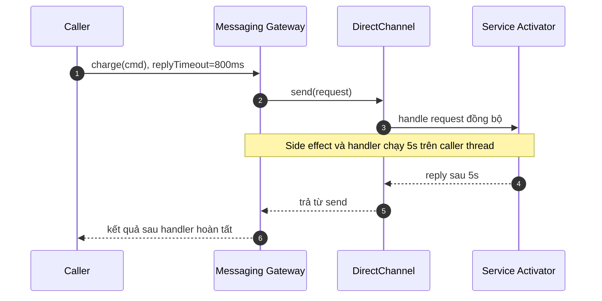
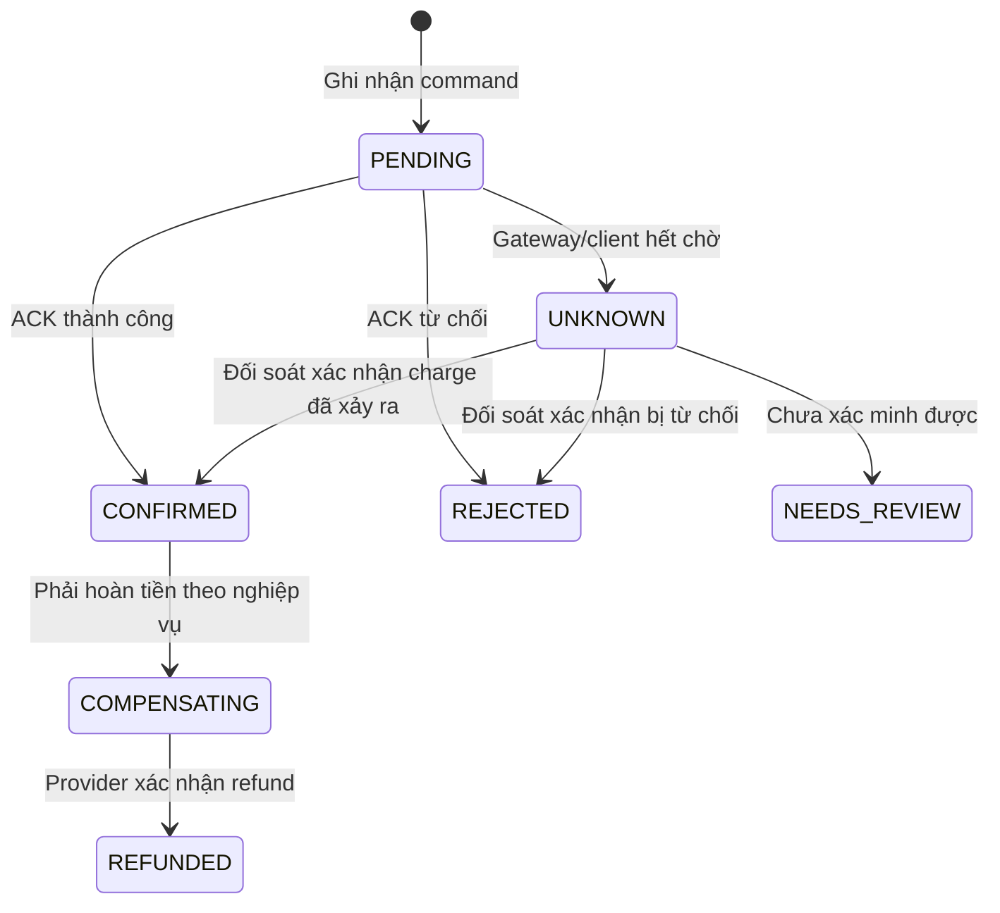
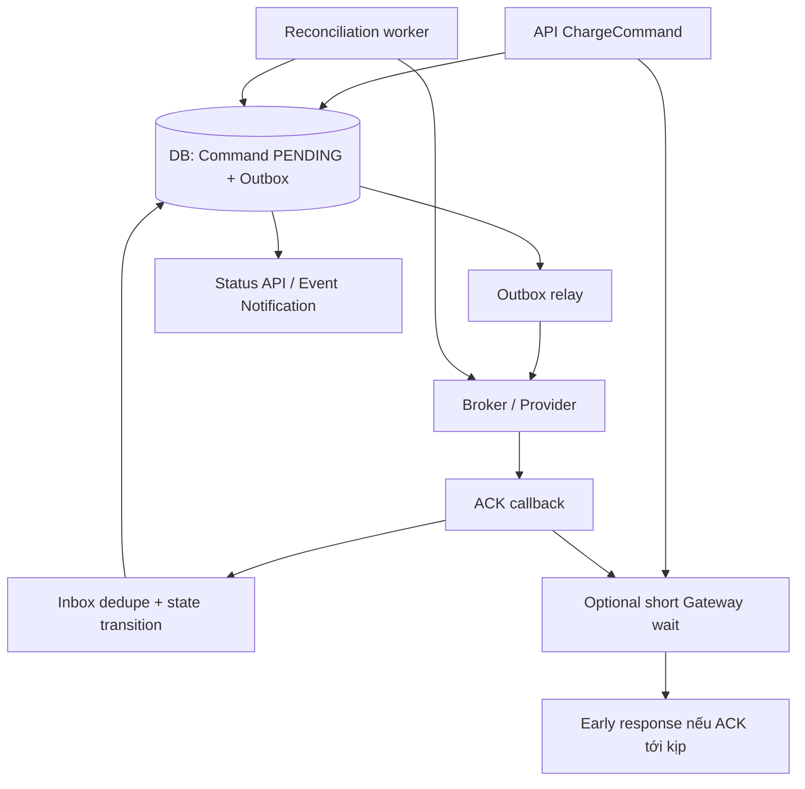
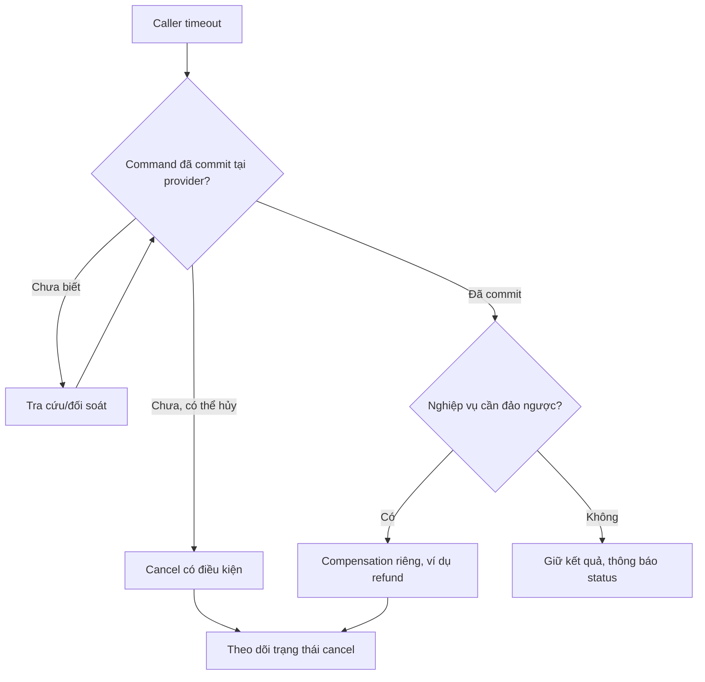
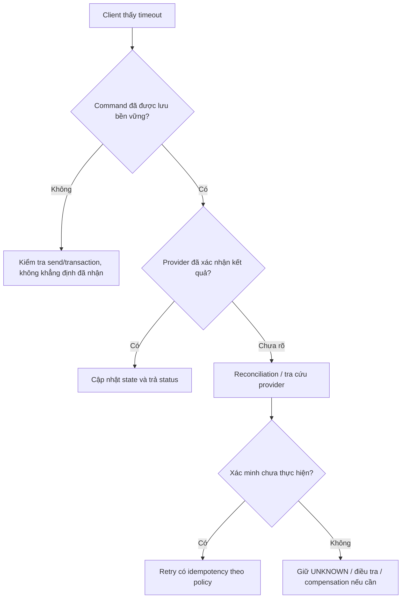

# Gateway timeout nhưng reply vẫn tạo side effect

## 1. Bài toán: caller đã hết chờ nhưng nghiệp vụ vẫn chạy

Trong module **SPRING_INTEGRATION_PATTERN**, chúng ta học cách triển khai *Enterprise Integration Patterns* bằng Spring Integration nhằm xây dựng các luồng thông điệp ít phụ thuộc và dễ mở rộng. Khi ghép Router, Filter, Transformer, Splitter, Aggregator, Gateway, retry, error channel và correlation thành một hệ thống, **Gateway** là cầu nối tiện dụng giữa lời gọi Java đồng bộ và các message được xử lý bên dưới.

Một lỗi khó phát hiện xuất hiện khi lập trình viên xem **Gateway timeout** là dấu hiệu lệnh đã bị hủy. Ví dụ:

1. API gọi `chargeGateway.charge(command)` và chỉ muốn đợi tối đa 800 ms.
2. Gateway gửi `ChargeCommand` vào `ExecutorChannel`. Worker gọi một cổng thanh toán bên ngoài.
3. Sau 800 ms chưa có reply; Gateway trả `null` hoặc báo `MessageTimeoutException` theo cấu hình.
4. API trả “chưa có kết quả” cho client.
5. Ở giây thứ hai, worker **vẫn hoàn thành lệnh charge**, ghi database hoặc gửi thông báo rồi mới tạo reply.
6. Client tưởng lần trước thất bại nên gửi lại lệnh. Nếu thiếu idempotency, tài khoản có thể bị trừ tiền hai lần.

**Vấn đề gốc:** **Timeout của reply là giới hạn thời gian *caller chờ câu trả lời*, không phải một cam kết tự động hủy việc xử lý hoặc đảo ngược side effect đã diễn ra**.

Trong bài này, “side effect” gồm: ghi database, thu tiền, đặt chỗ, giữ tồn kho, tạo vận đơn, phát sự kiện hoặc gửi email. Những tác động này có thể xảy ra **trước** khi reply được tạo, **sau** khi Gateway đã timeout hoặc thậm chí sau khi client HTTP đã ngắt kết nối.

### Mục tiêu học tập

Sau bài này, bạn có thể:

1. Phân biệt `requestTimeout`, `replyTimeout`, timeout của HTTP client và thời hạn thực hiện nghiệp vụ.
2. Giải thích khác biệt giữa Gateway đồng bộ cùng thread và flow bàn giao sang thread khác.
3. Xác định vì sao reply tới muộn không thể dùng để kết luận một side effect không xảy ra.
4. Thiết kế command ID, idempotency, trạng thái `UNKNOWN`, status query và đối soát.
5. Tổ chức xử lý lỗi, retry, cancellation, compensation và dữ liệu bền vững đúng ranh giới.
6. Viết kiểm thử chứng minh Gateway đã timeout **trước khi** worker hoàn tất side effect.

## 2. Gateway dùng hai timeout khác nhau

Với Messaging Gateway trong Spring Integration, hai cấu hình thường gặp là:

| Thuộc tính | Điều được giới hạn | Điều **không** được giới hạn |
| --- | --- | --- |
| `requestTimeout` | Thời gian chờ **gửi request vào input channel** nếu thao tác gửi có thể block, chẳng hạn `QueueChannel` hữu hạn đang đầy | Thời gian service bên dưới chạy, thời gian giao dịch bên đối tác hoặc thời gian chờ reply |
| `replyTimeout` | Thời gian Gateway **đợi nhận reply** sau khi request đã được gửi và quyền điều khiển quay lại Gateway | Công việc đang chạy ở worker, giao dịch đã commit hoặc tác động ở hệ thống ngoài |
| Timeout của HTTP/gRPC client | Giới hạn client chờ phản hồi từ API | Việc backend hay broker có tiếp tục công việc sau khi kết nối đóng |
| Timeout ở provider/adapter | Giới hạn một lời gọi mạng hoặc tác vụ kỹ thuật cụ thể | Việc đối tác đã nhận và thực hiện side effect hay chưa |
| `deadlineAt` nghiệp vụ | Thời hạn xử lý một command theo hợp đồng ứng dụng | Cơ chế tự hủy hay hoàn tác nếu không có phối hợp bổ sung |

Theo tài liệu Spring Integration, `requestTimeout` của Gateway chỉ có tác dụng rõ khi channel có thể block thao tác `send()`; còn thời gian `replyTimeout` bắt đầu khi thread **trở lại phía Gateway** để đợi reply, **không nhất thiết** ngay lúc method được gọi.

Một cấu hình `@Gateway(replyTimeout=800L)` không đồng nghĩa toàn bộ method luôn hoàn thành sau 800 ms. Bản chất channel và thread bên dưới quyết định liệu Gateway có cơ hội bắt đầu giai đoạn chờ reply hay chưa.

### 2.1. Đừng tin rằng một “timeout” áp dụng cho mọi điểm

```text
HTTP deadline             3.0 s
Gateway request send      <= 0.2 s nếu channel có thể block
Gateway reply wait        <= 0.8 s sau khi hand-off sang async
Provider call timeout     2.5 s
Business reconciliation   có thể kéo dài sau HTTP deadline
```

Đây là **ví dụ các bộ đếm có thời điểm bắt đầu khác nhau**, không phải một lịch thực thi cộng dồn cố định. Cần dựng ngân sách tổng thể từ SLA và đo thực tế. Nếu response cần hoàn thành trong 3 giây, không thể chỉ đặt `replyTimeout=3000` rồi bỏ qua mọi việc trước khi Gateway bắt đầu đợi.

## 3. Hai mô hình thread dẫn đến hai hành vi timeout khác nhau

### 3.1. Toàn bộ downstream là DirectChannel: timeout không cắt ngang handler đang chạy

Với `DirectChannel` và các handler đồng bộ liên tiếp, Gateway gửi request trên **chính thread gọi method**. Nếu một Service Activator mất 5 giây mới trả, thread đó phải chờ handler kết thúc hoặc ném exception; `replyTimeout=800ms` không thể tự ngắt ngang lời gọi đang chạy trên cùng thread.



Điểm cần nhớ: **`replyTimeout` không phải timeout cưỡng bức dành cho một handler đồng bộ chạy lâu**. Nếu cần giới hạn lời gọi provider, cấu hình timeout ở HTTP/database adapter và cân nhắc thiết kế bất đồng bộ có kiểm soát.

### 3.2. Có ExecutorChannel/queue/broker: Gateway có thể timeout trước worker

Khi request được bàn giao cho `ExecutorChannel` hoặc một ranh giới bất đồng bộ khác, Gateway có thể quay lại để đợi trên reply channel. Lúc đó `replyTimeout` phát huy tác dụng: caller kết thúc chờ, **nhưng worker không mặc nhiên bị hủy**.

```mermaid
sequenceDiagram
    autonumber
    participant C as Caller
    participant G as Messaging Gateway
    participant Q as ExecutorChannel
    participant W as Payment worker
    participant P as Payment provider
    C->>G: charge(cmd), replyTimeout=800ms
    G->>Q: send(request)
    Q-->>G: Đã bàn giao request
    Q->>W: handle(cmd)
    W->>P: charge(commandId)
    Note over G,W: 800ms qua, worker vẫn chạy
    G-->>C: null hoặc timeout exception
    P-->>W: charge accepted, sau 2s
    W->>W: Ghi trạng thái / phát event
    W-->>G: late reply cố gửi về replyChannel
    Note over G,W: Caller cũ không còn chờ; late reply không phải kết quả được caller nhận
```

Việc gửi reply tới một reply channel tạm thời sau timeout có thể không còn consumer phù hợp hoặc gặp cơ chế xử lý late reply của phiên bản/framework. **Không dựa vào một đường reply đến muộn để vận hành nghiệp vụ**: hãy lưu trạng thái xử lý bằng `commandId` và công bố kết quả qua API/event riêng.

### 3.3. Timeout không đồng nghĩa cancel

Một trong các hiểu lầm phổ biến nhất là:

```text
Gateway timeout == worker stopped == provider charge rolled back
```

Chuỗi suy luận này **sai**. Timeout chỉ nói về thời gian chờ. `Thread.interrupt()`, hủy `Future`, timeout của client mạng, hủy một subscription reactive hoặc HTTP disconnect **không bảo đảm** giao dịch ngoài tiến trình đã dừng. Khi phía nhận đã commit, muốn đảo ngược thường cần một **lệnh bù trừ** với điều kiện nghiệp vụ riêng.

## 4. `null`, `MessageTimeoutException` và lỗi nghiệp vụ có ý nghĩa khác nhau

Khi hết hạn chờ reply, Messaging Gateway có thể trả `null` theo cấu hình mặc định; từ Spring Integration **6.2**, `@MessagingGateway(errorOnTimeout=true)` cho phép yêu cầu lỗi `MessageTimeoutException` thay vì nhận `null` (hoặc gửi `ErrorMessage` tới error channel nếu đã cấu hình).

| Kết quả thấy ở caller | Điều có thể kết luận | Điều **không** được kết luận |
| --- | --- | --- |
| Gateway trả `null` vì timeout | Caller không nhận được reply trong giới hạn đã cấu hình | Lệnh chưa được xử lý, giao dịch đã rollback |
| `MessageTimeoutException` | Gateway không nhận reply kịp; cách biểu diễn lỗi rõ hơn | Side effect ở worker/provider không thể xảy ra |
| `ReplyRequiredException` | Handler được yêu cầu có reply nhưng không tạo reply | Một command ngoài hệ thống chưa từng được thực hiện |
| Provider trả `REJECTED` có correlation đúng | Một kết quả nghiệp vụ đã biết | Không nên biến kết quả đã biết này thành timeout |
| Provider báo lỗi kết nối | Không xác minh được kết quả qua lần gọi đó | Có thể đã commit trước khi mất kết nối |
| Có reply `ACCEPTED` | Có thông tin xác nhận từ handler/provider | Không tự chứng minh mọi downstream side effect khác đã hoàn tất |

**Định nghĩa trạng thái:** Với các tác vụ như thanh toán, `UNKNOWN`/`PENDING_CONFIRMATION` có thể là kết quả hợp lý khi hết deadline chờ, vì **chưa rõ** bên nhận đã thành công hay chưa. Không nên biến timeout thành `FAILED` một cách tuyệt đối nếu chưa đối soát.

### 4.1. Lỗi giao nhận không thay thế kết quả nghiệp vụ

`errorChannel` giúp thu nhận/điều phối exception từ flow; nó không lưu vĩnh viễn mỗi `ChargeCommand` và không tự khôi phục một phiên đợi reply. Nếu cần không mất kết quả, phải có lưu trạng thái, nguồn message có khả năng giao lại và chính sách xử lý trùng.

## 5. Java: Gateway cấu hình timeout và async hand-off

Ví dụ sau dùng một Gateway có reply timeout rõ ràng, một `ExecutorChannel` để cho worker xử lý độc lập và một Service Activator gọi adapter. Các record là **kiểu minh họa cho một hệ thống giả định**, không phải API có sẵn của Spring Integration.

### 5.1. Gateway interface

```java
import org.springframework.integration.annotation.Gateway;
import org.springframework.integration.annotation.MessagingGateway;

record ChargeCommand(
        String commandId,
        String orderId,
        long amountMinor,
        String idempotencyKey) {
}

record ChargeReply(String commandId, String providerStatus) {
}

// Spring Integration 6.2+: timeout trở thành lỗi có thể xử lý rõ.
@MessagingGateway(errorOnTimeout = true)
public interface ChargeGateway {

    @Gateway(
            requestChannel = "chargeCommands",
            requestTimeout = 200L,
            replyTimeout = 800L)
    ChargeReply charge(ChargeCommand command);
}
```

Khi dùng `@MessagingGateway` trong ứng dụng, đăng ký scanner `@IntegrationComponentScan` ở cấu hình phù hợp để framework tạo proxy interface. Nếu đang ở phiên bản trước 6.2, cần kiểm tra khả năng cấu hình `errorOnTimeout` qua API Gateway thay vì giả định annotation đã hỗ trợ.

### 5.2. Channel bất đồng bộ có executor giới hạn

```java
import org.springframework.context.annotation.Bean;
import org.springframework.context.annotation.Configuration;
import org.springframework.integration.channel.ExecutorChannel;
import org.springframework.integration.config.EnableIntegration;
import org.springframework.integration.annotation.IntegrationComponentScan;
import org.springframework.messaging.MessageChannel;
import org.springframework.scheduling.concurrent.ThreadPoolTaskExecutor;

@Configuration
@EnableIntegration
@IntegrationComponentScan
public class ChargeFlowConfiguration {

    @Bean
    public ThreadPoolTaskExecutor chargeExecutor() {
        ThreadPoolTaskExecutor executor = new ThreadPoolTaskExecutor();
        executor.setCorePoolSize(4);
        executor.setMaxPoolSize(8);
        executor.setQueueCapacity(100);
        executor.setThreadNamePrefix("charge-worker-");
        return executor;
    }

    @Bean
    public MessageChannel chargeCommands(ThreadPoolTaskExecutor chargeExecutor) {
        return new ExecutorChannel(chargeExecutor);
    }
}
```

`ExecutorChannel` tách thread thực thi khỏi Gateway. Hãy cấu hình capacity, rejection policy và theo dõi backlog; nó **không** lưu message bền vững qua restart. Một task đã được executor nhận cũng chưa bảo đảm provider đã nhận charge hoặc reply sẽ đến kịp thời.

### 5.3. Service Activator thực thi nghiệp vụ và trả reply

```java
import org.springframework.integration.annotation.ServiceActivator;
import org.springframework.stereotype.Component;

@Component
public class ChargeHandler {
    private final ChargeApplicationService chargeService;

    public ChargeHandler(ChargeApplicationService chargeService) {
        this.chargeService = chargeService;
    }

    @ServiceActivator(inputChannel = "chargeCommands")
    public ChargeReply handle(ChargeCommand command) {
        // Port giả định do dự án tự định nghĩa:
        // apply() phải idempotent theo commandId/idempotencyKey,
        // có lưu/truy vấn trạng thái và xử lý kết quả chưa rõ.
        ChargeOutcome outcome = chargeService.apply(command);
        return new ChargeReply(command.commandId(), outcome.status());
    }
}
```

`ChargeApplicationService` và `ChargeOutcome` là các kiểu ứng dụng phải triển khai; đoạn mã không chứng minh một API charge bên ngoài hỗ trợ idempotency. Nếu `apply()` gửi lệnh HTTP rồi bị timeout, handler vẫn cần tra cứu/đối soát theo hợp đồng thay vì tự suy ra `REJECTED`.

**Điểm then chốt:** nếu `apply()` đã thu tiền trước khi Gateway timeout, việc Gateway trả lỗi cho caller **không đảo ngược khoản tiền đó**. Handler có thể tạo reply sau khi client không còn chờ.

## 6. Phản ví dụ: retry ngay khi Gateway trả timeout

```java
// PHẢN VÍ DỤ: mỗi lần timeout tạo một commandId mới và charge lại.
public ChargeReply chargeTwiceOnTimeout(Order order) {
    try {
        return chargeGateway.charge(new ChargeCommand(
                "attempt-1", order.id(), order.amountMinor(), "idempotency-1"));
    } catch (MessageTimeoutException timeout) {
        // Nguy hiểm: provider có thể đã charge lần 1.
        return chargeGateway.charge(new ChargeCommand(
                "attempt-2", order.id(), order.amountMinor(), "idempotency-2"));
    }
}
```

Đoạn trên minh họa lỗi, `Order` và `chargeGateway` là dependency giả định. Vì attempt hai dùng cả command ID và idempotency key mới, provider có thể xem đây là **một charge hoàn toàn khác**.

### 6.1. Vì sao chỉ tăng timeout chưa chắc giải quyết được?

Nếu tăng `replyTimeout` từ 800 ms lên 10 giây, tỷ lệ timeout có thể giảm nhưng số thread Gateway đang chờ tăng. Khi broker/provider bị treo lâu hơn 10 giây, vấn đề vẫn tồn tại; còn client HTTP có thể đã timeout trước. Tăng thời hạn là **quyết định SLA/capacity**, không phải giải pháp cho thiếu idempotency hoặc trạng thái chưa rõ.

### 6.2. Vì sao retry advice cũng cần hợp đồng rõ?

`RequestHandlerRetryAdvice` hữu ích khi lỗi kỹ thuật có thể thử lại. Nhưng nếu thao tác bị retry là `charge()` có side effect, phải biết:

- Có idempotency key ổn định theo hành động logic không?
- Provider có bảo đảm trả lại cùng kết quả khi gọi lại bằng key ấy không?
- Nếu response mất sau commit, có API query theo `commandId`/provider reference để xác minh không?
- Timeout nào chỉ cho phép dừng chờ, timeout nào thực sự ngăn lệnh được thực hiện?
- Một lần thử mới có được phép tạo side effect mới hay chỉ tra cứu lần cũ?

Retry không được dùng để biến một trạng thái chưa biết thành một trạng thái biết trước.

## 7. Thiết kế đúng: commandId, idempotency và trạng thái bền vững

Các định danh cần được phân vai rõ ràng:

| Định danh | Dùng để làm gì? | Lưu ý |
| --- | --- | --- |
| `orderId` | Xác định đối tượng nghiệp vụ | Một đơn có thể có nhiều lệnh hoặc lần thử. |
| `commandId` | Xác định một command hoặc attempt cụ thể | Dùng để truy vấn/đối chiếu command sau timeout. |
| `idempotencyKey` | Ngăn thao tác logic được thực hiện lặp ở bên nhận | Có thể cần **giữ nguyên qua các lần gửi lại** cùng một hành động. |
| `correlationId` | Ghép ACK/reply với command đúng | Thường trỏ tới `commandId`, được truyền qua adapter. |
| `eventId` | Khử trùng lặp sự kiện callback/redelivery | Giữ ổn định qua các lần giao lại. |
| `traceId` | Quan sát xuyên dịch vụ | Không thay thế commandId hoặc idempotency key. |

Ví dụ một payload lệnh:

```json
{
  "orderId": "order-42",
  "commandId": "charge-42-attempt-1",
  "idempotencyKey": "charge-order-42",
  "amountMinor": 125000,
  "currency": "VND"
}
```

Nếu hệ thống quyết định **gửi lại đúng hành động charge** vì chưa biết kết quả, thường nên giữ cùng `idempotencyKey` theo hợp đồng của provider và tra cứu trạng thái cũ trước khi phát một charge mới. Có thể dùng `commandId` khác cho mỗi attempt vận chuyển nhưng phải giữ liên kết đến **logical operation** và correlation của ACK tương ứng.

### 7.1. State machine thay vì “timeout = failed”



Sơ đồ là **quy tắc của ứng dụng**, không phải trạng thái tích hợp mặc định. Tùy hợp đồng, timeout ở Gateway **không nhất thiết** làm state của command đổi ngay: một worker nghiệp vụ độc lập có thể tiếp tục `PENDING` cho tới khi có ACK hoặc hết deadline của command. Điều quan trọng là **caller đã hết chờ phải được trả một trạng thái trung thực**, và vẫn có nơi tra cứu kết quả cuối cùng.

### 7.2. Outbox, inbox và status API

Với hệ thống cần tiếp tục qua restart:

1. Trong một database transaction, tạo `command_attempt(PENDING)` và `outbox_event` chứa yêu cầu phát lệnh.
2. Outbox relay gửi lệnh tới broker, có publisher confirmation khi hỗ trợ.
3. Consumer phía nhận xử lý lệnh theo idempotency key, ACK sau khi đã ghi nhận bền vững.
4. ACK listener lưu sự kiện và chống trùng theo `eventId` trong inbox, cập nhật command state nguyên tử.
5. Client dùng `GET /charges/{commandId}` hoặc callback/event để biết kết quả sau khi Gateway không còn chờ.
6. Reconciliation worker kiểm tra các command lâu ở `UNKNOWN`/`PENDING`, đối soát với provider trước khi quyết định retry/compensation.



Trong mô hình này, Gateway là **tối ưu trả kết quả sớm**, không phải nơi duy nhất lưu sự thật nghiệp vụ. Khi Gateway timeout hoặc JVM restart, database và outbox/inbox vẫn có thể tiếp tục quy trình.

## 8. Cạnh tranh giữa timeout, ACK muộn và lệnh được gửi lại

Một race thực tế:

```text
t=0ms    API lưu command charge-42, gửi sang provider
t=800ms  Gateway hết chờ; client nhận PENDING_CONFIRMATION
t=900ms  User nhấn Retry trong UI
t=1000ms Provider hoàn tất charge lần đầu
t=1100ms Callback charge lần đầu đến; có thể gửi lại vì broker redelivery
```

Nếu frontend tạo một command mới với `idempotencyKey` mới, hai lần charge có thể cùng thành công. Nếu backend cho phép callback muộn cập nhật một trạng thái đã được hoàn tất bằng quy trình khác, dữ liệu cũng có thể bị ghi đè.

### 8.1. Chuyển trạng thái nguyên tử

Một lược đồ minh họa bằng PostgreSQL:

```sql
CREATE TABLE charge_command (
    command_id       TEXT PRIMARY KEY,
    order_id         TEXT NOT NULL,
    idempotency_key  TEXT NOT NULL,
    state            TEXT NOT NULL,
    provider_ref     TEXT,
    deadline_at      TIMESTAMPTZ NOT NULL,
    updated_at       TIMESTAMPTZ NOT NULL,
    version          BIGINT NOT NULL DEFAULT 0
);

CREATE UNIQUE INDEX uq_charge_logical_operation
    ON charge_command (order_id, idempotency_key);

CREATE TABLE processed_charge_ack (
    event_id         TEXT PRIMARY KEY,
    command_id       TEXT NOT NULL,
    received_at      TIMESTAMPTZ NOT NULL
);
```

Ứng dụng cập nhật có điều kiện:

```sql
UPDATE charge_command
SET state = 'CONFIRMED',
    provider_ref = :providerReference,
    updated_at = NOW(),
    version = version + 1
WHERE command_id = :commandId
  AND state IN ('PENDING', 'UNKNOWN');
```

Nếu cập nhật 0 dòng, phải tra cứu trạng thái hiện tại: ACK trùng, lệnh đã refund, sai khóa hoặc tình huống cần điều tra. Không tự phát `OrderPaid` thêm một lần chỉ vì callback tới lần nữa.

**Lưu ý:** Constraint `(order_id, idempotency_key)` minh họa một mô hình trong đó cặp đó là duy nhất. Khi ứng dụng lưu **nhiều lần thử** cho một idempotency key, cần tách bảng **logical operation** khỏi bảng **attempt** và chỉnh unique constraint cho phù hợp. Không áp dụng lược đồ minh họa nguyên xi nếu một logical operation có nhiều attempt được phép.

### 8.2. Transaction của inbox và outbox

Việc insert `processed_charge_ack(eventId)`, cập nhật command state và thêm event nghiệp vụ vào outbox nên thực hiện **trong cùng transaction database** khi chúng cùng thuộc một trạng thái nhất quán. Chỉ sau commit mới ACK nguồn message theo thiết kế.

Khi relay gửi event rồi crash trước khi đánh dấu đã gửi, broker có thể nhận event hai lần; consumer cần idempotency. Không nên tuyên bố “exactly once toàn hệ thống” chỉ vì đã có một transaction hoặc một broker hỗ trợ transactional publish nội bộ.

## 9. Cancellation và compensation: hai hành động khác nhau

Khi user đóng tab hoặc client timeout, có thể muốn hủy tác vụ. Tuy nhiên, phải phân biệt:

- **Ngừng chờ (stop waiting):** Gateway/caller dừng đợi reply; worker có thể vẫn chạy.
- **Yêu cầu hủy (request cancellation):** gửi tín hiệu/command hủy, worker kiểm tra trạng thái và có thể dừng **nếu chưa tới điểm commit**.
- **Bù trừ (compensation):** khi side effect đã commit, phát **một thao tác nghiệp vụ mới** như refund hoặc release reservation, có kết quả, retry và idempotency riêng.



Không nên viết logic “bắt `TimeoutException` thì gọi `refund()` ngay” khi chưa biết khoản tiền đã được charge hay chưa. Nếu charge vẫn xử lý sau refund hoặc refund không tìm thấy giao dịch, trạng thái có thể rối. Cần correlation đến provider transaction, **idempotency cho cả charge và refund**, và luật điều phối rõ ràng.

### 9.1. Hủy task trong JVM không bảo đảm hủy thao tác ngoài

`Future.cancel(true)`, `Thread.interrupt()`, hủy reactive subscription hoặc `CompletableFuture` không chắc khiến HTTP call hoặc stored procedure ngừng tại thời điểm mong muốn. Việc hủy chỉ được coi là thành công nếu worker/provider **xác nhận** và không còn khả năng side effect được commit; nếu không, trạng thái phải giữ ở `UNKNOWN`/`CANCEL_PENDING` để đối soát.

## 10. Lỗi Gateway, Router, Filter và luồng lỗi không đồng nghĩa nhau

| Dấu hiệu | Nguồn thực tế có thể có | Cách xử lý nên cân nhắc |
| --- | --- | --- |
| Gateway hết `replyTimeout` | Worker chậm, ACK mất, reply sai channel, không có reply | Trả `PENDING_CONFIRMATION`/lỗi timeout rõ, lưu command ID và đối soát. |
| `requestTimeout` khi gửi vào channel | Bounded queue đầy hoặc send block | Kiểm tra đã enqueue thành công chưa trước khi gửi lại; giám sát queue. |
| Handler trả `null` | Không có reply message; có thể do nghiệp vụ hoặc bug | `requiresReply=true` nếu hợp đồng bắt buộc trả kết quả. |
| Filter bỏ request | Không đến nhánh tạo reply | `throwExceptionOnRejection` hoặc nhánh rejected có kết quả nghiệp vụ rõ. |
| Router gửi sai channel | Reply không quay về Gateway hoặc request không tới handler | Kiểm tra correlation, mapping, default route và channel resolution. |
| Worker ném exception bất đồng bộ | Lỗi phát sinh ở thread khác | Cấu hình `errorChannel`/error flow, lưu trạng thái command và không nuốt lỗi. |
| Adapter gọi provider timeout | Trạng thái side effect ở provider chưa chắc biết | Query provider theo idempotency key/reference; không retry mù. |
| Reply tới sau khi Gateway ngừng chờ | Reply đã muộn nhưng worker có thể đã commit | Lưu kết quả bền vững, không phụ thuộc temporary reply channel. |

`errorOnTimeout=true` giúp caller **phân biệt** timeout với kết quả `null` thông thường. Nó **không** kích hoạt rollback hay cancellation cho worker. Cũng vậy, thêm `requiresReply=true` chỉ đổi hành vi handler khi không trả reply; nó không xác minh kết quả nghiệp vụ ở hệ thống ngoài.

## 11. Kiểm thử tái hiện: Gateway timeout, worker vẫn commit

Một test hữu ích phải chứng minh **hai sự kiện theo thứ tự**:

1. Gateway đã kết thúc chờ và trả `null`/timeout exception.
2. Sau đó worker được phép tiếp tục và tạo side effect.

Nếu chỉ đặt `Thread.sleep()` rồi assert một con số, test có thể phụ thuộc lịch chạy thread và flaky. Dùng `CountDownLatch` để điều khiển điểm trước commit.

### 11.1. Cấu hình test với ExecutorChannel

```java
import java.util.concurrent.CountDownLatch;
import java.util.concurrent.atomic.AtomicInteger;
import org.springframework.context.annotation.Bean;
import org.springframework.context.annotation.Configuration;
import org.springframework.context.annotation.Import;
import org.springframework.integration.annotation.Gateway;
import org.springframework.integration.annotation.IntegrationComponentScan;
import org.springframework.integration.annotation.MessagingGateway;
import org.springframework.integration.annotation.ServiceActivator;
import org.springframework.integration.channel.ExecutorChannel;
import org.springframework.integration.config.EnableIntegration;
import org.springframework.messaging.MessageChannel;
import org.springframework.scheduling.concurrent.ThreadPoolTaskExecutor;

record DemoCharge(String commandId) {}

// Dùng errorOnTimeout mặc định = false để assert reply null.
@MessagingGateway
interface SlowChargeGateway {
    @Gateway(requestChannel = "slowChargeRequests", replyTimeout = 150L)
    String submit(DemoCharge command);
}

final class SlowChargeHandler {
    final CountDownLatch started = new CountDownLatch(1);
    final CountDownLatch allowCommit = new CountDownLatch(1);
    final CountDownLatch committed = new CountDownLatch(1);
    final AtomicInteger committedCount = new AtomicInteger();

    @ServiceActivator(inputChannel = "slowChargeRequests")
    public String charge(DemoCharge command) throws InterruptedException {
        started.countDown();
        if (!allowCommit.await(5, java.util.concurrent.TimeUnit.SECONDS)) {
            throw new IllegalStateException("Test setup did not release worker");
        }
        // Mô phỏng side effect đã commit sau khi Gateway ngừng chờ.
        committedCount.incrementAndGet();
        committed.countDown();
        return "ACCEPTED"; // Có thể trở thành late reply.
    }
}

@Configuration
@EnableIntegration
@IntegrationComponentScan(basePackageClasses = SlowChargeGateway.class)
@Import(SlowChargeHandler.class)
class SlowChargeTestConfig {
    @Bean
    ThreadPoolTaskExecutor slowChargeExecutor() {
        ThreadPoolTaskExecutor executor = new ThreadPoolTaskExecutor();
        executor.setCorePoolSize(1);
        executor.setMaxPoolSize(1);
        executor.setQueueCapacity(5);
        executor.setThreadNamePrefix("test-charge-");
        return executor;
    }

    @Bean
    MessageChannel slowChargeRequests(ThreadPoolTaskExecutor slowChargeExecutor) {
        return new ExecutorChannel(slowChargeExecutor);
    }
}
```

Các kiểu trên được đặt trong **cùng package test**; `@IntegrationComponentScan` sẽ phát hiện Gateway interface và `@Import` đăng ký handler. Bản thân test cố tình tạo side effect bằng counter để chứng minh nguyên lý, **không** mô phỏng giao dịch tiền thật.

### 11.2. JUnit 5 kiểm tra timeout xảy ra trước side effect

```java
import static org.junit.jupiter.api.Assertions.*;

import java.util.UUID;
import java.util.concurrent.TimeUnit;
import org.junit.jupiter.api.Test;
import org.springframework.beans.factory.annotation.Autowired;
import org.springframework.test.context.junit.jupiter.SpringJUnitConfig;

@SpringJUnitConfig(SlowChargeTestConfig.class)
class LateReplySideEffectTest {
    @Autowired SlowChargeGateway gateway;
    @Autowired SlowChargeHandler handler;

    @Test
    void workerCanCommitAfterGatewayAlreadyTimedOut() throws Exception {
        try {
            // Worker bị chặn ở latch, nên Gateway không thể nhận reply.
            String reply = gateway.submit(new DemoCharge(UUID.randomUUID().toString()));
            assertNull(reply);

            assertTrue(handler.started.await(1, TimeUnit.SECONDS));
            assertEquals(0, handler.committedCount.get());

            // Gateway đã trả về nhưng worker vẫn có thể tiếp tục.
            handler.allowCommit.countDown();
            assertTrue(handler.committed.await(2, TimeUnit.SECONDS));
            assertEquals(1, handler.committedCount.get());
        } finally {
            handler.allowCommit.countDown(); // Tránh treo worker khi assert lỗi.
        }
    }
}
```

Test không được dùng để đo chính xác 150 ms trên mọi máy CI; mục đích là chứng minh **quan hệ thứ tự**: reply đã timeout nhưng side effect vẫn có thể xảy ra. Một late reply do Service Activator tạo ra sau đó có thể bị từ chối/không còn nơi nhận ở temporary reply channel, tùy cơ chế framework. Vì vậy test không assert client nhận late reply.

Khi bật `@MessagingGateway(errorOnTimeout=true)` ở Spring Integration 6.2+, thay assertion `assertNull` bằng kiểm tra exception timeout theo hợp đồng; test vẫn phải chứng minh worker tiếp tục sau đó. Đừng ép mọi exception thành `MessageTimeoutException` vì lỗi bean/configuration có thể khác bản chất.

### 11.3. Ma trận kiểm thử mở rộng

| Test case | Cách dựng | Điều phải xác nhận |
| --- | --- | --- |
| Synchronous DirectChannel | Handler chạy lâu trên caller thread | `replyTimeout` không cưỡng bức kết thúc handler đang chạy. |
| ExecutorChannel chậm | Worker đợi latch lâu hơn `replyTimeout` | Gateway kết thúc chờ trước khi worker hoàn tất. |
| Late reply | Worker trả reply sau timeout | Caller cũ không dùng late reply làm nguồn sự thật nghiệp vụ. |
| Retry từ client | Hai request cùng logical operation/idempotency key | Provider/service không tạo hai charge. |
| Retry với key mới | Hai request có idempotency key khác | Test chứng minh rủi ro nhân đôi nếu không có policy. |
| Crash sau provider commit | Provider xác nhận, ứng dụng crash trước DB update | Reconciliation có thể khôi phục kết quả mà không charge lại. |
| Crash sau DB commit, trước ACK | Broker redelivery event | Inbox không phát side effect hai lần. |
| Timeout và callback cùng lúc | Hai thread cập nhật command state | Transition nguyên tử, không ghi đè trạng thái không hợp lệ. |
| Cancel trước/đúng lúc commit | Gửi yêu cầu hủy khi worker tiến tới side effect | Có trạng thái xác nhận hủy; không giả định interrupt là rollback. |
| Filter không trả reply | Filter bỏ message của request/reply flow | Gateway trả timeout/lỗi có chủ đích, error flow quan sát được. |
| Queue đầy | Bounded channel không nhận thêm message | `requestTimeout` và chính sách retry được kiểm thử riêng. |
| Client HTTP timeout | Client ngắt khi worker vẫn xử lý | Status API/notification cung cấp kết quả sau khi kết nối cũ mất. |

Test tích hợp có broker/provider thật hoặc mô phỏng cần kiểm tra cả publisher confirm, ACK, transaction, redelivery và dữ liệu database. Không thể chứng minh exactly-once hay tính khôi phục chỉ bằng unit test Gateway.

## 12. Quan sát: tách “caller timeout” với “business completed”

Nếu dashboard chỉ đếm Gateway timeout như “payment failed”, nó có thể vừa báo thất bại vừa ghi nhận doanh thu đã thu. Hãy dùng hai trục trạng thái:

| Trục | Giá trị ví dụ | Ý nghĩa |
| --- | --- | --- |
| **Gateway/caller outcome** | `REPLIED`, `REPLY_TIMEOUT`, `SEND_FAILED` | Kết quả tương tác request/reply của một caller. |
| **Business command state** | `PENDING`, `UNKNOWN`, `CONFIRMED`, `REJECTED`, `REFUNDED` | Sự thật nghiệp vụ đã lưu/đối soát theo command ID. |

Ví dụ log có cấu trúc do ứng dụng chủ động tạo:

```text
event=command_created       commandId=C42 orderId=O42 state=PENDING
event=gateway_request_sent  commandId=C42 channel=chargeCommands
event=gateway_reply_timeout commandId=C42 waitMs=800
event=provider_ack          commandId=C42 providerRef=PX42 status=ACCEPTED
event=command_confirmed     commandId=C42 state=CONFIRMED
event=late_reply_observed   commandId=C42 callerWaiting=false
```

Các dòng trên **không phải log mặc định của Spring Integration**. Để triển khai, cần correlation ID được mang qua message headers và adapter; tránh log token/PII, đồng thời không dùng `commandId` làm nhãn metric có cardinality quá cao.

### 12.1. Metrics và cảnh báo có ích

- Số lượng `gateway_reply_timeout_total` theo flow/operation.
- Số `command_pending`/`command_unknown` và tuổi lệnh lớn nhất.
- Phân phối `provider_latency` so với `gateway_reply_wait` và HTTP deadline.
- Tỷ lệ ACK muộn, ACK trùng, retry bằng cùng/different idempotency key.
- Lượng outbox chưa publish, inbox duplicate, DLQ và lỗi đối soát.
- Số charge/refund được commit **độc lập** với số Gateway reply thành công.
- Executor queue depth, active threads, rejection và độ trễ end-to-end.

Đặc biệt cần cảnh báo nếu “Gateway timeout” tăng trong khi “provider confirmed” cũng tăng: đó là dấu hiệu **kết quả đến muộn**, không phải bằng chứng provider từ chối.

## 13. Chọn mô hình phản hồi phù hợp với thời gian xử lý

Không phải nghiệp vụ nào cũng nên chờ một reply đồng bộ:

| Thời lượng và yêu cầu | Cách làm phù hợp | Lưu ý |
| --- | --- | --- |
| Tác vụ rất nhanh, cùng JVM, không có side effect khó đảo | Gateway đồng bộ với timeout phù hợp | Bảo đảm handler không block vô hạn, có error policy. |
| Tác vụ thường nhanh nhưng đôi khi chậm | Lưu command ID và trạng thái bền vững, thử chờ reply ngắn | Timeout trả trạng thái chưa xác nhận, có status query. |
| Tác vụ qua broker/provider, có thể kéo dài phút | API `202 Accepted`, status URL hoặc callback/event | Không giữ thread chờ; cho phép client lấy kết quả cuối. |
| Tác vụ phải hoàn tất qua restart | Outbox/inbox, idempotent consumer, reconciliation | Reply tạm thời chỉ là tiện ích, không là nguồn sự thật. |
| Tác vụ cần hủy hoặc bù trừ | Workflow/state machine với điều kiện cancel/compensate | Cancel không tự rollback side effect đã commit. |

Với API HTTP, `202 Accepted` có thể phù hợp khi request đã được **chấp nhận để xử lý** nhưng chưa có kết quả cuối; trả về `commandId` hoặc status URL. Nếu chưa lưu được command bền vững, không nên hứa rằng request đã được nhận chắc chắn chỉ vì Gateway đã gửi vào một `ExecutorChannel` trong RAM.

### 13.1. Một hợp đồng API minh họa

```http
POST /charges
Idempotency-Key: charge-order-42

HTTP/1.1 202 Accepted
Content-Type: application/json

{
  "commandId": "charge-42-attempt-1",
  "state": "PENDING_CONFIRMATION",
  "statusUrl": "/charges/charge-42-attempt-1"
}
```

Đây là **ví dụ giao thức**, không phải format mặc định do Spring Integration cung cấp. API có thể trả 200/201 khi kết quả thực sự đã được xác nhận kịp thời, nhưng phải nêu rõ hai trạng thái: “đã nhận lệnh” và “đã thực hiện thành công”.

## 14. Quy trình chẩn đoán khi client timeout nhưng tác vụ vẫn phát sinh

1. **Xác định timeout nào:** `replyTimeout` của Gateway, `requestTimeout` khi send, timeout HTTP client, adapter/provider hay deadline nghiệp vụ?
2. **Xác định thread:** Flow dùng `DirectChannel` toàn bộ hay có `ExecutorChannel`/QueueChannel/broker bàn giao sang worker?
3. **Đọc message IDs:** `commandId`, `idempotencyKey`, `correlationId`, `eventId` có được giữ nguyên qua adapter/Transformer không?
4. **Dựng timeline:** thời điểm Gateway timeout, provider commit, ACK nhận, DB commit và reply phát ra.
5. **Kiểm tra status store:** command đã có trạng thái bền vững chưa, có outbox/inbox và worker reconciliation không?
6. **Kiểm tra retry:** client/SDK/retry advice có tạo key mới hay lặp side effect không?
7. **Kiểm tra late reply:** reply có được xử lý ngoài Gateway cũ hoặc bị bỏ/không còn consumer? Đừng lấy điểm này làm bằng chứng provider thất bại.
8. **Sửa ranh giới lỗi:** kết quả từ chối là event nghiệp vụ; timeout là chưa xác nhận; lỗi routing/Filter cần có error flow.
9. **Thêm test lỗi có kiểm soát:** crash, late reply, duplicate callback, race giữa timeout và ACK.
10. **Theo dõi metrics sau triển khai:** phân tách tỉ lệ caller timeout và tỷ lệ command được hoàn tất.



## 15. Bài thực hành: xử lý callback đến sau Gateway deadline

Xây dựng một flow `ReserveInventory` có worker mô phỏng độ trễ và trạng thái `PENDING` trong database:

1. Đặt Gateway `replyTimeout=500ms`, request đi qua `ExecutorChannel` có giới hạn.
2. Dùng latch để giữ worker trước bước commit; xác nhận Gateway kết thúc chờ trước khi latch được giải phóng.
3. Giải phóng worker sau timeout; kiểm tra reservation được ghi một lần dù caller đã nhận timeout.
4. Đổi sang `DirectChannel` đồng bộ; giải thích vì sao `replyTimeout` không tự ngắt method đang chạy.
5. Thêm `commandId` và `idempotencyKey`; gửi lại cùng command hai lần, kiểm chứng không giữ hàng hai lần.
6. Mô phỏng provider commit rồi lỗi kết nối trước reply; trả trạng thái `UNKNOWN` và tra cứu provider trước retry.
7. Cho callback/ACK đến muộn và đến trùng; lưu inbox `eventId`, cập nhật trạng thái có điều kiện, không phát hai lần `InventoryReserved`.
8. Mô phỏng user hủy reservation khi chưa có kết quả; phân biệt cancel trước commit với release reservation sau commit.
9. Thêm một Status API hoặc callback để người dùng xác minh kết quả cuối dù Gateway cũ đã timeout.
10. Thêm log/metrics phân biệt `gateway_reply_timeout`, `reservation_committed`, `duplicate_ack` và `reconciliation_completed`.

**Câu hỏi tự đánh giá**

- Tại sao `replyTimeout` của Gateway không luôn cắt ngắn một chuỗi `DirectChannel` đồng bộ?
- Nếu Gateway đã trả `null`, bạn biết chắc điều gì về provider?
- Vì sao một `MessageTimeoutException` không đồng nghĩa lệnh đã bị cancel?
- Khi nào retry với `commandId` mới nhưng cùng `idempotencyKey` là hợp lý?
- Tại sao không nên phát lệnh refund ngay khi gọi charge timeout?
- Một late reply còn được gửi vào temporary reply channel có phải nguồn sự thật cho giao dịch không?
- Vì sao `errorChannel` không thay thế một bảng lưu command state?
- Nếu HTTP client hết hạn trước Gateway, chuyện gì có thể xảy ra?
- Outbox và inbox lần lượt đóng cửa sổ mất event hoặc side effect trùng nào?
- Cần những trường log/metrics nào để phân biệt caller timeout với charge đã commit?

## 16. Tài liệu tham khảo

- [Spring Integration Reference — Messaging Gateways](https://docs.spring.io/spring-integration/reference/gateway.html): `requestTimeout`, `replyTimeout`, đặc điểm direct/multithread flow, Gateway không tạo reply và xử lý timeout.
- [Spring Integration Javadoc — @Gateway](https://docs.spring.io/spring-integration/docs/6.5.0/api/org/springframework/integration/annotation/Gateway.html): thời gian chờ gửi/nhận reply ở từng method.
- [Spring Integration Javadoc — @MessagingGateway](https://docs.spring.io/spring-integration/docs/6.5.0/api/org/springframework/integration/annotation/MessagingGateway.html): `errorOnTimeout` từ phiên bản 6.2 và cấu hình default timeout.
- [Spring Integration Javadoc — MessagingGatewaySupport](https://docs.spring.io/spring-integration/docs/6.5.0/api/org/springframework/integration/gateway/MessagingGatewaySupport.html): cơ chế xử lý reply timeout và error channel.
- [Spring Integration Reference — Message Channels](https://docs.spring.io/spring-integration/reference/channel.html): `DirectChannel`, `ExecutorChannel` và ranh giới đồng bộ/bất đồng bộ.
- [Spring Integration Reference — Error Handling](https://docs.spring.io/spring-integration/reference/error-handling.html): phân biệt exception đồng bộ, bất đồng bộ và `errorChannel`.

> **Ghi nhớ:** **Gateway timeout chỉ chấm dứt việc chờ reply; không chứng minh worker hoặc provider đã dừng thực hiện lệnh.** Với thao tác có side effect, phải dùng idempotency, correlation, trạng thái bền vững, status query và đối soát. Thử lại hoặc bù trừ chỉ khi đã xác định được trạng thái nghiệp vụ, không dựa riêng vào việc caller đã hết thời gian chờ.
