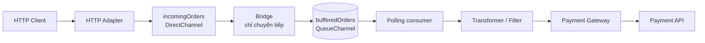
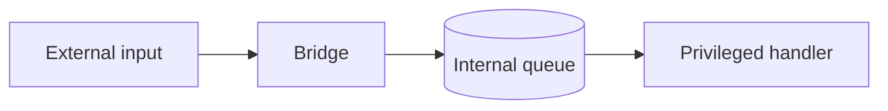
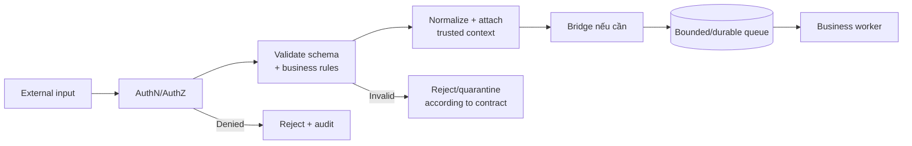
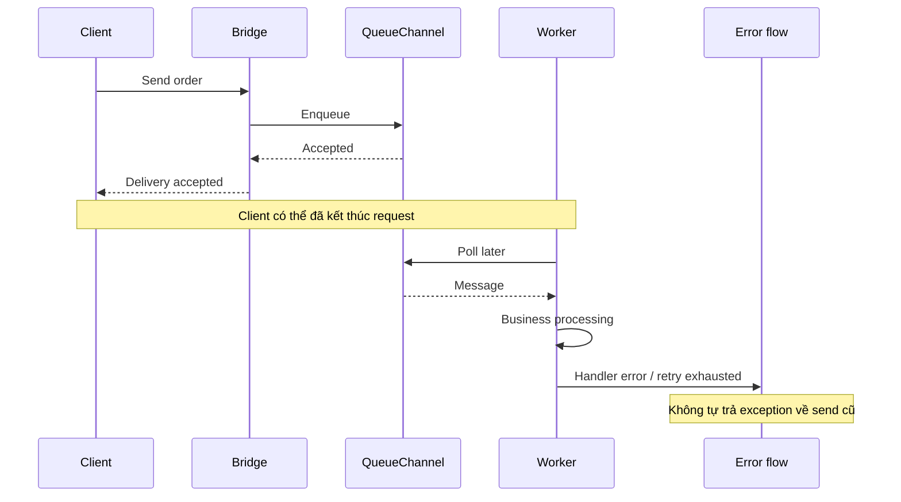
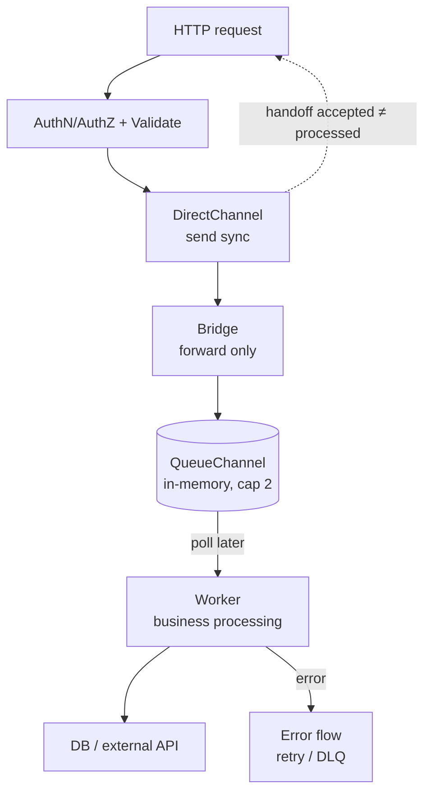

# Bridge che mất ranh giới giao tiếp thực sự

## 1. Lỗi kiến trúc thường gặp: nối được channel nhưng không thấy điểm chuyển giao

Một ứng dụng Spring Integration xử lý đơn hàng từ cổng HTTP, đẩy vào queue, kiểm tra bằng Filter, chuẩn hóa qua Transformer, dùng Router gửi sang dịch vụ thanh toán hoặc kho. Nhóm phát triển thêm một **Bridge** để nối hai channel vì muốn giữ flow gọn:

```text
httpIngress -> Bridge -> ordersBuffer -> paymentWorker -> paymentGateway
```

Sau đó dashboard cho thấy `httpIngress.send(...)` trả thành công. Nhóm vận hành kết luận đơn hàng đã đến dịch vụ thanh toán. Thực tế, message có thể mới **được nhận vào QueueChannel**, chưa được worker lấy, chưa qua validation, chưa commit và có thể mất khi JVM dừng nếu queue chỉ nằm trong bộ nhớ.

Đây là lỗi **“Bridge che mất ranh giới giao tiếp thực sự”**: sơ đồ chỉ nhìn thấy một đường nối liền mạch, nhưng không chỉ rõ sự thay đổi về **quyền sở hữu message, thread, thời điểm xử lý, durability, lỗi, transaction, ack và trách nhiệm của từng bên**.

Bài thuộc chương **Lỗi thường gặp** của module **SPRING_INTEGRATION_PATTERN**. Module hướng dẫn triển khai Enterprise Integration Patterns (EIP) với Spring Integration để xây dựng luồng thông điệp ít phụ thuộc, dễ mở rộng; thực hành Router, Filter, Transformer, Splitter, Aggregator, Gateway, retry, error channel và correlation, đồng thời kiểm thử, giám sát các nhánh xử lý.

Sau bài học, bạn có thể:

1. Giải thích chính xác Bridge dùng để nối channel và **không** tự động bổ sung những bảo đảm nào.
2. Nhận diện ranh giới đồng bộ/bất đồng bộ khi nối `DirectChannel` với `QueueChannel` hoặc `ExecutorChannel`.
3. Thiết kế hợp đồng **accepted, persisted, processed, acknowledged** riêng biệt.
4. Chỉ ra nơi validation, authorization, timeout, retry, error channel và transaction nên được đặt.
5. Giữ khả năng truy vết bằng correlation ID, audit, metric và topology có ghi nhãn.
6. Kiểm thử việc Bridge chuyển message nhưng downstream chưa xử lý, cùng các kịch bản lỗi.
7. Quyết định khi nào nên dùng Bridge và khi nào nên dùng Gateway, Adapter, Transformer, Router hoặc một service contract rõ ràng hơn.

## 2. Bridge trong Spring Integration thực sự làm gì?

**Messaging Bridge** là một mẫu EIP nối hai đường trao đổi message, giúp chuyển một message từ kênh nguồn sang kênh đích. Trong Spring Integration, có thể dùng DSL `.bridge()` để tạo một endpoint làm nhiệm vụ chuyển tiếp trong flow.

Một ví dụ khái niệm:

```java
@Bean
IntegrationFlow bridgeFlow() {
    return IntegrationFlow.from("incomingOrders")
            .bridge()
            .channel("bufferedOrders")
            .get();
}
```

Bridge phù hợp khi chủ đích là **chuyển tiếp message** giữa hai channel mà không yêu cầu biến đổi nghiệp vụ. Tuy nhiên, tên “bridge” không có nghĩa nó tự động:

- Xác minh người gửi được quyền thao tác.
- Kiểm tra schema hoặc tính hợp lệ của payload.
- Ghi message vào storage bền vững.
- Tạo transaction xuyên hai hệ thống.
- Chờ consumer downstream xử lý xong.
- Tạo acknowledgment nghiệp vụ hoặc reply cho HTTP caller.
- Bảo đảm exactly-once, idempotency hoặc thứ tự liên cụm.
- Bọc lỗi của mọi endpoint sau đó rồi gửi về cùng một error channel.

Bridge có thể **giữ nguyên ý nghĩa của message được chuyển tiếp**, nhưng các bảo đảm vận hành thực tế còn phụ thuộc vào **loại channel và các endpoint ở hai đầu**. Trước khi thêm một Bridge, phải trả lời câu hỏi: **sau khi chuyển xong, ai chịu trách nhiệm cho message?**

### Bridge khác các thành phần lân cận như thế nào?

| Thành phần | Mục đích chính | Khi nên cân nhắc |
| --- | --- | --- |
| **Bridge** | Chuyển message giữa các channel | Cần nối luồng và chủ ý không đổi nội dung nghiệp vụ |
| **Gateway** | Cung cấp giao diện request/reply hoặc hợp đồng gọi vào flow | Caller cần kết quả, timeout và ngữ nghĩa lỗi rõ |
| **Channel Adapter** | Kết nối hệ thống ngoài với message channel | Có HTTP, broker, file, JDBC, mail hoặc dịch vụ ngoài |
| **Transformer** | Đổi cấu trúc/kiểu payload | Hai bên có hợp đồng dữ liệu khác nhau |
| **Filter** | Chặn hoặc chuyển message theo điều kiện | Cần validate hoặc loại message theo policy |
| **Router** | Quyết định kênh/nhánh đích | Có nhiều đường xử lý phụ thuộc message |
| **Service Activator** | Thực hiện xử lý nghiệp vụ | Cần gọi service, kiểm tra hoặc tạo side effect |

Không nên đưa logic nghiệp vụ phức tạp vào Bridge rồi vẫn gọi đó là “đường nối vô hại”; cũng không nên dùng Bridge để ngụy trang cho giao tiếp giữa các bounded context có yêu cầu versioning và khả năng phục hồi riêng.

## 3. Phân tích ranh giới giao tiếp trước khi vẽ sơ đồ

Hãy đánh dấu rõ **ai gửi, ai nhận, kênh thuộc loại nào, message nằm ở đâu, khi nào có kết quả và ai retry**.



Dù mũi tên liên tục, có thể có ba ranh giới rất khác nhau:

| Ranh giới | Sự kiện thật sự xảy ra | Điều chưa được chứng minh |
| --- | --- | --- |
| Client → API | Request đến và vượt lớp ingress | Payload đã được chấp nhận theo hợp đồng, đã lưu bền vững |
| DirectChannel → Bridge → QueueChannel | Message được chuyển tới kênh có khả năng đệm | Worker đã xử lý, DB đã commit, đối tác đã nhận |
| QueueChannel → Polling consumer → Gateway | Một consumer nhận message rồi gọi downstream | Phía ngoài đã trả thành công, side effect đã idempotent |

**Điểm dễ nhầm:** `DirectChannel` thường gọi subscriber trên thread gửi, còn `QueueChannel` lưu message để một polling consumer nhận về sau. Vì thế, Bridge nối hai kênh này **không xóa sự khác biệt về thời gian xử lý**. Nếu send trả về sau khi QueueChannel nhận message thì caller có thể đã rời đi trước khi downstream chạy.

### Nên ghi hợp đồng bằng ngôn ngữ nghiệp vụ

Tránh đặt tên API đơn thuần là `processOrder()` nếu phương thức thực tế chỉ enqueue. Tên và phản hồi nên nói chính xác:

- `submitOrder(...)`: nhận yêu cầu và có thể phản hồi lỗi nếu không nhận.
- `acceptForProcessing(...)`: xác nhận đã nhận theo cấp độ bảo đảm đã công bố.
- `processOrder(...)`: chỉ dùng khi hợp đồng thực sự bao gồm kết quả nghiệp vụ.
- `getOrderStatus(id)`: cho phép đối soát trạng thái xử lý bất đồng bộ.

Nếu HTTP trả `202 Accepted`, phải định nghĩa “accepted” có nghĩa là **đã đưa vào memory buffer**, **đã commit vào durable broker** hay **đã có record trong DB**. Cùng một mã HTTP nhưng mức bảo đảm hoàn toàn khác nhau nếu hợp đồng không nói rõ.

## 4. Các loại channel thay đổi ý nghĩa của Bridge

Bridge không quyết định toàn bộ đặc tính của đường đi. Hai đầu nối mới quyết định rất nhiều điều.

| Loại channel | Đặc tính điển hình | Rủi ro khi không ghi rõ |
| --- | --- | --- |
| `DirectChannel` | Dispatch đồng bộ đến subscriber, thường cùng thread | Caller tưởng đã hoàn tất toàn flow dù Bridge tiếp tục gửi sang queue |
| `QueueChannel` | Đệm message để consumer `receive()` hoặc poll sau | Chấp nhận message chưa đồng nghĩa xử lý, queue có thể đầy hoặc mất dữ liệu khi restart |
| `ExecutorChannel` | Giao xử lý cho executor, thường tách thread | `send()` có thể trả trước khi handler chạy xong; lỗi ở thread khác |
| `PublishSubscribeChannel` | Gửi tới nhiều subscriber | Phải xem xét lỗi của từng subscriber, thứ tự và cấu hình executor |
| Kênh có `MessageStore` | Có thể lưu message bên ngoài bộ nhớ | Durability phụ thuộc store, transaction, TTL và khả năng commit |
| Broker qua outbound/inbound adapter | Vượt ranh giới process/network | Cần contract ack, serialization, versioning, retry, partition và DLQ |

Không được gọi Bridge là “network bridge” chỉ vì nó đứng giữa hai tầng hệ thống trong sơ đồ. Một BridgeHandler trong cùng `ApplicationContext` **không tự tạo kết nối từ JVM A sang JVM B**. Nếu cần liên process, phải có adapter/gateway qua transport cụ thể với các bảo đảm và failure mode được xác định.

### 4.1. Queue đầy không phải lỗi “tự chữa được”

Nếu `bufferedOrders` có capacity hữu hạn và đã đầy, việc chuyển message qua Bridge có thể bị từ chối, bị block hoặc thất bại tùy cấu hình timeout và channel. Phải thiết kế rõ hành vi cho **sender của Bridge** và sau đó cho adapter nguồn.

Một anti-pattern:

```java
// Đường nhận API: không kiểm tra kết quả chuyển giao.
incomingOrders.send(message);
return "ORDER_PROCESSED";
```

Giá trị trả về từ `send` chỉ diễn đạt việc channel nhận lệnh gửi theo hợp đồng; nó không xác minh payment worker đã hoàn tất. Khi Bridge/QueueChannel có vấn đề, lỗi có thể nổi lên dưới dạng `MessageDeliveryException` hoặc tín hiệu từ chối khác. Không được âm thầm nuốt lỗi rồi ack upstream.

### 4.2. Thứ tự message không xuyên qua mọi ranh giới

Queue có thể cho cảm giác FIFO, nhưng khi có nhiều consumer, executor hoặc retry, **thứ tự hoàn tất** có thể khác **thứ tự enqueue**. Nếu nghiệp vụ yêu cầu thứ tự theo account/order ID, cần thiết kế partition/correlation, giới hạn concurrency hoặc resequencing phù hợp. Bridge không cung cấp bảo đảm thứ tự toàn hệ thống.

## 5. Ví dụ có thể kiểm chứng: Bridge nối DirectChannel sang QueueChannel

Đây là mô hình cố tình đơn giản để thấy ranh giới. Message được chấp nhận vào buffer nhưng **không có worker nghiệp vụ nào chạy**. Vì vậy, test sẽ chứng minh không được gọi thành công của Bridge là thành công nghiệp vụ.

Giả định Spring Boot 3.x, Java 17+, Spring Integration do Spring Boot quản lý:

```gradle
dependencies {
    implementation("org.springframework.boot:spring-boot-starter-integration")
    testImplementation("org.springframework.boot:spring-boot-starter-test")
}
```

Tạo `BridgeBoundaryConfiguration.java`:

```java
package example.bridgeboundary;

import org.springframework.context.annotation.Bean;
import org.springframework.context.annotation.Configuration;
import org.springframework.integration.channel.DirectChannel;
import org.springframework.integration.channel.QueueChannel;
import org.springframework.integration.config.EnableIntegration;
import org.springframework.integration.dsl.IntegrationFlow;
import org.springframework.messaging.MessageChannel;

@Configuration
@EnableIntegration
public class BridgeBoundaryConfiguration {

    @Bean
    public MessageChannel incomingOrders() {
        return new DirectChannel();
    }

    @Bean
    public QueueChannel bufferedOrders() {
        // Chỉ là capacity trong bộ nhớ, không phải durability.
        return new QueueChannel(2);
    }

    @Bean
    public IntegrationFlow orderBridgeFlow() {
        return IntegrationFlow.from("incomingOrders")
                .bridge()
                .channel("bufferedOrders")
                .get();
    }
}
```

**Giải thích:**

- `incomingOrders` là `DirectChannel`. Sender sẽ dispatch đồng bộ đến endpoint Bridge theo hợp đồng của DirectChannel.
- `.bridge()` biểu diễn bước chuyển tiếp message.
- `bufferedOrders` là `QueueChannel` có capacity 2; message sau đó phải được một consumer khác lấy.
- **Không có Filter, validator, handler lưu DB hoặc thanh toán** trong flow này. Một payload sai vẫn có thể được chuyển đi.
- Mọi dữ liệu ở `QueueChannel` demo nằm trong bộ nhớ; khi JVM chết, chưa có bảo đảm giữ lại message.

### Test 1: được chuyển tới queue không có nghĩa đã xử lý

Tạo `BridgeBoundaryTest.java`:

```java
package example.bridgeboundary;

import static org.assertj.core.api.Assertions.assertThat;

import org.junit.jupiter.api.Test;
import org.springframework.beans.factory.annotation.Autowired;
import org.springframework.beans.factory.annotation.Qualifier;
import org.springframework.integration.channel.QueueChannel;
import org.springframework.messaging.Message;
import org.springframework.messaging.MessageChannel;
import org.springframework.messaging.support.MessageBuilder;
import org.springframework.test.context.junit.jupiter.SpringJUnitConfig;

@SpringJUnitConfig(BridgeBoundaryConfiguration.class)
class BridgeBoundaryTest {

    @Autowired
    @Qualifier("incomingOrders")
    MessageChannel incomingOrders;

    @Autowired
    @Qualifier("bufferedOrders")
    QueueChannel bufferedOrders;

    @Test
    void sendAcceptedOnlyMeansBufferedNotProcessed() {
        Message<String> order = MessageBuilder
                .withPayload("ORD-101")
                .setHeader("correlationId", "batch-77")
                .build();

        boolean accepted = incomingOrders.send(order);

        assertThat(accepted).isTrue();

        // Chưa có business consumer nào; message chỉ chờ ở queue.
        assertThat(bufferedOrders.getQueueSize()).isEqualTo(1);

        Message<?> queued = bufferedOrders.receive(0);
        assertThat(queued).isNotNull();
        assertThat(queued.getPayload()).isEqualTo("ORD-101");
        assertThat(queued.getHeaders().get("correlationId"))
                .isEqualTo("batch-77");
    }

    @Test
    void bridgeDoesNotValidateBusinessPayload() {
        Message<String> malformed = MessageBuilder
                .withPayload("NOT_AN_ORDER_ID")
                .build();

        assertThat(incomingOrders.send(malformed)).isTrue();

        Message<?> queued = bufferedOrders.receive(0);
        assertThat(queued).isNotNull();
        assertThat(queued.getPayload()).isEqualTo("NOT_AN_ORDER_ID");
    }
}
```

Test thứ hai cố tình đưa dữ liệu không hợp lệ qua một Bridge **không có validation**. Đây là chứng minh thiếu sót trong topology tối giản, không phải một cấu hình nên phơi trực tiếp ra Internet. Nếu một ingress adapter nhận dữ liệu không tin cậy, cần validate và phân quyền tại ranh giới phù hợp trước khi coi message là đã được chấp nhận theo hợp đồng.

Trong một hệ thống có nhiều test chạy chung context, cần bảo đảm queue được dọn hoặc test cô lập để không phụ thuộc thứ tự chạy. Một QueueChannel đã có message từ test trước có thể khiến phép đo capacity bị sai.

### Test 2 mở rộng: kiểm tra lỗi quá tải ở chính queue

Để kiểm tra semantics của `QueueChannel`, không nhất thiết đưa message qua Bridge: có thể thử trực tiếp kênh có capacity nhỏ và timeout bằng 0 trong một context kiểm thử độc lập.

```java
QueueChannel small = new QueueChannel(1);

Message<String> one = MessageBuilder
        .withPayload("ORD-1").build();
Message<String> two = MessageBuilder
        .withPayload("ORD-2").build();

assertThat(small.send(one, 0)).isTrue();
assertThat(small.send(two, 0)).isFalse();
assertThat(small.getQueueSize()).isEqualTo(1);
```

Điều này chứng minh kênh đích có thể từ chối message khi không còn capacity. Khi Bridge nằm ở giữa, **không nên suy ra chính xác cách exception/timeout xuất hiện ở caller nếu chưa kiểm tra cấu hình Bridge, channel và adapter cụ thể**. Nhưng hợp đồng nghiệp vụ bắt buộc vẫn giống nhau: message không được nhận thì nguồn phải biết và có phương án giữ lại.

## 6. Bridge che giấu sự khác biệt giữa accepted, persisted và processed

Một dashboard chỉ có trạng thái `“Bridge forwarded successfully”` là không đủ. Nên phân biệt các cột:

| Trạng thái | Dấu hiệu/bằng chứng | Có thể kết luận |
| --- | --- | --- |
| `RECEIVED` | Inbound adapter nhận request/message | Hệ thống đã quan sát dữ liệu tại đầu vào |
| `ACCEPTED` | Kênh đích chấp nhận message | Message được nhận ở ranh giới đó |
| `PERSISTED` | Broker/store bền vững đã commit theo hợp đồng | Có bằng chứng tồn tại qua failure mode đã thiết kế |
| `PROCESSING` | Consumer đã lấy và bắt đầu handler | Công việc đang thực thi |
| `PROCESSED` | Side effect nghiệp vụ đã xác nhận | Công việc đã hoàn tất theo điều kiện rõ |
| `ACKNOWLEDGED` | Nguồn đã ack/commit | Đã xác nhận delivery theo adapter |
| `FAILED` / `UNKNOWN` | Lỗi hoặc không đủ bằng chứng | Cần chính sách redelivery/đối soát |

Các trạng thái này là **mô hình vận hành đề xuất**, không phải trạng thái do Bridge hoặc Spring Integration tự tạo. Thứ tự `PERSISTED`, `PROCESSED` và `ACKNOWLEDGED` có thể khác theo kiến trúc và transaction. Chính điều đó phải được ghi rõ trong contract.

### Ví dụ phản hồi HTTP

Nếu API nhận đơn hàng trả `202 Accepted` ngay sau khi Bridge đẩy vào `QueueChannel` trong bộ nhớ, client có thể tưởng đơn hàng đã được bảo toàn. Khi JVM crash trước khi consumer xử lý, message chưa có nơi lưu bền vững để khôi phục.

Một hợp đồng tốt hơn là:

1. Định nghĩa mức chấp nhận thực tế của API, ví dụ “đã ghi vào broker bền vững”.
2. Chỉ phát phản hồi thành công tương ứng sau khi đạt mức đã công bố.
3. Trả request ID/idempotency key để caller tra trạng thái và gửi lại an toàn khi timeout.
4. Khi không thể ghi bền vững, trả trạng thái lỗi phù hợp; không im lặng coi đã xử lý.

Không có mô hình chung đảm bảo exactly-once chỉ bằng cách thêm Bridge vào flow.

## 7. Validation và phân quyền phải được đặt ở ranh giới thật

Một Bridge chỉ chuyển message; nó không biết người gửi có quyền đặt đơn hàng cho tenant nào hoặc payload có tuân schema hay không.

Topology thiếu kiểm soát:



Nếu handler phía sau có quyền thanh toán/ghi DB, việc gửi thẳng message bên ngoài vào queue nội bộ là **mở một đường thực thi nghiệp vụ mà chưa xác minh quyền**. Việc kênh nội bộ có tên `internalOrders` không tạo phân quyền tự động.

Topology an toàn hơn:



Khi thiết kế:

- Xác thực danh tính tại boundary HTTP/broker bằng cơ chế phù hợp.
- Phân quyền theo tenant, operation, environment, topic và tài nguyên.
- Validate schema và giới hạn kích thước trước khi đưa vào hàng đợi dài hạn.
- Không tin vào các header `tenantId` hoặc `role` do bên ngoài tự đặt nếu chưa kiểm tra và tái tạo trong trusted context.
- Gắn correlation/trace ID do hệ thống kiểm soát hoặc xác minh theo hợp đồng.
- Tránh sửa raw payload gốc không có khả năng đối soát; nếu biến đổi, lưu reference cần thiết.
- Kiểm tra chặt việc bridge tới control channel hoặc error channel: **message nghiệp vụ không được trở thành biểu thức SpEL điều khiển** chỉ do nối nhầm kênh.

Bridge không phải là nơi thích hợp để tự phát minh một “permission filter” khó quan sát. Hãy dùng adapter, Filter, Transformer hoặc service boundary có trách nhiệm rõ.

## 8. Error propagation và error channel: lỗi đi về đâu?

Đây là một ranh giới thường bị che bởi tên Bridge.

### 8.1. Trong chuỗi đồng bộ

Khi `DirectChannel` gọi Bridge và việc chuyển tiếp sang channel kế tiếp thất bại **đồng bộ**, exception có thể truyền ngược về sender. Nếu handler phía sau cũng nằm trong cùng chuỗi `DirectChannel` đồng bộ, exception của handler có thể quay về caller.

Nhưng không nên mặc định mọi exception đi vào global `errorChannel`. Error channel chỉ nhận `ErrorMessage` ở những nơi framework hoặc ứng dụng **thực sự publish** lỗi.

### 8.2. Sau khi chuyển sang xử lý bất đồng bộ

Nếu Bridge đưa message vào `QueueChannel`, caller có thể kết thúc trước khi polling consumer xử lý. Lỗi trong consumer sau đó **không tự biến thành exception đồng bộ của lời gọi send trước đó**.

Cần định nghĩa:

- Polling endpoint có error handler và error channel nào?
- Có sử dụng `RequestHandlerRetryAdvice` không?
- Khi retry hết, error flow ghi vào DLQ/quarantine hay chỉ log?
- Có giữ `failedMessage`, payload gốc và correlation ID không?
- Gateway đang chờ reply có timeout và quy tắc lỗi ra sao?
- Có trạng thái truy vấn được để client biết xử lý cuối cùng không?



**Không nhầm `send() == true` với “downstream không bao giờ lỗi”.** Kết quả gửi chỉ được hiểu theo hợp đồng của channel và những bước đồng bộ đã thực sự hoàn tất.

## 9. Ranh giới transaction, ack và lưu bền vững

Ví dụ một inbound adapter nhận message từ broker:

```text
Broker record
   -> inbound adapter
   -> DirectChannel
   -> Bridge
   -> in-memory QueueChannel
   -> polling worker
   -> database
```

Nếu adapter **ack broker ngay khi message vào queue trong bộ nhớ**, một crash trước khi worker ghi DB có thể dẫn tới mất dữ liệu. Ngược lại, nếu broker không được ack do transaction rollback và message được giao lại, downstream có thể nhận message trùng.

Bridge không giải quyết tự động hai vấn đề đó.

| Điểm xảy ra lỗi | Nguy cơ | Biện pháp cần thiết |
| --- | --- | --- |
| Trước khi channel đích chấp nhận | Nguồn tưởng message đã giao nhưng chưa nhận | Không ack/commit sai; trả lỗi hoặc retry delivery |
| Đã vào QueueChannel in-memory, chưa xử lý | JVM restart làm mất buffer | Durable broker/store hoặc giữ message ở nguồn |
| Đã ghi database, chưa ack broker | Broker redeliver, có side effect trùng | Idempotency key, unique constraints, reconciliation |
| Worker xử lý lỗi liên tục | Queue/backlog và retry tăng | Retry budget, backoff, DLQ/quarantine, cảnh báo |
| Bridge nối hai store khác nhau | Không có transaction liên tài nguyên | Outbox/inbox hoặc giải pháp transaction được thiết kế và kiểm thử |

Không dùng cụm từ “Bridge bảo đảm exactly-once”. Nếu hệ thống yêu cầu chống trùng, cần kiểm tra cả **delivery semantics** và **business side effects**. Một idempotency key ổn định, audit và transaction phù hợp thường quan trọng hơn việc đơn thuần chuyển message giữa kênh.

### Khi nào cần durable channel hoặc broker?

Nếu message phải sống sót qua restart, scale nhiều instance hoặc vượt ranh giới process, cần một lưu trữ bền vững theo hợp đồng. `QueueChannel` trong bộ nhớ chỉ thích hợp khi ứng dụng **chấp nhận được việc mất dữ liệu** hoặc nguồn khác vẫn có bản gốc đủ để replay.

Có `MessageStore` hay broker vẫn chưa bảo đảm đúng: phải xét chính sách ack, thời điểm commit, retention, serializer/version, phân quyền, dead-letter và idempotency. Bridge không thể thay những quyết định kiến trúc này.

## 10. Header, correlation ID và khả năng truy vết

Thông thường muốn truy ra một message đã được chuyển qua bao nhiêu Bridge và xử lý ở đâu, nên có **định danh bền qua nhiều bước**:

- `businessId` hoặc `orderId`: định danh nghiệp vụ, có thể dùng cho idempotency khi đủ điều kiện.
- `correlationId`: liên kết request, batch hoặc các mảnh của Splitter/Aggregator.
- `sourceSystem` và `receivedAt`: chỉ định nguồn và thời điểm ingress.
- `schemaVersion`: hỗ trợ giải mã, khôi phục và replay.
- `originalPayloadRef`: tham chiếu payload gốc an toàn nếu cần đối soát.
- `traceId`: liên kết span và log khi dùng distributed tracing.

**Không đặt toàn bộ niềm tin vào `MessageHeaders.ID`.** Việc tạo message mới, biến đổi hoặc replay có thể tạo message ID khác. Cần một khóa ứng dụng ổn định nếu nghiệp vụ đòi hỏi truy vết xuyên nhiều bước và lần xử lý.

Ví dụ tạo message tại ingress:

```java
Message<String> order = MessageBuilder
        .withPayload("ORD-101")
        .setHeader("correlationId", "batch-77")
        .setHeader("schemaVersion", 1)
        .setHeader("sourceSystem", "orders-http")
        .build();
```

Lưu ý: header đi qua message pipeline không mặc nhiên là dữ liệu **đáng tin**, nhất là header bắt nguồn từ HTTP hoặc broker bên ngoài. Các trường bảo mật phải được xác minh/tái tạo ở ingress và không để payload hoặc header nhạy cảm lộ trong metric/log.

### Một bản ghi audit tối thiểu

```json
{
  "event": "MESSAGE_HANDOFF",
  "correlationId": "batch-77",
  "boundary": "incomingOrders->bufferedOrders",
  "fromChannel": "incomingOrders",
  "toChannel": "bufferedOrders",
  "handoffResult": "ACCEPTED",
  "durable": false,
  "processed": false
}
```

Các trường là **mô hình log do ứng dụng tự xây dựng**. Đặt `durable=false` ở demo cho rõ rằng QueueChannel in-memory chưa đủ bảo đảm tồn tại qua restart. Trong production, các cờ nên được xác định bằng bằng chứng runtime từ broker/store; không gán `durable=true` chỉ vì tên channel có từ “queue”.

## 11. Bridge tạo hidden coupling như thế nào?

Bridge tưởng như một kết nối mỏng nhưng có thể khiến hai nhóm phát triển phụ thuộc ngầm:

1. **Phụ thuộc schema:** bên A đổi payload từ `String` sang `OrderCommand`; Bridge không chuyển đổi. Bên B nhận sai kiểu.
2. **Phụ thuộc timeout:** bên A chỉ có 200 ms để trả HTTP; bên B thêm retry 30 giây sau queue. Kết quả xử lý không thể trả qua request cũ nếu không thiết kế reply.
3. **Phụ thuộc thứ tự:** bên B bật xử lý song song, làm thay đổi thứ tự hoàn tất; bên A lại giả định FIFO end-to-end.
4. **Phụ thuộc security:** A tin header `tenantId`, B dùng header ấy để tra tài nguyên mà không xác minh.
5. **Phụ thuộc error handling:** lỗi B nằm trên error channel của poller, A không có API truy vấn trạng thái.
6. **Phụ thuộc version deploy:** A triển khai schema mới trước B, queue giữ message không tương thích.
7. **Phụ thuộc năng lực:** B giảm throughput, queue đầy, A không có backpressure policy.

Bridge không tạo ra các rủi ro này từ hư không. Vấn đề là **thiếu hợp đồng tại ranh giới** khiến rủi ro bị ẩn sau một đường nối có vẻ đơn giản.

### Cách sửa: ghi hợp đồng handoff

Ít nhất cần có tài liệu hoặc kiểm thử quy định:

| Câu hỏi | Ví dụ câu trả lời có thể kiểm chứng |
| --- | --- |
| Input contract là gì? | `OrderCreated` schema version 2, kích thước tối đa |
| Ai có quyền gửi? | Chỉ authenticated service A với tenant scope |
| Khi nào được coi là accepted? | Sau khi store/broker ghi bền vững thành công |
| Timeout tối đa bao lâu? | HTTP 500 ms; enqueue 100 ms; xử lý async |
| Nếu queue đầy? | Reject/503 hoặc nack, nguồn giữ message |
| Lỗi ở consumer đi đâu? | Retry 3 lần, sau đó quarantine/DLQ và audit |
| Làm sao tra trạng thái? | Correlation ID + status API |
| Có giữ thứ tự không? | Per orderId, không hứa thứ tự liên tenant |
| Replay như thế nào? | Idempotent, có phê duyệt/giới hạn số lượt |
| Khi deploy version mới? | Hỗ trợ schema 1/2 trong khoảng chuyển đổi |

Một contract rõ giúp hai đội có thể thay đổi bên trong độc lập hơn, **đúng với mục tiêu giảm phụ thuộc** của Enterprise Integration Patterns.

## 12. Khi Bridge nối nhầm các kênh quan trọng

Một số kênh có tác dụng đặc biệt như `errorChannel` hoặc kênh đưa message vào Control Bus. Nối chúng bằng Bridge mà không xem nội dung/nguồn message có thể gây hậu quả lớn hơn so với một queue nghiệp vụ.

### 12.1. Nối thẳng vào Control Bus

```text
Untrusted inbound payload
    -> Bridge
    -> controlChannel
    -> Control Bus đánh giá SpEL
```

Đây là một rủi ro nghiêm trọng: payload từ client có thể bị đánh giá như biểu thức điều khiển bean. Không dùng Bridge để đưa chuỗi SpEL tự do từ client vào Control Bus. Cần API quản trị có **allowlist lệnh cố định, authentication/authorization, audit** và giới hạn những flow được phép gửi vào control channel.

### 12.2. Nối error channel sang kênh nghiệp vụ

`ErrorMessage` thường có payload là `Throwable`. Nếu chuyển thẳng sang một handler mong đợi `OrderCommand`, có thể gây lỗi kiểu dữ liệu và tạo vòng lặp lỗi. Khi cần xử lý lỗi, phải có **error flow** rõ ràng để phân loại, lấy `failedMessage` khi có và đưa tới quarantine/DLQ/metrics theo policy.

### 12.3. Nối sang QueueChannel mà không có consumer

Message được nhận rồi tích lại đến khi queue đầy hoặc JVM hết bộ nhớ. Cần giám sát queue depth, oldest message age, số consumer active và trạng thái endpoint. Một Bridge không thay thế được việc xác nhận phía nhận có khả năng tiêu thụ.

## 13. Sơ đồ luồng và quan sát phải hiện các điểm handoff

Để tránh sơ đồ đánh lừa, hãy gắn nhãn từng ranh giới:



Sơ đồ nên thể hiện:

- **Channel type:** Direct, Queue, Executor, PublishSubscribe và loại store.
- **Thread boundary:** lúc nào caller chuyển sang worker khác.
- **Process boundary:** giao tiếp có đi ra broker/network hay không.
- **Durability boundary:** dữ liệu được lưu bền vững chính xác ở đâu.
- **Acknowledgment boundary:** nguồn ack tại bước nào.
- **Error path:** exception nào trở về caller và exception nào vào error flow.
- **Reply path:** Gateway/requester nhận kết quả nghiệp vụ bằng cách nào.
- **Ownership:** service nào chịu trách nhiệm giữ và khôi phục message.

Khi luồng có nhiều Bridge nối tiếp, không nên chỉ đếm số endpoint rồi tuyên bố “đã quan sát được”. Phải quan sát **bằng chứng tại mỗi handoff** và trạng thái của consumer thực tế.

### Metric nên có

| Metric gợi ý | Phát hiện |
| --- | --- |
| `handoff_accepted_total` | Số message chấp nhận tại ranh giới |
| `handoff_rejected_total` | Số message không nhận được vào kênh đích |
| `channel_send_duration` | Thời gian thread gửi bị giữ/chờ |
| `queue_depth` và `queue_capacity` | Buffer sắp đầy hoặc không có consumer |
| `oldest_message_age` | Message nằm chờ lâu vượt SLA |
| `worker_inflight` | Message đã rời queue nhưng chưa hoàn tất |
| `worker_completed_total` | Hoàn tất nghiệp vụ; không nhầm với enqueue |
| `worker_failed_total` | Lỗi sau handoff |
| `error_channel_backlog` | Đường lỗi cũng đang tắc |
| `retry_attempts_total` | Công việc lặp có thể tăng tải |
| `aggregator_pending_groups` | Nhánh Splitter/Aggregator chưa hoàn tất |

Đây là **tên chỉ số đề xuất**, không phải toàn bộ metric Spring Integration phát mặc định. Khi hiện thực với Micrometer và tracing, nên dùng label có cardinality thấp; không nhét payload hay message ID đơn lẻ vào metric tag.

## 14. Ảnh hưởng của Bridge lên các EIP khác

| EIP | Giả định sai khi Bridge che boundary | Thiết kế nên làm rõ |
| --- | --- | --- |
| **Router** | Bridge rồi route nghĩa là mọi nhánh đã xử lý | Mỗi nhánh có queue, retry và trạng thái riêng |
| **Filter** | Payload đi qua Bridge mặc nhiên hợp lệ | Validate trước hoặc sau ở vị trí xác định; quản lý discard |
| **Transformer** | Không đổi schema khi qua Bridge | Nếu hai phía có contract khác, dùng Transformer/versioning |
| **Splitter** | Một message sang queue vẫn là một đơn vị công việc | Có thể fan-out thành nhiều mảnh; tính capacity theo số mảnh |
| **Aggregator** | Queue rỗng nghĩa là batch hoàn tất | Có thể còn correlation group chưa đủ thành viên |
| **Gateway** | Send thành công tương đương request/reply thành công | Phải có reply/error channel và deadline rõ |
| **Retry** | Bridge tự retry khi phía nhận lỗi | Retry phải cấu hình tại handler/adapter và theo budget |
| **Error channel** | Mọi exception từ Bridge và downstream quay về cùng nơi | Đường đồng bộ/bất đồng bộ có semantics khác nhau |
| **Correlation** | Message ID không bao giờ thay đổi | Dùng business/correlation key ổn định qua transform/replay |

Đặc biệt với Splitter, một message đầu vào có thể thành hàng chục mảnh. Bridge sang queue trung gian chưa giải quyết việc **một mảnh thiếu hoặc bị lỗi** sẽ khiến Aggregator chờ tới khi timeout. Phải theo dõi release strategy, group expiration và cách bù/replay mảnh.

## 15. Khi nào nên giữ Bridge, khi nào cần thay đổi?

**Nên giữ Bridge** khi nó chỉ đơn giản nối hai channel trong cùng một bounded context, và những điều kiện sau đã rõ:

- Mục tiêu chỉ là chuyển tiếp message, không cần đổi schema hay quyết định nghiệp vụ.
- Trách nhiệm của hai đầu channel đã được ghi trong contract.
- Loại channel, thread, timeout, retry, durability và error path được quan sát/kiểm thử.
- Không tạo đường truy cập tắt tới handler nhạy cảm, Control Bus hoặc tài nguyên không được phân quyền.

**Nên thay Bridge hoặc thêm bước chuyên trách** khi:

- Hai phía có schema/version khác nhau: cần Transformer và contract tests.
- Cần xác thực và phân quyền: đưa boundary vào adapter/service an toàn.
- Cần lọc/định tuyến: dùng Filter/Router có discard path và test.
- Cần request/reply: dùng Gateway với timeout/reply/error semantics rõ.
- Cần giao tiếp giữa process: dùng broker/adapter hoặc transport rõ ràng, không giả định Bridge tạo kết nối mạng.
- Cần lưu qua crash: dùng durable store/broker với ack/transaction.
- Cần gọi dịch vụ nghiệp vụ: dùng Service Activator/handler có retry và idempotency phù hợp.

Một quy trình refactor an toàn:

1. **Vẽ lại topology hiện tại** với loại channel và mọi Bridge.
2. **Đánh dấu boundary thật** (thread/process/transaction/security/durability).
3. **Mô tả hợp đồng** cho mỗi handoff: accepted, persisted, processed, error.
4. **Thêm test xác minh** hành vi hiện tại, kể cả timeout và message sai.
5. **Đưa validation/authorization vào điểm đúng** trước khi thay bridge.
6. **Tách kênh lỗi và khả năng tra trạng thái** cho xử lý bất đồng bộ.
7. **Thay thế từng đoạn** mà không làm thay đổi reply/error behavior ngoài dự kiến.
8. **Đối chiếu metric trước/sau**: ingress, queue depth, processed, DLQ, latency.
9. **Kiểm tra redelivery/replay** bằng idempotency và dữ liệu thực tế.
10. **Cập nhật sơ đồ và runbook** để người vận hành không đo nhầm trạng thái.

## 16. Runbook sự cố: “API thành công nhưng đơn hàng biến mất”

Khi nhận sự cố, không nên sửa bằng cách đơn thuần thêm một Bridge hoặc tăng `QueueChannel` capacity. Hãy chẩn đoán theo từng ranh giới:

1. **Xác nhận message đầu vào:** có request ID, source record, schema version và correlation ID không?
2. **Tìm điểm được chấp nhận:** adapter/DirectChannel có nhận message, Bridge có chuyển tới channel đích không?
3. **Kiểm tra loại channel:** QueueChannel in-memory hay broker bền vững? Instance có restart trong khoảng thời gian đó không?
4. **Kiểm tra queue:** message còn chờ không, có consumer, backlog, oldest age, queue đầy hoặc send timeout?
5. **Kiểm tra consumer:** worker có chạy, có polling, có in-flight và retry hay lỗi không?
6. **Kiểm tra downstream:** database/API đối tác có side effect, timeout hoặc trả lỗi không?
7. **Kiểm tra đường lỗi:** ErrorMessage được publish ở đâu, còn failedMessage và raw reference không?
8. **Kiểm tra ack/commit:** upstream đã ack khi nào? Có redelivery, duplicate hay khả năng mất dữ liệu giữa các commit?
9. **Đối soát:** dùng business key/idempotency và nguồn dữ liệu để xác định message còn tồn tại hoặc đã xử lý một phần.
10. **Khôi phục có kiểm soát:** replay từ nguồn bền vững nếu có, không phát lại mù khi chưa biết side effect đã xảy ra chưa.

Đưa kết quả điều tra vào một bảng có từng mốc `RECEIVED / ACCEPTED / PERSISTED / PROCESSING / PROCESSED / ACKNOWLEDGED`. Nếu một mốc không có bằng chứng, đánh dấu `UNKNOWN` thay vì tự suy luận từ việc Bridge không báo lỗi.

## 17. Checklist review trước khi phát hành

- [ ] Mỗi Bridge có lý do tồn tại và tên nguồn/đích rõ ràng.
- [ ] Sơ đồ nêu loại channel, thread và process boundary.
- [ ] API không coi `send() == true` là bằng chứng xử lý nghiệp vụ thành công.
- [ ] Validation và authorization nằm ở boundary của nguồn không tin cậy.
- [ ] Message không được bridge tùy tiện vào Control Bus hoặc error channel.
- [ ] Hợp đồng schema, version và kích thước payload đã được xác định.
- [ ] Có chính sách khi queue đầy: bounded wait, reject, backpressure hoặc durable buffering.
- [ ] Durability được chứng minh bằng store/ack/transaction phù hợp, không suy từ tên channel.
- [ ] Có chính sách retry, error flow, DLQ/quarantine và khả năng khôi phục message.
- [ ] Có correlation ID và original payload reference khi nghiệp vụ cần đối soát.
- [ ] Có idempotency key cho message có thể bị redeliver/replay.
- [ ] Test có trường hợp send được nhưng downstream chưa chạy.
- [ ] Test lỗi sau ranh giới async không bị gán nhầm cho caller cũ.
- [ ] Có metric queue depth, oldest age, worker in-flight, processed và error.
- [ ] Có runbook khi một bên triển khai schema mới hoặc worker bị dừng.

## 18. Bài tập thực hành

**Bài 1 — Phân biệt accepted và processed.** Chạy `BridgeBoundaryConfiguration`, gửi một order rồi chỉ đọc `QueueChannel` sau đó. Giải thích vì sao `send()` thành công không có nghĩa business handler đã chạy.

**Bài 2 — Validation bị bỏ quên.** Gửi `NOT_AN_ORDER_ID` qua Bridge. Quan sát message vẫn vào queue, bổ sung một bước validation với discard/error flow rõ ràng rồi kiểm tra message sai bị từ chối theo hợp đồng.

**Bài 3 — Bảo toàn khi restart.** So sánh Bridge sang QueueChannel in-memory và một broker/durable store. Thiết kế test crash sau handoff nhưng trước xử lý, mô tả lúc nào nguồn được ack và cách replay.

**Bài 4 — Bounded queue.** Đặt capacity bằng 1 và tạo burst nhiều message. Định nghĩa timeout gửi, kết quả reject và cách source giữ dữ liệu khi không enqueue được.

**Bài 5 — Request/reply.** Một HTTP caller muốn biết thanh toán thành công trong 3 giây, nhưng worker phía sau queue đôi khi chạy 10 giây. Thiết kế lại API hoặc Gateway/reply contract, phân biệt timeout với thất bại nghiệp vụ.

**Bài 6 — Header không đáng tin.** Client gửi `tenantId` và `role` trong header. Tạo bước ingress xác thực và tái tạo trusted metadata; giải thích vì sao Bridge không phải security filter.

**Bài 7 — Splitter/Aggregator.** Một message tách thành 10 mảnh và đi qua Bridge vào queue. Một mảnh bị lỗi/timeout. Xây metric và cách xử lý correlation group để không chờ vô hạn.

**Bài 8 — Truy vết sự cố.** Tạo event log cho từng handoff với correlation ID, boundary, accepted/persisted/processed. Khi một worker dừng, xác định message đang nằm ở đâu từ log và metric mà không suy đoán.

## 19. Câu hỏi tự kiểm tra

1. Bridge có tự bổ sung validation, authorization hoặc transaction không?
2. Sự khác nhau giữa Bridge nối `DirectChannel` với `DirectChannel` và Bridge nối `DirectChannel` sang `QueueChannel` là gì?
3. Vì sao `send() == true` chưa chứng minh một payment handler đã chạy thành công?
4. Một Bridge trong cùng Spring context có tự tạo giao tiếp liên process không?
5. Trong trường hợp worker phía sau QueueChannel thất bại, exception có tự truyền về HTTP request đã kết thúc không?
6. Nếu QueueChannel chỉ nằm trong bộ nhớ, rủi ro gì có thể xảy ra khi JVM restart?
7. Tại sao cần tách `accepted`, `persisted`, `processed` và `acknowledged` trong monitoring?
8. Vì sao việc nối một nguồn không tin cậy qua Bridge vào Control Bus là nguy hiểm?
9. Khi có Splitter/Aggregator, queue depth bằng 0 đã chứng minh correlation group hoàn tất chưa?
10. Những dấu hiệu nào cho thấy cần thay Bridge bằng Gateway, Adapter hoặc Transformer?
11. Cần giữ metadata nào để truy message qua nhiều channel, transformer và lần replay?
12. Nếu producer nhanh hơn consumer, policy quá tải nên đặt ở đâu và do ai sở hữu?

**Ghi nhớ:** **Bridge là một bước nối channel, không phải một hợp đồng giao tiếp hoàn chỉnh**. Kiến trúc Spring Integration ít phụ thuộc chỉ thực sự an toàn khi mọi điểm handoff có trách nhiệm, thời gian xử lý, security, durability, ack, retry, error path và khả năng quan sát rõ ràng. Hãy làm hiện ranh giới thật trong topology, test và metric; đừng để một mũi tên Bridge khiến hệ thống báo “đã xử lý” trong khi message mới chỉ nằm ở queue.

