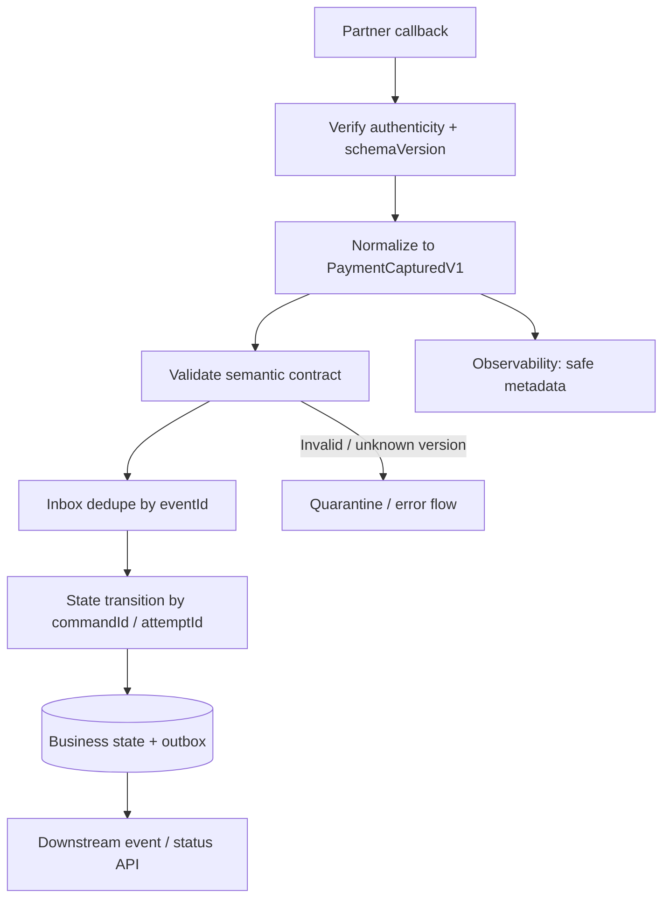
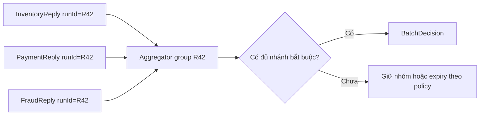
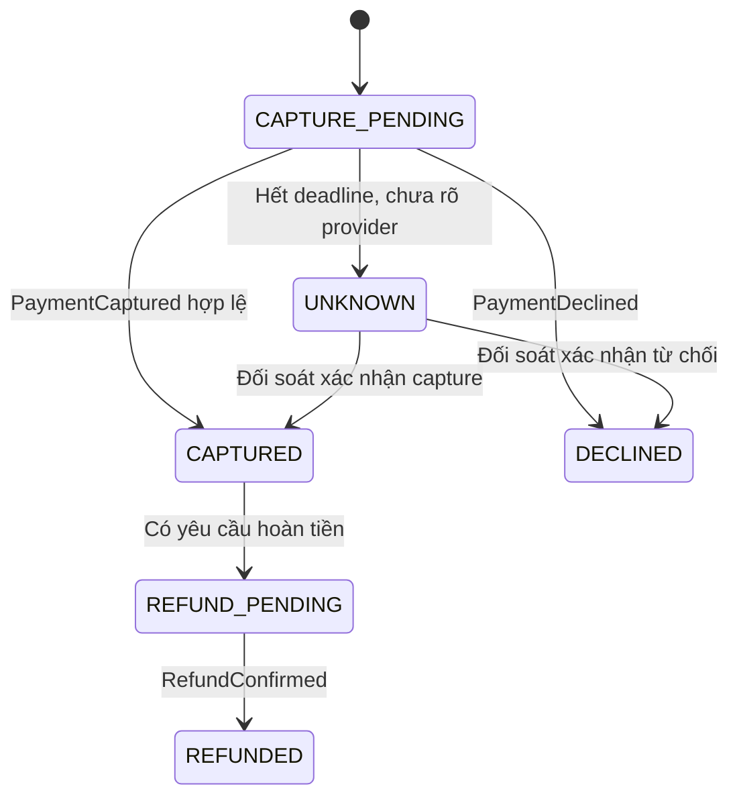

# Dùng pattern để che một hợp đồng message chưa rõ

## 1. Bài toán: flow có đủ pattern nhưng vẫn xử lý sai

Trong module **SPRING_INTEGRATION_PATTERN**, mục tiêu là triển khai *Enterprise Integration Patterns* với Spring Integration để tạo các luồng message ít phụ thuộc, dễ mở rộng, dễ kiểm thử và quan sát. Router, Filter, Transformer, Splitter, Aggregator, Gateway, retry, error channel và correlation cung cấp những cơ chế hữu ích, nhưng **chúng không thể tự sửa một hợp đồng message chưa được định nghĩa rõ**.

Xét một hệ thống nhận callback thanh toán:

```json
{
  "id": "42",
  "type": "paid",
  "amount": 125000,
  "time": "2026-11-21T08:00:00Z"
}
```

Nhóm phát triển bổ sung một Router để chọn channel theo `type`, Filter loại những bản tin “không hợp lệ”, Transformer đổi tên trường, Aggregator ghép callback, retry advice thử lại khi lỗi và error channel nhận exception. Mọi thành phần đều cấu hình được, nhưng những câu hỏi căn bản vẫn chưa có lời giải:

- `id` là **order ID**, payment ID, event ID hay ID của lần gửi callback?
- `paid` nghĩa là **đã ủy quyền (authorized)**, đã **thu tiền (captured)** hay đã **quyết toán (settled)**?
- `amount=125000` là đồng hay đơn vị nhỏ nhất của tiền tệ nào? Có bao gồm phí không?
- `time` là thời điểm giao dịch, thời điểm callback được tạo hay lúc consumer nhận?
- Callback có thể đến **hai lần**, **sai thứ tự**, **sau timeout** hoặc từ **phiên bản schema khác** không?
- Khi Router không có mapping hoặc Filter loại message, có được phép bỏ vĩnh viễn không?
- “Xử lý thành công” nghĩa là đã nhận message, đã gửi vào channel, đã ghi ledger hay đã hoàn tất toàn bộ workflow?

Không pattern nào trả lời thay bên phát và bên nhận. Nếu câu hỏi trên chưa rõ, dùng thêm nhiều pattern thường chỉ **che vấn đề bằng các cấu hình và nhánh lỗi phức tạp**.

> **Nguyên tắc:** **Hợp đồng message là đầu vào của thiết kế integration, không phải kết quả tình cờ của việc nối các EIP.** Trước khi route, filter, transform, aggregate hoặc retry, phải thống nhất message biểu diễn sự kiện gì, trường nào bắt buộc, điều kiện hợp lệ, danh tính và quy tắc giao nhận.

### Mục tiêu bài học

Sau bài này, bạn có thể:

1. Nhận diện dấu hiệu một pipeline phức tạp đang bù đắp cho schema hoặc ngữ nghĩa message mơ hồ.
2. Thiết kế hợp đồng gồm **payload, metadata, phiên bản, thời điểm, danh tính, correlation, idempotency và lỗi**.
3. Phân biệt command, event và reply; tránh lẫn lộn “đã nhận” với “đã thực hiện”.
4. Đặt validation/normalization ở đúng biên, dùng Router/Transformer/Gateway đúng trách nhiệm.
5. Quy định hành vi khi message trùng, sai thứ tự, thiếu trường, không hỗ trợ version hoặc đến muộn.
6. Viết các kiểm thử hợp đồng và kế hoạch migration trước khi thay đổi flow production.

## 2. Nhận diện anti-pattern qua các triệu chứng

| Dấu hiệu | Cách “chữa” bằng pattern thường gặp | Vấn đề hợp đồng bị che |
| --- | --- | --- |
| Các consumer hiểu `paid` khác nhau | Thêm Router/Filter cho từng consumer | Chưa định nghĩa trạng thái nghiệp vụ của event. |
| Một trường ID có nhiều nghĩa | Thêm correlation expression phức tạp | Không tách event ID, command ID, business ID và attempt ID. |
| Message cũ bị lỗi khi đổi schema | Thêm hàng loạt Transformer và fallback | Không có quy ước versioning và tương thích. |
| Nhóm Aggregator không bao giờ release | Tăng timeout hoặc ép release sau N message | Không biết tập kết quả bắt buộc và quy ước kết thúc nhóm. |
| Gateway thường timeout nhưng provider vẫn xử lý | Retry thêm một lần và tăng replyTimeout | Không có trạng thái `UNKNOWN`, idempotency và deadline nghiệp vụ. |
| Đơn hàng xử lý hai lần | Thêm Filter theo payload trước handler | Không có event ID ổn định và chính sách chống trùng bền vững. |
| Message “biến mất” | Route lỗi/unknown tới `nullChannel` | Không có chính sách rõ về reject, quarantine, DLQ và alert. |
| Không thể giải thích kết quả sai | Gắn Wire Tap log toàn bộ payload | Thiếu reason code, version, correlation và quy định dữ liệu được log. |
| Side effect đã xảy ra nhưng ACK lỗi | Bật retry advice vô điều kiện | Không có hợp đồng delivery và idempotency qua ranh giới bên ngoài. |

**Số lượng pattern nhiều không phải lỗi tự thân.** Một flow phức tạp có thể phù hợp nếu giải quyết bài toán phức tạp thực sự. Lỗi nằm ở việc **không mô tả được chính xác một message hợp lệ và kết quả kỳ vọng**, nên mỗi EIP bị ép phải tự suy đoán.

## 3. Hợp đồng message gồm những lớp nào?

Không nên chỉ xem hợp đồng như một file JSON Schema. Schema xác định hình dạng và kiểu dữ liệu, nhưng một integration contract tốt còn mô tả **ý nghĩa, quyền sở hữu, quy trình, thời gian và lỗi**.

| Lớp hợp đồng | Câu hỏi cần được trả lời | Ví dụ |
| --- | --- | --- |
| **Ý nghĩa nghiệp vụ** | Message tuyên bố điều gì đã hoặc cần xảy ra? | `PaymentCaptured` xác nhận khoản tiền đã được provider capture. |
| **Schema** | Trường nào bắt buộc, kiểu nào, enum/range nào hợp lệ? | `amountMinor` là số nguyên dương, `currency` theo mã ISO 4217. |
| **Danh tính** | Event, command, aggregate và attempt được nhận diện thế nào? | `eventId`, `commandId`, `orderId`, `paymentAttemptId`. |
| **Thời gian** | Thời điểm phát sinh, ghi nhận, deadline có ý nghĩa gì? | `occurredAt` là lúc provider xác nhận capture, dạng UTC. |
| **Phiên bản** | Khi thêm/bỏ/đổi nghĩa trường, consumer có tương thích không? | `eventType=PaymentCaptured`, `schemaVersion=1`. |
| **Giao nhận** | Có thể trùng, đến muộn, sai thứ tự, mất kết nối hay không? | Consumer hỗ trợ **at least once** và dedupe theo `eventId`. |
| **Kết quả/lỗi** | ACK nào là kết quả nghiệp vụ, lỗi nào retry được? | `CAPTURED`, `DECLINED`, `UNKNOWN` là trạng thái khác nhau. |
| **Bảo mật** | Ai được đọc payload/header, được log trường nào? | Không truyền PAN, CVV hoặc token trong diagnostic event. |
| **Vận hành** | Ai sở hữu schema, đo sai hợp đồng và rollback thế nào? | Contract test, version, DLQ và owner xác định. |

### 3.1. Command, event và reply không thay thế nhau

```text
Command: CapturePayment(commandId, amountMinor, currency)
    Nghĩa: "Hãy thực hiện capture"; chưa nói đã thành công.

Event: PaymentCaptured(eventId, commandId, captureReference, ...)
    Nghĩa: "Capture đã xảy ra" theo định nghĩa của producer.

Reply: CaptureAccepted(commandId, processingStatus)
    Nghĩa: có thể mới xác nhận đã nhận yêu cầu, chưa phải tiền đã được thu.
```

Việc một Gateway nhận reply `ACCEPTED` không tự chứng minh producer đã phát một `PaymentCaptured` hợp lệ. Phải làm rõ **“accepted để xử lý”** hay **“đã hoàn tất”**, cùng mốc transaction và nguồn xác nhận.

Một pattern Gateway giải quyết request/reply, không định nghĩa hộ ý nghĩa của lời xác nhận.

### 3.2. Payload và transport headers có vai trò khác nhau

- **Payload** nên chứa sự thật nghiệp vụ tối thiểu cần cho consumer độc lập.
- **Headers** có thể chứa `correlationId`, `replyChannel`, `errorChannel`, routing key hoặc tracing metadata phục vụ integration.
- **Envelope** ở broker/API có thể mang `eventId`, `eventType`, `schemaVersion`, `occurredAt` ngoài payload.
- **Contract** phải chỉ rõ trường nào nằm ở đâu, vì HTTP/JMS/Kafka/AMQP không nhất thiết giữ mọi Spring Message header khi qua adapter.

Đừng để một consumer nghiệp vụ phụ thuộc vào header nội bộ như `MessageHeaders.ID` nếu event có thể được tạo lại khi redelivery hoặc biến đổi message. ID của message Spring không mặc nhiên là **event ID bền vững**.

## 4. Viết lại ví dụ thành hợp đồng rõ ràng

Giả sử doanh nghiệp quyết định chỉ phát `PaymentCaptured` khi provider đã xác nhận capture. Một event phiên bản 1 có thể được mô tả như sau:

```json
{
  "eventType": "PaymentCaptured",
  "schemaVersion": 1,
  "eventId": "evt-cap-00042",
  "commandId": "cmd-cap-00042",
  "paymentAttemptId": "pay-attempt-00042",
  "orderId": "order-42",
  "amountMinor": 125000,
  "currency": "VND",
  "providerCaptureRef": "provider-cap-910",
  "occurredAt": "2026-11-21T08:00:00Z"
}
```

Ở đây:

- `PaymentCaptured` **chỉ** nói thao tác capture đã được provider xác nhận; không tự nói đơn đã vận chuyển hoặc đã quyết toán sổ cái.
- `eventId` do producer cấp **ổn định** cho một sự kiện logic; broker giao lại phải giữ nguyên ID.
- `commandId` liên kết kết quả với lệnh capture trước đó.
- `paymentAttemptId` phân biệt các lần thử thanh toán; `orderId` là danh tính đơn hàng.
- `amountMinor` là **đơn vị nhỏ nhất của `currency`**. Với `VND`, trong mô hình này một đơn vị nhỏ nhất là một đồng. Không dùng `amount` mơ hồ hoặc số thực floating-point cho giá trị tiền.
- `providerCaptureRef` phục vụ tra cứu/đối soát giao dịch ngoài hệ thống; không phải token bí mật.
- `occurredAt` là timestamp của sự kiện nghiệp vụ ở nguồn đã xác định, theo chuẩn UTC. Consumer có thể lưu thêm `receivedAt` riêng.

### 4.1. Mẫu hợp đồng phải kèm các bất biến

| Quy tắc | Cách xác minh |
| --- | --- |
| `eventType` phải là `PaymentCaptured` và version được hỗ trợ | Validate ở biên; không chuyển unknown version sang nhánh “thành công”. |
| Các ID và provider reference không rỗng | Reject/quarantine nếu thiếu, không tự sinh ID giả để lấp chỗ trống. |
| `amountMinor > 0` và `currency` hợp lệ | Kiểm tra kiểu/giá trị; đối soát với command được phát. |
| `commandId` và `paymentAttemptId` phải khớp record đang chờ | Từ chối update sai aggregate hoặc sai attempt. |
| Callback trùng `eventId` không được thực thi side effect hai lần | Inbox/idempotent handler. |
| Event tới khi đã `REFUNDED` cần chính sách riêng | Audit/đối soát; không tự ghi đè về `CAPTURED`. |
| Một event đã commit phải có đường giao nhận theo SLA | Outbox/broker/durable subscription theo yêu cầu. |

**Contract cần nêu chính xác producer và consumer owner.** Không được bắt từng consumer tự đoán liệu trạng thái `paid` thuộc authorization, capture hay settlement.

## 5. Sơ đồ: pattern đúng vai trò sau khi hợp đồng được chốt



Các EIP lúc này có ranh giới rõ:

- **Transformer** chuẩn hóa cấu trúc mà không bịa nghĩa nghiệp vụ.
- **Filter/Validator** kiểm tra điều kiện kỹ thuật, không im lặng nuốt command/event bắt buộc.
- **Router** phân luồng theo event type hoặc trường đã chuẩn hóa.
- **Aggregator** gom các phần theo correlation và release policy đã được định nghĩa trước.
- **Gateway** cung cấp giao diện request/reply có timeout; việc hết chờ không tự hủy side effect.
- **Retry/error channel** xử lý lỗi transport và điều phối chẩn đoán; không sửa được contract thiếu.
- **Application service** quản lý chuyển trạng thái, idempotency, transaction và phát event tiếp theo.

## 6. Java: kiểu message nội bộ có ngữ nghĩa kiểm chứng được

Ví dụ dưới đây dùng Java 17+ và record. Các kiểu được minh họa theo từng phần để có thể đưa vào package nghiệp vụ của dự án; đây không phải kiểu sẵn có của Spring Integration.

```java
import java.time.Instant;

record PaymentCapturedV1(
        String eventId,
        String commandId,
        String paymentAttemptId,
        String orderId,
        long amountMinor,
        String currency,
        String providerCaptureRef,
        Instant occurredAt) {
}
```

Validation không chỉ dựa vào việc JSON parse thành công. Có thể tách một lớp hợp đồng thuần Java:

```java
import java.util.Currency;

final class PaymentCapturedContract {
    private PaymentCapturedContract() {}

    static void validate(PaymentCapturedV1 event) {
        if (event == null
                || blank(event.eventId())
                || blank(event.commandId())
                || blank(event.paymentAttemptId())
                || blank(event.orderId())
                || blank(event.providerCaptureRef())
                || event.occurredAt() == null
                || event.amountMinor() <= 0) {
            throw new IllegalArgumentException(
                    "PaymentCapturedV1 thiếu trường bắt buộc hoặc sai giá trị");
        }

        if (blank(event.currency())
                || !event.currency().matches("[A-Z]{3}")) {
            throw new IllegalArgumentException("currency phải là ISO 4217 uppercase");
        }

        try {
            Currency.getInstance(event.currency());
        } catch (IllegalArgumentException invalidCurrency) {
            throw new IllegalArgumentException(
                    "currency không được hỗ trợ", invalidCurrency);
        }
    }

    private static boolean blank(String value) {
        return value == null || value.isBlank();
    }
}
```

Validator trên kiểm tra **cú pháp/miền giá trị tối thiểu**. Nó không chứng minh một provider đã thực sự capture tiền; việc đó cần xác minh nguồn callback (chữ ký, định danh nguồn, giao thức) và đối chiếu lệnh trong hệ thống. Cũng cần quy định chính sách đối với timestamp quá lệch, currency được hỗ trợ theo sản phẩm và amount khớp request.

### 6.1. Hợp đồng không nên có các trường mơ hồ

Không nên dùng kiểu:

```java
record GenericEvent(
        String id,
        String type,
        Object value,
        String status,
        Object extra) {
}
```

Kiểu `Object`, trường `value` chung chung hoặc `status` không rõ miền giá trị khiến mỗi consumer thực hiện một cách ép kiểu hoặc suy luận riêng. Có thể dùng envelope dùng chung ở transport, nhưng **payload nghiệp vụ vẫn cần schema và ngữ nghĩa theo từng event type**.

## 7. Biên chuẩn hóa: Transformer không được “bịa” hợp đồng

Giả sử adapter đối tác nhận callback có schema riêng. Khi callback đã được **xác thực nguồn** và phân loại là **capture thành công**, nó có thể được chuyển thành một event nội bộ.

```java
import java.time.Instant;

record PartnerCapturedNotification(
        String providerEventId,
        String commandReference,
        String attemptReference,
        String orderReference,
        long capturedMinor,
        String currencyCode,
        String captureReference,
        Instant capturedAt) {
}
```

```java
import org.springframework.integration.IntegrationMessageHeaderAccessor;
import org.springframework.integration.annotation.Transformer;
import org.springframework.integration.support.MessageBuilder;
import org.springframework.messaging.Message;
import org.springframework.stereotype.Component;

@Component
public class CapturedEventNormalizer {

    @Transformer(inputChannel = "verifiedPartnerCaptures",
                 outputChannel = "validatedCapturedEvents")
    public Message<PaymentCapturedV1> normalize(
            PartnerCapturedNotification source) {
        PaymentCapturedV1 event = new PaymentCapturedV1(
                source.providerEventId(),
                source.commandReference(),
                source.attemptReference(),
                source.orderReference(),
                source.capturedMinor(),
                source.currencyCode(),
                source.captureReference(),
                source.capturedAt());

        PaymentCapturedContract.validate(event);

        // Chỉ copy metadata đã có hợp đồng; không sao chép mọi header ngoài.
        return MessageBuilder.withPayload(event)
                .setHeader("eventType", "PaymentCaptured")
                .setHeader("schemaVersion", 1)
                .setHeader("eventId", event.eventId())
                .setHeader(
                        IntegrationMessageHeaderAccessor.CORRELATION_ID,
                        event.commandId())
                .build();
    }
}
```

Trong ví dụ, `verifiedPartnerCaptures` là **channel đã được adapter kiểm tra chữ ký/xác thực callback và phân loại trạng thái đúng**, không phải mọi callback thô từ Internet. Nếu nhà cung cấp chỉ gửi `AUTHORIZED`, normalizer không được tự đổi nó thành `PaymentCaptured`. Nếu provider **không có event ID bền vững**, cần thiết kế cách cấp/lưu ID ổn định dựa trên định danh giao dịch đã xác minh; không tạo UUID mới trong mỗi lần redelivery rồi gọi đó là deduplication.

`MessageBuilder.withPayload(...)` có chủ đích tạo một Spring message mới và chỉ thêm các headers được kiểm soát. Tránh `MessageBuilder.fromMessage(raw)` trong trường hợp raw message mang `Authorization`, cookie hoặc các header không được phép lan sang downstream; phương thức ấy có thể sao chép header từ message đầu vào.

## 8. Router và Filter chỉ được thực thi chính sách đã rõ

Sau khi message được validate, Router có thể chọn nhánh theo một giá trị đã chuẩn hóa. Ví dụ các adapter sổ cái phân theo currency được hệ thống hỗ trợ:

```java
import org.springframework.integration.annotation.Router;
import org.springframework.stereotype.Component;

@Component
public class CapturedEventRouter {

    @Router(inputChannel = "validatedCapturedEvents")
    public String selectLedgerChannel(PaymentCapturedV1 event) {
        return switch (event.currency()) {
            case "VND" -> "domesticCapturedEvents";
            case "USD" -> "foreignCapturedEvents";
            default -> "unsupportedCapturedCurrency";
        };
    }
}
```

Các channel này cần được ứng dụng khai báo và có handler tương ứng. `unsupportedCapturedCurrency` **không** nên mặc định trỏ `nullChannel`: đây là sự kiện đã được provider xác nhận, nhưng hệ thống chưa có đường xử lý; cần lưu dấu, cảnh báo và giải quyết.

### 8.1. Tại sao `Filter` không phải phép màu “làm sạch dữ liệu”?

Ví dụ một Filter:

```spel
payload != null && payload.status == 'paid'
```

Nếu payload thiếu `status`, Filter có thể reject hoặc lỗi đánh giá tùy cấu hình. Nếu `paid` có nghĩa khác giữa hai nhà cung cấp, Filter sẽ silently bỏ hoặc giữ sai message. **Định nghĩa giá trị và trường hợp từ chối phải nằm trong hợp đồng**, không chờ expression tự “hiểu”.

Nên phân loại ba kết quả:

1. **Hợp lệ:** tiếp tục xử lý message.
2. **Bị từ chối nghiệp vụ:** tạo kết quả `Rejected(reasonCode)` hoặc event tương ứng.
3. **Sai hợp đồng/không hiểu:** đưa vào đường quarantine/error flow; không đồng nhất với từ chối hợp lệ.

Với message tài chính, discard thiếu dấu vết là lỗi thiết kế ngay cả khi một Filter hoặc Router hoạt động đúng cú pháp.

## 9. Correlation, sequence và release: metadata phải có nghĩa

Một Aggregator chỉ hoạt động đúng nếu biết **message nào thuộc cùng nhóm** và **khi nào nhóm hoàn thành**. Không thể chọn `CorrelationStrategy` hoặc `ReleaseStrategy` hợp lý nếu contract không trả lời được:

- Một `batchId` là một yêu cầu xử lý hay một phiên retry mới?
- Ba phản hồi cần có tên gì? Có nhánh nào tùy chọn không?
- Nếu một nhánh không phản hồi, tạo partial result hay hết hạn?
- Nếu hai callback từ cùng nhánh đến, message nào được tính?
- Khi một ACK đến muộn sau group complete, phải đối soát hay loại?



Một Splitter có thể tự thêm `CORRELATION_ID`, `SEQUENCE_NUMBER` và `SEQUENCE_SIZE` cho các message con. Nhưng callback từ ba đối tác **không tự có các header ấy**. Nếu chỉ tăng `groupTimeout` hoặc dùng `group.size()==3`, message trùng có thể khiến nhóm release khi vẫn thiếu `FRAUD`. Định nghĩa nhóm theo ID có vòng đời ổn định, tập nhánh bắt buộc và quy tắc khi thiếu/trùng rồi mới cấu hình Aggregator.

## 10. Retry, error channel và timeout không sửa được ngữ nghĩa mơ hồ

Một contract cần nói rõ những trường hợp có thể thử lại và điều kiện coi là hoàn tất:

| Tình huống | Có nên retry? | Điều phải rõ trong contract |
| --- | --- | --- |
| Broker/network lỗi tạm thời | Có thể, có giới hạn và backoff | Event ID giữ nguyên khi redelivery; ACK/commit lúc nào? |
| Sai schema/version | Không retry vô hạn cùng dữ liệu | Consumer hỗ trợ version nào; đường quarantine/DLQ là gì? |
| Provider trả `DECLINED` | Thường là kết quả nghiệp vụ, không phải lỗi kết nối | Phân biệt từ chối với capture/authorization. |
| Gateway hết `replyTimeout` | Không được tự suy là thất bại | Worker có thể vẫn tạo side effect; tra cứu bằng command ID. |
| ACK trùng | Không thực thi side effect lần nữa | Inbox/idempotency theo stable event ID. |
| Sự kiện đến sai thứ tự | Có thể cần giữ, đối soát hoặc từ chối | Thứ tự nào được bảo đảm; theo `attemptId` hay version? |
| Thông điệp không có route | Fail fast/quarantine theo chính sách | Không ngầm đưa vào `nullChannel`. |
| Downstream commit rồi crash trước broker ACK | Broker có thể giao lại | Consumer phải idempotent; không hứa exactly once xuyên DB và broker. |

Với `DirectChannel` đồng bộ, exception thường lan về sender. Với `ExecutorChannel`, poller hoặc inbound adapter, exception có thể đi tới `errorChannel`/error flow trên thread khác. **ErrorMessage báo lỗi xử lý**, không tự sửa schema, không xác định kết quả nghiệp vụ thay bạn và không tự bảo đảm một message được replay bền vững.

### 10.1. “At least once” phải đi cùng idempotency

Producer có thể gửi lại sau mất kết nối hoặc crash. Consumer nên xử lý event ID ổn định:

```sql
CREATE TABLE consumed_event (
    consumer_name VARCHAR(100) NOT NULL,
    event_id      VARCHAR(128) NOT NULL,
    consumed_at   TIMESTAMP WITH TIME ZONE NOT NULL,
    PRIMARY KEY (consumer_name, event_id)
);
```

Khi xử lý, insert dấu đã nhận và cập nhật nghiệp vụ **trong cùng transaction**. Nếu event ID đã tồn tại, không tạo tác động trùng. Với HTTP side effect không cùng transaction DB, cần thêm outbox hoặc idempotency key được bên nhận hỗ trợ.

Không dùng `MessageHeaders.ID` làm idempotency key mặc định nếu Spring message được tái tạo khi qua producer/Transformer: key đó có thể khác dù vẫn là cùng một sự kiện.

## 11. Hợp đồng chuyển trạng thái và kết quả đến muộn

Một event `PaymentCaptured` có thể đến **sau** khi Gateway đã timeout hoặc sau khi đơn hàng được hủy. Nếu chỉ route theo `eventType` rồi luôn đặt `state=PAID`, ứng dụng sẽ ghi đè một trạng thái không còn hợp lệ.

Một state machine nghiệp vụ minh họa:



**Đây là state machine do ứng dụng định nghĩa**. Nó không được Spring Integration Router tự quản lý. Quy tắc chuyển trạng thái nên được kiểm tra trong transaction:

```sql
UPDATE payment_attempt
SET state = 'CAPTURED',
    provider_capture_ref = :captureReference,
    version = version + 1
WHERE attempt_id = :paymentAttemptId
  AND command_id = :commandId
  AND state IN ('CAPTURE_PENDING', 'UNKNOWN');
```

Ứng dụng phải kiểm tra **số dòng được cập nhật**. Nếu 0 dòng, có thể là message trùng, sai attempt, state đã `REFUNDED` hoặc lệnh không tồn tại. Không tiếp tục phát shipping/refund chỉ vì payload có tên `PaymentCaptured`.

**Hợp đồng cũng phải nêu quy tắc đối soát:** nếu provider đã capture nhưng hệ thống nhận callback muộn, ai là nguồn sự thật, khi nào gọi query API, và khi nào phát lệnh bù trừ. Gateway timeout chỉ nói caller đã hết chờ, không nói side effect có hay không.

## 12. Contract tests: kiểm thử schema và ý nghĩa trước flow

Khi có lớp `PaymentCapturedContract`, kiểm tra dữ liệu sai ở mức unit test trước khi dựng Spring context:

```java
import static org.junit.jupiter.api.Assertions.*;

import java.time.Instant;
import org.junit.jupiter.api.Test;

class PaymentCapturedContractTest {

    private PaymentCapturedV1 validEvent() {
        return new PaymentCapturedV1(
                "evt-42",
                "cmd-42",
                "attempt-42",
                "order-42",
                125_000L,
                "VND",
                "provider-capture-42",
                Instant.parse("2026-11-21T08:00:00Z"));
    }

    @Test
    void acceptsCompleteCapturedEvent() {
        assertDoesNotThrow(
                () -> PaymentCapturedContract.validate(validEvent()));
    }

    @Test
    void rejectsMissingStableEventId() {
        PaymentCapturedV1 original = validEvent();
        PaymentCapturedV1 invalid = new PaymentCapturedV1(
                "", original.commandId(), original.paymentAttemptId(),
                original.orderId(), original.amountMinor(),
                original.currency(), original.providerCaptureRef(),
                original.occurredAt());

        assertThrows(IllegalArgumentException.class,
                () -> PaymentCapturedContract.validate(invalid));
    }

    @Test
    void rejectsNegativeAmountAndUnclearCurrency() {
        PaymentCapturedV1 original = validEvent();
        PaymentCapturedV1 invalid = new PaymentCapturedV1(
                original.eventId(), original.commandId(),
                original.paymentAttemptId(), original.orderId(),
                -1, "vnd", original.providerCaptureRef(),
                original.occurredAt());

        assertThrows(IllegalArgumentException.class,
                () -> PaymentCapturedContract.validate(invalid));
    }
}
```

Những test trên xác minh hợp đồng dữ liệu, **chưa** xác thực chữ ký nhà cung cấp, transaction hoặc logic idempotency. Khi tích hợp với broker/HTTP, cần thêm contract test giữa producer-consumer và kiểm thử bản ghi đầu ra thực tế sau serialize/deserialize.

### 12.1. Ma trận contract test nên có

| Nhóm | Test case | Kết quả mong đợi |
| --- | --- | --- |
| Schema | Thiếu `eventType`/`schemaVersion` | Reject/quarantine, không route như event hợp lệ. |
| Schema | Unknown field được thêm ở minor version | Theo compatibility policy đã thống nhất. |
| Semantic | `AUTHORIZED` bị nhầm thành `CAPTURED` | Không phát `PaymentCaptured`. |
| Money | `amountMinor` âm, currency lạ, mismatch với command | Báo sai hợp đồng; không ghi ledger. |
| Identity | Event thiếu `eventId` hoặc callback trùng | Reject dữ liệu thiếu, dedupe khi trùng. |
| Correlation | `commandId` khớp nhưng `attemptId` sai | Không ghi cập nhật sai attempt. |
| Ordering | `RefundConfirmed` đến trước `PaymentCaptured` | Chính sách lưu/đối soát rõ, không âm thầm bỏ. |
| Timing | Event đến sau Gateway timeout | State và status API vẫn đưa được kết quả đúng. |
| Error | Router không biết version/provider | Error/quarantine flow có reason code. |
| Durability | Consumer commit xong nhưng chưa ACK | Redelivery không tạo side effect hai lần. |
| Privacy | Callback có token hoặc PII | Diagnostic log không lộ dữ liệu không cần thiết. |

Nếu producer có nhiều team, nên có **consumer-driven contract tests** hoặc schema compatibility check trong CI. Thay đổi meaning của một field là thay đổi phá vỡ tương thích dù tên và kiểu field không đổi.

## 13. Phiên bản hóa và migration không phá vỡ consumer cũ

Một hợp đồng lâu dài phải cho phép nâng cấp mà không biến mọi sự kiện cũ thành “unknown”. Ví dụ:

| Thay đổi | Mức rủi ro | Hướng xử lý |
| --- | --- | --- |
| Thêm trường tùy chọn, có default/ngữ nghĩa rõ | Thường có thể tương thích | Kiểm thử parser cũ và hành vi khi thiếu trường. |
| Đổi `amount` từ đồng sang xu nhưng giữ tên/kiểu | **Rất cao** | Tạo schemaVersion mới, không thay nghĩa âm thầm. |
| Đổi `paid` từ authorization sang capture | **Rất cao** | Đổi event type/contract; migration rõ ràng. |
| Xóa trường mà consumer đang sử dụng | Breaking change | Duy trì cả phiên bản hoặc kế hoạch nâng cấp phối hợp. |
| Thêm enum value | Có thể breaking với switch exhaustive | Consumer phải có nhánh unknown rõ ràng; contract test. |
| Thay cơ chế tạo `eventId` khi redelivery | Ảnh hưởng idempotency nghiêm trọng | Duy trì ID ổn định và kiểm chứng replay/legacy events. |

Một lộ trình triển khai:

1. Công bố contract phiên bản 1 với mẫu dữ liệu chuẩn và dữ liệu lỗi.
2. Liệt kê producer, consumer, adapter và owner của từng thành phần.
3. Thêm validation và metrics cho message legacy trước khi chặn.
4. Cho producer phát schema mới theo kế hoạch; consumer có thể đọc hai version trong giai đoạn chuyển tiếp.
5. Giám sát tỉ lệ unknown/invalid và backlog ở DLQ/quarantine.
6. Chỉ loại bỏ version cũ khi hết thời hạn retention/replay theo hợp đồng và consumer đã chuyển xong.

Không “sửa nhanh” bằng một Transformer chèn default cho trường bắt buộc mà chưa hiểu ý nghĩa. Ví dụ tạo một `commandId` ngẫu nhiên khi callback thiếu ID sẽ khiến hệ thống mất khả năng ghép với lệnh thật, gây lỗi khó phát hiện hơn so với reject dữ liệu sai.

## 14. Observability: ghi sự thật của hợp đồng, không log tất cả

Khi xảy ra lỗi, điều tra cần biết **sự kiện nào**, **hợp đồng phiên bản nào**, **vì sao invalid** và **đã đi qua ranh giới nào**:

```text
event=contract_received   eventType=PaymentCaptured schemaVersion=1
event=contract_validated  eventType=PaymentCaptured result=PASS
event=message_routed      eventType=PaymentCaptured target=domesticCapturedEvents
event=inbox_duplicate     eventType=PaymentCaptured reason=DUPLICATE_EVENT_ID
event=state_rejected      eventType=PaymentCaptured reason=ATTEMPT_MISMATCH
event=contract_rejected   eventType=PaymentCaptured reason=UNSUPPORTED_VERSION
```

Đây là log **minh họa do ứng dụng phát**, không phải format mặc định Spring Integration. Không log raw callback chứa bí mật, token, thông tin thẻ hoặc PII. Dùng allowlist trường, kiểm soát retention và quyền truy cập; không đưa `eventId` hoặc `orderId` vào nhãn metric có cardinality quá cao.

Nên đo:

- `invalid_contract_total` theo producer, event type, version và reason code.
- `unknown_version_total`, `unknown_route_total`, lỗi mapping/transformer.
- Tỷ lệ duplicate theo `eventId` và mismatch correlation.
- `outbox_backlog`, `consumer_lag`, số sự kiện tới muộn và kết quả đối soát.
- Tỉ lệ Gateway timeout **tách khỏi** tỷ lệ tác vụ nghiệp vụ hoàn tất.
- `aggregator_group_age`, tỉ lệ nhóm thiếu nhánh và partial result.

Wire Tap có thể hỗ trợ debug nhưng không được dùng để “khám phá hợp đồng” bằng cách log toàn bộ dữ liệu nhạy cảm trong production. Quan sát phải là **bằng chứng hợp đồng được thực thi** chứ không phải một nguồn leak dữ liệu mới.

## 15. Checklist thiết kế trước khi chọn pattern

Hãy hoàn thành bảng này cùng producer và consumer trước khi tạo integration flow:

| Câu hỏi bắt buộc | Câu trả lời ví dụ với `PaymentCaptured` |
| --- | --- |
| Đây là command, event hay reply? | Event xác nhận capture từ provider. |
| Điều kiện nghiệp vụ nào làm event được phát? | Provider xác nhận capture thành công, không chỉ authorized. |
| Ai sở hữu contract? | Đội Payment Integration, có version và quy trình thay đổi. |
| Payload/schema bắt buộc là gì? | `eventId`, `commandId`, `attemptId`, `orderId`, money, currency, provider ref, timestamp. |
| Phần nào nằm ở headers và có được truyền qua broker không? | `correlationId` cho routing/trace; trường ID bền vững vẫn ở envelope/payload. |
| Có thể duplicate/reorder/late event không? | Có; inbox, state transition và reconciliation bắt buộc. |
| Khi invalid/unknown version thì sao? | Quarantine, cảnh báo và xử lý bởi owner; không vào null channel. |
| Có phải có reply ngay không? | Không; có status API nếu xử lý lâu hơn Gateway deadline. |
| Có được phép mất event không? | Không; outbox và durable broker subscription theo SLA. |
| Những trường nào được log? | Event type, version, reason code và metadata đã được phê duyệt. |

Khi bảng trên đã rõ, **pattern trở thành công cụ triển khai**: Transformer để chuẩn hóa schema, Router để chọn channel, Aggregator để gom theo contract, Gateway để cung cấp interface và retry/error channel để đáp ứng chính sách lỗi. Ngược lại, khi contract chưa rõ, thêm pattern thường làm tăng số nhánh nhưng không tăng tính đúng đắn.

## 16. Bài thực hành: cứu một flow callback nhiều pattern nhưng thiếu hợp đồng

Một hệ thống nhận event:

```json
{
  "id": "payment-42",
  "status": "success",
  "total": 100.50,
  "time": "2026-11-21 15:00:00"
}
```

Flow hiện tại gồm `Filter(status == 'success')`, `Transformer(total * 100)`, `Router` theo provider, `Aggregator` theo `id` và `Gateway(replyTimeout=1000ms)`. Đội vận hành phát hiện thanh toán trùng, message thiếu nhánh và ACK muộn.

Hãy thực hiện:

1. Liệt kê các điểm mơ hồ của `id`, `success`, `total`, timestamp và provider; đặt câu hỏi với owner trước khi thay code.
2. Chọn event type có nghĩa chính xác (`PaymentAuthorized`, `PaymentCaptured` hay `PaymentSettled`), không dùng một tên thay thế cho mọi mốc.
3. Định nghĩa schema version mới với `eventId`, `commandId`, `paymentAttemptId`, `amountMinor`, `currency` và `occurredAt` rõ ràng.
4. Viết validation và contract tests cho amount, ID, timestamp, unknown version, event trùng và status không hỗ trợ.
5. Sửa Transformer chỉ chuyển đổi theo mapping đã được định nghĩa; không suy currency/ID bằng default tùy tiện.
6. Sửa Router để unknown provider/event vào nhánh quarantine có consumer và reason code.
7. Nếu cần Aggregator, xác định `groupId`, số nhánh bắt buộc, expiry và duplicate; không dựa vào `id` mơ hồ.
8. Thiết kế Gateway timeout trả trạng thái chưa xác nhận, không coi side effect là thất bại; thêm status API.
9. Mô phỏng hai callback cùng `eventId`, một callback đến sau timeout và một callback từ schema cũ; kiểm chứng idempotency và migration.
10. Thêm log/metrics contract compliance rồi giải thích chính xác vì sao từng message được xử lý, từ chối hoặc đối soát.

**Câu hỏi tự đánh giá**

- Tại sao một Router có mapping đầy đủ vẫn có thể định tuyến sai nghiệp vụ?
- Vì sao schema hợp lệ về cú pháp chưa đủ để kết luận `paid` nghĩa là capture?
- Khác nhau giữa `eventId`, `commandId`, `correlationId` và `traceId` là gì?
- Tại sao Aggregator không thể tự biết nhánh nào bắt buộc nếu hợp đồng không nói rõ?
- Khi Gateway timeout nhưng provider đã commit, cần trạng thái nào để không retry mù?
- Vì sao `nullChannel` không phải cách xử lý tốt cho unknown contract version?
- Khi thay đổi ý nghĩa của `amount` mà giữ nguyên kiểu dữ liệu, vì sao đó vẫn là breaking change?
- Điều gì phải được test trước khi triển khai một Transformer tương thích hai schema?

## 17. Tài liệu tham khảo

- [Spring Integration Reference — Message](https://docs.spring.io/spring-integration/reference/message.html): cấu trúc message, payload và headers.
- [Spring Integration Reference — Transformer](https://docs.spring.io/spring-integration/reference/transformer.html): chuyển đổi message và trách nhiệm của Transformer.
- [Spring Integration Reference — Router](https://docs.spring.io/spring-integration/reference/router.html): chọn channel theo routing key và mapping.
- [Spring Integration Reference — Aggregator](https://docs.spring.io/spring-integration/reference/aggregator.html): correlation, release strategy và message group.
- [Spring Integration Reference — Messaging Gateways](https://docs.spring.io/spring-integration/reference/gateway.html): request/reply, timeout và hợp đồng reply.
- [Spring Integration Reference — Error Handling](https://docs.spring.io/spring-integration/reference/error-handling.html): lỗi đồng bộ, bất đồng bộ và error flow.
- [CloudEvents Specification](https://github.com/cloudevents/spec): một cách tham khảo để chuẩn hóa metadata sự kiện; dùng khi phù hợp với hợp đồng của hệ thống, không bắt buộc mọi message phải theo CloudEvents.
- [JSON Schema Specification](https://json-schema.org/specification): mô tả hình dạng dữ liệu; cần bổ sung quy tắc ngữ nghĩa và delivery.

> **Ghi nhớ:** **Không EIP nào bù được một hợp đồng message mơ hồ.** Xác định event/command đang nói điều gì, schema và version nào được hỗ trợ, ID nào dùng để correlation/dedup, kết quả/lỗi có nghĩa gì và điều kiện giao nhận ra sao. Khi hợp đồng rõ, Spring Integration mới giúp Router, Filter, Transformer, Aggregator, Gateway và error flow hoạt động đúng, có thể kiểm thử và mở rộng.
