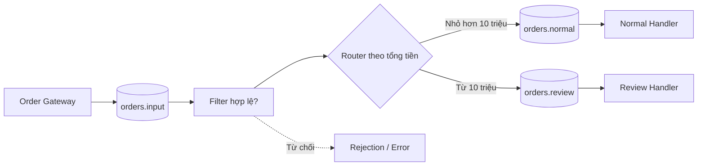
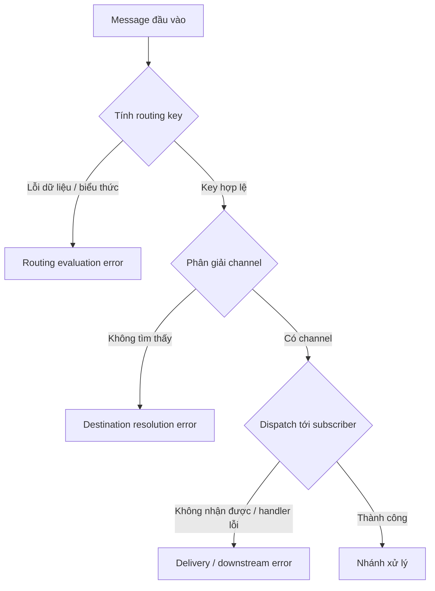

# Message Router quyết định channel đích

## 1. Message Router giải quyết vấn đề gì?

Trong một ứng dụng tích hợp, cùng một loại message có thể cần được xử lý theo **những tuyến khác nhau**. Đơn hàng có tổng tiền nhỏ được xử lý tự động, đơn hàng có giá trị lớn cần phê duyệt; thông báo giao dịch nội địa được gửi đến một hệ thống, giao dịch quốc tế đến hệ thống khác. Nếu viết tất cả trong một service với nhiều câu lệnh `if/else` và gọi trực tiếp các service đích, logic điều phối sẽ gắn chặt với logic nghiệp vụ, khó mở rộng và khó quan sát.

**Message Router** là một Enterprise Integration Pattern (EIP) dùng để **quyết định kênh đích (output channel)** cho message dựa trên một quy tắc. Trong Spring Integration, router là một **message endpoint**: nó nhận một `Message<?>` từ input channel, đánh giá điều kiện hoặc tính *routing key*, sau đó chuyển message đến channel đích được xác định bởi cấu hình.

Ví dụ một luồng xử lý đơn hàng:



Ở đây:

- `Order Gateway` là điểm nhận yêu cầu và đưa message vào flow.
- `orders.input`, `orders.normal`, `orders.review` là **message channel**: điểm nối, không tự quyết định nghiệp vụ.
- `Filter` quyết định **có cho message đi tiếp hay không**.
- `Router` quyết định **nếu được đi tiếp, message đến channel nào**.
- `Normal Handler` và `Review Handler` thực hiện công việc nghiệp vụ sau khi nhận message.

Một **router không xử lý phê duyệt** và không tự chuyển đổi giá trị đơn hàng. Điều đó thuộc handler hoặc transformer ở nhánh đích. Phân tách ba trách nhiệm này là trọng tâm của module `SPRING_INTEGRATION_PATTERN`: triển khai các Enterprise Integration Patterns bằng Spring Integration để xây dựng luồng thông điệp ít phụ thuộc và dễ mở rộng, kết hợp Filter, Transformer, Splitter, Aggregator, Gateway, retry, error channel, correlation và kiểm thử theo nhánh.

### Mục tiêu học tập

Sau bài này, người học có thể:

1. Giải thích quy trình **message → routing key → channel mapping → output channel → subscriber**.
2. Chọn điều kiện dựa vào payload, headers hoặc metadata đáng tin cậy.
3. Cấu hình router với Spring Integration Java DSL, bao gồm nhiều nhánh có tên rõ ràng.
4. Phân biệt Router, Filter, Recipient List và Publish–Subscribe.
5. Thiết kế nhánh không có mapping, nhánh không có subscriber, nhánh xử lý lỗi, và tránh gateway chờ phản hồi vô hạn.
6. Kiểm thử các ngưỡng và nhánh, quan sát routing decision, trace/correlation và khả năng quá tải của từng channel.

## 2. Router đứng ở vị trí nào trong integration flow?

### 2.1. Input, điều kiện, output

Router có thể được xem như một **điểm quyết định**:

```text
                      Message<Order>
                            |
                            v
                 +-------------------+
                 | Message Router    |
                 | key = policy(msg) |
                 +-------------------+
                            |
               +------------+------------+
               |                         |
          key = normal              key = review
               |                         |
         channelMapping             channelMapping
               |                         |
               v                         v
         orders.normal              orders.review
               |                         |
               v                         v
         Normal Handler             Review Handler
```

Về mặt khái niệm:

1. **Nhận message** từ input channel.
2. **Tính routing key** bằng hàm/biểu thức/cấu hình; ví dụ `normal` hay `review`.
3. **Phân giải đích** theo mapping từ key sang tên/bean channel, hoặc cơ chế phân giải khác của loại router.
4. **Gửi message** đến channel đích và để subscriber ở kênh đó tiếp tục xử lý.

**Routing key không nhất thiết trùng với channel name.** Ví dụ key `review` có thể map tới bean `orders.review`. Điều này tạo một tầng cấu hình riêng giữa **quyết định nghiệp vụ** và **địa chỉ kỹ thuật**, giúp thay channel mà không phải viết lại biểu thức định tuyến.

### 2.2. Message đi qua router có bị biến đổi không?

Với Content-Based Router thông thường, nhiệm vụ chính là **phân phối**, không phải tạo payload mới. Header và payload thường tiếp tục được chuyển đến nhánh nhận theo cơ chế dispatch của Spring Integration, nhưng không nên dựa vào việc message ID sẽ bất biến trong mọi bước tiếp theo: transformer, gateway, splitter, adapter hoặc thành phần tùy biến có thể tạo message mới.

Khi cần chuẩn hóa payload, dùng **Transformer** riêng:

```text
orders.input -> Transformer (chuẩn hóa) -> Router -> orders.review
                                           |
                                           +-----> orders.normal
```

Việc đặt Transformer trước hay sau Router phụ thuộc điều kiện định tuyến:

| Cách sắp xếp | Hợp lý khi | Rủi ro |
|---|---|---|
| Transformer → Router | Nguồn dữ liệu có nhiều schema; router cần DTO chuẩn. | Nếu transformer thất bại, router không nhận message. |
| Router → Transformer theo từng nhánh | Mỗi hệ thống đích dùng định dạng riêng. | Có thể trùng code chuẩn hóa chung giữa các nhánh. |
| Filter → Router | Cần loại message không hợp lệ trước khi tính key. | Phải xử lý rõ đường reject để không mất request–reply. |
| Router → Filter từng nhánh | Mỗi nhánh có bộ quy tắc kiểm tra riêng. | Các nhánh phải tự chịu trách nhiệm validation; có thể rẽ nhánh theo dữ liệu chưa an toàn. |

## 3. Các tiêu chí để Router chọn kênh đích

### 3.1. Dựa trên nội dung payload

Đây là **Content-Based Router**: đọc dữ liệu nghiệp vụ rồi chọn tuyến. Ví dụ:

```java
import java.math.BigDecimal;

record Order(String id, BigDecimal total, String currency) {}

String routeKey(Order order) {
    BigDecimal threshold = new BigDecimal("10000000");
    return order.total().compareTo(threshold) >= 0
            ? "review"
            : "normal";
}
```

Biểu thức trên có một **quy tắc biên** rõ ràng: tổng tiền **bằng đúng** 10 triệu cũng đi `review`. Nếu bỏ qua trường hợp bằng ngưỡng, các test ngưỡng có thể bỏ sót sai sót do dùng `>` thay cho `>=`.

Để quy tắc có ý nghĩa, phải bảo đảm trước đó:

- `total` khác `null` và lớn hơn 0 nếu hợp đồng nghiệp vụ yêu cầu.
- Đơn vị tiền tệ được xử lý hợp lý: so sánh `10_000_000` mà không xác định currency có thể sai cho các đơn USD/EUR.
- Các trường phục vụ route thuộc schema đã được kiểm tra, không phải dữ liệu người dùng có thể tùy ý giả mạo.

### 3.2. Dựa trên message headers

Nhiều quyết định route phù hợp với metadata: tenant đã xác thực, môi trường, phân vùng, nguồn gửi, loại giao dịch hoặc version. Chẳng hạn:

```text
Header: region=VN -> shipping.vn
Header: region=SG -> shipping.sg
Header: region=US -> shipping.us
```

Trong Spring Integration, có những router chuyên dụng như **Header Value Router** để đọc giá trị header. Header giúp tránh phải thay payload chỉ để truyền thông tin điều phối, nhưng **header không mặc nhiên đáng tin cậy**: ở ranh giới HTTP/broker, client có thể cung cấp header giả mạo. Nếu dùng header tenant/role làm route, phải xác thực và xây dựng lại giá trị tại vùng biên tin cậy.

Ví dụ `traceId` nên dùng để **truy nguyên**, không dùng làm điều kiện quyết định nghiệp vụ, trừ khi có yêu cầu thiết kế rõ. Tách biệt *metadata quan sát* với *metadata điều phối* giúp tránh logic route khó hiểu.

### 3.3. Dựa trên loại payload hoặc biểu thức

Đôi khi routing không cần mở các trường:

- **Payload Type Router:** route theo Java type, ví dụ `OrderCreated`, `PaymentCaptured`, `InventoryAdjusted`.
- **Expression Evaluating Router:** đánh giá một biểu thức từ message theo cấu hình; phù hợp với chính sách ngắn, cần kiểm tra cách truy cập field/header và xử lý `null`.
- **Method Invoking Router:** gọi method của một bean để lấy routing key; phù hợp khi chính sách có logic Java cần kiểm thử và tái sử dụng.

Spring Integration còn cung cấp các cách phân phối khác như **Recipient List Router**, nhưng không nên dùng mọi biến thể như một giải pháp thay thế hoàn toàn nhau: một số quyết định **một nhánh**, một số tạo **nhiều đích nhận**, một số trả về trực tiếp channel hoặc danh sách channel.

## 4. Java DSL hoàn chỉnh: một yêu cầu, hai channel đích

### 4.1. Yêu cầu nghiệp vụ

Ta triển khai flow đồng bộ:

1. `OrderGateway.submit(Order)` nhận đơn hàng và trả `Receipt`.
2. Filter kiểm tra tổng tiền **dương** và không `null`.
3. Router trả routing key `normal` nếu `total < 10_000_000`, ngược lại `review`.
4. Mapping `normal → orders.normal` và `review → orders.review`.
5. Mỗi nhánh có service activator riêng trả kết quả khác nhau.

Ví dụ hướng tới **Java 17+, Spring Boot 3.x và Spring Integration 6.x** cùng dependency `spring-boot-starter-integration`. Các `record` và interface đặt trong cùng package; trong dự án thật, mỗi public type cần file Java riêng.

### 4.2. Cấu hình flow và channel

```java
import java.math.BigDecimal;

import org.springframework.context.annotation.Bean;
import org.springframework.context.annotation.Configuration;
import org.springframework.integration.annotation.Gateway;
import org.springframework.integration.annotation.IntegrationComponentScan;
import org.springframework.integration.annotation.MessagingGateway;
import org.springframework.integration.channel.DirectChannel;
import org.springframework.integration.config.EnableIntegration;
import org.springframework.integration.dsl.IntegrationFlow;
import org.springframework.messaging.MessageChannel;

record Order(String orderId, BigDecimal total) {}
record Receipt(String orderId, String status) {}

@MessagingGateway
interface OrderGateway {
    @Gateway(requestChannel = "orders.input")
    Receipt submit(Order order);
}

@Configuration
@EnableIntegration
@IntegrationComponentScan
class OrderRouterConfiguration {

    @Bean(name = "orders.input")
    MessageChannel ordersInput() {
        return new DirectChannel();
    }

    @Bean(name = "orders.normal")
    MessageChannel ordersNormal() {
        return new DirectChannel();
    }

    @Bean(name = "orders.review")
    MessageChannel ordersReview() {
        return new DirectChannel();
    }

    @Bean
    IntegrationFlow chooseOrderDestination() {
        return IntegrationFlow.from("orders.input")
                // Filter trước Router để total không thể là null.
                .filter(Order.class,
                        order -> order.total() != null
                                && order.total().signum() > 0,
                        spec -> spec.throwExceptionOnRejection(true))
                // Routing key được map rõ sang channel name.
                .route(Order.class,
                        order -> order.total()
                                .compareTo(new BigDecimal("10000000")) >= 0
                                ? "review" : "normal",
                        spec -> spec
                                .channelMapping("review", "orders.review")
                                .channelMapping("normal", "orders.normal"))
                .get();
    }

    @Bean
    IntegrationFlow processNormalOrders() {
        return IntegrationFlow.from("orders.normal")
                .handle(Order.class, (order, headers) ->
                        new Receipt(order.orderId(), "ACCEPTED"))
                .get();
    }

    @Bean
    IntegrationFlow processReviewOrders() {
        return IntegrationFlow.from("orders.review")
                .handle(Order.class, (order, headers) ->
                        new Receipt(order.orderId(), "PENDING_REVIEW"))
                .get();
    }
}
```

Để Spring đăng ký interface `OrderGateway`, ví dụ dùng `@IntegrationComponentScan` trong cùng vùng package. Các phương thức bean tạo **ba kênh có tên ổn định**. Hai bean `IntegrationFlow` ở cuối đăng ký các handler nhận từ hai channel đích; nếu thiếu một trong hai, route hợp lệ vẫn có thể thất bại khi dispatch đến một channel không có subscriber.

### 4.3. Gọi Gateway và quan sát kết quả

```java
// orderGateway là bean do Spring inject vào service/controller.
Receipt a = orderGateway.submit(
        new Order("ORD-101", new BigDecimal("850000")));
// a.status() == "ACCEPTED"

Receipt b = orderGateway.submit(
        new Order("ORD-102", new BigDecimal("10000000")));
// b.status() == "PENDING_REVIEW"
```

Kết quả đi từng nhánh:

| Đơn hàng | Tổng tiền | Key do Router trả | Channel đích | Receipt |
|---|---:|---|---|---|
| ORD-101 | 850.000 | `normal` | `orders.normal` | `ACCEPTED` |
| ORD-102 | 10.000.000 | `review` | `orders.review` | `PENDING_REVIEW` |
| ORD-103 | 12.500.000 | `review` | `orders.review` | `PENDING_REVIEW` |
| ORD-104 | 0 | Không route | Bị Filter từ chối | Exception |
| ORD-105 | `null` | Không route | Bị Filter từ chối | Exception |

**Không nhầm:** trong ví dụ, `PENDING_REVIEW` là **kết quả mô phỏng** từ handler riêng, **không có nghĩa đã được phê duyệt**. Hệ thống thật có thể cần lưu trạng thái, xử lý review bất đồng bộ và thông báo kết quả sau. Khi đó, hợp đồng request–reply cần thay đổi phù hợp.

### 4.4. Message được trả về Gateway như thế nào?

Tuyến đang dùng `DirectChannel` nên handler và gateway có thể thực thi trên cùng chuỗi gọi đồng bộ. Hạ tầng Spring Integration dùng ngữ cảnh reply của request để chuyển `Receipt` về gateway; route chọn một nhánh chứ không thay ý nghĩa request–reply.

Khi thay một trong hai nhánh bằng `ExecutorChannel` hoặc `QueueChannel`, cần xem xét:

- Reply có thể đến **sau**; gateway cần timeout và hợp đồng xử lý phản hồi muộn.
- Lỗi phát sinh trong nhánh bất đồng bộ có thể được chuyển qua error flow thay vì ném trực tiếp lên thread caller.
- `QueueChannel` cần poller/consumer; không có poller thì message vào queue nhưng không được xử lý.
- Transaction và MDC/thread-local không tự lan truyền qua ranh giới thread.
- Dùng queue trong bộ nhớ không tự cung cấp durability, at-least-once hoặc exactly-once.

Chỉ thay loại channel **không** bảo đảm hành vi gateway giữ nguyên.

## 5. Routing key, channel mapping và nhánh dự phòng

### 5.1. Phân biệt ba thông tin

| Khái niệm | Ví dụ | Chủ sở hữu chính |
|---|---|---|
| Dữ liệu để quyết định | `order.total = 12_500_000` | Payload/headers của message. |
| Routing key | `review` | Chính sách/biểu thức của Router. |
| Channel destination | `orders.review` | Cấu hình channel mapping/địa chỉ nhận. |

Khi thay đích từ `orders.review` sang `orders.manualReview`, có thể chỉ cần sửa mapping nếu chính sách `review` không đổi. Ngược lại, nếu thay ngưỡng duyệt từ 10 triệu thành 20 triệu, nên sửa policy tại một nơi, không đổi tên tất cả channel.

### 5.2. Một routing key không có mapping

Giả sử policy trả `international` nhưng chỉ cấu hình `normal` và `review`. Hành vi **không được suy đoán**; tùy loại router và cấu hình, hệ thống có thể thử phân giải key như channel name, dùng default output channel, bỏ qua khi được cho phép, hoặc phát sinh lỗi khi không phân giải được đích.

Các khía cạnh cần xác định rõ:

- **Channel mapping:** Những key nào được cho phép và map đến channel nào?
- **Channel-key fallback:** Router có được thử coi key là tên channel trực tiếp không?
- **Default output channel:** Message không phù hợp mapping có được chuyển tới một nhánh dự phòng không?
- **Resolution required:** Không tìm thấy channel có bị xem là lỗi hay không?
- **Outcome:** Gateway trả gì, error channel ghi gì và ai chịu trách nhiệm xử lý?

Với nghiệp vụ quan trọng, nên **kiểm soát danh sách key hợp lệ** và viết test cho key lạ. Đừng trả một chuỗi chưa được kiểm soát từ payload/header rồi mặc nhiên tin nó an toàn để phân giải thành tên bean channel.

### 5.3. Khi nào dùng default channel?

Nhánh dự phòng hợp lý khi business contract có trạng thái **cần xem xét**, ví dụ đơn hàng có loại chưa hỗ trợ được chuyển vào `orders.unclassified` để lưu và xử lý thủ công. Không nên biến một lỗi cấu hình (sai chính tả tên channel) thành hành vi âm thầm bỏ qua message.

```text
Router
  normal         -> orders.normal
  review         -> orders.review
  other / unknown -> orders.unclassified  (nếu thiết kế cho phép)
```

Nhánh `unclassified` cần có consumer, cơ chế lưu/recovery, metrics và cảnh báo. **Default không đồng nghĩa drop message an toàn**. Nếu không có chính sách nghiệp vụ cho key lạ, fail fast với lỗi có thể truy nguyên thường tốt hơn một sự thành công giả.

### 5.4. Không tìm được subscriber sau khi đã tìm được channel

Hai lỗi khác nhau:

1. **Không phân giải được channel:** mapping/key sai hoặc không tồn tại bean channel.
2. **Channel tồn tại nhưng không có subscriber/consumer phù hợp:** ví dụ `orders.review` là `DirectChannel`, nhưng review handler chưa khởi động, đang stopped hoặc chưa đăng ký.

Trong trường hợp thứ hai, router **đã quyết định đích**, nhưng việc chuyển giao không thành công hoặc không thể xử lý theo kỳ vọng. Lỗi có thể xuất hiện qua dispatch/gateway tùy channel và luồng đồng bộ-bất đồng bộ; không suy ra rằng message tự nằm chờ ở DirectChannel cho tới khi consumer quay lại.

## 6. Router khác Filter, Recipient List và Publish–Subscribe ra sao?

| Mẫu | Câu hỏi giải quyết | Đầu ra thông dụng | Ví dụ |
|---|---|---|---|
| **Message Filter** | Có giữ cả message hay loại bỏ? | Tiếp tục hoặc reject/discard. | Đơn có số tiền dương mới được xử lý. |
| **Content-Based Router** | Chuyển message đến channel nào theo nội dung? | Một đích được chọn trong trường hợp phổ biến. | Đơn giá trị lớn → review. |
| **Recipient List Router** | Gửi tới những người nhận nào trong danh sách? | Một hoặc nhiều đích theo điều kiện. | Đơn quốc tế → fraud và customs. |
| **Publish–Subscribe** | Phát message tới những subscriber đang đăng ký nào? | Fan-out cho các subscriber theo cấu hình channel. | `OrderCreated` → audit, notification, analytics. |
| **Splitter** | Chia một message lớn thành bao nhiêu phần? | Nhiều message con. | Đơn chứa 5 mặt hàng → 5 item messages. |
| **Aggregator** | Khi nào ghép các message cùng nhóm? | Kết quả tổng hợp sau release. | Thu đủ kết quả của 5 mặt hàng. |

**Lưu ý thuật ngữ:** Router nói chung không bị giới hạn cứng ở đúng một đích; có router cho phép trả về nhiều destination. Vì vậy, câu “router luôn chỉ có một output” là không chính xác. Trong ví dụ Java DSL ở phần 4, policy được thiết kế **chọn đúng một nhánh**.

### 6.1. Không dùng Filter để thay Router

Ví dụ sai về trách nhiệm:

```text
orders.input -> Filter(amount < 10 triệu) -> normalHandler
             -> Filter(amount >= 10 triệu) -> reviewHandler
```

Nếu hai filter xếp nối tiếp trên một tuyến, message bị loại ở filter đầu sẽ **không thể** đến filter sau. Muốn chia hai nhánh, hãy đặt **Router** hoặc cấu hình fan-out có điều kiện đúng nghĩa; không ghép nhiều filter nối tiếp rồi mong chúng tự tạo đường song song.

### 6.2. Không nhầm publish–subscribe với routing theo business key

`PublishSubscribeChannel` phù hợp khi cùng một event cần được **mọi subscriber phù hợp** quan sát. Một router thông thường chọn channel theo rule, không tự nhân bản message cho toàn bộ người nhận. Ngược lại, một pub/sub channel không mặc nhiên biết đơn nào có giá trị lớn để chỉ phát cho bộ phận review.

Nếu cần nhiều người nhận nhưng điều kiện mỗi người khác nhau, cân nhắc **Recipient List Router** hoặc một flow fan-out chuyên biệt; không cần ép router đơn đích thành một bộ điều phối kết quả tổng hợp.

### 6.3. Router không tự hợp kết quả nhiều nhánh

Khi flow dùng Splitter để tạo nhiều message hoặc Recipient List để gửi nhiều endpoint, **việc có nhiều kết quả không làm router tự động ghép chúng**. Nếu nghiệp vụ yêu cầu “chỉ hoàn tất khi cả kiểm tra fraud và kiểm tra tồn kho đều thành công”, cần thiết kế **Scatter–Gather/Aggregator**, correlation key, release strategy, timeout và xử lý phần thiếu.

## 7. Hành vi lỗi, timeout và retry ở nhánh định tuyến

### 7.1. Ba vị trí phát sinh lỗi khác nhau



Cần phân biệt:

- **Routing evaluation error:** payload sai kiểu, thiếu field, biểu thức throw exception hoặc policy không hỗ trợ dữ liệu.
- **Destination resolution error:** key không được mapping hoặc channel không tồn tại theo contract router.
- **Delivery/processing error:** channel hợp lệ nhưng downstream unavailable, consumer stopped, queue đầy hoặc handler thất bại.

Ba lỗi này có chính sách retry khác nhau. Retry vô hạn một key không mapping không giải quyết gì; ngược lại, lỗi timeout tạm thời của downstream có thể retry có giới hạn nếu yêu cầu hỗ trợ.

### 7.2. Đồng bộ và bất đồng bộ

Với `DirectChannel`, exception xảy ra trong chuỗi dispatch đồng bộ có thể truyền ngược tới caller/gateway. Với executor, poller, broker hoặc message-driven adapter, lỗi có thể được chuyển thành `ErrorMessage` trên một `errorChannel` trong những bối cảnh được cấu hình hỗ trợ. **Không được giả định** mọi exception đều tự đến cùng một error channel, hoặc router tự retry các message lỗi.

Khi xây dựng chính sách retry:

1. Xác định **lỗi nào retryable** và lỗi nào cần báo ngay (key không hợp lệ, validation fail).
2. Giới hạn số lần retry, backoff, jitter và tổng thời gian.
3. Phân biệt **đã vào channel** với **đã xử lý nghiệp vụ thành công**.
4. Bảo đảm idempotency nếu endpoint đích có side effect (thu tiền, đặt hàng, xuất hóa đơn).
5. Có error flow, dead-letter/recovery hoặc phản hồi thất bại rõ ràng.

### 7.3. Gateway phải có đường phản hồi rõ ràng

Trong ví dụ, mỗi nhánh trả `Receipt`. Nếu một nhánh kết thúc bằng outbound adapter một chiều hoặc Filter discard mà không trả kết quả, gateway đồng bộ có thể chờ đến khi timeout. Đó **không phải** việc router “không chọn được” mà là **hợp đồng request–reply của nhánh chưa hoàn chỉnh**.

Thiết kế nên làm rõ:

| Tình huống | Ứng xử mong đợi |
|---|---|
| Route normal xử lý thành công | Trả `Receipt(ACCEPTED)`. |
| Route review chỉ ghi nhận yêu cầu duyệt | Trả acknowledgement `PENDING_REVIEW` hoặc thiết kế API bất đồng bộ; không giả vờ đã duyệt. |
| Filter từ chối | Trả business rejection hoặc exception theo contract. |
| Router không tìm thấy channel | Lỗi cấu hình/unknown route có log, metric và cơ chế recovery/alert. |
| Downstream quá tải | Thông báo overload/timeout, retry có giới hạn hoặc buffer theo yêu cầu. |

## 8. Router và thiết kế luồng ít phụ thuộc

### 8.1. Tách policy, mapping và handler

Một kiến trúc có trách nhiệm rõ:

```text
Inbound Adapter / Gateway
       |
       v
Input Channel
       |
       v
Validation Filter
       |
       v
Routing Policy -------> routing key
       |                       |
       |                  Channel Mapping
       |                       |
       +-----------------------+
                 |
        +--------+--------+
        |                 |
  Channel normal     Channel review
        |                 |
  Normal Service      Review Service
```

- **Policy:** dựa trên nghiệp vụ, nên có test unit và chủ sở hữu quy tắc rõ ràng.
- **Mapping:** cấu hình ranh giới module; quản lý tên channel, fallback, routing không hợp lệ.
- **Handler:** thực hiện logic độc lập theo nhánh; không cần hiểu cách router tính key.
- **Channel:** định nghĩa cách chuyển giao — đồng bộ, bất đồng bộ, có/không buffer.

Khi thêm nhánh `orders.international`, ta mở rộng policy và mapping, tạo channel/handler mới, đồng thời bổ sung test. Không cần làm normal handler biết review handler đang tồn tại.

### 8.2. Khi nào phải coi routing policy là dữ liệu thay đổi?

Nếu tuyến phân phối thay đổi theo cấu hình (ngưỡng tiền, vùng kinh doanh, đặc tính sản phẩm), hãy:

- Định nghĩa **version** hoặc thời điểm hiệu lực của policy khi cần audit.
- Kiểm soát quyền sửa: route sai có thể chuyển dữ liệu đến hệ thống không được phép.
- Kiểm thử ánh xạ cho **mọi key hợp lệ** trước khi deploy.
- Ghi quyết định định tuyến theo business ID và trace ID để biết một yêu cầu cụ thể dùng policy nào.
- Tránh tính routing key nhiều lần ở các nơi không nhất quán khi dữ liệu thay đổi trong quá trình xử lý.

Với yêu cầu nghiêm ngặt, **quyết định route đã áp dụng** cũng có thể được ghi như một sự kiện nghiệp vụ riêng, thay vì chỉ suy luận từ log của consumer đích.

## 9. Quan sát Router và truy nguyên nhánh xử lý

### 9.1. Message History chỉ là một phần của bức tranh

Spring Integration có thể ghi **Message History** khi bật tracking; history giúp nhận biết các component đã được theo dõi, nhưng không tự bao gồm toàn bộ lý do nghiệp vụ của một route, kết quả từng predicate hoặc hoạt động bên ngoài JVM.

Nên bổ sung **structured log** tại điểm ra quyết định và tại nhánh nhận:

```text
event=ROUTE_DECIDED orderId=ORD-102 traceId=t-102
    key=review destination=orders.review

event=BRANCH_ENTERED orderId=ORD-102 traceId=t-102
    channel=orders.review handler=reviewOrderService

event=ORDER_PROCESSED orderId=ORD-102 traceId=t-102
    outcome=PENDING_REVIEW
```

Ba sự kiện trả lời ba câu hỏi khác nhau:

1. **Router định đưa đi đâu?**
2. **Handler của nhánh đích có thực sự nhận được message?**
3. **Nghiệp vụ trên nhánh đó có hoàn tất không?**

Nếu log chỉ có `ROUTE_DECIDED` mà không có `BRANCH_ENTERED`, cần kiểm tra mapping, channel, subscriber/consumer, executor hoặc queue — không vội kết luận chính sách route sai. Nếu có `BRANCH_ENTERED` nhưng thiếu `ORDER_PROCESSED`, kiểm tra handler, timeout, retry và error flow.

### 9.2. Các loại ID cần giữ tách biệt

| ID | Dùng để |
|---|---|
| `messageId` | Nhận diện một message cụ thể; có thể thay đổi khi flow tạo message mới. |
| `orderId` / business ID | Gắn các bước với cùng thực thể nghiệp vụ. |
| `traceId` | Nối hành trình quan sát giữa các bước và dịch vụ nếu được propagate. |
| `correlationId` | Gắn nhóm message liên quan, đặc biệt với Splitter/Aggregator. |

Router không tự tạo correlation ID cho mọi nghiệp vụ. Nếu một nhánh Splitter phát nhiều message con, cần thiết kế/duy trì correlation và sequence phù hợp; bản thân router chỉ quyết định chuyển message đến đích, không cam kết ghép lại kết quả các phần.

Qua `ExecutorChannel` hoặc broker, không dựa hoàn toàn vào MDC/thread-local của thread cũ; truyền context cần thiết trong message/transport và dùng cơ chế tracing propagation được cấu hình.

### 9.3. Metrics theo nhánh

Nên đo:

- Số message **đầu vào router** theo đơn vị thời gian.
- Số message được route theo **key/destination**.
- Tỷ lệ **unknown key, unresolved destination** và **dispatch failure**.
- **Độ trễ** của từng nhánh và số message hoàn tất thành công/thất bại.
- **Queue depth, oldest message age, executor saturation** nếu nhánh bất đồng bộ.
- Retry count, error-channel volume, timeout, số group Aggregator chưa release nếu có.

Không nên dùng `routeKey` chứa dữ liệu cá nhân hoặc giá trị có số lượng vô hạn làm nhãn metric; có thể gây **cardinality explosion**. Chỉ dùng tập nhãn hữu hạn và ghi business ID vào log/tracing với chính sách bảo mật phù hợp.

## 10. Kiểm thử Router theo từng nhánh

### 10.1. Unit test routing policy

Nếu quy tắc lớn dần, trích nó thành một Java component thuần để kiểm thử riêng. Ví dụ:

```java
import java.math.BigDecimal;

final class OrderRoutePolicy {
    private static final BigDecimal REVIEW_THRESHOLD =
            new BigDecimal("10000000");

    String keyFor(Order order) {
        if (order == null || order.total() == null
                || order.total().signum() <= 0) {
            throw new IllegalArgumentException("Invalid total");
        }
        return order.total().compareTo(REVIEW_THRESHOLD) >= 0
                ? "review" : "normal";
    }
}
```

Trong một thiết kế thật, có thể inject policy đó vào Router để tránh lặp business rule. Ví dụ Java DSL đầy đủ ở phần 4 giữ lambda inline để dễ thấy nguyên lý; khi refactor, **phải bảo đảm policy và filter dùng cùng một hợp đồng validation**.

Kiểm tra các đường biên:

| Input | Key kỳ vọng | Lý do |
|---|---|---|
| 1 | `normal` | Dương và dưới ngưỡng. |
| 9.999.999 | `normal` | Ngay dưới ngưỡng. |
| 10.000.000 | `review` | Bằng ngưỡng là cần duyệt. |
| 10.000.001 | `review` | Trên ngưỡng. |
| 0 / âm / `null` | Reject | Không được định tuyến bằng dữ liệu sai hợp đồng. |

### 10.2. Integration test cho Gateway → Router → Handler

Ví dụ kiểm thử Spring Test/JUnit 5 cho `OrderRouterConfiguration` ở phần 4:

```java
import java.math.BigDecimal;

import org.junit.jupiter.api.Test;
import org.springframework.beans.factory.annotation.Autowired;
import org.springframework.messaging.MessagingException;
import org.springframework.test.context.junit.jupiter.SpringJUnitConfig;

import static org.junit.jupiter.api.Assertions.assertEquals;
import static org.junit.jupiter.api.Assertions.assertThrows;

@SpringJUnitConfig(OrderRouterConfiguration.class)
class OrderRouterFlowTest {

    @Autowired
    private OrderGateway gateway;

    @Test
    void belowThresholdGoesToNormal() {
        Receipt result = gateway.submit(
                new Order("O-1", new BigDecimal("9999999")));
        assertEquals("ACCEPTED", result.status());
    }

    @Test
    void thresholdGoesToReview() {
        Receipt result = gateway.submit(
                new Order("O-2", new BigDecimal("10000000")));
        assertEquals("PENDING_REVIEW", result.status());
    }

    @Test
    void aboveThresholdGoesToReview() {
        Receipt result = gateway.submit(
                new Order("O-3", new BigDecimal("12000000")));
        assertEquals("PENDING_REVIEW", result.status());
    }

    @Test
    void invalidAmountIsRejectedBeforeRouting() {
        assertThrows(MessagingException.class, () ->
                gateway.submit(new Order("O-4", BigDecimal.ZERO)));
    }
}
```

**Giới hạn của test:** các test trên kiểm tra kết quả tương ứng với handler mỗi nhánh, nhưng chưa chứng minh mọi cấu hình lỗi và mọi ứng xử async. Cần test bổ sung cho unknown key, nhánh không có consumer, channel đầy, downstream exception, timeout và thay đổi mapping. Khi test exception, kiểm tra đúng loại lỗi thực tế của phiên bản Spring Integration/cách gateway xử lý thay vì mặc nhiên nghĩ mọi lỗi đều cùng một class.

### 10.3. Kiểm thử việc route tới đúng channel

Để chứng minh routing decision thay vì chỉ kiểm tra kết quả business:

1. Dùng input message có ID nghiệp vụ và trace ID xác định.
2. Gắn interceptor hoặc test handler vào từng channel trong **cấu hình test**.
3. Gửi một đơn dưới ngưỡng, xác minh message vào `orders.normal` và **không** vào `orders.review`.
4. Gửi một đơn bằng ngưỡng, xác minh điều ngược lại.
5. Tạo key không được mapping trong một policy test riêng, xác minh error/default đã định.
6. Với channel bất đồng bộ, dùng latch/await có timeout, không dùng `Thread.sleep` cố định để đoán khi nào đã xong.

Nếu điểm đích trong production có side effect, mock/stub chúng ở test để tránh thu tiền thật hoặc ghi sai dữ liệu.

## 11. Sai lầm thường gặp

| Hiểu nhầm | Vấn đề gây ra | Cách làm đúng |
|---|---|---|
| “Router xử lý nghiệp vụ ở nhánh đích.” | Điều phối lẫn với handler, code coupling cao. | Router chọn channel; handler thực hiện nghiệp vụ. |
| “Routing key chính là channel name.” | Mất lớp cấu hình mapping, khó refactor. | Tách key nghiệp vụ và channel bean ID. |
| “Một Router luôn gửi đúng một nơi.” | Bỏ qua Recipient List hoặc router có nhiều destination. | Xác định single-destination hay multi-destination theo mẫu sử dụng. |
| “Filter và Router là một.” | Dùng các filter nối tiếp và không tạo được nhánh. | Filter giữ/bỏ; Router chọn đích. |
| “Một channel tồn tại nghĩa là có consumer đang chạy.” | DirectChannel không có subscriber, gửi có thể thất bại. | Test subscriber/lifecycle của endpoint nhánh. |
| “Unknown key luôn bị bỏ qua an toàn.” | Mất message hoặc đẩy sai channel theo fallback. | Cấu hình key mapping, default và resolution policy rõ. |
| “Message vào QueueChannel nghĩa là xử lý xong.” | Báo thành công quá sớm. | Phân biệt accepted/enqueued với processed/committed. |
| “Router tự retry lỗi outbound.” | Quá tải hoặc mất message do không có recovery. | Retry/error flow độc lập, có giới hạn và idempotency. |
| “Router tự gom phản hồi từ mọi nhánh.” | Gateway thiếu reply hoặc mất các kết quả song song. | Cần correlation, Splitter/Aggregator/Scatter–Gather nếu nghiệp vụ yêu cầu. |
| “Ghi log Router là đủ để biết xử lý thành công.” | Chỉ thấy ý định, không thấy delivery hay outcome. | Ghi quyết định, điểm nhận và kết quả theo trace/business ID. |
| “Header do client gửi luôn đáng tin.” | Điều phối sai tenant/region hoặc lộ dữ liệu. | Xác thực, chuẩn hóa, allowlist routing keys tại vùng biên. |

## 12. Bài thực hành mở rộng

1. **Thêm tuyến quốc tế:** mở rộng `Order` có `currency`, cho đơn không phải `VND` đi `orders.international`. Xác định thứ tự ưu tiên: đơn quốc tế giá trị lớn sẽ tới nhánh nào? Thể hiện quyết định bằng bảng truth table.
2. **Header routing:** tạo flow điều phối theo header `region` đã được xác thực. Kiểm tra key không nằm trong tập cho phép và bảo đảm không gửi đến bean channel tùy ý.
3. **Default route:** bổ sung `orders.unclassified` có consumer ghi nhận lỗi phân loại. Kiểm thử không bỏ message, nhưng cũng không coi một unknown key là xử lý thành công.
4. **Lifecycle:** tạm stop handler của `orders.review` trong khi Router vẫn hoạt động. Quan sát phản hồi gateway và thiết kế phương án tạm dừng intake, buffer bền vững hoặc thông báo quá tải.
5. **Fan-out:** một đơn hàng cần kiểm tra đồng thời tồn kho và gian lận. Quyết định khi nào dùng Recipient List/Publish–Subscribe và khi nào cần Aggregator để có kết quả tổng hợp.
6. **Truy vết:** gắn `traceId`, `orderId`, ghi `ROUTE_DECIDED` và `BRANCH_ENTERED`, sau đó tạo một lỗi ở nhánh review. Xác định chỗ bắt đầu lỗi mà không log toàn bộ payload nhạy cảm.
7. **Kiểm thử chịu tải:** thay nhánh review bằng queue bounded và polling consumer. Cho producer nhanh hơn consumer để quan sát backlog, rejected send, timeout và policy retry.

### Câu hỏi tự kiểm tra

**Câu 1:** Một đơn có tổng tiền đúng 10 triệu, policy dùng `compareTo(threshold) >= 0`. Router chọn key gì? **Đáp án:** `review`.

**Câu 2:** Router đã trả key `review` nhưng channel `orders.review` không có consumer. Có thể kết luận đơn được xử lý chưa? **Không.** Quyết định route khác với giao nhận và xử lý thành công.

**Câu 3:** Để gửi cùng một sự kiện tới ba subscriber độc lập, có bắt buộc dùng Content-Based Router một đích không? **Không.** Publish–Subscribe hoặc Recipient List phù hợp hơn tùy điều kiện và người nhận.

**Câu 4:** Nếu message đầu vào không hợp lệ và bị Filter loại, nó có đến Router hay không? **Không**, trong flow Filter → Router. Cần phản hồi reject rõ ràng nếu caller đang chờ reply.

**Câu 5:** Có đủ để truy nguyên khi log “route=review” chưa? **Chưa.** Nên có thêm bằng chứng channel/handler đã nhận và endpoint nghiệp vụ đã hoàn tất, liên kết bằng trace/business ID.

**Kết luận:** **Message Router quyết định channel đích, không thay thế việc xử lý nghiệp vụ ở đích.** Một flow Spring Integration tốt tách rõ dữ liệu nguồn, policy tính routing key, mapping key-to-channel, cơ chế dispatch và handler từng nhánh. Khi triển khai Enterprise Integration Patterns, hãy kiểm tra dữ liệu trước khi route, định nghĩa rõ đường fallback/error, xử lý timeout/retry theo đúng đồng bộ hay bất đồng bộ, rồi quan sát và kiểm thử từng nhánh. Nhờ đó luồng message ít phụ thuộc, dễ mở rộng và có thể truy nguyên khi sự cố xảy ra.
