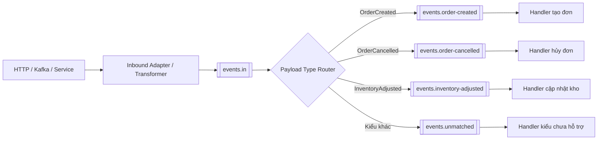
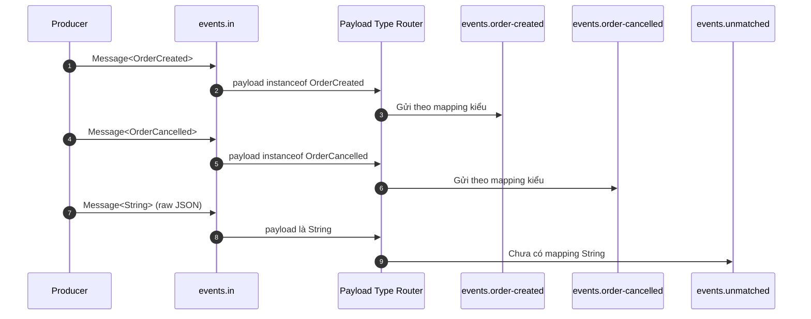
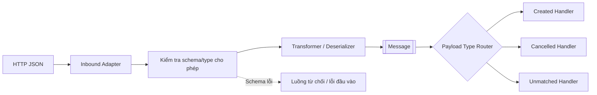
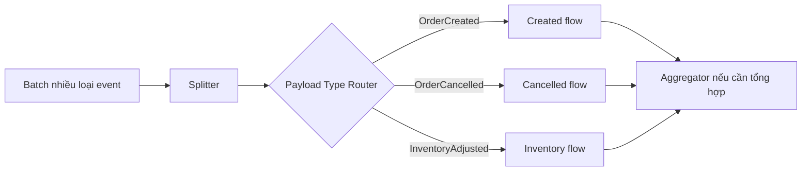

# Router theo payload type

Một luồng tích hợp có thể tiếp nhận nhiều loại sự kiện: `OrderCreated`, `OrderCancelled`, `InventoryAdjusted` hoặc `PaymentConfirmed`. Tất cả đều được gửi qua một điểm vào, nhưng từng loại cần một xử lý khác nhau. **Router theo payload type** (*Payload Type Router*) cho phép chọn **Message Channel đích dựa trên kiểu Java của `payload`** mà message đang mang, thay vì viết `if` phân nhánh ở mọi handler.

Đây là một cách hiện thực **Message Router** trong **Enterprise Integration Patterns (EIP)** với **Spring Integration**. Trong module `SPRING_INTEGRATION_PATTERN`, mục tiêu không chỉ là viết được Router, mà còn hiểu **khi nào nên định tuyến theo kiểu**, cách kết hợp với Filter, Transformer, Gateway, Splitter/Aggregator, cách xử lý kiểu không nhận diện được, retry/error channel, correlation và cách kiểm thử, quan sát mỗi nhánh.

> **Nguyên tắc cốt lõi:** Router theo payload type trả lời câu hỏi **“Đối tượng Java nằm trong `message.getPayload()` thuộc kiểu nào?”**. Nó không tự suy luận `status`, `eventType`, HTTP `Content-Type`, tên JSON field hay generic type lúc biên dịch.

## 1. Vì sao cần định tuyến theo kiểu dữ liệu?

Giả sử một ứng dụng nhận các sự kiện đơn hàng từ nhiều nguồn. Khi sự kiện đã được chuyển đổi thành đối tượng Java phù hợp, yêu cầu xử lý có thể đơn giản như sau:

| Payload Java | Kênh đích | Trách nhiệm của nhánh |
| --- | --- | --- |
| `OrderCreated` | `events.order-created` | Khởi tạo quy trình xử lý đơn hàng. |
| `OrderCancelled` | `events.order-cancelled` | Cập nhật trạng thái hủy và khởi tạo xử lý bù nếu cần. |
| `InventoryAdjusted` | `events.inventory-adjusted` | Đồng bộ số lượng tồn kho. |
| Kiểu chưa hỗ trợ | `events.unmatched` | Cách ly, ghi nhận loại chưa biết và xử lý theo chính sách. |

Nếu ứng dụng chỉ có một handler với nhiều câu `instanceof`, lớp đó sẽ phụ thuộc vào mọi loại nghiệp vụ. Thêm một loại sự kiện mới khiến handler trung tâm phải sửa cả routing lẫn logic xử lý. Tách Router và các handler đích giúp định nghĩa **chính sách chọn tuyến một lần** và để từng nhánh chỉ làm việc của nó.



Sơ đồ mô tả **luồng logic bên trong ứng dụng**, không mặc nhiên tạo Kafka topic, HTTP endpoint hay queue bền vững. Mỗi `Message Channel` vẫn cần cấu hình và có consumer/handler thích hợp.

### 1.1. Khi nào lựa chọn này đặc biệt hữu ích?

- **Đầu vào đa hình:** một gateway hoặc inbound adapter chuyển các loại lệnh/sự kiện khác nhau vào cùng một flow.
- **Mỗi loại có pipeline riêng:** sự kiện tạo đơn phải kiểm tra tồn kho, sự kiện hủy đơn phải tính bù trừ, sự kiện kho chỉ cập nhật projection.
- **Đã có DTO rõ kiểu:** dữ liệu JSON/XML/Avro đã được kiểm tra và chuyển thành Java object thuộc các lớp được hệ thống cho phép.
- **Muốn tách routing khỏi nghiệp vụ:** Router chọn channel; Service Activator hoặc application service thực hiện quy tắc nghiệp vụ.

Ngược lại, nếu mọi message đều là `OrderEvent` và chỉ khác `status` hay `priority`, thì **Router theo nội dung** thường phù hợp hơn. Một `OrderEvent(status="CREATED")` và `OrderEvent(status="CANCELLED")` có **cùng payload type**; Payload Type Router không tự tách chúng thành hai tuyến khác nhau.

## 2. Payload type là gì trong Spring Integration?

Spring Messaging biểu diễn thông điệp qua `Message<T>`, gồm:

- **`payload`**: dữ liệu thực tế được gửi, ví dụ một instance `OrderCreated`.
- **`headers`**: metadata hỗ trợ định tuyến, correlation, reply/error channel, tracing hoặc thông tin tích hợp khác.

Ví dụ:

```java
import org.springframework.messaging.Message;
import org.springframework.messaging.support.MessageBuilder;

record OrderCreated(String orderId, int itemCount) {}

Message<OrderCreated> message = MessageBuilder
    .withPayload(new OrderCreated("ORD-101", 2))
    .build();

Class<?> actualPayloadType = message.getPayload().getClass();
// actualPayloadType == OrderCreated.class
```

Trong trường hợp này, Router có thể phân nhánh theo `OrderCreated.class`. Nếu payload thực tế lại là `String` chứa JSON `{"type":"OrderCreated",...}`, kiểu Java mà Router nhìn thấy **là `String`** — không phải `OrderCreated`. Cần một Transformer/deserializer thích hợp **trước Router** hoặc chuyển sang lựa chọn định tuyến theo nội dung/metadata được kiểm soát.

### 2.1. Phân biệt kiểu khai báo và kiểu ở runtime

```java
Object event = new OrderCreated("ORD-102", 1);
Message<Object> envelope = MessageBuilder.withPayload(event).build();

// Dù biến được khai báo là Object, payload thực tế vẫn là OrderCreated.
assert envelope.getPayload().getClass() == OrderCreated.class;
```

Router dựa vào **kiểu đối tượng đang tồn tại khi xử lý**. Generic `Message<Object>` không buộc payload phải route theo `Object.class`. Tuy nhiên, kiểu generic của một collection thường không còn đủ ở runtime: `List<OrderCreated>` và `List<OrderCancelled>` đều có thể là `ArrayList` khi chạy. Do đó, không nên dựa vào generic element type để tách nhánh nếu payload chỉ là collection thông thường.

### 2.2. Kiểu payload không phải một HTTP header

| Trường hợp | Router thấy gì? | Hệ quả |
| --- | --- | --- |
| Payload là `new OrderCreated(...)` | `OrderCreated` | Có thể map đúng kiểu. |
| Payload là chuỗi JSON | `String` | Cần chuyển đổi hoặc định tuyến theo content. |
| Payload là `byte[]` từ broker | `byte[]` | Cần giải mã/deserialization trước. |
| Payload là `Map<String, Object>` | Lớp Map thực tế, ví dụ `LinkedHashMap` | Không tự suy ra event type từ khóa `type` trong Map. |
| Payload là một subclass | Kiểu subclass tại runtime | Cần kiểm chứng quy tắc match với mapping cha/con ở phiên bản và cấu hình sử dụng. |
| Payload là `List<...>` | Lớp collection tại runtime | Không phân biệt đáng tin cậy element type bằng generic. |

Đặc biệt, **đừng tin trực tiếp header `type` do client ngoài gửi** rồi tự tạo class Java bất kỳ. Chỉ cho phép các loại payload/schema đã định nghĩa và xác thực ở ranh giới đầu vào, tránh biến cơ chế định tuyến thành đường thực thi đối tượng ngoài ý muốn.

## 3. Payload Type Router khác các Router khác như thế nào?

Spring Integration có nhiều hình thức định tuyến. Cùng là chọn channel, nhưng chúng trả lời những câu hỏi khác nhau:

| Loại Router | Căn cứ định tuyến | Ví dụ |
| --- | --- | --- |
| **Payload Type Router** | Kiểu Java thực tế của payload. | `OrderCreated` → tuyến tạo đơn. |
| **Header Value Router** | Giá trị một header đã được kiểm soát. | `region=APAC` → nhánh khu vực. |
| **Content-Based/Expression Router** | Dữ liệu bên trong payload hoặc biểu thức. | `priority=true` → tuyến ưu tiên. |
| **Recipient List Router** | Danh sách các đích nhận theo cấu hình/chính sách. | Một thông báo được gửi cho nhiều subscriber. |
| **Exception Type Router** | Loại exception trong ngữ cảnh xử lý lỗi. | `TimeoutException` → tuyến retry; lỗi dữ liệu → tuyến từ chối. |

Khi **loại nghiệp vụ được thể hiện bằng lớp Java khác nhau**, Payload Type Router thường gọn và dễ đọc. Khi **cùng một lớp nhưng khác giá trị**, hãy dùng Router theo content/header thay vì tạo nhiều class chỉ để tránh đọc một field.

### 3.1. Router và Filter không thay thế nhau

**Filter** trả lời “message có được đi tiếp không?”; **Router** trả lời “đi tới kênh nào?”. Một flow phổ biến là:

```text
Inbound → Transformer (JSON → Java DTO) → Filter (schema/điều kiện)
        → Payload Type Router → Handler theo loại sự kiện
```

Nếu loại message không hỗ trợ, đích `events.unmatched` có thể xử lý như một **nhánh từ chối có chủ đích**. Nếu message vi phạm điều kiện chung, Filter có thể chặn **trước khi đến Router**. Lỗi deserialization thì phát sinh sớm hơn và cần đường lỗi tương ứng — không nên đánh đồng tất cả thành “không match kiểu”.

## 4. Triển khai `routeByType` bằng Spring Integration Java DSL

Giả sử ứng dụng dùng Java hỗ trợ `record`, Spring Framework, Spring Integration và Spring Test/JUnit 5 tương thích. Ví dụ tập trung **định tuyến theo kiểu Java**, không tích hợp ERP thật, không yêu cầu Kafka hay RabbitMQ.

### 4.1. Định nghĩa các loại sự kiện

```java
record OrderCreated(String orderId, int itemCount) {}

record OrderCancelled(String orderId, String reason) {}

record InventoryAdjusted(String sku, int delta) {}
```

Mỗi record biểu thị một **sự kiện khác loại** với hợp đồng dữ liệu riêng. Không nên đặt token xác thực, mật khẩu hay dữ liệu cá nhân thừa vào event hoặc header chỉ để phục vụ định tuyến.

### 4.2. Định nghĩa channel đích và Router

```java
import org.springframework.context.annotation.Bean;
import org.springframework.context.annotation.Configuration;
import org.springframework.integration.channel.QueueChannel;
import org.springframework.integration.config.EnableIntegration;
import org.springframework.integration.dsl.IntegrationFlow;

@Configuration
@EnableIntegration
class EventTypeRoutingConfiguration {

    @Bean("events.order-created")
    QueueChannel createdEvents() {
        return new QueueChannel(20);
    }

    @Bean("events.order-cancelled")
    QueueChannel cancelledEvents() {
        return new QueueChannel(20);
    }

    @Bean("events.inventory-adjusted")
    QueueChannel inventoryEvents() {
        return new QueueChannel(20);
    }

    @Bean("events.unmatched")
    QueueChannel unmatchedEvents() {
        return new QueueChannel(20);
    }

    @Bean
    IntegrationFlow routeEventsByType() {
        return IntegrationFlow.from("events.in")
            .routeByType(spec -> spec
                .channelMapping(OrderCreated.class.getName(),
                    "events.order-created")
                .channelMapping(OrderCancelled.class.getName(),
                    "events.order-cancelled")
                .channelMapping(InventoryAdjusted.class.getName(),
                    "events.inventory-adjusted")
                .defaultOutputChannel("events.unmatched"))
            .get();
    }
}
```

**Đọc từng phần:**

1. `IntegrationFlow.from("events.in")` định nghĩa đầu vào message của flow; Spring Integration có thể tạo/register input channel tương ứng nếu chưa có bean cùng tên và cấu hình không mâu thuẫn.
2. `.routeByType(...)` khai báo Router dùng **kiểu của payload** làm cơ sở định tuyến.
3. `channelMapping(SomeType.class.getName(), "destination")` liên kết tên kiểu Java với một channel. Trong ví dụ, `class.getName()` tránh viết sai tên đầy đủ của class bằng chuỗi thủ công.
4. `.defaultOutputChannel("events.unmatched")` tạo **nhánh fallback** cho loại payload không có tuyến phù hợp theo chính sách router; nhánh này phải có cơ chế xử lý rõ ràng.
5. Các `QueueChannel(20)` chỉ dùng để quan sát kết quả và test; chúng không tự lưu bền qua restart, không tự gọi nghiệp vụ và không tự bảo đảm mọi message được giữ nếu đầy.

**Hạn chế của snippet:** Để biến thành ứng dụng production, cần consumer/poller hoặc integration flow xử lý mỗi channel, chính sách queue capacity/timeout, cấu hình transaction hoặc broker nếu muốn đảm bảo lưu bền, và kiểm soát lỗi/giám sát. Đừng diễn giải một dòng `channelMapping` là message đã được một hệ thống bên ngoài xử lý thành công.

### 4.3. Luồng thực thi theo từng payload



Sơ đồ cho thấy **cùng input channel**, nhưng các message đi về **các output channel khác nhau**. Trong sản phẩm thực tế, các tuyến được map cần có bên nhận; kênh `events.unmatched` không nên chỉ tồn tại trên giấy mà không có quy trình xử lý.

## 5. Kiểm thử Router theo payload type

Ví dụ test dưới đây dùng JUnit 5 và `@SpringJUnitConfig`. Vì channel kết quả là `QueueChannel`, test có thể đọc message ra để xác minh **đúng nhánh và không gửi nhầm sang nhánh khác**. Đặt test trong cùng package với record và cấu hình ở mục 4.

```java
import static org.junit.jupiter.api.Assertions.*;

import org.junit.jupiter.api.Test;
import org.springframework.beans.factory.annotation.Autowired;
import org.springframework.context.ApplicationContext;
import org.springframework.integration.channel.QueueChannel;
import org.springframework.messaging.Message;
import org.springframework.messaging.MessageChannel;
import org.springframework.messaging.support.MessageBuilder;
import org.springframework.test.context.junit.jupiter.SpringJUnitConfig;

@SpringJUnitConfig(EventTypeRoutingConfiguration.class)
class EventTypeRouterTest {

    @Autowired
    ApplicationContext context;

    private MessageChannel input() {
        return context.getBean("events.in", MessageChannel.class);
    }

    private QueueChannel destination(String name) {
        return context.getBean(name, QueueChannel.class);
    }

    @Test
    void routesRecognizedTypesAndCapturesUnknownType() {
        OrderCreated created = new OrderCreated("ORD-001", 2);
        OrderCancelled cancelled = new OrderCancelled("ORD-002", "requested");
        InventoryAdjusted stock = new InventoryAdjusted("SKU-07", -1);

        assertTrue(input().send(MessageBuilder.withPayload(created).build()));
        assertTrue(input().send(MessageBuilder.withPayload(cancelled).build()));
        assertTrue(input().send(MessageBuilder.withPayload(stock).build()));

        // Chuỗi JSON chưa được chuyển thành đối tượng OrderCreated.
        String rawJson = "{\"eventType\":\"OrderCreated\"}";
        assertTrue(input().send(MessageBuilder.withPayload(rawJson).build()));

        Message<?> fromCreated = destination("events.order-created").receive(0);
        Message<?> fromCancelled = destination("events.order-cancelled").receive(0);
        Message<?> fromInventory = destination("events.inventory-adjusted").receive(0);
        Message<?> fromUnknown = destination("events.unmatched").receive(0);

        assertNotNull(fromCreated);
        assertNotNull(fromCancelled);
        assertNotNull(fromInventory);
        assertNotNull(fromUnknown);

        assertEquals(created, fromCreated.getPayload());
        assertEquals(cancelled, fromCancelled.getPayload());
        assertEquals(stock, fromInventory.getPayload());
        assertEquals(rawJson, fromUnknown.getPayload());

        assertNull(destination("events.order-created").receive(0));
        assertNull(destination("events.order-cancelled").receive(0));
        assertNull(destination("events.inventory-adjusted").receive(0));
        assertNull(destination("events.unmatched").receive(0));
    }
}
```

Test trên xác minh **bốn hành vi**: mỗi loại Java được chuyển đúng queue; raw JSON kiểu `String` được đưa tới fallback. Các assertion `receive(0)` phù hợp với ví dụ dispatch đồng bộ và queue nội bộ. Nếu thay input/intermediate channel bằng executor hoặc broker bất đồng bộ, phải chuyển sang cách chờ theo điều kiện với timeout phù hợp thay vì kỳ vọng nhận ngay.

### 5.1. Điều gì chưa được chứng minh bởi unit/integration flow test này?

- Không có adapter HTTP/Kafka, do đó chưa kiểm tra **deserialization thực tế**.
- Không có handler nghiệp vụ hoặc ERP thật, nên chưa chứng minh side effect hay transaction.
- Queue ví dụ nằm trong bộ nhớ, không kiểm thử khôi phục sau restart.
- Chưa có kiểm thử đa luồng, tải cao, full queue, thứ tự hoàn tất hoặc điều kiện race.
- Chưa xác minh subclass/proxy/generic payload; cần bổ sung test nếu hệ thống định tuyến dựa trên kế thừa.
- Chưa kiểm tra một gateway request–reply nhận kết quả cuối cùng.

Đây là lý do nên phân tầng test: **test mapping Router** → **test flow với handler** → **test adapter/broker** → **test nghiệp vụ end-to-end**.

## 6. Kiểu chưa hỗ trợ: thiết kế fallback thay vì mất dữ liệu

Một ứng dụng có thể bắt đầu với `OrderCreated` và `OrderCancelled`, sau đó một dịch vụ khác bổ sung `OrderReturned`. Nếu producer gửi đối tượng mới nhưng consumer chưa cập nhật mapping, một flow chỉ có những mapping cũ sẽ không biết phải gửi message tới đâu.

Các lựa chọn chính sách:

| Chính sách | Khi nào phù hợp? | Rủi ro cần kiểm soát |
| --- | --- | --- |
| **`defaultOutputChannel` đến fallback** | Muốn cách ly loại chưa hỗ trợ để ghi nhận và xử lý sau. | Fallback phải có consumer, retention, cảnh báo; không chỉ đặt tên channel. |
| **Báo lỗi định tuyến** | Loại event ngoài hợp đồng là lỗi nghiêm trọng cần caller nhìn thấy. | Đường đồng bộ/bất đồng bộ nhận lỗi khác nhau; cần test exception/error flow. |
| **Lọc loại không quan tâm trước Router** | Những loại không liên quan được phép bỏ qua. | Cần xác định việc drop có hợp đồng, không làm mất event cần xử lý. |
| **Đưa vào quarantine/DLQ có kiểm soát** | Cần điều tra/replay khi schema mới xuất hiện. | Cần phân quyền, thời hạn lưu, quản lý dữ liệu nhạy cảm và quy trình replay. |

**Khuyến nghị:** Với các event có giá trị nghiệp vụ, thường nên có fallback rõ ràng, metric cho **unmatched type** và quy trình xử lý không tương thích phiên bản. `events.unmatched` ở ví dụ là điểm quan sát; muốn bền vững phải nối tới lưu trữ/adapter phù hợp.

### 6.1. Fallback không phải xử lý lỗi tự động

Một message rơi vào `defaultOutputChannel` **không mặc nhiên** trở thành `ErrorMessage`. Đây là **quyết định định tuyến bình thường** của Router. Tương tự, Router không thể tự khôi phục một lỗi xảy ra **trước đó** khi JSON không giải mã được: đó là lỗi ở Transformer/adapter và có đường xử lý riêng.

### 6.2. Vì sao không nên dùng fallback thành “thùng rác”?

Nếu hàng nghìn loại event chưa biết được gửi vào queue nội bộ không có consumer, queue sẽ đầy, làm phát sinh lỗi hoặc backpressure. Nếu fallback chỉ log `message.toString()`, payload nhạy cảm có thể bị lộ. Nếu nó âm thầm drop, có thể mất sự kiện nghiệp vụ quan trọng mà không ai biết.

Một fallback vận hành được cần tối thiểu: **mã loại không hỗ trợ đã chuẩn hóa, correlation ID mờ, số lượng/rate, chính sách lưu hoặc từ chối, và cảnh báo khi vượt ngưỡng**.

## 7. Router theo type và chuỗi chuyển đổi dữ liệu đầu vào

Tại một HTTP endpoint, request body thường là JSON; tại Kafka, payload có thể là bytes; ở JDBC, dữ liệu là hàng/cột. Nếu gọi Payload Type Router **trước** bước giải mã có nghĩa, những message rất khác nhau về nghiệp vụ có thể cùng `String`, `byte[]` hoặc `Map`.



### 7.1. Type discriminator và deserializer có trách nhiệm khác nhau

Nếu nguồn gửi:

```json
{
  "eventType": "ORDER_CREATED",
  "schemaVersion": 2,
  "eventId": "EVT-1001",
  "orderId": "ORD-009"
}
```

thì một **mapper được phép** có thể dùng `eventType` + `schemaVersion` để chọn DTO `OrderCreated`. Từ đó, Payload Type Router route theo **class của DTO đã được tạo**. Ngược lại, Router theo header/content có thể chọn kênh bằng `eventType` mà không cần tạo nhiều subclass.

Sự lựa chọn phụ thuộc hợp đồng đầu vào, cách quản lý version và khả năng kiểm thử. Tránh deserializer cho phép payload bên ngoài chỉ định **tên class Java tùy ý** rồi instantiate tự động; nên kiểm soát bằng **allowlist các loại sự kiện được tin cậy** và validation rõ ràng.

### 7.2. Type trước và sau Transformer có thể khác nhau

```text
Trước Transformer: payload là String (raw JSON)
Sau Transformer:  payload là OrderCreated
Sau một Transformer khác: payload là NormalizedOrderCommand
```

Router đặt ở đâu sẽ quyết định nó nhìn thấy kiểu nào. Nếu Router phải chọn theo **loại sự kiện gốc**, hãy giữ/chuẩn hóa thông tin loại hợp lệ trước khi chuyển sang một DTO dùng chung, hoặc đặt Router ở vị trí còn đủ thông tin. Nếu đã chuyển mọi event thành `NormalizedOrderCommand`, Payload Type Router chỉ thấy **cùng một kiểu**, nên không thể phân tuyến theo event gốc nếu không dùng thêm nội dung/header.

## 8. Kế thừa, interface, proxy và generic: chỗ dễ gây hiểu nhầm

Giả sử thiết kế:

```java
sealed interface OrderEvent permits OrderCreatedEvent, OrderCancelledEvent {}

record OrderCreatedEvent(String id) implements OrderEvent {}

record OrderCancelledEvent(String id) implements OrderEvent {}
```

Cách tạo hierarchy có thể làm hợp đồng rõ hơn. Tuy nhiên, khi Router có cả mapping cho một kiểu cha/interface và kiểu con, **chính sách chọn mapping và xử lý xung đột không nên chỉ đoán từ vẻ ngoài của class**. Hãy kiểm tra hành vi matching của `PayloadTypeRouter` trong phiên bản đang dùng và viết test cho những loại thực tế; đặc biệt chú ý những trường hợp nhiều interface, dynamic proxy hoặc subclass được framework tạo ra.

Các nguyên tắc an toàn:

1. **Ưu tiên mapping rõ cho những concrete payload type quan trọng** khi cần tách nhánh chắc chắn.
2. **Không dựa vào `List<OrderCreated>` như một runtime class khác với `List<OrderCancelled>`** nếu object thực tế chỉ là cùng loại collection.
3. Nếu type trở thành dynamic proxy, framework wrapper hoặc class con ngoài ý muốn, cần test router trên payload sau cùng, không chỉ trên DTO tưởng tượng.
4. Nếu muốn logic kiểu `instanceof` có thứ tự ưu tiên phức tạp, có thể cân nhắc một Router expression/method tường minh thay vì giả định rule kế thừa ngầm.
5. Nếu có nhiều loại khác nhau nhưng phải cùng nhánh, mapping nhiều loại vào **cùng tên channel** là một giải pháp đơn giản, miễn là handler của nhánh nhận được tất cả loại đó.

**Không phải cứ dùng inheritance là kiến trúc tốt hơn.** Để hiện thực event integration, record riêng và mapping tường minh thường dễ kiểm thử hơn hierarchy được dùng chỉ nhằm điều khiển routing.

## 9. Tích hợp với Gateway, Filter, Splitter và Aggregator

Router không nằm độc lập. Trong EIP, nó thường là một bước giữa các endpoint khác.

### 9.1. Gateway phía trước Router

Với `@MessagingGateway(defaultRequestChannel="events.in")`, caller có thể gọi một phương thức Java để phát event mà không cần biết tên từng output channel. Tuy nhiên:

- `void publish(Object event)` không tự bảo đảm xử lý bất đồng bộ/bền vững; hành vi phụ thuộc channel và transport.
- Nếu gateway **cần reply**, mỗi nhánh phải có handler trả lời theo hợp đồng và reply path thích hợp. Nhánh `unmatched` chỉ đưa vào queue để kiểm tra sẽ **không tự tạo reply**, dễ khiến caller chờ hoặc không có kết quả.
- Không đặt dữ liệu nhạy cảm vào headers để gateway và router tiện truy cập; loại payload đã đủ để phân tuyến trong ví dụ này.

### 9.2. Filter trước Router

Một **Filter kiểm tra trường bắt buộc** có thể chặn event thiếu `orderId` trước khi route. Điều này khác với `defaultOutputChannel`, vốn xử lý **không có loại phù hợp**. Cần phân biệt: kiểu nhận diện được nhưng payload sai dữ liệu, với payload thuộc kiểu mới chưa được hỗ trợ.

Ví dụ chính sách:

```text
Message<OrderCreated>
    → Filter: orderId hợp lệ?  Không → orders.invalid
    → Payload Type Router:   OrderCreated → orders.created

Message<UnknownEvent>
    → Payload Type Router:   Không match → events.unmatched
```

### 9.3. Splitter trước Router

Một batch có thể chứa nhiều loại event. Splitter tách ra từng phần, Router theo payload type phân loại từng message con. Cần đảm bảo Splitter **tạo ra payload kiểu đúng**; nếu chỉ tạo `Map` hoặc `String`, kết quả route sẽ phụ thuộc vào loại wrapper đó.



**Cảnh báo Aggregator:** Nếu Router gửi các phần tới các handler có tốc độ khác nhau, hoặc một nhánh bị Filter loại message, Aggregator có thể không đủ phần để hoàn tất. Cần xác định correlation key, group release/expiry và late arrivals; không giả định việc có Router đồng nghĩa Aggregator sẽ tự ghép đúng nhóm.

### 9.4. Router theo type trong error flow

Ở đường lỗi, có thể cần phân loại exception theo loại để quyết định retry/quarantine. Đây là bài toán **exception routing**, không phải mặc định dùng cùng Router theo payload nghiệp vụ; payload lúc này có thể là `ErrorMessage` chứa exception. Nếu dùng Router theo type ở nhánh lỗi, phải xác định **kiểu thực tế của payload lỗi** và trách nhiệm mapping riêng.

## 10. Lỗi, retry và timeout tại các nhánh định tuyến

Việc Router chọn một channel không chứng minh handler đã hoàn tất. Mỗi nhánh có thể gặp lỗi khác nhau:

| Tình huống | Ranh giới | Hướng xử lý nên xem xét |
| --- | --- | --- |
| Không có mapping type | Router | Fallback hoặc báo lỗi rõ theo hợp đồng. |
| Mapping tới channel không có subscriber | Channel/endpoint wiring | Cấu hình handler/flow; test khởi động và các nhánh. |
| Queue đích đầy | Backpressure/channel | Giới hạn chờ gửi, chọn fail-fast hoặc cơ chế lưu bền phù hợp. |
| Handler `OrderCreated` lỗi dữ liệu | Validation/handler | Không retry y nguyên vô hạn; chuyển tuyến từ chối có lý do. |
| Outbound ERP timeout | Adapter hoặc network client | Timeout riêng, retry có backoff, kiểm tra trạng thái và idempotency. |
| Event phát lại | Producer/broker/consumer | Idempotency key ổn định và kiểm soát side effect. |

### 10.1. Send timeout không phải processing timeout

Nếu flow dùng `DirectChannel` cho nhánh `events.order-created`, handler có thể chạy đồng bộ trên thread caller. Đặt `sendTimeout` ngắn không tự ngắt handler gọi ERP mất nhiều giây. Nếu đổi sang `ExecutorChannel`, caller có thể được giải phóng sớm hơn nhưng **không tự có persistence**; executor vẫn có khả năng bão hòa và từ chối tác vụ.

Với `QueueChannel`, timeout gửi có ý nghĩa khi queue hữu hạn đã đầy; `receive(timeout)` áp dụng cho consumer/poller khi queue chưa có dữ liệu. Các timeout này **khác** reply timeout của Gateway, timeout của Aggregator và timeout HTTP client.

### 10.2. Không retry nhầm tạo đơn hai lần

Giả sử `OrderCreated` đã được chuyển đến nhánh tạo đơn. ERP đã tạo đơn nhưng trả lời bị mất. Nếu consumer retry mà không dùng idempotency key, hệ thống có thể tạo đơn trùng dù Router đã chọn đúng nhánh.

Một thiết kế đúng cần định danh nghiệp vụ/sự kiện ổn định (ví dụ `eventId`, `orderId` theo hợp đồng), cách xác nhận đã xử lý, retry hữu hạn, và đôi khi transactional outbox hoặc bù trừ. **Router chỉ chọn hướng đi, không tự cung cấp exactly-once end-to-end**.

### 10.3. Error channel không nhận tất cả lỗi theo một quy tắc chung

Ở nhánh đồng bộ, exception có thể truyền ngược caller; ở nhánh async/poller, endpoint và adapter có thể phát `ErrorMessage` tới error channel khi được cấu hình. Một event vào fallback theo policy lại không phải exception. **Đừng trộn `unmatched type`, `invalid data`, `downstream timeout` và `failed handler` thành cùng một trạng thái lỗi mơ hồ**.

## 11. Quan sát Router theo kiểu: biết loại nào đang đi nhánh nào

Với một entry point có nhiều loại event, observability cần cho thấy **tỷ lệ phân loại** và **chất lượng xử lý mỗi nhánh**:

- Tổng số message đến `events.in` và số đi từng destination.
- Số message vào `events.unmatched`, theo nhóm **loại đã được duyệt**.
- Latency của từng handler và outbound adapter, không chỉ thời gian Router.
- Tỷ lệ lỗi/timeout/retry của mỗi loại sự kiện.
- Queue depth, queue age, khả năng nhận của consumer ở các nhánh.
- Correlation ID/trace ID mờ để nối log khi có Splitter/Aggregator hoặc nhiều service.

Ví dụ log có cấu trúc:

```text
event=integration_routed
flow=eventIntake
router=payloadTypeRouter
payload_type=OrderCreated
destination=events.order-created
outcome=routed
correlation_id=3a2984f2-9259-4d7d-996a-66bc0194fb76
```

Đây chỉ là **định dạng log minh họa**, không phải các trường mặc định được framework tự phát ra. Nếu đưa class name vào logs/metrics, chỉ nên dùng tập kiểu hữu hạn được cho phép; không log `message.toString()`, payload, token hay thông tin cá nhân. Tránh dùng correlation ID theo từng request làm **metric label**, vì độ biến thiên rất cao và có thể liên kết đến dữ liệu nhạy cảm.

### 11.1. Một báo động vận hành có ích

Nếu trước đây `events.unmatched` gần như bằng 0 nhưng sau khi một producer triển khai phiên bản mới, kênh này tăng mạnh, hãy kiểm tra **schema/version/DTO mapping** trước. Có thể event chưa được deserializer nhận diện, hoặc một loại mới chưa được thêm mapping. Không nên sửa nhanh bằng một fallback “drop all” chỉ để biểu đồ trở về 0.

## 12. Kiểm thử các ranh giới quan trọng ngoài happy path

| Kịch bản | Điều phải xác minh |
| --- | --- |
| `OrderCreated` hợp lệ | Chỉ tới `events.order-created`, handler đúng loại nhận được. |
| `OrderCancelled` hợp lệ | Chỉ tới `events.order-cancelled`, không gọi nhánh tạo đơn. |
| `InventoryAdjusted` hợp lệ | Chỉ tới nhánh kho; message giữ dữ liệu/correlation hợp lệ. |
| Raw JSON `String` | Không bị hiểu nhầm thành `OrderCreated`; qua chuyển đổi hoặc fallback đúng thiết kế. |
| Kiểu chưa hỗ trợ | Có fallback hoặc lỗi rõ; không drop im lặng ngoài hợp đồng. |
| Subclass/interface/proxy | Hành vi mapping tương thích với cấu trúc kiểu thực tế; có test riêng. |
| Batch/Splitter | Các phần đúng type, nhóm correlation không bị trộn; phần bị loại được xử lý. |
| Handler lỗi/ERP timeout | Retry/error flow và trạng thái chưa chắc chắn được quản lý rõ. |
| Queue đầy/downstream chậm | Backpressure, timeout và không báo sai rằng nghiệp vụ đã hoàn tất. |
| Replay cùng event | Idempotency không cho side effect trùng ngoài chủ đích. |
| Logger/tracing | Có thể theo nhánh, không ghi raw payload hoặc thông tin bí mật. |

Các test định tuyến nên bao gồm **negative assertions**: không chỉ kiểm tra message *có* đến nhánh đúng, mà còn xác nhận nó *không* đến nhánh sai. Với flow bất đồng bộ, dùng cơ chế chờ theo điều kiện có timeout; tránh kiểm tra quá sớm khiến test không ổn định.

## 13. Những sai lầm thường gặp

### Sai lầm 1 — Nghĩ JSON `eventType` chính là payload type

Payload của inbound adapter là `String`. JSON bên trong có field `eventType`, nhưng Router theo kiểu vẫn thấy `String`. **Khắc phục:** dùng Transformer/deserializer và allowlist kiểu, hoặc Router theo content nếu đó là hợp đồng mong muốn.

### Sai lầm 2 — Mọi event cùng một record, nhưng kỳ vọng route theo status

`OrderEvent(status="CREATED")` và `OrderEvent(status="CANCELLED")` có cùng class. **Khắc phục:** chọn Router theo content/header, hoặc tái thiết kế event types khi khác biệt thực sự đáng thể hiện bằng các kiểu riêng.

### Sai lầm 3 — Dùng generic collection để suy element type

`ArrayList<OrderCreated>` và `ArrayList<OrderCancelled>` không phải hai runtime class khác nhau. **Khắc phục:** Splitter thành từng event có kiểu cụ thể hoặc dùng wrapper DTO mang type discriminator rõ ràng.

### Sai lầm 4 — Quên nhánh fallback

Loại event mới xuất hiện, flow không có mapping, không ai biết message đi đâu. **Khắc phục:** khai báo `defaultOutputChannel` hoặc một lỗi có hợp đồng, theo dõi unmatched và có quy trình replay/upgrade.

### Sai lầm 5 — Xem Router như nơi thực thi toàn bộ nghiệp vụ

Router chỉ chọn tuyến. Nếu condition routing gọi quá nhiều API và còn ghi DB, trách nhiệm trở nên khó kiểm thử và khó retry. **Khắc phục:** đưa kiểm tra/side effect vào endpoint/service phù hợp, Router dựa trên kết quả đã được chuẩn hóa.

### Sai lầm 6 — Coi mapping đúng là xử lý thành công

Gửi đến channel `events.order-created` không chứng minh ERP đã tạo đơn, broker đã lưu bền hay transaction đã commit. **Khắc phục:** quan sát handler, acknowledgement, transaction, idempotency và trạng thái cuối cùng.

### Sai lầm 7 — Cho dữ liệu ngoài tự chọn tên class Java

Một type header không tin cậy có thể khiến hệ thống giải mã sai hoặc cố tạo lớp ngoài ý muốn. **Khắc phục:** validate schema/version và danh sách event được phép, phân tách bước nhận dữ liệu với quyết định route trên Java DTO đã kiểm soát.

## 14. Bài tập thực hành

**Bài tập 1 — Thêm loại sự kiện.** Bổ sung record `PaymentConfirmed(paymentId, orderId)` và channel `events.payment-confirmed`. Cập nhật `.channelMapping(...)`, tạo handler, rồi test rằng message mới chỉ đi vào nhánh thanh toán; message cũ vẫn đi đúng tuyến.

**Bài tập 2 — Chuyển đổi trước Router.** Tạo một inbound flow nhận chuỗi JSON có `eventType`. Thiết kế deserializer theo allowlist để nhận `OrderCreated`/`OrderCancelled`. Kiểm tra loại chưa hỗ trợ không bị instantiate thành class tùy ý.

**Bài tập 3 — Thử hierarchy.** Tạo interface `DomainEvent` và hai record triển khai. Kiểm thử sự khác biệt khi mapping chỉ interface, chỉ concrete class, hoặc cả hai; ghi rõ kết quả **trong phiên bản Spring Integration thực tế** thay vì đoán theo `instanceof`.

**Bài tập 4 — Tải cao.** Giới hạn channel nhánh tạo đơn còn capacity 1, giữ consumer không poll. Hãy quan sát lần send thứ hai; thiết kế chính sách gửi thất bại/backpressure và cách tránh trả trạng thái nghiệp vụ thành công sai.

**Bài tập 5 — Splitter/Aggregator.** Một batch chứa ba loại event khác nhau được Splitter chia thành các message. Sau khi Router phân loại, hãy thiết kế correlation, release và expiry để tạo báo cáo tổng hợp của batch, kể cả khi một nhánh thất bại hoặc xử lý muộn.

## 15. Checklist trước khi triển khai

| Câu hỏi | Tiêu chí đạt |
| --- | --- |
| Payload đã là kiểu Java đúng chưa? | Đã deserialize/transform và validate theo schema tin cậy. |
| Có cần route theo type thật không? | Khác biệt nằm ở class; nếu khác giá trị thì chọn content/header router. |
| Mapping class name đúng chưa? | Có test từng loại concrete và các trường hợp inheritance cần hỗ trợ. |
| Output channels có consumer không? | Có handler/flow và chính sách queue phù hợp, không chỉ tên channel. |
| Loại chưa hỗ trợ đi đâu? | Có fallback hoặc lỗi tường minh, metrics và xử lý/replay có kiểm soát. |
| Có dữ liệu nhạy cảm trong payload/header/log không? | Chỉ giữ trường cần thiết, không phát tán secrets/PII qua nhánh ngoài. |
| Có Gateway request–reply không? | Mỗi nhánh có reply/error contract, correlation và deadline đúng. |
| Có Splitter/Aggregator không? | Có group key, release/expiry, late result và xử lý nhánh thiếu. |
| Retry/timeout có gây trùng tác vụ không? | Có idempotency và phân biệt lỗi gửi với side effect đã hoàn tất. |
| Kiểm thử có đủ positive và negative case không? | Đúng nhánh, không sai nhánh, unmatched, deserialization, lỗi, quá tải. |
| Có quan sát được lỗi và phân bố loại không? | Metrics theo loại hữu hạn, branch, handler latency, retry và backlog. |

## Kết luận

**Router theo payload type** là cách định tuyến message dựa vào **kiểu Java thực tế của `payload`**. Trong Spring Integration, cấu hình `.routeByType(...)` cho phép gắn từng loại event với một Message Channel tương ứng, tách việc **chọn tuyến** khỏi logic nghiệp vụ bên trong từng handler. Khi dữ liệu đã được chuyển đổi thành DTO rõ kiểu, đây là giải pháp dễ đọc, dễ mở rộng và dễ kiểm thử cho một đầu vào có nhiều loại sự kiện.

Một thiết kế hoàn chỉnh phải đi xa hơn bảng mapping: **phân biệt runtime type với JSON/header, kiểm soát kiểu từ bên ngoài, định nghĩa fallback, xử lý channel không có consumer, backpressure, retry, error flow, correlation, idempotency và observability**. Kết hợp các ranh giới ấy với Filter, Transformer, Gateway, Splitter và Aggregator giúp luồng tích hợp hoạt động đúng không chỉ trong trường hợp thành công, mà cả khi dữ liệu mới xuất hiện, một nhánh chậm hoặc hệ thống đích gặp sự cố.
