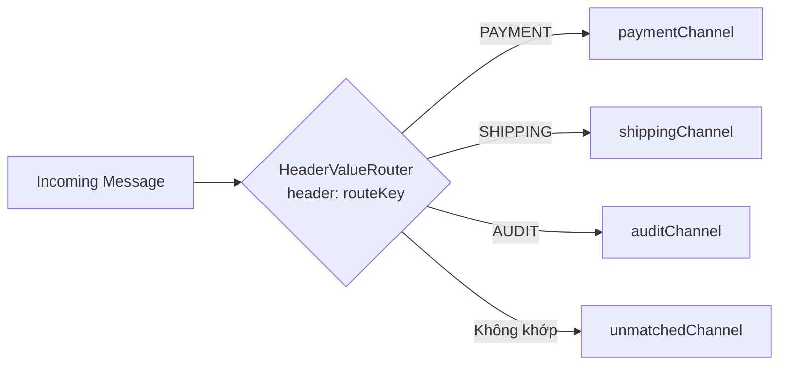
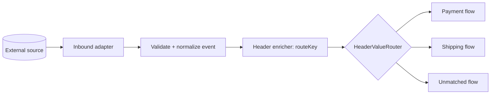
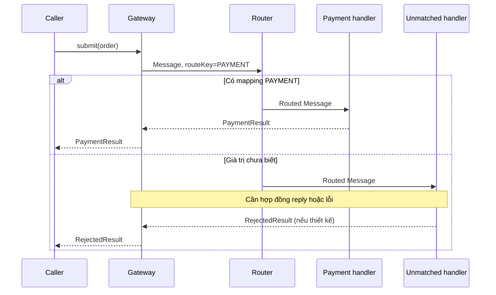
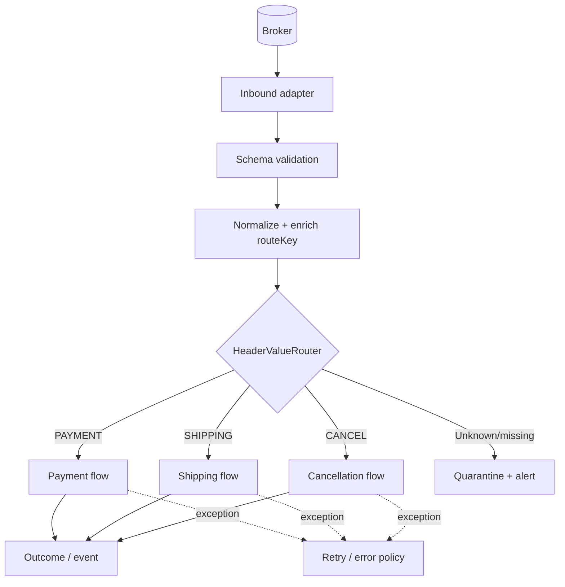

# Router theo header value

Trong **Spring Integration**, **Message Router** quyết định message sẽ được gửi sang channel nào dựa trên một quy tắc định tuyến. Với **header-value routing**, quy tắc không cần xem trực tiếp payload: Router đọc **giá trị của một header đã chọn**, đối chiếu với các ánh xạ và chuyển message sang channel tương ứng.

Ví dụ, hệ thống nhận nhiều loại sự kiện đơn hàng. Một thành phần ở đầu luồng gắn header `routeKey` bằng `PAYMENT`, `SHIPPING` hoặc `AUDIT`. **HeaderValueRouter** chọn channel xử lý phù hợp mà không cần một chuỗi `if/else` trong từng service. Cách tách trách nhiệm này phù hợp với mục tiêu của module `SPRING_INTEGRATION_PATTERN`: triển khai **Enterprise Integration Patterns** (EIP) như Router, Filter, Transformer, Splitter, Aggregator, Gateway, retry, error channel và correlation để các nhánh xử lý **ít phụ thuộc, dễ kiểm thử và mở rộng**.

Sau bài này, bạn có thể:

- Diễn giải `HeaderValueRouter` chọn đích như thế nào và phân biệt **routing key** với dữ liệu nghiệp vụ.
- Cấu hình `HeaderValueRouter`, `channelMapping` và channel dự phòng trong Spring Integration Java DSL.
- Xử lý header thiếu, giá trị lạ hoặc sai kiểu mà không làm message biến mất ngoài ý muốn.
- Hiểu mối liên hệ giữa Router, Filter, Gateway, Splitter/Aggregator và error flow.
- Kiểm thử từng nhánh định tuyến cùng việc giữ nguyên payload, headers và correlation.

## 1. Header-value routing giải quyết vấn đề gì?

Một Spring message có hai phần chính:

```text
Message<OrderEvent>
├── payload
│   ├── eventId      = "evt-101"
│   ├── orderId      = "ORD-1001"
│   └── eventType    = "PAYMENT"
└── headers
    ├── id           = UUID của Spring message
    ├── routeKey     = "PAYMENT"
    ├── traceId      = "trace-a1"
    └── correlationId= "request-789"
```

Ở đây `eventType` trong payload thuộc **hợp đồng sự kiện** và nên tồn tại sau khi serialize/replay; `routeKey` trong header là **quyết định điều phối** được tính toán hoặc xác minh ở ranh giới tích hợp. Hai giá trị có thể giống nhau, nhưng không bắt buộc: chẳng hạn adapter ánh xạ nhiều event type vào cùng một nhóm xử lý `BILLING`.



**Router chuyển message tới đích**; nó không phải là bộ chuyển đổi payload và cũng không tự xử lý thanh toán hay vận chuyển. Các handler/flow ở channel đích mới làm công việc nghiệp vụ.

### Phân biệt với các pattern gần giống

| Pattern | Câu hỏi nó trả lời | Hành vi chính |
| --- | --- | --- |
| **Header Value Router** | “Giá trị header này tương ứng channel nào?” | Chọn channel theo routing key trong headers. |
| **Payload-type / Content-based Router** | “Kiểu hay nội dung message yêu cầu đi nhánh nào?” | Định tuyến dựa trên dữ liệu/kiểu hoặc biểu thức. |
| **Filter** | “Message có được tiếp tục không?” | Chấp nhận hoặc từ chối; có thể dùng discard channel. |
| **Recipient List Router** | “Message cần tới những người nhận nào?” | Có thể phát tới nhiều channel theo danh sách recipient. |
| **Transformer** | “Payload/headers cần đổi sang biểu diễn nào?” | Tạo message/giá trị đã chuyển đổi. |

Header-value routing thông thường là lựa chọn **một nhánh theo một khóa**. Nếu nghiệp vụ cần cùng một event gửi đồng thời tới cả thanh toán và báo cáo, hãy thiết kế **fan-out/Recipient List Router/Publish-Subscribe** phù hợp, thay vì giả định `HeaderValueRouter` tự sao chép message tới mọi nhánh.

## 2. Nguyên lý của HeaderValueRouter

`org.springframework.integration.router.HeaderValueRouter` là một router chuyên đọc **một header cụ thể**. Ví dụ nếu được cấu hình đọc `routeKey`, Router có thể xử lý theo bảng ánh xạ:

| `headers.routeKey` | Channel đích | Ý nghĩa minh họa |
| --- | --- | --- |
| `PAYMENT` | `paymentChannel` | Xử lý sự kiện liên quan thanh toán. |
| `SHIPPING` | `shippingChannel` | Xử lý luồng vận chuyển. |
| `AUDIT` | `auditChannel` | Gửi tới luồng ghi nhận nghiệp vụ. |
| `UNKNOWN` | `unmatchedChannel` (nếu cấu hình fallback) | Chờ phân loại hoặc rà soát. |
| Header không tồn tại | Cần chính sách thiếu khóa rõ ràng | Không suy đoán rằng message sẽ tự đi vào channel đúng. |

**Routing key** là giá trị dùng để xác định đích. `channelMapping` ánh xạ **giá trị định tuyến → tên channel**; channel mang tên đó phải được khai báo hoặc có cách phân giải hợp lệ trong application context.

### Hai lớp cần tách biệt

1. **Trích xuất khóa:** đọc `routeKey` từ message headers. Với `HeaderValueRouter`, tên header được cấu hình khi tạo router.
2. **Phân giải channel:** đổi khóa đó thành channel thực tế, dùng các mapping đã khai báo và chính sách dự phòng/lỗi.

Nếu thiếu mapping, hành vi cuối cùng phụ thuộc vào cấu hình **default output channel**, **resolution required** và khả năng phân giải tên channel. Đừng để một giá trị mới do producer phát hành đi vào production mà không có kịch bản kiểm thử cho trường hợp không khớp.

### Có thể đặt tên header tùy ý không?

Có thể dùng header tùy biến, chẳng hạn `routeKey`, `businessArea` hoặc `processingLane`, nhưng cần thống nhất tên và kiểu giữa producer, transformer và router. Header trong Spring message là một `Object` theo khóa; nếu nơi phát gắn `"PAYMENT"` dạng `String`, trong khi nơi khác gắn enum hoặc chuỗi viết thường `"payment"`, việc ánh xạ có thể cho kết quả khác kỳ vọng. **Chuẩn hóa tại ranh giới** là cách an toàn hơn là suy đoán các khóa sẽ luôn được tự chuyển kiểu.

## 3. Cấu hình Java DSL với HeaderValueRouter

Ví dụ dưới đây dùng **Java 17+**, Spring Integration và các channel kiểu `QueueChannel` để quan sát dễ dàng đường đi của message. Ở ứng dụng thực, có thể thay các queue này bằng các flow thực thi nghiệp vụ, broker adapter hoặc service activator tương ứng.

```java
import org.springframework.context.annotation.Bean;
import org.springframework.context.annotation.Configuration;
import org.springframework.integration.channel.QueueChannel;
import org.springframework.integration.dsl.IntegrationFlow;
import org.springframework.integration.router.HeaderValueRouter;

@Configuration
class OrderHeaderRoutingConfig {

    @Bean
    QueueChannel paymentChannel() {
        return new QueueChannel();
    }

    @Bean
    QueueChannel shippingChannel() {
        return new QueueChannel();
    }

    @Bean
    QueueChannel auditChannel() {
        return new QueueChannel();
    }

    @Bean
    QueueChannel unmatchedChannel() {
        return new QueueChannel();
    }

    @Bean
    HeaderValueRouter routeKeyRouter() {
        HeaderValueRouter router = new HeaderValueRouter("routeKey");
        router.setChannelMapping("PAYMENT", "paymentChannel");
        router.setChannelMapping("SHIPPING", "shippingChannel");
        router.setChannelMapping("AUDIT", "auditChannel");
        router.setDefaultOutputChannelName("unmatchedChannel");
        return router;
    }

    @Bean
    IntegrationFlow headerRoutingFlow(HeaderValueRouter routeKeyRouter) {
        return IntegrationFlow.from("routerInput")
                .route(routeKeyRouter)
                .get();
    }
}
```

**Đọc từ đầu đến cuối:**

1. Một producer gửi `Message<?>` tới `routerInput`.
2. `routeKeyRouter` đọc giá trị của header `routeKey`.
3. `PAYMENT` → `paymentChannel`, `SHIPPING` → `shippingChannel`, `AUDIT` → `auditChannel`.
4. Giá trị không có mapping được chuyển sang `unmatchedChannel` theo cấu hình dự phòng của ví dụ.
5. Các `QueueChannel` giữ message để một consumer nhận/poll. Nếu không có consumer, message không tự biến thành một hành động nghiệp vụ.

`setDefaultOutputChannelName(...)` là **chính sách do ứng dụng chọn**, không phải bảo đảm bất kỳ Router không cấu hình nào cũng có fallback này. Không tự động dùng `nullChannel` làm fallback nếu yêu cầu tránh mất dữ liệu hoặc cần biết producer đã gửi routing key mới.

### Gửi message mẫu có routeKey

```java
import org.springframework.messaging.Message;
import org.springframework.messaging.MessageChannel;
import org.springframework.messaging.support.MessageBuilder;

record OrderEvent(String eventId, String orderId, String eventType) {}

class OrderProducer {

    void sendPaymentEvent(MessageChannel routerInput) {
        OrderEvent event = new OrderEvent("evt-101", "ORD-1001", "PAYMENT");

        Message<OrderEvent> message = MessageBuilder.withPayload(event)
                .setHeader("routeKey", "PAYMENT")
                .setHeader("traceId", "trace-a1")
                .setHeader("correlationId", "request-789")
                .build();

        boolean accepted = routerInput.send(message);
        // accepted cho biết trạng thái gửi ở ranh giới channel,
        // không đồng nghĩa nghiệp vụ thanh toán đã hoàn tất.
    }
}
```

Khi message đi qua router, **payload không cần đổi**. Những header như `traceId`, `correlationId` vẫn có thể đi cùng message để downstream truy vết hoặc gom nhóm; ở các adapter/transformer sau đó, cần kiểm thử cơ chế lan truyền header tương ứng.

**Điểm thiết kế:** Không tạo `routeKey` bằng giá trị cố định `PAYMENT` với mọi message trong production. Thông thường, thành phần tiếp nhận sẽ **kiểm tra event type đã được xác thực**, áp dụng quy tắc ánh xạ rồi mới thiết lập header. `HeaderValueRouter` thực hiện định tuyến, không xác thực tính đúng đắn của nội dung nghiệp vụ.

## 4. Nên đặt và chuẩn hóa header ở đâu?

Đặt `routeKey` ngay tại nơi producer **biết chắc thông tin phân loại**, hoặc tại một bước chuẩn hóa chuyên trách trước Router. Ví dụ:



Một `Header Enricher` có thể bổ sung hoặc tính toán headers từ payload, nguồn tin cậy và cấu hình nghiệp vụ. Ví dụ DSL bên dưới giả định payload có `eventType()`:

```java
IntegrationFlow.from("validatedEvents")
        .enrichHeaders(headers -> headers
                .headerFunction("routeKey", message ->
                        ((OrderEvent) message.getPayload()).eventType()))
        .channel("routerInput")
        .get();
```

Đây là ví dụ minh họa **header enrichment**; ứng dụng thực cần kiểm tra `eventType` thuộc tập giá trị cho phép trước khi dùng. Không ép kiểu payload tùy tiện nếu channel nhận nhiều loại message; có thể tách flow theo kiểu hoặc dùng một service chuẩn hóa có hợp đồng rõ ràng.

### Phân biệt routing header và dữ liệu phải giữ bền vững

- **`eventId`, `orderId`, `eventType`** có thể là dữ liệu thiết yếu của hợp đồng sự kiện và cần được lưu trong payload/event envelope nếu bên nhận phải hiểu chúng khi phát lại.
- **`routeKey`** có thể được tính lại từ các trường bền vững hoặc dựa trên một chính sách nội bộ. Nó là chỉ dẫn điều phối, không thay thế sự kiện nghiệp vụ.
- **`traceId`** giúp quan sát; **`correlationId`** giúp liên kết xử lý hoặc nhóm các message; không tự động là định danh dùng để khử trùng lặp.
- Header từ HTTP/Kafka/AMQP không mặc nhiên mang cùng tên, kiểu hoặc mức độ đáng tin khi được ánh xạ thành Spring headers. Hãy xác minh và kiểm thử adapter-specific header mapping.

Một phiên bản event đã lưu có thể được phát lại qua transport khác. Nếu thông tin quan trọng chỉ tồn tại ở `routeKey` của một lần chuyển message, hệ thống mới có thể không còn biết cách diễn giải sự kiện. Vì vậy, **giữ sự thật nghiệp vụ trong hợp đồng dữ liệu bền vững**, còn header giúp tối ưu và điều phối flow.

## 5. Header thiếu, giá trị không khớp và channel không tồn tại

Một Router production phải định nghĩa đầy đủ **nhánh bất thường** chứ không chỉ các giá trị chính xác:

| Tình huống | Rủi ro | Cách xử lý nên cân nhắc |
| --- | --- | --- |
| Header `routeKey` thiếu | Không trích xuất được routing key. | Fallback sang `unmatchedChannel`, hoặc validation báo lỗi rõ ràng trước Router. |
| Giá trị lạ `REFUND` | Producer triển khai event type mới trước consumer. | Giữ message ở nhánh chưa phân loại; cảnh báo/schema compatibility test. |
| Khác chữ hoa/thường (`payment`) | Bị coi là khóa khác với `PAYMENT`. | Chuẩn hóa thành tập giá trị chuẩn và kiểm thử. |
| Sai kiểu (`Integer`, enum tùy chỉnh, collection) | Mapping có thể không tìm được hoặc có hành vi chuyển đổi không mong đợi. | Chuẩn hóa thành một kiểu duy nhất, thường là `String` cố định. |
| Mapping trỏ tới tên channel không tồn tại | Không thể chuyển message tới đích. | Kiểm tra bean/channel khi khởi động và integration test. |
| Channel đích có lỗi handler | Router đã chọn nhánh nhưng xử lý có thể thất bại. | Định nghĩa error/retry policy, không coi routing thành công là nghiệp vụ thành công. |

### Các lựa chọn chính sách

**Fallback channel:** Gửi message vào `unmatchedChannel` để audit, quarantine hoặc xử lý thủ công. Phù hợp khi không muốn đánh mất sự kiện mới hoặc cần theo dõi thay đổi của producer.

**Fail fast:** Với contract nghiêm ngặt, có thể kiểm tra khóa trước Router hoặc cấu hình router yêu cầu phân giải được đích, sau đó phát sinh lỗi khi không thể định tuyến. Exception sẽ lan tới caller hoặc error mechanism tùy endpoint/channels; không có quy tắc chung rằng lỗi luôn được đẩy tới `errorChannel`.

**Bỏ qua:** Có thể dùng `nullChannel` hoặc chính sách không bắt buộc phân giải trong trường hợp loại bỏ được cho phép. Đây là **quyết định có thể làm mất message** và phải được ghi trong hợp đồng, instrument bằng metrics và được kiểm thử.

Trong đa số luồng nghiệp vụ quan trọng, **fallback có lưu vết hoặc báo lỗi có kiểm soát** an toàn hơn việc im lặng bỏ mọi giá trị lạ.

## 6. Không dùng routing header như một cơ chế bảo mật

Một header như `routeKey=ADMIN` hoặc `routeKey=PAYMENT` có thể bị upstream gửi sai hoặc cố ý giả mạo, nhất là khi message bắt nguồn từ HTTP client hoặc nguồn không đáng tin. **HeaderValueRouter không phải authorization filter**.

Các nguyên tắc cần áp dụng:

1. **Xác thực nguồn và kiểm tra quyền** trước khi cho phép message đi vào nhánh nhạy cảm. Route chỉ nên được tính từ dữ liệu đã xác thực, hoặc được ghi đè bởi thành phần tin cậy.
2. **Allowlist channel đích:** Ánh xạ các khóa được biết trước tới các channel cụ thể. Đừng để giá trị người dùng tùy ý trở thành tên channel có thể phân giải động trong application context.
3. **Không tin `userId`, `tenantId`, `traceId` do bên ngoài tự gắn** như bằng chứng xác thực hoặc đủ quyền. Mọi quyết định an ninh phải dựa trên cơ chế đáng tin cậy.
4. **Cách ly các nhánh dữ liệu nhạy cảm:** Kiểm soát quyền đọc/ghi của adapter, không ghi payload thanh toán hoặc dữ liệu cá nhân vào log chỉ để chẩn đoán routing.
5. **Phiên bản hợp đồng:** Khi thêm routing key, phối hợp thay đổi giữa producer và consumer; triển khai fallback/compatibility trước khi bật loại mới nếu cần.

Đối với hệ thống nhiều tenant, một `tenantId` có thể ảnh hưởng lựa chọn đích nhưng không được chấp nhận chỉ vì client đã đặt nó trong header. Cần so sánh với identity/claims được xác minh và phạm vi được phép.

## 7. Khi Router nằm giữa Gateway và các nhánh bất đồng bộ

Gateway thường tạo một yêu cầu rồi chờ phản hồi; HeaderValueRouter chỉ chọn **đường đi**. Nếu nhánh được chọn không gửi reply, việc gọi Gateway có thể timeout hoặc không nhận kết quả mong muốn.



Nếu `unmatchedChannel` chỉ ghi log mà không trả lời, sơ đồ nhánh `RejectedResult` **không xảy ra tự động**. Bên gọi sẽ chịu hành vi no-reply/timeout theo cấu hình Gateway. Bởi vậy, muốn phản hồi nghiệp vụ tường minh, hãy thiết kế result type như `Accepted`, `Rejected`, `UnsupportedEventType` và đảm bảo mọi nhánh bắt buộc có reply đều trả về đúng hợp đồng.

### Header trả lời và lỗi

Trong Spring Integration, các header như `replyChannel` và `errorChannel` có thể tham gia request–reply/error flow. Nếu một bước Transformer hoặc adapter dựng message mới, phải kiểm tra việc giữ/ánh xạ metadata này. **Không dùng `routeKey` thay thế reply correlation**: một khóa nhánh `PAYMENT` có thể dùng chung cho nhiều yêu cầu đồng thời, không đủ để ghép phản hồi về đúng caller.

## 8. HeaderValueRouter trong pipeline Splitter/Aggregator

Giả sử một đơn hàng được Splitter tách thành bốn yêu cầu xử lý; mỗi message con được gắn routing header để đi tới dịch vụ phù hợp:

```text
OrderBatch #B-100
     │
  Splitter
     ├── Item 1  routeKey=WAREHOUSE_A ─► Warehouse A ─┐
     ├── Item 2  routeKey=WAREHOUSE_B ─► Warehouse B ─┤
     ├── Item 3  routeKey=WAREHOUSE_A ─► Warehouse A ─┤─► Aggregator
     └── Item 4  routeKey=WAREHOUSE_B ─► Warehouse B ─┘
             HeaderValueRouter chọn nhánh cho từng item
```

Router có thể dùng `routeKey` khác nhau trên từng message con, trong khi **`correlationId` phải mô tả cùng một nhóm cần gom**. `sequenceNumber` và `sequenceSize` (khi được tạo/cấu hình) có thể giúp Aggregator nhận diện vị trí và số phần tử. Những header phục vụ định tuyến và gom nhóm **không thay thế lẫn nhau**:

| Header/ID | Mục đích | Có thể giống nhau cho nhiều message? |
| --- | --- | --- |
| `routeKey` | Chọn channel xử lý message hiện tại. | Có — nhiều item cùng đến Warehouse A. |
| `correlationId` | Nhận biết các message thuộc một nhóm tổng hợp. | Có — các item cùng một lượt split. |
| `sequenceNumber` | Vị trí message trong nhóm theo quy ước splitter. | Thường khác nhau giữa các phần tử trong nhóm. |
| `eventId`/`commandId` bền vững | Nhận diện sự kiện hoặc thao tác để khử trùng lặp khi cần. | Theo hợp đồng; không mặc định bằng message ID. |

### Nhánh bất thường có thể làm Aggregator không hoàn tất

Nếu message con `routeKey=WAREHOUSE_C` chưa có mapping rồi bị gửi vào `nullChannel`, Aggregator có thể chỉ nhận 3/4 kết quả trong khi chờ đủ bốn message. Cách thiết kế an toàn hơn là:

- Trả một kết quả có kiểu `ItemUnsupportedRoute` nhưng **giữ correlation/sequence** để nhóm có thể hoàn tất và báo lỗi từng item.
- Hoặc cấu hình timeout/release strategy cho nhóm chưa đủ, quyết định rõ việc tạo partial result hay đánh dấu batch thất bại.
- Theo dõi số message vào/ra từng nhánh và trạng thái từng nhóm để phát hiện thất lạc.

Đừng dùng `routeKey` làm group key chỉ vì hai giá trị nằm trong headers: một nhóm thường chứa message từ **nhiều nhánh**.

## 9. Error handling, retry và observability

Có ít nhất ba loại sự cố khác nhau khi vận hành Router:

| Sự cố | Ví dụ | Hướng xử lý |
| --- | --- | --- |
| **Không định tuyến được** | Thiếu khóa, giá trị lạ, mapping sai. | Fallback, validate trước Router, quarantine hoặc fail fast tùy contract. |
| **Định tuyến được nhưng không giao được** | Channel đích không có consumer phù hợp, send thất bại. | Kiểm tra topology/endpoint lifecycle; dùng error handling và cảnh báo. |
| **Giao được nhưng handler downstream lỗi** | API thanh toán timeout hoặc database unavailable. | Retry có giới hạn tại ranh giới phù hợp, error channel và idempotency. |

`discardChannel` của Filter, `defaultOutputChannel` của Router và `errorChannel` xử lý **những loại tình huống khác nhau**. Đưa message chưa có mapping sang channel dự phòng **không** tương đương ném exception; gửi message vào `errorChannel` cũng không tự mô tả “loại sự kiện không được hỗ trợ” như một kết quả nghiệp vụ.

Khi cần retry, hãy tự hỏi: lần thử mới có thay đổi kết quả không? Giá trị route key lạ do chưa cập nhật contract thường **không** được khắc phục bằng retry tức thì. Trái lại, một lời gọi outbound HTTP trên nhánh được định tuyến có thể được retry khi lỗi mạng tạm thời. Với thao tác tạo đơn, giữ idempotency key ổn định để retry không tạo tác dụng phụ lặp.

### Metrics gợi ý

Nên theo dõi `router_received_total`, `router_routed_total{route="PAYMENT"}`, `router_unmatched_total`, `router_delivery_failed_total` và thời gian xử lý từng nhánh. Đây là **tên metric minh họa do ứng dụng định nghĩa**, không phải các counter được Spring tự tạo sẵn. Dùng **nhãn route hữu hạn**, không dùng `orderId`, `eventId` hoặc giá trị header tự do làm label vì dễ gây high cardinality.

Ngoài metrics, log có cấu trúc có thể ghi: `eventId` đã được kiểm soát, `routeKey` đã chuẩn hóa, channel đích, trạng thái giao nhận và `traceId`. Khi message đi qua async channel hoặc reactive bridge, MDC/ThreadLocal không mặc nhiên được truyền qua mọi thread; kiểm tra propagation của tracing context.

## 10. Kiểm thử HeaderValueRouter: xác minh từng nhánh, không chỉ predicate

Một unit test kiểm tra hàm `eventType -> routeKey` là có ích nhưng **không chứng minh** Router đã ánh xạ đúng tên channel hoặc fallback hoạt động. Với cấu hình ở mục 3, có thể dùng JUnit 5 và Spring Test để gửi message qua `routerInput` rồi đọc lại channel đích:

```java
import static org.junit.jupiter.api.Assertions.assertEquals;
import static org.junit.jupiter.api.Assertions.assertNotNull;
import static org.junit.jupiter.api.Assertions.assertNull;
import static org.junit.jupiter.api.Assertions.assertTrue;

import org.junit.jupiter.api.Test;
import org.springframework.beans.factory.annotation.Autowired;
import org.springframework.beans.factory.annotation.Qualifier;
import org.springframework.integration.channel.QueueChannel;
import org.springframework.messaging.Message;
import org.springframework.messaging.MessageChannel;
import org.springframework.messaging.support.MessageBuilder;
import org.springframework.test.context.junit.jupiter.SpringJUnitConfig;

@SpringJUnitConfig(OrderHeaderRoutingConfig.class)
class HeaderValueRouterTest {

    @Autowired
    @Qualifier("routerInput")
    MessageChannel input;

    @Autowired
    @Qualifier("paymentChannel")
    QueueChannel payments;

    @Autowired
    @Qualifier("shippingChannel")
    QueueChannel shipping;

    @Autowired
    @Qualifier("unmatchedChannel")
    QueueChannel unmatched;

    @Test
    void routesPaymentAndUnknownKeyToSeparateChannels() {
        OrderEvent payment = new OrderEvent("evt-1", "ORD-1", "PAYMENT");
        assertTrue(input.send(MessageBuilder.withPayload(payment)
                .setHeader("routeKey", "PAYMENT")
                .setHeader("traceId", "trace-1")
                .build()));

        Message<?> paymentResult = payments.receive(1_000);
        assertNotNull(paymentResult);
        assertEquals(payment, paymentResult.getPayload());
        assertEquals("trace-1", paymentResult.getHeaders().get("traceId"));
        assertNull(shipping.receive(0));
        assertNull(unmatched.receive(0));

        OrderEvent unknown = new OrderEvent("evt-2", "ORD-2", "REFUND");
        assertTrue(input.send(MessageBuilder.withPayload(unknown)
                .setHeader("routeKey", "REFUND")
                .build()));

        Message<?> fallback = unmatched.receive(1_000);
        assertNotNull(fallback);
        assertEquals(unknown, fallback.getPayload());
        assertNull(payments.receive(0));
        assertNull(shipping.receive(0));
    }
}
```

Test này dùng **`QueueChannel` làm đích quan sát** nên không cần khởi chạy hệ thống thanh toán thật. Đối với flow production, bổ sung test adapter thực hoặc giả lập phụ thuộc ngoài. Ví dụ chỉ kiểm tra hai trường hợp minh họa; kiểm thử đầy đủ cần thêm `SHIPPING`, `AUDIT`, header thiếu, sai kiểu, tên channel sai, lỗi ở downstream và các yêu cầu đồng thời.

### Ma trận kiểm thử nên có

| Ca kiểm thử | Kết quả mong đợi |
| --- | --- |
| `routeKey=PAYMENT` | Chỉ `paymentChannel` nhận message; payload/headers cần thiết không đổi. |
| `routeKey=SHIPPING` | Chỉ `shippingChannel` nhận message. |
| `routeKey=AUDIT` | Chỉ `auditChannel` nhận message. |
| `routeKey=REFUND` | Đến fallback hoặc có lỗi có kiểm soát đúng contract, không im lặng biến mất. |
| Header vắng mặt / sai kiểu | Trạng thái lỗi/dự phòng được định nghĩa và kiểm chứng theo phiên bản/framework. |
| Downstream lỗi | Error flow, retry policy, trạng thái bên gửi và observability đúng kỳ vọng. |
| Message từ nguồn không tin cậy | Không thể tự chọn nhánh có quyền cao chỉ bằng header giả mạo. |
| Chạy song song sau Splitter | Correlation và sequence được giữ, Aggregator gom đúng và không chờ mãi khi có nhánh bị loại. |

## 11. Những lỗi thiết kế phổ biến

**1. Chọn channel trực tiếp từ header không kiểm soát.** Nếu cho client tùy ý ghi tên bean channel, dữ liệu có thể đi vào handler không mong muốn. Dùng routing key đã chuẩn hóa và **allowlist mapping**.

**2. Đặt dữ liệu bền vững chỉ trong header.** Khi message được serialize hoặc phát lại qua adapter khác, `eventType` có thể thất lạc. Lưu sự thật nghiệp vụ trong payload/event contract và kiểm thử mapping header.

**3. Không có fallback cho loại mới.** Producer thêm `REFUND` khiến flow lỗi hoặc bỏ message. Định nghĩa unrecognized-key policy và triển khai tương thích khi thay đổi contract.

**4. Coi Router là Filter.** Router chọn nhánh, không tự mang ý nghĩa “được chấp nhận” hay “được từ chối”. Nếu cần từ chối kèm lý do, tạo result type hoặc nhánh reject chuyên trách.

**5. Coi Router tự nhân bản message.** Một routing key không biến thành broadcast đến mọi channel. Dùng Recipient List Router hoặc Publish-Subscribe khi nghiệp vụ thật sự cần đa đích.

**6. Lấy `routeKey` làm khóa correlation.** Hai đơn hàng khác nhau có thể cùng `PAYMENT`, khiến Aggregator gom sai. Thiết kế correlation ID cho **đúng nhóm xử lý**.

**7. Mặc định mọi exception đi vào `errorChannel`.** Exception ở synchronous flow có thể lan về caller; hành vi phụ thuộc channel và endpoint. Kiểm tra cấu hình thực tế.

**8. Chỉ test giá trị header nhưng không test delivery.** Hàm ánh xạ trả đúng `PAYMENT` chưa chứng minh bean `paymentChannel` tồn tại hoặc có consumer. Kiểm thử toàn flow và nhánh fallback.

## 12. Bài tập tình huống: Router phân luồng sự kiện đặt hàng

Một dịch vụ nhận ba loại sự kiện: `OrderPaid`, `OrderReadyToShip`, `OrderCancelled`. Các bên sản xuất sự kiện gửi chúng qua một broker. Ứng dụng cần:

- `OrderPaid` → nhánh thanh toán/ghi nhận doanh thu.
- `OrderReadyToShip` → nhánh giao vận.
- `OrderCancelled` → nhánh hủy/hoàn tiền.
- Loại mới hoặc header thiếu → **quarantine** và cảnh báo, không bỏ qua.
- Mỗi nhánh có thể phát sinh timeout; nếu retry thì phải tránh xử lý lặp một event.

Một thiết kế phù hợp:



**Hướng thực hiện:**

1. Dùng hợp đồng sự kiện bền vững có `eventId`, `eventType`, `orderId` và thời điểm sự kiện.
2. Xác thực nguồn và schema ở inbound adapter/validation bước đầu; ánh xạ `eventType` thành `routeKey` thuộc tập `PAYMENT`, `SHIPPING`, `CANCEL`.
3. Khai báo `channelMapping` tường minh và `unmatchedChannel` có consumer thực sự lưu/ghi nhận message.
4. Mỗi nhánh dùng service/adapter riêng, giữ nguyên định danh nghiệp vụ cần thiết, kiểm soát retry theo loại lỗi.
5. Nếu dùng Gateway hoặc một flow cần reply, thiết kế rõ phản hồi cho cả trường hợp unsupported event type và timeout.
6. Với Splitter/Aggregator ở nhánh vận chuyển, dùng `correlationId` theo batch/lượt xử lý, không dùng chung `routeKey` làm khóa gom.
7. Kiểm thử các nhánh bình thường, header thiếu, giá trị lạ, redelivery, consumer lỗi và khả năng truy vết bằng `traceId`.

**Câu hỏi tự đánh giá:** Nếu message có `routeKey=PAYMENT` và `routerInput.send(...)` trả `true`, có thể kết luận thanh toán thành công không? **Không.** Điều đó chỉ chứng minh thao tác gửi được chấp nhận theo cơ chế channel. Kết quả nghiệp vụ phải dựa vào xác nhận từ nhánh xử lý và trạng thái bền vững tại hệ thống đích.

## Tổng kết

- **HeaderValueRouter** đọc một header được chỉ định, dùng giá trị để chọn channel theo ánh xạ và chính sách phân giải đã cấu hình.
- **`channelMapping`** là tập ánh xạ **routing key → channel**, còn **fallback** cần được thiết kế tường minh để xử lý giá trị không khớp hoặc dữ liệu thiếu.
- Giữ **event type/ID bền vững trong payload hoặc hợp đồng sự kiện**, dùng header để điều phối; không dùng routing header từ nguồn không tin cậy làm bằng chứng xác thực.
- **Router, Filter, Transformer, Recipient List Router và Gateway** giải quyết các vấn đề khác nhau; chọn theo ngữ nghĩa luồng, không chỉ theo tiện lợi của API.
- Khi định tuyến giữa các nhánh **Splitter/Aggregator**, cần tách **routeKey** khỏi **correlationId**, bảo toàn metadata cần thiết và có chính sách cho nhánh không được hỗ trợ.
- Kiểm thử **cả đường đi bình thường lẫn lỗi/fallback**, đồng thời theo dõi delivery, retry, error handling và observability để biết message thực sự đi đến đâu.
