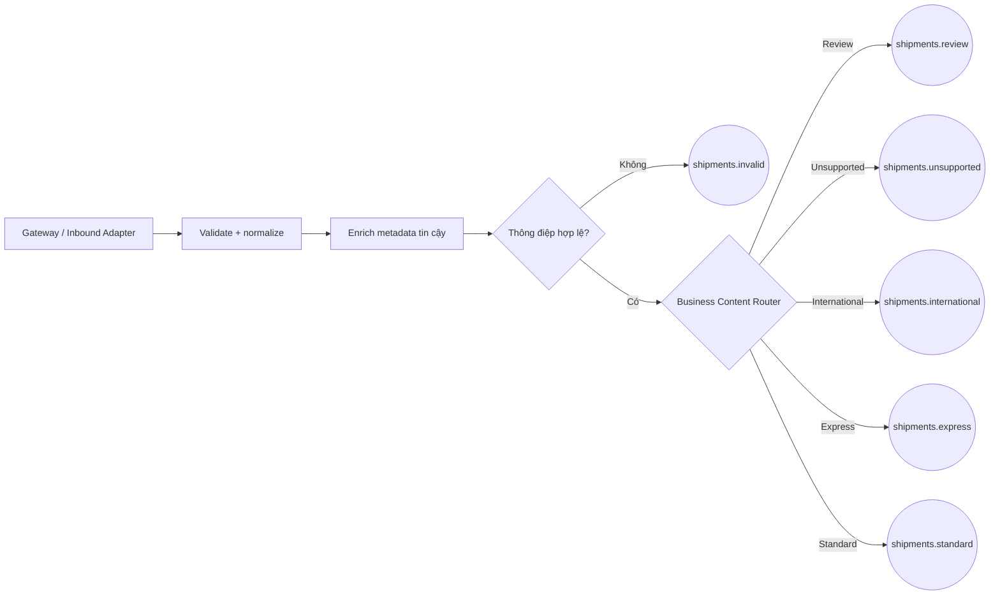
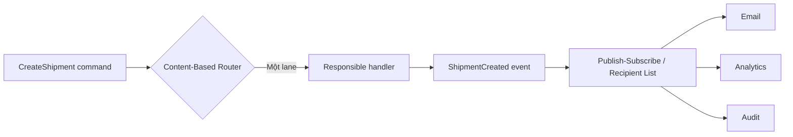
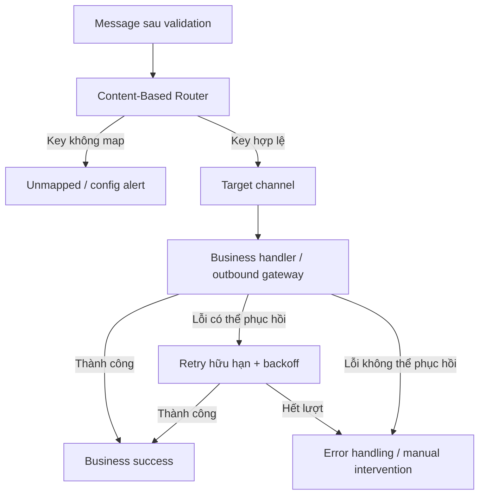

# Router theo nội dung nghiệp vụ

> **Chương:** Message router  
> **Module:** `SPRING_INTEGRATION_PATTERN` — học triển khai Enterprise Integration Patterns với Spring Integration để xây dựng luồng thông điệp ít phụ thuộc, dễ mở rộng; thực hành Router, Filter, Transformer, Splitter, Aggregator, Gateway, retry, error channel, correlation, kiểm thử và quan sát các nhánh. Bài này đi sâu vào **Content-Based Router**: xác định đích dựa trên **quy tắc nghiệp vụ và nội dung message**, chứ không chỉ dựa vào tên channel.

## 1. Mục tiêu học tập

Sau bài học, bạn có thể:

1. Phân biệt **business routing** với định tuyến kỹ thuật, lọc dữ liệu, biến đổi payload và phân phối một event cho nhiều bên nhận.
2. Biểu diễn quy tắc định tuyến thành **decision table**, thứ tự ưu tiên và một hàm quyết định thuần, có thể kiểm thử độc lập.
3. Kết hợp payload/header đáng tin cậy với `Content-Based Router` trong Spring Integration Java DSL; sử dụng `channelMapping` và `defaultOutputChannel` đúng mục đích.
4. Thiết kế riêng nhánh **invalid**, **unsupported**, **manual review** và **technical error**, tránh biến dữ liệu thiếu thành một kết luận nghiệp vụ sai.
5. Kiểm thử **nhánh được chọn và các nhánh không được chọn**, truy vết quyết định bằng correlation ID, policy version và kết quả thực thi downstream.
6. Nhận biết tác động của retry, nguồn metadata, tính đồng bộ/bất đồng bộ và routing nhiều bước đối với độ tin cậy của flow.

## 2. Vì sao Router phải hiểu nội dung nghiệp vụ?

Một hệ thống vận chuyển nhận yêu cầu tạo vận đơn từ website, hệ thống bán hàng và đối tác. Mọi yêu cầu có thể đi vào cùng channel `shipments.in`, nhưng không phải tất cả được xử lý giống nhau:

- Hàng cần kiểm tra đặc biệt phải qua **kiểm duyệt thủ công**.
- Quốc gia đích không được hỗ trợ cần vào **nhánh từ chối có lý do**.
- Đơn quốc tế có giá trị cao cần được **xem xét** trước khi gửi hãng vận chuyển.
- Đơn nội địa yêu cầu chuyển phát nhanh và đủ điều kiện có thể dùng **luồng express**.
- Những đơn nội địa còn lại đi **luồng tiêu chuẩn**.

Nếu thành phần tiếp nhận gọi trực tiếp từng dịch vụ bằng một chuỗi `if/else` lẫn cả thao tác I/O, bất kỳ thay đổi chính sách nào cũng dễ kéo theo thay đổi mã tích hợp. **Content-Based Router** cho phép đưa quyết định chọn nhánh thành một endpoint riêng, còn từng nhánh có trách nhiệm xử lý chuyên biệt.



Sơ đồ phân biệt **dữ liệu không hợp lệ** với **dữ liệu hợp lệ nhưng không được hỗ trợ**. Cả hai đều cần phản hồi phù hợp, nhưng không nhất thiết cùng một lỗi hoặc cùng một bộ phận chịu trách nhiệm.

## 3. Content-Based Router là một mẫu EIP

**Message Router** chọn một hay nhiều đường đi tiếp theo cho message. **Content-Based Router** là biến thể ra quyết định dựa trên **nội dung message**: trường của payload, header nghiệp vụ hoặc thông tin đã được chuẩn hóa/làm giàu.

Trong Spring Integration, Router thường được gắn sau một input channel và được cấu hình để đưa message tới các output channel. Nó có thể lấy khóa định tuyến từ:

| Nguồn quyết định | Ví dụ | Cần lưu ý |
| --- | --- | --- |
| **Payload field** | `destinationCountry`, `declaredValue`, `expressRequested` | Validate kiểu dữ liệu và tính nhất quán |
| **Header nghiệp vụ** | `tenantRegion`, `riskLevel`, `customerTier` | Xác thực/ghi đè header do client có thể giả mạo |
| **Kiểu payload** | `CreateShipmentCommand`, `CancelShipmentCommand` | Type phải được deserialize theo schema đáng tin cậy |
| **Kết quả enrichment** | Hạng khách hàng từ Customer Service | Enricher phải chạy **trước** Router sử dụng dữ liệu đó |
| **Hàm policy** | `routePolicy.decide(request)` | Quy tắc nên thuần, có version và test độc lập |

**Business routing không tương đương load balancing.** Quyết định “đơn này cần kiểm duyệt” thuộc nghiệp vụ; quyết định “gửi request tới instance A hay B để phân tải” thường thuộc hạ tầng/transport. Trong một hệ thống thực, hai cơ chế có thể cùng tồn tại nhưng cần tách rõ.

### 3.1. Phân biệt những endpoint dễ nhầm

| EIP / thành phần | Câu hỏi | Ví dụ |
| --- | --- | --- |
| **Filter** | Message có được tiếp tục? | Bỏ yêu cầu không có mã đơn hoặc giá trị tiền không dương |
| **Transformer** | Đổi biểu diễn dữ liệu như thế nào? | Chuẩn hóa mã quốc gia sang ISO 3166-1 alpha-2 |
| **Header/Content Enricher** | Bổ sung thông tin còn thiếu nào? | Lấy `customerTier` từ service tin cậy |
| **Content-Based Router** | Message nên đi nhánh nghiệp vụ nào? | Quốc tế, express, manual review |
| **Recipient List Router** | Message cần được gửi đến những đích được chọn nào? | Gửi thông báo cho audit và billing |
| **Publish-Subscribe Channel** | Phát một thông điệp đến các subscriber đăng ký như thế nào? | Event `ShipmentCreated` tới nhiều bên quan tâm |
| **Service Activator** | Thực hiện logic nghiệp vụ ở nhánh đã chọn như thế nào? | Gọi API hãng vận chuyển |

Router **chọn đường**, không tự bảo đảm một hành động đã thành công tại đích. `send()` hoặc định tuyến thành công ở channel không đồng nghĩa hệ thống vận chuyển đã tạo vận đơn.

## 4. Đưa quy tắc nghiệp vụ thành decision table

Ta dùng dữ liệu ví dụ sau:

```json
{
  "shipmentId": "SHP-701",
  "destinationCountry": "VN",
  "declaredValue": 1500000,
  "restrictedGoods": false,
  "expressRequested": true,
  "customerTier": "GOLD"
}
```

Giả định để học (không phải quy định pháp lý hay chính sách của hãng vận chuyển):

1. `shipmentId`, quốc gia, giá trị khai báo và hạng khách hàng phải hợp lệ. Hạng khách hàng **được lấy từ nguồn đáng tin cậy**, không sử dụng giá trị tự khai của người mua.
2. Hàng được đánh dấu `restrictedGoods=true` phải vào **manual review**.
3. Hệ thống chỉ hỗ trợ `VN`, `SG`, `TH`; các nước khác vào nhánh **unsupported**.
4. Với đơn quốc tế (`SG` hoặc `TH`), giá trị khai báo **trên 5.000.000** cần manual review; các đơn quốc tế còn lại vào nhánh quốc tế.
5. Với đơn nội địa (`VN`), khách hạng `GOLD` yêu cầu express đi nhánh express. Khách `REGULAR` yêu cầu express phải được review thay vì **âm thầm hạ cấp dịch vụ**.
6. Các đơn nội địa hợp lệ còn lại vào nhánh tiêu chuẩn.

### 4.1. Thứ tự ưu tiên là một phần của policy

| Thứ tự | Điều kiện xét, sau khi validation PASS | Kết quả quyết định |
| --- | --- | --- |
| 1 | `restrictedGoods == true` | `MANUAL_REVIEW` |
| 2 | Quốc gia đích ngoài tập được hỗ trợ | `UNSUPPORTED_COUNTRY` |
| 3 | Quốc gia khác `VN` và `declaredValue > 5_000_000` | `MANUAL_REVIEW` |
| 4 | Quốc gia khác `VN` | `INTERNATIONAL` |
| 5 | Nội địa, yêu cầu express nhưng khách không đủ điều kiện | `MANUAL_REVIEW` |
| 6 | Nội địa, express, khách `GOLD` | `DOMESTIC_EXPRESS` |
| 7 | Nội địa, không yêu cầu express | `DOMESTIC_STANDARD` |

Đây là quy tắc **first match**: khi một điều kiện đã khớp, không tiếp tục đánh giá các điều kiện dưới. Ví dụ hàng bị hạn chế mà đích cũng không được hỗ trợ sẽ vào `MANUAL_REVIEW` theo **chính sách ưu tiên đang minh họa**. Nếu nghiệp vụ muốn từ chối quốc gia không hỗ trợ trước khi review, hãy đổi thứ tự rõ ràng, cập nhật test và policy version — không chỉnh thứ tự tùy ý trong code.

### 4.2. Kết quả phân loại khác tên channel

Router nên tạo một **routing key** có ý nghĩa nghiệp vụ (`MANUAL_REVIEW`, `INTERNATIONAL`...) rồi ánh xạ nó đến channel (`shipments.review`, `shipments.international`...).

```text
payload / trusted metadata
    |
    v
Business policy: decide(request)
    |
    +-- routing key: DOMESTIC_EXPRESS
    |
    v
channel mapping
    |
    +-- target channel: shipments.express
```

Tách hai lớp giúp cấu hình topology thay đổi mà không phải sửa câu hỏi nghiệp vụ “loại đơn này là gì?”. Ngược lại, tên channel không nên là dữ liệu người gửi bên ngoài được tự do chỉ định.

## 5. Viết policy thuần Java, không gọi I/O trong Router

Một hàm policy tốt có đầu vào và kết quả rõ ràng, **không đọc dữ liệu ngầm và không phát sinh side effect**. Ta tạo `enum` cho các nhánh để tránh rải nhiều chuỗi định tuyến.

```java
import java.math.BigDecimal;
import java.util.Locale;
import java.util.Set;

record ShipmentRequest(
    String shipmentId,
    String destinationCountry,
    BigDecimal declaredValue,
    boolean restrictedGoods,
    boolean expressRequested,
    String customerTier
) {}

enum ShippingLane {
    MANUAL_REVIEW,
    UNSUPPORTED_COUNTRY,
    INTERNATIONAL,
    DOMESTIC_EXPRESS,
    DOMESTIC_STANDARD
}

final class ShippingRoutePolicy {
    private static final Set<String> SUPPORTED_COUNTRIES =
        Set.of("VN", "SG", "TH");

    private static final Set<String> ALLOWED_TIERS =
        Set.of("GOLD", "REGULAR");

    private static final BigDecimal INTERNATIONAL_REVIEW_THRESHOLD =
        new BigDecimal("5000000");

    private ShippingRoutePolicy() {}

    static boolean valid(ShipmentRequest request) {
        return request != null
            && request.shipmentId() != null
            && !request.shipmentId().isBlank()
            && request.destinationCountry() != null
            && request.destinationCountry().trim().matches("[A-Za-z]{2}")
            && request.declaredValue() != null
            && request.declaredValue().signum() > 0
            && ALLOWED_TIERS.contains(request.customerTier());
    }

    static ShippingLane decide(ShipmentRequest request) {
        if (!valid(request)) {
            throw new IllegalArgumentException("Validate before routing");
        }

        String country = request.destinationCountry()
            .trim().toUpperCase(Locale.ROOT);

        if (request.restrictedGoods()) {
            return ShippingLane.MANUAL_REVIEW;
        }

        if (!SUPPORTED_COUNTRIES.contains(country)) {
            return ShippingLane.UNSUPPORTED_COUNTRY;
        }

        if (!"VN".equals(country)) {
            if (request.declaredValue()
                .compareTo(INTERNATIONAL_REVIEW_THRESHOLD) > 0) {
                return ShippingLane.MANUAL_REVIEW;
            }
            return ShippingLane.INTERNATIONAL;
        }

        if (request.expressRequested()
            && !"GOLD".equals(request.customerTier())) {
            return ShippingLane.MANUAL_REVIEW;
        }

        return request.expressRequested()
            ? ShippingLane.DOMESTIC_EXPRESS
            : ShippingLane.DOMESTIC_STANDARD;
    }
}
```

**Diễn giải code:**

- `valid(...)` kiểm tra contract tối thiểu. Một giá trị quốc gia có đúng hai chữ cái nhưng không nằm trong whitelist là **hợp lệ về hình thức**, sau đó được route `UNSUPPORTED_COUNTRY`.
- `decide(...)` đánh giá theo thứ tự của decision table. Quy tắc `> 5_000_000` không áp dụng cho giá trị đúng bằng 5.000.000; test cần cố định ranh giới này.
- Hàm chỉ xử lý dữ liệu đã có; nó không gọi CRM, không tạo vận đơn và không trả về tên channel động từ người dùng.
- Dữ liệu như `customerTier` phải được một bước **enrichment từ nguồn đáng tin cậy** đưa vào trước Router. Ví dụ giả định bước đó đã xảy ra, để tập trung vào routing.
- Trong hệ thống thực, đơn vị tiền tệ và cách quy đổi phải được định nghĩa. Tránh so sánh giá trị từ nhiều đơn vị tiền tệ bằng một ngưỡng không cùng đơn vị. Ở đây mọi giá trị khai báo được giả định cùng một đơn vị đã chuẩn hóa.

### 5.1. Vì sao không gọi dịch vụ ngoài ngay trong `decide(...)`?

Một router vừa gọi API kiểm tra tín dụng vừa lựa chọn nhánh sẽ khó tái hiện quyết định cũ, test chậm và không rõ lỗi là **lỗi tra cứu** hay **không có tuyến phù hợp**. Cách tổ chức tốt hơn:

```text
Inbound -> Validate -> Enrich(customerTier/riskLevel)
        -> Business Router (pure decision)
        -> Chosen channel -> Business handler
```

Enricher chịu trách nhiệm lookup, timeout, retry và làm rõ dữ liệu stale/missing; Router chỉ dùng snapshot đã được xác minh. Nếu giá trị thay đổi theo thời gian, phải quyết định **dùng snapshot lúc nhận** hay **tra cứu ngay trước khi thực thi**, và ghi lại phiên bản/thời điểm để truy vết.

## 6. Spring Integration Java DSL: từ routing key tới channel

Ví dụ bên dưới dùng Java 17+ (`record`) với Spring Integration Java DSL. Những handler chỉ in payload để minh họa đường đi. Để dùng trong dự án thật, khai báo dependency Spring Integration phù hợp, cấu hình ứng dụng Spring và thay console handler bằng service/adapter nghiệp vụ.

### 6.1. Messaging Gateway

```java
import org.springframework.integration.annotation.Gateway;
import org.springframework.integration.annotation.MessagingGateway;

@MessagingGateway
interface ShipmentGateway {
    @Gateway(requestChannel = "shipments.in")
    void submit(ShipmentRequest shipment);
}
```

Gateway giúp code nghiệp vụ gọi `shipmentGateway.submit(...)` thay vì biết tên/kiểu các channel downstream. `void` không có nghĩa là yêu cầu đã hoàn tất ở hệ thống vận chuyển ngoài ứng dụng.

### 6.2. Filter đầu vào, Router và các handler minh họa

```java
import org.springframework.context.annotation.Bean;
import org.springframework.context.annotation.Configuration;
import org.springframework.integration.annotation.IntegrationComponentScan;
import org.springframework.integration.config.EnableIntegration;
import org.springframework.integration.dsl.IntegrationFlow;

@Configuration
@EnableIntegration
@IntegrationComponentScan
class ShipmentRoutingConfiguration {

    @Bean
    IntegrationFlow shipmentIngress() {
        return IntegrationFlow.from("shipments.in")
            // Chỉ cho yêu cầu hợp lệ đi đến Router.
            .filter(ShipmentRequest.class, ShippingRoutePolicy::valid,
                spec -> spec.discardChannel("shipments.invalid"))

            // Hàm trả routing key; mapping chỉ ra channel thực tế.
            .route(ShipmentRequest.class,
                request -> ShippingRoutePolicy.decide(request).name(),
                spec -> spec
                    .channelMapping("MANUAL_REVIEW", "shipments.review")
                    .channelMapping("UNSUPPORTED_COUNTRY", "shipments.unsupported")
                    .channelMapping("INTERNATIONAL", "shipments.international")
                    .channelMapping("DOMESTIC_EXPRESS", "shipments.express")
                    .channelMapping("DOMESTIC_STANDARD", "shipments.standard")
                    .defaultOutputChannel("shipments.unmapped"))
            .get();
    }

    @Bean
    IntegrationFlow invalidShipments() {
        return IntegrationFlow.from("shipments.invalid")
            .handle(m -> System.out.println("INVALID: " + m.getPayload()))
            .get();
    }

    @Bean
    IntegrationFlow reviewShipments() {
        return IntegrationFlow.from("shipments.review")
            .handle(m -> System.out.println("REVIEW: " + m.getPayload()))
            .get();
    }

    @Bean
    IntegrationFlow unsupportedShipments() {
        return IntegrationFlow.from("shipments.unsupported")
            .handle(m -> System.out.println("UNSUPPORTED: " + m.getPayload()))
            .get();
    }

    @Bean
    IntegrationFlow internationalShipments() {
        return IntegrationFlow.from("shipments.international")
            .handle(m -> System.out.println("INTERNATIONAL: " + m.getPayload()))
            .get();
    }

    @Bean
    IntegrationFlow expressShipments() {
        return IntegrationFlow.from("shipments.express")
            .handle(m -> System.out.println("EXPRESS: " + m.getPayload()))
            .get();
    }

    @Bean
    IntegrationFlow standardShipments() {
        return IntegrationFlow.from("shipments.standard")
            .handle(m -> System.out.println("STANDARD: " + m.getPayload()))
            .get();
    }

    @Bean
    IntegrationFlow unmappedShipments() {
        return IntegrationFlow.from("shipments.unmapped")
            .handle(m -> System.out.println("UNMAPPED: " + m.getPayload()))
            .get();
    }
}
```

Các ví dụ `ShipmentRequest`, `ShippingLane`, `ShippingRoutePolicy`, `ShipmentGateway` và `ShipmentRoutingConfiguration` thuộc cùng ứng dụng/package theo giả định của bài. Khi tách file production, cần tổ chức package, component scan và kiểm thử đúng với dự án thực tế.

Ví dụ gửi một số yêu cầu **đã được kiểm tra metadata tin cậy ở ingress**:

```java
shipmentGateway.submit(new ShipmentRequest(
    "SHP-701", "VN", new BigDecimal("1500000"),
    false, true, "GOLD"));

shipmentGateway.submit(new ShipmentRequest(
    "SHP-702", "SG", new BigDecimal("900000"),
    false, false, "REGULAR"));

shipmentGateway.submit(new ShipmentRequest(
    "SHP-703", "VN", new BigDecimal("1500000"),
    true, true, "GOLD"));

shipmentGateway.submit(new ShipmentRequest(
    "SHP-704", "FR", new BigDecimal("900000"),
    false, false, "REGULAR"));

shipmentGateway.submit(new ShipmentRequest(
    "SHP-705", "VN", BigDecimal.ZERO,
    false, false, "REGULAR"));
```

Kết quả minh họa (rút gọn payload):

```text
EXPRESS: SHP-701
INTERNATIONAL: SHP-702
REVIEW: SHP-703
UNSUPPORTED: SHP-704
INVALID: SHP-705
```

### 6.3. Ý nghĩa của các nhánh mặc định

Trong ví dụ, `decide(...)` chỉ trả về các giá trị enum đã được mapping, vì vậy `shipments.unmapped` thường **không xuất hiện**. Nhánh này là tuyến phòng vệ khi policy/mapping bị lệch trong một cấu hình được sửa đổi.

Điều quan trọng là **phân biệt**:

- `shipments.invalid`: message thiếu hoặc sai trường bắt buộc, bị Filter chặn **trước Router**.
- `shipments.unsupported`: message hợp lệ về cấu trúc nhưng quốc gia nằm ngoài chính sách hỗ trợ.
- `shipments.review`: dữ liệu hợp lệ, cần người/hệ thống xét duyệt theo nghiệp vụ.
- `shipments.unmapped`: quyết định không ánh xạ được thành output channel theo cấu hình, cần chẩn đoán policy/topology.
- **Error channel/exception flow:** lỗi kỹ thuật tại lookup, send, handler hoặc outbound adapter; không thể mặc định dùng `defaultOutputChannel` như tuyến failover cho mọi lỗi runtime.

**Định tuyến được** không đồng nghĩa **xử lý thành công**. Handler ví dụ chỉ ghi console; sản phẩm thật phải quyết định thời điểm xác nhận vận đơn đã được tạo, retry thế nào và xử lý trùng ra sao.

## 7. Quy tắc nhiều điều kiện: tránh sai lệch khi policy lớn dần

Business routing thường phức tạp hơn một biểu thức `urgent ? A : B`. Những rủi ro điển hình gồm:

### 7.1. Hai điều kiện cùng đúng

Một yêu cầu quốc tế giá trị cao có thể đồng thời chứa hàng cần kiểm duyệt. Hãy định nghĩa rõ **ưu tiên trước/sau** và lưu chính sách dưới dạng decision table có test. Không để hai nhánh cùng xử lý một command nếu nghiệp vụ chỉ cho phép **một logical owner** thực hiện hành động.

### 7.2. Giá trị thiếu và giá trị không hỗ trợ là khác nhau

`destinationCountry=null` là **input không hợp lệ**. `destinationCountry="FR"` có thể là mã hợp lệ nhưng **ngoài phạm vi hỗ trợ**. Nếu gộp cả hai thành `STANDARD`, Router có thể chuyển sai nhiệm vụ đến một handler không có khả năng xử lý.

### 7.3. Ngữ nghĩa của giá trị biên

Quy tắc `declaredValue > 5_000_000` và `>= 5_000_000` cho kết quả khác nhau ở ngưỡng chính xác. Dùng `BigDecimal` để so sánh tiền, nhất quán đơn vị và làm rõ cách làm tròn/đổi ngoại tệ. Policy phải có **test giá trị sát ngưỡng**, không chỉ test các giá trị rất nhỏ hoặc rất lớn.

### 7.4. Quy tắc có thể thay đổi theo thời gian

Hôm nay đơn quốc tế cần review từ 5 triệu; ngày mai có thể đổi ngưỡng. Một message còn nằm trong queue được xử lý sau thay đổi policy có thể cho kết quả khác với lúc nhận. Có hai hướng chính:

1. **Evaluate at processing time:** dùng quy tắc hiện tại khi Router xử lý; hợp lý với chính sách luôn phải mới nhưng cần xem xét replay.
2. **Evaluate with pinned policy version:** ghi phiên bản/snapshot policy áp dụng cho message để tái hiện quyết định; hữu ích với audit hoặc quy trình có ràng buộc hợp đồng.

Cần thống nhất chính sách trong hệ thống; **không giả định mọi message cũ phải tự động áp policy mới** hay mọi message phải giữ policy cũ.

## 8. Metadata và ranh giới tin cậy trước Router

Để quyết định dựa trên nội dung đúng, dữ liệu đưa vào Router phải đủ và đáng tin cậy:

| Dữ liệu | Nguồn có thể dùng | Kiểm soát cần thiết |
| --- | --- | --- |
| `destinationCountry` | Payload từ khách/đối tác | Normalize, validate mã nước và kiểm tra quy tắc hỗ trợ |
| `declaredValue` | Payload giao dịch đã chuẩn hóa | Đơn vị tiền, kiểu số, quyền sửa và anti-tampering |
| `customerTier` | Customer Profile/CRM đáng tin cậy | Enrich trước Router; không tin header tier do client tự đặt |
| `restrictedGoods` | Bộ phân loại nghiệp vụ/chính sách nội bộ | Nguồn, version, thời điểm và quyền xác nhận |
| `traceId` / `correlationId` | Ingress/tracing hệ thống | Propagation qua channel/broker, không dùng thay idempotency |

### 8.1. Enricher phải chạy trước khi route cần metadata

Nếu chưa có `customerTier`, Router **không nên** tự coi khách là `REGULAR`. Tách flow thành `Validate → Enrich tier → Validate metadata → Router`, hoặc đưa trường hợp tier không xác định đến nhánh lỗi/review có kiểm soát. Không nên truy cập CRM ngầm trong hàm `decide(...)`, vì sẽ trộn kết quả phân loại với trạng thái mạng.

### 8.2. Không lấy tên channel trực tiếp từ dữ liệu thiếu tin cậy

Ví dụ nhận header `targetChannel="internal.paymentAdmin"` rồi gửi thẳng tới channel đó là rủi ro. Nên chuyển dữ liệu vào **routing key thuộc allowlist**, map key sang channel nội bộ. Quyền truy cập của producer, bảo mật channel/adapter và validation cần được xử lý ở ranh giới hệ thống, không thể dựa duy nhất vào một biểu thức router.

### 8.3. Thông tin chỉ phục vụ routing có nên ở header?

Header có thể phù hợp cho `riskLevel`, `customerTier`, `routingZone` khi những giá trị này là metadata điều khiển flow. Payload phù hợp khi dữ liệu là một phần hợp đồng nghiệp vụ phải được lưu/truyền sang hệ thống khác. Cả hai lựa chọn cần có schema và kiểm thử. Qua broker/HTTP, **header không mặc nhiên được giữ nguyên**; hãy kiểm tra mapping, serialization và giới hạn kích thước header.

## 9. Một message, nhiều đích và idempotency

Trong ví dụ tạo vận đơn, mỗi command phải có **một nhánh chịu trách nhiệm** để tránh tạo hai vận đơn. Nhưng khi vận đơn đã tạo, một **event** `ShipmentCreated` có thể cần được phát đến email, analytics và audit.



| Mẫu | Đặc trưng | Khi chọn |
| --- | --- | --- |
| **Content-Based Router** | Quyết định nhánh theo quy tắc nghiệp vụ | Chọn luồng tạo vận đơn phù hợp |
| **Recipient List Router** | Gửi đến tập người nhận tùy điều kiện | Chỉ gửi event cho những bộ phận liên quan |
| **Publish-Subscribe Channel** | Phát event đến các subscriber của channel | Nhiều hệ thống cần biết cùng một sự kiện |

**Không mặc định “có nhiều subscriber” là broadcast.** `DirectChannel` có thể điều phối đến một subscriber; `PublishSubscribeChannel` có semantics khác. Khi cần mỗi consumer độc lập về lỗi và thời gian xử lý, phải thiết kế ranh giới bất đồng bộ/độ bền thích hợp.

### Idempotency và correlation

Router lựa chọn nhánh có thể được gọi lại nếu thông điệp được broker redeliver hoặc quá trình xử lý retry. Mỗi **command có side effect** cần khóa idempotency phù hợp, ví dụ `shipmentId + operation`, để tránh tạo hai vận đơn. `correlationId` hỗ trợ truy vết các message thuộc cùng quy trình; nó **không tự ngăn tác dụng phụ lặp**.

Nếu shipment được Splitter thành nhiều kiện và các kiện được route tới nhiều kho, Aggregator phải có **correlation strategy**, **release strategy**, timeout và xử lý kết quả đến lặp/muộn. Routing từng kiện không có nghĩa Aggregator tự biết đơn đã hoàn tất.

## 10. Đồng bộ, bất đồng bộ và xử lý lỗi trong từng nhánh

Một Router trong Spring Integration có thể đưa message tới `DirectChannel`, `ExecutorChannel`, `QueueChannel` hoặc adapter ra broker. Quyết định chọn channel và mức bảo đảm delivery **không phải một**.

| Đích | Khi nào thao tác gửi được xem là thành công theo ranh giới gần? | Chưa đủ để kết luận gì? |
| --- | --- | --- |
| `DirectChannel` | Message được dispatch đến subscriber theo semantics đồng bộ | Đích ngoài đã commit hoàn tất giao dịch |
| `ExecutorChannel` | Message được giao/lên lịch cho executor | Handler đã chạy xong hoặc đã gọi API thành công |
| `QueueChannel` | Message được đưa vào queue | Consumer đã poll, xử lý hoặc ghi bền qua restart |
| Broker ngoài qua adapter | Đã nhận xác nhận ở tầng transport nếu có | Consumer bên kia đã xử lý thành công nghiệp vụ |

### 10.1. Phân biệt lỗi không route được và lỗi xử lý đích



**`defaultOutputChannel` chỉ xử lý việc thiếu đích theo chính sách Router**, không phải tuyến failover tự động khi một downstream handler ném exception. Lỗi trong `DirectChannel` thường có thể lan về caller; lỗi ở ranh giới async/poller có thể được chuyển thành `ErrorMessage` qua cơ chế error channel phù hợp. Cần kiểm thử đúng cấu hình, không mặc định mọi exception đều tự đến một channel lỗi chung.

### 10.2. Retry ở nơi có thể phục hồi

Retry thường phù hợp hơn quanh outbound handler/API call, có timeout, số lần thử tối đa, backoff, phân loại lỗi và đường cuối khi hết lượt. **Đừng** retry toàn tuyến từ Gateway nếu điều đó có nguy cơ lặp những bước đã gây side effect. Với lệnh tạo vận đơn bị timeout, kết quả lần đầu có thể đã thành công ở hãng vận chuyển; dùng idempotency key hoặc tra cứu trạng thái trước khi gửi lại.

### 10.3. Không tự động chuyển sang nhánh khác khi lỗi

Một đơn đã được route `MANUAL_REVIEW` không nên chuyển sang `DOMESTIC_STANDARD` chỉ vì hệ thống review tạm thời unavailable. Điều này **thay đổi quyết định nghiệp vụ**, không còn là fallback kỹ thuật. Nếu cần fallback, phải có chính sách được phê duyệt và bảo đảm điều kiện an toàn được duy trì.

## 11. Quan sát “tại sao đi nhánh này?”

Khi hỗ trợ vận hành, câu hỏi quan trọng không chỉ là message đã gửi vào channel nào, mà còn **vì sao** policy chọn channel đó và nó có được xử lý xong hay không.

Nên ghi lại một **routing decision record** về mặt logic, ví dụ:

```json
{
  "shipmentId": "SHP-701",
  "policyVersion": "shipping-routing-v1",
  "decision": "DOMESTIC_EXPRESS",
  "reasonCode": "ELIGIBLE_DOMESTIC_EXPRESS",
  "targetChannel": "shipments.express",
  "occurredAt": "2026-11-21T04:00:00Z"
}
```

Đây là **ví dụ cấu trúc audit**, không phải một message/header mặc định Spring Integration tự sinh. Nếu cần đảm bảo quyết định được ghi chính xác một lần, thiết kế store hoặc event audit phù hợp. Không nên viết audit bền vững bằng thao tác I/O chặn tùy tiện trong chính hàm chọn routing key.

### 11.1. Những chỉ số giúp theo dõi từng nhánh

| Điểm đo | Gợi ý tín hiệu | Câu hỏi |
| --- | --- | --- |
| Ingress | Message count, source, schema | Đã nhận bao nhiêu yêu cầu? |
| Filter | Invalid count, reason | Bao nhiêu message bị chặn trước Router? |
| **Business Router** | Routing key, policy version, reason code, count theo lane | Vì sao message vào nhánh này? |
| Target channel | Dispatch result, queue depth, wait time | Đã tới channel đích chưa? |
| Handler/outbound | Processing result, downstream timeout, retry attempts | Đích có hoàn thành nghiệp vụ không? |
| Error/review flow | Error class, số yêu cầu tồn đọng, age | Còn bao nhiêu việc cần can thiệp? |

`ChannelInterceptor`, Wire Tap, metrics và distributed tracing có thể bổ trợ nhau. `correlationId`/`shipmentId` hữu ích trong logs/traces; **đừng dùng shipmentId làm metric tag** nếu cardinality quá cao. Payload có thể chứa thông tin cá nhân hoặc tài chính; chỉ log dữ liệu cần thiết, mask hoặc loại bỏ trường nhạy cảm.

### 11.2. Lưu decision một lần khi cần tái hiện

Nếu flow phải bảo đảm Router và handler sau đó **nhìn cùng một quyết định**, có thể tạo một `RoutingDecision` bất biến trước Router rồi đưa nó trong payload/header đáng tin cậy:

```java
record RoutingDecision(ShippingLane lane, String reasonCode,
                       String policyVersion) {}

record RoutedShipment(ShipmentRequest shipment,
                      RoutingDecision decision) {}

// Ý tưởng ở một bước Transformer/Enricher chuyên trách:
ShippingLane lane = ShippingRoutePolicy.decide(request);
RoutedShipment routed = new RoutedShipment(
    request,
    new RoutingDecision(lane, "RULE_MATCHED", "shipping-routing-v1"));
```

Khi đó Router đọc `routed.decision().lane()` thay vì gọi policy lần hai. Với hệ thống lớn, reason code nên lấy từ nhánh cụ thể của policy thay vì dùng giá trị minh họa `RULE_MATCHED`. Việc đánh giá một lần giúp tránh thay đổi kết quả do lookup/policy động giữa các bước; vẫn cần xác định policy version và cách audit khi message được replay.

## 12. Kiểm thử policy và toàn bộ đường routing

Một test đúng phải bao gồm **nhánh dương**, **nhánh âm**, **giá trị biên** và trường hợp lỗi. Unit test policy chưa đủ để phát hiện `channelMapping` sai hoặc thiếu subscriber; integration test Router và các channel là tầng cần thiết tiếp theo.

### 12.1. Ma trận nghiệp vụ

| Dữ liệu đầu vào | Kỳ vọng | Điểm dễ sai |
| --- | --- | --- |
| `VN`, GOLD, express, không hạn chế | `DOMESTIC_EXPRESS` | Dựa sai vào header tier không tin cậy |
| `VN`, REGULAR, không express | `DOMESTIC_STANDARD` | Nhầm mọi REGULAR thành nhánh review |
| `VN`, REGULAR, express | `MANUAL_REVIEW` | Âm thầm hạ cấp express trái chính sách ví dụ |
| `SG`, giá trị 5.000.000 | `INTERNATIONAL` | Dùng `>=` thay vì `>` |
| `SG`, giá trị 5.000.001 | `MANUAL_REVIEW` | Bỏ qua ngưỡng giá trị quốc tế |
| `TH`, restricted goods | `MANUAL_REVIEW` | Rule quốc tế đứng trước rule kiểm duyệt |
| `FR`, không hạn chế | `UNSUPPORTED_COUNTRY` | Gửi nhầm quốc gia không hỗ trợ |
| `FR`, restricted goods | `MANUAL_REVIEW` theo thứ tự mẫu | Thay đổi thứ tự rule mà không cập nhật quyết định |
| `VN`, amount bằng 0 | `shipments.invalid` | Để Router nhận dữ liệu chưa hợp lệ |
| `customerTier` rỗng | `shipments.invalid` hoặc lỗi enrichment trước Router | Mặc định tin rằng tier là REGULAR |
| Routing key chưa map | `shipments.unmapped` nếu được cấu hình | Bỏ message không có tín hiệu |
| Handler `shipments.express` ném exception | Technical error path | Tự đổi route sang standard |

### 12.2. Unit test cho quy tắc thuần

```java
import static org.junit.jupiter.api.Assertions.assertEquals;

import java.math.BigDecimal;
import org.junit.jupiter.api.Test;

class ShippingRoutePolicyTest {

    private ShipmentRequest request(String country, String amount,
                                    boolean restricted, boolean express,
                                    String tier) {
        return new ShipmentRequest("SHP-900", country,
            new BigDecimal(amount), restricted, express, tier);
    }

    @Test
    void choosesExpressForEligibleDomesticRequest() {
        assertEquals(ShippingLane.DOMESTIC_EXPRESS,
            ShippingRoutePolicy.decide(
                request("VN", "1000000", false, true, "GOLD")));
    }

    @Test
    void restrictedGoodsTakePrecedenceOverInternationalRoute() {
        assertEquals(ShippingLane.MANUAL_REVIEW,
            ShippingRoutePolicy.decide(
                request("TH", "1000000", true, false, "REGULAR")));
    }

    @Test
    void exactInternationalThresholdDoesNotTriggerReview() {
        assertEquals(ShippingLane.INTERNATIONAL,
            ShippingRoutePolicy.decide(
                request("SG", "5000000", false, false, "REGULAR")));
    }

    @Test
    void aboveInternationalThresholdTriggersReview() {
        assertEquals(ShippingLane.MANUAL_REVIEW,
            ShippingRoutePolicy.decide(
                request("SG", "5000001", false, false, "REGULAR")));
    }

    @Test
    void unknownCountryIsAnExplicitBusinessOutcome() {
        assertEquals(ShippingLane.UNSUPPORTED_COUNTRY,
            ShippingRoutePolicy.decide(
                request("FR", "1000000", false, false, "REGULAR")));
    }
}
```

Các test này kiểm tra **decision table**, không khởi động Spring context. Chúng không chứng minh một channel thực sự nhận message.

### 12.3. Integration test nên assert cả sự vắng mặt ở nhánh khác

Trong Spring Test/JUnit, có thể dựng context chứa `ShipmentGateway`, flow và các channel handler kiểm thử để ghi message nhận được. Với một request hợp lệ `DOMESTIC_EXPRESS`, cần assert:

1. `shipments.express` nhận **chính xác một message** có payload/header đúng.
2. `shipments.standard`, `shipments.international`, `shipments.review`, `shipments.unsupported` **không** nhận message đó.
3. Không có message trên `shipments.invalid` hoặc `shipments.unmapped`.
4. Khi thay nguồn metadata hoặc policy, điều kiện mới có test phản ánh phiên bản rule tương ứng.
5. Nếu channel đích bất đồng bộ, chờ điều kiện có **timeout xác định** thay vì dựa vào `Thread.sleep()` tùy ý.

Thêm test handler downstream ném exception, message bị gửi lặp và broker/adapter bỏ header correlation. Các lỗi này thuộc **đường thực thi**, khác với quyết định nghiệp vụ của hàm policy.

## 13. Anti-pattern khi route theo nghiệp vụ

| Anti-pattern | Hậu quả | Cách cải thiện |
| --- | --- | --- |
| **Rule lẫn side effect** | Router gọi API, ghi DB, khó test và retry | Pure decision + Handler/Enricher riêng |
| **Tin giá trị route từ client** | Có thể đi vào channel không được phép | Validate dữ liệu, map allowlist key → channel |
| **Thiếu rule precedence** | Hai điều kiện cùng đúng nhưng kết quả khó đoán | Decision table, priority và boundary tests |
| **Missing = default standard** | Dữ liệu thiếu bị coi là nghiệp vụ bình thường | Tách invalid, unknown, unsupported, technical failure |
| **Fallback khi handler lỗi bằng cách chọn nhánh khác** | Có thể vi phạm nghiệp vụ hoặc tạo side effect trùng | Retry/error/compensation riêng, không đổi quyết định một cách âm thầm |
| **Dùng `double` để phân loại giá trị tiền** | Sai ranh giới do biểu diễn số thực | `BigDecimal`, định nghĩa đơn vị và rounding |
| **Metric tag chứa `shipmentId`** | Cardinality cao, làm hỏng chi phí giám sát | Đưa ID vào log/trace, metrics chỉ dùng lane/reason/version |
| **Enrich sau Router** | Quy tắc dùng tier/risk chưa có hoặc stale | Enrich trước bước cần metadata |
| **Không test nhánh âm** | Một message có thể bị gửi sai hoặc lặp | Assert nhánh được chọn và nhánh không được chọn |

## 14. Bài tập vận dụng

Một nền tảng thanh toán nhận `PaymentRequest` có `amount`, `currency`, `country`, `riskLevel`, `merchantTier`. Chính sách ví dụ:

- `riskLevel=HIGH` → `payments.review`.
- Quốc gia không hỗ trợ → `payments.unsupported`.
- `riskLevel=LOW`, tiền tệ và merchant đủ điều kiện → `payments.fastLane`.
- Các giao dịch hợp lệ khác → `payments.standard`.
- Nếu Risk Service không phản hồi → lỗi kỹ thuật/retry hữu hạn, **không mặc định LOW**.

Hãy thực hiện:

1. Vẽ flow `Gateway → Validate → Enrich riskLevel → Router → các handler` và tách đường invalid, unsupported, review, technical error.
2. Viết decision table có thứ tự xét, bao gồm giao dịch vừa thuộc quốc gia không hỗ trợ vừa có rủi ro cao.
3. Thiết kế enum routing key và channel mapping; không dùng header `targetChannel` do client gửi để chọn bean tùy ý.
4. Nêu policy version, correlation và idempotency key; lý giải vì sao retry transaction timeout có nguy cơ thu tiền hai lần.
5. Lập ma trận kiểm thử các ngưỡng tiền, thiếu metadata, rule conflict, out-of-order/replay và nhánh không được chọn.

**Gợi ý:** Dùng `Filter` cho dữ liệu sai cấu trúc, `Enricher` cho risk từ nguồn tin cậy, `Content-Based Router` cho quyết định nghiệp vụ, `Gateway/Service Activator` cho xử lý thanh toán. Không cho một giao dịch đi đồng thời hai handler có side effect. Chỉ phát event `PaymentSucceeded` sau khi có bằng chứng trạng thái thanh toán thực sự thành công.

## 15. Tổng kết

**Router theo nội dung nghiệp vụ** biến các thuộc tính của message thành một **quyết định chọn nhánh có thể giải thích, kiểm thử và quản lý phiên bản**. Điểm quan trọng không chỉ là trả về một channel name, mà là **dữ liệu đầu vào đáng tin cậy, thứ tự quy tắc, ý nghĩa của nhánh invalid/unsupported/review và mối liên hệ giữa quyết định với kết quả downstream**.

Trong Spring Integration, hãy giữ **Filter, Transformer/Enricher, Router và Service Activator** có trách nhiệm riêng. Dùng `channelMapping` để nối routing key với channel, `defaultOutputChannel` để xử lý key không ánh xạ được, và thiết kế riêng **retry, error channel, correlation, idempotency, tracing và kiểm thử** cho mỗi nhánh. Một thiết kế tốt cho biết **vì sao message được route ở đó**, **đã đến đâu** và **khi nào nghiệp vụ thực sự hoàn tất**.

**Tài liệu tham khảo:** Gregor Hohpe & Bobby Woolf, *Enterprise Integration Patterns* (Content-Based Router, Message Router, Recipient List); tài liệu chính thức Spring Integration về Routers, Java DSL, Message Channels, Content Enricher, Gateways và Error Handling.
