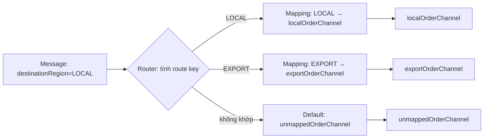
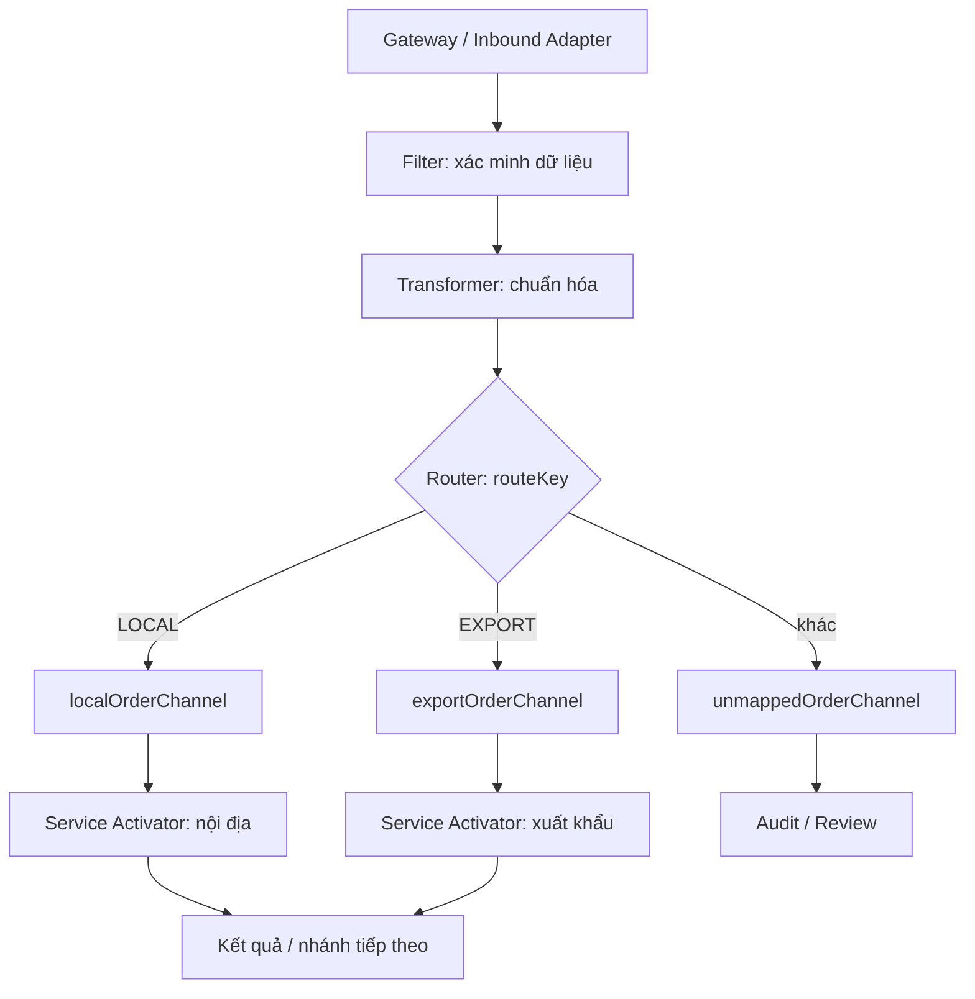

# Channel mapping và tên route trong Spring Integration

Trong một hệ thống tích hợp, thông điệp đơn hàng, thanh toán hoặc thông báo thường cần đi đến những nhánh xử lý khác nhau. Ví dụ, đơn nội địa chuyển đến bộ xử lý giao hàng trong nước; đơn xuất khẩu chuyển đến bộ xử lý chứng từ; dữ liệu chưa nhận diện được chuyển đến nhánh kiểm tra. **Message Router** quyết định đường đi của mỗi Message, còn **channel mapping** liên kết *giá trị quyết định định tuyến* với *Message Channel thực sự* trong ứng dụng.

Trong chương **Message router** của module `SPRING_INTEGRATION_PATTERN`, bài này giải thích cách đặt tên route, đặt tên channel, ánh xạ giữa chúng và kiểm chứng tuyến đi trong Spring Integration. Đây là cơ sở để kết hợp Router với Gateway, Filter, Transformer, Splitter, Aggregator, retry, error channel và correlation trong các Enterprise Integration Patterns (EIP) có mức phụ thuộc thấp, dễ mở rộng và dễ quan sát.

## 1. Phân biệt route key, channel mapping và channel name

Giả sử có một Message mang thông tin:

```json
{
  "orderId": "ORD-2401",
  "destinationRegion": "LOCAL",
  "total": 1250000
}
```

Một Router kiểm tra `destinationRegion` và quyết định:

- `LOCAL` → `localOrderChannel`.
- `EXPORT` → `exportOrderChannel`.
- Giá trị khác → `unmappedOrderChannel`.

Ba khái niệm cần tách bạch:

| Khái niệm | Ví dụ | Ý nghĩa |
| --- | --- | --- |
| **Route key** (giá trị định tuyến) | `LOCAL`, `EXPORT` | Kết quả do biểu thức/hàm định tuyến tính ra từ Message |
| **Channel mapping** | `LOCAL → localOrderChannel` | Bảng ánh xạ từ route key sang đích vận chuyển |
| **Channel name** | `localOrderChannel` | Tên bean `MessageChannel` mà Spring Integration giải quyết để gửi Message |
| **Route mặc định** | `unmappedOrderChannel` | Đích cho giá trị không có ánh xạ, khi đã cấu hình |
| **Địa chỉ bên ngoài** | HTTP URL, Kafka topic, AMQP queue | Tài nguyên tích hợp bên ngoài, chỉ liên quan nếu channel/adapter được kết nối phù hợp |

Tên route là **nhãn logic của quyết định**, còn tên channel là **điểm kết nối giữa các endpoint trong Spring Integration**. Một route key `EXPORT` không nhất thiết phải có bean channel tên `EXPORT`: ánh xạ cho phép dùng `exportOrderChannel` thay vì buộc mô hình nghiệp vụ phụ thuộc vào tên hạ tầng.



**Một channel không phải là một route.** Channel là nơi chuyển giao Message cho các endpoint; Router là endpoint đưa ra quyết định *chọn channel*. Router có thể quyết định theo payload, header, loại dữ liệu hoặc một phương thức nghiệp vụ.

## 2. Vì sao nên dùng channel mapping?

Nếu viết logic định tuyến trả trực tiếp tên channel:

```java
String channelName = order.destinationRegion().equals("LOCAL")
        ? "localOrderChannel"
        : "exportOrderChannel";
```

thì code nghiệp vụ biết tên bean hạ tầng. Khi đổi tên channel, phải sửa logic định tuyến hoặc phân tán chuỗi tên channel vào nhiều nơi. Mặt khác, điều kiện trên còn đưa mọi giá trị khác `LOCAL` sang tuyến xuất khẩu, dù dữ liệu có thể bị lỗi.

Với **channel mapping**, hàm định tuyến có thể chỉ trả nhãn nghiệp vụ:

```java
String routeKey = order.destinationRegion();
// "LOCAL", "EXPORT", hoặc một giá trị không được hỗ trợ
```

Sau đó một bảng ánh xạ quyết định channel đích:

```text
Route keys                Channel bean names
------------------------------------------------
LOCAL                   → localOrderChannel
EXPORT                  → exportOrderChannel
(unknown, no mapping)   → unmappedOrderChannel
```

Cách này giúp:

1. **Tách chính sách khỏi kết nối:** quy tắc xác định loại nghiệp vụ không cần biết channel triển khai.
2. **Quản lý route tập trung:** dễ xem tất cả nhánh có thể nhận Message và phát hiện trường hợp thiếu mapping.
3. **Kiểm thử rõ ràng:** gửi Message đại diện cho từng route key và quan sát channel đích.
4. **Tái cấu trúc dễ hơn:** có thể đổi cấu trúc consumer/channel mà giữ nguyên các mã `LOCAL`, `EXPORT` mà hệ thống đầu vào đang sử dụng.

Mapping không tự tạo channel, không cấp tên mới cho handler và không phải cơ chế chuyển Message giữa các ứng dụng. **Bean channel đích vẫn phải tồn tại hoặc phải có cơ chế giải quyết đích hợp lệ.**

## 3. Router chọn channel bằng cơ chế nào?

Spring Integration có nhiều loại router. Cùng là lựa chọn đích nhưng nguồn route key khác nhau:

| Loại router | Nguồn quyết định | Ví dụ |
| --- | --- | --- |
| Header Value Router | Giá trị một Message header | `eventType=PAYMENT` |
| Payload Type Router | Kiểu Java của payload | `PaymentEvent.class` |
| Expression-based Router | Biểu thức trên Message | `payload.region` |
| Method-based Router / `@Router` | Kết quả trả về từ phương thức Java | `calculateRoute(order)` |
| Recipient List Router | Danh sách đích cần nhận | Cùng sự kiện gửi đến audit và xử lý |

Không phải mọi loại router đều có cùng ý nghĩa đối với mapping. **Channel mapping đặc biệt hữu ích với các router tạo ra giá trị logic rồi ánh xạ sang tên channel**, chẳng hạn router dựa trên header hoặc biểu thức. Router kiểu Payload Type có thể dựa trên tên loại payload; Recipient List Router hướng đến một tập recipient, không chỉ một nhãn logic.

Một số router cũng có thể dùng **tên channel trực tiếp** hoặc tham chiếu đến đối tượng `MessageChannel`; trong trường hợp đó, không nhất thiết cần bảng mapping. Tuy nhiên, sự rõ ràng của hợp đồng route và cách xử lý giá trị không hợp lệ vẫn quan trọng.

### Route key không phải Java method name hay HTTP route

Trong bài này:

- `LOCAL` là route key.
- `localOrderChannel` là tên channel bean.
- `handleLocalOrder()` có thể là tên phương thức của consumer.
- `/orders/local` có thể là URL của một inbound adapter hoặc API.

Đây là bốn loại định danh khác nhau. Đừng dựa vào việc chúng trùng tên để suy ra cơ chế tự động liên kết. Nơi gắn các endpoint với nhau là cấu hình Spring Integration.

## 4. Tạo channel mapping bằng Java DSL

Ví dụ sau sử dụng Spring Integration Java DSL. Đơn hàng có `destinationRegion` bằng `LOCAL` hoặc `EXPORT` sẽ được chuyển tới `QueueChannel` tương ứng. Giá trị không được hỗ trợ đi vào channel mặc định để một consumer kiểm tra.

### 4.1. Cấu hình channel và flow

```java
package example.integration;

import java.math.BigDecimal;

import org.springframework.context.annotation.Bean;
import org.springframework.context.annotation.Configuration;
import org.springframework.integration.channel.DirectChannel;
import org.springframework.integration.channel.QueueChannel;
import org.springframework.integration.config.EnableIntegration;
import org.springframework.integration.dsl.IntegrationFlow;
import org.springframework.messaging.MessageChannel;
import org.springframework.messaging.PollableChannel;

@Configuration
@EnableIntegration
public class OrderRoutingConfiguration {

    public record OrderEvent(
            String orderId,
            String destinationRegion,
            BigDecimal total) {
    }

    @Bean
    public MessageChannel ordersInput() {
        return new DirectChannel();
    }

    @Bean
    public PollableChannel localOrderChannel() {
        return new QueueChannel(20);
    }

    @Bean
    public PollableChannel exportOrderChannel() {
        return new QueueChannel(20);
    }

    @Bean
    public PollableChannel unmappedOrderChannel() {
        return new QueueChannel(20);
    }

    @Bean
    public IntegrationFlow orderRoutingFlow() {
        return IntegrationFlow.from("ordersInput")
                .route(OrderEvent.class,
                        OrderEvent::destinationRegion,
                        spec -> spec
                                .channelMapping("LOCAL", "localOrderChannel")
                                .channelMapping("EXPORT", "exportOrderChannel")
                                .defaultOutputChannel("unmappedOrderChannel"))
                .get();
    }
}
```

Luồng chạy theo các bước:

1. Producer gửi một `Message<OrderEvent>` đến channel `ordersInput`.
2. Router đọc payload `OrderEvent` và lấy `destinationRegion` làm route key.
3. Với key `LOCAL` hoặc `EXPORT`, router tra bảng `channelMapping`.
4. Message được đưa đến channel có tên phù hợp. Khi không có mapping, cấu hình `defaultOutputChannel` xác định nhánh dự phòng.
5. Consumer ở từng `QueueChannel` có thể nhận Message qua `receive()` hoặc một polling endpoint.

**Kết quả route key không có tiền tố `orders`:** nó chỉ cần trùng khóa bên trái của `channelMapping`. Tên bean đích phải trùng tên bên phải. Hai chuỗi này là hai phần của một hợp đồng cấu hình.

Các `QueueChannel` dùng trong ví dụ giúp kiểm thử đích nhận Message. Trong ứng dụng thực, có thể thay bằng `DirectChannel`, channel được tích hợp với adapter hoặc cấu trúc consumer khác; quy tắc định tuyến logic không cần thay đổi nếu tên đích vẫn ổn định.

### 4.2. Gửi Message và quan sát route

```java
package example.integration;

import java.math.BigDecimal;

import org.springframework.context.annotation.AnnotationConfigApplicationContext;
import org.springframework.messaging.Message;
import org.springframework.messaging.MessageChannel;
import org.springframework.messaging.PollableChannel;
import org.springframework.messaging.support.MessageBuilder;

import example.integration.OrderRoutingConfiguration.OrderEvent;

public class OrderRoutingDemo {

    public static void main(String[] args) {
        try (var context = new AnnotationConfigApplicationContext(
                OrderRoutingConfiguration.class)) {

            MessageChannel input =
                    context.getBean("ordersInput", MessageChannel.class);
            PollableChannel local =
                    context.getBean("localOrderChannel", PollableChannel.class);
            PollableChannel export =
                    context.getBean("exportOrderChannel", PollableChannel.class);
            PollableChannel unmapped =
                    context.getBean("unmappedOrderChannel", PollableChannel.class);

            input.send(MessageBuilder.withPayload(new OrderEvent(
                    "ORD-101", "LOCAL", new BigDecimal("300000"))).build());
            input.send(MessageBuilder.withPayload(new OrderEvent(
                    "ORD-102", "EXPORT", new BigDecimal("900000"))).build());
            input.send(MessageBuilder.withPayload(new OrderEvent(
                    "ORD-103", "UNKNOWN", new BigDecimal("400000"))).build());

            Message<?> localMessage = local.receive(0);
            Message<?> exportMessage = export.receive(0);
            Message<?> unknownMessage = unmapped.receive(0);

            System.out.println(localMessage.getPayload());   // ORD-101
            System.out.println(exportMessage.getPayload());  // ORD-102
            System.out.println(unknownMessage.getPayload()); // ORD-103
        }
    }
}
```

Các dòng chú thích `ORD-101`, `ORD-102`, `ORD-103` thể hiện **ID của đơn hàng nằm trong payload**; khi in toàn bộ record, kết quả sẽ chứa cả ba trường `orderId`, `destinationRegion` và `total`. Các `receive(0)` ở ví dụ có thể trả `null` nếu channel rỗng; mã minh họa giả định các lượt `send` chạy thành công trên luồng đồng bộ và queue còn dung lượng.

Trong hệ thống cần phản hồi trực tiếp, nên kiểm tra kết quả `send()` và sử dụng timeout phù hợp. Một `send()` thành công biểu thị Message được tầng channel tiếp nhận, **không đồng nghĩa consumer nghiệp vụ đã hoàn thành xử lý**.

## 5. Tên route được đặt như thế nào cho rõ ràng?

Tên route nên thể hiện **quy tắc nghiệp vụ ổn định**; tên channel nên thể hiện **đích xử lý hoặc vai trò của nhánh**.

| Cách đặt | Ví dụ | Đánh giá |
| --- | --- | --- |
| Route key theo ngữ nghĩa nghiệp vụ | `LOCAL`, `EXPORT`, `REVIEW_REQUIRED` | Dễ giải thích trong log và trong test |
| Channel name theo vai trò | `localOrderChannel`, `reviewOrders` | Dễ xác định endpoint/consumer |
| Đặt mọi channel bằng key viết hoa | `LOCAL`, `EXPORT` | Có thể chạy nếu bean tồn tại, nhưng dễ trộn nhãn logic với tên hạ tầng |
| Route key sinh từ chỉ số | `1`, `2`, `3` | Khó đọc khi định tuyến nhiều nhánh |
| Channel name mơ hồ | `out1`, `main2` | Khó truy vết khi thay đổi flow |
| Route key nhập trực tiếp từ nguồn ngoài | `clientSuppliedChannelName` | Có thể khiến dữ liệu bên ngoài chi phối tên channel ngoài ý định |

Để tránh lỗi khó phát hiện:

- **Thống nhất chữ hoa/chữ thường** của route key. `LOCAL`, `local` và `Local` là các chuỗi khác nhau nếu không được chuẩn hóa trước.
- **Dùng tên bean thực tế** ở bên phải của `channelMapping`. Đổi tên bean mà quên sửa mapping có thể làm route thất bại.
- **Giữ route key ổn định** khi có nhiều producer hoặc consumer dùng chung hợp đồng.
- **Tránh tên biểu thị vị trí tạm thời**, chẳng hạn `stage2Out`, nếu kênh mang trách nhiệm nghiệp vụ rõ ràng.
- **Quản lý tập route hữu hạn** bằng enum/constant khi phù hợp; định nghĩa rõ hành vi của giá trị không được hỗ trợ.

Một ứng dụng có thể đưa enum vào payload:

```java
public enum OrderRoute {
    LOCAL,
    EXPORT,
    REVIEW_REQUIRED
}
```

Điều này giúp tránh lỗi chính tả trong code Java, nhưng khi tương tác với JSON/broker vẫn cần xác định quy tắc serialization, chuyển đổi giá trị và xử lý trường hợp client gửi enum không tồn tại. Enum không tự tạo `MessageChannel` hoặc mapping.

## 6. Xử lý route không có mapping

Một trong những quyết định quan trọng nhất là: **Nếu router trả route key không nằm trong bảng mapping, chuyện gì xảy ra?**

Với ví dụ ở mục 4, key `UNKNOWN` được gửi tới `unmappedOrderChannel` nhờ `defaultOutputChannel`. Nhánh đó có thể dùng để ghi audit, từ chối yêu cầu hoặc gửi Message tới đội vận hành.

Khi không có default route, Spring Integration có thể cố giải quyết tên channel trực tiếp hoặc báo lỗi không giải quyết được đích, tùy loại router và cấu hình như `resolutionRequired`. Vì vậy, đừng suy luận mọi giá trị lạ đều bị bỏ qua hoặc đều được gửi tới một channel mang đúng tên route key. Cần thiết kế và kiểm thử chính sách này cụ thể.

| Chính sách | Khi nào phù hợp | Điều cần chú ý |
| --- | --- | --- |
| **Default output channel** | Có yêu cầu giữ và phân loại Message chưa nhận diện | Nhánh mặc định phải có consumer hoặc cơ chế lưu trữ phù hợp |
| **Fail fast** | Route sai cho thấy lỗi cấu hình hoặc hợp đồng bắt buộc | Error path cần ghi đủ route key và thông tin nguồn |
| **Bỏ qua có chủ đích** | Luồng fire-and-forget với Message ngoài phạm vi | Cần metric/audit; không làm mất yêu cầu cần reply |
| **Chuẩn hóa route key trước Router** | Khác biệt chỉ do dữ liệu đầu vào như khoảng trắng/chữ thường | Không được tự đổi nghĩa các loại sự kiện thực sự khác nhau |

**Không dùng `nullChannel` để che lỗi cấu hình.** Spring Integration có kênh đặc biệt `nullChannel` nhằm tiêu thụ và bỏ Message có chủ đích. Chỉ route tới đó nếu quy tắc nghiệp vụ cho phép bỏ dữ liệu, đồng thời đảm bảo việc quan sát hoặc phản hồi cần thiết đã được giải quyết.

### 6.1. Fallback không thay thế validation

Nếu giá trị `destinationRegion` được nhập từ API, hệ thống có thể chủ động kiểm tra các giá trị hợp lệ trước khi router thực thi. Khi một giá trị bất hợp lệ có thể là lỗi request, hãy trả phản hồi có cấu trúc. Nếu đó là sự kiện từ một nguồn tích hợp chưa đồng bộ định nghĩa route, channel mặc định có thể là nơi lưu thông tin để xử lý tiếp.

Fallback tốt phải phản ánh **ý nghĩa nghiệp vụ của route không khớp**, thay vì đơn giản chuyển tất cả Message chưa hiểu sang một consumer bất kỳ.

## 7. Route theo header và độ tin cậy của metadata

Đôi khi quyết định được chứa trong header `eventType` hoặc `routeKey`:

```java
Message<OrderEvent> message = MessageBuilder
        .withPayload(order)
        .setHeader("routeKey", "EXPORT")
        .setHeader("businessOrderId", order.orderId())
        .build();
```

Với **Header Value Router**, việc định tuyến có thể dựa trên giá trị header và mapping như `EXPORT → exportOrderChannel`. Header-based routing hữu ích khi không muốn endpoint phải đọc sâu payload chỉ để quyết định nhánh.

Tuy nhiên, cần hiểu ai là người cấp header:

1. Header do một **Transformer/adapter được tin cậy** trong nội bộ tính ra từ dữ liệu đã kiểm tra có thể là nguồn route key hợp lệ.
2. Header do **client bên ngoài tự gửi** không mặc nhiên đáng tin. Nếu cho phép client chỉ định tùy ý channel name, nó có thể điều hướng Message tới nhánh ngoài ý định.
3. Khi Message đi qua HTTP, Kafka, AMQP hoặc broker khác, cần kiểm tra **header mapper** và định dạng truyền tải: không phải mọi header nội bộ Spring Messaging đều tự được truyền xuyên dịch vụ.

**Không biến route key thành quyền truy cập.** Quyền nghiệp vụ phải được xác minh tại boundary/endpoint phù hợp; router chỉ chọn đường đi dựa trên dữ liệu mà nó được cấu hình để tin.

## 8. Tên channel được giải quyết trong application context

Khi cấu hình `channelMapping("LOCAL", "localOrderChannel")`, phần `localOrderChannel` thường là **tên bean MessageChannel** trong Spring application context. Router gửi Message tới channel mà hạ tầng Integration giải quyết từ tên đó.

Các vấn đề thường gặp:

| Triệu chứng | Nguyên nhân có thể | Hướng xác minh |
| --- | --- | --- |
| Route key đúng nhưng không có Message ở channel mong đợi | Mapping trỏ sai tên bean | Đối chiếu tên bean và giá trị `channelMapping` |
| Lỗi không tìm thấy channel | Channel chưa khai báo hoặc tên không khớp | Xem cấu hình bean và lỗi khởi tạo/vận hành |
| Message vào đúng channel nhưng không có kết quả | Channel không có consumer, consumer bị lỗi hoặc đang chờ poll | Kiểm tra handler/poller của channel |
| Nhiều Message trộn vào một nhánh | Hai route key cùng trỏ một channel mà chưa được chủ ý | Rà soát mapping, consumer và log |
| Khác biệt giữa môi trường test và production | Bean/channel hoặc cấu hình mapping bị thay đổi | Kiểm tra cấu hình thực tế theo profile |

Việc hai route key cùng ánh xạ tới một channel là **hợp lệ nếu có chủ đích**. Ví dụ `LOCAL` và `PICKUP` đều đi đến `domesticProcessing`. Đây là hợp nhất đường đi, không có nghĩa một Message được nhân bản.

Ngược lại, nếu muốn **một Message đi tới nhiều channel**, cần xem xét `RecipientListRouter` hoặc `PublishSubscribeChannel`, không kỳ vọng một channel mapping đơn giản tự tạo fan-out.

## 9. Channel mapping trong hệ thống có nhiều nhánh

Trong một flow lớn, mapping có thể nối với các mẫu EIP khác:



Flow này giúp mỗi nhánh có thể phát triển riêng. Tuy nhiên, có hai câu hỏi cần trả lời trước khi mở rộng:

**Có cần một kết quả trả về Gateway?** Nếu có, mọi nhánh hợp lệ phải đi tới cơ chế reply phù hợp. Đường `unmappedOrderChannel` chỉ ghi log mà không trả reply có thể khiến Gateway request-reply chờ đến timeout.

**Một đơn hàng có đi qua nhiều nhánh hay không?** Nếu một đơn được tách thành nhiều phần, cần `Splitter`, `Aggregator` và correlation metadata. Một Router chọn một channel dựa vào key không tự thực hiện việc tách/gộp.

### 9.1. Kết hợp Splitter/Aggregator

Giả sử một đơn hàng gồm ba dòng, mỗi dòng cần route theo loại sản phẩm. Khi đặt Router sau Splitter, từng Message con có thể đi qua các channel khác nhau:

```text
             Order: 3 items
                   |
                Splitter
                   |
       +-----------+-----------+
       |           |           |
     Item 1      Item 2      Item 3
    corr=G       corr=G      corr=G
    seq=1/3      seq=2/3     seq=3/3
       |           |           |
       +------ Router ----------+
       |           |           |
   electronics   books       clothing
       |           |           |
       +-----------+-----------+
                   |
              Aggregator
```

Channel mapping chọn nhánh xử lý **từng phần tử**; nó không thay thế metadata `correlationId`, `sequenceNumber`, `sequenceSize`. Nếu một nhánh bị chặn bởi Filter hoặc bỏ Message lạ vào `nullChannel`, Aggregator có thể thiếu phần tử so với số lượng kỳ vọng và không giải phóng nhóm.

Nếu chỉ có một phần tử cần review, nên thiết kế rõ: trả một **kết quả review** vào nhóm hay cho phép nhóm hoàn tất một phần với timeout/release strategy. Đừng thay đổi mapping rồi mặc định Aggregator vẫn nhận đủ mọi phần tử.

### 9.2. Router kết hợp retry và error channel

Route không giải quyết được đích, consumer lỗi, hoặc việc gửi tới channel thất bại là những tình huống khác nhau:

- **Route key không hợp lệ:** có thể là lỗi dữ liệu; xử lý bằng nhánh mặc định hay từ chối tùy hợp đồng.
- **Mapping trỏ sai bean:** lỗi cấu hình; cần fail fast và sửa mapping.
- **Consumer gọi API bị timeout:** lỗi xử lý; có thể retry có giới hạn, backoff và error flow.
- **Message đã được chấp nhận nhưng handler retry:** cần khóa idempotency ổn định để tránh tác dụng nghiệp vụ lặp.

Với `DirectChannel`, ngoại lệ có thể lan về bên gọi đồng bộ. Với `QueueChannel` hoặc executor/poller, việc xử lý lỗi phụ thuộc hạ tầng bất đồng bộ và cấu hình `errorChannel`; không mặc định Message lỗi được trả về producer ban đầu.

## 10. Kiểm thử channel mapping thay vì chỉ kiểm tra hàm route

Unit test cho `OrderEvent::destinationRegion` chỉ chứng minh khóa được tạo đúng. **Integration test** cần chứng minh khóa đó dẫn Message tới đúng channel và không lọt sang channel khác.

### 10.1. JUnit 5 cho ba trường hợp mapping

```java
package example.integration;

import static org.junit.jupiter.api.Assertions.*;

import java.math.BigDecimal;

import org.junit.jupiter.api.Test;
import org.springframework.context.annotation.AnnotationConfigApplicationContext;
import org.springframework.messaging.Message;
import org.springframework.messaging.MessageChannel;
import org.springframework.messaging.PollableChannel;
import org.springframework.messaging.support.MessageBuilder;

import example.integration.OrderRoutingConfiguration.OrderEvent;

class OrderRoutingIntegrationTest {

    @Test
    void shouldMapKnownRouteKeysAndUseDefaultForUnknown() {
        try (var context = new AnnotationConfigApplicationContext(
                OrderRoutingConfiguration.class)) {
            MessageChannel input =
                    context.getBean("ordersInput", MessageChannel.class);
            PollableChannel local =
                    context.getBean("localOrderChannel", PollableChannel.class);
            PollableChannel export =
                    context.getBean("exportOrderChannel", PollableChannel.class);
            PollableChannel unmatched =
                    context.getBean("unmappedOrderChannel", PollableChannel.class);

            Message<OrderEvent> first = MessageBuilder.withPayload(
                    new OrderEvent("ORD-1", "LOCAL", BigDecimal.ONE))
                    .setHeader("businessOrderId", "ORD-1")
                    .build();
            Message<OrderEvent> second = MessageBuilder.withPayload(
                    new OrderEvent("ORD-2", "EXPORT", BigDecimal.TEN))
                    .build();
            Message<OrderEvent> third = MessageBuilder.withPayload(
                    new OrderEvent("ORD-3", "UNKNOWN", BigDecimal.ONE))
                    .build();

            assertTrue(input.send(first));
            assertTrue(input.send(second));
            assertTrue(input.send(third));

            Message<?> a = local.receive(0);
            Message<?> b = export.receive(0);
            Message<?> c = unmatched.receive(0);

            assertNotNull(a);
            assertNotNull(b);
            assertNotNull(c);

            assertEquals("ORD-1", ((OrderEvent) a.getPayload()).orderId());
            assertEquals("ORD-2", ((OrderEvent) b.getPayload()).orderId());
            assertEquals("ORD-3", ((OrderEvent) c.getPayload()).orderId());
            assertEquals("ORD-1", a.getHeaders().get("businessOrderId"));

            assertNull(local.receive(0));
            assertNull(export.receive(0));
            assertNull(unmatched.receive(0));
        }
    }
}
```

Trong cấu hình này, `ordersInput` là `DirectChannel`; router gửi đồng bộ vào các `QueueChannel` có đủ chỗ. Vì vậy, kiểm tra `receive(0)` sau mỗi lần `send` có tính xác định. Với hệ thống có executor, broker hoặc polling consumer, cần dùng cơ chế chờ điều kiện trong một khoảng timeout thay vì giả định xử lý xong ngay.

### 10.2. Những trường hợp cần bổ sung

1. **Tên key khác chữ hoa/chữ thường:** `LOCAL`, `local`, `Local`; xác minh chính sách chuẩn hóa.
2. **Key thiếu hoặc rỗng:** quy định fail fast, default hay trả lỗi nghiệp vụ.
3. **Mapping sai tên channel:** chứng minh lỗi được phát hiện và log có đủ chi tiết.
4. **Hai key vào một channel:** xác minh hành vi gom đích có chủ ý.
5. **Tuyến mặc định:** Message lạ không được rơi vào nhánh nghiệp vụ hợp lệ.
6. **Gateway request-reply:** mọi nhánh phải có kết quả hoặc lỗi phù hợp trước timeout.
7. **Splitter/Aggregator:** các Message con qua các route vẫn giữ correlation metadata đủ để ghép.
8. **Retry và error:** lỗi consumer không bị hiểu nhầm là route key sai, không tạo tác dụng nghiệp vụ lặp.

Một bài kiểm thử tốt cần xác minh **route key đầu vào, channel nhận, payload/headers được bảo toàn và trạng thái nhánh không được chọn**.

## 11. Quan sát và khắc phục sự cố định tuyến

Khi vận hành nhiều route, người quản trị cần biết *Message nào được gửi, route key nào được tính ra, mapping nào được áp dụng và channel nào đã nhận*.

Một log định tuyến có cấu trúc có thể có dạng:

```json
{
  "stage": "order-router",
  "messageId": "<uuid>",
  "businessOrderId": "ORD-2401",
  "routeKey": "EXPORT",
  "targetChannel": "exportOrderChannel",
  "decision": "MAPPED",
  "correlationId": null
}
```

Trường `targetChannel` trong log là thông tin ứng dụng ghi nhận để phục vụ quan sát, không phải header được Spring Integration luôn tự tạo. `correlationId` chỉ có khi flow cấp metadata tương quan; không nên tạo giá trị giả để làm log có vẻ đầy đủ.

| Chỉ số gợi ý | Tác dụng |
| --- | --- |
| `router.input.count` | Đếm số Message đi vào Router |
| `router.route.count{routeKey=...}` | Xem lưu lượng từng khóa route |
| `router.default.count` | Phát hiện key chưa có mapping hoặc dữ liệu mới |
| `router.error.count` | Phát hiện lỗi giải quyết channel/gửi Message |
| `channel.queue.depth` | Quan sát backlog của channel có bộ đệm |
| `consumer.error.count` | Phân biệt lỗi sau Router với lỗi tại Router |

Các tên metric trên là **đề xuất đặt tên**, không mặc định là toàn bộ metric được Spring Integration/Actuator cung cấp. Có thể instrument qua Micrometer, logging/tracing và channel/handler phù hợp.

Khi route lỗi, trình tự kiểm tra thực tế nên là: **đọc route key → đối chiếu bảng mapping → xác minh bean channel tồn tại → kiểm tra channel nhận Message → kiểm tra consumer → xem error flow**. Cách đó phân biệt được lỗi chính sách, lỗi cấu hình và lỗi xử lý nghiệp vụ.

## 12. Checklist thiết kế route và mapping

- **Định nghĩa tập route key:** ý nghĩa nghiệp vụ, kiểu dữ liệu, chuẩn chữ hoa/chữ thường và giá trị không hợp lệ.
- **Đặt tên channel có chủ đích:** dùng tên bean ổn định phản ánh chức năng consumer.
- **Khai báo mapping tường minh:** mọi route chính cần có kiểm thử đường đi.
- **Chọn chính sách default/fail:** không để Message lạ tự lọt vào nhánh xử lý quan trọng.
- **Bảo vệ boundary:** không tin route header do nguồn ngoài tự khai báo nếu chưa xác thực.
- **Xem xét fan-out:** nếu cần nhiều recipient, chọn pattern có hỗ trợ phân phối tới nhiều channel.
- **Thiết kế request-reply:** đảm bảo Gateway không chờ vô hạn ở nhánh mặc định.
- **Giữ correlation:** khi route Message con, đảm bảo Aggregator nhận đủ thông tin nhóm.
- **Phân biệt lỗi và retry:** route sai, channel sai và consumer lỗi cần chính sách khác nhau.
- **Đo lường từng nhánh:** log route key, channel đích, khóa nghiệp vụ và kết quả xử lý phù hợp.

Channel mapping biến một quyết định định tuyến mang ý nghĩa nghiệp vụ thành đường đi cụ thể của Message trong Spring Integration. Khi tên route và tên channel được tách rõ, mapping được kiểm thử cả trường hợp bình thường lẫn fallback, Router có thể phối hợp với các endpoint khác mà vẫn dễ thay đổi, quan sát và bảo trì.
