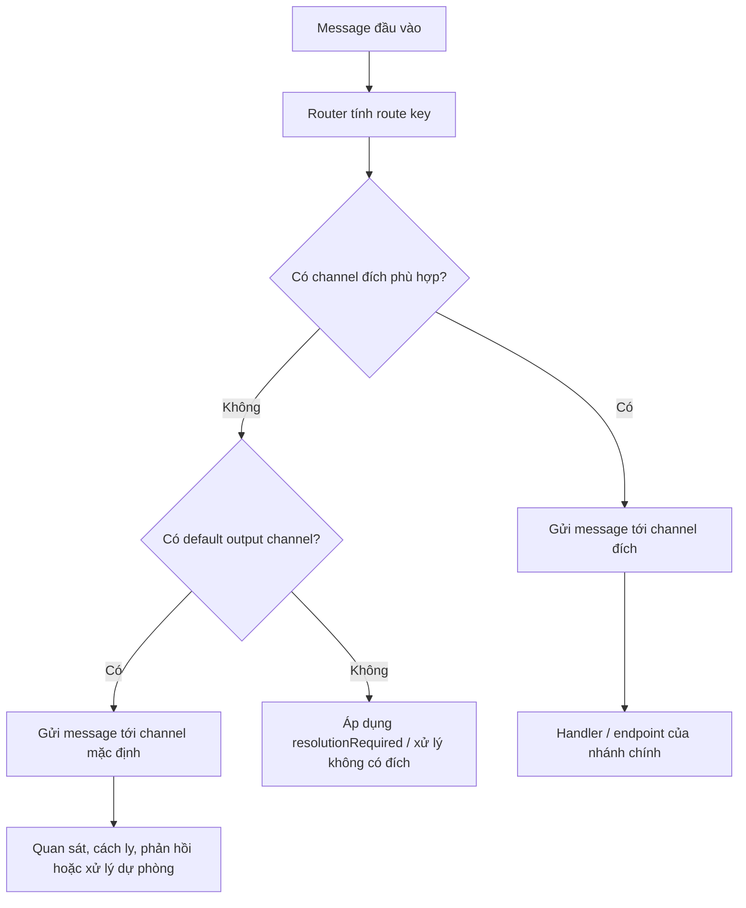
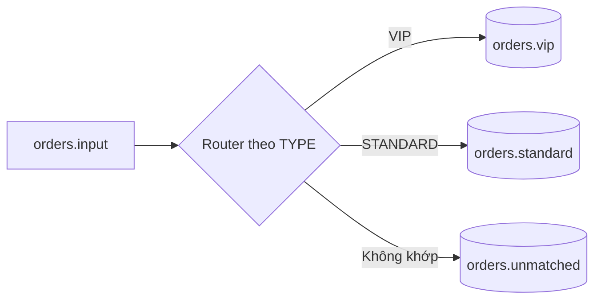
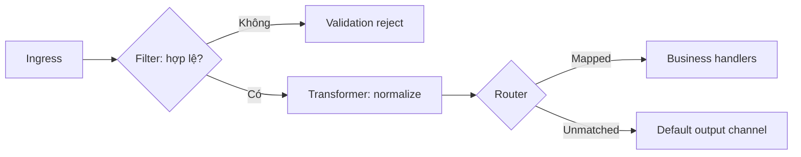
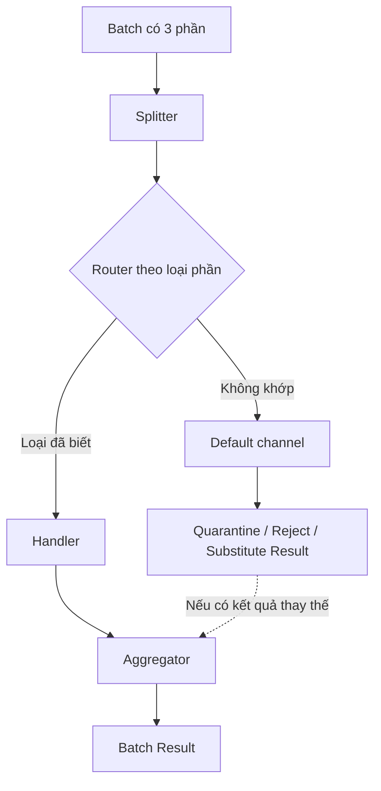

# Default output channel khi không có route trong Spring Integration

## Mục tiêu bài học

Trong hệ thống tích hợp, không phải message nào cũng khớp với một quy tắc định tuyến đã biết. Ví dụ, ứng dụng xử lý đơn hàng có hai tuyến `VIP` và `STANDARD` nhưng nhận một message gắn loại `WHOLESALE` vừa được hệ thống đối tác bổ sung. Nếu Router không xác định được channel đích, hệ thống phải có hành vi rõ ràng: từ chối, gửi đến một nơi xử lý dự phòng, hoặc chủ động loại bỏ.

**Default output channel** (kênh đầu ra mặc định) là một cấu hình của **Message Router** trong Spring Integration để tiếp nhận message khi Router **không tìm được channel đích phù hợp**. Đây là một cơ chế kiểm soát trường hợp không có route; bản thân kênh mặc định không tự động sửa lỗi nghiệp vụ, retry message hay gửi message đến dead-letter queue.

Bài học thuộc chương **Message router** trong module **SPRING_INTEGRATION_PATTERN**. Module thực hành Enterprise Integration Patterns để xây luồng thông điệp ít phụ thuộc và dễ mở rộng, kết hợp Router, Filter, Transformer, Splitter, Aggregator, Gateway, retry, error channel và correlation, đồng thời kiểm thử và theo dõi những nhánh xử lý.

Sau bài học, bạn có thể:

1. Mô tả chính xác khi nào Router sử dụng `defaultOutputChannel`.
2. Phân biệt route không khớp với lỗi gửi message hoặc lỗi handler sau khi route thành công.
3. Cấu hình kênh mặc định bằng Spring Integration Java DSL và chọn kiểu channel phù hợp.
4. Kiểm thử message hợp lệ đi đúng nhánh, message không khớp đi đến fallback và headers được bảo toàn.
5. Thiết kế xử lý message không nhận diện có kiểm soát: kiểm tra, ghi nhận, cảnh báo, cách ly hoặc phản hồi lỗi.
6. Tránh những sai lầm khi Router nằm trong Gateway, Splitter/Aggregator hoặc luồng có retry.

## 1. Bài toán: Router không tìm được nơi gửi message

Hãy xét một luồng đơn hàng:

```text
Inbound message
    |
    v
Message Router (đọc orderType)
    |--- VIP -----------> vipChannel
    |--- STANDARD ------> standardChannel
    |
    +--- WHOLESALE ???   không có mapping
```

Nếu ứng dụng mới chỉ định nghĩa hai mapping `VIP` và `STANDARD`, thông điệp `WHOLESALE` chưa có đích được cấu hình trong mô hình định tuyến. Có ba chính sách phổ biến:

| Chính sách | Hành vi | Khi nên chọn |
| --- | --- | --- |
| **Fail fast** | Router báo lỗi khi không có tuyến phù hợp | Sai loại message là lỗi hợp đồng, caller cần biết ngay |
| **Default output channel** | Chuyển message không khớp tới một channel dự phòng | Cần ghi nhận hoặc xử lý riêng loại chưa biết mà không làm mất message |
| **Discard có chủ đích** | Chuyển đến nơi loại bỏ sau khi đã xác nhận nghiệp vụ cho phép | Message không cần thiết, có thống kê và tiêu chí loại bỏ rõ |

Ví dụ một kênh `orders.unmatched` giúp quan sát và quyết định số phận của message chưa nhận diện. Không nên tự động chuyển mọi message lạ sang nhánh `STANDARD` nếu nhánh ấy thực thi nghiệp vụ thật: một loại đơn mới có thể bị xử lý sai mà không ai nhận ra.

### Khái niệm quan trọng

- **Route key**: giá trị mà Router tính từ payload hoặc header, ví dụ `VIP`, `STANDARD`, `WHOLESALE`.
- **Channel mapping**: ánh xạ một route key sang một channel, ví dụ `VIP -> orders.vip`.
- **Resolved destination**: channel đích mà Router thực sự xác định được sau khi áp dụng các quy tắc cấu hình.
- **Default output channel**: channel được Router dùng khi **không xác định được đích**; không phải nhánh có mức ưu tiên thấp hơn hay handler chữa mọi exception.

Một message có thể đã được định tuyến thành công nhưng handler ở channel đích ném exception. Trong trường hợp đó, Router không tự quay lại kênh mặc định; phải dùng cơ chế retry và error handling tương ứng.

## 2. Luồng quyết định của default output channel



Hãy hiểu biểu đồ này ở cấp **quyết định định tuyến**. Việc xác định channel đích có thể liên quan nhiều bước hơn so với tra cứu mapping: một số Router hỗ trợ giải tên channel từ route key và có lựa chọn `channelKeyFallback`.

Thứ tự thực tế và cách xử lý key không tồn tại phụ thuộc loại Router và cấu hình phiên bản Spring Integration đang dùng. Vì vậy, khi yêu cầu **chỉ cho phép các mapping tường minh**, cần kiểm soát việc giải route key thành tên channel, thay vì giả định key lạ chắc chắn đến default.

### Một tình huống cụ thể

```text
Mappings:
  VIP      -> orders.vip
  STANDARD -> orders.standard

Default:
  orders.unmatched

Route key tính ra:
  VIP       -> orders.vip
  STANDARD  -> orders.standard
  WHOLESALE -> orders.unmatched (khi không giải được channel khác)
  UNKNOWN   -> orders.unmatched (khi không giải được channel khác)
```

Đặt tên `orders.unmatched` nhấn mạnh rằng message **chưa có route được chấp nhận**; không hàm ý hệ thống đã xử lý thành công đơn hàng.

## 3. Default output channel khác các cấu hình dễ nhầm

| Cấu hình / cơ chế | Trả lời câu hỏi | Không đồng nghĩa với |
| --- | --- | --- |
| `defaultOutputChannel` | Khi không xác định được destination, Router gửi message đến đâu? | `errorChannel`, retry hoặc nhánh xử lý ngoại lệ |
| `resolutionRequired` | Router có yêu cầu phải tìm được channel đích hay không? | Tự tạo route mới hoặc tự gửi đến kênh mặc định |
| `channelKeyFallback` | Có cho phép dùng key làm tên channel khi không có mapping trực tiếp không? | Đường dự phòng nghiệp vụ |
| `ignoreSendFailures` | Với Router gửi đến nhiều đích, xử lý một số lỗi gửi ra sao? | Catch-all cho exception từ mọi handler |
| `errorChannel` | Thông điệp lỗi được chuyển vào cơ chế error flow trong bối cảnh có hỗ trợ error message như thế nào? | Nơi nhận tự động mọi route key không khớp |
| `nullChannel` | Chủ đích bỏ message được gửi đến channel này | Nơi lưu trữ hoặc audit message thất bại |

### Quan hệ với `resolutionRequired`

Nếu không có default output channel mà Router không tìm được nơi nhận, Router có thể ném lỗi định tuyến khi yêu cầu resolution (`resolutionRequired`) đang bật; nếu được cấu hình không bắt buộc resolution, message có thể kết thúc tại Router mà không có tuyến tiếp theo. Đây là những hành vi phải quyết định từ yêu cầu nghiệp vụ, kiểm chứng bằng test và quan sát được trong vận hành.

Khi **có** một default output channel hợp lệ, một message không có route có thể được chuyển tới kênh đó thay vì rơi vào chính sách không tìm được đích.

### Quan hệ với `channelKeyFallback`

Một số mapping router cho phép tìm channel bằng chính tên được route key trả về nếu không có mapping tường minh. Ví dụ, key `WHOLESALE` có thể vô tình khớp với bean channel cùng tên dù bạn chỉ khai báo mapping `VIP` và `STANDARD`.

Nếu yêu cầu vận hành là **bất cứ key nào ngoài danh sách cho phép đều phải vào `orders.unmatched`**, hãy cấu hình tắt fallback theo tên channel khi DSL/router đang dùng hỗ trợ, hoặc xác định hợp đồng route theo cách tường minh khác. Kiểm thử key lạ ngay cả khi hệ thống đã có các channel khác trong context.

## 4. Ví dụ Java DSL: Router có một channel mặc định

Ứng dụng ví dụ đọc chuỗi dạng `TYPE:ORDER_ID`:

```text
VIP:ORD-100
STANDARD:ORD-101
WHOLESALE:ORD-102
MALFORMED
```

Chúng ta thiết kế:

- `orders.input`: nhận yêu cầu.
- `orders.vip`: kênh cho VIP.
- `orders.standard`: kênh cho STANDARD.
- `orders.unmatched`: kênh tiếp nhận loại chưa được định tuyến.
- Một Router tính route key từ tiền tố chuỗi, chỉ chấp nhận hai mapping tường minh.

Để dễ thử nghiệm, ba output dùng `QueueChannel`: chúng ta có thể đọc chúng bằng `receive()` mà không cần khởi động handler chạy nền.



### Cấu hình Spring Integration

```java
import org.springframework.context.annotation.Bean;
import org.springframework.context.annotation.Configuration;
import org.springframework.integration.channel.DirectChannel;
import org.springframework.integration.channel.QueueChannel;
import org.springframework.integration.config.EnableIntegration;
import org.springframework.integration.dsl.IntegrationFlow;
import org.springframework.messaging.MessageChannel;
import org.springframework.messaging.PollableChannel;

@Configuration
@EnableIntegration
public class OrderRouterConfig {

    @Bean("orders.input")
    MessageChannel orderInput() {
        return new DirectChannel();
    }

    @Bean("orders.vip")
    PollableChannel vipQueue() {
        return new QueueChannel();
    }

    @Bean("orders.standard")
    PollableChannel standardQueue() {
        return new QueueChannel();
    }

    @Bean("orders.unmatched")
    PollableChannel unmatchedQueue() {
        return new QueueChannel();
    }

    @Bean
    IntegrationFlow orderRoutingFlow() {
        return IntegrationFlow.from("orders.input")
            .route(String.class, OrderRouterConfig::routeKey,
                spec -> spec
                    .channelMapping("VIP", "orders.vip")
                    .channelMapping("STANDARD", "orders.standard")
                    .channelKeyFallback(false)
                    .defaultOutputChannel("orders.unmatched"))
            .get();
    }

    private static String routeKey(String payload) {
        int separator = payload.indexOf(':');

        if (separator <= 0) {
            return "UNRECOGNIZED";
        }

        return payload.substring(0, separator);
    }
}
```

**Ý nghĩa các cấu hình:**

1. `IntegrationFlow.from("orders.input")` mở luồng bằng một input channel.
2. `route(String.class, OrderRouterConfig::routeKey, ...)` tính key từ payload dạng `String`.
3. `channelMapping("VIP", "orders.vip")` và `channelMapping("STANDARD", "orders.standard")` xác định các đích được cho phép.
4. `channelKeyFallback(false)` ngăn key chưa map được phân giải trực tiếp thành một tên channel có sẵn.
5. `defaultOutputChannel("orders.unmatched")` chỉ định nơi nhận nếu Router không xác định được channel đích.
6. `QueueChannel` không tự gọi handler. Trong bài kiểm thử, chúng ta đọc đầu ra chủ động.

Trong phiên bản Spring Integration Java DSL tương ứng, API cấu hình Router được cung cấp qua `RouterSpec`. Khi sử dụng Spring Integration với Spring Boot, bạn cần dependency Spring Integration và cấu hình tạo các bean tương ứng; ví dụ trên dùng cấu hình Java độc lập với Spring Boot.

### Message gửi vào flow

```java
import org.springframework.messaging.Message;
import org.springframework.messaging.support.MessageBuilder;

Message<String> input = MessageBuilder.withPayload("WHOLESALE:ORD-102")
    .setHeader("traceId", "trace-102")
    .setHeader("tenantId", "tenant-a")
    .build();

ordersInput.send(input);
```

Biến `ordersInput` là bean `MessageChannel` có tên `orders.input` được lấy từ Spring context. Với message này, Router trả route key `WHOLESALE`; không có mapping nào cho key đó và `channelKeyFallback` đã tắt, nên message được gửi đến `orders.unmatched`.

Điểm quan trọng: **payload và các header nghiệp vụ vẫn giữ nguyên** khi được Router chuyển sang channel phù hợp. Channel mặc định có thể đọc `traceId` để phân tích nguồn message và thông báo lại cho nơi gửi.

## 5. Kiểm thử các tuyến hợp lệ và kênh mặc định

Để chứng minh hành vi, test phải kiểm tra cả ba điều:

- Key đã map đi **đúng** channel.
- Key chưa map đi vào **kênh mặc định**.
- Các channel khác **không nhận thêm** message ngoài mong đợi.

Chúng ta dùng JUnit 5, Spring Test và AssertJ.

```java
import static org.assertj.core.api.Assertions.assertThat;

import org.junit.jupiter.api.Test;
import org.springframework.beans.factory.annotation.Autowired;
import org.springframework.beans.factory.annotation.Qualifier;
import org.springframework.messaging.Message;
import org.springframework.messaging.MessageChannel;
import org.springframework.messaging.PollableChannel;
import org.springframework.messaging.support.MessageBuilder;
import org.springframework.test.context.junit.jupiter.SpringJUnitConfig;

@SpringJUnitConfig(OrderRouterConfig.class)
class OrderRouterTest {

    @Autowired
    @Qualifier("orders.input")
    MessageChannel input;

    @Autowired
    @Qualifier("orders.vip")
    PollableChannel vip;

    @Autowired
    @Qualifier("orders.standard")
    PollableChannel standard;

    @Autowired
    @Qualifier("orders.unmatched")
    PollableChannel unmatched;

    private static Message<String> request(String body) {
        return MessageBuilder.withPayload(body)
            .setHeader("traceId", "trace-102")
            .setHeader("tenantId", "tenant-a")
            .build();
    }

    @Test
    void vipMessageUsesMappedChannel() {
        assertThat(input.send(request("VIP:ORD-100"))).isTrue();

        Message<?> received = vip.receive(2_000);
        assertThat(received).isNotNull();
        assertThat(received.getPayload()).isEqualTo("VIP:ORD-100");
        assertThat(standard.receive(0)).isNull();
        assertThat(unmatched.receive(0)).isNull();
    }

    @Test
    void standardMessageUsesMappedChannel() {
        assertThat(input.send(request("STANDARD:ORD-101"))).isTrue();

        Message<?> received = standard.receive(2_000);
        assertThat(received).isNotNull();
        assertThat(received.getPayload()).isEqualTo("STANDARD:ORD-101");
        assertThat(vip.receive(0)).isNull();
        assertThat(unmatched.receive(0)).isNull();
    }

    @Test
    void unknownKeyGoesToDefaultChannel() {
        assertThat(input.send(request("WHOLESALE:ORD-102"))).isTrue();

        Message<?> received = unmatched.receive(2_000);
        assertThat(received).isNotNull();
        assertThat(received.getPayload())
            .isEqualTo("WHOLESALE:ORD-102");
        assertThat(received.getHeaders().get("traceId"))
            .isEqualTo("trace-102");
        assertThat(received.getHeaders().get("tenantId"))
            .isEqualTo("tenant-a");

        assertThat(vip.receive(0)).isNull();
        assertThat(standard.receive(0)).isNull();
    }

    @Test
    void malformedTypeAlsoGoesToDefaultChannel() {
        assertThat(input.send(request("MALFORMED"))).isTrue();

        Message<?> received = unmatched.receive(2_000);
        assertThat(received).isNotNull();
        assertThat(received.getPayload()).isEqualTo("MALFORMED");
        assertThat(vip.receive(0)).isNull();
        assertThat(standard.receive(0)).isNull();
    }
}
```

Test sử dụng `DirectChannel` để route đồng bộ trước khi assert, và queue chưa có poller khác tiêu thụ. Nếu ứng dụng chuyển các kênh này sang bất đồng bộ, việc gọi `receive(0)` ở kênh khác không đủ để chứng minh tuyệt đối rằng message không bao giờ đến muộn; cần phép đo và thời hạn quan sát thích hợp.

**Không gộp tất cả trường hợp vào một test duy nhất nếu muốn chỉ rõ trường hợp nào thất bại.** Khi dùng cùng Spring test context, phải rút hết các message trong queue hoặc cấu hình cô lập trạng thái nếu test có thể chạy song song.

### Bổ sung test quan trọng

Nên kiểm thử thêm:

1. Một route key chỉ khác chữ hoa/thường, ví dụ `vip`, bị đưa vào kênh mặc định nếu chính sách phân loại phân biệt chữ.
2. Message có loại vừa được bổ sung trong enum nghiệp vụ nhưng chưa có mapping ở Router.
3. Payload đầu vào được chuẩn hóa trước khi tính key để tránh lỗi do khoảng trắng.
4. Header `traceId` và mã nghiệp vụ ở các nhánh được giữ đúng.
5. Không có consumer tại kênh mặc định thì queue có thể tăng; cần capacity và giám sát hoặc handler tiếp nhận.

## 6. Chọn ý nghĩa nghiệp vụ cho kênh mặc định

**Fallback về mặt định tuyến chưa phải fallback về mặt nghiệp vụ.** Một message chưa có route cần một chính sách tiếp nhận có trách nhiệm. Có ít nhất bốn thiết kế:

| Thiết kế kênh mặc định | Cách xử lý | Hệ quả |
| --- | --- | --- |
| **Quarantine channel** | Ghi nhận message và lý do chưa nhận diện để kiểm tra | Tốt cho đối tác gửi thêm loại message mới |
| **Validation/rejection channel** | Xây phản hồi lỗi có cấu trúc cho caller | Phù hợp Gateway/API đồng bộ |
| **Audit-only channel** | Đếm và ghi sự kiện không khớp với dữ liệu đã ẩn nhạy cảm | Phù hợp nếu nghiệp vụ chủ động cho phép bỏ message sau khi ghi nhận |
| **Compatibility channel** | Biến đổi và định tuyến tiếp khi một số loại cũ có thể chuẩn hóa | Phù hợp giai đoạn chuyển đổi phiên bản, phải có whitelist |

Một kênh tên `orders.unmatched` thường phù hợp hơn đặt nhãn `orders.error` vì “không có route” có thể không phải exception. Nếu message bị sai hợp đồng, handler ở kênh mặc định **có thể chủ động trả lỗi** hoặc gửi vào error flow; đó là quyết định của ứng dụng.

### Đừng nuốt message mặc định

Một `QueueChannel` không có consumer sẽ tích lũy message. Trong ví dụ học tập điều này giúp kiểm thử, nhưng khi vận hành cần ít nhất:

- Có handler hoặc poller để xử lý message đang chờ.
- Giới hạn capacity của queue hoặc chọn message store thích hợp.
- Quy tắc retention, retry và cách xử lý khi kênh dự phòng cũng gặp lỗi.
- Metric theo số lượng message không khớp và loại key.
- Không log toàn bộ payload hoặc header có dữ liệu nhạy cảm.

Khi có nhiều nhóm message chưa nhận diện, một Router khác có thể tiếp tục phân loại tại kênh mặc định, ví dụ chuyển sang review hoặc quarantine. Tuy nhiên, phải có điểm dừng rõ để tránh vòng lặp giữa các route mặc định.

## 7. Kết hợp Filter, Transformer và Router

Một thiết kế thông dụng gồm ba bước:



Phân biệt ba tình huống:

- **Invalid input**: dữ liệu thiếu trường bắt buộc hoặc không đúng kiểu; Filter/validator có thể từ chối trước khi route.
- **Valid but unsupported type**: dữ liệu có cấu trúc đúng nhưng loại chưa được hỗ trợ; Router đưa tới default output channel.
- **Mapped type but processing failed**: Router đã tìm được destination, nhưng handler lỗi; xử lý qua exception/retry/error flow.

Ba tình huống có ý nghĩa nghiệp vụ và cách báo cáo khác nhau. Không đẩy lỗi xác thực hoặc exception vào default channel một cách ngầm định.

### Ví dụ chuẩn hóa route key

Khi input lấy từ nhiều đối tác, thay vì route trực tiếp bằng chuỗi, bạn có thể dùng một DTO:

```java
record IncomingOrder(String orderId, String type, String source) {}

String normalizedType(IncomingOrder order) {
    if (order.type() == null) {
        return "UNRECOGNIZED";
    }

    return order.type().trim().toUpperCase(java.util.Locale.ROOT);
}
```

Sau đó Router tính key từ `IncomingOrder` và map các giá trị chuẩn hóa; dữ liệu không hợp lệ về mặt cấu trúc nên được kiểm tra trước khi định tuyến. Quan trọng là **không coi route key nhận từ client là đáng tin tuyệt đối** nếu nó quyết định những thao tác có quyền hạn khác nhau.

## 8. Default channel với nhiều đích định tuyến

Không phải Router nào cũng chỉ trả một channel. Recipient-list router hoặc Router có nhiều channel đích có thể gửi một message tới nhiều nhánh. Với trường hợp ấy:

- Một số recipient hợp lệ và một số không hợp lệ **không đồng nghĩa** với “không có route”.
- `defaultOutputChannel` là giải pháp khi Router **không xác định được đích phù hợp**, không phải nơi nhận bản sao của mọi message đã được route.
- `ignoreSendFailures` có ý nghĩa riêng đối với quá trình gửi tới nhiều recipient và không biến default channel thành một catch-all cho lỗi gửi.
- Muốn audit mọi message, sử dụng một nhánh publish/subscribe hoặc wire tap được thiết kế riêng, không trông chờ default channel.

Để kiểm thử, cần xác nhận chính xác yêu cầu **số người nhận**: một message được route tới một kênh, nhiều recipient hợp lệ, hay không có recipient nào. Nếu một handler cần kết quả tổng hợp từ nhiều nhánh, phải thiết kế correlation và Aggregator thay vì mặc định coi Router đã hoàn tất workflow.

## 9. Gateway: không có route và hợp đồng phản hồi

Một Gateway dạng request-reply thường chờ kết quả hoặc exception để trả cho caller. Nếu message không khớp route, có ba kịch bản:

1. **Default channel có handler trả reply**: Gateway có thể nhận phản hồi mang nội dung “unsupported order type”.
2. **Default channel chỉ ghi audit và không trả reply**: Gateway có thể chờ đến `replyTimeout` vì đường xử lý không sinh kết quả.
3. **Router yêu cầu resolution, không có default và không tìm được route**: lỗi có thể truyền về caller khi đường xử lý đồng bộ, hoặc đi vào cơ chế error handling đã cấu hình.

Vì vậy, khi kết nối Router với Gateway, nên thiết kế response hoặc exception rõ cho trường hợp unsupported.

Một phản hồi nghiệp vụ có thể biểu đạt:

```json
{
  "status": "REJECTED",
  "code": "UNSUPPORTED_ORDER_TYPE",
  "orderId": "ORD-102",
  "message": "Order type WHOLESALE is not supported"
}
```

Đây chỉ là ví dụ hợp đồng ứng dụng, không phải payload mặc định do Spring Integration tự sinh. Khi dùng một chiều qua broker, thay vì trả reply, ứng dụng có thể phát một event lỗi hoặc lưu message chờ xem xét.

**Lưu ý:** Một channel dự phòng chứa `QueueChannel` sẽ không trả reply chỉ vì có message trong hàng đợi. Cần consumer/poller tạo response nếu Gateway phải nhận kết quả.

## 10. Splitter, Aggregator và correlation khi có kênh dự phòng

Giả sử Splitter tạo ba message con, mỗi message đi qua Router:



Nếu hai phần được xử lý bình thường nhưng một phần bị đưa vào quarantine và **không phát kết quả**, Aggregator có thể chỉ nhận 2/3 message trong khi `sequenceSize=3`. Nó sẽ không release theo điều kiện đủ số nếu phần còn lại không tới.

Các lựa chọn:

- **Kết quả thay thế**: nhánh default tạo một `PartResult(status=UNSUPPORTED)` mang đủ correlation/sequence để Aggregator nhận biết và trả báo cáo tổng hợp có lỗi.
- **Release strategy tùy chỉnh**: cho phép hoàn tất khi có marker kết thúc, timeout hoặc điều kiện nghiệp vụ; phân biệt kết quả đủ và thiếu.
- **Chia nhóm ngay từ đầu**: Router đưa unsupported vào một group khác, hoặc từ chối batch trước Splitter nếu không thể chấp nhận thiếu.
- **Hủy có kiểm soát**: đưa batch vào trạng thái thất bại rõ ràng và dọn message group theo chính sách.

**Đừng chỉ đưa message không khớp vào default rồi nghĩ rằng Aggregator vẫn đủ phần.** Thiết kế định tuyến phải đi cùng thiết kế correlation, group completion và idempotency.

### Những header cần giữ

Với các message con, nên quy định rõ việc truyền:

| Header | Vì sao cần |
| --- | --- |
| `traceId` | Theo dõi cùng một batch qua các nhánh |
| `batchId` / `orderId` | Liên kết theo khóa nghiệp vụ ổn định |
| `correlationId` | Gom các message thuộc cùng một nhóm |
| `sequenceNumber` | Xác định phần tử nào đã được xử lý |
| `sequenceSize` | Hỗ trợ chính sách đợi đủ các phần khi biết trước số lượng |
| `originalType` | Cho phép phân tích trường hợp message bị route vào nhánh mặc định |

Khi handler tạo message mới, cần kiểm tra header nào được giữ; đừng dựa vào `id` hoặc `timestamp` để nối log vì chúng có thể thay đổi theo vòng đời của message.

## 11. Retry và error channel: giới hạn của default output

### Trường hợp 1 — Không có route

```text
routeKey = WHOLESALE
mapping = {VIP, STANDARD}
default = orders.unmatched
    |
    v
orders.unmatched
```

Đây là trường hợp default output channel giải quyết.

### Trường hợp 2 — Route đúng nhưng handler thất bại

```text
routeKey = VIP
    |
    v
orders.vip --> VIP handler --> exception
```

Router đã xác định được destination là `orders.vip`. Khi handler phía sau ném exception, message **không tự bị định tuyến lại** sang `orders.unmatched`. Ứng dụng cần retry, error channel hoặc phản hồi lỗi theo loại channel và kiểu endpoint.

### Trường hợp 3 — Kênh đích từ chối hoặc không gửi được

Ví dụ một channel có capacity đã đầy hoặc consumer không sẵn sàng. Đây là vấn đề **delivery**. Một default output channel dành cho trường hợp **không giải quyết được route** không thể được xem là bộ điều phối retry tổng quát cho các lỗi này. Nếu business cần gửi sang kênh dự phòng khi delivery thất bại, phải thiết kế logic chuyển tuyến có kiểm soát, cân nhắc trùng lặp và khả năng message đã được handler xử lý một phần.

### Retry nào hợp lý?

Thông thường, gửi đi gửi lại một message có loại `WHOLESALE` vào Router với cùng cấu hình mapping vẫn cho kết quả `unmatched`. Retry chỉ hữu ích nếu điều kiện có thể thay đổi, ví dụ mapping được cập nhật hoặc handler downstream đang gặp lỗi tạm thời.

Đối với loại không hỗ trợ, nên xác định quy trình **quarantine → đánh giá → cập nhật routing rule → replay** với khóa idempotency và kiểm soát version. Không đưa các message này vào vòng retry vô hạn.

### ErrorChannel khác default channel

Spring Integration có thể biểu diễn lỗi thành `ErrorMessage` trong luồng lỗi bất đồng bộ hoặc các thành phần phát error message. Hãy kiểm tra `failedMessage` khi exception cung cấp và truyền `traceId` để quan sát. Default channel không tự động nhận mọi `ErrorMessage`; đó là luồng xử lý lỗi riêng.

## 12. Quan sát và vận hành channel mặc định

Khi đưa default output channel vào hệ thống thực tế, cần theo dõi một số chỉ số:

| Chỉ số | Ý nghĩa |
| --- | --- |
| `router_unmatched_total{routeKey}` | Số message chưa tìm được đích theo loại key |
| `router_unmatched_rate` | Tốc độ xuất hiện loại chưa hỗ trợ; phát hiện thay đổi phía upstream |
| `router_default_queue_depth` | Số message đang chờ trong kênh mặc định |
| `router_unmatched_age` | Message lâu nhất chưa được xử lý |
| `router_default_handler_errors_total` | Lỗi khi xử lý/quarantine ở nhánh mặc định |
| `router_replayed_total` | Số message được replay sau khi cập nhật rule |
| `router_unmatched_result_total{outcome}` | Số message đã reject, replay hoặc xử lý được |

Đây là **tên metric do ứng dụng có thể định nghĩa**, không khẳng định Spring Integration tự động xuất chúng. Có thể kết hợp Micrometer/observation, structured logging và kiểm tra queue depth tùy dự án.

Một log đã lọc dữ liệu nhạy cảm có thể là:

```text
traceId=trace-102 orderId=ORD-102 event=route_unmatched
routeKey=WHOLESALE destination=orders.unmatched source=checkout
```

Không ghi token, credential hoặc payload chứa dữ liệu cá nhân vào log chỉ vì đi qua kênh mặc định. Nếu cần replay, dùng storage có chính sách truy cập và thời gian lưu rõ ràng.

### Khi nào phải cảnh báo?

- Lượng message chưa khớp tăng bất thường ngay sau deploy.
- Bắt đầu xuất hiện route key không được whitelist.
- Queue mặc định đầy hoặc không có consumer.
- Một message chờ xử lý quá SLA.
- Replay liên tục nhưng cùng một key vẫn không có mapping.

Một chỉ số tổng “số message đã route” là chưa đủ: cần phân biệt **mapped**, **unmatched**, **delivery failed** và **business failed**.

## 13. Sai lầm phổ biến và cách khắc phục

| Triệu chứng | Nguyên nhân thường gặp | Cách xử lý |
| --- | --- | --- |
| Key lạ vẫn đi vào một channel bất ngờ | Router có channel-key fallback theo tên bean | Kiểm soát `channelKeyFallback` và test mapping |
| Không tìm thấy message trong default queue | Router đã resolve một channel khác; hoặc một handler/poller đã tiêu thụ | Kiểm tra route key, mapping, subscriber và số message đã nhận |
| Message không có route bị mất | Không có default, cấu hình cho phép không resolve hoặc routing khác làm rơi message | Xác định fail-fast/default và bổ sung metric |
| VIP handler lỗi nhưng default không nhận | Default chỉ xử lý trường hợp không tìm được destination | Cấu hình retry/error flow cho handler |
| Gateway timeout với message không nhận diện | Default channel chỉ lưu message, không trả reply | Có reject reply/error message rõ ràng |
| Aggregator chờ mãi | Nhánh default không tạo kết quả phần tử | Kết quả thay thế, custom release hoặc fail group |
| Default queue phình to | Không có consumer/retention/capacity | Thêm handler, capacity, storage, cảnh báo |
| Cùng message bị replay nhiều lần | Thiếu idempotency key hoặc trạng thái replay | Định danh message nghiệp vụ và kiểm tra kết quả xử lý |
| Route theo header không đáng tin | Header do client gửi không được xác thực | Chuẩn hóa và xác thực tại ingress |

## 14. Bài tập thực hành

### Bài 1 — Cấu hình kênh mặc định

Dùng `OrderRouterConfig` ở mục 4 và gửi:

```text
VIP:ORD-1
STANDARD:ORD-2
WHOLESALE:ORD-3
MALFORMED
```

Kiểm tra `orders.vip` nhận đúng một message, `orders.standard` nhận đúng một message và `orders.unmatched` nhận hai message. Đảm bảo mỗi message vẫn có header `traceId` như đầu vào.

### Bài 2 — So sánh fail-fast và default

Trong một cấu hình **thử nghiệm độc lập**, bỏ default output channel và bật `resolutionRequired`. Gửi route key không hợp lệ và ghi nhận exception. Sau đó cấu hình lại default channel và quan sát sự khác biệt. Tránh tái sử dụng cùng context với các queue còn message tồn.

### Bài 3 — Kiểm soát channel-key fallback

Tạo một channel có tên trùng với route key chưa map. Thử Router với `channelKeyFallback` bật và tắt, quan sát kết quả. Giải thích vì sao mapping whitelist và test route lạ quan trọng trong hệ thống có nhiều bean channel.

### Bài 4 — Validation trước Router

Thay payload chuỗi bằng `IncomingOrder`. Dùng Filter hoặc validator từ chối đơn thiếu `orderId`; dùng Router để phân loại loại đơn có cấu trúc hợp lệ. Phân biệt reject do validation với unmatched do chưa hỗ trợ loại đơn.

### Bài 5 — Gateway có phản hồi lỗi

Tạo Gateway gọi Router và một handler ở `orders.unmatched` sinh DTO lỗi `UNSUPPORTED_ORDER_TYPE`. Kiểm tra caller nhận phản hồi trong timeout hợp đồng, thay vì chờ một queue không có consumer.

### Bài 6 — Splitter/Aggregator và fallback

Tách một batch thành ba phần, trong đó một phần có loại chưa hỗ trợ. Thử phương án default channel phát `PartResult(status=UNSUPPORTED)` để Aggregator vẫn đủ số phần. Kiểm tra `correlationId`, `sequenceNumber` và kết quả nhóm tổng hợp.

### Bài 7 — Quan sát và replay

Thêm metric đếm unmatched theo route key, lưu sự kiện tối thiểu để replay; sau đó bổ sung mapping cho một route key mới và chạy replay có idempotency. Bảo đảm không xử lý trùng các nghiệp vụ đã hoàn thành trước đó.

## 15. Checklist thiết kế

Trước khi kết nối Message Router với ứng dụng thật, hãy tự trả lời:

1. **Tập route key hợp lệ** là gì và ai có quyền thêm loại mới?
2. **Mapping tường minh** có bao phủ tất cả giá trị đã hỗ trợ không?
3. **Channel-key fallback** có thể giải một key lạ thành channel có sẵn không?
4. Khi **không có route**, nên fail fast, dùng default channel hay chủ động discard?
5. **Default channel** có consumer, capacity, retry, retention và giám sát chưa?
6. Message ở nhánh default cần **reply** (Gateway), lưu chờ xử lý hay phát event?
7. **Delivery error** và **handler error** đã có cơ chế riêng chưa?
8. Nếu message là một phần của batch, **correlation/release** của Aggregator còn đúng không?
9. Có kiểm thử **mapped, unmatched, malformed, fallback by key, header propagation** không?
10. Có **traceId, business key và idempotency key** để quan sát/replay an toàn không?

### Ghi nhớ

**Default output channel là điểm nhận message khi Router không xác định được tuyến đích.** Nó giúp biến trường hợp “không biết đưa message đi đâu” thành một nhánh có thể quan sát và xử lý bằng quy tắc rõ ràng. Hãy phân biệt sự kiện **không có route** với lỗi xử lý sau khi route thành công, kiểm soát việc phân giải channel từ route key và thiết kế đầy đủ consumer, timeout, phản hồi, retry, correlation và giám sát. Một fallback được kiểm thử đúng giúp hệ thống Spring Integration mở rộng loại message an toàn mà không âm thầm đưa dữ liệu vào nhánh nghiệp vụ sai.
