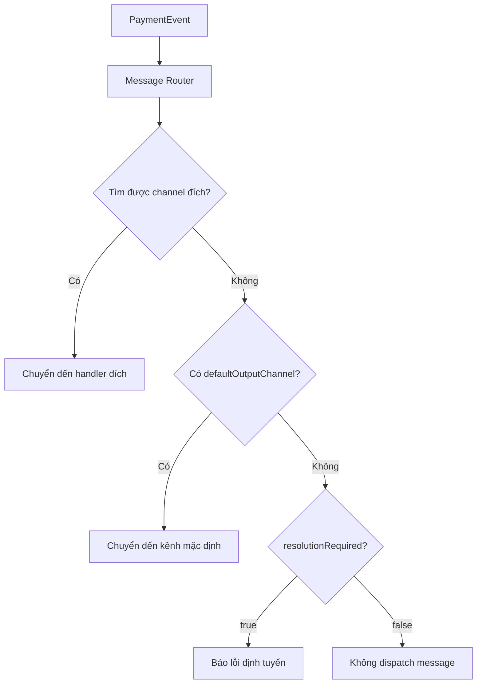
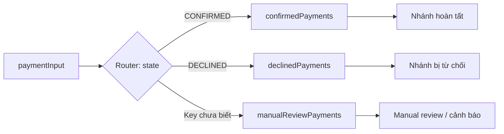
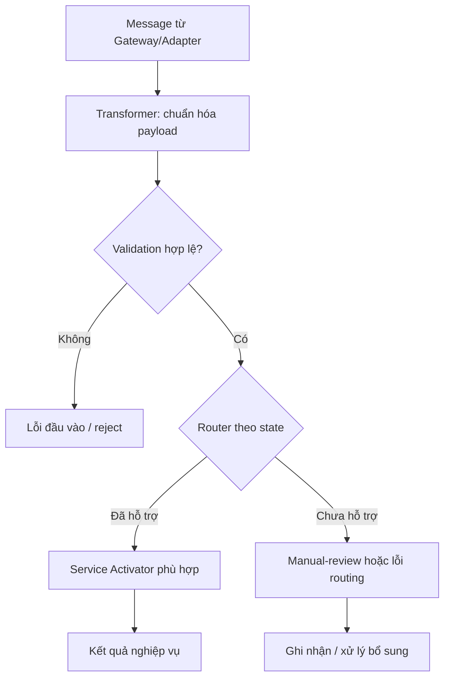
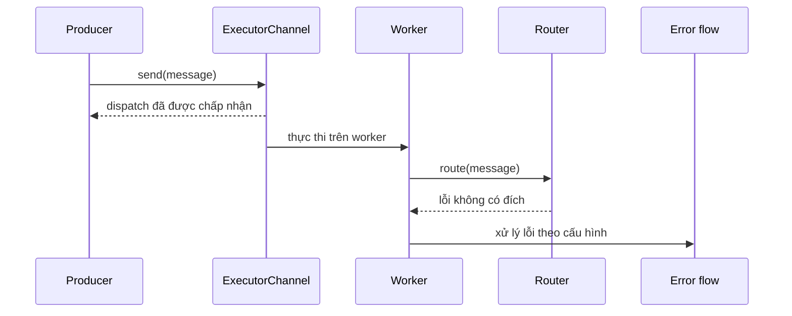
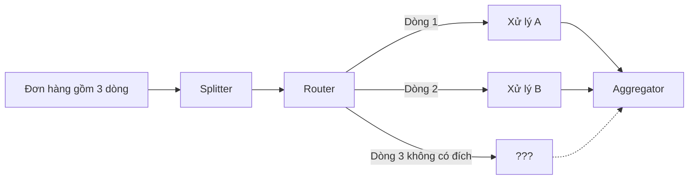

# Resolution required và message không có đích trong Spring Integration

> **Chương:** Message router  
> **Bài học:** Resolution required và message không có đích  
> **Bối cảnh:** Enterprise Integration Patterns với Spring Integration để xây dựng luồng thông điệp ít phụ thuộc, có thể mở rộng bằng Router, Filter, Transformer, Splitter, Aggregator, Gateway, retry, error channel, correlation và công cụ quan sát.

## 1. Vấn đề: Router không tìm thấy nơi chuyển message

Một hệ thống nhận thông điệp thanh toán rồi chọn nhánh dựa trên trạng thái:

- `CONFIRMED` → xử lý thanh toán thành công.
- `DECLINED` → xử lý thanh toán bị từ chối.
- `PENDING_REVIEW` → hệ thống chưa có nhánh tương ứng.

Với trạng thái cuối cùng, Router sẽ làm gì? Ném exception, đưa vào kênh dự phòng hay bỏ message? Nếu bỏ qua tình huống này, message có thể biến mất khỏi luồng nghiệp vụ hoặc người gọi phải đợi reply cho đến khi timeout.



Trong Spring Integration, **`resolutionRequired`** là cấu hình quan trọng của Router để quy định hành vi khi **không thể xác định được kênh đầu ra**. Hiểu đúng cấu hình này giúp tránh mất message âm thầm, đồng thời cho phép thiết kế chính sách rõ ràng cho message chưa phân loại.

Mục tiêu bài học:

1. Phân biệt **routing key**, **channel mapping** và **channel đích thực tế**.
2. Hiểu `resolutionRequired`, `defaultOutputChannel` và `channelKeyFallback`.
3. Thiết kế nhánh lỗi hoặc nhánh dự phòng có thể quan sát và kiểm thử.
4. Phân biệt lỗi **không có đích** với lỗi **gửi tới đích thất bại**.
5. Kết hợp Router với Filter, Gateway, retry, error channel và correlation.

## 2. Router quyết định đích như thế nào?

Message Router là một Enterprise Integration Pattern lựa chọn đích đến của message dựa trên nội dung payload, headers hoặc quy tắc riêng.

Ví dụ:

```text
Message<PaymentEvent>
  payload: PaymentEvent("PAY-001", "CONFIRMED")
  headers: {businessKey: "PAY-001", traceId: "trace-a1"}

                         |
                         v
                    Router đọc state
                         |
                         v
               Routing key = CONFIRMED
                         |
                         v
          channelMapping("CONFIRMED", "confirmedPayments")
                         |
                         v
                  confirmedPayments
```

Ba khái niệm cần tách bạch:

| Thành phần | Ví dụ | Ý nghĩa |
| --- | --- | --- |
| **Routing key** | `CONFIRMED` | Giá trị do Router tính từ message |
| **Channel mapping** | `CONFIRMED → confirmedPayments` | Cấu hình ánh xạ key sang tên/kênh |
| **MessageChannel đích** | Bean `confirmedPayments` | Đối tượng nhận message thực tế |

Routing key **không nhất thiết** phải trùng với tên channel. Sự tách biệt này cho phép thay đổi tên channel hoặc tổ chức flow mà không yêu cầu payload nghiệp vụ đổi theo.

Một key không có mapping chưa chắc ngay lập tức dẫn đến lỗi: Router có thể thử giải quyết key như tên channel nếu cho phép **channel-key fallback**, hoặc chuyển tới **default output channel** khi không có đích phù hợp.

## 3. `resolutionRequired` dùng để làm gì?

Với các Router dựa trên cơ chế định tuyến của Spring Integration, `resolutionRequired` điều khiển phản ứng khi **không phân giải được đích**.

- **`resolutionRequired = true`:** nếu không có output channel nào được phân giải và không có fallback/default phù hợp, Router phát sinh lỗi định tuyến thay vì bỏ message. Đây là lựa chọn phù hợp với thông điệp quan trọng cần kiểm soát.
- **`resolutionRequired = false`:** Router được phép không dispatch message khi không tìm được đích. Message không đến một handler nghiệp vụ nào; ứng dụng cần tự thiết kế quan sát nếu chủ đích loại bỏ.

Trong các Router chuẩn của Spring Integration, hành vi mặc định thường yêu cầu phân giải đích; khi thiết kế một flow quan trọng, nên thể hiện `resolutionRequired(true)` tường minh để người đọc thấy rõ hợp đồng.

**Cần phân biệt:** cấu hình này giải quyết vấn đề **không có kênh được chọn**, không chứng minh rằng channel nhận thành công hay handler đã xử lý xong nghiệp vụ.

Ví dụ: Router chọn được `confirmedPayments` nhưng channel này không có subscriber hoặc executor phía sau đã hết năng lực. Đó là lỗi dispatch/delivery, không phải trường hợp thuần túy “không tìm được đích”.

### Vì sao bỏ message âm thầm dễ gây nguy hiểm?

Giả sử service nhận 1.000 lệnh thanh toán:

```text
CONFIRMED       800
DECLINED        150
PENDING_REVIEW   50
-------------------
Tổng          1.000
```

Nếu Router chỉ biết hai trạng thái đầu và `resolutionRequired=false`, 50 message còn lại có thể không đi đến xử lý tiếp. Sender vẫn có thể thấy việc gửi vào flow đã hoàn tất bình thường. Không có cơ chế theo dõi sẽ khiến việc đối soát thiếu 50 giao dịch.

Với các message có giá trị nghiệp vụ cao, nên chọn một trong hai chính sách minh bạch: **fail fast** để báo lỗi, hoặc **đưa vào kênh dự phòng** để ghi nhận và xử lý sau.

## 4. Ba cấu hình cần phân biệt

| Cấu hình | Trách nhiệm | Khi nào sử dụng |
| --- | --- | --- |
| `resolutionRequired` | Quy định có phải báo lỗi khi không giải quyết được output channel | Bắt buộc định tuyến hoặc cho phép message không có đích |
| `defaultOutputChannel` | Chỉ định kênh dự phòng khi không tìm được đích theo quy tắc | Manual review, quarantine hoặc nhánh xử lý chưa phân loại |
| `channelKeyFallback` | Cho phép sử dụng routing key như tên channel nếu không có mapping tường minh | Bật khi tên channel chính là một phần hợp đồng; tắt khi muốn whitelist routing keys |

Ví dụ bảng quyết định:

| Routing key | Mapping tường minh | Fallback theo tên key | Default channel | Kết quả |
| --- | --- | --- | --- | --- |
| `CONFIRMED` | Có | Không cần | Có hoặc không | Đến channel đã map |
| `PENDING_REVIEW` | Không | Tắt | Có | Đến default channel |
| `PENDING_REVIEW` | Không | Tắt | Không, `resolutionRequired=true` | Báo lỗi |
| `PENDING_REVIEW` | Không | Tắt | Không, `resolutionRequired=false` | Không dispatch |
| `otherChannel` | Không | Bật; bean channel tồn tại | Có hoặc không | Có thể được resolve theo tên channel |

Bảng trình bày trường hợp thông thường khi Router chỉ cần chọn một đích. Với Router đa đích, số channel có thể lớn hơn một; cần kiểm tra cơ chế phân giải và gửi của loại Router cụ thể.

### Thứ tự tư duy

1. Router tính một key hoặc một tập key.
2. Router tìm mapping nếu đã cấu hình.
3. Nếu cho phép, Router có thể dùng key làm tên channel cần phân giải.
4. Nếu không có đích phù hợp, Router xét kênh mặc định.
5. Khi vẫn không có đích, `resolutionRequired` quyết định việc báo lỗi hay bỏ qua.

Đừng nhầm **default output channel** với **default business result**. Đưa message sang manual-review channel không có nghĩa thanh toán đã thành công.

## 5. Ví dụ hoàn chỉnh: Router với kênh xử lý dự phòng

Ví dụ dùng **Spring Integration Java DSL**. Một ứng dụng nhận `PaymentEvent` có `state`. Hai trạng thái đã biết đi đến channel chuyên biệt; mọi trạng thái chưa được hỗ trợ đi tới `manualReviewPayments`.

Để dễ quan sát trong bài học, các đích là `QueueChannel`. Trong hệ thống thật, chúng có thể là `DirectChannel` với Service Activator, hoặc là channel được poller/adapter tiêu thụ.

### 5.1. Cấu hình Router

```java
package example.integration;

import org.springframework.context.annotation.Bean;
import org.springframework.context.annotation.Configuration;
import org.springframework.integration.channel.DirectChannel;
import org.springframework.integration.channel.QueueChannel;
import org.springframework.integration.config.EnableIntegration;
import org.springframework.integration.dsl.IntegrationFlow;
import org.springframework.messaging.MessageChannel;

@Configuration
@EnableIntegration
public class PaymentRouterConfiguration {

    public record PaymentEvent(String paymentId, String state) {}

    @Bean
    public MessageChannel paymentInput() {
        return new DirectChannel();
    }

    @Bean
    public QueueChannel confirmedPayments() {
        return new QueueChannel();
    }

    @Bean
    public QueueChannel declinedPayments() {
        return new QueueChannel();
    }

    @Bean
    public QueueChannel manualReviewPayments() {
        return new QueueChannel();
    }

    @Bean
    public IntegrationFlow paymentRoutingFlow() {
        return IntegrationFlow.from("paymentInput")
            .route(
                PaymentEvent.class,
                PaymentEvent::state,
                spec -> spec
                    .channelMapping("CONFIRMED", "confirmedPayments")
                    .channelMapping("DECLINED", "declinedPayments")
                    .channelKeyFallback(false)
                    .defaultOutputChannel("manualReviewPayments")
                    .resolutionRequired(true)
            )
            .get();
    }
}
```

Giải thích:

- `PaymentEvent::state` lấy routing key từ payload.
- `channelMapping(...)` ánh xạ hai trạng thái được công nhận.
- `channelKeyFallback(false)` buộc định tuyến tuân thủ các key đã map, tránh việc một key chưa khai báo vô tình trùng tên bean channel rồi được dùng làm đích.
- `defaultOutputChannel("manualReviewPayments")` đưa message còn lại sang nhánh xử lý riêng.
- `resolutionRequired(true)` nhấn mạnh chính sách phải tìm được đích; với message không khớp mapping, kênh mặc định đã giải quyết vấn đề này.

**Điểm cần nhớ:** đặt đồng thời `resolutionRequired(true)` và `defaultOutputChannel(...)` là hợp lệ về mặt ý tưởng. Với default channel có thể resolve, Router không phải báo lỗi chỉ vì routing key lạ. Để *key lạ thực sự gây lỗi*, hãy bỏ default channel và tắt fallback theo key.

Với `QueueChannel`, gửi message vào queue chỉ có nghĩa message đang nằm trong bộ nhớ của ứng dụng, chờ người nhận poll. Bài học dùng nó để kiểm tra output; môi trường thực tế cần poller/consumer và cơ chế lưu bền vững nếu có yêu cầu không mất message khi ứng dụng dừng.

### 5.2. Message đến từng đích



Ví dụ logic:

| Payload | Kênh nhận | Lý do |
| --- | --- | --- |
| `PaymentEvent("PAY-1", "CONFIRMED")` | `confirmedPayments` | Có mapping tường minh |
| `PaymentEvent("PAY-2", "DECLINED")` | `declinedPayments` | Có mapping tường minh |
| `PaymentEvent("PAY-3", "PENDING_REVIEW")` | `manualReviewPayments` | Không có mapping, đi default |
| `PaymentEvent("PAY-4", null)` | `manualReviewPayments` | Không có key có thể map, dùng default |

Ở hệ thống thật, cần kiểm tra và chuẩn hóa null/giá trị lạ trước khi ra quyết định nghiệp vụ; default channel là nơi ghi nhận vấn đề, không phải cơ chế xác thực đầu vào.

## 6. Chính sách fail fast: khi thiếu đích phải báo lỗi

Có những hệ thống mà trạng thái ngoài danh sách cho phép là vi phạm hợp đồng. Ví dụ sự kiện tài chính từ một đối tác cam kết chỉ phát `CONFIRMED` hoặc `DECLINED`. Nếu xuất hiện trạng thái khác, cần báo lỗi để đội tích hợp điều tra ngay.

Có thể thay cấu hình Router trong mục 5 bằng biến thể:

```java
@Bean
public IntegrationFlow strictPaymentRoutingFlow() {
    return IntegrationFlow.from("paymentInput")
        .route(
            PaymentRouterConfiguration.PaymentEvent.class,
            PaymentRouterConfiguration.PaymentEvent::state,
            spec -> spec
                .channelMapping("CONFIRMED", "confirmedPayments")
                .channelMapping("DECLINED", "declinedPayments")
                .channelKeyFallback(false)
                .resolutionRequired(true)
        )
        .get();
}
```

Đây là **phương án thay thế** flow `paymentRoutingFlow` trước đó, không đăng ký đồng thời cả hai làm consumer của `paymentInput`.

Cơ chế:

```text
PAY-1, CONFIRMED
    -> mapping tồn tại
    -> confirmedPayments

PAY-2, UNKNOWN
    -> mapping không tồn tại
    -> không fallback theo tên key
    -> không có defaultOutputChannel
    -> resolutionRequired=true
    -> exception tại Router
```

Kiểu exception cụ thể có thể được Spring Integration bọc trong `MessagingException` hoặc exception liên quan đến delivery/routing tùy luồng và phiên bản. Ở bài kiểm thử hoặc tầng API, nên kiểm tra loại lỗi thực tế thay vì mặc định rằng mọi Router sẽ phát sinh cùng một subclass.

### Phản ứng của sender khi Router đồng bộ

Nếu flow sử dụng `DirectChannel` và exception được phát trong thread gửi, lời gọi `send` hoặc Messaging Gateway đồng bộ thường có thể quan sát exception. Phía HTTP API có thể chuyển thành phản hồi lỗi hợp đồng, ví dụ “unknown payment state”.

Nếu trước Router có `ExecutorChannel` hoặc một adapter nhận bất đồng bộ, sender có thể đã quay về trước khi Router báo lỗi. Khi đó, phải cấu hình error handler/error channel và theo dõi từ phía worker/adapter.

## 7. Chính sách cho phép bỏ message: sử dụng rất có chủ đích

Một số sự kiện thực sự có thể bỏ qua. Ví dụ hệ thống phân tích nhận nhiều event chỉ để thống kê, còn Router chỉ xử lý event liên quan đến campaign. Nếu event không liên quan, đội phát triển có thể chủ đích cho phép không chọn đích.

Biến thể:

```java
@Bean
public IntegrationFlow optionalEventRoutingFlow() {
    return IntegrationFlow.from("optionalEventInput")
        .route(
            PaymentRouterConfiguration.PaymentEvent.class,
            PaymentRouterConfiguration.PaymentEvent::state,
            spec -> spec
                .channelMapping("CONFIRMED", "confirmedPayments")
                .channelKeyFallback(false)
                .resolutionRequired(false)
        )
        .get();
}
```

Flow minh họa này cần một channel `optionalEventInput` và chỉ nên được khai báo như **cấu hình riêng** khi ứng dụng quyết định cho phép drop. Nó không sử dụng default channel.

Với key không được phân giải, Router có thể không gửi message tới channel nào. Điều đó không phải là thành công nghiệp vụ. Nếu chọn chính sách này, phải quy định rõ tại sao việc bỏ qua hợp lệ.

**Các điều kiện tối thiểu trước khi drop:**

- Sự kiện không mang yêu cầu xử lý bắt buộc.
- Mất một message không làm sai trạng thái đơn hàng, thanh toán hay đối soát.
- Có metric/counting hoặc audit đủ để biết bao nhiêu message bị bỏ.
- Có test xác nhận chính sách drop cho từng loại routing key.
- Phía gửi hiểu rõ rằng việc gửi được chấp nhận không đồng nghĩa có một handler xử lý.

Không dùng `resolutionRequired(false)` như một cách che lỗi cấu hình channel bị thiếu hoặc route chưa được triển khai.

## 8. `channelKeyFallback` và rủi ro định tuyến ngoài ý muốn

Giả sử application context đã có các channel:

```text
confirmedPayments
declinedPayments
internalAdminChannel
manualReviewPayments
```

Nếu Router nhận routing key `internalAdminChannel` và `channelKeyFallback` được cho phép, Router có thể cố phân giải trực tiếp tên channel đó, kể cả khi nó không nằm trong `channelMapping` nghiệp vụ.

Trong môi trường đa nguồn, **routing key không nên mặc nhiên quyết định tên bean nội bộ**. Đối với tập trạng thái/loại sự kiện cố định, cấu hình sau rõ ràng hơn:

```java
.route(
    PaymentEvent.class,
    PaymentEvent::state,
    spec -> spec
        .channelMapping("CONFIRMED", "confirmedPayments")
        .channelMapping("DECLINED", "declinedPayments")
        .channelKeyFallback(false)
        .defaultOutputChannel("manualReviewPayments")
)
```

Đây là sơ đồ định tuyến whitelist ở lớp cấu hình. Nó vẫn **không thay thế xác thực, phân quyền hoặc kiểm tra dữ liệu**. Trạng thái không hợp lệ nên bị chặn hoặc đưa vào nhánh xem xét theo hợp đồng, còn quyền truy cập phải được quyết định bởi dữ liệu đã xác thực.

### Khác biệt giữa default output và fallback theo tên key

- `channelKeyFallback` thử coi key chưa map là tên channel.
- `defaultOutputChannel` là kênh nhận khi không chọn được channel nào khác.
- `resolutionRequired` chỉ quyết định có bắt buộc phải phân giải ra channel khi không có lựa chọn thích hợp.

Nếu tắt fallback và đặt default, key ngoài danh sách sẽ đi default thay vì vô tình đi vào một channel nội bộ cùng tên key.

## 9. “Không có đích” khác “gửi tới đích thất bại”

Hai lỗi này dễ bị gộp thành “Router không hoạt động”, nhưng cách sửa hoàn toàn khác nhau.

### 9.1. Không thể phân giải channel

Tình huống:

```text
routingKey = PENDING_REVIEW
mappings   = {CONFIRMED, DECLINED}
default    = none
fallback   = false
```

Không có channel được chọn. `resolutionRequired=true` giúp fail fast. Hướng giải quyết là bổ sung quy tắc route hợp lệ, đặt default channel hoặc chủ đích cho phép drop.

### 9.2. Đã resolve channel, nhưng dispatch thất bại

Tình huống:

```text
routingKey = CONFIRMED
mapping    = confirmedPayments
channel    = bean tồn tại
subscriber = không có (đối với channel cần subscriber)
```

Router đã xác định một channel hợp lệ. Nhưng gửi message có thể thất bại vì channel không có subscriber, handler ném exception, hàng đợi đầy hoặc executor từ chối tác vụ.

Đây là lỗi **delivery/dispatch**, không phải trường hợp chính của `resolutionRequired`. Hướng giải quyết nằm ở subscriber, capacity, endpoint lifecycle và error handling. Bật/tắt `resolutionRequired` sẽ không tự làm handler hoạt động trở lại.

| Triệu chứng | Nơi tìm nguyên nhân | Hướng kiểm tra |
| --- | --- | --- |
| Key ngoài danh sách, không thấy handler | Routing expression, channel mappings | Có default? Có bật fallback? `resolutionRequired` là gì? |
| Tên channel mapping sai | Channel resolver/bean name | Có đúng bean channel và tên không? |
| Router chọn đúng channel nhưng không ai xử lý | Subscriber hoặc poller | Handler đã đăng ký chưa, poller có chạy không? |
| Queue có message nhưng downstream không chạy | Poller, consumer, scheduler | Có thành phần poll queue và xử lý chưa? |
| Gửi bị từ chối lúc tải cao | Executor, bounded queue | Pool/queue/rejection policy ra sao? |
| Handler ném exception | Service, adapter, transaction | Có retry/error flow, timeout, idempotency không? |

Việc một bean channel tồn tại không đảm bảo message đã đi hết pipeline. Đặc biệt với `QueueChannel`, channel có thể nhận message trước rồi một poller mới lấy ra xử lý.

## 10. Router, Filter và lỗi validation có nhiệm vụ khác nhau

Giả sử event có các trạng thái:

```text
CONFIRMED
DECLINED
PENDING_REVIEW
??? (chuỗi sai định dạng)
null
```

Có ba loại vấn đề:

1. **Validation:** trạng thái rỗng hoặc không theo schema dữ liệu.
2. **Routing:** trạng thái hợp lệ nhưng chưa có handler chuyên trách.
3. **Delivery:** handler được chọn nhưng việc gửi/xử lý thất bại.

Flow tốt tách các quyết định:



Filter có thể loại message nhưng nếu nó chỉ *discard* trong một flow request-reply, Gateway có thể không nhận response. Nếu lỗi validation phải được báo cho caller, hãy thiết kế exception hoặc nhánh trả kết quả từ chối phù hợp, thay vì lặng lẽ drop message.

Router không phải bộ validate toàn diện; `resolutionRequired` chỉ phát hiện rằng không chọn được output channel theo quy tắc hiện tại.

## 11. Xử lý message không có đích trong request-reply Gateway

Gateway thường đưa lời gọi Java vào luồng thông điệp và có thể chờ kết quả.

Ví dụ hợp đồng:

```java
public interface PaymentGateway {
    PaymentResult submit(PaymentEvent event);
}
```

Với trạng thái không được hỗ trợ:

- **Fail-fast Router:** có thể truyền lỗi trở lại caller nếu đường đi đồng bộ và exception được propagate.
- **Default output channel:** message đi sang nhánh xử lý dự phòng; nếu Gateway cần reply, nhánh dự phòng **phải trả một kết quả** có nghĩa nghiệp vụ hoặc phát lỗi rõ ràng.
- **Cho phép drop:** Gateway có thể chờ reply đến timeout hoặc gặp hành vi thiếu reply tùy cấu hình.

Ví dụ result ở nhánh mặc định:

```java
public record PaymentResult(
    String paymentId,
    String status,
    String reason) {}

public PaymentResult manualReview(PaymentEvent event) {
    return new PaymentResult(
        event.paymentId(),
        "REQUIRES_REVIEW",
        "Payment state chưa được hỗ trợ");
}
```

Đây là ví dụ về một service method mà Service Activator ở nhánh default có thể gọi. Nó cho phép API nói rõ “đã chuyển sang xét duyệt”, thay vì đánh đồng với “đã thanh toán”.

Nếu nhánh default chỉ ghi log hoặc gửi sang một queue mà không reply, Gateway request-reply vẫn cần chính sách timeout/trả trạng thái “đã nhận” riêng.

### Đặt timeout phù hợp

Ngay cả khi Router đã tìm được channel, Gateway có thể đợi lâu vì handler chậm hoặc bất đồng bộ. Định nghĩa reply timeout và error handling tách biệt với `resolutionRequired`; một tham số không thay thế tham số còn lại.

## 12. Error channel, retry và Router bất đồng bộ

Trong flow đồng bộ qua `DirectChannel`, lỗi Router thường xuất hiện trên thread gọi và có thể được caller nhận. Khi thêm `ExecutorChannel`:



Ở đây producer có thể đã tiếp tục trước khi Router ném lỗi. Vì vậy, cần xác định **điểm phát lỗi và đường xử lý lỗi**:

- Error handler hoặc error channel phù hợp với component/adapter bất đồng bộ.
- Logging/metric của message bị từ chối và routing key gây lỗi.
- Thao tác phục hồi: sửa mapping, retry có giới hạn, đưa sang dead-letter hoặc thao tác thủ công.
- Một cách lưu vết để không mất liên kết giữa `businessKey`, `traceId` và lỗi.

### Có nên retry lỗi không tìm được route?

Thường **không** nên retry lặp lại cùng một message ngay lập tức nếu Router không có mapping cho key đó; dữ liệu và cấu hình không thay đổi thì kết quả vẫn như cũ. Retry hợp lý hơn khi thất bại vì một tài nguyên tạm thời không khả dụng, hoặc sau khi cấu hình/khả năng xử lý đã được sửa.

Phân biệt:

| Lỗi | Retry ngay? | Giải pháp chính |
| --- | --- | --- |
| Key không có mapping do schema mới | Thường không | Cập nhật contract, mapping hoặc đưa review |
| Key null vì dữ liệu hỏng | Không | Validation / reject và báo nguồn |
| Executor quá tải tạm thời | Có thể, có backoff | Backpressure, giới hạn concurrency |
| API downstream timeout | Có thể, có idempotency | Retry advice, timeout và recovery |
| Bean channel bị xóa hoặc sai tên | Không giải quyết bằng retry mù | Sửa cấu hình, kiểm tra triển khai |

Một request đã gây tác dụng phụ trước khi retry cần idempotency key để tránh giao dịch trùng.

## 13. Correlation và xử lý nhóm khi Router không có đích

Tình huống đặc biệt quan trọng là **Splitter → Router → Aggregator**.



Splitter thường tạo metadata nhóm, chẳng hạn `correlationId`, `sequenceNumber` và `sequenceSize`. Nếu Router bỏ một message con vì `resolutionRequired(false)`, Aggregator có thể chỉ nhận 2 trong 3 phần tử rồi đợi mãi hoặc tới khi group timeout.

**Nguyên tắc:** nếu downstream cần tất cả phần tử để hoàn tất nhóm, không được drop message con thiếu route một cách âm thầm.

Có thể xử lý theo một trong các cách:

1. Đưa message con chưa định tuyến sang nhánh mặc định tạo `LineResult.FAILED` rồi gửi về Aggregator như một kết quả hợp lệ về mặt cấu trúc.
2. Thiết kế chiến lược release/expire riêng cho nhóm bị thiếu phần tử và quyết định xử lý từng phần.
3. Xác thực toàn bộ tập trạng thái trước khi Splitter để tránh sinh nhóm không thể hoàn tất.
4. Ghi nhận `correlationId` và `businessKey` để truy vết phần tử bị thiếu.

Không ghi đè các header correlation/sequence do framework tạo ra chỉ để né lỗi release. Chỉnh chiến lược correlation và release tại các component đúng trách nhiệm.

### Router đa đích

Một số Router có thể chọn nhiều output channels (ví dụ recipient list). Khi một key không giải quyết được nhưng các key khác giải quyết được, cần phân biệt quy tắc **phân giải từng đích** và **gửi tới từng đích** của loại Router cụ thể. Những tùy chọn như bỏ qua send failure không thay thế `resolutionRequired`.

Trước khi dùng recipient-list routing trong xử lý tài chính hoặc audit, hãy xác định liệu **tất cả** subscriber phải nhận message hay chỉ cần **một** đích nhận thành công, rồi kiểm thử cả trường hợp thiếu channel và lỗi delivery từng nhánh.

## 14. Kiểm thử bằng JUnit 5: mapping và nhánh mặc định

Các test sau dùng `PaymentRouterConfiguration` ở mục 5. Vì output là `QueueChannel`, ta có thể đọc message đã được Router gửi đến đâu một cách tường minh.

```java
package example.integration;

import static org.junit.jupiter.api.Assertions.*;

import org.junit.jupiter.api.Test;
import org.springframework.beans.factory.annotation.Autowired;
import org.springframework.beans.factory.annotation.Qualifier;
import org.springframework.integration.channel.QueueChannel;
import org.springframework.messaging.Message;
import org.springframework.messaging.MessageChannel;
import org.springframework.messaging.support.MessageBuilder;
import org.springframework.test.context.junit.jupiter.SpringJUnitConfig;

@SpringJUnitConfig(PaymentRouterConfiguration.class)
class PaymentRouterTest {

    @Autowired
    @Qualifier("paymentInput")
    private MessageChannel paymentInput;

    @Autowired
    @Qualifier("confirmedPayments")
    private QueueChannel confirmedPayments;

    @Autowired
    @Qualifier("declinedPayments")
    private QueueChannel declinedPayments;

    @Autowired
    @Qualifier("manualReviewPayments")
    private QueueChannel manualReviewPayments;

    @Test
    void confirmedStateGoesToConfirmedChannel() {
        var payment = new PaymentRouterConfiguration.PaymentEvent(
            "PAY-101", "CONFIRMED");

        assertTrue(paymentInput.send(
            MessageBuilder.withPayload(payment)
                .setHeader("businessKey", "PAY-101")
                .build()));

        Message<?> routed = confirmedPayments.receive(1_000);
        assertNotNull(routed);
        assertSame(payment, routed.getPayload());
        assertEquals(
            "PAY-101",
            routed.getHeaders().get("businessKey"));
        assertNull(manualReviewPayments.receive(0));
    }

    @Test
    void unknownStateGoesToDefaultChannel() {
        var payment = new PaymentRouterConfiguration.PaymentEvent(
            "PAY-102", "PENDING_REVIEW");

        assertTrue(paymentInput.send(
            MessageBuilder.withPayload(payment).build()));

        Message<?> routed = manualReviewPayments.receive(1_000);
        assertNotNull(routed);
        assertSame(payment, routed.getPayload());
        assertNull(confirmedPayments.receive(0));
        assertNull(declinedPayments.receive(0));
    }

    @Test
    void declinedStateGoesToDeclinedChannel() {
        var payment = new PaymentRouterConfiguration.PaymentEvent(
            "PAY-103", "DECLINED");

        assertTrue(paymentInput.send(
            MessageBuilder.withPayload(payment).build()));

        Message<?> routed = declinedPayments.receive(1_000);
        assertNotNull(routed);
        assertSame(payment, routed.getPayload());
    }
}
```

Những gì test chứng minh:

- Key được map gửi đến đúng channel.
- Key chưa được hỗ trợ đi vào default channel, không bị mất âm thầm.
- Router giữ payload và header nghiệp vụ cần thiết.
- Không có message thừa đi sang một số channel không liên quan trong các trường hợp được kiểm tra.

Vì đây là ví dụ flow đồng bộ và đích là các queue dùng trong test, kết quả không chứng minh handler thực tế đã hoàn thành công việc hoặc message có thể sống sót qua restart.

### Kiểm thử strict mode không có default

Với biến thể `strictPaymentRoutingFlow` ở mục 6, hãy dùng một Spring test context **chỉ có một Router gắn với `paymentInput`**. Sau đó kiểm tra key không map gây lỗi:

```java
var unknown = new PaymentRouterConfiguration.PaymentEvent(
    "PAY-404", "UNKNOWN");

assertThrows(RuntimeException.class, () ->
    paymentInput.send(
        MessageBuilder.withPayload(unknown).build()));
```

Dùng `RuntimeException` trong ví dụ nhỏ để tránh phụ thuộc vào cách exception bị framework bọc. Trong test dự án thật, nên kiểm tra cause chain và error code cụ thể mà API cam kết. Đừng dùng một test context có cả strict flow và default flow cùng subscribe input, vì `DirectChannel` là unicast và có thể dispatch sang một consumer bất kỳ theo chiến lược của dispatcher.

### Kiểm thử drop policy

Với `resolutionRequired(false)` và không có default, đừng chỉ kiểm tra rằng `send` không ném lỗi. Phải kiểm tra rõ rằng không có message ở output và một counter/metric riêng ghi nhận key bị loại theo chính sách. Nếu mục tiêu là “không mất message”, bài test này phải thất bại và gợi ý cần default channel hoặc fail-fast.

## 15. Vận hành và quan sát message không có đích

Một Router có thể hoạt động đúng về mặt cấu hình nhưng tạo ra lỗi nghiệp vụ vì trạng thái mới xuất hiện từ phía nguồn. Không nên chỉ dựa vào log exception để phát hiện.

Các chỉ số nên theo dõi:

| Chỉ số | Câu hỏi cần trả lời |
| --- | --- |
| Số message nhận vào | Có bao nhiêu message đã tới Router? |
| Số message theo mỗi key | Tỷ lệ `CONFIRMED`/`DECLINED`/unknown thay đổi ra sao? |
| Số message vào default channel | Có xuất hiện trạng thái chưa hỗ trợ không? |
| Số lỗi không resolve được channel | Có deploy thiếu mapping hoặc tên channel sai không? |
| Số send failure sau khi chọn channel | Có nghẽn/thiếu subscriber hay tài nguyên không? |
| Thời gian chờ của default/manual-review | Backlog chưa phân loại đang tăng hay giảm? |
| Tỷ lệ hoàn tất theo business key | Message quan trọng có bị thất lạc giữa các bước không? |

Ví dụ log có ích:

```text
WARN payment-router
  paymentId=PAY-102
  routeKey=PENDING_REVIEW
  action=MANUAL_REVIEW
  traceId=trace-102
```

Chỉ log những trường đã được duyệt; không log token xác thực, số thẻ thanh toán hoặc toàn bộ payload chứa thông tin nhạy cảm.

Khi triển khai Micrometer Observation/OpenTelemetry, nên nối trace và correlation xuyên Router, Service Activator, Gateway và adapter. Dữ liệu quan sát giúp xác định message bị loại vì policy, rơi vào default vì thiếu mapping hay bị lỗi sau khi đã định tuyến.

## 16. Những sai lầm thường gặp

### 16.1. Bật `resolutionRequired(false)` để che lỗi

Router không ném exception nhưng thông điệp kinh doanh cũng không có đích. Kết quả là dữ liệu bị thiếu mà không có cảnh báo. Chỉ dùng chính sách này cho message được phép bỏ thật sự.

### 16.2. Có `defaultOutputChannel` nhưng không có consumer

Message được chuyển đến kênh mặc định, song không ai xử lý. Với `QueueChannel`, message nằm chờ trong queue; với channel cần subscriber, việc dispatch có thể thất bại. Cần kiểm tra toàn bộ đường xử lý default, không dừng ở việc Router đã chọn kênh.

### 16.3. Nghĩ `resolutionRequired(true)` sẽ luôn báo lỗi khi key lạ

Nếu `defaultOutputChannel` đã được cấu hình và phân giải được, key lạ có thể đi default. Nếu cho phép `channelKeyFallback`, key lạ cũng có thể trùng tên một channel. Muốn fail-fast cho key ngoài whitelist, tắt fallback và không đặt default.

### 16.4. Gộp lỗi dữ liệu với lỗi routing

Trạng thái null do upstream gửi sai schema khác với trạng thái mới hợp lệ nhưng chưa có handler. Xử lý khác nhau: validation/reject cho schema sai, manual review hoặc nâng phiên bản contract cho trạng thái mới.

### 16.5. Router trả về channel nhưng Gateway vẫn timeout

Router chỉ chọn nơi gửi; nếu nhánh được chọn không trả reply, Gateway chờ đến timeout. Phải thiết kế response contract cho từng nhánh, đặc biệt nhánh default.

### 16.6. Drop message con khiến Aggregator không hoàn tất

Một message con bị bỏ có thể làm group thiếu phần tử. Phải giữ correlation/sequence đúng và có chiến lược xử lý kết quả lỗi hoặc group timeout.

### 16.7. Retry vô hạn lỗi cấu hình

Nếu không có mapping vì triển khai thiếu rule, retry cùng message ngay lập tức vẫn thất bại và tạo thêm tải. Sửa cấu hình hoặc chuyển tới kênh có lưu giữ để xử lý sau.

## 17. Bài thực hành: thiết kế Router không làm mất đơn hàng

**Bối cảnh:** Ứng dụng nhận `ShipmentEvent(orderId, status)` với các trạng thái `CREATED`, `IN_TRANSIT`, `DELIVERED` và `RETURN_REQUESTED`. Phiên bản hiện tại chỉ biết ba trạng thái đầu.

### Yêu cầu

1. Định nghĩa Router đọc `status` từ payload và ánh xạ ba trạng thái đã biết đến các channel chuyên trách.
2. Tắt `channelKeyFallback` để tránh route theo tên channel chưa được phê duyệt.
3. Tạo `unknownShipmentEvents` làm default output channel cho trạng thái chưa xử lý.
4. Đặt một Service Activator hoặc poller nhận message từ default channel, ghi lại `orderId`, trạng thái và nguyên nhân cần xem xét.
5. Viết test `RETURN_REQUESTED` đến đúng nhánh dự phòng, không bị drop.
6. Tạo một cấu hình strict thay thế, không có default channel, `resolutionRequired(true)`; test exception khi key ngoài whitelist.
7. Giải thích khi nào có thể dùng `resolutionRequired(false)` và vì sao không phù hợp với shipment event bắt buộc đối soát.
8. Thử chuyển Router ra sau `ExecutorChannel`; thiết kế error flow cho lỗi routing bất đồng bộ.
9. Nếu một đơn có nhiều kiện hàng đi qua Splitter và Aggregator, giải thích cách xử lý một kiện không có route mà vẫn hoàn tất hoặc báo lỗi nhóm đúng cách.

### Kết quả cần quan sát

| Test case | Kết quả kỳ vọng |
| --- | --- |
| `CREATED` | Đến nhánh created |
| `IN_TRANSIT` | Đến nhánh in-transit |
| `DELIVERED` | Đến nhánh delivered |
| `RETURN_REQUESTED` với default | Đến unknown/default để review |
| `RETURN_REQUESTED` với strict | Báo lỗi định tuyến |
| `RETURN_REQUESTED` với drop policy | Không dispatch; phải có quyết định nghiệp vụ và observability |
| Mapping đúng nhưng downstream không chạy | Kiểm tra subscriber/poller, không quy hết lỗi cho `resolutionRequired` |

### Câu hỏi tự đánh giá

**Câu 1:** `resolutionRequired=true` có nghĩa mọi message đều đến đúng handler không?

*Không. Nó yêu cầu Router có thể phân giải đích theo cấu hình. Việc send và xử lý downstream vẫn có thể thất bại.*

**Câu 2:** Đã có `defaultOutputChannel` thì key không được map có luôn gây exception không?

*Không. Khi Router không chọn được channel thường, default có thể nhận message và tránh lỗi thiếu đích.*

**Câu 3:** Vì sao thường nên đặt `channelKeyFallback(false)` cho các routing key nghiệp vụ cố định?

*Để ngăn một key chưa khai báo được dùng như tên channel nội bộ, làm sai contract định tuyến.*

**Câu 4:** Với Gateway request-reply, nếu Router bỏ message thì caller sẽ ra sao?

*Caller có thể không nhận reply và đợi đến timeout hoặc xử lý theo chính sách requires-reply cụ thể.*

**Câu 5:** Khi Router nằm giữa Splitter và Aggregator, điều gì nguy hiểm nếu bỏ message không có đích?

*Aggregator có thể thiếu một phần tử, không thỏa điều kiện release và phải chờ timeout/expire.*

## 18. Checklist triển khai thực tế

- **Routing contract:** khai báo rõ key hợp lệ, mapping, thứ tự xử lý và hành vi khi xuất hiện key mới.
- **Resolution policy:** chọn `resolutionRequired(true/false)` có chủ đích; message quan trọng thường cần fail-fast hoặc default.
- **Fallback policy:** kiểm soát `channelKeyFallback`; tránh dùng tên bean nội bộ như một API định tuyến không được kiểm soát.
- **Default channel:** có consumer/handler thật, có quy tắc reply hoặc ghi nhận lỗi, không coi default là thành công.
- **Validation:** tách dữ liệu sai schema ra khỏi trạng thái hợp lệ nhưng chưa được hỗ trợ.
- **Error handling:** phân biệt lỗi thiếu route với lỗi send/dispatch và lỗi service downstream.
- **Request-reply:** mọi nhánh cần trả kết quả cho Gateway đều phải có reply hoặc quy tắc timeout rõ.
- **Correlation:** không mất message con âm thầm trước Aggregator, giữ headers nhóm và chiến lược release.
- **Bất đồng bộ:** error channel, retry, executor capacity và backpressure phải phù hợp.
- **Quan sát:** theo dõi routing key lạ, số message vào default, số lỗi và trạng thái xử lý cuối cùng.
- **Kiểm thử:** xác minh cả route hợp lệ, route thiếu, default, strict, drop policy và downstream failure.

**Ghi nhớ:** `resolutionRequired` trả lời câu hỏi *“Router có bắt buộc tìm được đích hay không?”*. `defaultOutputChannel` trả lời *“Nếu chưa có đích phù hợp, message đi đâu?”*. `channelKeyFallback` trả lời *“Có cho phép coi key là tên channel khi không có mapping hay không?”*. Thiết kế ba quyết định này cùng hợp đồng lỗi, request-reply và quan sát sẽ giúp luồng Spring Integration xử lý message không có đích một cách có kiểm soát.
