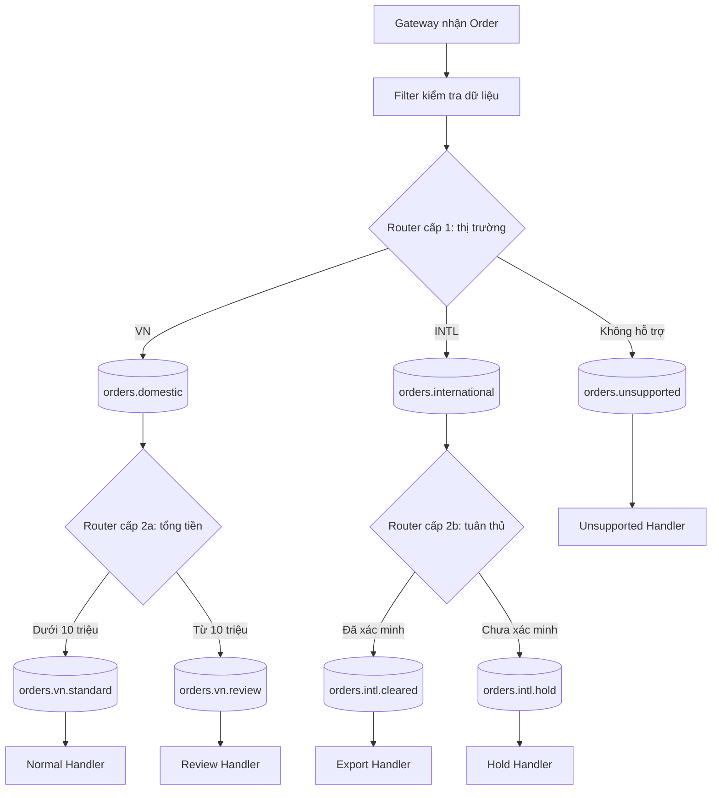
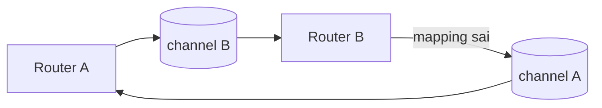

# Router phân cấp và route nhiều bước

## 1. Vì sao cần router phân cấp?

Trong một hệ thống tích hợp, một quyết định định tuyến đôi khi chưa đủ. Đơn hàng nội địa và quốc tế cần chính sách khác nhau; trong mỗi nhóm lại có phân loại riêng về mức giá trị, mức rủi ro hoặc tình trạng xác minh. Viết mọi quyết định và thao tác nghiệp vụ vào một khối `if/else` lớn sẽ tạo coupling, khiến việc bổ sung nhánh và kiểm thử khó khăn.

**Router phân cấp** (*hierarchical routing*) tổ chức các quyết định thành các tầng: tầng đầu xác định **nhóm đích lớn**, tầng sau chọn **nhánh cụ thể** trong nhóm. **Route nhiều bước** (*multi-stage routing*) mô tả message lần lượt đi qua các router và có thể đi qua Filter, Transformer, Gateway hoặc endpoint khác giữa các lần route.

Ví dụ một luồng đơn hàng trong Spring Integration:



Trong sơ đồ, Router **không thực hiện nghiệp vụ phê duyệt** và **không tự biến đổi payload**. Router nhận message, tính routing key, tìm output channel và chuyển message cho consumer tương ứng. Handler ở lá chịu trách nhiệm tạo kết quả hoặc gọi hệ thống ngoài.

Module `SPRING_INTEGRATION_PATTERN` sử dụng Enterprise Integration Patterns với Spring Integration để xây dựng flow ít phụ thuộc, dễ mở rộng. Kiểu phân cấp này đặc biệt hữu ích khi kết hợp Router với Filter, Transformer, Splitter, Aggregator, Gateway, retry, error channel và correlation, vì mỗi bước có thể được kiểm thử, theo dõi và xử lý lỗi độc lập.

**Sau bài này, người học cần biết:** phân biệt router phân cấp với fan-out và Routing Slip; thiết kế cây routing key/channel mapping; triển khai bằng Java DSL; bảo toàn message context qua nhiều tầng; xử lý nhánh không khớp, lỗi và vòng lặp; kiểm thử từng đường đi từ gốc đến lá.

## 2. Phân biệt các mô hình định tuyến

### 2.1. Router một bước

```text
orders.input -> Router(amount >= 10_000_000?)
                   | true  -> orders.review
                   | false -> orders.normal
```

Chỉ có một điểm quyết định. Nếu hai channel đích nối thẳng đến handler cuối, message không đi qua router thứ hai.

### 2.2. Router phân cấp

```text
orders.input -> Router 1 (market)
                 | domestic -> Router 2a (amount)
                 |              | standard
                 |              | review
                 | international -> Router 2b (compliance)
                 |                   | cleared
                 |                   | hold
                 | unsupported -> handler từ chối
```

Ở mô hình này, router cấp 1 **không cần biết** quy tắc về giá trị nội địa hoặc trạng thái tuân thủ quốc tế; mỗi router cấp 2 chỉ phụ trách một nhóm.

### 2.3. Route nhiều bước

Một tuyến có thể kết hợp nhiều endpoint:

```text
Input -> Filter -> Router vùng
                   -> Transformer chuẩn hóa
                   -> Router mức ưu tiên
                   -> Outbound Gateway
                   -> Router theo kết quả remote
                   -> Handler cuối
```

Không phải mọi bước trên đều là Router. **Filter** giữ hoặc loại cả message; **Transformer** đổi biểu diễn dữ liệu; **Gateway** trao đổi request–reply; **Router** chọn channel. Tách đúng trách nhiệm giúp luồng dễ thay đổi.

| Khái niệm | Vấn đề giải quyết | Điểm khác biệt |
|---|---|---|
| **Hierarchical Router** | Chọn nhánh ở nhiều cấp phân loại. | Một lựa chọn cấp trước xác định router cấp sau. |
| **Multi-stage routing** | Quyết định định tuyến lần lượt tại nhiều thời điểm. | Có thể xen giữa Transformer, Enricher, Gateway và Handler. |
| **Recipient List** | Chọn một hoặc nhiều người nhận theo danh sách. | Có thể phát message đến **nhiều đích song song**. |
| **Publish–Subscribe** | Phát tới các subscriber của channel. | Fan-out, không mặc nhiên là cây quyết định nhiều cấp. |
| **Routing Slip** | Chuyển message qua một chuỗi endpoint đã được xác định thành hành trình. | Lộ trình xử lý được mang/quản lý theo danh sách bước, không giống mỗi router tự tính chính sách ở tầng riêng. |
| **Splitter / Aggregator** | Chia nhiều message con / gom các message cùng nhóm. | Thay đổi số lượng message, thường cần correlation và release strategy. |

Ví dụ bên dưới thiết kế mỗi message hợp lệ đi qua **một đường đi từ gốc đến đúng một lá**, nên phù hợp với Gateway đồng bộ trả một kết quả. Điều đó **không có nghĩa** mọi loại router của Spring Integration luôn bị giới hạn ở một destination.

## 3. Thiết kế cây trước khi viết Java DSL

### 3.1. Xác định đầu vào đáng tin cậy

Xét payload:

```java
record OrderCommand(
        String orderId,
        String market,
        java.math.BigDecimal amountVnd,
        boolean complianceCleared) {}
```

- `orderId` là định danh nghiệp vụ.
- `market` nhận `VN` hoặc `INTL`; giá trị khác đi nhánh không hỗ trợ.
- `amountVnd` là **số tiền đã quy đổi và kiểm tra về VND** ở biên hệ thống; không so sánh trực tiếp tiền USD và VND với cùng ngưỡng.
- `complianceCleared` là **kết quả đã được xác minh từ nguồn đáng tin cậy**, không phải flag do client tự khai báo để bỏ qua kiểm tra.

Đây là domain mô phỏng nhằm giảng giải routing, không phải logic phê duyệt/tuân thủ dùng ngay trong sản phẩm thật.

### 3.2. Hợp đồng của từng tầng

| Tầng | Key | Input channel | Output channel | Quy tắc |
|---|---|---|---|---|
| 0: validation | Không có | `orders.input` | Giữ hoặc reject | ID có giá trị, market không null, amount dương. |
| 1: market | `domestic` | `orders.input` | `orders.domestic` | `market=VN`. |
| 1: market | `international` | `orders.input` | `orders.international` | `market=INTL`. |
| 1: market | `unsupported` | `orders.input` | `orders.unsupported` | Giá trị khác. |
| 2a: domestic | `standard` | `orders.domestic` | `orders.vn.standard` | Dưới 10 triệu. |
| 2a: domestic | `review` | `orders.domestic` | `orders.vn.review` | Từ 10 triệu trở lên. |
| 2b: international | `cleared` | `orders.international` | `orders.intl.cleared` | Đã xác minh. |
| 2b: international | `hold` | `orders.international` | `orders.intl.hold` | Chưa xác minh. |

Hai khái niệm phải tách biệt: **routing key** (ví dụ `review`) là kết quả chính sách; **channel bean name** (ví dụ `orders.vn.review`) là địa chỉ kỹ thuật. `channelMapping` gắn hai thông tin này với nhau.

### 3.3. Bảng chân trị cho đường đi

| Thị trường | Số tiền (VND) | Cleared | Đường đi | Kết quả mô phỏng |
|---|---:|---|---|---|
| `VN` | 800.000 | Bất kỳ | domestic → standard | `ACCEPTED` |
| `VN` | 10.000.000 | Bất kỳ | domestic → review | `PENDING_REVIEW` |
| `INTL` | 8.000.000 | `true` | international → cleared | `READY_FOR_EXPORT` |
| `INTL` | 8.000.000 | `false` | international → hold | `PENDING_COMPLIANCE` |
| `OTHER` | 8.000.000 | Bất kỳ | unsupported | `REJECTED_UNSUPPORTED_MARKET` |
| `VN` | `null` hoặc ≤ 0 | Bất kỳ | Bị Filter từ chối | Exception |

Ràng buộc đường đi có thể được viết thành một bất biến: **mỗi message hợp lệ được route cấp 1 đúng một lần, nếu chọn domestic/international thì chỉ đi qua router cấp 2 tương ứng, rồi tới đúng một handler lá**. Viết bất biến trước giúp xác định test đầy đủ.

## 4. Hiện thực bằng Spring Integration Java DSL

Ví dụ hướng tới **Java 17+, Spring Boot 3.x và Spring Integration 6.x**, với dependency `spring-boot-starter-integration`. Các type nằm cùng package; tách những type cần `public` ra file Java riêng khi đưa vào dự án.

### 4.1. Gateway, model và các channel

```java
import java.math.BigDecimal;

import org.springframework.context.annotation.Bean;
import org.springframework.context.annotation.Configuration;
import org.springframework.integration.annotation.Gateway;
import org.springframework.integration.annotation.IntegrationComponentScan;
import org.springframework.integration.annotation.MessagingGateway;
import org.springframework.integration.channel.DirectChannel;
import org.springframework.integration.config.EnableIntegration;
import org.springframework.integration.dsl.IntegrationFlow;
import org.springframework.messaging.MessageChannel;

record OrderCommand(
        String orderId,
        String market,
        BigDecimal amountVnd,
        boolean complianceCleared) {}

record RoutingReceipt(
        String orderId,
        String route,
        String status) {}

@MessagingGateway
interface OrderGateway {
    @Gateway(requestChannel = "orders.input")
    RoutingReceipt submit(OrderCommand order);
}

@Configuration
@EnableIntegration
@IntegrationComponentScan
class HierarchicalRoutingConfig {
    private static final BigDecimal REVIEW_THRESHOLD =
            new BigDecimal("10000000");

    @Bean(name = "orders.input")
    MessageChannel input() {
        return new DirectChannel();
    }

    // Channel trung gian nối tầng 1 với tầng 2.
    @Bean(name = "orders.domestic")
    MessageChannel domestic() {
        return new DirectChannel();
    }

    @Bean(name = "orders.international")
    MessageChannel international() {
        return new DirectChannel();
    }

    // Channel lá nối Router cấp 2 với handler.
    @Bean(name = "orders.vn.standard")
    MessageChannel vnStandard() {
        return new DirectChannel();
    }

    @Bean(name = "orders.vn.review")
    MessageChannel vnReview() {
        return new DirectChannel();
    }

    @Bean(name = "orders.intl.cleared")
    MessageChannel intlCleared() {
        return new DirectChannel();
    }

    @Bean(name = "orders.intl.hold")
    MessageChannel intlHold() {
        return new DirectChannel();
    }

    @Bean(name = "orders.unsupported")
    MessageChannel unsupported() {
        return new DirectChannel();
    }

    // Tầng 0: Filter; tầng 1: Router theo market.
    @Bean
    IntegrationFlow routeByMarket() {
        return IntegrationFlow.from("orders.input")
                .filter(OrderCommand.class,
                        order -> order.orderId() != null
                                && !order.orderId().isBlank()
                                && order.market() != null
                                && order.amountVnd() != null
                                && order.amountVnd().signum() > 0,
                        spec -> spec.throwExceptionOnRejection(true))
                .route(OrderCommand.class,
                        order -> switch (order.market()) {
                            case "VN" -> "domestic";
                            case "INTL" -> "international";
                            default -> "unsupported";
                        },
                        spec -> spec
                                .channelMapping("domestic", "orders.domestic")
                                .channelMapping("international",
                                        "orders.international")
                                .channelMapping("unsupported",
                                        "orders.unsupported"))
                .get();
    }

    // Tầng 2a: chỉ message từ thị trường nội địa.
    @Bean
    IntegrationFlow routeDomesticByAmount() {
        return IntegrationFlow.from("orders.domestic")
                .route(OrderCommand.class,
                        order -> order.amountVnd()
                                .compareTo(REVIEW_THRESHOLD) >= 0
                                ? "review" : "standard",
                        spec -> spec
                                .channelMapping("standard",
                                        "orders.vn.standard")
                                .channelMapping("review",
                                        "orders.vn.review"))
                .get();
    }

    // Tầng 2b: chỉ message từ thị trường quốc tế.
    @Bean
    IntegrationFlow routeInternationalByCompliance() {
        return IntegrationFlow.from("orders.international")
                .route(OrderCommand.class,
                        order -> order.complianceCleared()
                                ? "cleared" : "hold",
                        spec -> spec
                                .channelMapping("cleared",
                                        "orders.intl.cleared")
                                .channelMapping("hold",
                                        "orders.intl.hold"))
                .get();
    }

    // Handler lá: trả kết quả mô phỏng request-reply.
    @Bean
    IntegrationFlow processDomesticStandard() {
        return IntegrationFlow.from("orders.vn.standard")
                .handle(OrderCommand.class, (order, headers) ->
                        new RoutingReceipt(order.orderId(),
                                "VN/STANDARD", "ACCEPTED"))
                .get();
    }

    @Bean
    IntegrationFlow processDomesticReview() {
        return IntegrationFlow.from("orders.vn.review")
                .handle(OrderCommand.class, (order, headers) ->
                        new RoutingReceipt(order.orderId(),
                                "VN/REVIEW", "PENDING_REVIEW"))
                .get();
    }

    @Bean
    IntegrationFlow processInternationalCleared() {
        return IntegrationFlow.from("orders.intl.cleared")
                .handle(OrderCommand.class, (order, headers) ->
                        new RoutingReceipt(order.orderId(),
                                "INTL/CLEARED", "READY_FOR_EXPORT"))
                .get();
    }

    @Bean
    IntegrationFlow processInternationalHold() {
        return IntegrationFlow.from("orders.intl.hold")
                .handle(OrderCommand.class, (order, headers) ->
                        new RoutingReceipt(order.orderId(),
                                "INTL/HOLD", "PENDING_COMPLIANCE"))
                .get();
    }

    @Bean
    IntegrationFlow rejectUnsupportedMarket() {
        return IntegrationFlow.from("orders.unsupported")
                .handle(OrderCommand.class, (order, headers) ->
                        new RoutingReceipt(order.orderId(),
                                "UNSUPPORTED",
                                "REJECTED_UNSUPPORTED_MARKET"))
                .get();
    }
}
```

### 4.2. Đọc cấu hình theo trách nhiệm

- `routeByMarket()` kiểm tra đầu vào và chọn `domestic`, `international` hoặc `unsupported`; nó không biết ngưỡng giá trị hay quy trình tuân thủ của các nhánh con.
- `routeDomesticByAmount()` chỉ nhận từ `orders.domestic` và chọn standard/review.
- `routeInternationalByCompliance()` chỉ nhận từ `orders.international` và chọn cleared/hold.
- Các `IntegrationFlow` cuối **đăng ký endpoint lá**, trả một `RoutingReceipt`, không thực hiện giao dịch thật.
- `DirectChannel` giữ ví dụ ở kiểu dispatch đồng bộ; cả hai router trên đường đi và handler cuối tham gia vào cùng request–reply từ gateway.

`@IntegrationComponentScan` giúp phát hiện interface `@MessagingGateway` trong vùng package tương ứng. Tên bean `IntegrationFlow` không phải tự động là tên channel; hãy dựa trên tên `@Bean(name=...)` và mapping cụ thể.

### 4.3. Chạy thử qua gateway

```java
// orderGateway là bean được inject từ Spring context.
RoutingReceipt vn = orderGateway.submit(
        new OrderCommand("O-101", "VN",
                new BigDecimal("800000"), false));
// vn.route() == "VN/STANDARD", vn.status() == "ACCEPTED"

RoutingReceipt review = orderGateway.submit(
        new OrderCommand("O-102", "VN",
                new BigDecimal("10000000"), false));
// review.route() == "VN/REVIEW", review.status() == "PENDING_REVIEW"

RoutingReceipt intl = orderGateway.submit(
        new OrderCommand("O-103", "INTL",
                new BigDecimal("20000000"), true));
// intl.route() == "INTL/CLEARED"

RoutingReceipt unknown = orderGateway.submit(
        new OrderCommand("O-104", "OTHER",
                new BigDecimal("900000"), false));
// unknown.status() == "REJECTED_UNSUPPORTED_MARKET"
```

Ví dụ chỉ **phân loại và trả kết quả mô phỏng**: `PENDING_REVIEW` không có nghĩa đã có người phê duyệt; `READY_FOR_EXPORT` không có nghĩa đã gọi hệ thống vận chuyển. Hệ thống thật cần handler nghiệp vụ, persistence, security và error/retry policy.

### 4.4. Thứ tự xử lý một request

Với `O-102`:

1. Gateway tạo message và gửi `orders.input`.
2. Filter kiểm tra orderId, market, amount.
3. Router cấp 1 tính key `domestic`, map tới `orders.domestic`.
4. Consumer của `orders.domestic` là Router cấp 2a, tính `review` vì amount bằng ngưỡng.
5. Router cấp 2a map tới `orders.vn.review`.
6. Handler lá trả `RoutingReceipt("O-102", "VN/REVIEW", "PENDING_REVIEW")`.
7. Hạ tầng request–reply chuyển kết quả cho gateway.

Nếu một bước không có subscriber, lỗi khi phân giải channel hoặc handler không trả reply, **không thể suy ra** kết quả gateway vẫn giống các case thành công.

## 5. Bảo toàn dữ liệu và correlation qua nhiều tầng

### 5.1. Message và các loại ID

| Thông tin | Phạm vi | Lưu ý |
|---|---|---|
| `messageId` / `MessageHeaders.ID` | Một message cụ thể | Có thể đổi khi Transformer, Splitter hoặc adapter tạo message mới. |
| `orderId` | Định danh nghiệp vụ | Liên kết mọi bước với cùng đơn hàng. |
| `traceId` | Hành trình quan sát | Phải được truyền đúng qua các channel/transport. |
| `correlationId` | Nhóm message liên quan | Quan trọng khi Splitter/Aggregator, không phải cứ thêm router là tạo ID nhóm mới. |
| `replyChannel` | Địa chỉ phản hồi của request–reply | Có thể là tham chiếu nội bộ; không tùy tiện chuyển nguyên sang broker/JVM khác. |

Đi qua nhiều router **không tự nhân đôi message** theo cách ví dụ được cấu hình. Nếu thêm Splitter, mỗi phần có thể có ID riêng và cần correlation/sequence để Aggregator ghép kết quả; router không tự tạo release strategy.

### 5.2. Dữ liệu mới trước quyết định kế tiếp

Trong thực tế, `complianceCleared` nên đến từ một bước xác minh:

```text
orders.international
  -> Outbound Gateway hỏi dịch vụ xác minh
  -> Transformer/Enricher dựng trạng thái đã xác thực
  -> Router theo clearance
  -> orders.intl.cleared / orders.intl.hold
```

Khi gọi dịch vụ xác minh bị timeout, **không tự xem timeout là “chưa đạt tuân thủ”** nếu nghiệp vụ chưa quy định như vậy. Nên có error flow hoặc trạng thái `VERIFICATION_UNAVAILABLE` riêng.

Nếu tạo message mới bằng tay, cần truyền đúng metadata cần thiết. Ví dụ về nguyên tắc (giả sử `NormalizedOrder` là DTO do ứng dụng định nghĩa):

```java
import org.springframework.messaging.Message;
import org.springframework.messaging.support.MessageBuilder;

Message<NormalizedOrder> normalize(Message<OrderCommand> input) {
    OrderCommand source = input.getPayload();
    NormalizedOrder normalized =
            new NormalizedOrder(source.orderId(), source.amountVnd());

    return MessageBuilder.withPayload(normalized)
            .copyHeaders(input.getHeaders())
            .build();
}
```

`copyHeaders` không phải lựa chọn mặc định an toàn khi đi qua **ranh giới tin cậy**. Cần chọn lọc header được phép mang sang hệ thống ngoài, nhất là tham chiếu `replyChannel`, thông tin bảo mật và header do client tự gửi.

## 6. Nhánh lỗi, fallback và điều kiện dừng

### 6.1. Năm tình huống khác nhau

Trong một cây nhiều tầng, cần phân biệt ít nhất năm nguồn lỗi:

1. **Input không hợp lệ:** Filter hoặc validation endpoint từ chối trước khi tính key.
2. **Routing expression thất bại:** code tính key ném exception hoặc nhận một payload không đúng kiểu.
3. **Key không thể phân giải:** policy trả key nhưng cấu hình không tìm được output channel phù hợp.
4. **Channel có nhưng consumer không hoạt động:** endpoint cấp sau stopped/unsubscribed, hoặc channel không có subscriber.
5. **Consumer có nhưng handler thất bại:** ngoại lệ downstream, timeout, xử lý nghiệp vụ không thành công.

Các nguồn lỗi này cần hành vi khác nhau. Một key sai cấu hình không nên retry vô hạn; lỗi kết nối tạm thời của downstream có thể retry có giới hạn và cần idempotency.

### 6.2. Key chưa mapping và default output

Routing key như `domestic` là **giá trị chính sách**, còn `orders.domestic` là **bean channel**. Tùy loại router và cấu hình, key chưa mapping có thể được thử phân giải như tên channel, chuyển đến default output channel hoặc phát sinh lỗi. Không giả định mọi router sẽ bỏ qua message không khớp một cách an toàn.

Trong ví dụ Java, key `unsupported` được **ánh xạ có chủ đích** sang một channel có handler trả `REJECTED_UNSUPPORTED_MARKET`. Như vậy người gọi không phải đoán rằng request đã được xử lý thành công khi thực tế bị từ chối.

| Tình huống | Cách xử lý nên xem xét | Điều cần kiểm tra |
|---|---|---|
| Thiếu `orderId`, amount ≤ 0 | Reject bằng lỗi validation | Caller nhận lỗi và không có nhánh được xử lý. |
| Thị trường không hỗ trợ | Nhánh từ chối/đưa vào review theo contract | Có handler và reply rõ ràng. |
| Sai chính tả mapping | Fail fast, cảnh báo cấu hình | Không che lỗi bằng fallback tùy tiện. |
| Consumer cấp 2 tạm dừng | Buffer phù hợp hoặc từ chối overload | Không để gateway chờ vô hạn. |
| Xác minh quốc tế timeout | Error/recovery/unknown state | Không coi hạ tầng lỗi là kết luận tuân thủ. |

Default channel là một **quyết định nghiệp vụ**, không phải nơi “nhét tạm” mọi message. Nếu không có subscriber hoặc cơ chế phục hồi, default chỉ chuyển lỗi sang một điểm khác.

### 6.3. DirectChannel không lưu message chờ router tiếp theo

Trong ví dụ, `orders.domestic` là `DirectChannel`. Nếu consumer `routeDomesticByAmount` dừng, Router cấp 1 vẫn có thể chọn `domestic` nhưng việc gửi tới channel trung gian có thể thất bại. `DirectChannel` không tự lưu message để phát lại sau khi endpoint start.

Thay bằng `QueueChannel` thay đổi semantics:

- Producer có thể enqueue khi còn capacity dù poller chưa chạy.
- Consumer cần `receive` hoặc poller; nếu không, message nằm chờ.
- Khi queue đầy, `send` có thể chờ hoặc thất bại theo timeout; cần overload policy.
- Queue in-memory không tự bảo đảm persistence qua restart.
- Request–reply qua poller/executor cần thiết kế reply timeout, error handling và transaction khác với dispatch đồng bộ.

Không đổi channel type như một “sửa lỗi nhanh” nếu chưa xác định được hợp đồng **accepted**, **processed**, **committed** và các tình huống client retry.

### 6.4. Retry và error channel

Với flow đồng bộ dùng `DirectChannel`, lỗi phát sinh tại một router hoặc handler có thể truyền lên call stack và về gateway. Với flow có executor, poller hoặc adapter bất đồng bộ, lỗi có thể được chuyển dưới dạng `ErrorMessage` qua `errorChannel` trong ngữ cảnh có hỗ trợ. **Không có bảo đảm mọi exception ở mọi transport đều tự đi vào một error channel chung.**

Khi thiết kế retry:

- Chỉ retry những lỗi **có khả năng phục hồi** (ví dụ timeout downstream tạm thời); không lặp vô hạn validation hoặc sai channel mapping.
- Giới hạn số lần, backoff, jitter và tổng thời gian chờ.
- Nếu handler có side effect (tạo hóa đơn, đặt hàng), sử dụng **idempotency key** dựa trên event/business ID ổn định.
- Theo dõi số lần thử và outcome riêng; **Message History không phải counter retry đáng tin cậy**.
- Có recovery/dead-letter policy khi đã hết khả năng retry.

Với Gateway request–reply, một nhánh chỉ sử dụng outbound adapter một chiều mà không cung cấp reply hoặc exception theo contract có thể khiến caller chờ tới timeout dù Router đã tìm đúng channel.

## 7. Tránh vòng lặp trong route nhiều bước

Định tuyến phân cấp lý tưởng là một **cây** hoặc một đồ thị có hướng không chu trình (*DAG*). Nhưng một mapping sai có thể tạo vòng lặp:



Trong các channel đồng bộ, vòng lặp có thể tạo lời gọi lồng nhau tới mức cạn stack. Với các channel bất đồng bộ, nó có thể làm tăng queue depth, CPU và lưu lượng tới khi hết tài nguyên. Spring Integration không mặc định hiểu một chu trình định tuyến là lỗi nghiệp vụ cần tự cắt.

Để thiết kế an toàn:

1. Định nghĩa **tầng và tập output channels được phép** cho mỗi router trước khi code.
2. Kiểm tra đồ thị channel/endpoint không có cạnh quay về input trái quy tắc.
3. Nếu cần xử lý lặp thật, tách rõ **retry/reprocessing** với **route decision**, đặt số bước tối đa, deadline và trạng thái đã xử lý.
4. Khi dùng hop counter (`routingHops`) phải cập nhật và kiểm tra ở **tất cả** các điểm có thể lặp; đó là quy ước ứng dụng, không phải tính năng bảo đảm của Router.
5. Test key lạ, fallback, nhánh bị stop và error recovery vì đây là nơi rất dễ hình thành cycle.

Một luồng nhiều bước cũng không đồng nghĩa cần **càng nhiều router càng tốt**. Nếu một bước luôn chỉ gửi từ A sang B mà không có tiêu chí nào, dùng channel trực tiếp có thể rõ ràng hơn một router chỉ để chuyển tiếp.

## 8. Phân tầng chính sách để giảm coupling

### 8.1. Tách policy khỏi DSL

Khi quy tắc phức tạp, nên đưa nó vào Java service có test đơn vị:

```java
enum MarketRoute {
    DOMESTIC, INTERNATIONAL, UNSUPPORTED
}

final class MarketRoutePolicy {
    MarketRoute decide(OrderCommand order) {
        return switch (order.market()) {
            case "VN" -> MarketRoute.DOMESTIC;
            case "INTL" -> MarketRoute.INTERNATIONAL;
            default -> MarketRoute.UNSUPPORTED;
        };
    }
}
```

**Chú ý:** policy trên trả về `enum` còn Router Java DSL ở phần 4 trả về `String`. Nếu thay logic, phải chỉnh mapping theo **giá trị thực tế** mà router trả; không gắn `channelMapping("domestic", ...)` một cách mù quáng rồi giả định enum và string là cùng một key.

Tách policy giúp:

- Kiểm thử quy tắc **không cần Spring context**.
- Thay ngưỡng/nhánh theo cấu hình mà không sửa handler.
- Quản lý phiên bản chính sách khi cần audit route cho request cũ.
- Chia quyền sở hữu: nhóm A quản lý điều phối thị trường, nhóm B quản lý nhánh nội địa, nhóm C quản lý nhánh quốc tế.

Không nhất thiết mọi bộ điều kiện `if` đều phải tách thành router mới. Nếu rule đơn giản, chỉ có hai nhánh và không có thay đổi độc lập, một router với policy rõ ràng có thể đủ. Phân cấp nên phục vụ **ranh giới trách nhiệm thật**, không phải để tăng số component.

### 8.2. Khi cần thêm tầng Transformer/Gateway

Giả sử sau khi phân loại thị trường, nhánh quốc tế phải lấy kết quả kiểm tra:

```text
Router cấp 1
   |
   +-- international
          |
          +-- Outbound Gateway / Enricher (gọi dịch vụ xác minh)
          |
          +-- Transformer (chuẩn hóa kết quả)
          |
          +-- Router cấp 2 (cleared / hold / unavailable)
```

Nên dùng object kết quả có các trạng thái rõ như `CLEARED`, `HOLD`, `UNAVAILABLE`, thay vì ép timeout thành `false` rồi coi đó là quyết định tuân thủ. Điều này cũng cho phép kiểm thử lỗi của dịch vụ xác minh mà không lẫn với test route.

### 8.3. Multi-step routing và nhiều kết quả song song

Nếu sau một lá cần gửi đồng thời yêu cầu kiểm tra gian lận và kiểm tra tồn kho, lúc đó có thể dùng Recipient List/Publish–Subscribe hoặc **Scatter–Gather**. Khi cần một phản hồi tổng hợp, **Aggregator** phải có correlation ID, release strategy, timeout và chính sách kết quả thiếu.

Trong trường hợp này số message **thực sự thay đổi**, không còn chỉ là một đường đi đơn đích từ gốc tới lá. Router phân cấp **không tự ghép** các kết quả của hai nhánh; một Gateway cũng không tự suy ra phải chờ kết quả nào nếu flow chưa định nghĩa rõ.

## 9. Quan sát và truy nguyên từng tầng

### 9.1. Ghi quyết định, giao nhận và outcome tách biệt

Một định dạng log ứng dụng gợi ý:

```text
traceId=trace-O102 orderId=O-102
  event=ROUTE_DECIDED level=1 key=domestic
  destination=orders.domestic

traceId=trace-O102 orderId=O-102
  event=ROUTE_DECIDED level=2 key=review
  destination=orders.vn.review

traceId=trace-O102 orderId=O-102
  event=BRANCH_ENTERED endpoint=processDomesticReview

traceId=trace-O102 orderId=O-102
  event=ROUTING_COMPLETED status=PENDING_REVIEW
```

Đây là **schema log do ứng dụng thiết kế**, không phải log mặc định của Spring Integration. Mỗi event trả lời câu hỏi riêng:

| Event | Câu hỏi |
|---|---|
| `ROUTE_DECIDED` | Router **đã quyết định** đưa đi đâu? |
| `BRANCH_ENTERED` | Consumer **có thực sự nhận được** message? |
| `ROUTING_COMPLETED` | Xử lý ở lá **đã hoàn tất** theo contract? |
| `ROUTING_FAILED` | Lỗi nằm ở tầng nào, loại nào? |

Nếu log cấp 1 xuất hiện nhưng cấp 2 không xuất hiện, hãy kiểm tra channel trung gian, subscriber, trạng thái endpoint, queue/executor hoặc lỗi dispatch. Nếu hai cấp đều quyết định xong nhưng thiếu outcome, tập trung vào handler cuối và downstream.

**Message History** của Spring Integration có thể lưu dấu các component đã được theo dõi khi bật cấu hình; nó không tự ghi đầy đủ **lý do chọn key**, transaction outcome hoặc lịch sử xuyên JVM. Log có cấu trúc và distributed tracing bổ sung cho message history.

### 9.2. Metrics có thể dùng cho router tree

| Chỉ số | Phát hiện |
|---|---|
| Input count theo router/tầng | Mỗi tầng nhận bao nhiêu message. |
| Routed count theo key hữu hạn | Tỷ lệ từng nhánh tăng hay giảm bất thường. |
| Rejected/unknown-key count | Input ngoài hợp đồng hoặc lỗi cấu hình. |
| Dispatch failures | Đã chọn output channel nhưng không gửi/tiếp nhận được. |
| Branch processing latency | Nhánh nào tăng độ trễ. |
| Queue depth/oldest-message age | Backlog ở channel bất đồng bộ. |
| Error/retry/timeout count | Nhánh nào gây lỗi hoặc xử lý lặp. |
| Incomplete Aggregator groups | Các request fan-out còn thiếu phần. |

Đừng dùng `orderId`, `traceId` hoặc một routing key có vô số giá trị làm **label metric**, vì cardinality quá cao. Các ID này phù hợp hơn với log/tracing có kiểm soát bảo mật và lưu giữ. Qua `ExecutorChannel` hoặc broker, MDC/thread-local không tự lan truyền; cần trace-context propagation qua message/transport.

## 10. Kiểm thử từng đường đi từ gốc đến lá

### 10.1. Spring Test + JUnit 5

Ví dụ kiểm thử đồng bộ dựa trên `HierarchicalRoutingConfig`:

```java
import java.math.BigDecimal;

import org.junit.jupiter.api.Test;
import org.springframework.beans.factory.annotation.Autowired;
import org.springframework.messaging.MessagingException;
import org.springframework.test.context.junit.jupiter.SpringJUnitConfig;

import static org.junit.jupiter.api.Assertions.assertEquals;
import static org.junit.jupiter.api.Assertions.assertThrows;

@SpringJUnitConfig(HierarchicalRoutingConfig.class)
class HierarchicalRoutingTest {
    @Autowired
    private OrderGateway gateway;

    @Test
    void domesticBelowThreshold() {
        RoutingReceipt receipt = gateway.submit(
                new OrderCommand("O-1", "VN",
                        new BigDecimal("9999999"), false));

        assertEquals("VN/STANDARD", receipt.route());
        assertEquals("ACCEPTED", receipt.status());
    }

    @Test
    void domesticAtThresholdNeedsReview() {
        RoutingReceipt receipt = gateway.submit(
                new OrderCommand("O-2", "VN",
                        new BigDecimal("10000000"), true));

        assertEquals("VN/REVIEW", receipt.route());
        assertEquals("PENDING_REVIEW", receipt.status());
    }

    @Test
    void internationalCleared() {
        RoutingReceipt receipt = gateway.submit(
                new OrderCommand("O-3", "INTL",
                        new BigDecimal("5000000"), true));

        assertEquals("INTL/CLEARED", receipt.route());
        assertEquals("READY_FOR_EXPORT", receipt.status());
    }

    @Test
    void internationalNotCleared() {
        RoutingReceipt receipt = gateway.submit(
                new OrderCommand("O-4", "INTL",
                        new BigDecimal("5000000"), false));

        assertEquals("INTL/HOLD", receipt.route());
        assertEquals("PENDING_COMPLIANCE", receipt.status());
    }

    @Test
    void unsupportedMarketHasExplicitRejection() {
        RoutingReceipt receipt = gateway.submit(
                new OrderCommand("O-5", "OTHER",
                        new BigDecimal("5000000"), false));

        assertEquals("UNSUPPORTED", receipt.route());
        assertEquals("REJECTED_UNSUPPORTED_MARKET", receipt.status());
    }

    @Test
    void invalidAmountIsRejectedBeforeRouting() {
        assertThrows(MessagingException.class, () ->
                gateway.submit(
                        new OrderCommand("O-6", "VN",
                                BigDecimal.ZERO, false)));
    }
}
```

Các test này kiểm tra **đường đi end-to-end qua Gateway và handler lá**, không thay thế test cho subscriber absent, async, retry hoặc mapping sai. Nếu cần kiểm tra channel cụ thể, gắn interceptor/test-only consumer hoặc dùng Spring Integration test support; không dựa duy nhất vào tên status của handler.

### 10.2. Ma trận kiểm thử mở rộng

| Tình huống | Điều cần khẳng định |
|---|---|
| `VN` dưới ngưỡng | Chỉ tới nhánh standard. |
| `VN` bằng hoặc trên ngưỡng | Chỉ tới nhánh review. |
| `INTL` verified/unverified | Đi đúng cleared/hold, không qua router nội địa. |
| Unknown market | Có reply reject, không lạc vào các nhánh hợp lệ. |
| Amount bằng 0, âm hoặc `null` | Filter từ chối trước bất kỳ router nào. |
| Mapping trỏ channel không tồn tại | Lỗi được báo rõ, không silent drop. |
| Endpoint tầng 2 stopped | Không báo đã xử lý thành công khi không có consumer. |
| Biến đổi payload giữa hai tầng | Schema và trace/business context đúng contract. |
| Queue nhánh đầy | Có timeout/backpressure/retry policy rõ. |
| Error ở handler lá | Có xử lý đồng bộ/bất đồng bộ và recovery theo contract. |
| Vòng lặp do mapping sai | Có cách phát hiện/ngăn trong cấu hình test cô lập. |

Với flow bất đồng bộ, dùng latch/await condition với **timeout** để chờ kết quả; tránh dùng `Thread.sleep` như bằng chứng duy nhất. Nếu có tác động ngoài (thanh toán, gửi email, database), dùng stub/mocks và test idempotency trước khi kiểm thử tích hợp thật.

## 11. Các sai lầm thiết kế thường gặp

| Hiểu nhầm | Hậu quả | Hướng xử lý |
|---|---|---|
| “Router cấp 1 phải biết mọi handler lá.” | Độ phụ thuộc cao, khó thêm nhánh. | Mỗi router chỉ biết key và output channels ở tầng của mình. |
| “Nhiều router nối tiếp là fan-out.” | Sai số lượng message/reply. | Phân biệt multi-stage với Recipient List/Publish–Subscribe. |
| “Hierarchical Router giống Routing Slip.” | Nhầm lịch trình với quyết định động theo tầng. | Chọn pattern theo semantics cần có. |
| “Mọi key và channel đều trùng tên.” | Mapping khó đổi, lỗi phân giải khó tìm. | Tách policy key và channel bean name. |
| “Unknown key chắc chắn bị bỏ qua an toàn.” | Message thất lạc hoặc đi nhầm. | Tạo default/error contract rõ và test key lạ. |
| “DirectChannel giữ lại message khi router cấp sau dừng.” | Gửi thất bại, gateway thiếu reply. | Thiết kế buffer/fallback/từ chối rõ. |
| “Message ID không đổi qua mọi tầng.” | Không truy nguyên được transformer/splitter. | Dùng business/trace ID và correlation theo tình huống. |
| “Vòng lặp channel sẽ tự dừng.” | Stack overflow hoặc queue bão hòa. | Thiết kế DAG, hop limit khi có loop hợp lệ. |
| “Gateway có nhiều router nên chắc chắn nhận reply.” | Nhánh cuối một chiều hoặc lỗi làm timeout. | Định nghĩa reply/error của mọi lá. |
| “Có `isRunning=true` thì tất cả nhánh khỏe.” | Bỏ qua lỗi downstream và backlog. | Kết hợp health, metrics, tracing và test. |
| “Retry một key chưa mapping sẽ sửa được lỗi.” | Lỗi lặp vô hạn, tốn tài nguyên. | Phân loại lỗi cấu hình và lỗi vận hành. |

## 12. Bài tập tự thực hành

1. **Mở rộng cấp 1:** thêm thị trường `EU`, định nghĩa channel `orders.eu` và Router cấp 2 theo loại tài liệu thuế. Viết bảng chân trị trước khi code.
2. **Thêm tầng 3:** với `orders.vn.review`, tạo tiếp hai nhánh `manual` và `escalated` theo mức rủi ro đã xác minh; bảo đảm mỗi lá đều có reply.
3. **Thêm Transformer:** input chứa `amount` và `currency`; chuẩn hóa `amountVnd` trước khi phân loại. Xử lý trường hợp không xác định được tỷ giá.
4. **Thử fallback:** tạo key chưa mapping trong một test cấu hình riêng; xác minh default/output hoặc exception theo policy đã chọn.
5. **Thử ngừng consumer:** tạm stop Router cấp 2 domestic, kiểm tra Gateway và thiết kế một cách tạm ngừng tiếp nhận hoặc buffer hợp lệ.
6. **Thử vòng lặp:** mô tả lỗi Router B gửi ngược về Router A; xác định bước nào sẽ phát hiện hop count vượt giới hạn và cách dừng an toàn.
7. **Quan sát:** gắn `traceId`, log `ROUTE_DECIDED` ở hai cấp và `BRANCH_ENTERED` tại lá; tạo lỗi ở cấp 2 và xác định vị trí message dừng.
8. **Fan-out có tập hợp:** từ một nhánh lá, gửi kiểm tra fraud và tồn kho song song. Thiết kế correlation, release/timeout và Aggregator trước khi trả kết quả tổng hợp cho gateway.

### Câu hỏi tự kiểm tra

**Câu 1:** Đơn `market=VN`, `amountVnd=10_000_000` qua những quyết định nào? **Đáp án:** Filter → cấp 1 `domestic` → cấp 2 `review` → `orders.vn.review`.

**Câu 2:** Đơn `market=INTL`, `complianceCleared=false` có đi qua router giá trị nội địa không? **Không.** Nó đi qua cấp 2 quốc tế và đến `orders.intl.hold`.

**Câu 3:** Router cấp 1 đã tìm được `orders.domestic` nhưng endpoint cấp 2 stopped. Có thể báo xử lý thành công không? **Không.** Quyết định route, giao message và xử lý nghiệp vụ là ba sự kiện khác nhau.

**Câu 4:** Dùng Recipient List gửi tới ba hệ thống đồng thời có tương đương đi qua ba Router nối tiếp không? **Không.** Đó là fan-out, còn multi-stage là các quyết định ở những giai đoạn tiếp theo.

**Câu 5:** Có cần tạo correlation ID mới tại từng router không? **Không.** Correlation dùng để nhận diện nhóm message khi cần; giữ trace/business ID phù hợp để nối đường đi.

**Kết luận:** **Router phân cấp** tách điều kiện định tuyến thành các tầng có quyền sở hữu riêng; **route nhiều bước** đưa message qua những quyết định và thao tác nối tiếp trước khi đến kết quả cuối. Với Spring Integration, hãy đặt rõ hợp đồng của mỗi channel, phân biệt routing key với output destination, dùng Filter/Transformer/Gateway đúng trách nhiệm, kiểm soát đường lỗi và vòng lặp, bảo toàn correlation/tracing và kiểm thử mọi tuyến từ gốc đến lá. Nhờ vậy luồng EIP ít phụ thuộc, dễ mở rộng, dễ quan sát và dễ phục hồi khi một tầng gặp sự cố.
