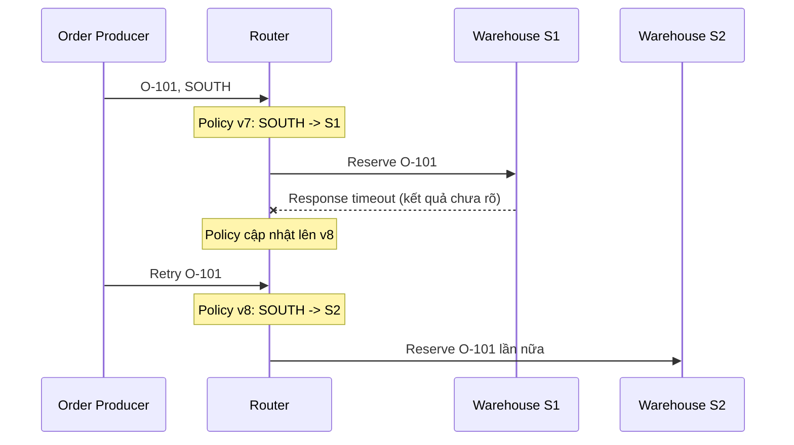
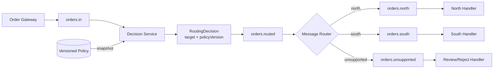
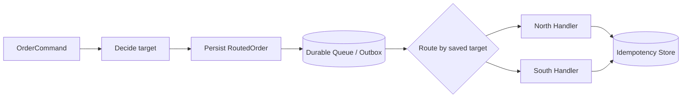
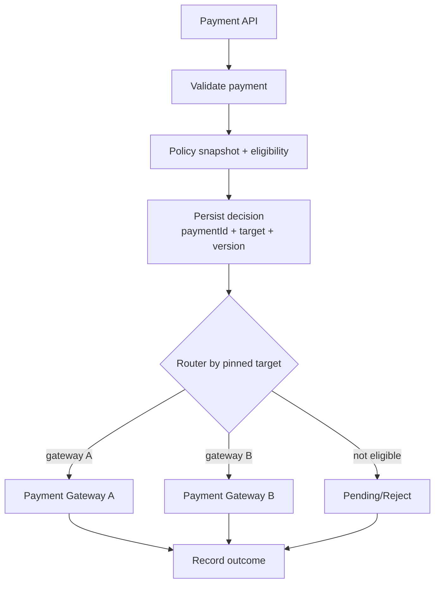

# Router có state và rủi ro không xác định

Trong Enterprise Integration Patterns (EIP), **Message Router** quyết định một message sẽ được chuyển đến channel hoặc hệ thống nào dựa trên nội dung và ngữ cảnh. Router đơn giản có thể chỉ đọc `region` hoặc `messageType`. Nhưng khi quyết định phụ thuộc vào bộ đếm, trạng thái hệ thống, cấu hình đang thay đổi, kết quả của API ngoài hoặc lịch sử các message trước đó, ta bước vào vùng **routing phụ thuộc trạng thái (state-dependent routing)**.

Một router có state không mặc nhiên là sai. Định tuyến theo năng lực xử lý, quy tắc ưu tiên hoặc phiên bản cấu hình đôi khi là yêu cầu nghiệp vụ. Rủi ro xuất hiện khi **cùng một message có thể chọn nhiều đích khác nhau mà không ai biết tại sao**. Khi đó retry, chạy nhiều instance, cập nhật cấu hình và điều tra sự cố có thể trở nên khó đoán.

Bài học thuộc chương **Message router** của module **SPRING_INTEGRATION_PATTERN**. Trọng tâm là dùng Spring Integration để triển khai Enterprise Integration Patterns thành các luồng thông điệp ít phụ thuộc, dễ mở rộng; kết hợp Router với Gateway, Filter, Transformer, Splitter, Aggregator, retry, error channel, correlation, kiểm thử và theo dõi đường đi. Bài này đặc biệt phân tích **trạng thái ảnh hưởng đến quyết định routing**, tính xác định, và cách giảm rủi ro trong ứng dụng thực tế.

Sau bài học, bạn có thể nhận diện các nguồn state, phân biệt tính xác định với tính lặp lại qua thời gian, thiết kế quyết định routing có thể truy vết, và kiểm thử tình huống retry, concurrency hoặc cấu hình thay đổi giữa chừng.

## 1. Routing có tính xác định nghĩa là gì?

Một router có thể được mô tả bằng hàm:

\[
destination = route(message,\ context)
\]

Với router thuần, `context` chỉ gồm những giá trị **ổn định, đã xác định** mà router cần để quyết định. Khi cùng input và cùng quy tắc được cung cấp, đầu ra có thể lặp lại.

Ví dụ:

```java
String routeByRegion(OrderCreated event) {
    return switch (event.region()) {
        case "NORTH" -> "orders.north";
        case "SOUTH" -> "orders.south";
        default -> "orders.unmapped";
    };
}
```

Nếu `event.region()` không đổi và code không đổi, kết quả không đổi. Với luồng này, ta dễ trả lời “vì sao đơn hàng O-101 đi về kho miền Bắc?”.

Một router phụ thuộc trạng thái có thể hoạt động như:

\[
destination = route(message,\ rulesVersion,\ load,\ history,\ time)
\]

Cùng một message đi qua hai lần có thể được gửi tới hai đích khác nhau vì phiên bản quy tắc, mức tải, lịch sử hoặc thời gian đã thay đổi.

**Cần phân biệt hai khái niệm:**

- **Xác định theo snapshot:** cùng message và cùng snapshot state thì quyết định như nhau. Điều này vẫn có thể đúng với router đọc cấu hình động.
- **Ổn định xuyên retry:** một quyết định đã chọn sẽ tiếp tục được giữ khi message phát lại. Điều này **không tự động có** chỉ vì hàm routing xác định theo snapshot.

Một router dùng trạng thái được quản lý tốt có thể xác định theo từng snapshot nhưng vẫn làm thay đổi đích ở thời điểm replay. Thiết kế phải quy định liệu thay đổi đó có được phép hay không.

## 2. "State" đến từ đâu trong Message Router?

State không nhất thiết nằm trong một field `counter` của class Java. Bất kỳ thông tin nào **có thể thay đổi độc lập với message** và ảnh hưởng đến routing đều là nguồn trạng thái đáng xem xét.

| Nguồn state | Ví dụ quyết định | Rủi ro khi thay đổi |
| --- | --- | --- |
| **Cấu hình động** | Bảng `region → warehouse` trong database hoặc config service | Một message retry sau khi cập nhật chính sách có thể chuyển sang kho khác |
| **Bộ đếm / vòng quay** | Round-robin lần lượt chọn instance A, B, C | Các lần retry đổi đích; mỗi node giữ bộ đếm khác nhau |
| **Mức tải và sức khỏe đích** | Chọn hệ thống chưa quá tải, còn hoạt động | Kết quả phụ thuộc thời điểm đo và độ trễ cập nhật health check |
| **Lịch sử xử lý** | Nếu đã thử A thì chuyển sang B | Trạng thái retry phải chính xác, tồn tại qua restart và tương thích khi chạy nhiều instance |
| **Thời gian** | Đơn nhận sau giờ đóng cửa sang đội trực đêm | Hai lần replay vào hai thời điểm cho kết quả khác nhau |
| **Feature flag/A-B test** | Điều hướng theo cờ bật tính năng | Cờ bật/tắt giữa các lần xử lý; tỷ lệ rollout và sticky assignment thay đổi |
| **Trạng thái workflow** | Chuyển theo bước hiện tại của quy trình duyệt | Trạng thái bị đọc/ghi không nhất quán; message đến muộn |
| **Dịch vụ bên ngoài** | Hỏi API quyết định kho hoặc cổng thanh toán | Timeout, mạng lỗi, dữ liệu ngoài không ổn định, kết quả chưa rõ |

**Router stateful theo nghĩa hẹp** lưu state bên trong chính đối tượng router, ví dụ `AtomicInteger`. **Router phụ thuộc state theo nghĩa rộng** có thể hoàn toàn không lưu state nội bộ nhưng lại đọc database, feature flag hoặc load balancer khi quyết định. Về tính ổn định của kết quả, cả hai cần được đánh giá.

### Không nhầm stateful router với các pattern giữ trạng thái khác

- **Aggregator** thường giữ message group và trạng thái correlation để ghép kết quả. Đây là trách nhiệm ghép nhóm, không phải tự động là trạng thái của Router.
- **Resequencer** (nếu dùng) giữ trạng thái phục vụ sắp thứ tự.
- **Process Manager / Saga** có thể cần trạng thái quy trình bền vững để điều phối nhiều bước.
- **Router** nên tập trung vào *chọn đích*, không ôm toàn bộ trạng thái nghiệp vụ và side effect của các bước downstream.

Khi nghiệp vụ cần biết “đã thanh toán chưa, đã giữ kho chưa, đã gửi email chưa”, một workflow/process manager hoặc trạng thái bền vững tại domain có thể phù hợp hơn việc giấu tất cả điều kiện ấy trong một router singleton.

## 3. Năm rủi ro thường gặp khi router có state

### 3.1. Cùng một message đi hai đích sau retry

Giả sử `OrderPlaced("O-101", "SOUTH")` được định tuyến lần đầu tới kho `warehouse-s1`. Handler gọi API kho, API xử lý thành công nhưng response bị mất; hệ thống coi đây là lỗi timeout.

Sau đó chính sách thay đổi, vùng SOUTH được chuyển sang `warehouse-s2`. Khi retry từ **trước router**, cùng message được phân tuyến lại tới S2.



Rủi ro là **giữ hàng hai nơi**. Timeout không chứng minh request trước đó chưa được xử lý. Retry có thể tạo side effect trùng ngay cả khi router vẫn chọn cùng đích; việc đổi đích làm khả năng đối soát phức tạp hơn.

Biện pháp cần phối hợp:

1. Quy định một quyết định routing có được thay đổi khi retry hay không.
2. Nếu phải giữ nguyên, **lưu route decision** gắn với business key/event ID trước điểm cần phát lại.
3. Làm handler downstream **idempotent**; dùng khóa định danh nghiệp vụ hoặc event ID ổn định.
4. Khi timeout không rõ kết quả, đối soát trạng thái thực tế thay vì giả định thất bại và gửi sang đích khác.

### 3.2. Race condition trong bộ đếm hoặc trạng thái dùng chung

Một router round-robin tự viết có thể dùng:

```java
class UnsafeRoundRobin {
    private int next = 0; // không có đồng bộ

    String route() {
        String[] targets = {"orders.a", "orders.b"};
        return targets[(next++) % targets.length];
    }
}
```

Khi nhiều thread cùng gọi, thao tác `next++` không nguyên tử. Hai thread có thể nhìn thấy cùng giá trị, ghi đè cập nhật hoặc cho ra phân phối không đúng mong muốn. Khi `next` tràn qua số âm, toán tử `%` còn có thể trả chỉ số âm và gây lỗi.

Dùng `AtomicInteger` và `Math.floorMod` có thể khắc phục một phần rủi ro cập nhật đồng thời trong **một JVM**:

```java
import java.util.concurrent.atomic.AtomicInteger;

class LocalRoundRobin {
    private final AtomicInteger next = new AtomicInteger();

    String route() {
        String[] targets = {"orders.a", "orders.b"};
        int index = Math.floorMod(
            next.getAndUpdate(value -> value == Integer.MAX_VALUE ? 0 : value + 1),
            targets.length);
        return targets[index];
    }
}
```

Tuy nhiên, cách này chỉ bảo vệ bộ đếm trong một instance. Hai ứng dụng chạy song song có **hai bộ đếm độc lập**; deploy/restart làm reset state; retry vẫn có thể chọn đích khác. Hơn nữa, ngay cả với AtomicInteger, thứ tự quyết định còn phụ thuộc vào thứ tự thread chạy. **An toàn luồng không đồng nghĩa với định tuyến xác định xuyên thời gian hay xuyên nhiều node**.

### 3.3. Mỗi instance dùng phiên bản quy tắc khác nhau

Một ứng dụng có ba instance:

```text
Node A: routingPolicy.version = 10 (SOUTH -> Warehouse A)
Node B: routingPolicy.version = 11 (SOUTH -> Warehouse B)
Node C: routingPolicy.version = 11 (SOUTH -> Warehouse B)

Cùng message O-101 đến Node A hoặc B
  -> khác đích
  -> kết quả phụ thuộc load balancer và thời điểm cập nhật
```

Nếu cập nhật policy theo cơ chế đẩy đến từng node, một giai đoạn lệch phiên bản có thể xảy ra. Đây không nhất thiết là lỗi triển khai, nhưng phải có chính sách chấp nhận hay ngăn điều kiện đó.

Các hướng giảm rủi ro: phân phối phiên bản cấu hình có kiểm soát; kiểm tra readiness khi phiên bản chưa đồng bộ; lưu version và route decision cùng công việc; hoặc chọn kiến trúc có một nguồn quyết định ổn định cho mỗi business key. Lựa chọn cụ thể phụ thuộc yêu cầu nhất quán và khả năng chịu lỗi.

### 3.4. Đọc nhiều field state không cùng snapshot

Giả sử router cần:

- `featureEnabled`: có bật tuyến xử lý mới không?
- `warehouseMapping`: bảng map đích mới.
- `fallbackTarget`: đích dự phòng.

Nếu ba field được cập nhật độc lập, một thread có thể đọc feature flag mới nhưng mapping cũ. Kết quả là route không tồn tại hoặc chọn fallback ngoài ý muốn.

Giải pháp phổ biến là gói **toàn bộ chính sách liên quan** vào một object bất biến, rồi thay bằng **một phép cập nhật nguyên tử**. Khi xử lý một message, router chỉ đọc object một lần và sử dụng cùng một version.

### 3.5. Fallback che giấu tình trạng không xác định

Khi API chọn đích bị timeout, router có thể vô điều kiện gửi vào `orders.default`. Nếu đích mặc định không có cùng ngữ nghĩa hoặc không đảm bảo đủ năng lực, hệ thống có thể âm thầm xử lý sai nghiệp vụ.

**Fallback phải là một chính sách có hợp đồng**, ví dụ:

- Loại yêu cầu nào được phép dùng đích dự phòng?
- Fallback có thể tạo side effect trùng với request vừa timeout không?
- Có cần trì hoãn, đưa vào hàng kiểm tra thủ công hoặc báo trạng thái chưa xác định?
- Mọi quyết định fallback có được ghi nhận với lý do và version không?

Đường “default” không nhất thiết là đường “an toàn”. Khi không thể xác định đích có quyền xử lý, một trạng thái `UNROUTABLE` hoặc kiểm tra thủ công thường đáng cân nhắc hơn route bừa.

## 4. Router không xác định, ngẫu nhiên và phụ thuộc trạng thái khác nhau thế nào?

| Kiểu quyết định | Ví dụ | Khả năng lặp lại |
| --- | --- | --- |
| **Thuần/xác định** | `region = NORTH → north` | Cùng input và cùng code/policy cho cùng kết quả |
| **Theo policy có phiên bản** | `route(order, policy-v12)` | Xác định nếu snapshot policy-v12 không đổi |
| **Dựa trên state thay đổi** | Route sang kho còn capacity | Cùng input có thể đổi đích khi state đổi |
| **Round-robin** | Đích A, B, C luân phiên | Phụ thuộc thứ tự message/thread; không sticky theo business key |
| **Ngẫu nhiên** | Random chọn một đích hợp lệ | Có tính xác suất; cần seed hoặc lưu quyết định nếu muốn replay |
| **Phụ thuộc tác động ngoài** | API chọn cổng xử lý theo rủi ro | Phụ thuộc phản hồi/dữ liệu bên ngoài; cần timeout và audit |

**“Không xác định” không đồng nghĩa với hành vi lỗi ngẫu nhiên của JVM.** Ở đây đó là rủi ro kiến trúc: không thể suy ra một đích duy nhất nếu chỉ có input message mà thiếu state, phiên bản và bối cảnh lúc quyết định.

Đối với load balancing không mang yêu cầu sticky, round-robin có thể hoàn toàn hợp lý. Đối với lệnh có side effect như trừ tiền hoặc giữ hàng, việc cùng business key đi nhiều đích không kiểm soát có thể là lỗi nghiêm trọng. Yêu cầu nghiệp vụ quyết định mức ổn định cần đạt.

## 5. Thiết kế an toàn: bất biến hóa policy và tách quyết định routing

Một cách tiếp cận là chia luồng thành hai bước:

1. **Quyết định:** lấy một snapshot policy, kiểm tra message, trả về object `RoutingDecision` có đích và version.
2. **Thực thi quyết định:** Router chỉ đọc `RoutingDecision.target` để chọn channel. Nó không truy vấn lại state trong quá trình routing.



Trong ví dụ này, *decision service* có thể phụ thuộc vào policy thay đổi; riêng *message router thực thi đích* thì đơn giản, chỉ đọc quyết định đã có. Đây là cách làm giảm phần bất định nằm rải rác giữa nhiều endpoint.

### 5.1. Mô hình dữ liệu và snapshot policy

```java
import java.util.Locale;
import java.util.Map;
import java.util.concurrent.atomic.AtomicReference;

record OrderCommand(String orderId, String region) {}

record RoutingPolicy(long version, Map<String, String> targetsByRegion) {
    RoutingPolicy {
        // Không để ai sửa Map sau khi đã công bố một policy.
        targetsByRegion = Map.copyOf(targetsByRegion);
    }
}

record RoutedOrder(
    OrderCommand order,
    String target,
    long policyVersion
) {}

final class RoutingPolicyService {
    private final AtomicReference<RoutingPolicy> current =
        new AtomicReference<>(
            new RoutingPolicy(
                1L,
                Map.of("NORTH", "north", "SOUTH", "south")
            )
        );

    RoutedOrder decide(OrderCommand order) {
        if (order == null || order.orderId() == null
                || order.orderId().isBlank() || order.region() == null) {
            throw new IllegalArgumentException("Invalid order command");
        }

        // Chỉ đọc một snapshot cho mỗi message.
        RoutingPolicy policy = current.get();
        String region = order.region().trim().toUpperCase(Locale.ROOT);
        String target = policy.targetsByRegion()
            .getOrDefault(region, "unsupported");

        return new RoutedOrder(order, target, policy.version());
    }

    void replacePolicy(RoutingPolicy nextPolicy) {
        // Quy tắc cập nhật version/authorization cần quản lý bên ngoài.
        current.set(nextPolicy);
    }
}
```

Cần hiểu đúng bảo đảm của ví dụ:

- `RoutingPolicy` dùng `Map.copyOf`, nên một version không bị sửa từng phần sau khi công bố.
- `AtomicReference` bảo đảm một thread nhận **một object policy hoàn chỉnh** thay vì trộn dữ liệu từ nhiều cập nhật cùng lúc trong một JVM.
- `decide` tính `target` chỉ một lần và đưa `policyVersion` vào message kết quả.
- Điều này **không** tự đồng bộ state giữa nhiều JVM, không lưu decision bền vững qua restart và không ngăn replay của **OrderCommand ban đầu** tính lại route sau policy update.

Trong thực tế, việc thay policy cần xác thực đầu vào, đảm bảo version tăng hợp lệ, giới hạn tập target, kiểm soát rollout và lưu lịch sử phiên bản đủ phục vụ audit. Đừng cho phép tên channel đến từ dữ liệu không tin cậy được dùng như một đích tùy ý.

### 5.2. Tách decision service khỏi Router trong Spring Integration DSL

Ví dụ dưới đây có **ba đích cố định**: north, south và unsupported. Nếu policy đổi, nó chỉ được phép trả một trong ba key mà cấu hình đã ánh xạ. Các handler là interface nghiệp vụ do ứng dụng cung cấp bean triển khai.

```java
import org.springframework.context.annotation.Bean;
import org.springframework.context.annotation.Configuration;
import org.springframework.integration.annotation.Gateway;
import org.springframework.integration.annotation.IntegrationComponentScan;
import org.springframework.integration.annotation.MessagingGateway;
import org.springframework.integration.channel.DirectChannel;
import org.springframework.integration.config.EnableIntegration;
import org.springframework.integration.dsl.IntegrationFlow;
import org.springframework.messaging.MessageChannel;

interface DispatchService {
    void dispatchNorth(RoutedOrder routed);
    void dispatchSouth(RoutedOrder routed);
    void reviewUnsupported(RoutedOrder routed);
}

@MessagingGateway
interface OrderGateway {
    @Gateway(requestChannel = "orders.in")
    void submit(OrderCommand order);
}

@Configuration
@EnableIntegration
@IntegrationComponentScan
class OrderRouterConfiguration {

    @Bean
    RoutingPolicyService routingPolicyService() {
        return new RoutingPolicyService();
    }

    @Bean("orders.in")
    MessageChannel ordersIn() {
        return new DirectChannel();
    }

    @Bean("orders.routed")
    MessageChannel ordersRouted() {
        return new DirectChannel();
    }

    @Bean("orders.north")
    MessageChannel northChannel() {
        return new DirectChannel();
    }

    @Bean("orders.south")
    MessageChannel southChannel() {
        return new DirectChannel();
    }

    @Bean("orders.unsupported")
    MessageChannel unsupportedChannel() {
        return new DirectChannel();
    }

    @Bean
    IntegrationFlow selectPolicy(RoutingPolicyService policies) {
        return IntegrationFlow.from("orders.in")
            .transform(OrderCommand.class, policies::decide)
            .channel("orders.routed")
            .get();
    }

    @Bean
    IntegrationFlow routePinnedDecision() {
        return IntegrationFlow.from("orders.routed")
            .route(RoutedOrder.class, RoutedOrder::target,
                mapping -> mapping
                    .channelMapping("north", "orders.north")
                    .channelMapping("south", "orders.south")
                    .channelMapping("unsupported", "orders.unsupported"))
            .get();
    }

    @Bean
    IntegrationFlow handleNorth(DispatchService dispatch) {
        return IntegrationFlow.from("orders.north")
            .handle(RoutedOrder.class, (routed, headers) -> {
                dispatch.dispatchNorth(routed);
                return null;
            })
            .get();
    }

    @Bean
    IntegrationFlow handleSouth(DispatchService dispatch) {
        return IntegrationFlow.from("orders.south")
            .handle(RoutedOrder.class, (routed, headers) -> {
                dispatch.dispatchSouth(routed);
                return null;
            })
            .get();
    }

    @Bean
    IntegrationFlow handleUnsupported(DispatchService dispatch) {
        return IntegrationFlow.from("orders.unsupported")
            .handle(RoutedOrder.class, (routed, headers) -> {
                dispatch.reviewUnsupported(routed);
                return null;
            })
            .get();
    }
}
```

Khi `OrderGateway.submit(new OrderCommand("O-101", "SOUTH"))` được gọi:

1. Gateway gửi `OrderCommand` vào `orders.in`.
2. Transformer gọi `policies.decide` và tạo `RoutedOrder` gồm input, target và policy version.
3. Router đọc đúng `target` từ `RoutedOrder`; cấu hình mapping chọn channel đầu ra.
4. Handler ở channel tương ứng nhận chính `RoutedOrder` để có thể ghi log/đối soát `policyVersion`.

Tất cả channel trong ví dụ là `DirectChannel` nên xử lý **đồng bộ**, chưa có broker, lưu bền hay retry tự động. Ví dụ giả định ứng dụng có dependency Spring Integration, gateway nằm trong phạm vi `@IntegrationComponentScan` và `DispatchService` có bean triển khai.

**Lưu ý:** tuyến `unsupported` trong ví dụ thể hiện **chuyển đến handler rà soát hoặc từ chối**, không phải đường dự phòng tự động xử lý nghiệp vụ như một kho hợp lệ. Với hệ thống nhạy cảm, nên giữ trạng thái chưa định tuyến được và yêu cầu quyết định rõ ràng.

### 5.3. Quy tắc quan trọng khi đã có RoutedOrder

Một khi `RoutedOrder` được tạo và **lưu bền đúng cách**, ta có thể route/retry lại **RoutedOrder** thay vì chạy lại `policies.decide(OrderCommand)`. Nếu chỉ retry lại từ đầu qua `orders.in`, policy mới có thể cho một `target` khác.

Điểm lưu bền có thể là một message đã chứa route decision trong broker, một bảng xử lý với `businessKey + target + version` hoặc một bản ghi outbox gắn cùng transaction nghiệp vụ. Việc chọn cơ chế nào phụ thuộc yêu cầu nhất quán và khả năng mất dữ liệu; `AtomicReference` chỉ là cơ chế snapshot bộ nhớ, không phải nơi lưu lịch sử quyết định lâu dài.

## 6. Phân phối tải: khi nào không cần giữ cố định đích?

Không phải mọi message đều cần sticky routing. Với các tác vụ **idempotent, stateless** và mọi worker tương đương, cơ chế load balancing có thể tự do chọn một worker khác khi retry.

Ví dụ chạy tác vụ tạo thumbnail từ ảnh gốc và ghi kết quả theo một content hash; nếu mọi worker cùng truy cập dữ liệu đầu vào và output được bảo vệ khỏi ghi trùng, việc đổi worker có thể chấp nhận được.

Ngược lại, với các command có side effect và ràng buộc theo đích — giữ hàng của một kho, thu tiền tại một provider hoặc cập nhật aggregate cụ thể — sự thay đổi đích cần chính sách rõ ràng.

| Mục tiêu | Phương án cần cân nhắc | Điểm đánh đổi |
| --- | --- | --- |
| Worker tương đương, tác vụ idempotent | Queue cạnh tranh consumer hoặc cân bằng tải | Không nhất thiết cần lưu worker được chọn |
| Cùng đơn luôn cần cùng shard | Hash ổn định trên business key và danh sách shard đã quản lý | Thay đổi số shard có thể đổi mapping, cần kế hoạch di chuyển |
| Quy tắc kinh doanh thay đổi theo thời gian | Snapshot policy có version và lưu quyết định khi cần | Tốn metadata và cần chiến lược rollout |
| Đích chính gặp lỗi, cần failover | Chính sách chuyển đích có kiểm soát + đối soát | Timeout có thể đã tạo side effect ở đích chính |
| Cần xử lý theo trạng thái quy trình | Process manager/workflow state bền vững | Thêm quản lý trạng thái và consistency |

### Consistent hashing cũng cần quản lý thay đổi

Tính `hash(orderId)` để chọn shard có vẻ hoàn toàn xác định. Nhưng nếu danh sách shard thay đổi, mapping có thể đổi; với modulo đơn giản, thêm một shard thường làm nhiều khóa dịch chuyển. Consistent hashing có thể giảm số khóa bị dịch chuyển theo thiết kế, nhưng **không** tự đảm bảo một order không bị chia xử lý giữa hai shard trong giai đoạn di chuyển.

Nếu đích có dữ liệu sở hữu theo business key, cần quy định rõ quá trình cutover/migration, thời điểm hiệu lực và khả năng đọc lại quyết định cũ.

## 7. Retry, transaction và idempotency quyết định tính an toàn thực tế

Có ít nhất ba nơi có thể retry:

- **Trước Router:** message gốc được phát lại và có thể **tính lại đích**.
- **Sau Router:** message đã có route decision được phát lại vào cùng nhánh, nếu hệ thống thực sự giữ quyết định ấy.
- **Tại đích bên ngoài:** adapter/broker/consumer có thể redeliver hoặc retry thao tác gọi API.

Chúng không tương đương.



Ví dụ trên thể hiện nguyên tắc, không mặc định hai handler cùng ghi vào một cơ sở dữ liệu. **Idempotency store** phải được thiết kế phù hợp ranh giới của side effect thực tế.

### 7.1. Lưu quyết định và side effect là hai việc khác nhau

Giả sử producer ghi một order vào database rồi publish message chứa `target`. Nếu tiến trình chết giữa hai thao tác, có thể xảy ra trường hợp DB đã ghi nhưng broker chưa có message.

Một phương án là **Transactional Outbox**: ghi bản ghi nghiệp vụ và bản ghi quyết định cần publish trong cùng transaction database, sau đó publisher chuyển outbox sang broker. Cách này giảm rủi ro mất sự kiện do dual-write, nhưng publisher có thể phát lặp khi bị retry; consumer vẫn cần idempotency.

Ở phía handler, nếu nhận `RoutedOrder` nhiều lần, có thể dùng business key như `orderId`, kết hợp ràng buộc duy nhất và transaction để đảm bảo một tác vụ không tạo side effect trùng trong phạm vi do hệ thống sở hữu. Với side effect ở bên ngoài như API thanh toán, cần hợp đồng idempotency/đối soát của provider; chỉ ghi một cờ trong database nội bộ không tự bảo đảm API ngoài chưa thực thi.

### 7.2. Khi policy thay đổi có chủ đích để sửa tuyến

Đôi khi nghiệp vụ muốn **reroute** một lệnh đã ghi nhận, ví dụ kho ban đầu bị vô hiệu hóa hẳn. Khi đó reroute nên là **một sự kiện/quyết định nghiệp vụ có dấu vết**, không phải hệ quả ngầm của retry.

Một bản ghi có thể gồm:

```json
{
  "orderId": "O-101",
  "originalTarget": "warehouse-s1",
  "newTarget": "warehouse-s2",
  "fromPolicyVersion": 7,
  "toPolicyVersion": 8,
  "reason": "WAREHOUSE_DECOMMISSIONED",
  "approvedAt": "2026-11-21T04:00:00Z"
}
```

Ví dụ này chỉ minh họa hợp đồng audit. Trong triển khai thực tế phải xác định ai được quyền chuyển đích, trạng thái tác vụ cũ, bồi hoàn nếu cần và giới hạn thời gian thay đổi.

### 7.3. Không nhầm exactly-once với việc đã cố định route

Dù router chọn cùng đích cho mọi lần replay, một message có thể được giao lại và handler vẫn xử lý hai lần. Ngược lại, một cơ chế idempotency tốt có thể ngăn một side effect lặp nhưng chưa chắc nhận diện được việc cùng lệnh đã đi sang hai đích khác nhau.

Cần bảo vệ cả hai tầng: **tính nhất quán của quyết định đích** và **tính an toàn khi thực thi lặp lại**. Các tuyên bố "exactly-once" phải được giới hạn theo phạm vi broker, transaction và side effect cụ thể.

## 8. Xử lý lỗi định tuyến theo loại nguyên nhân

Router có state gặp lỗi không chỉ ở việc thiếu mapping. Cần phân loại nguyên nhân để tránh retry hoặc fallback sai.

| Lỗi hoặc tình huống | Phản ứng hợp lý có thể cân nhắc | Không nên mặc định |
| --- | --- | --- |
| Message thiếu `region` hoặc mã không hợp lệ | Reject/validation result, lưu lý do nếu cần | Retry vô hạn cùng payload |
| Không có rule cho một vùng mới | `unsupported`/manual review hoặc từ chối theo hợp đồng | Route bừa đến kho mặc định |
| Policy service timeout trước khi có quyết định | Retry có giới hạn hoặc dùng snapshot đã biết nếu chính sách cho phép | Lặng lẽ dùng quy tắc không rõ phiên bản |
| Target đã chọn không còn sẵn sàng | Queue tạm, retry, hoặc reroute theo thủ tục | Tự chuyển sang target khác dù tác vụ cũ có thể đã hoàn thành |
| Không có subscriber ở channel được chọn | Báo lỗi cấu hình/route, đo và cảnh báo | Giả định message đã được xử lý |
| Message chứa target ngoài whitelist | Reject và ghi nhận vi phạm hợp đồng | Tự tạo destination từ dữ liệu bên ngoài |
| Consumer xử lý thành công nhưng ack lỗi | Redelivery và idempotency/đối soát | Coi lần xử lý trước chắc chắn thất bại |

Trong Spring Integration, lỗi **đồng bộ** từ `DirectChannel` thường truyền về caller. Với `ExecutorChannel`, poller, inbound adapter hoặc broker, lỗi có thể được bắt ở thread khác và chuyển qua **error channel** nếu cơ chế lỗi tương ứng được cấu hình. Chỉ khai báo channel có tên `errors` không tự biến mọi exception thành `ErrorMessage`.

Nếu cần retry, phải quyết định **retry từ bước nào**. Retry từ trước decision service có thể thay đổi đích; retry sau điểm đã lưu `RoutedOrder` giúp giữ quyết định. Với các adapter ngoài, cần hiểu ngữ nghĩa ack, redelivery, dead-letter và timeout của transport đang dùng.

## 9. Quan sát một quyết định routing như thế nào?

Router có state mà không ghi nhận snapshot/version khiến việc điều tra sự cố rất khó. Đừng chỉ log:

```text
Processed order O-101
```

Hãy ghi nhận đủ thông tin để trả lời **tại sao** và **ở trạng thái nào** message được định tuyến:

| Trường | Mục đích |
| --- | --- |
| `messageId` và `businessKey` | Xác định message/lệnh cụ thể, phát hiện retry |
| `correlationId` | Liên kết các message cùng giao dịch hoặc luồng nghiệp vụ |
| `routerName` và `routerInstance` | Biết endpoint/node nào đưa ra quyết định |
| `policyVersion` | Biết bản quy tắc đã dùng |
| `routeKey` và `chosenTarget` | Giải thích nhánh đã chọn |
| `reasonCode` | Cho biết match rule nào, chọn fallback hay manual review |
| `attemptNumber` và `isReplay` | Đối chiếu retry với quyết định ban đầu |
| `decisionTimestamp` | Điều tra thời điểm xảy ra cập nhật/race |
| `downstreamOutcome` | Biết việc đã thực hiện xong, lỗi hay chưa xác định |

Ví dụ log có cấu trúc (giá trị chỉ minh họa):

```json
{
  "event": "route_decided",
  "businessKey": "O-101",
  "correlationId": "checkout-101",
  "routerInstance": "order-router-02",
  "policyVersion": 8,
  "routeKey": "SOUTH",
  "chosenTarget": "warehouse-s2",
  "reasonCode": "REGION_MAPPING",
  "attemptNumber": 1
}
```

Nếu một lệnh trước đó đã được route theo v7, một bản ghi v8 với cùng business key cần được giải thích: đây có phải reroute đã phê duyệt hay một quyết định được tính lại ngoài dự kiến?

Khi đo metrics, nên theo dõi: số message theo route, số route không ánh xạ được, số lần dùng fallback, policy-version skew giữa instance, số message bị chuyển target khi replay, lỗi downstream và độ trễ xử lý. **Hạn chế dùng business key làm metric label** vì độ phân mảnh dữ liệu lớn; giữ key trong log/trace có kiểm soát, tránh log dữ liệu nhạy cảm.

## 10. Kiểm thử tính xác định và trạng thái

Một vài unit test của hàm `route` chưa đủ. Cần kiểm thử thay đổi state và cách hệ thống nhận lại message.

### 10.1. Bảng kiểm thử cốt lõi

| Tình huống | Hành động kiểm thử | Kỳ vọng |
| --- | --- | --- |
| Input giống, policy giống | Route cùng `OrderCommand` hai lần khi version không đổi | Cùng target và version |
| Policy thay đổi | Thay map SOUTH từ south sang north rồi route lại input gốc | Decision mới phản ánh version mới; đây là thay đổi dự kiến |
| Retry decision đã lưu | Phát lại chính `RoutedOrder` cũ sau khi policy đổi | Router thực thi vẫn chọn target đã lưu |
| Nhiều thread đọc policy | Song song route trong lúc thay toàn bộ policy snapshot | Mỗi decision thuộc một snapshot hợp lệ, không trộn field |
| Nhiều instance lệch version | Cho hai instance nhận policy khác nhau | Hệ thống phát hiện hoặc ghi nhận khác biệt theo chính sách |
| Thiếu mapping | Route region ngoài whitelist | Đi đường unsupported hoặc reject theo cấu hình, không rơi âm thầm |
| Target down | Giả lập timeout sau side effect | Không tạo duplicate khi retry/đối soát |
| Message trùng | Gửi cùng business key hai lần | Idempotency bảo vệ side effect theo phạm vi cần thiết |

### 10.2. Unit test policy snapshot với JUnit 5

Dựa trên `RoutingPolicyService` ở mục 5, có thể kiểm tra một lần tính route và thay policy theo phiên bản:

```java
import static org.junit.jupiter.api.Assertions.*;
import java.util.Map;
import org.junit.jupiter.api.Test;

class RoutingPolicyServiceTest {

    @Test
    void sameSnapshotProducesSameDecision() {
        RoutingPolicyService policies = new RoutingPolicyService();
        OrderCommand order = new OrderCommand("O-101", "SOUTH");

        RoutedOrder first = policies.decide(order);
        RoutedOrder second = policies.decide(order);

        assertEquals("south", first.target());
        assertEquals(first.target(), second.target());
        assertEquals(first.policyVersion(), second.policyVersion());
    }

    @Test
    void policyChangeAffectsNewDecisionNotExistingDecision() {
        RoutingPolicyService policies = new RoutingPolicyService();
        OrderCommand order = new OrderCommand("O-102", "SOUTH");

        RoutedOrder pinned = policies.decide(order);
        policies.replacePolicy(new RoutingPolicy(
            2L,
            Map.of("SOUTH", "north", "NORTH", "north")
        ));
        RoutedOrder later = policies.decide(order);

        assertEquals("south", pinned.target());
        assertEquals(1L, pinned.policyVersion());
        assertEquals("north", later.target());
        assertEquals(2L, later.policyVersion());
    }

    @Test
    void unknownRegionDoesNotAccidentallySelectWarehouse() {
        RoutingPolicyService policies = new RoutingPolicyService();

        RoutedOrder routed =
            policies.decide(new OrderCommand("O-103", "OTHER"));

        assertEquals("unsupported", routed.target());
    }
}
```

Các test này chứng minh hành vi của decision service trong bộ nhớ. Chúng **chưa** chứng minh một `RoutedOrder` được lưu bền qua restart, Kafka offset được commit đúng hay side effect được thực hiện idempotent. Những yêu cầu đó cần integration test với cơ sở dữ liệu/broker hoặc transport thật trong môi trường kiểm soát.

### 10.3. Integration test có các bước retry khác nhau

Tạo một thử nghiệm với hai đường:

- **Đường A:** lỗi xảy ra trước khi lưu route decision; khi replay `OrderCommand` sau policy update, mục tiêu có thể đổi. Test phải xác minh đây là điều hệ thống cho phép hay là vi phạm.
- **Đường B:** route decision đã được lưu, retry bắt đầu từ `RoutedOrder`. Sau policy update, message vẫn đi đúng target ban đầu.
- **Đường C:** handler ở target trả timeout nhưng side effect đã hoàn thành. Test cần mô phỏng việc nhận lại cùng command và chứng minh idempotency hoặc đối soát ngăn side effect trùng.
- **Đường D:** hai instance có policy version khác nhau. Cần kiểm tra metrics/log và quy tắc đồng bộ hoặc fail-closed theo yêu cầu.

Với flow bất đồng bộ, hãy đợi theo điều kiện có giới hạn thời gian, không mặc định handler đã chạy ngay khi message được enqueue. Với các channel như `DirectChannel`, exception có thể lan ngược theo thread gửi; với queue/broker cần kiểm tra đường error/ack/redelivery riêng.

## 11. Các nguyên tắc vận hành trước khi mở rộng hệ thống

Để Router phụ thuộc state có thể vận hành lâu dài, nên trả lời:

1. **Nguồn sự thật của policy là gì?** Config file, database, service quản lý rule hay code? Ai có quyền cập nhật?
2. **Một phiên bản có bất biến không?** Cần quy tắc phát hành version, lưu history và rollback không thay đổi lịch sử.
3. **Policy được tải đồng nhất ra sao?** Có giới hạn thời gian lệch giữa các node? Có kiểm tra readiness/skew?
4. **Quyết định nào phải sticky?** Những business key nào được phép đổi đích? Quy trình reroute hợp lệ?
5. **Lỗi khi target không sẵn sàng xử lý thế nào?** Backoff, queue, timeout, manual review hoặc bồi hoàn?
6. **Retry bắt đầu từ đâu?** Trước hay sau chỗ ghi route decision? Message nào được lưu bền?
7. **Đích có an toàn với message trùng không?** Idempotency key, unique constraint, transaction hoặc API provider?
8. **Quan sát sự thay đổi quyết định bằng cách nào?** Route audit, policy version, reason code, cảnh báo skew và fallback.

Nếu một hệ thống đang dùng round-robin chỉ để chia đều tác vụ vô trạng thái, không cần biến nó thành một quy trình audit phức tạp. Nếu nó điều phối tiền, tồn kho hoặc dữ liệu phân mảnh, việc lưu quyết định và đối soát có thể là yêu cầu thiết yếu.

## 12. Bài tập thực hành: Router cho thanh toán đa cổng

Một ứng dụng thanh toán dùng cổng A cho giao dịch nội địa và cổng B cho giao dịch quốc tế. Khi A quá tải, hệ thống có thể chuyển **một số** giao dịch sang B nếu khách hàng và phương thức thanh toán đủ điều kiện. Routing policy được cập nhật qua dashboard, ứng dụng có ba instance chạy song song.

Yêu cầu nghiệp vụ:

- Mỗi payment request có `paymentId` không đổi qua retry.
- Một giao dịch không được bị trừ tiền ở cả hai cổng chỉ vì timeout.
- Cần truy ra ai/phiên bản rule nào quyết định chuyển cổng.
- Một số request không thể chuyển cổng; chúng phải ở trạng thái chờ hoặc báo lỗi có kiểm soát.

Hãy thiết kế sơ đồ:



Tự trả lời các câu hỏi:

1. Nếu policy đổi sau khi quyết định nhưng trước khi gọi cổng, giao dịch có được chuyển không? Điều kiện và thẩm quyền thay đổi?
2. Nếu cổng A timeout nhưng thực tế đã trừ tiền, ứng dụng xác minh kết quả trước khi gửi cổng B bằng cách nào?
3. Hai instance cùng nhận một `paymentId` sẽ tranh chấp quyền tạo route decision ra sao? Có cần unique constraint/transaction?
4. Nếu một event được phát lại từ broker sau một giờ, router dùng policy hiện tại hay decision đã lưu?
5. Những trường nào cần ghi trong log/audit để đối soát? Có thông tin nhạy cảm nào phải loại khỏi log?
6. Khi không có mapping hợp lệ, nên trả lỗi, giữ hàng chờ xử lý hay dùng fallback? Ai quyết định?

Một lời giải vững chắc phải chỉ ra **đâu là state, state được chụp và lưu ở đâu, khi nào có thể tính lại route, và side effect nào cần chống xử lý trùng**. Chỉ thêm một Router trên sơ đồ không giải quyết được những ràng buộc ấy.

## Ghi nhớ

**Router có state** là router có quyết định phụ thuộc vào trạng thái thay đổi trong hoặc ngoài ứng dụng: policy động, bộ đếm, mức tải, thời gian, lịch sử hay hệ thống bên ngoài. Rủi ro “không xác định” thường đến từ việc cùng message chọn khác đích khi state thay đổi, thread tranh chấp, các node dùng phiên bản khác nhau hoặc message được replay.

Trong Spring Integration, cách thiết kế dễ kiểm chứng là **tách bước lấy policy và chốt route decision khỏi bước Router phát message**. Dùng snapshot bất biến có version; lưu route decision bền vững khi nghiệp vụ cần sticky routing; định nghĩa fallback và đường error rõ ràng; thiết kế retry, idempotency, correlation và observability theo ranh giới thực thi. Nhờ đó luồng Router kết hợp với Filter, Transformer, Splitter, Aggregator và Gateway có thể mở rộng mà vẫn giải thích được từng quyết định.

