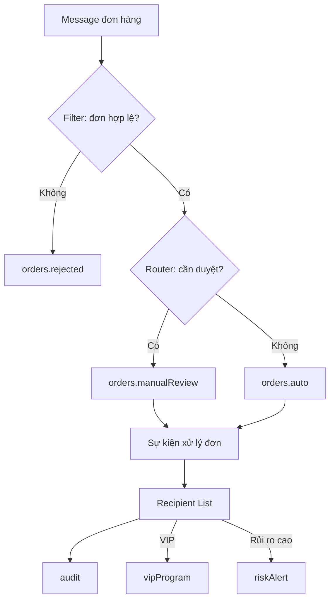
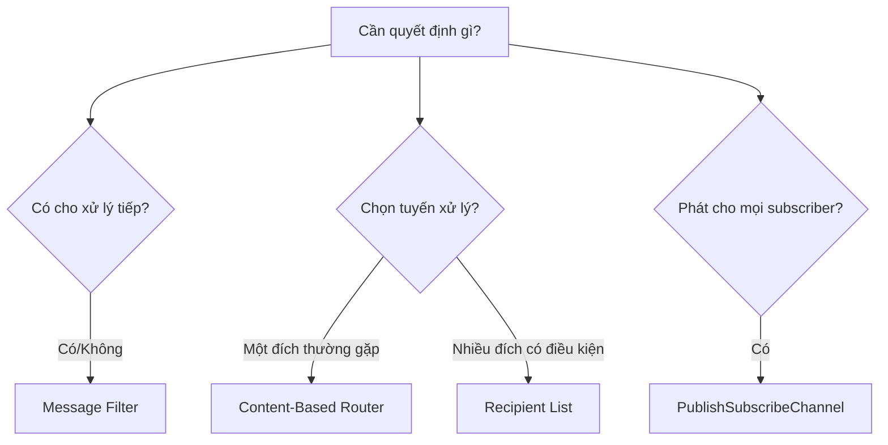

# Phân biệt router với filter và recipient list

## 1. Vì sao cần phân biệt ba pattern?

Một hệ thống xử lý đơn hàng thường phải trả lời ba câu hỏi khác nhau:

1. **Message có được xử lý tiếp không?** Đơn hàng thiếu mã hoặc giá trị âm phải bị từ chối.
2. **Message hợp lệ nên đi đến nhánh nào?** Đơn hàng giá trị cao cần xét duyệt; đơn hàng thông thường được xử lý tự động.
3. **Message cần được gửi đến những đối tượng nào?** Một sự kiện đơn hàng có thể vừa gửi cho bộ phận audit, vừa gửi cho chương trình khách hàng VIP và hệ thống cảnh báo.

Ba câu hỏi này tương ứng với ba pattern:

- **Message Filter**: kiểm tra một điều kiện và cho message đi tiếp hoặc loại message khỏi đường đi chính.
- **Content-Based Router / Message Router**: chọn đích xử lý dựa trên nội dung hoặc header của message.
- **Recipient List**: xác định danh sách người nhận, có thể gửi cùng một message đến nhiều đích phù hợp.

Trong module **SPRING_INTEGRATION_PATTERN**, chương **Message router** giúp thực hành các Enterprise Integration Patterns bằng Spring Integration để xây dựng luồng ít phụ thuộc và dễ mở rộng. Phân biệt đúng ba pattern còn giúp phối hợp Transformer, Splitter, Aggregator, Gateway, retry, error channel và correlation; mỗi nhánh có thể được kiểm thử và quan sát một cách độc lập.

Sau bài này, bạn sẽ chọn được pattern phù hợp với yêu cầu nghiệp vụ, cấu hình bằng Java DSL, xác định chính sách cho message không khớp quy tắc, tránh tác dụng phụ do gửi tới nhiều recipient và viết kiểm thử chứng minh những quyết định định tuyến.

## 2. So sánh nhanh theo quyết định nghiệp vụ

| Tiêu chí | Message Filter | Message Router | Recipient List |
| --- | --- | --- | --- |
| Câu hỏi chính | Có được đi tiếp? | Đi theo đường nào? | Gửi đến những ai? |
| Kết quả kiểm tra | `true` hoặc `false` | Một hoặc nhiều đích theo quy tắc router | Tập recipient thỏa điều kiện |
| Cách dùng phổ biến | Giữ 1 message hoặc loại khỏi tuyến chính | Chọn **một nhánh** trong nhiều nhánh | Gửi đến **nhiều nhánh** có thể đồng thời đúng |
| Không có lựa chọn phù hợp | Loại message, đưa sang discard channel hoặc ném lỗi theo cấu hình | Đến default output, không resolve được hoặc bị bỏ tùy cấu hình | Có thể không gửi đến recipient nào; cần chính sách rõ |
| Một message có thể đi nhiều đích? | Thường không; discard là đường xử lý kết quả bị loại | **Có thể**, nếu router trả danh sách nhiều đích | **Có**, đây là mục đích chính |
| Ví dụ | Chỉ chấp nhận đơn hàng có số lượng dương | Đơn lớn → review, đơn nhỏ → auto | Sự kiện → audit + VIP + cảnh báo |

**Không hiểu router là “bắt buộc đúng một đích” trong mọi cấu hình.** Nhiều message router trong Spring Integration có thể trả nhiều channel hoặc channel key, tùy router và chiến lược resolution. Nhưng *Content-Based Router* thường được dùng để lựa chọn một tuyến xử lý, còn *Recipient List* thể hiện rõ ý định gửi tới nhiều bên nhận đã được liệt kê.

### Hình dung trên cùng một ví dụ



Hình trên là **sơ đồ nghiệp vụ**: khi triển khai cần xác định rõ producer nào phát sự kiện ở bước F; chỉ nối thêm một channel vào sơ đồ không tự phát sự kiện từ cả hai nhánh.

## 3. Message Filter: giữ hoặc loại message

Message Filter dùng một **predicate** (điều kiện đúng/sai) để quyết định message có tiếp tục trên đường chính hay không.

Ví dụ điều kiện hợp lệ cho đơn hàng:

- `orderId` không rỗng;
- `amount` tồn tại và không âm;
- tenant của đơn hàng đã được xác thực ở ingress.

Nếu điều kiện trả `true`, message được gửi đến output channel của filter. Nếu trả `false`, filter có thể **bỏ message**, **gửi vào discard channel**, hoặc **ném exception khi bị từ chối** theo cấu hình.

Điểm quan trọng: **lọc một message không đồng nghĩa với message có lỗi kỹ thuật**. Có những điều kiện loại là quyết định nghiệp vụ bình thường (ví dụ loại event chưa đến kỳ xử lý). Với dữ liệu sai mà caller cần biết, nên có nhánh từ chối hoặc thông báo lỗi tường minh.

Ví dụ Java DSL minh họa:

```java
IntegrationFlow.from("incomingOrders")
    .filter(Order.class,
        order -> order.id() != null
            && !order.id().isBlank()
            && order.amount() != null
            && order.amount().signum() >= 0,
        spec -> spec.discardChannel("orders.rejected"))
    .channel("orders.validated")
    .get();
```

Hai kết quả được xử lý riêng:

- **Pass**: message đi đến `orders.validated` mà không cần thay đổi payload.
- **Reject**: message đi đến `orders.rejected`, nơi một consumer có thể ghi lý do từ chối, trả lỗi API hoặc đưa vào quy trình sửa dữ liệu.

Filter không quyết định rằng đơn hợp lệ phải đến `manualReview` hay `auto`. Đó là trách nhiệm của Router.

### Filter khác Transformer và Router ở đâu?

Transformer biến đổi payload hoặc biểu diễn message: `OrderCommand → ValidatedOrder`. Filter giữ hoặc loại message. Router chọn đường đi. Có thể dùng cả ba theo chuỗi **Filter → Transformer → Router**, nhưng tránh viết một Filter tự ghi database, tự gọi API và tự định tuyến bởi lúc đó predicate đã chứa nhiều trách nhiệm.

## 4. Router: chọn đường đi dựa trên nội dung hoặc header

Router thường nhận một message, đánh giá biểu thức/hàm định tuyến và xác định destination. Với Content-Based Router, quyết định thường dựa trên payload:

- `amount >= 1000` → `orders.manualReview`;
- `amount < 1000` → `orders.auto`.

Một ví dụ:

```java
IntegrationFlow.from("orders.validated")
    .route(Order.class,
        order -> order.amount().compareTo(
            new BigDecimal("1000")) >= 0 ? "review" : "auto",
        spec -> spec
            .channelMapping("review", "orders.manualReview")
            .channelMapping("auto", "orders.auto"))
    .get();
```

Ở đây `"review"` và `"auto"` là **routing key**, được ánh xạ tới tên channel có ý nghĩa. Router thường không sửa payload; nó gửi message đến đích dựa trên quyết định định tuyến.

Router cũng có thể đọc header, chẳng hạn `headers['tenantTier']`, nhưng phải xác định header do ai cung cấp. Nếu một HTTP client tự khai `X-Tenant-Tier: PREMIUM` mà ứng dụng tin ngay để bỏ qua xét duyệt, đây là lỗi **ranh giới tin cậy**, không phải lỗi của Router. Metadata có ảnh hưởng đến phân quyền, giá hoặc ưu tiên phải đến từ nguồn đã xác thực.

### Những loại router có thể gặp

| Router | Căn cứ quyết định | Ví dụ |
| --- | --- | --- |
| Payload/content-based router | Trường của payload hoặc biểu thức | Giá trị đơn hàng cao → manual review |
| Header value router | Giá trị header đã tin cậy | `region=EU` → tuyến EU |
| Payload type router | Kiểu payload | `InvoiceEvent` → invoice flow |
| Custom router | Logic Java hoặc service điều phối | Tính nhánh từ trạng thái nghiệp vụ phức tạp |
| Recipient List Router | Danh sách recipients và các selector | Gửi event đến audit và những hệ thống quan tâm |

Trong Spring Integration, tên router, API DSL và cách cấu hình có thể khác theo phiên bản. Hãy sử dụng router đơn giản nhất thể hiện đúng **cách chọn đích**; chuyển logic phức tạp sang hàm/service có thể kiểm thử.

### Nếu router không chọn được channel

Không có nhánh khớp có thể do:

- biểu thức trả key mà chưa có `channelMapping`;
- giá trị header không được khai báo;
- một destination đã thay tên hoặc không có subscriber;
- router chọn được tên channel nhưng ứng dụng không tạo channel/consumer phù hợp.

Có thể định nghĩa default output channel cho các tình huống không xác định, hoặc cấu hình router báo lỗi khi không resolve được đích. **Không dựa vào default không kiểm chứng**: quyết định từ chối, gửi sang nhánh fallback hay báo lỗi phải phù hợp hợp đồng nghiệp vụ và cấu hình router đang dùng.

## 5. Recipient List: cùng một message đến nhiều nơi

Pattern **Recipient List** chọn một **tập người nhận** cho mỗi message. Mỗi recipient có thể luôn được nhận, hoặc chỉ nhận khi một selector thỏa điều kiện. Các selector **được đánh giá độc lập**: nhiều điều kiện có thể cùng đúng.

Ví dụ mọi sự kiện đơn hàng đều đi tới `events.audit`. Ngoài ra:

- Nếu `vip == true`, gửi thêm tới `events.vip`.
- Nếu `manualReview == true`, gửi thêm tới `events.risk`.

Một message có cả hai header đúng sẽ được gửi tới **ba recipient**, không phải “chỉ recipient đầu tiên phù hợp”.

```java
IntegrationFlow.from("events.in")
    .routeToRecipients(spec -> spec
        .recipient("events.audit")
        .recipient("events.vip", "headers['vip'] == true")
        .recipient("events.risk", "headers['manualReview'] == true"))
    .get();
```

Nếu một message không có `vip` và `manualReview`, nó vẫn đi đến audit. Có thể thiết kế danh sách mà không có recipient luôn nhận; khi không selector nào đúng, cần chọn chính sách rõ ràng cho “không có người nhận”.

Recipient List phù hợp cho **phát cùng một sự kiện tới những mục đích độc lập**. Nếu chỉ muốn chọn một nhánh chịu trách nhiệm xử lý, dùng Content-Based Router thường rõ hơn và tránh tạo xử lý trùng.

### Recipient List khác Publish-Subscribe Channel

Hai lựa chọn đều có thể gửi một message tới nhiều consumer, nhưng ý định cấu hình khác nhau:

| Tiêu chí | Recipient List Router | PublishSubscribeChannel |
| --- | --- | --- |
| Ai chọn các nơi nhận? | Router quyết định dựa vào danh sách recipient và selector | Các subscriber đã đăng ký trên channel |
| Điều kiện theo từng message | Có thể khai báo selector cho từng recipient | Cần thêm filter hoặc logic ở subscriber nếu muốn chọn có điều kiện |
| Cách thể hiện topology | Danh sách đích rõ ràng trong router | Một pub-sub channel với nhiều subscriber |
| Mục đích | Routing có điều kiện đến một tập đích | Broadcast tới các subscriber của channel |

Không nên suy ra tất cả recipient luôn hoàn thành thành công chỉ vì route đã được gọi. Với channel đồng bộ, nếu gửi thành công cho recipient A nhưng recipient B ném exception, A có thể đã thực hiện side effect rồi. Việc retry cả event có thể khiến A nhận lần nữa. Không có giao dịch nguyên tử đa recipient được bảo đảm tự động.

## 6. Ví dụ Java DSL đầy đủ để quan sát ba pattern

Cấu hình dưới đây dùng **hai flow độc lập** nhằm quan sát rõ hành vi:

- Flow `orders.in`: **Filter** kiểm tra đơn hàng; **Router** chọn auto hoặc manual review.
- Flow `events.in`: **Recipient List** gửi sự kiện đến audit và các recipient theo header.

Các output được khai báo `QueueChannel` cho mục đích **kiểm thử**. Trong ứng dụng thật, chúng thường được thay bằng consumer/adapter phù hợp và có chính sách về capacity, timeout, retry và lưu trữ.

```java
import java.math.BigDecimal;

import org.springframework.context.annotation.Bean;
import org.springframework.context.annotation.Configuration;
import org.springframework.integration.channel.DirectChannel;
import org.springframework.integration.channel.QueueChannel;
import org.springframework.integration.config.EnableIntegration;
import org.springframework.integration.dsl.IntegrationFlow;
import org.springframework.messaging.MessageChannel;

record Order(String id, BigDecimal amount, boolean vip) {}

@Configuration
@EnableIntegration
public class RoutingPatternsConfiguration {

    @Bean("orders.in")
    public MessageChannel orderInput() {
        return new DirectChannel();
    }

    @Bean("events.in")
    public MessageChannel eventInput() {
        return new DirectChannel();
    }

    @Bean("orders.rejected")
    public QueueChannel rejectedOrders() {
        return new QueueChannel();
    }

    @Bean("orders.auto")
    public QueueChannel automaticOrders() {
        return new QueueChannel();
    }

    @Bean("orders.manualReview")
    public QueueChannel manualReviewOrders() {
        return new QueueChannel();
    }

    @Bean("events.audit")
    public QueueChannel auditEvents() {
        return new QueueChannel();
    }

    @Bean("events.vip")
    public QueueChannel vipEvents() {
        return new QueueChannel();
    }

    @Bean("events.risk")
    public QueueChannel riskEvents() {
        return new QueueChannel();
    }

    @Bean
    public IntegrationFlow validateAndRouteOrders() {
        return IntegrationFlow.from("orders.in")
            .filter(Order.class,
                order -> order.id() != null
                    && !order.id().isBlank()
                    && order.amount() != null
                    && order.amount().signum() >= 0,
                spec -> spec.discardChannel("orders.rejected"))
            .route(Order.class,
                order -> order.amount()
                    .compareTo(new BigDecimal("1000")) >= 0
                        ? "review" : "auto",
                spec -> spec
                    .channelMapping("review", "orders.manualReview")
                    .channelMapping("auto", "orders.auto"))
            .get();
    }

    @Bean
    public IntegrationFlow routeEventRecipients() {
        return IntegrationFlow.from("events.in")
            .routeToRecipients(spec -> spec
                .recipient("events.audit")
                .recipient("events.vip", "headers['vip'] == true")
                .recipient("events.risk",
                    "headers['manualReview'] == true"))
            .get();
    }
}
```

**Đọc flow theo tình huống:**

| Message đầu vào | Filter | Router / Recipient List | Kết quả |
| --- | --- | --- | --- |
| `Order("A", 300, false)` | Pass | `auto` | 1 message ở `orders.auto` |
| `Order("B", 1500, true)` | Pass | `review` | 1 message ở `orders.manualReview` |
| `Order("C", -10, false)` | Reject | Router không được gọi | 1 message ở `orders.rejected` |
| Event có `vip=true` và `manualReview=false` | Không có Filter ở flow event | Audit và VIP | 2 message đi tới 2 channel |
| Event có `vip=true` và `manualReview=true` | Không có Filter ở flow event | Audit, VIP và Risk | 3 message đi tới 3 channel |
| Event không có hai header trên | Không có Filter ở flow event | Chỉ Audit | 1 message ở `events.audit` |

Trong ví dụ, `vip` và `manualReview` của event là header **đã được producer đáng tin cậy gắn vào**. Không dùng header từ client chưa được xác thực để kích hoạt xử lý nhạy cảm. Hai flow độc lập nên **đơn hàng đi vào `orders.in` không tự phát event tới `events.in`**; ứng dụng có thể tạo event sau khi hoàn thành xử lý nghiệp vụ và gửi vào flow thứ hai.

## 7. Kiểm thử việc lọc, chọn một nhánh và chọn nhiều recipient

Có thể viết kiểm thử Spring Integration bằng JUnit 5 và AssertJ để xác nhận những hành vi khác nhau ngay trong ứng dụng, chưa cần HTTP API hoặc broker.

```java
import static org.assertj.core.api.Assertions.assertThat;

import java.math.BigDecimal;

import org.junit.jupiter.api.Test;
import org.springframework.beans.factory.annotation.Autowired;
import org.springframework.beans.factory.annotation.Qualifier;
import org.springframework.integration.channel.QueueChannel;
import org.springframework.messaging.Message;
import org.springframework.messaging.MessageChannel;
import org.springframework.messaging.support.MessageBuilder;
import org.springframework.test.context.junit.jupiter.SpringJUnitConfig;

@SpringJUnitConfig(RoutingPatternsConfiguration.class)
class RoutingPatternsTest {

    @Autowired
    @Qualifier("orders.in")
    MessageChannel orders;

    @Autowired
    @Qualifier("events.in")
    MessageChannel events;

    @Autowired
    @Qualifier("orders.rejected")
    QueueChannel rejected;

    @Autowired
    @Qualifier("orders.auto")
    QueueChannel automatic;

    @Autowired
    @Qualifier("orders.manualReview")
    QueueChannel manual;

    @Autowired
    @Qualifier("events.audit")
    QueueChannel audit;

    @Autowired
    @Qualifier("events.vip")
    QueueChannel vip;

    @Autowired
    @Qualifier("events.risk")
    QueueChannel risk;

    @Test
    void filterRejectsInvalidOrderBeforeRouter() {
        Order invalid = new Order("C", new BigDecimal("-10"), false);
        boolean sent = orders.send(
            MessageBuilder.withPayload(invalid).build());

        assertThat(sent).isTrue();
        assertThat(rejected.receive(0)).isNotNull();
        assertThat(automatic.receive(0)).isNull();
        assertThat(manual.receive(0)).isNull();
    }

    @Test
    void routerSelectsExactlyOneOrderDestination() {
        Order expensive =
            new Order("B", new BigDecimal("1500"), true);

        assertThat(orders.send(
            MessageBuilder.withPayload(expensive).build())).isTrue();

        Message<?> output = manual.receive(1_000);
        assertThat(output).isNotNull();
        assertThat(output.getPayload()).isEqualTo(expensive);
        assertThat(automatic.receive(0)).isNull();
        assertThat(rejected.receive(0)).isNull();
    }

    @Test
    void recipientListSendsToEveryMatchingRecipient() {
        Message<String> event = MessageBuilder.withPayload("order-B")
            .setHeader("vip", true)
            .setHeader("manualReview", true)
            .setHeader("requestId", "req-B")
            .build();

        assertThat(events.send(event)).isTrue();

        Message<?> auditCopy = audit.receive(1_000);
        Message<?> vipCopy = vip.receive(1_000);
        Message<?> riskCopy = risk.receive(1_000);

        assertThat(auditCopy).isNotNull();
        assertThat(vipCopy).isNotNull();
        assertThat(riskCopy).isNotNull();
        assertThat(auditCopy.getPayload()).isEqualTo("order-B");
        assertThat(vipCopy.getHeaders().get("requestId"))
            .isEqualTo("req-B");
        assertThat(riskCopy.getPayload()).isEqualTo("order-B");
    }
}
```

Lưu ý các `QueueChannel` trên mặc định chỉ phục vụ ví dụ. Nếu một test gửi nhiều message đến cùng queue, phải đọc hết kết quả hoặc dùng context/fixture mới để tránh kết quả từ test khác làm sai assertion. Kiểm thử vận hành còn cần đo thời gian, xử lý lỗi ở từng recipient, retry và idempotency với các side effect thật.

### Những test case nên có thêm

| Test case | Điều cần khẳng định |
| --- | --- |
| Header định tuyến thiếu hoặc sai kiểu | Router/selector áp dụng fallback hoặc báo lỗi theo contract, không định tuyến tùy tiện. |
| Không có recipient thỏa điều kiện | Có log, metric, drop hoặc fallback rõ; không im lặng đánh mất sự kiện quan trọng. |
| Hai selector cùng đúng | Cả hai recipient nhận message; số lần phát đúng. |
| Một selector sai, một selector đúng | Recipient không hợp lệ không được nhận; recipient đúng vẫn nhận. |
| Destination không có consumer | Lỗi gửi được quan sát và xử lý; không hiểu nhầm là đã xử lý xong. |
| Recipient thứ hai lỗi sau khi recipient đầu nhận thành công | Có idempotency/recovery; không giả định toàn bộ fan-out rollback. |
| Retry cùng một event | Side effect có thể phát lại, cần chống trùng bằng `eventId`. |
| Header `tenantId` hoặc quyền do client giả mạo | Không được dùng để định tuyến dữ liệu sang tenant khác hoặc bỏ qua chính sách. |

## 8. Error handling: khác nhau ở Filter, Router và Recipient List

### Filter loại message

Trường hợp `false` là **kết quả đánh giá**, không mặc nhiên là exception. Nếu không cấu hình `discardChannel` hoặc chế độ ném lỗi, message bị loại khỏi đường chính. Với yêu cầu audit hoặc phản hồi người gọi, nên định nghĩa một consumer cho rejected message.

Nếu muốn coi dữ liệu không hợp lệ là exception, có thể dùng tùy chọn của Filter như `throwExceptionOnRejection(true)`, tùy API/configuration. Việc dùng exception hay discard cần nhất quán với thiết kế request/reply và error flow.

### Router không định tuyến được

Router có thể không tìm ra đích khi key không được map hoặc destination không thể resolve. Phải phân biệt:

- **Không có key hợp lệ**: dữ liệu sai hoặc luật định tuyến thiếu trường hợp.
- **Có key nhưng không có destination**: lỗi cấu hình hoặc topology.
- **Có destination nhưng gửi thất bại**: lỗi dispatch/channel/subscriber.

Các tình huống có thể cần hướng xử lý khác nhau. Một default output channel phù hợp cho loại nghiệp vụ chưa được nhận diện; lỗi cấu hình nên được báo rõ thay vì chuyển sang nhánh bất kỳ.

### Recipient List gửi thành công một phần

Với nhiều recipient, mỗi lần gửi có thể kéo theo side effect độc lập. Ví dụ audit đã lưu event, sau đó hệ thống VIP không sẵn sàng; việc retry cả message có thể khiến audit nhận lần nữa.

Không nên coi **gửi tới nhiều channel** là một giao dịch phân tán. Để an toàn hơn:

1. Định nghĩa `eventId` ổn định và cơ chế idempotency ở mỗi consumer.
2. Cấu hình retry theo recipient hoặc qua broker khi cần phục hồi độc lập.
3. Ghi rõ ai chịu trách nhiệm theo dõi việc giao tới từng recipient.
4. Dùng transactional outbox hoặc broker nếu yêu cầu giao tin bền vững qua lỗi tiến trình.
5. Giới hạn timeout và backpressure khi có recipient chậm.

Một số channel xử lý đồng bộ trên thread gửi, những channel khác dùng executor hoặc polling. Vì vậy lỗi và thứ tự hoàn tất còn phụ thuộc loại channel, không phải chỉ thuộc tính của Recipient List Router.

## 9. Tác động tới thread, thứ tự và correlation

**Router không tự định nghĩa mô hình concurrency.** Cùng một router có thể gửi vào:

- `DirectChannel`: thường chạy subscriber trên thread gửi và có thể lan exception đồng bộ.
- `ExecutorChannel`: dispatch bằng executor, thay đổi ranh giới thread và cách quan sát lỗi.
- `QueueChannel`: lưu vào queue cho polling consumer, thời điểm gửi thành công tách khỏi thời điểm xử lý xong.
- AMQP/JMS/Kafka adapter: tạo ranh giới transport với ack, retry, header mapping và delivery semantics riêng.

Khi gửi tới nhiều recipient, không nên suy ra rằng toàn bộ recipient xử lý theo cùng thứ tự hoặc cùng hoàn tất trước khi producer tiếp tục. Tùy channel và endpoint, mỗi recipient có thể có mức độ đồng bộ khác nhau.

### Correlation và trace

Nếu một sự kiện được gửi tới ba consumer, cùng một `requestId` hoặc `eventId` giúp đối chiếu ba kết quả. Tuy nhiên:

- `MessageHeaders.ID` của framework không nên tự động được xem như business idempotency key.
- `correlationId` được Splitter/Aggregator dùng để nhóm message không đồng nghĩa với correlation của HTTP, JMS hoặc broker khác.
- Nếu ba nhánh sau đó cần ghép lại thành một kết quả, phải thiết kế **fan-out/fan-in** cụ thể: correlation key, số phần cần nhận, release strategy và timeout của Aggregator.
- Nếu Recipient List chỉ phục vụ audit/thông báo độc lập, thường **không cần đợi đủ ba reply** trước khi hoàn thành nghiệp vụ chính.

### Filter trước Aggregator có thể làm kẹt nhóm

Splitter tạo ba message với `sequenceSize = 3`. Nếu Filter loại một message trước khi Aggregator nhận mà không có chiến lược bù hoặc điều chỉnh release, Aggregator có thể chờ mãi hai message còn lại. Giải pháp phải nằm trong hợp đồng: phát kết quả loại như một phần hợp lệ, xử lý timeout, hoặc chọn release strategy khác. Không sửa `sequenceSize` tùy tiện ở một nhánh riêng.

## 10. Chọn pattern theo tình huống



Bảng quyết định nhanh:

| Yêu cầu | Pattern phù hợp | Lý do |
| --- | --- | --- |
| Bỏ các sự kiện chưa đủ dữ liệu | Filter | Chỉ cần một predicate và chính sách reject/drop. |
| Chuyển đơn có rủi ro cao đến xét duyệt, còn lại tự động | Router | Chọn tuyến xử lý theo đặc tính đơn hàng. |
| Gửi event đến audit và những hệ thống thỏa điều kiện | Recipient List | Các selector độc lập, nhiều bên có thể cùng nhận. |
| Phát message cho mọi subscriber của một channel | Publish-Subscribe Channel | Đăng ký subscriber phù hợp với nhu cầu broadcast. |
| Gửi từng phần của đơn hàng vào các nhánh rồi ghép kết quả | Router/Splitter kết hợp Aggregator | Ngoài routing cần correlation và release để fan-in. |
| Không hợp lệ thì báo lỗi, hợp lệ thì chọn một kênh | Filter rồi Router | Hai quyết định có mục đích khác nhau và kiểm thử độc lập. |

Có thể phối hợp pattern trong một pipeline. Cách chia tốt là đặt câu hỏi cho từng bước: **bước này xác nhận điều kiện, chọn đích, hay tạo danh sách người nhận?** Một method duy nhất làm cả ba việc sẽ khó kiểm thử và khó quản lý side effect.

## 11. Những lỗi thiết kế thường gặp

| Hiện tượng | Nguyên nhân | Cách khắc phục |
| --- | --- | --- |
| Dùng Router cho một điều kiện đúng/sai rồi tạo nhánh “drop” phức tạp | Trường hợp chỉ cần loại message | Xem xét Filter với discard/rejection rõ ràng. |
| Dùng Filter nhưng mong đưa message tới một trong nhiều đích | Filter không có trách nhiệm chọn nhiều tuyến xử lý | Thêm Router sau bước lọc. |
| Dùng router chọn một đích cho yêu cầu audit + thông báo | Ý định thực tế là fan-out nhiều recipient | Dùng Recipient List hoặc publish-subscribe phù hợp. |
| Chỉ recipient đầu nhận được event | Logic `if / else if` hoặc route theo một key | Kiểm tra selector độc lập của Recipient List và topology đầu ra. |
| Gửi event lặp sau retry | Retry cả fan-out sau khi một recipient đã có side effect | Thêm event id, idempotency, cơ chế phát độc lập theo recipient. |
| Message “biến mất” khi không có nhánh | Không có fallback, discard hoặc quan sát trường hợp no-match | Cấu hình chính sách không khớp, metric và test. |
| Router định tuyến theo quyền người dùng khai báo | Header chưa được xác thực | Tạo thông tin trusted ở ingress và kiểm tra tenant/authorization. |
| Aggregator chờ mãi sau Filter | Một phần của chuỗi đã bị loại | Thiết kế release/partial/timeout khi có Filter ở giữa. |
| Gửi thành công nhưng handler downstream lỗi | Channel/endpoint không đồng bộ hoặc consumer xử lý sau | Quan sát riêng send, processing, error flow và retry. |

## 12. Bài thực hành

### Bài 1 — Chọn pattern

Với mỗi yêu cầu dưới đây, xác định dùng Filter, Router, Recipient List hay kết hợp:

1. Chỉ xử lý hóa đơn đã được xác thực.
2. Hóa đơn bằng ngoại tệ phải đi sang service chuyển đổi; nội tệ đi trực tiếp.
3. Sau khi tạo đơn hàng, gửi sự kiện cho audit; nếu là khách VIP, gửi thêm cho CRM.
4. Mọi subscriber đăng ký vào channel `systemEvents` đều nhận sự kiện.
5. Hóa đơn bị từ chối cần đưa vào kênh riêng để nhân viên kiểm tra.

Giải thích chọn pattern bằng **câu hỏi mà endpoint trả lời**, không chỉ bằng số lượng dòng Java cần viết.

### Bài 2 — Kiểm thử các nhánh không thể trộn

Mở rộng ví dụ ở mục 6: thêm trường `riskScore` và hai nhánh `orders.manualReview` / `orders.auto`. Với mỗi message, test:

- Một đơn hợp lệ nhỏ đi **đúng một** nhánh auto.
- Một đơn hợp lệ rủi ro cao đi **đúng một** nhánh review.
- Một đơn thiếu mã không đi qua Router.
- Header `requestId` được giữ tại output.

### Bài 3 — Recipient List có nhiều selector đúng

Thêm recipient `events.marketing` khi header `campaignEligible == true`. Gửi một sự kiện đồng thời thỏa VIP, marketing và manual review. Viết test xác nhận audit, VIP, marketing và risk cùng nhận. Gửi tiếp sự kiện không thỏa điều kiện nào và kiểm tra chỉ audit nhận.

### Bài 4 — Lỗi một phần và retry

Giả sử audit lưu thành công nhưng CRM thất bại sau khi nhận cùng sự kiện. Thiết kế cách retry chỉ phần CRM thất bại, hoặc cách retry có thể an toàn nhờ `eventId`. Giải thích vì sao một lời gọi Recipient List không mang nghĩa transaction cho tất cả recipient.

### Bài 5 — Fan-out và fan-in

Một yêu cầu cần kết quả từ ba dịch vụ kiểm tra: FRAUD, CREDIT và SHIPPING. Hãy phân biệt bài toán **gửi tới ba nơi** với bài toán **đợi đủ ba kết quả**. Thiết kế sơ đồ dùng Recipient List/Router ở phía gửi và Aggregator ở phía nhận, chỉ rõ correlation key, release strategy, reply timeout và chính sách khi một dịch vụ không trả lời.

## 13. Những điều cần ghi nhớ

- **Filter** quyết định pass/reject theo predicate; nhánh discard hoặc exception là một lựa chọn cấu hình.
- **Router** quyết định nơi message được xử lý tiếp; lựa chọn một nhánh là trường hợp phổ biến, nhưng khả năng gửi nhiều đích vẫn tồn tại trong một số router.
- **Recipient List** diễn đạt rõ nhu cầu gửi đến nhiều người nhận, mỗi recipient có thể có selector riêng và nhiều selector có thể cùng đúng.
- **Publish-Subscribe Channel** là cách khác để broadcast tới các subscriber, với hợp đồng cấu hình khác Recipient List.
- Không có recipient, không map được destination, lỗi gửi ở một recipient và lỗi nghiệp vụ sau khi nhận là **những tình huống khác nhau**; cần xử lý và kiểm thử riêng.
- Khi fan-out kèm side effect, cần `eventId`, idempotency, timeout và quan sát từng recipient.
- Khi muốn gom lại các kết quả từ nhiều nhánh, phải thiết kế thêm Aggregator, correlation và release strategy.

## Tài liệu tham khảo

- [Spring Integration Reference — Message Routing](https://docs.spring.io/spring-integration/reference/router.html)
- [Spring Integration Reference — Message Filtering](https://docs.spring.io/spring-integration/reference/filter.html)
- [Spring Integration Reference — Recipient List Router](https://docs.spring.io/spring-integration/reference/router/implementations.html)
- [Spring Integration Reference — Java DSL](https://docs.spring.io/spring-integration/reference/dsl.html)
- [Spring Integration Reference — Message Channels](https://docs.spring.io/spring-integration/reference/channel.html)
- [Spring Integration Reference — Error Handling](https://docs.spring.io/spring-integration/reference/error-handling.html)
- [Enterprise Integration Patterns — Content-Based Router](https://www.enterpriseintegrationpatterns.com/patterns/messaging/ContentBasedRouter.html)
- [Enterprise Integration Patterns — Message Filter](https://www.enterpriseintegrationpatterns.com/patterns/messaging/Filter.html)
- [Enterprise Integration Patterns — Recipient List](https://www.enterpriseintegrationpatterns.com/patterns/messaging/RecipientList.html)

Các ví dụ mô tả Java DSL trong các phiên bản Spring Integration hiện đại; khi đưa vào dự án, cần đối chiếu API, cấu hình router/selector và hành vi của loại channel đang sử dụng.
