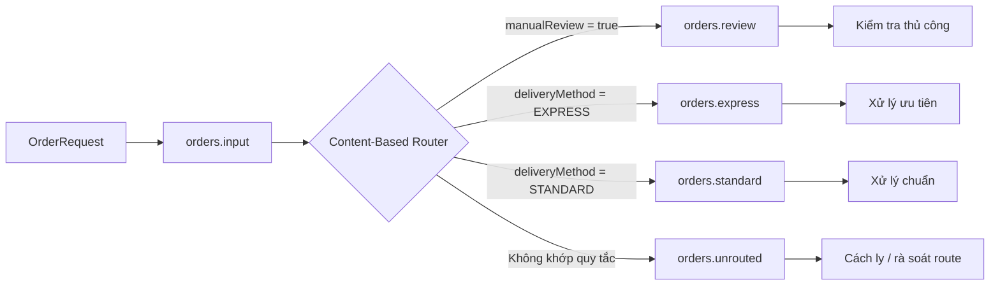
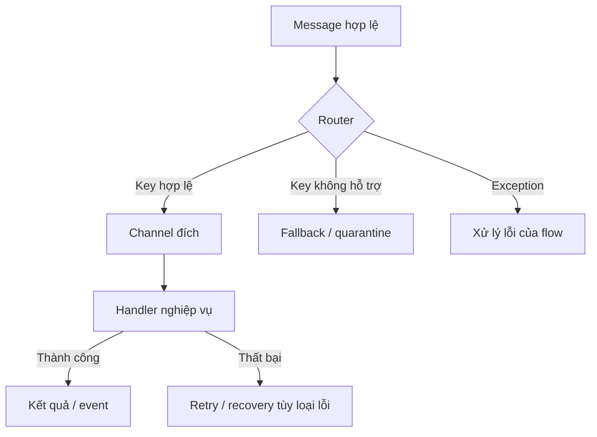
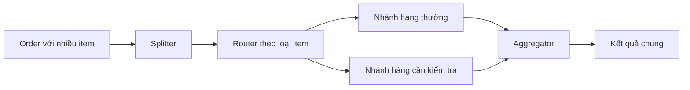

# Content-Based Router chọn đường theo nội dung

## 1. Bài toán: cùng một loại message nhưng cần xử lý ở các nhánh khác nhau

Một hệ thống bán hàng nhận `OrderRequest` từ nhiều cửa hàng. Đơn giao nhanh phải đến bộ phận xử lý ưu tiên; đơn thông thường đi vào quy trình chuẩn; đơn cần xác minh được chuyển đến nhóm kiểm tra thủ công. Nếu mọi endpoint đều tự kiểm tra điều kiện rồi quyết định có xử lý hay không, logic định tuyến sẽ bị phân tán và khó thay đổi.

**Content-Based Router** là một *Enterprise Integration Pattern* (EIP) nhận message, **đánh giá nội dung của message** theo một quy tắc và gửi message đến **channel hoặc endpoint thích hợp**. Trong Spring Integration, Router là một *message endpoint* chuyên chịu trách nhiệm quyết định đường đi; các bước nghiệp vụ phía sau không cần biết toàn bộ quy tắc phân nhánh.

Bài thuộc chương **Content-based router** của module **SPRING_INTEGRATION_PATTERN**. Module tập trung triển khai Enterprise Integration Patterns bằng Spring Integration để xây dựng luồng thông điệp ít phụ thuộc, dễ mở rộng, với Router, Filter, Transformer, Splitter, Aggregator, Gateway, retry, error channel và correlation, cùng kỹ thuật kiểm thử và theo dõi các nhánh xử lý. Ta bắt đầu bằng một Content-Based Router xác định, dễ kiểm thử rồi xem cách nó phối hợp với các mẫu còn lại.



**Hai trách nhiệm được tách ra:** Router chọn nơi xử lý; handler tại nhánh được chọn thực hiện công việc. Vì vậy, thay đổi quy tắc gửi đơn giao nhanh không nhất thiết phải sửa `ExpressOrderService`, và đổi cách lưu đơn cũng không cần thay Router.

### 1.1. Khi nào cần Content-Based Router?

| Tình huống | Nội dung được xét | Nhánh kết quả |
| --- | --- | --- |
| Phân loại đơn hàng | Phương thức giao, cờ cần xác minh, giá trị đơn | Nhanh, thường, kiểm tra |
| Xử lý thanh toán | Loại giao dịch, đơn vị tiền, quốc gia | Cổng thanh toán tương ứng |
| Điều phối tài liệu | Loại chứng từ, phiên bản schema | Parser/validator phù hợp |
| Xử lý sự kiện | Loại sự kiện và trạng thái trong payload | Cập nhật tồn kho, hóa đơn, thông báo |
| Luồng hỗ trợ khách hàng | Chủ đề và mức ưu tiên của yêu cầu | Nhóm hỗ trợ chuyên môn |

Content-Based Router có ích nhất khi mỗi message có thể được phân loại bằng quy tắc rõ ràng trước khi chạy nghiệp vụ ở nhánh đích.

## 2. Router quyết định đường đi như thế nào?

Một message gồm **payload** (dữ liệu chính) và **headers** (metadata). Content-Based Router thường đọc payload trực tiếp hoặc dùng giá trị đã được suy ra từ payload; chẳng hạn `deliveryMethod` trong `OrderRequest`. Sau khi tính **routing key**, Router chọn recipient được cấu hình cho key đó.

```text
Input: Message<OrderRequest>
   payload: OrderRequest("ORD-001", 450000, "EXPRESS", false)
   headers: { tenantId: "store-hcm", eventId: "evt-001" }

Decision: deliveryMethod = EXPRESS
Route key: "EXPRESS"
Mapping:   "EXPRESS" -> orders.express
Result:    gửi message đến orders.express
```

Tập quy tắc minh họa:

| Ưu tiên | Điều kiện | Routing key | Output channel |
| --- | --- | --- | --- |
| 1 | `manualReview == true` | `REVIEW` | `orders.review` |
| 2 | `deliveryMethod == "EXPRESS"` | `EXPRESS` | `orders.express` |
| 3 | `deliveryMethod == "STANDARD"` | `STANDARD` | `orders.standard` |
| Cuối | Không đáp ứng các quy tắc trên | `UNSUPPORTED` | `orders.unrouted` |

Nếu đơn hàng vừa mang `manualReview=true` vừa có `deliveryMethod="EXPRESS"`, quy tắc **REVIEW được ưu tiên**. Việc xác định thứ tự xét điều kiện rất quan trọng khi các điều kiện có thể đồng thời đúng. Hãy ghi rõ thứ tự trong chính hàm quyết định và kiểm thử các trường hợp chồng lấp.

### 2.1. Một message đến một nhánh hay nhiều nhánh?

Trong mô hình cơ bản, Content-Based Router chọn **một đường xử lý chính** cho mỗi message. Nếu muốn gửi một message đến **nhiều nhánh độc lập**, hãy cân nhắc **Recipient List Router** hoặc Publish-Subscribe, vì semantics lúc đó khác với chọn một nhánh loại trừ.

Ví dụ đơn hàng vừa cần **kiểm tra gian lận** vừa cần **cập nhật thống kê** không nhất thiết phải chọn một trong hai. Có thể đưa thống kê vào một flow theo dõi riêng, còn Content-Based Router chọn nhánh xử lý đơn chính.

### 2.2. Nội dung, header và routing key khác nhau

**Payload** chứa sự thật nghiệp vụ, chẳng hạn `deliveryMethod`, số tiền hoặc trạng thái đơn hàng. **Routing key** là kết quả phân loại của một hàm; ví dụ `"EXPRESS"`. **Channel name** là đích cụ thể trong hệ thống; ví dụ `"orders.express"`.

Ta có thể tách:

```text
OrderRequest -> RoutingPolicy -> routing key -> channel mapping -> MessageChannel
```

Tách key khỏi tên channel giúp thay đổi topology mà ít ảnh hưởng đến logic phân loại. Trong Spring Integration, **Header Value Router** đặc biệt phù hợp khi key đã nằm trong header; còn Content-Based Router thường đánh giá payload hoặc biểu thức trên message. Nếu header `routeKey` được tạo từ payload bởi một bước trước, cần kiểm tra rằng nó không bị cũ khi payload thay đổi.

## 3. Viết chính sách định tuyến thành hàm thuần

Định tuyến nên **xác định, có đầu vào/đầu ra rõ ràng và ít hiệu ứng phụ**. Với một message và cùng bộ quy tắc, hàm nên trả cùng routing key. Tách hàm này khỏi Spring Integration giúp kiểm thử nhanh mà không phải dựng toàn bộ channel.

Định nghĩa dữ liệu đơn hàng:

```java
record OrderRequest(
        String orderId,
        long amountVnd,
        String deliveryMethod,
        boolean manualReview) {
}
```

Tạo hàm ra quyết định:

```java
final class OrderRoutingPolicy {
    private OrderRoutingPolicy() {}

    static String decide(OrderRequest order) {
        // Khi có cờ cần kiểm tra, REVIEW thắng các điều kiện giao hàng.
        if (order.manualReview()) {
            return "REVIEW";
        }

        if ("EXPRESS".equals(order.deliveryMethod())) {
            return "EXPRESS";
        }

        if ("STANDARD".equals(order.deliveryMethod())) {
            return "STANDARD";
        }

        return "UNSUPPORTED";
    }
}
```

Các giá trị `EXPRESS`, `STANDARD` và `REVIEW` là **khóa phân loại** do ứng dụng quy định. `UNSUPPORTED` cho phép bắt các loại mới hoặc chưa được hỗ trợ. Khi dữ liệu đến từ API công khai, bạn có thể dùng enum/schema validation để giới hạn loại hợp lệ ngay từ đầu; ví dụ cố ý dùng chuỗi để minh họa khả năng một nhà tích hợp gửi giá trị chưa biết.

**Không trộn validation và phân loại một cách mơ hồ.** Trường `orderId` trống hoặc `amountVnd <= 0` là **dữ liệu sai**, nên bị từ chối rõ ràng trước khi điều phối. Trái lại, `deliveryMethod="SAME_DAY"` có thể là phương thức mới hợp lệ với đối tác nhưng hiện hệ thống chưa hỗ trợ; việc đưa vào nhánh `orders.unrouted` giúp phát hiện nhu cầu cập nhật rule.

### 3.1. Thuật toán định tuyến có cần truy vấn database?

Router nên dựa trên thông tin đã có trong message khi có thể. Nếu mỗi message đều phải gọi HTTP hoặc truy vấn database để biết nhánh, routing trở thành điểm nghẽn và khó retry. Trong trường hợp cần dữ liệu bổ sung, cân nhắc **Content Enricher/Service Activator** lấy dữ liệu trước, rồi cho Router chạy trên một payload hoặc header đã được làm giàu.

Ví dụ:

```text
OrderRequest -> Enricher (thêm mức rủi ro) -> Content-Based Router
```

Khi thông tin điều phối thay đổi liên tục theo cấu hình vận hành, cân nhắc cơ chế quản trị rule có version và kiểm thử, tránh thay đổi điều kiện động không được ghi nhận.

## 4. Cấu hình Content-Based Router bằng Spring Integration Java DSL

Ta ghép **Filter kiểm tra đầu vào → Router chọn channel → Service Activator mỗi nhánh**. Đây là ví dụ cho ứng dụng Java hỗ trợ `record` và đã cấu hình Spring Integration. Các lớp `OrderRequest` và `OrderRoutingPolicy` ở phần 3 được dùng lại.

Hợp đồng xử lý nghiệp vụ ở các nhánh:

```java
interface OrderBranchService {
    void processExpress(OrderRequest order);
    void processStandard(OrderRequest order);
    void queueForManualReview(OrderRequest order);
    void quarantineUnsupported(OrderRequest order);
}
```

Khai báo channels và flow:

```java
import org.springframework.context.annotation.Bean;
import org.springframework.context.annotation.Configuration;
import org.springframework.integration.channel.DirectChannel;
import org.springframework.integration.config.EnableIntegration;
import org.springframework.integration.dsl.IntegrationFlow;
import org.springframework.messaging.MessageChannel;

@Configuration
@EnableIntegration
class OrderRouterConfiguration {

    @Bean("orders.input")
    MessageChannel inputChannel() {
        return new DirectChannel();
    }

    @Bean("orders.express")
    MessageChannel expressChannel() {
        return new DirectChannel();
    }

    @Bean("orders.standard")
    MessageChannel standardChannel() {
        return new DirectChannel();
    }

    @Bean("orders.review")
    MessageChannel reviewChannel() {
        return new DirectChannel();
    }

    @Bean("orders.unrouted")
    MessageChannel unroutedChannel() {
        return new DirectChannel();
    }

    @Bean
    IntegrationFlow routeOrders() {
        return IntegrationFlow.from("orders.input")
                .filter(OrderRequest.class,
                        order -> order.orderId() != null
                                && !order.orderId().isBlank()
                                && order.amountVnd() > 0,
                        spec -> spec.throwExceptionOnRejection(true))
                .route(OrderRequest.class,
                        OrderRoutingPolicy::decide,
                        spec -> spec
                                .channelMapping("REVIEW", "orders.review")
                                .channelMapping("EXPRESS", "orders.express")
                                .channelMapping("STANDARD", "orders.standard")
                                .defaultOutputChannel("orders.unrouted"))
                .get();
    }

    @Bean
    IntegrationFlow expressOrders(OrderBranchService service) {
        return IntegrationFlow.from("orders.express")
                .handle(OrderRequest.class, (order, headers) -> {
                    service.processExpress(order);
                    return null;
                })
                .get();
    }

    @Bean
    IntegrationFlow standardOrders(OrderBranchService service) {
        return IntegrationFlow.from("orders.standard")
                .handle(OrderRequest.class, (order, headers) -> {
                    service.processStandard(order);
                    return null;
                })
                .get();
    }

    @Bean
    IntegrationFlow reviewOrders(OrderBranchService service) {
        return IntegrationFlow.from("orders.review")
                .handle(OrderRequest.class, (order, headers) -> {
                    service.queueForManualReview(order);
                    return null;
                })
                .get();
    }

    @Bean
    IntegrationFlow unroutedOrders(OrderBranchService service) {
        return IntegrationFlow.from("orders.unrouted")
                .handle(OrderRequest.class, (order, headers) -> {
                    service.quarantineUnsupported(order);
                    return null;
                })
                .get();
    }
}
```

Diễn giải:

1. `orders.input` nhận `Message<OrderRequest>`; payload có thể được gửi từ Gateway, channel adapter hoặc producer nội bộ.
2. `filter` từ chối đơn không có `orderId` hợp lệ hoặc số tiền không dương. `throwExceptionOnRejection(true)` làm rõ lỗi thay vì âm thầm bỏ message.
3. `route(OrderRequest.class, ...)` tính **key từ payload** và ánh xạ key tới channel cụ thể.
4. `defaultOutputChannel("orders.unrouted")` tiếp nhận các key chưa ánh xạ thay vì để chúng đi tới nhánh ngẫu nhiên.
5. Mỗi flow tiếp theo chỉ làm việc của một nhánh và **không cần tự quyết định lại đơn hàng thuộc nhánh nào**.

**Giới hạn của ví dụ:** `DirectChannel` xử lý trong bộ nhớ và thường đồng bộ trên thread gửi; nó không tạo queue bền vững. Các phương thức `queueForManualReview` và `quarantineUnsupported` chỉ thực sự lưu an toàn nếu **implementation** của `OrderBranchService` ghi vào database/queue bền vững. Việc `.handle(...)` trả `null` kết thúc xử lý một chiều, không tự tạo reply cho Gateway đang chờ kết quả.

### 4.1. Gửi message để quan sát Router

Ví dụ một producer đã được inject channel `orders.input`:

```java
import org.springframework.beans.factory.annotation.Qualifier;
import org.springframework.messaging.MessageChannel;
import org.springframework.messaging.support.MessageBuilder;
import org.springframework.stereotype.Component;

@Component
class OrderProducer {
    private final MessageChannel ordersInput;

    OrderProducer(@Qualifier("orders.input") MessageChannel ordersInput) {
        this.ordersInput = ordersInput;
    }

    void sendExamples() {
        var express = new OrderRequest(
                "ORD-001", 450_000L, "EXPRESS", false);
        var review = new OrderRequest(
                "ORD-002", 8_000_000L, "EXPRESS", true);

        ordersInput.send(MessageBuilder.withPayload(express)
                .setHeader("tenantId", "store-hcm")
                .setHeader("eventId", "evt-001")
                .setHeader("traceId", "trace-001")
                .build());

        ordersInput.send(MessageBuilder.withPayload(review)
                .setHeader("tenantId", "store-hcm")
                .setHeader("eventId", "evt-002")
                .setHeader("traceId", "trace-002")
                .build());
    }
}
```

Kết quả mong đợi:

| Order | Payload liên quan | Nhánh |
| --- | --- | --- |
| `ORD-001` | `EXPRESS`, `manualReview=false` | `orders.express` |
| `ORD-002` | `EXPRESS`, `manualReview=true` | `orders.review` |

Message ID và các headers có thể hỗ trợ truy vết, nhưng **rule ở ví dụ chỉ đọc payload**. Nếu tenant ảnh hưởng việc định tuyến, hãy xác định rõ liệu tenant thuộc payload nghiệp vụ hay header bắt buộc; kiểm soát nguồn gốc của nó và kiểm thử sự nhất quán.

## 5. Phương án khai báo Router bằng annotation `@Router`

Spring Integration cũng cho phép gắn `@Router` lên một phương thức Java. Phương thức quyết định **tên output channel** hoặc kết quả phù hợp với cơ chế ánh xạ được cấu hình.

```java
import org.springframework.integration.annotation.Router;
import org.springframework.stereotype.Component;

@Component
class AnnotationOrderRouter {

    @Router(inputChannel = "orders.annotation-input")
    public String selectChannel(OrderRequest order) {
        return switch (OrderRoutingPolicy.decide(order)) {
            case "REVIEW" -> "orders.review";
            case "EXPRESS" -> "orders.express";
            case "STANDARD" -> "orders.standard";
            default -> "orders.unrouted";
        };
    }
}
```

Ví dụ annotation là **một phương án thay thế** cho Router trong DSL. Ứng dụng cần có channel đầu vào `orders.annotation-input` và các output channel thực sự tồn tại. Không đăng ký cả hai Router cùng tiêu thụ `orders.input` trừ khi chủ động thiết kế cơ chế phân phối: nhiều subscriber trên `DirectChannel` không có nghĩa mỗi message sẽ được broadcast cho cả hai.

Khi route dựa trên nhiều điều kiện hoặc phiên bản chính sách, phương thức riêng như `OrderRoutingPolicy.decide` giúp **chỉ có một nơi chứa quyết định nghiệp vụ**; cách đăng ký bằng annotation hay DSL không làm thay đổi ý nghĩa của rule.

## 6. Không khớp route, channel lỗi và chính sách fallback

Một tình huống thường bị bỏ quên là message có nội dung mới mà chưa có nhánh đích. Ví dụ đối tác thêm `deliveryMethod="SAME_DAY"`, nhưng Router chỉ biết `EXPRESS` và `STANDARD`. Nếu không có đường fallback được cấu hình, hành vi có thể là exception hoặc không có recipient phù hợp, tùy cấu hình router; không nên mặc định message luôn được xử lý thành công.

Có ba chính sách thực tế:

| Chính sách | Cách dùng | Rủi ro cần kiểm soát |
| --- | --- | --- |
| **Default output channel** | Đưa unknown key vào `orders.unrouted` để lưu/điều tra | Phải đảm bảo consumer fallback và lưu bền vững |
| **Báo lỗi định tuyến** | Từ chối request và trả nguyên nhân rõ ràng | Cần đường xử lý exception cho sync/async |
| **Bỏ qua có chủ đích** | Chỉ phù hợp các message không cần xử lý theo hợp đồng | Dễ mất dữ liệu nếu hiểu nhầm; phải có metric/audit |

Không sử dụng `nullChannel` hoặc cấu hình bỏ qua recipient như nơi “chữa cháy” cho đơn hàng thực tế nếu hợp đồng nghiệp vụ yêu cầu không được mất đơn. `nullChannel` là kênh nhận rồi bỏ message theo chủ ý; nó không phải dead-letter queue.

### 6.1. Phân biệt lỗi quyết định route và lỗi bên trong nhánh

**Lỗi tại Router** có thể phát sinh do payload sai, expression/logic ném exception, key không ánh xạ hoặc channel đích không nhận được message. **Lỗi sau khi route** có thể là database timeout, lỗi nghiệp vụ hoặc API ngoài bị gián đoạn.



Trong một flow dùng `DirectChannel`, exception ở handler downstream có thể truyền ngược qua Router đến bên gửi. Khi chạy qua executor/poller/broker, lỗi có thể phát sinh trên thread khác và cần **error handler/error channel** phù hợp. `defaultOutputChannel` chỉ xử lý trường hợp **không có route phù hợp**, không tự bắt exception của mọi handler phía sau.

Retry nên áp dụng theo loại lỗi: timeout tạm thời có thể thử lại có giới hạn; sai schema hoặc unsupported route không tự hết lỗi nhờ retry. Với thông điệp có thể bị giao lại, nhánh nghiệp vụ cần sử dụng **business event ID hoặc idempotency key** để tránh tác động trùng.

## 7. So sánh Router với những pattern liên quan

| Pattern | Quyết định chính | Khác biệt quan trọng |
| --- | --- | --- |
| **Content-Based Router** | Chọn channel dựa trên nội dung message | Thường chọn một nhánh xử lý loại trừ theo quy tắc |
| **Header Value Router** | Chọn channel từ giá trị header | Phù hợp khi routing key đã nằm trong metadata |
| **Recipient List Router** | Xác định nhiều recipient của cùng message | Có thể fan-out tới nhiều nhánh |
| **Filter** | Cho qua hoặc loại message | Không nhất thiết chọn một trong nhiều nhánh |
| **Transformer** | Đổi hình dạng/kiểu payload | Thường không quyết định một topology thay thế |
| **Dynamic Router** | Quy tắc/đích có thể điều chỉnh khi chạy | Cần quản trị thay đổi rule và tính nhất quán |
| **Routing Slip** | Danh sách điểm xử lý tuần tự | Message đi qua nhiều bước theo lộ trình |
| **Publish-Subscribe Channel** | Phân phối tới các subscriber | Không phải lựa chọn một nhánh dựa trên nội dung |

Khi yêu cầu là “**đơn giao nhanh đi A, đơn thường đi B**”, Content-Based Router thường phù hợp. Khi yêu cầu là “**mọi đơn đều đi qua chống gian lận rồi ghi log và thống kê**”, cần đánh giá Splitter, Publish-Subscribe, Wire Tap hoặc chuỗi endpoint thay vì cố dùng một Router cho mọi tác vụ.

### 7.1. Kết hợp với Transformer

Router hoạt động chính xác khi có nội dung đủ rõ để quyết định. Nếu adapter nhận JSON dạng `byte[]`, đặt **Transformer deserialize** trước Router để routing policy làm việc với `OrderRequest` có kiểu:

```text
Inbound Adapter -> Transformer<byte[], OrderRequest> -> Filter -> Content-Based Router
```

Router không nên tự parse JSON ở nhiều nhánh điều kiện vì sẽ lặp logic và khó phát hiện lỗi dữ liệu. Tương tự, khi cần phân luồng theo mức rủi ro được tính từ nhiều trường, có thể thực hiện một bước phân loại có hợp đồng rõ ràng trước Router.

### 7.2. Kết hợp với Splitter, Aggregator và correlation

Một đơn hàng có nhiều dòng có thể được Splitter chia thành các message con. Content-Based Router sẽ quyết định **đường đi của từng message con** dựa trên thuộc tính của nó; Aggregator sau đó gom kết quả theo **correlation ID** và release strategy.



Nếu các nhánh đổi hoặc làm mất `correlationId`, `sequenceNumber`, `sequenceSize`, Aggregator có thể gom nhầm hoặc chờ mãi. Header `traceId` hỗ trợ quan sát, còn `eventId` giúp chống xử lý trùng khi phải replay; những định danh này có ý nghĩa khác nhau và không thay thế nhau.

## 8. Kiểm thử quy tắc và kiểm thử luồng tích hợp

### 8.1. Unit test hàm route

Vì `OrderRoutingPolicy.decide` độc lập với framework, có thể kiểm thử mọi trường hợp quan trọng bằng JUnit 5:

```java
import org.junit.jupiter.api.Test;
import static org.junit.jupiter.api.Assertions.assertEquals;

class OrderRoutingPolicyTest {

    @Test
    void routesExpressOrder() {
        var order = new OrderRequest(
                "ORD-001", 450_000L, "EXPRESS", false);
        assertEquals("EXPRESS", OrderRoutingPolicy.decide(order));
    }

    @Test
    void reviewHasPriorityOverExpress() {
        var order = new OrderRequest(
                "ORD-002", 8_000_000L, "EXPRESS", true);
        assertEquals("REVIEW", OrderRoutingPolicy.decide(order));
    }

    @Test
    void unknownDeliveryMethodUsesFallbackKey() {
        var order = new OrderRequest(
                "ORD-003", 100_000L, "SAME_DAY", false);
        assertEquals("UNSUPPORTED", OrderRoutingPolicy.decide(order));
    }

    @Test
    void normalOrderUsesStandardRoute() {
        var order = new OrderRequest(
                "ORD-004", 100_000L, "STANDARD", false);
        assertEquals("STANDARD", OrderRoutingPolicy.decide(order));
    }
}
```

Các test trên kiểm tra **decision logic**, nhưng chưa xác minh mapping từ routing key sang channel hay việc endpoint đích thực sự được gọi.

### 8.2. Integration test với Spring context

Khi kiểm thử flow thật, khởi tạo context có `OrderRouterConfiguration` và một `OrderBranchService` giả lập. Gửi message vào `orders.input`; xác minh đúng phương thức handler được gọi **một lần** và các nhánh khác không được gọi. Kiểm tra cả lỗi từ Filter và nhánh default.

| Trường hợp | Kỳ vọng |
| --- | --- |
| `EXPRESS`, không cần review | Chỉ `processExpress` được gọi |
| `STANDARD`, không cần review | Chỉ `processStandard` được gọi |
| Vừa `EXPRESS` vừa `manualReview=true` | Chỉ `queueForManualReview` được gọi |
| Giá trị `SAME_DAY` chưa biết | Chỉ `quarantineUnsupported` được gọi |
| `orderId` rỗng hoặc `amountVnd<=0` | Flow từ chối, không gọi handler nghiệp vụ |
| Handler ở nhánh đích ném exception | Lỗi được quan sát/trả theo cấu hình sync hoặc async |
| Hai message có cùng `eventId` được giao lại | Tính idempotency của consumer được bảo đảm bởi cơ chế nghiệp vụ riêng |
| Message đi qua Transformer trước Router | Payload được phân loại đúng sau chuyển đổi; headers quan trọng vẫn còn |

Nếu thêm flow bất đồng bộ, cần kiểm tra bằng điều kiện chờ có giới hạn hoặc một kết quả quan sát được thay vì suy luận rằng `MessageChannel.send(...)` trả về nghĩa là đã hoàn tất nghiệp vụ. Nếu dùng broker, kiểm tra thêm ACK/NACK, retry và thứ tự xử lý theo cấu hình của broker.

### 8.3. Quan sát từng nhánh Router

Những metric có ích khi vận hành:

- **Tỷ lệ vào từng route**: số message qua `orders.express`, `orders.standard`, `orders.review`.
- **Tỷ lệ không ánh xạ**: tổng message đi `orders.unrouted`; nếu tăng đột biến có thể xuất hiện payload/schema mới.
- **Lỗi của Router**: exception khi đánh giá quyết định hoặc gửi sang channel.
- **Lỗi của endpoint downstream**: thất bại sau khi route đã được chọn.
- **Độ trễ, backlog, retry**: đo riêng theo branch nếu dùng queue hoặc consumer có tải khác nhau.

Gắn `eventId`, `traceId`, `correlationId` đúng ngữ cảnh để lần theo một message. Có thể ghi routing key đã tính vào log hoặc metric có cardinality được kiểm soát. Tránh dùng `orderId` riêng lẻ làm nhãn metric vì sẽ tạo số lượng series rất lớn; tránh ghi payload nhạy cảm vào log.

## 9. Những lỗi thiết kế thường gặp

1. **Điều kiện chồng lấp nhưng không quy định thứ tự.** Đơn cần review bị route thẳng sang giao nhanh.
2. **Không có chính sách fallback.** Message mang giá trị mới không đi tới recipient nào, hoặc bị bỏ qua mà không có dấu vết.
3. **Dùng Filter thay cho Router nhiều nhánh.** Các bước tự kiểm tra cùng một điều kiện ở nhiều nơi, khó duy trì.
4. **Coi Header Value Router và Content-Based Router là giống hệt.** Header có thể là dữ liệu suy ra trước đó và không còn đúng với payload sau Transformer.
5. **Đặt I/O tốn kém trong hàm quyết định.** Router trở thành điểm nghẽn và khó xử lý lỗi.
6. **Bỏ qua tính bền vững.** Chuyển message tới `DirectChannel` hoặc `nullChannel` không tương đương lưu vào dead-letter storage.
7. **Phụ thuộc vào message ID để chống trùng.** Một sự kiện nghiệp vụ gửi lại có thể nhận một message ID mới.
8. **Kiểm thử riêng hàm route, không kiểm thử mapping.** Hàm trả `EXPRESS` đúng nhưng channel mapping cấu hình sai vẫn có thể phát message tới nhánh khác.
9. **Quên propagation của headers trong flow nhiều nhánh.** Thiếu `tenantId` hoặc correlation làm downstream xử lý sai.
10. **Không giám sát nhánh fallback.** Tỷ lệ unknown route tăng mà không ai phát hiện.

## 10. Bài tập thực hành

Thiết kế một flow xử lý `PaymentRequested` với payload chứa `paymentId`, `currency`, `amount`, `riskLevel`, đồng thời có headers `tenantId`, `eventId`, `traceId`.

Yêu cầu:

1. Xác định bảng điều kiện route: giao dịch rủi ro cao vào `manualReview`; tiền `VND` vào `localPayments`; tiền `USD` vào `internationalPayments`; đơn vị tiền khác vào `unsupportedCurrency`.
2. Giải thích thứ tự xét rule khi giao dịch vừa là USD vừa có rủi ro cao.
3. Viết một hàm Java **thuần** trả routing key, không gọi database hoặc API ngoài.
4. Cấu hình Content-Based Router bằng Java DSL với `channelMapping` và `defaultOutputChannel`.
5. Tách validation số tiền dương và định danh giao dịch khỏi logic routing.
6. Viết unit test cho từng key và integration test để xác minh handler được gọi đúng nhánh.
7. Giả lập handler thanh toán thất bại, đưa ra chính sách retry/recovery và khóa idempotency phù hợp.
8. Đề xuất metric để nhận biết tỷ lệ giao dịch cần review hoặc có currency mới tăng bất thường.

Tự kiểm tra: **Điều kiện phân loại nằm ở đâu? Routing key có khác channel name không? Khi không có nhánh phù hợp hệ thống làm gì? Lỗi tại Router khác lỗi downstream thế nào? Message có cần đi đến một nhánh hay nhiều nhánh?**

Một **Content-Based Router** được thiết kế tốt có điều kiện rõ ràng, thứ tự ưu tiên minh bạch, mapping có thể kiểm thử và fallback có thể quan sát. Khi Router chỉ tập trung chọn đường còn các endpoint thực hiện hành vi nghiệp vụ, flow Spring Integration trở nên dễ mở rộng, kiểm thử và phục hồi trước dữ liệu mới hoặc sự cố trong từng nhánh.
