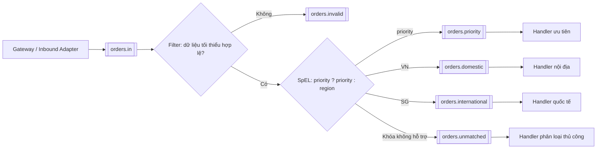
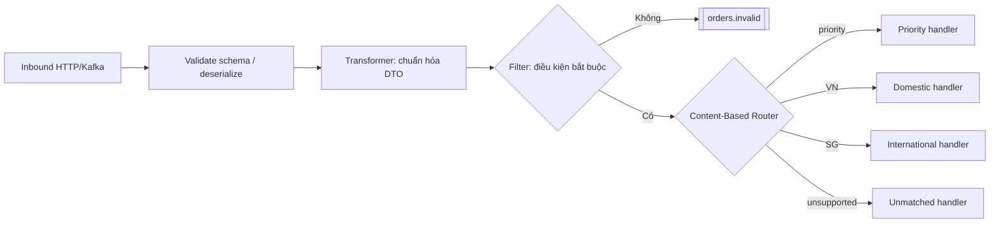
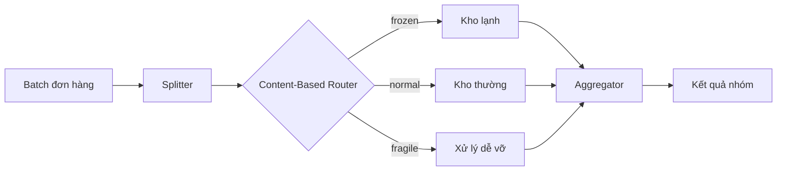

# Payload object và biểu thức truy cập dữ liệu

Khi một luồng tích hợp nhận đơn hàng, việc chọn nhánh xử lý thường phụ thuộc vào **dữ liệu bên trong thông điệp**: khu vực giao hàng, mức ưu tiên, loại nghiệp vụ hoặc trạng thái xác thực. Các giá trị ấy không nhất thiết nằm ở header hay được biểu diễn bằng những lớp Java khác nhau. Chúng thường là **thuộc tính của payload object**. **Content-Based Router** cho phép đọc dữ liệu đó và quyết định message cần được chuyển đến **Message Channel** nào.

Trong **Spring Integration**, ta có thể biểu diễn điều kiện chọn nhánh bằng một hàm Java có kiểu rõ ràng hoặc bằng **Spring Expression Language (SpEL)**, ví dụ `payload.customer.region` hay `payload.priority ? 'priority' : 'standard'`. Điều quan trọng không phải viết biểu thức ngắn nhất, mà là biết **biểu thức đọc từ đâu, kết quả là gì, cách ánh xạ kết quả đến channel và chuyện gì xảy ra nếu dữ liệu thiếu hoặc sai kiểu**.

Bài thuộc chương **Content-based router** của module `SPRING_INTEGRATION_PATTERN`. Đây là nền tảng khi kết hợp Router với Filter, Transformer, Gateway, Splitter, Aggregator, retry, error channel, correlation, kiểm thử và quan sát những nhánh xử lý.

> **Ý chính:** Content-Based Router chọn đích dựa trên **nội dung đã được chuẩn hóa của message**. Trong Spring Integration, SpEL như `payload.customer.region` truy cập thuộc tính của **đối tượng payload ở runtime**, không phải đường dẫn tự động vào một JSON string.

## 1. Content-Based Router cần biết những gì?

Giả sử hệ thống nhận `OrderCommand` rồi định tuyến theo chính sách:

1. Nếu đơn có `priority = true`, đi tuyến ưu tiên.
2. Nếu không ưu tiên và `customer.region = "VN"`, đi tuyến nội địa.
3. Nếu không ưu tiên và `customer.region = "SG"`, đi tuyến quốc tế.
4. Nếu region không được hỗ trợ, đi tuyến cần xử lý bổ sung.
5. Nếu `orderId` hoặc dữ liệu khách hàng bắt buộc bị thiếu, **từ chối đầu vào** thay vì để biểu thức truy cập một đối tượng `null`.

| Dữ liệu trong payload | Khóa định tuyến | Channel |
| --- | --- | --- |
| `priority=true`, `region="VN"` | `priority` | `orders.priority` |
| `priority=false`, `region="VN"` | `VN` | `orders.domestic` |
| `priority=false`, `region="SG"` | `SG` | `orders.international` |
| `priority=false`, `region="TH"` | `TH` (chưa map) | `orders.unmatched` theo chính sách fallback |
| `customer=null` | Không cố tính khóa | `orders.invalid` qua Filter đầu vào |

Điều kiện ưu tiên là **quyết định có thứ tự**: với đơn ưu tiên, nhánh `priority` được chọn trước cả khi xét vùng. Tuy nhiên, nếu hợp đồng bắt buộc luôn có `customer.region`, bước kiểm tra đầu vào vẫn nên chạy trước Router.



Sơ đồ chỉ minh họa **topology logic**. Channel nội bộ không đồng nghĩa broker, xử lý bất đồng bộ hoặc lưu bền. Các channel đích phải có consumer/handler và chính sách lỗi phù hợp trong triển khai thực tế.

## 2. Đối tượng mà biểu thức nhìn thấy

Một message Spring Messaging gồm `payload` và `headers`:

```java
import org.springframework.messaging.Message;
import org.springframework.messaging.support.MessageBuilder;

Message<String> message = MessageBuilder
    .withPayload("ORDER_CREATED")
    .setHeader("source", "web")
    .build();

String payload = message.getPayload(); // "ORDER_CREATED"
Object source = message.getHeaders().get("source"); // "web"
```

Với các biểu thức router thông dụng của Spring Integration, **đối tượng gốc (root)** trong ngữ cảnh SpEL là message. Ta có thể truy cập:

- `payload`: giá trị payload của message;
- `payload.customer`: thuộc tính `customer` trên payload đã có kiểu Java phù hợp;
- `payload.customer.region`: thuộc tính `region` của đối tượng `customer`;
- `headers['source']`: giá trị một message header theo tên;
- `payload.priority ? 'priority' : 'standard'`: trả về một **khóa định tuyến** theo điều kiện.

Khi viết biểu thức cho Router qua Java DSL, thường truyền **chuỗi SpEL trực tiếp**, ví dụ `"payload.customer.region"`. Không nhầm với cú pháp `#{...}` của một số nơi khai báo bean/property expression trong Spring.

### 2.1. SpEL không tự phân tích JSON string

Đây là khác biệt quyết định:

| Payload thực tế | Kiểu runtime | Cách đọc dữ liệu |
| --- | --- | --- |
| JavaBean `OrderCommand` | `OrderCommand` | `payload.customer.region` nếu có getter và object con phù hợp |
| Java `Map` chứa khóa `region` | `Map`, ví dụ `LinkedHashMap` | `payload['region']` hoặc đường index tương ứng |
| String chứa JSON `{"region":"VN"}` | `String` | Cần deserializer/Transformer trước, không dùng `payload.region` như với bean |
| `byte[]` từ broker | `byte[]` | Cần giải mã/deserialize theo schema và allowlist |
| DTO có `getTotalAmount()` | Kiểu DTO cụ thể | `payload.totalAmount` đọc property theo JavaBean convention |

**Điểm then chốt:** SpEL đi theo **cấu trúc đối tượng ở JVM**, không theo hình thức mà dữ liệu từng có khi đi qua mạng. Nếu inbound adapter chưa deserialize, tên khóa trong JSON không tự biến thành property Java.

### 2.2. Getter JavaBean và property access

Ví dụ về DTO để minh họa cho SpEL:

```java
public final class Customer {
    private final String region;

    public Customer(String region) {
        this.region = region;
    }

    public String getRegion() {
        return region;
    }
}

public final class OrderCommand {
    private final String orderId;
    private final Customer customer;
    private final boolean priority;

    public OrderCommand(String orderId, Customer customer, boolean priority) {
        this.orderId = orderId;
        this.customer = customer;
        this.priority = priority;
    }

    public String getOrderId() {
        return orderId;
    }

    public Customer getCustomer() {
        return customer;
    }

    public boolean isPriority() {
        return priority;
    }
}
```

Với đối tượng này:

- `payload.orderId` đọc `getOrderId()`.
- `payload.customer` đọc `getCustomer()`.
- `payload.customer.region` đọc tiếp `getRegion()`.
- `payload.priority` đọc `isPriority()`.

Property access của SpEL có thể hỗ trợ các kiểu khác như record, Map hoặc property accessor tùy cấu hình/phiên bản. Dùng JavaBean đơn giản giúp làm rõ semantics trong ví dụ, tránh phụ thuộc vào một thư viện JSON hoặc cơ chế reflection đặc thù.

**Lưu ý:** Nếu `customer` bằng `null`, biểu thức `payload.customer.region` bình thường có thể lỗi khi cố truy cập `region`. Nếu property không tồn tại hoặc getter ném exception, đó cũng là **lỗi đánh giá biểu thức**, không tự trở thành khóa "unknown".

## 3. Từ giá trị biểu thức đến channel đích

Trong Content-Based Router có hai câu hỏi tách biệt:

1. **Biểu thức trả về gì?** Ví dụ `"priority"` hoặc `"VN"`.
2. **Khóa đó được gửi đi đâu?** Ví dụ khóa `"VN"` ánh xạ đến channel `"orders.domestic"`.

```text
Message<OrderCommand>
      |
      v
SpEL: payload.priority ? 'priority' : payload.customer.region
      |
      +--> "priority" ---mapping---> orders.priority
      +--> "VN" --------mapping---> orders.domestic
      +--> "SG" --------mapping---> orders.international
      +--> "TH" --------unmatched--> orders.unmatched
```

Tên property `customer.region` và tên channel `orders.domestic` có trách nhiệm khác nhau. Thay đổi channel không nên bắt dữ liệu khách hàng đổi giá trị `region`; phần mapping là ranh giới giúp tách **hợp đồng dữ liệu** khỏi **topology tích hợp**.

### 3.1. Các cách biểu đạt khóa định tuyến

| Biểu thức SpEL minh họa | Kết quả mong đợi | Điều kiện để chạy đúng |
| --- | --- | --- |
| `payload.customer.region` | `"VN"` | Payload là đối tượng có customer/region hợp lệ |
| `payload.priority ? 'priority' : 'standard'` | `"priority"` hoặc `"standard"` | Có property boolean `priority` |
| `payload['eventType']` | Giá trị của khóa `eventType` | Payload thực tế là Map hỗ trợ index bằng key |
| `headers['eventCategory']` | Giá trị header `eventCategory` | Header đã được xác thực/chuẩn hóa |
| `payload.customer?.region ?: 'unknown'` | Region hoặc `"unknown"` | Phiên bản SpEL hỗ trợ safe-navigation/Elvis; vẫn cần kiểm soát dữ liệu đầu vào |

Trong SpEL, toán tử điều kiện `condition ? a : b` có thể được dùng để chọn một khóa rõ nghĩa. Safe-navigation `?.` giúp xử lý một số trường hợp đối tượng con `null`; toán tử Elvis `?:` có thể cung cấp giá trị thay thế. Nhưng **không nên lấy null-handling thay cho bước validation** khi trường đó là bắt buộc theo nghiệp vụ.

### 3.2. Giá trị trả về phải khớp chính sách mapping

Nếu biểu thức tạo `"vn"` còn mapping khai báo `"VN"`, hai khóa **không giống nhau**. Nếu biểu thức trả về một đối tượng enum hoặc số thay vì chuỗi, cách router chuyển kết quả thành channel key còn phụ thuộc cơ chế triển khai.

Để tránh mơ hồ, nên:

- Chuẩn hóa input (chẳng hạn upper-case region theo quy ước) **trước Router**.
- Dùng tập khóa routing hữu hạn, rõ nghĩa: `priority`, `VN`, `SG`, `unknown`.
- Kiểm thử trường hợp case khác nhau, khoảng trắng, `null` và dữ liệu ngoài danh sách.
- Không lắp trực tiếp một chuỗi từ người dùng thành **tên channel có quyền đặc biệt**.

### 3.3. Fallback không giống lỗi SpEL

| Tình huống | Diễn giải | Chính sách nên có |
| --- | --- | --- |
| Biểu thức trả khóa `"VN"` có mapping | Định tuyến thành công. | Gửi channel đã định nghĩa. |
| Biểu thức trả khóa `"TH"` chưa được hỗ trợ | Giá trị được tính hợp lệ nhưng không có route nghiệp vụ mong muốn. | Fallback đã cấu hình hoặc báo lỗi phù hợp. |
| `payload.customer == null` nhưng biểu thức truy cập `.region` | Có thể phát sinh exception khi đánh giá. | Validation trước Router hoặc guard/safe navigation được kiểm thử. |
| Payload là `String` nhưng expression đòi `customer` | Sai hình dạng dữ liệu. | Deserialize/Transformer và kiểm tra schema trước Router. |
| Channel đích không có consumer hoặc đã đầy | Lỗi/giới hạn gửi message sau khi định tuyến. | Cấu hình downstream, backpressure, timeout và error policy. |

**Không coi `defaultOutputChannel` là bộ bắt mọi exception.** Nó phục vụ quyết định định tuyến khi khóa không dẫn tới channel theo chính sách, còn lỗi property access, deserialization hoặc lỗi gửi channel cần được xử lý ở ranh giới tương ứng. Với mapping router, hãy kiểm chứng cấu hình fallback tên channel trực tiếp (*channel-key fallback*) của phiên bản sử dụng nếu khóa định tuyến lấy từ nguồn không tin cậy.

## 4. Ví dụ Spring Integration Java DSL: đọc object bằng SpEL

Ta dùng `OrderCommand` và `Customer` ở mục 2. Mục tiêu là dựng **một luồng nhận message**, kiểm tra các trường bắt buộc, đọc `priority`/`customer.region` rồi route đến những channel đã định nghĩa. Các channel đích là `QueueChannel` để test; khi triển khai thật, chúng cần consumer/flow thích hợp.

### 4.1. Cấu hình flow

```java
import org.springframework.context.annotation.Bean;
import org.springframework.context.annotation.Configuration;
import org.springframework.integration.channel.QueueChannel;
import org.springframework.integration.config.EnableIntegration;
import org.springframework.integration.dsl.IntegrationFlow;

@Configuration
@EnableIntegration
public class OrderRoutingConfiguration {

    @Bean("orders.priority")
    QueueChannel priorityOrders() {
        return new QueueChannel(16);
    }

    @Bean("orders.domestic")
    QueueChannel domesticOrders() {
        return new QueueChannel(16);
    }

    @Bean("orders.international")
    QueueChannel internationalOrders() {
        return new QueueChannel(16);
    }

    @Bean("orders.unmatched")
    QueueChannel unmatchedOrders() {
        return new QueueChannel(16);
    }

    @Bean("orders.invalid")
    QueueChannel invalidOrders() {
        return new QueueChannel(16);
    }

    @Bean
    IntegrationFlow routeOrdersByContent() {
        return IntegrationFlow.from("orders.in")
            .filter(OrderCommand.class,
                command -> command.getOrderId() != null
                    && !command.getOrderId().isBlank()
                    && command.getCustomer() != null
                    && command.getCustomer().getRegion() != null
                    && !command.getCustomer().getRegion().isBlank(),
                spec -> spec.discardChannel("orders.invalid"))
            .route(
                "payload.priority ? 'priority' : payload.customer.region",
                spec -> spec
                    .channelMapping("priority", "orders.priority")
                    .channelMapping("VN", "orders.domestic")
                    .channelMapping("SG", "orders.international")
                    .defaultOutputChannel("orders.unmatched"))
            .get();
    }
}
```

Giải thích theo thứ tự:

1. `orders.in` là đầu vào của `IntegrationFlow`. Producer có thể gửi `Message<OrderCommand>` vào đây.
2. `.filter(...)` xác nhận dữ liệu cần thiết trước khi Router đánh giá biểu thức lồng nhau. Thông điệp không hợp lệ được gửi sang `orders.invalid`.
3. `.route("...")` dùng **SpEL**; ở đây `payload.priority` tương đương kiểm tra `OrderCommand.isPriority()`.
4. Nếu ưu tiên, biểu thức trả `"priority"`, không đọc nhánh phía sau của toán tử điều kiện.
5. Nếu không ưu tiên, biểu thức đọc `payload.customer.region` và trả khóa như `"VN"`.
6. `channelMapping` biến khóa thành **tên channel nội bộ** tương ứng.
7. `defaultOutputChannel` xử lý những khóa không được định tuyến theo mapping/fallback đã cấu hình.

**Một chi tiết cần kiểm chứng khi chạy trên phiên bản Spring Integration cụ thể:** Router ánh xạ khóa với tên channel và có thể hỗ trợ cơ chế lấy trực tiếp tên channel từ khóa (*channel-key fallback*). Vì vậy, đừng giả định mọi khóa chưa map luôn vào default trong mọi cấu hình. Khi routing key do nguồn ngoài ảnh hưởng, hãy giới hạn tập khóa, kiểm tra tùy chọn fallback và viết test cho khóa không hợp lệ.

### 4.2. Vì sao Filter nằm trước Router?

Biểu thức `payload.customer.region` giả định `customer` tồn tại. Bước Filter là **ranh giới bảo vệ cấu trúc đầu vào**: message thiếu `customer` không được chuyển tiếp đến biểu thức có thể ném lỗi.

Nếu message có kiểu khác `OrderCommand`, các endpoint typed có thể gặp vấn đề chuyển đổi/kiểm tra kiểu tùy flow. Ở biên nhận HTTP/Kafka, cần **deserialize và validate schema** trước khi đưa DTO vào channel này; chỉ dựa vào Filter typed trong flow không thay thế input validation tại adapter.

### 4.3. Khi region không hỗ trợ

Nếu `priority=false` và `region="TH"`, biểu thức trả khóa `"TH"`. Khi không có channel mapping/hợp đồng cho TH, nhánh `orders.unmatched` là nơi xử lý **giá trị chưa hỗ trợ** theo chính sách.

Trong ví dụ, `QueueChannel` chỉ lưu tạm thông điệp trong bộ nhớ cho test. Nó **không tự gọi handler**, không lưu bền và không tự bảo vệ khi queue đầy. Ở production, cần thiết kế consumer, cảnh báo, cách ly hoặc trả lỗi có nghĩa. Không dùng fallback như một thùng rác im lặng.

## 5. Kiểm thử đường đi bằng JUnit 5

Ví dụ dùng Spring Test để khởi tạo `OrderRoutingConfiguration`. Các test gửi message vào channel đầu vào, rồi nhận kết quả từ queue đích. Đặt test trong cùng package với các lớp ví dụ ở trên.

```java
import static org.junit.jupiter.api.Assertions.*;

import org.junit.jupiter.api.Test;
import org.springframework.beans.factory.annotation.Autowired;
import org.springframework.context.ApplicationContext;
import org.springframework.integration.channel.QueueChannel;
import org.springframework.messaging.Message;
import org.springframework.messaging.MessageChannel;
import org.springframework.messaging.support.MessageBuilder;
import org.springframework.test.context.junit.jupiter.SpringJUnitConfig;

@SpringJUnitConfig(OrderRoutingConfiguration.class)
class OrderContentRouterTest {

    @Autowired
    ApplicationContext context;

    private MessageChannel input() {
        return context.getBean("orders.in", MessageChannel.class);
    }

    private QueueChannel output(String name) {
        return context.getBean(name, QueueChannel.class);
    }

    private void send(OrderCommand command) {
        assertTrue(input().send(
            MessageBuilder.withPayload(command).build()));
    }

    @Test
    void routesByPriorityAndNestedRegion() {
        var priority = new OrderCommand(
            "ORD-1", new Customer("VN"), true);
        var domestic = new OrderCommand(
            "ORD-2", new Customer("VN"), false);
        var international = new OrderCommand(
            "ORD-3", new Customer("SG"), false);
        var unmatched = new OrderCommand(
            "ORD-4", new Customer("TH"), false);
        var invalid = new OrderCommand("ORD-5", null, false);

        send(priority);
        send(domestic);
        send(international);
        send(unmatched);
        send(invalid);

        Message<?> resultPriority = output("orders.priority").receive(0);
        Message<?> resultDomestic = output("orders.domestic").receive(0);
        Message<?> resultInternational =
            output("orders.international").receive(0);
        Message<?> resultUnmatched = output("orders.unmatched").receive(0);
        Message<?> resultInvalid = output("orders.invalid").receive(0);

        assertNotNull(resultPriority);
        assertNotNull(resultDomestic);
        assertNotNull(resultInternational);
        assertNotNull(resultUnmatched);
        assertNotNull(resultInvalid);

        assertSame(priority, resultPriority.getPayload());
        assertSame(domestic, resultDomestic.getPayload());
        assertSame(international, resultInternational.getPayload());
        assertSame(unmatched, resultUnmatched.getPayload());
        assertSame(invalid, resultInvalid.getPayload());

        assertNull(output("orders.priority").receive(0));
        assertNull(output("orders.domestic").receive(0));
        assertNull(output("orders.international").receive(0));
        assertNull(output("orders.unmatched").receive(0));
        assertNull(output("orders.invalid").receive(0));
    }
}
```

Test này chứng minh **cùng một flow** có thể đọc một property boolean, một property lồng nhau và định tuyến đúng theo các giá trị runtime. Nó cũng kiểm tra **âm tính**: sau khi đọc mỗi kết quả, không còn message dư ở các queue đích.

**Giới hạn:** Ví dụ chỉ dùng channel và queue nội bộ đồng bộ; không kiểm tra HTTP, Kafka, persistence, retry, transaction hay throughput. Nếu đưa `ExecutorChannel` hoặc adapter bất đồng bộ vào flow, test phải đợi theo điều kiện có timeout thay vì gọi `receive(0)` ngay.

### 5.1. Những test nên bổ sung

| Kịch bản | Kết quả cần xác minh |
| --- | --- |
| `priority=true` và `region="SG"` | Vẫn đi tuyến ưu tiên vì toán tử điều kiện chọn nhánh đầu. |
| `priority=false` và `region="VN"` | Đi nội địa, không vào ưu tiên/quốc tế. |
| `region="vn"` | Hành vi chuẩn hóa hoặc fallback theo hợp đồng, không mặc nhiên trùng `"VN"`. |
| `customer=null` | Bị Filter chặn; không có `SpelEvaluationException` do truy cập sâu. |
| `region=""` | Bị từ chối vì thiếu giá trị bắt buộc. |
| `region="TH"` | Fallback hoặc chính sách lỗi xác định; không tự gửi vào channel bất kỳ. |
| Payload ban đầu là JSON String | Có Transformer/mapper trước; không đọc nhầm `payload.customer` trên String. |
| Outbound handler chậm, queue đầy | Backpressure/send timeout hoạt động theo loại channel. |
| Gateway yêu cầu reply | Mỗi nhánh thành công/từ chối có đường trả lời hợp lệ. |

## 6. Truy cập dữ liệu trên Map, nested object và danh sách

Không phải producer nào cũng đưa vào JavaBean. Một webhook hoặc một nguồn không có schema chặt có thể được deserialize thành `Map<String, Object>`. Khi đó cần chọn cú pháp biểu thức phù hợp với kiểu runtime.

### 6.1. Payload là Map

```java
import java.util.Map;
import org.springframework.messaging.Message;
import org.springframework.messaging.support.MessageBuilder;

Map<String, Object> order = Map.of(
    "priority", false,
    "customer", Map.of("region", "VN")
);

Message<Map<String, Object>> message =
    MessageBuilder.withPayload(order).build();
```

Với Map này, những biểu thức kiểu SpEL có thể dùng là:

```text
payload['priority']
payload['customer']['region']
payload['priority'] ? 'priority' : payload['customer']['region']
```

**Điểm khác biệt:** `payload.customer.region` được viết theo cách truy cập property của object; `payload['customer']['region']` truy cập khóa của Map bằng indexer. Cần kiểm thử trên **đúng cấu trúc Map do deserializer tạo ra**. Nếu `customer` không tồn tại hoặc không phải Map, các phép truy cập tiếp theo có thể lỗi.

### 6.2. Field lồng nhau có thể null

Giả sử:

```text
OrderCommand
  orderId = "ORD-100"
  customer = null
  priority = false
```

Biểu thức `payload.customer.region` không còn đường truy cập hợp lệ. Có hai hướng:

1. **Kiểm tra trước bằng Filter/validator** để từ chối message sai hợp đồng; cách này phù hợp khi `customer.region` bắt buộc.
2. **Dùng safe-navigation/giá trị thay thế** trong những trường hợp `customer` thực sự tùy chọn, ví dụ `payload.customer?.region ?: 'unknown'` trong SpEL hỗ trợ cú pháp đó.

Không nên dùng toán tử Elvis để mặc nhiên cho dữ liệu sai đi tuyến “unknown” nếu nghiệp vụ phải phát hiện và báo lỗi nhập liệu.

### 6.3. Collection và mảng

Payload có thể là `List<OrderLine>`, nhưng payload lúc này là **một collection**, không phải một `OrderLine`. Nếu bạn muốn Router định tuyến từng dòng theo `line.type`, cách thường rõ ràng hơn là:

```text
Message<List<OrderLine>>
    -> Splitter
    -> Message<OrderLine> (mỗi phần)
    -> Content-Based Router theo payload.type
    -> nhánh xử lý của từng loại dòng
```

Khi có **Splitter**, nhớ bảo toàn correlation/sequence metadata hoặc chiến lược liên kết nhóm cần thiết nếu sau đó **Aggregator** phải gom các kết quả. Nếu một nhánh bị Filter loại, Aggregator có thể thiếu phần và cần chính sách release/expiry riêng.

### 6.4. Property không có nghĩa là “giá trị tự động an toàn”

Dù payload là JavaBean, property `customer.email` vẫn có thể chứa dữ liệu cá nhân. Không nên dùng email, access token hoặc số thẻ làm **routing key** hay metric label chỉ vì truy cập được bằng SpEL. Ưu tiên mã phân loại đã chuẩn hóa như `region` hoặc `priorityTier`, và đặt chính sách cho việc truyền header/tracing ra ngoài.

## 7. SpEL hay Java lambda: chọn theo mức phức tạp

Spring Integration có thể định tuyến theo một hàm Java typed, thay vì dùng SpEL string. Ví dụ cùng chính sách:

```java
// Một cách cấu hình thay thế cho .route("payload....", ...).
IntegrationFlow typedFlow = IntegrationFlow.from("orders.typed.in")
    .route(OrderCommand.class,
        command -> command.isPriority()
            ? "priority"
            : command.getCustomer().getRegion(),
        spec -> spec
            .channelMapping("priority", "orders.priority")
            .channelMapping("VN", "orders.domestic")
            .channelMapping("SG", "orders.international")
            .defaultOutputChannel("orders.unmatched"))
    .get();
```

Đoạn này **chỉ minh họa lựa chọn thay thế**, không cần khai báo cùng tên bean/input flow với phiên bản SpEL ở mục 4. Nó cũng giả định input đã hợp lệ, vì `getCustomer()` vẫn có thể trả `null`.

| Tiêu chí | SpEL expression | Java lambda/strategy |
| --- | --- | --- |
| Cấu hình điều kiện đơn giản | Ngắn, dễ nhìn khi chỉ đọc vài property. | Rõ kiểu nhưng có thể dài hơn chút. |
| Bắt lỗi ở compile time | Chuỗi property thường được kiểm tra lúc chạy. | IDE/compiler kiểm tra method/property types tốt hơn. |
| Refactor tên field | Có nguy cơ quên cập nhật chuỗi. | Refactor Java thông thường dễ theo dõi hơn. |
| Điều kiện nghiệp vụ phức tạp | Dễ thành biểu thức dài, khó kiểm thử riêng. | Nên tách thành method/service policy có unit test. |
| Khả năng mở rộng | Phù hợp biểu thức ngắn, cấu hình ổn định. | Phù hợp logic nhiều nhánh, cần typed API và test. |
| Rủi ro bảo mật | Không được đánh giá expression động do nguồn không tin cậy gửi tới. | Vẫn phải validation input và kiểm soát quyền tác dụng phụ. |

**Khuyến nghị thực hành:** Dùng SpEL cho **quy tắc chọn tuyến ngắn, xác định và được kiểm soát trong source/config**. Khi điều kiện phải gọi nhiều dịch vụ, tính phí, đọc dữ liệu nhạy cảm hay có side effect, hãy chuyển phần chính sách đó vào **application/domain service** hoặc một hàm Java typed được kiểm thử, rồi để Router chỉ nhận một khóa phân loại rõ.

## 8. Tách trách nhiệm cho đúng: Filter, Transformer và Router

Một lỗi thường thấy là dùng một biểu thức `.route(...)` dài để **vừa deserialize, vừa sửa dữ liệu, vừa validate, vừa chọn kênh**. Khi lỗi xảy ra, rất khó biết bước nào sai và liệu có thể retry hay không.

Luồng có ranh giới rõ thường như sau:



| Thành phần | Nên làm | Không nên mặc định làm |
| --- | --- | --- |
| Inbound Adapter/Deserializer | Đọc transport, kiểm tra payload theo schema và tạo DTO an toàn. | Cho dữ liệu ngoài tự quyết class Java hoặc biểu thức SpEL cần đánh giá. |
| Transformer | Chuẩn hóa mã vùng, định dạng, payload shape. | Gây side effect nghiệp vụ ngoài ý muốn. |
| Filter | Chặn input không hợp lệ hoặc không được phép. | Thay Router khi cần chọn nhiều đích khác nhau. |
| Content-Based Router | Tính khóa trên nội dung đã chuẩn hóa và chọn channel. | Tự tạo đơn, trừ tiền hoặc kết nối ERP bên trong biểu thức. |
| Service Activator/Handler | Gọi nghiệp vụ thật, trả kết quả khi cần. | Xem Router đã gửi là bằng chứng nghiệp vụ đã hoàn tất. |

### 8.1. Biểu thức có method call: cẩn thận với side effect

SpEL có khả năng gọi method tùy ngữ cảnh. **Không nên đặt lời gọi sửa database, gửi email hoặc thu tiền trong biểu thức điều kiện route**. Một message có thể được retry/replay khiến side effect chạy lại trong khi người đọc tưởng Router chỉ tính toán.

Nếu cần quyết định VIP theo hợp đồng khách hàng, hãy để service chuyên trách trả `RoutingDecision` hoặc một thuộc tính đã chuẩn hóa, rồi Router đọc kết quả. Việc quyết định **ai được hưởng ưu tiên** có thể thuộc domain; việc gửi **tuyến ưu tiên đi channel nào** thuộc integration flow.

## 9. Mapping an toàn và ranh giới với dữ liệu ngoài

Một router đọc `payload.destination` rồi tự chuyển tới tên channel trùng giá trị đó có thể trở thành **đường điều khiển topology bằng dữ liệu ngoài** nếu không giới hạn tập giá trị cho phép.

Thực hành tốt:

1. **Không tạo SpEL bằng nối chuỗi dữ liệu request**, ví dụ không nhận `expression` từ HTTP rồi đem đánh giá.
2. **Allowlist routing keys** và mapping cố định đến các channel đã thiết kế. Kiểm tra cách cấu hình xử lý channel key chưa map và fallback trực tiếp theo phiên bản đang dùng.
3. Phân biệt `unknown` do nghiệp vụ không hỗ trợ với `invalid` do dữ liệu sai schema hoặc thiếu field.
4. **Không đặt token/PII vào route key** hay tên channel.
5. Kiểm tra quyền truy cập **trước khi đi vào nhánh** có thể xem dữ liệu nhạy cảm hoặc thực hiện tác vụ có đặc quyền.
6. Nếu router phải đọc header từ nguồn ngoài, xác thực header đó; không tự tin tưởng `X-Role: admin` do client gửi.

Trong log, ghi một **mã route hữu hạn** và tên component thay vì in cả payload; nếu cần correlation, dùng ID mờ và phân quyền truy vết.

## 10. Request–reply Gateway, lỗi và timeout

Nếu caller gọi một `@MessagingGateway` có return value, Router cần dẫn request đến handler có thể tạo **reply**. Trong ví dụ ở mục 4, các queue chỉ có tác dụng kiểm tra đường đi, **không tự tạo kết quả trả về**.

### 10.1. Gateway đợi reply ở nhánh nào?

Giả sử interface:

```java
import org.springframework.integration.annotation.MessagingGateway;

@MessagingGateway(defaultRequestChannel = "orders.in")
interface OrderGateway {
    OrderReceipt submit(OrderCommand command);
}

// OrderReceipt do ứng dụng định nghĩa;
// cần flow/handler tạo reply tương ứng.
```

Nếu Router chuyển message sang `orders.domestic` nhưng không có handler trả `OrderReceipt` về reply path, caller **không nhận được kết quả nghiệp vụ**. Cần nối service handler hoặc một flow trả lời, và định nghĩa rõ hành vi ở nhánh `orders.invalid`, `orders.unmatched`.

Một **Filter drop** message có thể khiến caller thiếu reply; một Router có fallback nhưng chỉ lưu queue cũng vậy. **Không dùng reply timeout để thay thế kết quả từ chối hợp lệ.**

### 10.2. Timeout ở đâu?

| Timeout | Ranh giới chờ | Không có nghĩa là |
| --- | --- | --- |
| `MessageChannel.send(timeout)` | Chờ channel nhận message khi implementation hỗ trợ blocking. | Handler chắc chắn hoàn tất trước thời gian đó. |
| `PollableChannel.receive(timeout)` | Chờ có message để consumer lấy. | Đơn hàng nghiệp vụ đã hoàn thành. |
| Gateway reply timeout | Chờ nhận reply theo đường request–reply có hỗ trợ chờ. | Công việc downstream đã bị hủy hoặc rollback. |
| HTTP/broker client timeout | Chờ kết nối/response từ hệ thống ngoài. | Đối tác chắc chắn chưa tạo side effect. |
| Aggregator group timeout | Thời gian chờ các phần của một nhóm message. | Tương đương timeout nhận một message từ queue. |

Với `DirectChannel` đồng bộ, handler chậm có thể giữ thread caller; reply timeout của Gateway **không phải đồng hồ cắt ngang mọi handler đang chạy**. Với ranh giới bất đồng bộ, reply có thể đến sau deadline của caller. Cần chính sách late reply và idempotency rõ ràng.

### 10.3. Error channel và biểu thức lỗi

Lỗi SpEL vì property không tồn tại khác với khóa `TH` chưa có mapping. Khi expression evaluation ném exception, luồng đồng bộ có thể truyền lỗi về caller; luồng async/adapter có thể phát `ErrorMessage` tới error channel theo cấu hình.

| Loại thất bại | Điểm phát hiện | Xử lý thường hợp lý |
| --- | --- | --- |
| `customer=null` | Validator/Filter đầu vào | Từ chối dữ liệu, trả lý do rõ. |
| `region=TH` chưa hỗ trợ | Router mapping | Fallback/quarantine hoặc yêu cầu bổ sung policy. |
| SpEL property sai tên do refactor | Router evaluation | Lỗi cấu hình/code, cần sửa và test; retry y nguyên không có ích. |
| Channel đích thiếu consumer | Channel/flow wiring | Sửa wiring và kiểm tra startup/integration test. |
| ERP trả timeout | Outbound Gateway/adapter | Retry có giới hạn, đối soát trạng thái, idempotency. |

Error flow phải phân biệt **lỗi nghiệp vụ xác định** và **lỗi kỹ thuật có thể khôi phục**, không biến mọi ngoại lệ thành `accepted`.

## 11. Splitter, Aggregator và correlation khi Router chọn nhánh

Một request có thể chứa danh sách nhiều `OrderLine`. Sau Splitter, mỗi phần được route theo `payload.category` hoặc `payload.destinationRegion`. Các nhánh xử lý không nhất thiết kết thúc cùng lúc.



Để Aggregator gom đúng, cần xác định:

- **Correlation key:** các message con nào cùng batch/order?
- **Sequence/completion:** phải nhận bao nhiêu phần hoặc điều kiện nào để phát reply?
- **Rejected parts:** Filter hoặc Router unmatched sẽ tạo kết quả từ chối thay thế hay bị loại?
- **Timeout/expiry:** khi một nhánh chậm, trả partial, lỗi hay chờ tiếp?
- **Late results:** message đến sau khi nhóm đã release được xử lý ra sao?

Content-Based Router chỉ chọn kênh đích theo dữ liệu, **không tự giữ trạng thái Aggregator hoặc bảo đảm thứ tự hoàn tất**. Nếu một nhánh không bao giờ trả phản hồi, cần chính sách release/expiry phù hợp, nếu không nhóm có thể bị giữ lại.

## 12. Kiểm thử đặc biệt cho biểu thức SpEL

Ngoài kiểm thử đúng/nhầm nhánh, hãy tập trung vào những trường hợp biểu thức thường gây lỗi:

| Thử nghiệm | Rủi ro được phát hiện |
| --- | --- |
| Getter bị đổi tên (`getRegion` → `getMarket`) | Chuỗi `payload.customer.region` có thể không còn hợp lệ dù phần còn lại vẫn biên dịch. |
| `customer=null` hoặc `region=null` | Lỗi truy cập lồng nhau hoặc route key `null` ngoài dự kiến. |
| Payload JSON chưa deserialize | Router thấy `String`/`byte[]` thay vì bean. |
| Payload là `Map`, nhưng expression dùng bean property | Không đúng cấu trúc dữ liệu hoặc property accessor. |
| `region="vn"`, `" VN "` | Không match mapping nếu chưa chuẩn hóa. |
| `priority=true` nhưng `region` chưa map | Kiểm tra toán tử ternary ưu tiên chính sách như mong muốn. |
| Biểu thức trả bool/number/object thay String | Cách chuyển thành channel key không như mapping kỳ vọng. |
| Header đến từ request ngoài | Không thể chọn nhánh đặc quyền chỉ bằng metadata chưa xác thực. |
| Router fallback vào channel có queue đầy | Gửi không thành công, cần backpressure/error handling. |
| Nhiều request cùng lúc | Không dùng state mutable trong biểu thức; đo tải và xác định thứ tự khi có async. |

**Cách test tốt:** Xem **output channel thật** và kiểm tra rằng không có message ở các nhánh sai. Khi dùng SpEL, test thêm kịch bản sai kiểu/null để phát hiện lỗi chỉ xuất hiện ở runtime. Đừng chỉ unit test một hàm tạo route key rồi cho rằng channel wiring đã đúng.

## 13. Observability: theo dõi dữ liệu đủ dùng, không lộ bí mật

Các chỉ số nên thu thập:

- Message nhận ở đầu vào và số qua Filter hợp lệ.
- Tỷ lệ theo routing key hữu hạn: `priority`, `VN`, `SG`, `unmatched`.
- Tần suất lỗi **expression evaluation** phân biệt với **unmatched key**.
- Độ trễ mỗi nhánh Handler/Outbound Gateway.
- Queue depth và số send timeout ở nhánh đông tải.
- Retry/exception rate và kết quả nghiệp vụ theo trạng thái cuối.
- Trace/correlation xuyên các nhánh và qua Splitter/Aggregator khi có.

Ví dụ format log an toàn:

```text
event=content_router_decision
flow=orderIntake
router=orderContentRouter
route_key=VN
destination=orders.domestic
outcome=routed
trace_id=<opaque-trace-id>
```

Đây là **format minh họa**, không phải log mặc định của Spring Integration. Không in `Message.toString()`, toàn bộ payload, token, cookie, địa chỉ/email hoặc dữ liệu thanh toán. Correlation/trace ID mờ nên nằm trong log có phân quyền; **không dùng ID riêng từng request làm metric label** gây high cardinality.

### 13.1. Quan sát chưa đủ nếu không biết mẫu số

Ví dụ 1.000 đơn qua Filter, 100 bị từ chối; trong 900 đơn hợp lệ còn 200 ưu tiên, 500 nội địa, 150 quốc tế và 50 unmatched. Dashboard cần biểu diễn:

- `invalid = 100/1000 = 10%` tổng đầu vào;
- `priority = 200/900 ≈ 22,2%` đầu vào hợp lệ của Router;
- `unmatched = 50/900 ≈ 5,6%` đầu vào hợp lệ của Router.

Đừng lấy 50 unmatched chia cho 1.000 mà nhầm đó là tỷ lệ lỗi **của Router**; dùng đúng mẫu số giúp phân biệt lỗi input với thiếu mapping.

## 14. Những sai lầm thường gặp

### 14.1. “`payload.region` hoạt động cho mọi JSON”

**Sai.** Payload có thể vẫn là String/byte array. Hãy deserialize thành DTO/Map đã kiểm soát, rồi dùng biểu thức đúng với kiểu runtime.

### 14.2. “Unknown key và SpEL exception đều vào default channel”

**Sai.** Giá trị không được mapping và việc biểu thức ném exception là hai tình huống khác nhau. Cần validation, fallback và error flow riêng.

### 14.3. “Biểu thức đọc getter nên không bao giờ gây tác dụng phụ”

**Sai.** Getter hoặc method được gọi có thể chứa logic đắt đỏ/side effect. Hãy giữ route key computation đơn giản, deterministic và được kiểm thử.

### 14.4. “Cứ đưa toàn bộ business rule vào Router”

**Không nên.** Quy tắc về quyền VIP, khuyến mại hay thanh toán thuộc nghiệp vụ; Router nên quyết định **kênh xử lý** dựa trên một giá trị đã xác định hợp lệ.

### 14.5. “Default channel đã tồn tại thì không cần consumer”

**Sai.** Tên channel không tự sinh consumer, DLQ hoặc lưu trữ bền vững. Phải thiết kế xử lý, capacity, error policy và vận hành cho nhánh đó.

### 14.6. “SpEL chuỗi vẫn được compiler bắt lỗi khi rename property”

**Sai.** Đa số lỗi tên property chỉ bộc lộ khi evaluate ở runtime. Cần integration test với DTO thực.

### 14.7. “Một callback timeout có nghĩa nghiệp vụ chưa chạy”

**Sai.** Handler hoặc dịch vụ ngoài có thể đã hoàn tất nhưng reply bị mất. Retry phải xét idempotency và trạng thái đã commit.

## 15. Bài tập thực hành

**Bài 1 — Thêm một vùng.** Bổ sung route `JP → orders.international` mà không thay đổi DTO. Thêm test cho `region=JP` và chứng minh message không rơi vào unmatched.

**Bài 2 — Chuẩn hóa dữ liệu.** Đầu vào có region `" vn "`. Thiết kế Transformer làm sạch/chuẩn hóa theo hợp đồng trước Router, viết test cho `VN`, `vn`, `" VN "` và region rỗng.

**Bài 3 — Null và nested object.** So sánh hai chính sách: Filter từ chối `customer=null`, hoặc SpEL safe-navigation + `unknown`. Nêu lúc nào mỗi chính sách là đúng nghĩa nghiệp vụ.

**Bài 4 — Cấu trúc Map.** Thay `OrderCommand` bằng `Map<String,Object>` chứa các khóa `priority`, `customer`. Viết biểu thức đúng với Map, bổ sung test khi khóa `customer` không tồn tại.

**Bài 5 — Gateway request–reply.** Đổi các queue đích thành Service Activator trả `OrderReceipt`. Thiết kế reply có mã `ACCEPTED`, `INVALID`, `UNSUPPORTED_REGION` cho các nhánh; không dùng reply timeout làm lỗi validation.

**Bài 6 — Splitter/Aggregator.** Một batch có 5 dòng hàng; một dòng có `category` chưa được hỗ trợ, ba dòng xử lý nhanh và một dòng chậm. Định nghĩa correlation, release/expiry, kết quả partial và chính sách late reply.

**Bài 7 — So sánh SpEL và Java.** Viết cùng một routing policy bằng expression và typed lambda; tạo test chung để đảm bảo cả hai có cùng kết quả trên tập dữ liệu hợp lệ và không hợp lệ.

## 16. Checklist trước khi đưa Content-Based Router vào production

| Câu hỏi | Tiêu chí hoàn thành |
| --- | --- |
| Payload thực tế là DTO, Map hay raw text? | Biểu thức truy cập khớp cấu trúc runtime sau deserialization. |
| Có property lồng nhau tùy chọn hoặc bắt buộc? | Filter/validation hoặc safe-navigation phù hợp và có test null. |
| Biểu thức trả về khóa kiểu gì? | Khóa rõ ràng, được chuẩn hóa, tập giá trị hữu hạn. |
| Key-to-channel mapping đã đủ chưa? | Các khóa chuẩn có channel và consumer; lỗi unmapped được xử lý. |
| Có rủi ro dynamic channel resolution không? | Đã xét channel-key fallback và không cho dữ liệu ngoài chọn kênh đặc quyền. |
| Có khác biệt giữa invalid và unmatched không? | Có tuyến/chính sách riêng, không gom hai loại thành lỗi mơ hồ. |
| Router có làm business side effect không? | Không; chỉ quyết định tuyến, trách nhiệm nghiệp vụ ở service. |
| Có Gateway cần reply không? | Cả nhánh hợp lệ và từ chối có response contract rõ ràng. |
| Có Splitter/Aggregator không? | Đã định nghĩa correlation, completion, timeout, late result. |
| Có retry/error channel không? | Phân loại evaluation error, send failure và downstream timeout. |
| Unit/integration test có đủ không? | Test property, null, Map, mapping, default, negative branches và concurrency khi cần. |
| Logging/tracing có an toàn không? | Không có secret/PII hoặc raw message trong log, metric labels hữu hạn. |

## Kết luận

**Payload object và biểu thức truy cập dữ liệu** là trung tâm của **Content-Based Router**: Spring Integration có thể dùng SpEL để lấy property trực tiếp từ payload Java, Map hoặc message headers, rồi chuyển **khóa định tuyến** thành **Message Channel đích**. Ví dụ `payload.priority ? 'priority' : payload.customer.region` rất ngắn, nhưng chỉ đúng khi payload được deserialize, validated và chuẩn hóa theo hợp đồng.

Một luồng đáng tin không dừng ở việc biểu thức chạy được. Nó cần **xử lý null/sai kiểu, ánh xạ key an toàn, fallback tường minh, consumer cho channel đích, phân biệt Filter rejection với exception, retry có idempotency, correlation và quan sát từng nhánh**. Làm rõ những ranh giới ấy giúp Router phối hợp với Transformer, Gateway, Splitter và Aggregator để xây dựng luồng thông điệp **ít phụ thuộc, dễ kiểm thử và có thể vận hành khi hệ thống ngoài gặp sự cố**.
