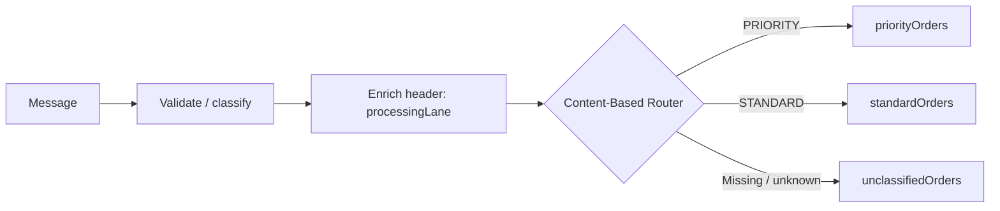
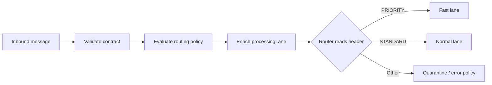
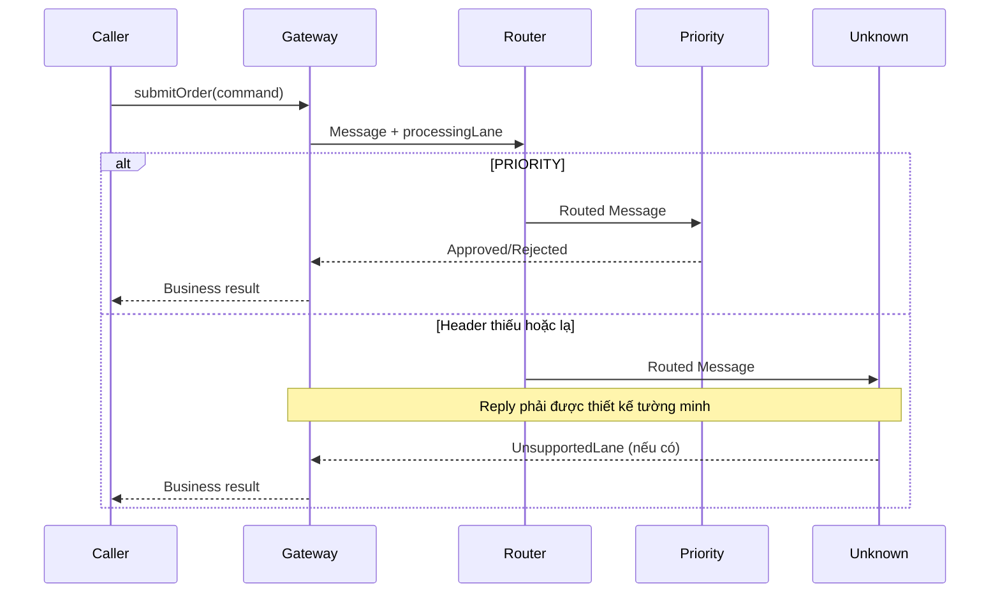
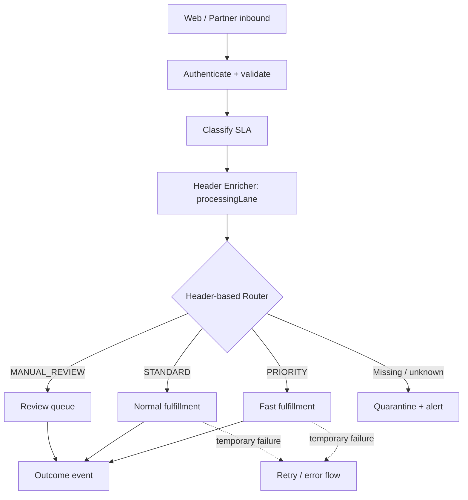

# Header làm nguồn quyết định route

Trong mẫu **Content-Based Router** của Enterprise Integration Patterns (EIP), một message được chuyển đến một trong các nhánh xử lý dựa trên thông tin của chính message đó. Thông tin dùng để quyết định **không nhất thiết nằm trong payload**: nó có thể là một giá trị đã được phân loại và đặt trong **message headers**. Đây là cách hữu ích để tách logic nghiệp vụ khỏi logic điều phối, chẳng hạn chọn luồng xử lý ưu tiên, chọn khu vực giao vận hoặc định tuyến theo nguồn sự kiện.

Với **Spring Integration**, Router có thể đọc trực tiếp một header, thực thi một biểu thức dựa trên headers hoặc gọi một phương thức Java để tính channel đích. Bài học thuộc chương **Content-based router** của module `SPRING_INTEGRATION_PATTERN`, nơi ta học triển khai Router, Filter, Transformer, Splitter, Aggregator, Gateway, retry, error channel và correlation nhằm xây dựng các luồng message ít phụ thuộc, dễ mở rộng, dễ kiểm thử và quan sát.

Sau bài học, bạn có thể:

- Phân biệt **dữ liệu quyết định route** và **kết quả quyết định route**; hiểu khi nào nên đọc header thay vì payload.
- Tạo và chuẩn hóa routing header tại một ranh giới đáng tin cậy.
- Cấu hình Content-Based Router dùng header bằng Spring Integration Java DSL và phương thức `@Router`.
- Thiết kế nhánh dự phòng khi header thiếu, sai kiểu, không được phép hoặc không có mapping.
- Bảo toàn correlation, reply/error handling và ngữ nghĩa giao nhận khi message qua nhiều nhánh.
- Kiểm thử tất cả đường đi, kể cả giá trị lạ, dữ liệu không tin cậy và downstream thất bại.

## 1. Header có thể là một phần của “content” để định tuyến

Một Spring message mang hai nhóm thông tin:

```text
Message<OrderSubmitted>
├── payload
│   ├── orderId       = "ORD-1001"
│   ├── customerId    = "CUS-18"
│   ├── amountCents   = 850000
│   └── destination   = "VN"
└── headers
    ├── processingLane = "PRIORITY"
    ├── traceId        = "trace-77"
    ├── correlationId  = "batch-3"
    └── sourceSystem   = "web-checkout"
```

**Payload** mô tả sự thật nghiệp vụ của đơn hàng; header `processingLane` là quyết định điều phối được đặt vào message để Router chọn nhánh. Ví dụ, một service phân loại sau khi kiểm tra hạn mức, trạng thái khách hàng hoặc cam kết SLA có thể gán `PRIORITY` hay `STANDARD`.



Khi nội dung quyết định đã có sẵn trong header, Router **không phải biết cách tính hạn mức hoặc phân loại khách hàng**. Thay vào đó, nó chỉ đọc một thông tin điều phối ổn định tại ranh giới giữa hai bước. Đây là cách phân chia trách nhiệm giúp thêm nhánh mới mà không phải chép lại điều kiện vào nhiều handler.

### Header-based routing có còn là Content-Based Router?

Có. Theo nghĩa kiến trúc EIP, *content-based* là quyết định dựa trên **thông tin của message**, trái với việc chuyển mọi message cố định vào một đích. Thông tin đó có thể được lấy từ payload, headers hoặc một kết hợp được thiết kế rõ. Trong Spring Integration, **`HeaderValueRouter`** là một cơ chế chuyên biệt để router theo một header; một **expression-based router** hoặc phương thức `@Router` có thể tính đường đi từ nhiều trường hơn.

Điểm quan trọng không phải tên lớp, mà là **quy tắc xác định đích có thể giải thích, kiểm thử và bảo toàn qua các bước**.

## 2. Chọn header hay payload làm nguồn quyết định?

| Tiêu chí | Route trực tiếp từ payload | Route từ header |
| --- | --- | --- |
| Nguồn thông tin | Trường nghiệp vụ: `eventType`, `orderStatus`, `country`. | Metadata điều phối: `processingLane`, `targetRegion`, `sourceSystem`. |
| Mức kết dính | Router có thể phụ thuộc schema/kiểu payload. | Router chủ yếu phụ thuộc hợp đồng header. |
| Thêm quy tắc phân loại | Sửa biểu thức hoặc logic Router. | Có thể thay bước phân loại/enrichment riêng. |
| Replay hoặc đổi transport | Trường nghiệp vụ thường sống cùng payload đã serialize. | Header có thể bị mất nếu adapter không ánh xạ; cần chiến lược tái tạo. |
| Bảo mật | Vẫn phải xác thực các trường đầu vào. | Đặc biệt phải kiểm tra nguồn và độ tin cậy của header. |
| Kiểm thử | Kiểm tra ánh xạ từ dữ liệu nghiệp vụ. | Kiểm tra cả **bước tạo header** và **bước dùng header**. |

Không có lựa chọn nào luôn tốt hơn. Nếu `eventType` là sự thật nghiệp vụ bắt buộc được lưu bền vững, việc chỉ chuyển nó vào một header nội bộ có thể làm mất ngữ nghĩa khi phát lại. Ngược lại, `processingLane` là một lựa chọn triển khai có thể thay đổi theo SLA mà không cần sửa dữ liệu đơn hàng — phù hợp để đặt trong header.

**Quy tắc thực hành:** Khi thay đổi header mà vẫn giữ payload, hãy tự hỏi: *tôi đang thay đường xử lý hay đang làm sai lệch sự kiện nghiệp vụ?* Nếu thay header làm biến đổi ý nghĩa sự kiện mà không còn dữ liệu để truy lại quyết định, hợp đồng thiết kế cần được xem xét lại.

### Ba nơi có thể sinh routing header

1. **Adapter ở đầu vào:** ánh xạ metadata transport đã được kiểm tra, ví dụ loại nguồn hoặc nhóm sự kiện, thành header thống nhất.
2. **Header Enricher:** tính header từ payload đã được validate, cấu hình nghiệp vụ và ngữ cảnh đáng tin cậy.
3. **Service phân loại:** gọi một dịch vụ quyết định chính sách rồi đính kèm kết quả vào message. Nếu dịch vụ phụ thuộc mạng/DB, phải tính đến timeout và lỗi phân loại trước khi router chạy.

Không nên sao chép bừa một header HTTP/Kafka do client điều khiển rồi cho nó quyết định mọi quyền truy cập. Router làm nhiệm vụ **định tuyến**, không thay thế authentication/authorization.

## 3. Biểu thức đọc header trong Spring Integration Java DSL

Một cách trực tiếp để route theo header là sử dụng **SpEL expression** trong Spring Integration DSL. Biểu thức `headers['processingLane']` đọc header có tên `processingLane`; cấu hình tiếp theo ánh xạ giá trị trả về sang tên channel.

Ví dụ sau dùng `QueueChannel` làm đích để có thể nhận và kiểm tra message mà không gọi hệ thống ngoài. Dùng Spring Integration cùng Java 17+:

```java
import org.springframework.context.annotation.Bean;
import org.springframework.context.annotation.Configuration;
import org.springframework.integration.channel.DirectChannel;
import org.springframework.integration.channel.QueueChannel;
import org.springframework.integration.dsl.IntegrationFlow;

@Configuration
class HeaderRoutingConfiguration {

    @Bean
    DirectChannel ordersToRoute() {
        return new DirectChannel();
    }

    @Bean
    QueueChannel priorityOrders() {
        return new QueueChannel();
    }

    @Bean
    QueueChannel standardOrders() {
        return new QueueChannel();
    }

    @Bean
    QueueChannel unclassifiedOrders() {
        return new QueueChannel();
    }

    @Bean
    IntegrationFlow routeOrders() {
        return IntegrationFlow.from(ordersToRoute())
                .route("headers['processingLane']", spec -> spec
                        .channelMapping("PRIORITY", "priorityOrders")
                        .channelMapping("STANDARD", "standardOrders")
                        .defaultOutputChannel("unclassifiedOrders"))
                .get();
    }
}
```

Với cấu hình minh họa này:

- Message có `processingLane=PRIORITY` đi đến `priorityOrders`.
- Message có `processingLane=STANDARD` đi đến `standardOrders`.
- Message có khóa chưa được ánh xạ đi đến `unclassifiedOrders` **theo chính sách fallback đã khai báo**.
- Channel đích không tự thực thi nghiệp vụ: `QueueChannel` phải có consumer poll hoặc được thay bằng channel/handler phù hợp trong hệ thống thật.

`channelMapping` mô tả **giá trị định tuyến → tên channel**, không phải phép biến đổi payload. Ví dụ `processingLane=PRIORITY` không có nghĩa payload bị đổi thành chuỗi `"PRIORITY"`; Router chỉ dùng giá trị header để chọn channel.

### Gửi hai message có payload cùng kiểu nhưng khác nhánh

```java
import org.springframework.messaging.Message;
import org.springframework.messaging.MessageChannel;
import org.springframework.messaging.support.MessageBuilder;

record OrderSubmitted(String orderId, long amountCents) {}

class OrdersPublisher {
    void publish(MessageChannel ordersToRoute) {
        Message<OrderSubmitted> priority = MessageBuilder
                .withPayload(new OrderSubmitted("ORD-1", 100_000))
                .setHeader("processingLane", "PRIORITY")
                .setHeader("traceId", "trace-1")
                .build();

        Message<OrderSubmitted> standard = MessageBuilder
                .withPayload(new OrderSubmitted("ORD-2", 80_000))
                .setHeader("processingLane", "STANDARD")
                .setHeader("traceId", "trace-2")
                .build();

        ordersToRoute.send(priority);
        ordersToRoute.send(standard);
    }
}
```

Hai payload đều là `OrderSubmitted`, nhưng chúng có **quyết định điều phối khác nhau**. Đơn giá trị `100_000` không tự động thuộc nhánh ưu tiên: trong ví dụ, chính sách tạo `processingLane` đã quyết định trước đó. Nếu yêu cầu mọi đơn có số tiền từ một mức nào đó tự thuộc nhánh ưu tiên, hãy thể hiện điều kiện này ở **bước phân loại** hoặc dùng Router tính trực tiếp từ dữ liệu nghiệp vụ.

> Ví dụ dùng tên channel tường minh để học cách ánh xạ. Khi triển khai thật, cần cấu hình Spring Integration và các dependency tương ứng, thêm consumer cho từng channel, đồng thời kiểm tra tương thích API với phiên bản được dự án quản lý.

## 4. Tính routing header bằng Header Enricher

Trong mô hình sạch, bước chịu trách nhiệm **phân loại** được đặt trước bước chịu trách nhiệm **chuyển tiếp**. Spring Integration cung cấp Header Enricher để thêm hoặc tính một header theo message hiện tại.

Ví dụ: `OrderSubmitted` có thêm trường `serviceTier` do nghiệp vụ quy định. Sau khi xác minh trường này hợp lệ, ta tạo `processingLane`:

```java
record OrderSubmitted(
        String orderId,
        long amountCents,
        String serviceTier
) {}

IntegrationFlow.from("validatedOrders")
        .enrichHeaders(headers -> headers
                .headerFunction("processingLane", message -> {
                    OrderSubmitted order = (OrderSubmitted) message.getPayload();
                    return "GOLD".equals(order.serviceTier())
                            ? "PRIORITY"
                            : "STANDARD";
                }))
        .channel("ordersToRoute")
        .get();
```

Đây là **đoạn cấu hình minh họa** để nối với DSL ở mục 3, không phải một lớp hoàn chỉnh: trong dự án, đặt đoạn flow vào `@Bean IntegrationFlow`, bảo đảm channel `validatedOrders` và kiểu payload được khai báo đồng bộ. Quan trọng hơn, ví dụ giả định `serviceTier` **đã được validate**; nếu `serviceTier=null` hoặc một giá trị lạ có ý nghĩa riêng, không nên tự động hiểu là `STANDARD` nếu hợp đồng không cho phép.

Một cách khác là để bước phân loại trả một kết quả có kiểu rõ ràng rồi sử dụng `headerFunction` chỉ để ánh xạ kết quả đó. Việc này đặc biệt hữu ích khi một quy tắc phức tạp phải giải thích được tại sao message được đưa vào nhánh ưu tiên.



### “Làm giàu header” không đồng nghĩa dữ liệu luôn được lưu bền vững

Spring headers có thể thay đổi hoặc không được ánh xạ qua adapter HTTP/Kafka/AMQP. Nếu kết quả phân loại **phải sống qua replay** để đảm bảo cùng một sự kiện luôn được xử lý theo chính sách ở thời điểm phát sinh, cần lưu kết quả quyết định vào **hợp đồng sự kiện bền vững** hoặc một bản ghi quyết định riêng. Nếu muốn áp dụng **chính sách mới khi replay**, nên chủ động tính lại header, ghi rõ phiên bản chính sách và theo dõi sự khác biệt. Không giả định một header nội bộ luôn tự đi cùng message qua mọi ranh giới.

## 5. Phương thức `@Router` khi quyết định không chỉ là phép ánh xạ một header

Đôi khi channel đích phụ thuộc **nhiều header cùng lúc**, chẳng hạn `processingLane` và `sourceSystem`, hoặc cần chuẩn hóa giá trị, kiểm tra allowlist và chuyển trường hợp không hợp lệ sang một nhánh khác. Khi đó, có thể dùng phương thức Java được đánh dấu `@Router`:

```java
import org.springframework.integration.annotation.Router;
import org.springframework.messaging.Message;
import org.springframework.stereotype.Component;

@Component
class LaneRouter {

    @Router(inputChannel = "ordersToRoute")
    public String chooseChannel(Message<?> message) {
        Object raw = message.getHeaders().get("processingLane");
        Object source = message.getHeaders().get("sourceSystem");

        // Một chính sách ví dụ: mọi route cần xuất phát từ nguồn đã biết.
        if (!(source instanceof String system)
                || !(system.equals("checkout") || system.equals("partner-gateway"))) {
            return "unclassifiedOrders";
        }

        if (!(raw instanceof String lane)) {
            return "unclassifiedOrders";
        }

        return switch (lane.trim().toUpperCase(java.util.Locale.ROOT)) {
            case "PRIORITY" -> "priorityOrders";
            case "STANDARD" -> "standardOrders";
            default -> "unclassifiedOrders";
        };
    }
}
```

Trong cách này, phương thức trả về **tên channel đích**, không phải payload mới. Các channel phải tồn tại và có consumer phù hợp. Nếu dùng `@Router`, cần bật hạ tầng annotation của Spring Integration (ví dụ qua cấu hình tích hợp của ứng dụng); không ghép đồng thời method router trên với router DSL ở mục 3 trên cùng input channel trong một cấu hình demo chạy thật. **Hai đoạn mã là hai phương án thay thế**, không phải hai Router cùng tiêu thụ một message.

Lưu ý: đoạn kiểm tra `sourceSystem` chỉ là một **chính sách phân loại minh họa**. Bất kỳ client ngoài nào cũng có thể tự ghi `sourceSystem=checkout` nếu header đó không được tạo/ghi đè tại ranh giới đã xác thực. Do đó **không coi kiểm tra chuỗi nguồn là biện pháp bảo mật**; dùng cơ chế xác thực/ủy quyền thật trước khi quyết định luồng có quyền cao.

### Lựa chọn giữa ba cơ chế

| Cơ chế | Khi phù hợp | Điểm cần chú ý |
| --- | --- | --- |
| **`HeaderValueRouter`** | Một header, nhiều giá trị ánh xạ tĩnh. | Hợp đồng kiểu header, channel mapping, default channel. |
| **Expression-based Router** | Quy tắc lấy từ headers/payload có thể biểu diễn ngắn bằng SpEL. | Tránh biểu thức quá phức tạp, khó kiểm thử và khó debug. |
| **Method-invoking `@Router`** | Có nhiều ràng buộc, chuẩn hóa, policy hoặc logic cần unit test riêng. | Trách nhiệm chỉ nên chọn route; không nhét toàn bộ nghiệp vụ, I/O nặng vào Router. |

## 6. Xử lý header thiếu, sai kiểu hoặc không có channel tương ứng

Thiết kế router chỉ có hai nhánh “đúng” thường không đủ. Một message có thể bị producer phát không đúng hợp đồng, một adapter bỏ mất header, hoặc phiên bản mới phát routing key mà consumer cũ chưa biết.

| Tình huống | Ví dụ | Tác động có thể xảy ra | Chính sách nên chọn |
| --- | --- | --- | --- |
| **Thiếu header** | Không có `processingLane` | Router không có khóa hợp lệ. | Fallback/quarantine hoặc validation error. |
| **Giá trị mới** | `processingLane=EXPRESS` | Chưa có mapping. | Theo dõi và xử lý nhánh unknown, nâng cấp contract. |
| **Sai kiểu** | `processingLane=123` | Ánh xạ chuỗi có thể không khớp. | Chuẩn hóa/validate kiểu trước khi route. |
| **Sai định dạng** | `priority`, ` PRIORITY ` | Không khớp khóa canonical. | Chuẩn hóa ở một vị trí rõ ràng. |
| **Đích không được khai báo** | Mapping tới `missingChannel` | Có thể lỗi phân giải/gửi. | Kiểm tra topology và bean registration lúc khởi động/test. |
| **Channel đích không có consumer** | Đích `DirectChannel` không có handler | Chuyển tiếp thất bại hoặc không có xử lý phù hợp. | Kiểm tra subscription/endpoint lifecycle. |
| **Header không đáng tin** | Client đặt `processingLane=PRIORITY` | Vượt chính sách ưu tiên, có thể dẫn tới lạm dụng. | Không tin routing header từ nguồn ngoài; tính lại sau xác thực. |

**Fallback phải là một chính sách hữu ích**, không chỉ là một tên channel. Nếu `unclassifiedOrders` là `QueueChannel` nhưng không có consumer, message có thể nằm chờ mà không có phương án giải quyết. Trong production, nó có thể dẫn tới một *quarantine workflow*, lưu audit có kiểm soát hoặc phát kết quả từ chối nghiệp vụ rõ ràng.

### Drop, fallback hay exception?

- **Fallback route:** không xử lý ở nhánh chính nhưng chuyển đến nơi giám sát/review. Phù hợp với message có thể quan trọng hoặc từ nguồn có thể phát schema mới.
- **Reject bằng kết quả nghiệp vụ:** nếu caller cần câu trả lời `UNSUPPORTED_LANE` hoặc `INVALID_INPUT`, tạo result type và nhánh reply rõ ràng.
- **Exception/error flow:** nếu vi phạm một contract bắt buộc hoặc lỗi khi định tuyến; xác định exception lan về caller hay được xử lý bởi error channel theo cơ chế endpoint.
- **`nullChannel`:** loại bỏ có chủ đích; chỉ dùng khi chắc chắn được phép mất message và có đo lường. Đây không phải dead-letter queue.

Không nên retry vô hạn một message thiếu header: nếu không thay đổi dữ liệu hoặc hợp đồng, retry sẽ lặp lại cùng kết quả. Ngược lại, lỗi mạng ở một handler sau khi đã định tuyến có thể là lỗi tạm thời cần retry có giới hạn.

## 7. Header định tuyến, header correlation và header reply là các khái niệm khác nhau

Trong một message có thể tồn tại đồng thời nhiều header phục vụ những mục đích độc lập:

| Header/định danh | Mục đích | Không nên dùng thay cho |
| --- | --- | --- |
| `processingLane` | Chọn nhánh `PRIORITY`/`STANDARD`. | `orderId`, `correlationId`, role bảo mật. |
| `correlationId` | Liên kết các message cùng nhóm xử lý. | Routing key hoặc định danh duy nhất của sự kiện. |
| `sequenceNumber`/`sequenceSize` | Phục vụ Splitter/Aggregator khi được thiết lập. | Số lần retry hoặc thứ tự giao nhận toàn cục. |
| `replyChannel` | Nơi luồng gửi phản hồi cho một request. | Channel đích do Router quyết định. |
| `errorChannel` | Gợi ý đường xử lý lỗi trong những cơ chế hỗ trợ. | Nhánh `unclassified` cho sự kiện không hợp lệ. |
| `traceId` | Quan sát hành trình qua service/channel. | Chứng cứ xác thực hoặc khóa idempotency. |
| `eventId` trong contract bền vững | Nhận diện sự kiện nhằm replay/khử trùng lặp. | ID của một lần tạo Spring message. |

### Gateway cần phản hồi, Router chỉ chọn nhánh

Giả sử Gateway `submitOrder()` chờ kết quả, nhưng `processingLane` thiếu và Router đưa message đến một nơi chỉ ghi log. Trong trường hợp đó, caller **không tự động nhận được một `Rejected`**. Gateway có thể chờ đến timeout hoặc phản ứng theo chính sách no-reply. Cần bảo đảm mọi nhánh mà API yêu cầu trả kết quả đều có một endpoint tạo reply phù hợp.



Header `processingLane` không cần và không nên thay thế correlation giữa request với reply. Nhiều lời gọi đồng thời có thể cùng đi nhánh `PRIORITY`, nhưng mỗi lời gọi vẫn cần nhận đúng kết quả của mình.

### Splitter và Aggregator khi các phần tử đi nhiều nhánh

Một đơn có thể được Splitter tách thành nhiều kiện hàng. Mỗi kiện được gán `processingLane` tương ứng tốc độ hoặc khu vực, nhưng tất cả message của cùng lượt split vẫn phải giữ **khóa correlation chung** để Aggregator tổng hợp đúng.

```text
Batch B-17
    |
 Splitter (3 item messages, correlationId=B-17)
    |-- Item 1, lane=PRIORITY ---> Priority flow ---> Result 1 --|
    |-- Item 2, lane=STANDARD ---> Normal flow ----> Result 2 --|--> Aggregator
    |-- Item 3, lane=PRIORITY ---> Priority flow ---> Result 3 --|
```

Nếu Router gửi Item 2 sang `nullChannel` vì thiếu mapping, Aggregator có thể nhận **2/3** kết quả và chờ mãi nếu release strategy dựa vào số phần tử gốc. Các lựa chọn an toàn gồm: kiểm tra route trước khi split, tạo kết quả `UnsupportedRoute` có correlation/sequence cho phần tử bị từ chối, hoặc dùng timeout/release strategy cho nhóm không hoàn chỉnh. **Routing header và correlation header không thay thế nhau**.

## 8. Ranh giới transport: header nào tồn tại sau khi qua adapter?

Trong Spring Integration, `MessageHeaders` là metadata của Spring message. Kafka, RabbitMQ/AMQP và HTTP đều có **metadata của transport** riêng; adapter có thể ánh xạ một số header nhưng **không bảo đảm mọi header được giữ nguyên**.

Ví dụ, producer viết một sự kiện vào Kafka với `eventType=OrderSubmitted` trong JSON payload nhưng `processingLane` chỉ nằm trong Spring headers trước khi gửi. Nếu outbound adapter không chuyển header đó qua bản ghi Kafka, consumer tạo message từ broker có thể **không thấy `processingLane`**. Một thiết kế chắc chắn nên:

1. Quy định rõ những trường bắt buộc trong **event schema** hoặc transport headers.
2. Kiểm thử cách outbound/inbound adapter ánh xạ các trường đó.
3. Xác định có tái tạo `processingLane` ở phía consumer hay không, dựa trên dữ liệu bền vững và phiên bản chính sách.
4. Xử lý giá trị vắng mặt theo fallback/validation, không định tuyến ngầm vào nhánh nhạy cảm.

**Không dùng Spring `MessageHeaders.id` làm event ID** khi cần khử trùng lặp qua phát lại: một message dựng lại có thể có ID khác dù đại diện cùng sự kiện. Tương tự, dùng `sourceSystem` hoặc `tenantId` do client tự cung cấp để chọn channel đặc quyền là không an toàn nếu chưa được xác minh.

## 9. An toàn của routing header và vấn đề đa tenant

Khi message đến từ nguồn ngoài, routing header có thể trở thành **điểm chuyển quyền** nếu một giá trị được phép chọn nhánh có thao tác nhạy cảm (ví dụ thanh toán ưu tiên, hoàn tiền, truy cập kho dữ liệu của tenant khác). Những nguyên tắc cần giữ:

- **Xác thực và ủy quyền trước khi route:** header dùng để chọn nhánh không phải thông tin xác thực. `sourceSystem=trusted` do chính client gắn không làm nguồn trở nên đáng tin.
- **Allowlist khóa và channel:** chỉ chấp nhận tập giá trị `PRIORITY`, `STANDARD`, v.v. đã biết; không sử dụng thẳng giá trị header làm tên bean channel có quyền truy cập bất kỳ.
- **Nguồn sự thật đáng tin:** tính `processingLane` từ dữ liệu đã xác minh ở bước enrichment. Với multi-tenant, đối chiếu tenant trong message với identity/claims đã xác thực.
- **Không đưa dữ liệu bí mật vào header hoặc metrics:** headers có thể được ghi log/tracing hoặc ánh xạ qua transport; che dữ liệu nhạy cảm và dùng nhãn route hữu hạn.
- **Giám sát bất thường:** số lần thiếu header, giá trị lạ, các lần gửi vào nhánh ưu tiên không tương ứng với chính sách và lỗi phân giải channel là tín hiệu cần cảnh báo.

Quy tắc routing là **policy điều phối**. Những thao tác nhạy cảm vẫn phải kiểm tra quyền tại endpoint nghiệp vụ; không coi việc message đã đến đúng channel là bằng chứng được phép xử lý.

## 10. Lỗi, retry và trạng thái giao nhận

Một quyết định route thành công chưa đồng nghĩa một giao dịch thành công. Cần phân biệt:

| Điểm phát sinh | Ví dụ | Hướng xử lý |
| --- | --- | --- |
| **Validation trước Router** | Thiếu `eventType` hoặc source không được phép. | Trả kết quả từ chối, quarantine hoặc báo lỗi contract. |
| **Routing** | `processingLane=EXPRESS` chưa có mapping. | Fallback hoặc fail-fast theo chính sách. |
| **Send sang channel** | Channel đích không có consumer hoặc lỗi giao. | Kiểm tra topology, lifecycle và cơ chế error handling. |
| **Downstream business handler** | Hệ thống kho timeout. | Retry có giới hạn, timeout, circuit breaker/idempotency nếu cần. |
| **Outbound adapter** | Broker từ chối publish hoặc API trả lỗi. | Thiết kế ack/commit, replay và báo lỗi tại ranh giới transport. |

`errorChannel` và `ErrorMessage` tham gia xử lý **exception** trong các cơ chế Spring Integration phù hợp; một routing key không được hỗ trợ **không tự động** biến thành `ErrorMessage` nếu bạn đã cấu hình fallback bình thường. Với flow đồng bộ, exception có thể lan ngược về caller; với endpoint bất đồng bộ hoặc poller, có thể có đường error handling khác. Đừng suy đoán một tên channel là đủ để xử lý mọi exception.

**Retry nên đặt ở nơi có thể phục hồi.** Ví dụ mạng tạm lỗi sau khi Router chọn `priorityOrders` có thể thử lại lời gọi downstream. Nhưng retry cùng một message mãi không tạo mapping mới cho giá trị `EXPRESS`. Với side effect như tạo đơn hoặc trừ tồn kho, giữ **idempotency key bền vững** qua các lần retry, tránh tạo tác dụng phụ lặp.

### Truy vết trên các nhánh

Để trả lời “message đi đâu và vì sao?”, có thể ghi các sự kiện có cấu trúc:

```text
eventId=evt-9  policyVersion=v3  processingLane=PRIORITY
selectedChannel=priorityOrders  routingOutcome=ROUTED
traceId=trace-21  correlationId=batch-31
```

Đây là **định dạng log minh họa của ứng dụng**, không phải log tự động của Spring. Nên có các metric như `router_received_total`, `router_routed_total{lane}`, `router_unmatched_total` và `router_delivery_failed_total`. Không đưa `orderId` hoặc `eventId` vào label của metric vì tạo **high cardinality**; dùng giá trị lane hữu hạn và lý do lỗi chuẩn hóa. Trên các channel bất đồng bộ/reactive, cần bảo đảm tracing context được truyền phù hợp thay vì dựa tuyệt đối vào MDC/`ThreadLocal`.

## 11. Kiểm thử Header-based Content Router

Unit test quy tắc phân loại chưa đủ để xác nhận route thực sự đi đến channel đúng. Hãy kiểm tra **vị trí message tới, nhánh không nhận, payload/headers được giữ và fallback**.

### Integration test dùng QueueChannel

Ví dụ sau dùng `HeaderRoutingConfiguration` ở mục 3 và JUnit 5/Spring Test. Không cần kết nối broker vì cả các nhánh đều dùng `QueueChannel` nội bộ:

```java
import static org.junit.jupiter.api.Assertions.assertEquals;
import static org.junit.jupiter.api.Assertions.assertNotNull;
import static org.junit.jupiter.api.Assertions.assertNull;
import static org.junit.jupiter.api.Assertions.assertTrue;

import org.junit.jupiter.api.Test;
import org.springframework.beans.factory.annotation.Autowired;
import org.springframework.beans.factory.annotation.Qualifier;
import org.springframework.integration.channel.QueueChannel;
import org.springframework.messaging.Message;
import org.springframework.messaging.MessageChannel;
import org.springframework.messaging.support.MessageBuilder;
import org.springframework.test.context.junit.jupiter.SpringJUnitConfig;

@SpringJUnitConfig(HeaderRoutingConfiguration.class)
class HeaderRoutingFlowTest {

    @Autowired @Qualifier("ordersToRoute")
    MessageChannel input;

    @Autowired @Qualifier("priorityOrders")
    QueueChannel priority;

    @Autowired @Qualifier("standardOrders")
    QueueChannel standard;

    @Autowired @Qualifier("unclassifiedOrders")
    QueueChannel unmatched;

    @Test
    void routesPriorityWithoutChangingBusinessPayload() {
        OrderSubmitted order = new OrderSubmitted("ORD-1", 100_000);
        assertTrue(input.send(MessageBuilder.withPayload(order)
                .setHeader("processingLane", "PRIORITY")
                .setHeader("traceId", "trace-101")
                .build()));

        Message<?> actual = priority.receive(1_000);
        assertNotNull(actual);
        assertEquals(order, actual.getPayload());
        assertEquals("trace-101", actual.getHeaders().get("traceId"));
        assertNull(standard.receive(0));
        assertNull(unmatched.receive(0));
    }

    @Test
    void routesUnknownHeaderToFallback() {
        OrderSubmitted order = new OrderSubmitted("ORD-2", 80_000);
        assertTrue(input.send(MessageBuilder.withPayload(order)
                .setHeader("processingLane", "EXPRESS")
                .build()));

        Message<?> actual = unmatched.receive(1_000);
        assertNotNull(actual);
        assertEquals(order, actual.getPayload());
        assertNull(priority.receive(0));
        assertNull(standard.receive(0));
    }
}
```

Đoạn kiểm thử này minh họa **nhánh priority** và **giá trị lạ**. Các bean và kiểu dữ liệu dùng lại từ cấu hình Java DSL phía trên, nên cần đặt các đoạn ví dụ thành source tương ứng trong project khi chạy thật. `receive(0)` kiểm tra queue có message ngay tại thời điểm test; vì flow minh họa đồng bộ, đây là cách quan sát hợp lý, nhưng khi dùng async channel cần kiểm thử có điều kiện và timeout phù hợp.

### Ma trận kiểm thử tối thiểu

| Ca | Kết quả mong đợi |
| --- | --- |
| `processingLane=PRIORITY` | Chỉ `priorityOrders` nhận message. |
| `processingLane=STANDARD` | Chỉ `standardOrders` nhận message. |
| Header `EXPRESS` chưa hỗ trợ | Đến fallback hoặc báo lỗi theo contract đã chọn. |
| Thiếu `processingLane` | Không bị gửi ngầm sang nhánh quan trọng. |
| Header có kiểu bất ngờ | Validation/canonicalization xử lý đúng chính sách. |
| Payload có cùng kiểu nhưng lane khác | Đích khác, dữ liệu nghiệp vụ không bị thay đổi ngoài ý muốn. |
| Header từ nguồn không tin cậy | Không thể tự chiếm lane đặc quyền chỉ bằng giá trị header. |
| Nhánh được chọn bị lỗi | Error/retry policy hoạt động, không nhầm lẫn với lỗi routing. |
| Splitter chia một đơn sang nhiều lane | Aggregator giữ đúng correlation, xử lý đủ hoặc có timeout/partial-result policy. |
| Replay qua broker/adapter | Header mapping hoặc bước tái tạo header bảo đảm routing đúng phiên bản hợp đồng. |

## 12. Những sai lầm thường gặp

**1. Tin header do client cung cấp mà không xác thực.** Client có thể chọn nhánh ưu tiên hoặc nhánh nhạy cảm trái phép. Hãy tính lại hoặc xác minh header ở ingress và kiểm tra quyền tại handler.

**2. Tưởng header luôn đi theo payload qua mọi adapter.** Mapping tùy giao thức và cấu hình; phát lại có thể thiếu giá trị. Cần contract và test serialization/header mapper.

**3. Chỉ định fallback là `nullChannel` cho mọi trường hợp.** Message loại mới bị mất không có dấu vết. Nếu dữ liệu quan trọng, dùng quarantine/audit/alert.

**4. Dùng routing key làm `correlationId`.** Nhiều giao dịch cùng lane có thể bị gom nhầm. Cần ID nhóm xử lý riêng.

**5. Để Router gọi trực tiếp các API nghiệp vụ nặng.** Khó test, khó kiểm soát timeout và làm phức tạp trách nhiệm điều phối. Tách classifier và downstream handler thành bước riêng.

**6. Không chuẩn hóa chữ hoa/thường hoặc kiểu header.** `priority`, `PRIORITY`, enum và số có thể phân giải khác nhau; dùng canonical values và test.

**7. Coi `send()` thành công là tác vụ hoàn tất.** Message có thể mới vào channel hoặc downstream còn xử lý bất đồng bộ. Theo dõi trạng thái giao nhận và phản hồi nghiệp vụ tường minh.

**8. Retry vô hạn khi thiếu mapping.** Lỗi contract thường cần sửa cấu hình/phần mềm chứ không hết bằng backoff. Chỉ retry đúng loại lỗi có thể phục hồi.

**9. Chỉ test biểu thức route, không test topology.** Channel có thể bị đặt sai tên, không có consumer hoặc không phản hồi Gateway. Phải có integration test quan sát đích.

## 13. Tình huống thực hành: xử lý đơn hàng theo SLA

**Bối cảnh:** Một hệ thống thương mại điện tử nhận `OrderSubmitted` từ web và đối tác. Một service phân loại quyết định mỗi đơn thuộc `PRIORITY`, `STANDARD` hay `MANUAL_REVIEW`. Các đơn cần xử lý qua hàng đợi riêng, nhưng mọi kết quả cuối cùng vẫn phải có thể theo dõi theo `orderId` và `eventId`. Khi phân loại thất bại hoặc nguồn gửi một lane không hợp lệ, không được làm mất đơn.



**Yêu cầu thiết kế:**

1. Quy định payload/event contract có `eventId`, `orderId`, trạng thái nghiệp vụ và timestamp bền vững; header `processingLane` không thay thế các trường đó.
2. Xác thực nguồn và **không tin lane do web client tự gắn**; service phân loại dựa trên dữ liệu đã kiểm tra và chính sách SLA.
3. Chuẩn hóa ba giá trị lane; thêm fallback channel có consumer để xử lý giá trị mới hoặc thiếu.
4. Nếu `PRIORITY` phải được ưu tiên thực sự về tài nguyên, chọn executor/queue/broker và capacity theo SLA: **Router chỉ chọn đường đi**, không tự bảo đảm độ trễ.
5. Thiết kế idempotency khi message có thể replay; lưu policy version nếu quyết định SLA cần được kiểm toán.
6. Đối với request–reply Gateway, đảm bảo mọi trường hợp cần trả kết quả có reply hoặc lỗi/timeout được định nghĩa.
7. Kiểm thử thiếu header, giá trị sai, adapter làm mất header, handler lỗi, xử lý song song và metrics theo nhánh.

**Câu hỏi tự đánh giá:** Nếu Router nhìn thấy `processingLane=PRIORITY` và chuyển được message sang `priorityOrders`, điều đó có đảm bảo hệ thống đã xử lý đơn ưu tiên trong thời hạn SLA không? **Không.** Router chỉ xác định đích. Thời gian hoàn tất còn phụ thuộc worker, queue, broker, năng lực downstream, retry và các điều kiện nghiệp vụ. Cần đo latency end-to-end và thiết kế tài nguyên riêng nếu SLA yêu cầu.

## Tổng kết

- **Header có thể là nguồn quyết định route** trong Content-Based Router, giúp tách bước phân loại và bước chuyển tiếp message.
- **Header-value routing** phù hợp khi đã có một khóa điều phối; SpEL Router hoặc phương thức `@Router` phù hợp khi cần quy tắc bổ sung. Chọn theo độ phức tạp và khả năng kiểm thử.
- **Header Enricher** nên tạo routing header từ dữ liệu đã xác minh; không dùng header không đáng tin như cơ chế phân quyền.
- Luôn định nghĩa chính sách cho **header thiếu, sai kiểu, giá trị lạ, channel đích không tồn tại và lỗi downstream**; fallback cần có consumer thực sự.
- **Routing key khác correlation, event ID và reply/error channel**. Bảo toàn thông tin cần thiết qua Splitter/Aggregator, Gateway và các adapter, đồng thời thiết kế retry/idempotency đúng ranh giới.
- Kiểm thử **toàn bộ đường đi**, không chỉ giá trị header hay biểu thức; dùng metrics và tracing để biết message đã được chọn nhánh nào và đã thực sự xử lý tới đâu.
