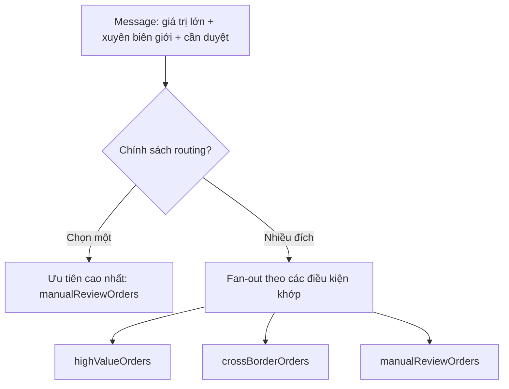
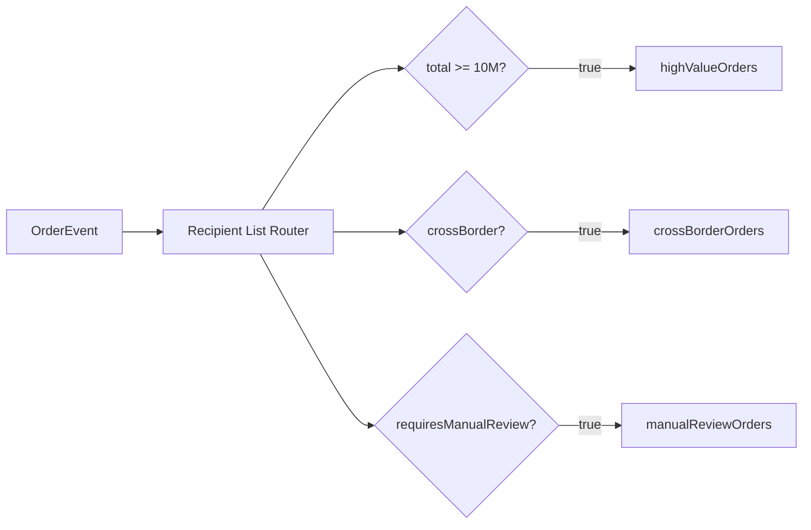
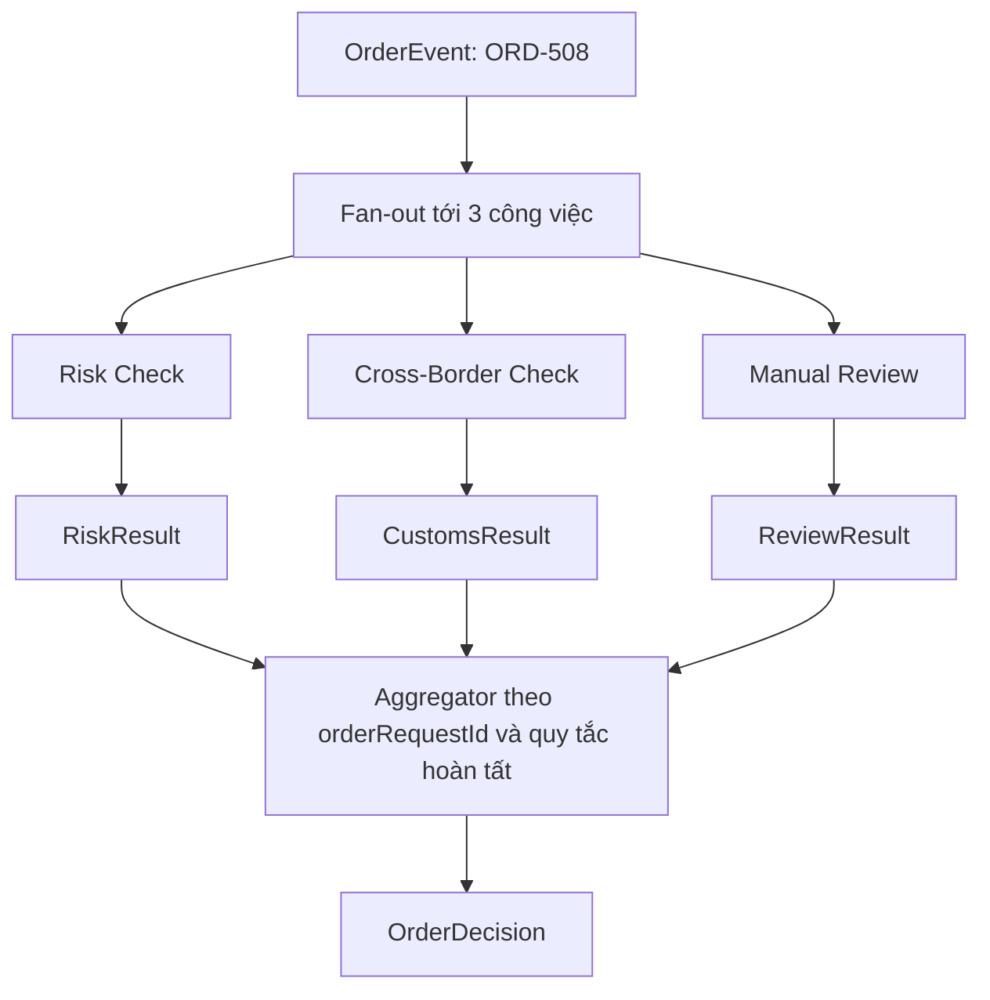

# Nhiều điều kiện cùng khớp trong Content-Based Router

Trong mô hình **Content-Based Router**, Message được gửi đến nhánh xử lý dựa trên nội dung payload hoặc metadata. Một đơn hàng có thể vừa có giá trị lớn, vừa là đơn xuyên biên giới, vừa cần kiểm duyệt thủ công. Khi **nhiều điều kiện cùng đúng**, hệ thống phải trả lời một câu hỏi quan trọng: **chọn đúng một tuyến theo độ ưu tiên hay gửi Message đến tất cả các tuyến phù hợp?**

Đây là vấn đề thiết kế luồng, không chỉ là câu lệnh `if`. Nếu chọn một nhánh, những công việc cần chạy ở các nhánh còn lại có thể bị bỏ qua. Nếu gửi đến nhiều nhánh, ứng dụng cần quản lý fan-out, xử lý trùng, lỗi một phần, thời gian chờ và correlation khi tổng hợp kết quả.

Bài học thuộc chương **Content-based router** trong module `SPRING_INTEGRATION_PATTERN`. Mục tiêu của module là triển khai Enterprise Integration Patterns bằng Spring Integration để xây dựng luồng thông điệp ít phụ thuộc, dễ mở rộng; thực hành Router, Filter, Transformer, Splitter, Aggregator, Gateway, retry, error channel, correlation, kiểm thử và quan sát các nhánh xử lý. Ở đây chúng ta tập trung vào **ngữ nghĩa khi nhiều điều kiện định tuyến đồng thời khớp**.

## 1. Bài toán: một Message thỏa nhiều quy tắc

Giả sử hệ thống tiếp nhận sự kiện:

```json
{
  "orderId": "ORD-508",
  "total": 15000000,
  "crossBorder": true,
  "requiresManualReview": true
}
```

Có ba quy tắc:

| Quy tắc | Điều kiện | Kênh đích |
| --- | --- | --- |
| Đơn giá trị lớn | `total >= 10_000_000` | `highValueOrders` |
| Đơn xuyên biên giới | `crossBorder == true` | `crossBorderOrders` |
| Cần kiểm duyệt | `requiresManualReview == true` | `manualReviewOrders` |

Cả ba điều kiện đều đúng với `ORD-508`. Điều này tạo ra hai mô hình hợp lệ, nhưng khác về nghiệp vụ.

**Mô hình A — chọn một tuyến duy nhất:** ưu tiên kiểm duyệt thủ công, sau đó tuyến xuyên biên giới, sau cùng tuyến giá trị lớn. Message chỉ đến `manualReviewOrders`.

**Mô hình B — gửi đến mọi tuyến phù hợp:** Message đến cả `highValueOrders`, `crossBorderOrders` và `manualReviewOrders`. Mỗi nhánh thực hiện một trách nhiệm độc lập.



Không có câu trả lời “luôn chọn tất cả” hay “luôn chọn đầu tiên”. **Hợp đồng nghiệp vụ phải quyết định** điều kiện nào mang tính loại trừ và điều kiện nào là những công việc phải cùng thực hiện.

## 2. Phân biệt “điều kiện khớp” với “đích được chọn”

Một predicate là hàm boolean được áp dụng lên Message. Nó có thể trả `true` hoặc `false` độc lập với các predicate khác:

```java
boolean highValue = total.compareTo(THRESHOLD) >= 0;
boolean crossBorder = order.crossBorder();
boolean needsReview = order.requiresManualReview();
```

**Tập điều kiện khớp** là tập các predicate trả `true`. **Tập đích được chọn** phụ thuộc chính sách định tuyến:

- Với **exclusive routing**, tập đích có tối đa một channel sau khi áp dụng thứ tự ưu tiên.
- Với **multicast/recipient routing**, tập đích có thể chứa nhiều channel.
- Với **fail-on-ambiguous**, nếu có hơn một điều kiện đúng, Message bị coi là dữ liệu hoặc cấu hình không hợp lệ.

Ví dụ bảng quyết định:

| `highValue` | `crossBorder` | `needsReview` | Ưu tiên review > cross-border > high-value | Gửi tới mọi nhánh khớp |
| --- | --- | --- | --- | --- |
| false | false | false | `standardOrders` | `standardOrders` (fallback) |
| true | false | false | `highValueOrders` | `highValueOrders` |
| true | true | false | `crossBorderOrders` | `highValueOrders`, `crossBorderOrders` |
| false | true | true | `manualReviewOrders` | `crossBorderOrders`, `manualReviewOrders` |
| true | true | true | `manualReviewOrders` | Cả ba channel |

Một thay đổi nhỏ trong thứ tự `if/else if` có thể làm kết quả của exclusive routing thay đổi. Trong khi đó, nhiều câu lệnh `if` độc lập có thể tạo nhiều recipient. Quyết định đó cần được thể hiện rõ trong tên phương thức, tài liệu và test.

## 3. Content-Based Router, Filter và Recipient List khác nhau thế nào?

Spring Integration cung cấp các cơ chế phù hợp với những ý định khác nhau:

| Cơ chế | Ý định | Khi nhiều quy tắc đúng |
| --- | --- | --- |
| **Content-Based Router** chọn một channel | Chia luồng thành các nhánh loại trừ nhau | Cần chính sách ưu tiên hoặc điều kiện loại trừ |
| **Router trả một collection of channels** | Đưa một Message tới nhiều channel | Có thể chọn nhiều channel nếu collection chứa nhiều đích |
| **Recipient List Router** | Đánh giá các recipient/selector độc lập | Những recipient đủ điều kiện đều được chọn |
| **PublishSubscribeChannel** | Phát tới các subscriber của cùng một channel | Tất cả subscriber phù hợp với cơ chế subscribe đều có thể nhận; không chọn theo predicate nghiệp vụ của từng recipient theo cách Recipient List Router |
| **Filter** | Cho Message đi tiếp hoặc loại khỏi một nhánh | Chỉ quyết định `true/false` tại nhánh đó; nhiều Filter đặt trên những nhánh khác nhau là một bài toán khác |

Một **Content-Based Router truyền thống** thường được mô tả là định tuyến Message đến một trong các channel đích. Khi yêu cầu thực tế là **gửi đến nhiều recipient có điều kiện**, cách diễn đạt rõ nhất là *Recipient List Router* hoặc một method router trả về tập channel. Không nên giả định một biểu thức router đơn trị sẽ tự chạy tất cả các rule nếu nhiều điều kiện đúng.

Đừng nhầm **fan-out** với **Splitter**. Router fan-out có thể gửi cùng một Message đến nhiều nhánh, còn Splitter thường tách payload thành những Message con. Một Splitter có thể bổ sung sequence/correlation headers phục vụ Aggregator; việc Router gửi nhiều đích **không mặc nhiên tạo cùng metadata chuỗi đó**.

## 4. Cách 1: chọn một tuyến theo thứ tự ưu tiên

Khi mỗi Message chỉ được đưa vào **một quy trình xử lý chính**, hãy làm rõ độ ưu tiên trong một hàm định tuyến.

```java
public String chooseExactlyOneRoute(OrderEvent order) {
    if (order.requiresManualReview()) {
        return "manualReviewOrders";
    }
    if (order.crossBorder()) {
        return "crossBorderOrders";
    }
    if (order.total().compareTo(HIGH_VALUE_THRESHOLD) >= 0) {
        return "highValueOrders";
    }
    return "standardOrders";
}
```

Giả sử `order.total()` đã được validate và không `null`, thứ tự trên cố ý ưu tiên `manualReviewOrders`. Nếu đổi vị trí hai nhánh đầu, đơn xuyên biên giới cần duyệt sẽ có kết quả định tuyến khác.

**Những điểm phải quy định trong thiết kế:**

1. Độ ưu tiên là một **quy tắc nghiệp vụ** cần kiểm thử, không phải chi tiết ngẫu nhiên của code.
2. Khi nhiều điều kiện đồng thời đúng, chỉ một công việc được khởi chạy ở tuyến chính. Các trách nhiệm còn lại cần được thực hiện bên trong tuyến đã chọn hoặc qua một quy trình khác nếu vẫn cần thiết.
3. Nếu kết quả route không khớp channel nào, cần có default route hoặc cơ chế báo lỗi theo hợp đồng.
4. Nếu nhiều điều kiện **đáng lẽ không thể đồng thời đúng**, có thể kiểm tra tính bất biến và trả lỗi thay vì ưu tiên âm thầm.

Exclusive routing thường phù hợp khi lựa chọn *một phương thức thanh toán*, *một nhóm xử lý sở hữu yêu cầu* hoặc *một môi trường thực thi*.

## 5. Cách 2: gửi đến nhiều tuyến cùng khớp

Khi mỗi điều kiện biểu diễn một công việc độc lập, có thể tạo tập channel từ các predicate. Trong Spring Integration, phương thức `@Router` có thể trả về một tập tên channel để định tuyến Message đến nhiều đích.

Ví dụ: đơn giá trị lớn cần thẩm định rủi ro; đơn xuyên biên giới cần tính chứng từ; đơn cần review cần được đưa vào danh sách kiểm duyệt. Cả ba công việc có thể cần chạy cho cùng một đơn.

### 5.1. Cấu hình ứng dụng mẫu

Ví dụ Java 17+ dưới đây dùng annotation-based router và các `QueueChannel` để quan sát rõ Message tới từng nhánh. Các lớp dùng package minh họa `example.integration`.

```java
package example.integration;

import java.math.BigDecimal;
import java.util.LinkedHashSet;
import java.util.List;
import java.util.Set;

import org.springframework.context.annotation.Bean;
import org.springframework.context.annotation.Configuration;
import org.springframework.integration.annotation.Router;
import org.springframework.integration.channel.DirectChannel;
import org.springframework.integration.channel.QueueChannel;
import org.springframework.integration.config.EnableIntegration;
import org.springframework.messaging.MessageChannel;
import org.springframework.messaging.PollableChannel;

@Configuration
@EnableIntegration
public class MultiMatchRoutingConfiguration {

    private static final BigDecimal HIGH_VALUE_THRESHOLD =
            new BigDecimal("10000000");

    public record OrderEvent(
            String orderId,
            BigDecimal total,
            boolean crossBorder,
            boolean requiresManualReview) {
    }

    @Bean
    public MessageChannel ordersInput() {
        return new DirectChannel();
    }

    @Bean
    public PollableChannel highValueOrders() {
        return new QueueChannel(10);
    }

    @Bean
    public PollableChannel crossBorderOrders() {
        return new QueueChannel(10);
    }

    @Bean
    public PollableChannel manualReviewOrders() {
        return new QueueChannel(10);
    }

    @Bean
    public PollableChannel standardOrders() {
        return new QueueChannel(10);
    }

    @Bean
    public PollableChannel invalidOrders() {
        return new QueueChannel(10);
    }

    @Router(inputChannel = "ordersInput")
    public List<String> routeOrder(OrderEvent order) {
        if (order.total() == null || order.total().signum() < 0) {
            return List.of("invalidOrders");
        }

        Set<String> recipients = new LinkedHashSet<>();

        if (order.total().compareTo(HIGH_VALUE_THRESHOLD) >= 0) {
            recipients.add("highValueOrders");
        }
        if (order.crossBorder()) {
            recipients.add("crossBorderOrders");
        }
        if (order.requiresManualReview()) {
            recipients.add("manualReviewOrders");
        }

        if (recipients.isEmpty()) {
            recipients.add("standardOrders");
        }
        return List.copyOf(recipients);
    }
}
```

Chú ý một số lựa chọn có chủ đích:

- Các `if` **độc lập**, nên một Message có thể khớp nhiều điều kiện. Nếu dùng `else if`, chỉ một nhánh trong chuỗi điều kiện được chọn.
- `LinkedHashSet` tránh đưa trùng cùng tên channel và giữ thứ tự khai báo recipient khi xây tập đích. **Thứ tự khai báo không bảo đảm thứ tự hoàn tất xử lý** khi các nhánh chạy bất đồng bộ.
- `@Router` trả về danh sách **tên bean MessageChannel**; Spring Integration giải quyết các tên đó rồi gửi Message đến các kênh đã chọn.
- Nếu dữ liệu không đạt kiểm tra sơ bộ (`total` thiếu hoặc âm), chỉ chọn `invalidOrders`. Nhánh này có thể tiếp tục validate và tạo phản hồi phù hợp.
- Nếu không quy tắc chuyên biệt nào khớp, Message đi đến `standardOrders`. Đây là **fallback tường minh**, không có chuyện Message tự biến mất vì không khớp.
- `QueueChannel(10)` chỉ là bộ đệm trong bộ nhớ phục vụ demo; môi trường production cần đánh giá công suất, overflow, độ bền và consumer.

### 5.2. Gửi một Message khớp ba nhánh

```java
package example.integration;

import java.math.BigDecimal;

import org.springframework.context.annotation.AnnotationConfigApplicationContext;
import org.springframework.messaging.Message;
import org.springframework.messaging.MessageChannel;
import org.springframework.messaging.PollableChannel;
import org.springframework.messaging.support.MessageBuilder;

import example.integration.MultiMatchRoutingConfiguration.OrderEvent;

public class MultiMatchRoutingDemo {

    public static void main(String[] args) {
        try (var context = new AnnotationConfigApplicationContext(
                MultiMatchRoutingConfiguration.class)) {

            MessageChannel input =
                    context.getBean("ordersInput", MessageChannel.class);
            PollableChannel highValue =
                    context.getBean("highValueOrders", PollableChannel.class);
            PollableChannel crossBorder =
                    context.getBean("crossBorderOrders", PollableChannel.class);
            PollableChannel manualReview =
                    context.getBean("manualReviewOrders", PollableChannel.class);
            PollableChannel standard =
                    context.getBean("standardOrders", PollableChannel.class);

            OrderEvent event = new OrderEvent(
                    "ORD-508",
                    new BigDecimal("15000000"),
                    true,
                    true);

            Message<OrderEvent> inputMessage =
                    MessageBuilder.withPayload(event)
                            .setHeader("businessOrderId", event.orderId())
                            .setHeader("eventId", "evt-508")
                            .build();

            boolean acceptedByInput = input.send(inputMessage);
            System.out.println("Accepted by input: " + acceptedByInput);

            Message<?> a = highValue.receive(0);
            Message<?> b = crossBorder.receive(0);
            Message<?> c = manualReview.receive(0);

            System.out.println(a == null ? "none" : a.getPayload());
            System.out.println(b == null ? "none" : b.getPayload());
            System.out.println(c == null ? "none" : c.getPayload());
            System.out.println("Default empty: " + (standard.receive(0) == null));
        }
    }
}
```

Khi input dùng `DirectChannel` và các queue còn chỗ, ba channel chuyên biệt nhận cùng dữ liệu nghiệp vụ của `ORD-508`, còn `standardOrders` không nhận Message. Cả ba `receive(0)` là phép quan sát sau `send` đồng bộ. Trong luồng bất đồng bộ, cần chờ điều kiện phù hợp với timeout thay vì kiểm tra ngay.

**Gửi thành công vào ba channel không đồng nghĩa ba nhánh nghiệp vụ đã xử lý xong.** Trong ví dụ, Message vẫn ở queue chờ consumer lấy ra; ứng dụng cần cấu hình polling endpoint hoặc consumer thực sự.

## 6. Recipient List Router: mỗi recipient có một predicate

Khi số lượng recipient tương đối cố định và mỗi nhánh có **điều kiện được khai báo riêng**, Spring Integration cung cấp **Recipient List Router**. Thay vì viết một hàm trả danh sách channel, ta định nghĩa các recipient cùng điều kiện lựa chọn riêng của chúng.

Sơ đồ hoạt động:



Các predicate được đánh giá độc lập; khi hai hoặc ba predicate khớp, những recipient tương ứng đều được chọn. Trong Java DSL, điểm nối dành cho mô hình này là `.routeToRecipients(...)`. Một cấu hình DSL có thể tổ chức như sau:

```java
// Đoạn DSL thay thế cho phương thức @Router ở mục 5.
// Chỉ đăng ký một trong hai cơ chế trên cùng input channel.
@Bean
public IntegrationFlow recipientRoutingFlow() {
    return IntegrationFlow.from("ordersInput")
            .routeToRecipients(spec -> spec
                    .recipient("highValueOrders",
                            "payload.total >= 10000000")
                    .recipient("crossBorderOrders",
                            "payload.crossBorder == true")
                    .recipient("manualReviewOrders",
                            "payload.requiresManualReview == true"))
            .get();
}
```

Đây là ví dụ thể hiện ý tưởng cấu hình bằng **biểu thức SpEL**; cách truy cập thuộc tính của record/DTO và cú pháp phù hợp cần được xác nhận theo phiên bản Spring Integration/Spring Framework đang dùng. Flow ở mục 5 là ví dụ tự chứa để chạy và kiểm thử trực tiếp.

Với Recipient List Router, cần thiết kế riêng **đường đi khi không recipient nào khớp** (chẳng hạn một nhánh fallback, điều kiện nhận mọi Message, hoặc một chính sách báo lỗi). Không được mặc định rằng router sẽ tự gửi đến `standardOrders` nếu cấu hình chỉ có ba recipient bên trên.

### Khi nào dùng mỗi cách?

| Nhu cầu | Lựa chọn thường phù hợp |
| --- | --- |
| Một Message chỉ được đến một nhánh | Method router trả một channel hoặc biểu thức trả một key với quy tắc ưu tiên |
| Một Message phải đến tất cả nhánh có điều kiện khớp | Recipient List Router hoặc method router trả nhiều channel |
| Phát cùng sự kiện cho mọi subscriber | PublishSubscribeChannel |
| Tách danh sách phần tử thành nhiều Message riêng | Splitter |
| Lọc hẳn Message không hợp lệ trước khi route | Filter |

Không có một API duy nhất giải quyết mọi tình huống. Hãy chọn dựa trên **số nhánh phải nhận Message**, **cách xác định điều kiện** và **hợp đồng kết quả**.

## 7. Thứ tự thực thi, trùng recipient và fan-out không nguyên tử

Khi một Message được gửi đến nhiều channel, cần phân biệt ba khái niệm:

**Thứ tự chọn recipient** là thứ tự danh sách channel được tạo hoặc cấu hình. **Thứ tự chuyển giao** là thứ tự router thực hiện lệnh gửi. **Thứ tự hoàn tất nghiệp vụ** là lúc handler phía sau mỗi channel kết thúc. Ba thứ tự này không nhất thiết giống nhau, nhất là khi dùng `ExecutorChannel`, polling consumer, broker hoặc nhiều instance.

Giả sử gửi đến A rồi B rồi C, nhưng B xử lý trong 10 ms, A mất 5 s và C gặp lỗi. Log có thể cho thấy B hoàn thành trước A. Không nên dùng thứ tự routing để suy ra thứ tự kết thúc.

### 7.1. Một lỗi có thể xảy ra sau khi nhánh khác đã nhận Message

Fan-out **không mặc định là một giao dịch nguyên tử xuyên mọi channel**. Một router có thể gửi thành công đến channel thứ nhất, sau đó lỗi khi gửi đến channel thứ hai. Khi đó:

1. Nhánh đã nhận Message có thể đang xử lý hoặc đã có side effect.
2. Nhánh gặp lỗi cần cơ chế ghi nhận và retry phù hợp.
3. Retry toàn bộ Message có thể khiến nhánh thành công nhận lại sự kiện.

Vì vậy, luồng có nhiều recipient nên có **khóa idempotency** ổn định, chẳng hạn `eventId` kết hợp tên loại công việc, và quy định rõ cách phục hồi khi một nhánh thất bại. Không suy ra “exactly once” chỉ từ việc Router nhận một Message.

### 7.2. Một channel xuất hiện nhiều lần trong danh sách

Nếu hai điều kiện cùng dẫn tới `highValueOrders` và code thêm tên channel hai lần, một cơ chế routing hỗ trợ collection có thể xem đó là hai recipient và chuyển giao lặp. Ví dụ ở mục 5 dùng `LinkedHashSet` để đảm bảo mỗi tên channel chỉ xuất hiện một lần.

Nếu nghiệp vụ thật sự cần tạo **hai công việc khác nhau**, hãy biểu diễn thành hai Message hoặc hai lệnh công việc có định danh và trách nhiệm rõ ràng, thay vì cố tình lặp tên channel không có quy ước.

## 8. Khi không khớp, khớp nhiều và dữ liệu không hợp lệ

Thiết kế chính sách cho ba tình huống độc lập:

| Kết quả predicate | Điều cần quyết định | Ví dụ |
| --- | --- | --- |
| **Không điều kiện nào khớp** | Fallback, bỏ qua, hay trả lỗi? | Đơn thông thường → `standardOrders` |
| **Một điều kiện khớp** | Gửi đúng recipient được chọn | Đơn xuyên biên giới → `crossBorderOrders` |
| **Nhiều điều kiện khớp** | Chọn theo ưu tiên, gửi tất cả, hay báo lỗi? | Đơn lớn xuyên biên giới cần duyệt |
| **Không thể đánh giá** | Validation, retry hay error flow? | Thiếu `total`, service chính sách timeout |

Không dùng **default route** để che lỗi dữ liệu. Ví dụ `total = null` không nhất thiết là một đơn “thông thường”; trong code mẫu nó đi đến `invalidOrders`. Với một schema bắt buộc số tiền hợp lệ, có thể còn cần chặn từ đầu bằng Filter/validator và trả lỗi cho upstream.

Nếu routing phụ thuộc header do client bên ngoài tự đặt, phải xác minh độ tin cậy ở boundary. Không để nguồn không đáng tin quyết định trực tiếp tên channel nội bộ nếu điều đó cho phép đi vòng qua bước kiểm soát.

## 9. Mối quan hệ với Splitter, Aggregator và correlation

**Router đa đích không phải Splitter.** Khi một Message được đưa tới ba nhánh, ba nhánh có thể thấy cùng payload nghiệp vụ, nhưng không có nghĩa một `sequenceNumber` 1, 2, 3 được tự động cấp cho ba bản gửi theo cách của Splitter.

Nếu mục tiêu là **gửi ba yêu cầu, đợi ba kết quả rồi trả một câu trả lời**, hãy xác định một mẫu tổng hợp phù hợp như Scatter-Gather hoặc tự thiết kế correlation/release strategy cho Aggregator:



Để gom đúng kết quả, nên thiết kế rõ:

- **Correlation key:** mọi kết quả của một lần xử lý đơn hàng mang cùng `orderRequestId` (không nhất thiết chỉ dùng `orderId`, vì cùng đơn có thể được đánh giá lại nhiều lần).
- **Branch identity:** mỗi kết quả chỉ rõ nhánh tạo nó, ví dụ `RISK`, `CUSTOMS`, `REVIEW`.
- **Completion rule:** kết quả được coi là đủ khi nhận được các loại kết quả nào; có bắt buộc cả ba hay không?
- **Timeout:** nếu một nhánh chậm hoặc không hồi đáp thì trả lỗi, chờ thêm hay trả kết quả một phần?
- **Duplicate handling:** cùng nhánh trả hai lần phải được nhận diện theo `eventId`, request ID và branch ID.

Với thiết kế này, nếu chỉ hai trong ba điều kiện khớp, Aggregator phải biết **tập nhánh thực sự được kỳ vọng**. Đừng hardcode đợi ba kết quả cho mọi đơn hàng. Một số trường hợp nên dùng cơ chế Scatter-Gather được Spring Integration hỗ trợ thay vì tự ghép nhiều router và aggregator.

### Khi có Filter sau Router

Giả sử nhánh `manualReviewOrders` có Filter từ chối một Message mà Aggregator vẫn kỳ vọng kết quả từ nhánh này. Nhóm có thể chờ mãi nếu không có timeout hoặc thông điệp “từ chối” được ghi nhận như một kết quả. Một cách thiết kế là gửi về `ReviewResult(REJECTED)` thay vì để nhánh biến mất.

## 10. Gateway, retry và error channel

Với Gateway request-reply, việc Router gửi cùng Message đến nhiều kênh không tự bảo đảm chỉ có **một reply** để trả về cho lời gọi Java. Nếu nhiều nhánh cùng trả kết quả, hãy chỉ rõ cơ chế tổng hợp hoặc chọn kết quả trước khi trả Gateway.

Khi một nhánh ném exception:

- Với các channel đồng bộ như `DirectChannel`, exception có thể lan tới router và người gửi.
- Với queue, executor hoặc broker, lỗi thường xuất hiện trong consumer ở thời điểm khác; đường đi của `ErrorMessage` phụ thuộc cấu hình error handling.
- Retry cần được áp dụng đúng phạm vi. Retry toàn bộ routing có thể làm lại cả những nhánh đã thành công.
- Không mặc định rằng lỗi ở một nhánh được tự động chuyển tới mọi `errorChannel` hoặc có thể hoàn tác tác dụng đã chạy ở nhánh khác.

Để tránh thực hiện trùng, một khóa idempotency hữu ích có dạng:

```text
idempotencyKey = eventId + ":" + branchType
```

Ví dụ `evt-508:RISK` và `evt-508:CUSTOMS` là hai công việc khác nhau, dù được sinh từ cùng một event. Cách lưu khóa, phạm vi transaction và thời gian giữ khóa phải phù hợp với nghiệp vụ; một chuỗi khóa tự thân chưa đủ bảo đảm an toàn khi xử lý song song.

## 11. Kiểm thử nhiều điều kiện cùng khớp

Chỉ unit test ba predicate riêng lẻ là chưa đủ. Cần kiểm chứng **Message đến đúng tất cả channel được chọn và không đến những channel không được chọn**.

Ví dụ JUnit 5 sử dụng cấu hình ở mục 5:

```java
package example.integration;

import static org.junit.jupiter.api.Assertions.*;

import java.math.BigDecimal;

import org.junit.jupiter.api.Test;
import org.springframework.context.annotation.AnnotationConfigApplicationContext;
import org.springframework.messaging.Message;
import org.springframework.messaging.MessageChannel;
import org.springframework.messaging.PollableChannel;
import org.springframework.messaging.support.MessageBuilder;

import example.integration.MultiMatchRoutingConfiguration.OrderEvent;

class MultiMatchRoutingIntegrationTest {

    @Test
    void oneMessageCanReachThreeMatchingRecipients() {
        try (var context = new AnnotationConfigApplicationContext(
                MultiMatchRoutingConfiguration.class)) {

            MessageChannel input =
                    context.getBean("ordersInput", MessageChannel.class);
            PollableChannel highValue =
                    context.getBean("highValueOrders", PollableChannel.class);
            PollableChannel crossBorder =
                    context.getBean("crossBorderOrders", PollableChannel.class);
            PollableChannel manualReview =
                    context.getBean("manualReviewOrders", PollableChannel.class);
            PollableChannel standard =
                    context.getBean("standardOrders", PollableChannel.class);
            PollableChannel invalid =
                    context.getBean("invalidOrders", PollableChannel.class);

            OrderEvent event = new OrderEvent(
                    "ORD-508", new BigDecimal("15000000"), true, true);
            assertTrue(input.send(MessageBuilder.withPayload(event)
                    .setHeader("eventId", "evt-508")
                    .build()));

            Message<?> a = highValue.receive(0);
            Message<?> b = crossBorder.receive(0);
            Message<?> c = manualReview.receive(0);

            assertNotNull(a);
            assertNotNull(b);
            assertNotNull(c);
            assertEquals(event, a.getPayload());
            assertEquals(event, b.getPayload());
            assertEquals(event, c.getPayload());
            assertEquals("evt-508", a.getHeaders().get("eventId"));
            assertNull(standard.receive(0));
            assertNull(invalid.receive(0));
            assertNull(highValue.receive(0));
            assertNull(crossBorder.receive(0));
            assertNull(manualReview.receive(0));
        }
    }

    @Test
    void noSpecialConditionUsesStandardBranch() {
        try (var context = new AnnotationConfigApplicationContext(
                MultiMatchRoutingConfiguration.class)) {

            MessageChannel input =
                    context.getBean("ordersInput", MessageChannel.class);
            PollableChannel standard =
                    context.getBean("standardOrders", PollableChannel.class);
            PollableChannel highValue =
                    context.getBean("highValueOrders", PollableChannel.class);

            OrderEvent event = new OrderEvent(
                    "ORD-509", new BigDecimal("50000"), false, false);
            assertTrue(input.send(MessageBuilder.withPayload(event).build()));

            Message<?> result = standard.receive(0);
            assertNotNull(result);
            assertEquals(event, result.getPayload());
            assertNull(highValue.receive(0));
        }
    }
}
```

Hai test trên dùng `DirectChannel` làm input và các `QueueChannel` chưa có consumer, vì vậy ngay sau khi `send()` đồng bộ hoàn thành có thể dùng `receive(0)` để quan sát. Nếu các branch có executor/poller thật, cần chờ điều kiện có timeout hữu hạn và không kiểm tra theo thứ tự hoàn tất cố định.

Những kịch bản cần bổ sung:

1. **Ngưỡng biên:** đúng `10_000_000`, ngay dưới và ngay trên ngưỡng.
2. **Hai điều kiện cùng đúng:** xác minh chính xác hai channel nhận, những channel còn lại rỗng.
3. **Không điều kiện nào đúng:** rơi vào `standardOrders`, không mất Message.
4. **Dữ liệu sai:** `total = null`, `total < 0` đi đến `invalidOrders`.
5. **Exclusive routing:** khi chọn ưu tiên, một Message dù thỏa ba điều kiện vẫn chỉ đến một channel.
6. **Lỗi khi một channel đầy hoặc handler ném exception:** xác minh cách ghi nhận gửi thành công một phần và phục hồi an toàn.
7. **Retry/idempotency:** cùng event được gửi lại, không tạo tác dụng nghiệp vụ lặp ở những nhánh đã thành công.
8. **Tổng hợp kết quả:** Aggregator chỉ chờ những branch mà routing thực sự chọn, có timeout/duplicate policy.

## 12. Theo dõi các nhánh khi hệ thống chạy

Muốn chẩn đoán lỗi “một nhánh không nhận sự kiện”, cần ghi nhận **tập điều kiện khớp** và **tập recipient cuối cùng**, bên cạnh Message ID và khóa nghiệp vụ.

```json
{
  "stage": "multi-match-router",
  "eventId": "evt-508",
  "businessOrderId": "ORD-508",
  "matchedRules": ["HIGH_VALUE", "CROSS_BORDER", "MANUAL_REVIEW"],
  "targetChannels": [
    "highValueOrders",
    "crossBorderOrders",
    "manualReviewOrders"
  ],
  "routingPolicy": "ALL_MATCH",
  "result": "DISPATCHED"
}
```

Các trường trên là **schema log gợi ý**, không mặc định được Spring Integration tự sinh. Khi log `DISPATCHED`, cần xác định rõ đó là việc router đã gửi xong vào channel hay là nghiệp vụ của consumer đã hoàn tất; hai trạng thái khác nhau.

| Metric gợi ý | Dùng để |
| --- | --- |
| `router.evaluated.count` | Đếm Message đi vào router |
| `router.matched_rules.count` | Quan sát điều kiện thường khớp |
| `router.recipient_count` | Phát hiện số recipient bất thường trên một Message |
| `router.fallback.count` | Theo dõi số Message không có điều kiện chuyên biệt |
| `router.dispatch.failure` | Theo dõi lỗi chuyển giao vào channel |
| `branch.consumer.failure` | Phân biệt lỗi xử lý của nhánh với lỗi định tuyến |
| `branch.processing.duration` | Đánh giá nhánh nào làm chậm cả quy trình |
| `aggregator.incomplete_groups` | Phát hiện nhóm đang chờ kết quả từ nhánh đã chọn |

Đây là **tên metric minh họa**; có thể xây dựng bằng Micrometer, Spring Boot Actuator, log và tracing theo thiết kế. Không dùng giá trị động nhiều khả năng là duy nhất (`orderId`, `eventId`) làm tag metric để tránh bùng nổ cardinality; những khóa này thích hợp trong log/traces.

Khi điều tra sự cố, trình tự hữu ích là: **Message đầu vào → predicate thực tế → chính sách chọn một/nhiều → danh sách channel được chọn → kết quả gửi đến từng channel → consumer → error/reply/aggregation**.

## 13. Những lỗi thiết kế thường gặp

| Hiện tượng | Nguyên nhân | Hướng xử lý |
| --- | --- | --- |
| Chỉ một nhánh chạy dù có nhiều điều kiện đúng | Dùng `else if` hoặc router chỉ trả một channel | Chọn mô hình multi-recipient khi các trách nhiệm độc lập |
| Nhiều nhánh chạy ngoài ý muốn | Dùng nhiều `if` khi yêu cầu chỉ một route | Định nghĩa ưu tiên và test tổ hợp điều kiện |
| Cùng nhánh nhận Message hai lần | Danh sách recipient chứa duplicate hoặc retry fan-out | Khử trùng channel, dùng idempotency theo nhánh |
| Message không khớp biến mất | Thiếu fallback hoặc cấu hình router bỏ unmatched | Định nghĩa route mặc định / chính sách từ chối |
| Gateway chờ phản hồi mãi | Nhiều nhánh không có cơ chế gom hoặc tạo reply | Thiết kế Scatter-Gather, timeout và kết quả tổng hợp |
| Aggregator không hoàn tất | Số nhánh kỳ vọng khác số nhánh được chọn hoặc một nhánh bị Filter loại | Quản lý expected recipients, correlation và expiry |
| Retry gây lặp side effect | Một nhánh lỗi sau khi nhánh khác đã thành công | Retry theo nhánh, khóa idempotency ổn định, ghi trạng thái |
| Log thiếu nguyên nhân | Chỉ ghi tên Router, không ghi rule và recipient | Log matched rules và target channels có cấu trúc |

## 14. Nguyên tắc áp dụng

- **Làm rõ hợp đồng trước khi viết router:** một Message được phép tới một hay nhiều nhánh?
- **Công khai chính sách ưu tiên nếu chọn một nhánh.** Không để thứ tự điều kiện ngầm quyết định kết quả.
- **Dùng recipient routing khi nhiều công việc độc lập cùng cần Message.** Không nhầm nó với Splitter.
- **Quy định fallback và validation.** Không xem dữ liệu sai như một Message bình thường chỉ vì không khớp predicate.
- **Kiểm soát duplicate và lỗi từng nhánh.** Fan-out không mặc nhiên atomic hoặc exactly-once.
- **Thiết kế reply và correlation nếu cần gom kết quả.** Router đa đích không tự bảo đảm một câu trả lời duy nhất cho Gateway.
- **Kiểm thử tập recipient thực tế.** Kiểm tra cả nhiều điều kiện khớp, một điều kiện, không điều kiện và lỗi.
- **Theo dõi được mỗi quyết định.** Ghi log matched rules, target channels, eventId và trạng thái xử lý theo từng nhánh.

Khi nhiều điều kiện cùng khớp, điều quan trọng nhất là **phân biệt quyết định chọn một tuyến với quyết định gửi đến nhiều tuyến**. Spring Integration hỗ trợ cả hai mô hình, nhưng tính đúng đắn đến từ chính sách nghiệp vụ, cách cấu hình channel, đường lỗi, correlation và kiểm thử cho từng tổ hợp điều kiện.
