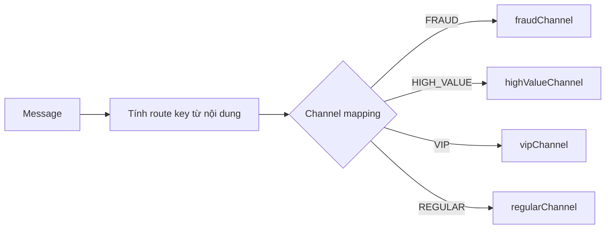
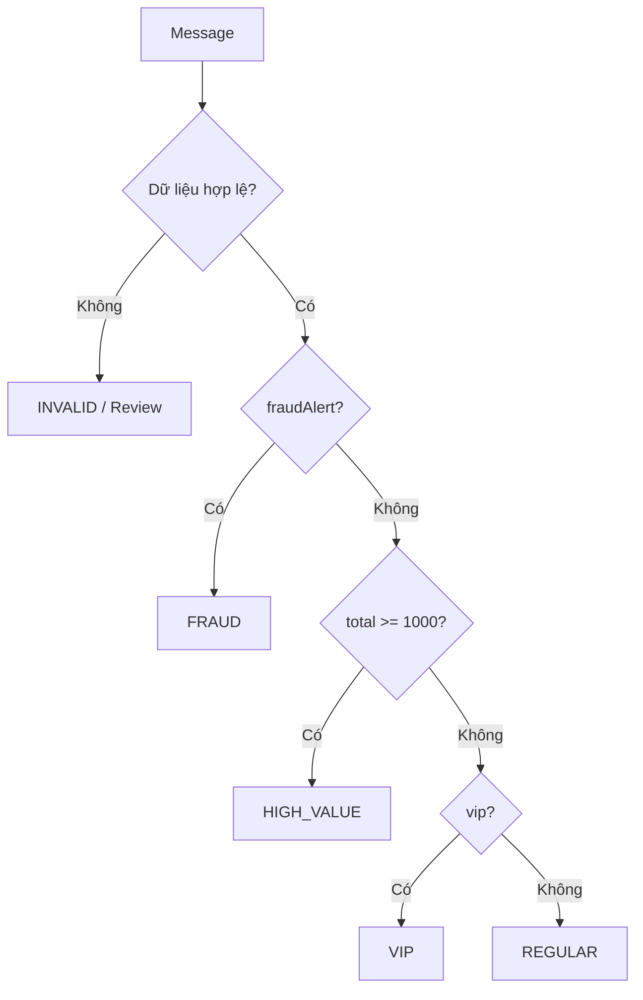
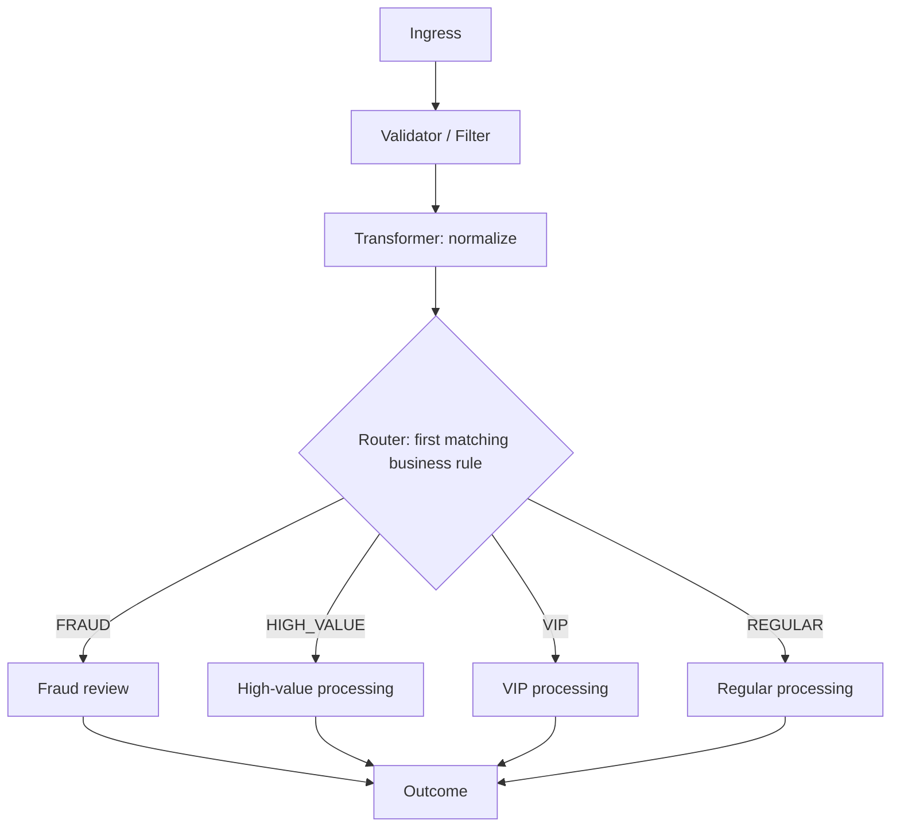

# Thứ tự đánh giá route trong Content-Based Router của Spring Integration

## Mục tiêu học tập

Khi một message thỏa mãn **nhiều điều kiện định tuyến**, hệ thống sẽ chọn nhánh nào? Một đơn hàng vừa có cảnh báo gian lận, vừa có giá trị cao, vừa thuộc khách hàng VIP phải được chuyển tới bước kiểm tra gian lận, xử lý ưu tiên hay xử lý khách hàng VIP? Đây là bài toán **thứ tự đánh giá route**.

Trong chương **Content-based router** của module **SPRING_INTEGRATION_PATTERN**, chúng ta dùng Enterprise Integration Patterns (EIP) với Spring Integration để xây các luồng thông điệp ít phụ thuộc, dễ mở rộng. Bài học kết nối Router với Filter, Transformer, Splitter, Aggregator, Gateway, retry, error channel và correlation, đồng thời nhấn mạnh cách kiểm thử từng nhánh xử lý.

Kết thúc bài, bạn có thể:

1. Phân biệt **thứ tự đánh giá điều kiện**, **thứ tự khai báo channel mapping**, **thứ tự gửi message** và **thứ tự hoàn tất công việc**.
2. Thiết kế chính sách **first-match-wins** bằng Java `if / else if` hoặc một danh sách rule có độ ưu tiên tường minh.
3. Cấu hình Content-Based Router bằng Spring Integration Java DSL để tính route key từ nội dung message và ánh xạ key sang channel.
4. Giải thích khi nào một message có thể đến nhiều nhánh với `RecipientListRouter`, và vì sao không nên áp dụng tư duy “rule đầu tiên thắng” cho fan-out.
5. Viết kiểm thử cho các điều kiện chồng lấn, trường hợp biên, đầu vào không hợp lệ và bảo toàn headers.
6. Dự đoán ảnh hưởng của xử lý bất đồng bộ, retry, Filter và Aggregator lên kết quả của một thiết kế routing.

## 1. Content-Based Router thực sự quyết định điều gì?

**Content-Based Router** chọn đường đi dựa trên nội dung message, thường là `payload`, đôi khi kết hợp các `headers` đã được chuẩn hóa. Mỗi message đi vào một endpoint Router, endpoint xác định một hoặc nhiều đích và gửi message tiếp qua các channel.



Một cách triển khai phổ biến gồm **hai giai đoạn**:

1. **Đánh giá nội dung**: hàm/biểu thức của Router tính kết quả như `"FRAUD"` hoặc `"VIP"`.
2. **Phân giải đích**: Router dùng `channelMapping` để đổi route key thành channel tương ứng, hoặc áp dụng cấu hình fallback nếu không có đích.

Điểm cần ghi nhớ:

> **Khai báo `channelMapping("VIP", ...)` trước `channelMapping("FRAUD", ...)` không có nghĩa điều kiện VIP được kiểm tra trước Fraud.** Với Router có một hàm tính key, quy tắc quyết định key nằm trong chính hàm/biểu thức ấy.

Spring Integration không tự suy ra mức ưu tiên nghiệp vụ của các mapping. Muốn “kiểm tra gian lận trước khi chọn ưu đãi VIP”, ứng dụng phải thể hiện điều đó trong logic routing và kiểm thử.

## 2. Bốn loại “thứ tự” thường bị nhầm

| Loại thứ tự | Câu hỏi cần trả lời | Cơ chế chi phối |
| --- | --- | --- |
| **Rule evaluation order** | Điều kiện nào được xem xét trước khi đưa ra quyết định? | Mã Java, cây quyết định, bảng rule có priority hoặc biểu thức định tuyến |
| **Channel mapping order** | Các dòng ánh xạ key → channel được khai báo trước/sau ra sao? | Bảng ánh xạ; với một key đã tính xong, thứ tự khai báo thông thường không phải thứ tự ưu tiên |
| **Delivery / dequeue order** | Các message được nhận ở channel nào và theo thứ tự nào? | `DirectChannel`, `QueueChannel`, `PriorityChannel`, executor, broker, poller |
| **Completion order** | Message nào xử lý nghiệp vụ xong trước? | Độ dài công việc, concurrency, I/O, retry, timeout |

Ví dụ hai message A và B:

```text
A (VIP, amount=100, fraud=false)  gửi lúc 10:00:00
B (VIP, amount=9000, fraud=true) gửi lúc 10:00:01

Rule chọn:
    A -> VIP
    B -> FRAUD

Thứ tự hoàn tất có thể:
    B hoàn tất trước A  (nếu các nhánh chạy song song)
```

Việc B được xếp vào nhánh FRAUD không nói lên nó sẽ hoàn tất sớm hay muộn hơn A. **Routing priority** không đồng nghĩa với **processing priority**.

### Property `order` trên endpoint có phải rule priority?

Không. Trong một số cấu hình Spring Integration, thuộc tính `order` điều chỉnh **thứ tự gọi subscriber** của một endpoint khi chúng cùng đăng ký trên channel. Nó không xếp hạng các predicate bên trong hàm Content-Based Router. Nếu endpoint là polling consumer, thuộc tính ấy cũng không biến thứ tự các mapping thành độ ưu tiên nghiệp vụ.

## 3. Quy tắc ưu tiên có điều kiện chồng lấn

Giả sử đơn hàng có bốn dữ kiện:

- `fraudAlert`: hệ thống phát hiện dấu hiệu gian lận.
- `total`: tổng tiền đơn.
- `vip`: khách hàng thuộc nhóm VIP.
- `orderId`: mã đơn hàng.

Nghiệp vụ yêu cầu:

1. Dữ liệu không hợp lệ → đưa vào kênh review.
2. Có cảnh báo gian lận → `FRAUD`.
3. Tổng tiền từ 1.000 trở lên → `HIGH_VALUE`.
4. Là VIP → `VIP`.
5. Còn lại → `REGULAR`.

### Bảng quyết định

| Thứ tự xét | Điều kiện | Route key | Ý nghĩa |
| ---: | --- | --- | --- |
| 0 | `orderId` rỗng, `total` âm hoặc thiếu | `INVALID` | Không thực hiện nghiệp vụ trên dữ liệu thiếu điều kiện |
| 1 | `fraudAlert == true` | `FRAUD` | Ưu tiên đánh giá rủi ro |
| 2 | `total >= 1000` | `HIGH_VALUE` | Đơn giá trị cao cần quy trình riêng |
| 3 | `vip == true` | `VIP` | Ưu đãi cho VIP khi không vướng điều kiện trên |
| 4 | Không điều kiện nào đúng | `REGULAR` | Quy trình thông thường |

Một message có `fraudAlert=true`, `total=5000`, `vip=true` thỏa **ba điều kiện nghiệp vụ**. Nhưng với **first-match-wins**, kết quả phải là **FRAUD** vì đây là điều kiện hợp lệ đầu tiên. Nếu chuyển điều kiện VIP lên trước Fraud, kết quả sẽ đổi thành VIP. Thứ tự đánh giá là một phần **hợp đồng nghiệp vụ**, không chỉ là lựa chọn trình bày mã.



### Vì sao dùng chuỗi `if / else if`?

```java
static String chooseRoute(Order order) {
    if (order.fraudAlert()) {
        return "FRAUD";
    } else if (order.total().compareTo(new BigDecimal("1000")) >= 0) {
        return "HIGH_VALUE";
    } else if (order.vip()) {
        return "VIP";
    }
    return "REGULAR";
}
```

Mỗi nhánh `return` kết thúc quyết định, nên các điều kiện sau **không được đánh giá** nếu điều kiện trước đã khớp. Đây là một quy tắc **short-circuit** rõ ràng và dễ kiểm thử.

Cũng có thể viết những câu `if` độc lập rồi liên tục gán lại biến route:

```java
String key = "REGULAR";
if (order.fraudAlert()) key = "FRAUD";
if (order.total().compareTo(new BigDecimal("1000")) >= 0) key = "HIGH_VALUE";
if (order.vip()) key = "VIP";
```

Nhưng cách này là **last-write-wins**: điều kiện VIP ở cuối ghi đè FRAUD. Kết quả trái hợp đồng ở trên. Nếu cần ưu tiên có chủ đích, hãy dùng chuỗi điều kiện trả về ngay hoặc bảng rule đã sắp xếp và dừng ở lần khớp đầu.

## 4. Java DSL: tính key một lần rồi ánh xạ đến channel

Ví dụ sau tạo một ứng dụng nhỏ với năm đích: `fraud`, `highValue`, `vip`, `regular` và `review`. Chúng ta dùng `QueueChannel` cho các đích để có thể chủ động đọc kết quả trong kiểm thử.

**Hợp đồng ví dụ:** những message hợp lệ được route đúng **một** nhánh; message thiếu mã đơn hoặc giá trị tiền không hợp lệ đi vào kênh review.

```java
import java.math.BigDecimal;

import org.springframework.context.annotation.Bean;
import org.springframework.context.annotation.Configuration;
import org.springframework.integration.channel.DirectChannel;
import org.springframework.integration.channel.QueueChannel;
import org.springframework.integration.config.EnableIntegration;
import org.springframework.integration.dsl.IntegrationFlow;
import org.springframework.messaging.MessageChannel;
import org.springframework.messaging.PollableChannel;

@Configuration
@EnableIntegration
public class OrderedRoutingConfig {

    public record Order(
        String orderId,
        BigDecimal total,
        boolean fraudAlert,
        boolean vip
    ) {}

    @Bean("orders.in")
    MessageChannel ordersIn() {
        return new DirectChannel();
    }

    @Bean("orders.fraud")
    PollableChannel fraudQueue() {
        return new QueueChannel();
    }

    @Bean("orders.highValue")
    PollableChannel highValueQueue() {
        return new QueueChannel();
    }

    @Bean("orders.vip")
    PollableChannel vipQueue() {
        return new QueueChannel();
    }

    @Bean("orders.regular")
    PollableChannel regularQueue() {
        return new QueueChannel();
    }

    @Bean("orders.review")
    PollableChannel reviewQueue() {
        return new QueueChannel();
    }

    @Bean
    IntegrationFlow orderRoutingFlow() {
        return IntegrationFlow.from("orders.in")
            .route(Order.class, OrderedRoutingConfig::chooseRoute,
                spec -> spec
                    .channelMapping("FRAUD", "orders.fraud")
                    .channelMapping("HIGH_VALUE", "orders.highValue")
                    .channelMapping("VIP", "orders.vip")
                    .channelMapping("REGULAR", "orders.regular")
                    .channelKeyFallback(false)
                    .defaultOutputChannel("orders.review"))
            .get();
    }

    // Hàm thuần: cùng dữ liệu đầu vào -> cùng route key.
    static String chooseRoute(Order order) {
        if (order.orderId() == null || order.orderId().isBlank()
            || order.total() == null || order.total().signum() < 0) {
            return "INVALID";
        }

        if (order.fraudAlert()) {
            return "FRAUD";
        }

        if (order.total().compareTo(new BigDecimal("1000")) >= 0) {
            return "HIGH_VALUE";
        }

        if (order.vip()) {
            return "VIP";
        }

        return "REGULAR";
    }
}
```

Giải thích cấu hình:

1. `.route(Order.class, OrderedRoutingConfig::chooseRoute, ...)` gọi hàm quyết định từ payload của message.
2. Hàm `chooseRoute` đánh giá các điều kiện theo thứ tự được viết và chỉ trả **một key**.
3. `.channelMapping(...)` tra cứu channel tương ứng với key; vị trí các dòng mapping không thay thứ tự `if`.
4. `.channelKeyFallback(false)` tránh việc một key lạ vô tình được xem là tên channel đã tồn tại.
5. `.defaultOutputChannel("orders.review")` định tuyến key không có mapping, ví dụ `INVALID`, sang kênh review.
6. Các output đều là `PollableChannel`; chúng ta **chưa gắn consumer chạy nền**, vì bài kiểm thử sẽ gọi `receive()`.

Cấu hình minh họa dùng Java 17+ (do sử dụng `record`) và Spring Integration Java DSL. Trong ứng dụng thực tế, một bước validation trước Router có thể xử lý trường hợp thiếu dữ liệu, còn default channel tập trung vào những loại message chưa có route. Việc gom chúng vào review ở đây giúp minh họa kết quả một cách dễ kiểm chứng.

### Dấu hiệu của một Router có thứ tự đúng

Hãy thử gửi:

```java
import java.math.BigDecimal;

import org.springframework.messaging.Message;
import org.springframework.messaging.support.MessageBuilder;

OrderedRoutingConfig.Order order = new OrderedRoutingConfig.Order(
    "ORD-42", new BigDecimal("2500"), true, true);

Message<OrderedRoutingConfig.Order> message =
    MessageBuilder.withPayload(order)
        .setHeader("traceId", "trace-42")
        .setHeader("tenantId", "tenant-a")
        .build();

ordersIn.send(message);
```

`ordersIn` là bean `MessageChannel` mang tên `orders.in` đã lấy từ Spring context. Kết quả route key là `FRAUD`, vì `fraudAlert` đúng trước khi so đến tiền và VIP. Message vào `orders.fraud`, không vào `orders.highValue` hay `orders.vip`.

Router không cần thay payload để quyết định nhánh. Những header như `traceId` và `tenantId` vẫn cần theo message để phục vụ tracing và kiểm soát ngữ cảnh downstream.

## 5. Kiểm thử thứ tự: điều kiện chồng lấn mới quan trọng

Kiểm thử chỉ với một đơn VIP không chứng minh quy tắc ưu tiên Fraud > High Value > VIP. Cần tạo các input **đồng thời khớp nhiều điều kiện**.

### Ma trận ca kiểm thử

| Input | Fraud | Total | VIP | Expected |
| --- | --- | ---: | --- | --- |
| `ORD-A` | true | 5.000 | true | **FRAUD** |
| `ORD-B` | false | 2.000 | true | **HIGH_VALUE** |
| `ORD-C` | false | 999,99 | true | **VIP** |
| `ORD-D` | false | 1.000 | false | **HIGH_VALUE** |
| `ORD-E` | false | 200 | false | **REGULAR** |
| `""` | false | 200 | false | **REVIEW** |
| `ORD-F` | true | -1 | true | **REVIEW** |

Hai hàng đầu kiểm tra **ưu tiên giữa các điều kiện cùng đúng**. Hàng có tổng tiền đúng 1.000 kiểm tra ranh giới `>=`. Hàng cuối khẳng định validation chạy **trước** quy tắc nghiệp vụ, kể cả khi cờ Fraud đang bật.

### Kiểm thử JUnit 5 và Spring Test

```java
import static org.assertj.core.api.Assertions.assertThat;

import java.math.BigDecimal;

import org.junit.jupiter.api.Test;
import org.springframework.beans.factory.annotation.Autowired;
import org.springframework.beans.factory.annotation.Qualifier;
import org.springframework.messaging.Message;
import org.springframework.messaging.MessageChannel;
import org.springframework.messaging.PollableChannel;
import org.springframework.messaging.support.MessageBuilder;
import org.springframework.test.context.junit.jupiter.SpringJUnitConfig;

@SpringJUnitConfig(OrderedRoutingConfig.class)
class OrderedRoutingTest {

    @Autowired
    @Qualifier("orders.in")
    MessageChannel input;

    @Autowired
    @Qualifier("orders.fraud")
    PollableChannel fraud;

    @Autowired
    @Qualifier("orders.highValue")
    PollableChannel highValue;

    @Autowired
    @Qualifier("orders.vip")
    PollableChannel vip;

    @Autowired
    @Qualifier("orders.regular")
    PollableChannel regular;

    @Autowired
    @Qualifier("orders.review")
    PollableChannel review;

    private void send(String id, String total, boolean fraudAlert, boolean isVip) {
        var order = new OrderedRoutingConfig.Order(
            id, new BigDecimal(total), fraudAlert, isVip);

        assertThat(input.send(
            MessageBuilder.withPayload(order)
                .setHeader("traceId", "trace-" + id)
                .build()
        )).isTrue();
    }

    @Test
    void fraudWinsWhenFraudHighValueAndVipOverlap() {
        send("ORD-A", "5000", true, true);

        Message<?> routed = fraud.receive(2_000);
        assertThat(routed).isNotNull();
        assertThat(routed.getHeaders().get("traceId"))
            .isEqualTo("trace-ORD-A");
        assertThat(highValue.receive(0)).isNull();
        assertThat(vip.receive(0)).isNull();
        assertThat(regular.receive(0)).isNull();
        assertThat(review.receive(0)).isNull();
    }

    @Test
    void highValueWinsOverVip() {
        send("ORD-B", "2000", false, true);

        assertThat(highValue.receive(2_000)).isNotNull();
        assertThat(vip.receive(0)).isNull();
        assertThat(fraud.receive(0)).isNull();
    }

    @Test
    void vipAppliesOnlyAfterHigherRulesFail() {
        send("ORD-C", "999.99", false, true);

        assertThat(vip.receive(2_000)).isNotNull();
        assertThat(highValue.receive(0)).isNull();
        assertThat(fraud.receive(0)).isNull();
    }

    @Test
    void invalidInputGoesToReviewBeforeBusinessRules() {
        send("", "-1", true, true);

        Message<?> routed = review.receive(2_000);
        assertThat(routed).isNotNull();
        assertThat(fraud.receive(0)).isNull();
    }

    @Test
    void thresholdAndRegularCasesAreDeterministic() {
        assertThat(OrderedRoutingConfig.chooseRoute(
            new OrderedRoutingConfig.Order(
                "ORD-D", new BigDecimal("1000"), false, false)))
            .isEqualTo("HIGH_VALUE");

        assertThat(OrderedRoutingConfig.chooseRoute(
            new OrderedRoutingConfig.Order(
                "ORD-E", new BigDecimal("200"), false, false)))
            .isEqualTo("REGULAR");
    }
}
```

Vì `orders.in` là `DirectChannel` và các đích là queue không có consumer khác, việc kiểm tra các channel sau `send()` là xác định trong ví dụ. Nếu hệ thống thực tế chuyển sang `ExecutorChannel` hoặc broker, hãy chờ sự kiện kết thúc/ack và dùng timeout thích hợp để xác nhận nhánh thay vì suy từ `receive(0)` tức thời.

Đây là kiểm thử minh họa; dự án cần có JUnit 5, AssertJ, Spring Test và Spring Integration. Ví dụ không tuyên bố đã chạy test trên repository này.

## 6. Bảng rule có priority tường minh

Với ba hoặc bốn quy tắc, `if / else if` dễ đọc. Khi nhiều nhóm nghiệp vụ cùng quản lý danh sách điều kiện, bạn có thể biểu diễn thành **rule table** được sắp xếp theo `priority`.

```java
import java.math.BigDecimal;
import java.util.Comparator;
import java.util.List;
import java.util.function.Predicate;

record RoutingRule(
    int priority,
    int tieOrder,
    Predicate<OrderedRoutingConfig.Order> matches,
    String key
) {}

final class RuleTable {

    private static final List<RoutingRule> RULES = List.of(
        new RoutingRule(10, 0, o -> o.fraudAlert(), "FRAUD"),
        new RoutingRule(20, 0,
            o -> o.total().compareTo(new BigDecimal("1000")) >= 0,
            "HIGH_VALUE"),
        new RoutingRule(30, 0, o -> o.vip(), "VIP")
    ).stream()
        .sorted(Comparator
            .comparingInt(RoutingRule::priority)
            .thenComparingInt(RoutingRule::tieOrder))
        .toList();

    static String select(OrderedRoutingConfig.Order order) {
        // Giả định message đã qua bước validation.
        return RULES.stream()
            .filter(rule -> rule.matches().test(order))
            .map(RoutingRule::key)
            .findFirst()
            .orElse("REGULAR");
    }
}
```

Ở ví dụ này, **priority số nhỏ hơn thắng**: 10 → Fraud, 20 → High Value, 30 → VIP. Đây là **quy tắc do ứng dụng đặt ra**, không phải quy định số ưu tiên mặc định của Spring Integration. `tieOrder` là tiêu chí phụ để tránh trường hợp hai rule có cùng priority nhưng thứ tự không xác định theo hợp đồng.

Các yêu cầu thiết kế rule table:

- **Sắp xếp một lần thành danh sách bất biến** hoặc duy trì snapshot nhất quán để message không gặp trạng thái quy tắc thay đổi giữa một lượt đánh giá.
- **Validation trước predicates**: không để `null` hoặc dữ liệu sai kiểu gây lỗi ngoài mong đợi.
- **Không có side effect trong predicate**: không ghi database, cập nhật số dư, gửi HTTP hay sửa payload chỉ để kiểm tra route.
- **Có tie-breaker rõ ràng** khi một số rule cùng priority.
- **Có test về overlap** để khi thêm rule mới không vô tình chiếm nhánh đang được sử dụng.
- **Có version của policy** nếu rule thay đổi động và người vận hành cần tái hiện quyết định lịch sử.

Không nên tùy tiện cho người dùng nhập một SpEL expression và thực thi trực tiếp bằng quyền ứng dụng. Rule động cần quản lý quyền, validation và triển khai theo cơ chế an toàn của dự án.

### Tính toán quy tắc phải ổn định

Một điều kiện đọc đồng hồ, tỷ giá thời gian thực hoặc database có thể cho kết quả khác giữa các lần retry của cùng một message. Nếu nghiệp vụ cần quyết định ổn định, hãy snapshot dữ liệu quyết định trong payload/header được xác thực, hoặc ghi `routePolicyVersion` và route key đã chọn để truy vết.

```text
messageId nghiệp vụ = ORD-42
routePolicyVersion = 2026-11
chosenRoute = FRAUD
```

`chosenRoute` là metadata ứng dụng có thể ghi nhận, **không phải header bắt buộc do Spring Integration tự tạo**.

## 7. Một key hay nhiều recipient? Chọn đúng semantics

Trong Spring Integration, một **Content-Based Router dùng hàm trả một key** thường chọn một đích. Nhưng với **RecipientListRouter** (hoặc một Router trả nhiều đích), cùng một message có thể được gửi tới nhiều channel.

### Router chọn một nhánh

```text
if fraud        -> FRAUD (dừng)
else if vip     -> VIP
else            -> REGULAR
```

Điều kiện có thể chồng lấn nhưng chỉ một nhánh được chọn theo thứ tự ưu tiên.

### Recipient-list router phát tới nhiều nhánh

```text
if auditEnabled -> AUDIT
if fraud        -> FRAUD
if vip          -> VIP

Kết quả có thể là [AUDIT, FRAUD, VIP].
```

Với Recipient List, các selector của những recipient xác định **những đích được nhận message**. Không nên tự cho rằng rule đầu tiên khớp sẽ làm các rule còn lại dừng như `if / else if`. Nếu muốn chỉ một nhánh nghiệp vụ nhưng vẫn phát audit, hãy dùng **một Router chọn nhánh chính** và một cơ chế audit riêng (ví dụ wire tap hoặc publish-subscribe) với hợp đồng rõ ràng.

Một mẫu XML minh họa cách chọn từng recipient:

```xml
<int:recipient-list-router input-channel="orders.events">
    <int:recipient channel="orders.audit"/>
    <int:recipient
        channel="orders.fraud"
        selector-expression="payload.fraudAlert()"/>
    <int:recipient
        channel="orders.vipNotification"
        selector-expression="payload.vip()"/>
</int:recipient-list-router>
```

Đoạn XML giả định namespace `int` đã được khai báo và các channel tồn tại. Một message vừa Fraud vừa VIP có thể đến **cả hai** kênh điều kiện, cộng với audit. Các biểu thức được đánh giá trên message; không dùng thứ tự các dòng khai báo làm hợp đồng business “ưu tiên Fraud, bỏ VIP”.

### Thứ tự gửi tới nhiều recipient có được bảo đảm?

Đừng dùng thứ tự dispatch của Router nhiều đích làm bằng chứng rằng nghiệp vụ A đã hoàn tất trước B. Cấu hình channel, executor, lỗi khi gửi và handler downstream ảnh hưởng hành vi thực tế. Nếu nghiệp vụ yêu cầu A thành công **trước khi** B được phép bắt đầu, hãy biểu diễn bằng **pipeline có thứ tự** hoặc điều phối có dependency, không chỉ dựa vào thứ tự recipient.

## 8. Quy tắc trùng nhau và kiểm thử bằng decision table

Rule chồng lấn có hai loại:

- **Chồng lấn hợp lệ**: nhiều điều kiện cùng đúng nhưng có một ưu tiên nghiệp vụ được định nghĩa, ví dụ Fraud và VIP.
- **Chồng lấn ngoài dự kiến**: hai rule mới cùng chiếm một trường hợp mà chủ sản phẩm chưa định nghĩa hành vi.

Cách xử lý:

1. Liệt kê các điều kiện **có thể cùng đúng**.
2. Viết rõ route kỳ vọng cho mỗi tổ hợp có ý nghĩa.
3. Gắn test trực tiếp cho trường hợp nhiều điều kiện cùng đúng.
4. Ghi lại lý do ưu tiên, đặc biệt với rule quản lý rủi ro và quyền truy cập.
5. Khi thêm rule, bổ sung cả test overlap với rule đang tồn tại.

Ví dụ bảng bổ sung:

| Fraud | Total ≥ 1000 | VIP | Kết quả theo policy |
| --- | --- | --- | --- |
| false | false | false | REGULAR |
| false | false | true | VIP |
| false | true | false | HIGH_VALUE |
| false | true | true | HIGH_VALUE |
| true | false | false | FRAUD |
| true | false | true | FRAUD |
| true | true | false | FRAUD |
| true | true | true | FRAUD |

Bảng này có thể biến thành **parameterized test** để tránh thiếu tổ hợp. Đừng chỉ test từng rule riêng lẻ: khi đó lỗi ưu tiên do sửa thứ tự sẽ không bị phát hiện.

### Ranh giới tiền và dữ liệu đầu vào

Với số tiền Java, ưu tiên `BigDecimal.compareTo` thay cho so sánh bằng `equals` khi cần xét ngưỡng: `1000.0` và `1000.00` có thang đo khác nhau nhưng cùng giá trị số học. Ngưỡng thực tế cần kèm đơn vị tiền tệ và quy tắc chuyển đổi, không tự dùng một số tiền cho mọi currency.

Dữ liệu thiếu hoặc giả mạo phải được xác thực. Nếu điều kiện routing quyết định quyền hạn hay mức kiểm soát gian lận, không tin hoàn toàn header hoặc cờ `vip` do client tự cung cấp.

## 9. Default route, lỗi biểu thức và lỗi downstream

Ba tình huống cần tách biệt:

| Tình huống | Điều đã xảy ra | Hành vi phù hợp |
| --- | --- | --- |
| **Không có key phù hợp** | Hàm Router trả key nhưng không resolve được channel | `defaultOutputChannel`, fail-fast hoặc reject có chủ đích |
| **Đánh giá điều kiện ném exception** | Ví dụ `NullPointerException`, gọi service timeout trong rule | Xử lý lỗi ở ingress/router, retry khi thực sự hữu ích |
| **Đã route thành công nhưng handler lỗi** | Message đã đến channel/endpoint mục tiêu | Retry/error flow của nhánh, idempotency nếu có side effect |

**Default output channel không phải catch-all cho exception.** Nếu predicate ném exception, Router có thể không hoàn tất bước chọn key; cần xử lý exception theo chính sách error handling của flow.

Ví dụ nếu `chooseRoute` luôn trả `FRAUD`, `HIGH_VALUE`, `VIP`, `REGULAR` hoặc `INVALID`, default channel trong `OrderedRoutingConfig` chỉ nhận `INVALID` vì bốn key còn lại đều có mapping. Nó không tự nhận các lỗi của handler FRAUD.

### `channelKeyFallback` và `resolutionRequired`

Đối với router ánh xạ key sang channel:

- `channelKeyFallback` liên quan việc thử dùng key làm tên channel nếu mapping không có.
- `defaultOutputChannel` xác định kênh dự phòng khi không có channel đích phù hợp.
- `resolutionRequired` điều khiển yêu cầu giải được tên channel thành một destination; tương tác giữa các tham số có khác biệt theo phiên bản.

Từ Spring Integration 6.0, cấu hình default output channel trên mapping router đồng thời có cơ chế tắt channel-key fallback mặc định, trừ khi bạn thay đổi rõ ràng. Trong ví dụ vẫn viết `channelKeyFallback(false)` để biểu đạt policy whitelist. Khi nâng phiên bản, hãy kiểm thử một key chưa map có tên trùng với một bean channel để tránh route ngoài ý muốn.

## 10. Router kết hợp Transformer, Filter, Splitter và Aggregator

Thứ tự **endpoint trong flow** cũng cần phân biệt với thứ tự rule bên trong Router.



- **Filter trước Router**: loại đầu vào không hợp lệ trước khi tính rule, tránh routing sai do dữ liệu chưa được kiểm tra.
- **Transformer trước Router**: chuẩn hóa payload hoặc dữ liệu sử dụng trong quyết định.
- **Router trước các nhánh nghiệp vụ**: chọn đúng channel, sau đó handler của nhánh thực hiện side effect.
- **Error handling theo nhánh**: xử lý lỗi riêng nơi phát sinh; không coi route ưu tiên cao là tự động retry tốt hơn.

Nếu một payload chứa danh sách và Splitter tạo nhiều message con, **mỗi phần tử** có thể được Router đánh giá theo cùng policy. Nếu sau đó Aggregator phải gom lại, đảm bảo:

1. Mỗi phần còn giữ khóa `correlationId` và các header sequence cần thiết.
2. Những nhánh “không có route” cũng trả kết quả thay thế hoặc tạo trạng thái lỗi nhóm nếu Aggregator vẫn kỳ vọng đủ số phần.
3. Mỗi phần dùng `partId`/idempotency key để tránh bị xử lý lặp khi retry.
4. Không dùng **thứ tự hoàn tất** của các nhánh làm thứ tự dữ liệu gốc; cần `sequenceNumber` hoặc business key phù hợp.

### Route priority và Gateway

Một Gateway đồng bộ cần reply hoặc exception hợp đồng. Nếu Router đưa message đến một queue không có consumer, hoặc nhánh chỉ làm side effect và không trả kết quả, caller có thể chờ đến `replyTimeout`. Việc đặt một rule lên đầu danh sách **không làm Gateway phản hồi sớm hơn** nếu handler nhánh ấy chậm hoặc không trả reply.

## 11. Bất đồng bộ: route đúng chưa chắc hoàn thành trước

Giả sử Router chọn Fraud cho đơn rủi ro và VIP cho đơn khác. Nếu cả hai nhánh dùng `ExecutorChannel` hoặc các queue có poller:

```text
Message A -> FRAUD -> Handler xử lý 5 giây
Message B -> VIP   -> Handler xử lý 0,1 giây

B được xử lý xong trước A dù A đi vào nhánh có mức ưu tiên
nghiệp vụ cao hơn.
```

Muốn **ưu tiên tài nguyên xử lý**, cần thiết kế chính sách scheduling/queue/consumer riêng, ví dụ `PriorityChannel`, nhóm worker riêng hoặc admission control. Việc chọn channel bằng rule chỉ quyết định **đường đi**.

### Các thứ tự dễ bị đảo

- **Nhiều message:** một message đến sau có thể hoàn thành trước.
- **Một message và nhiều nhánh:** Recipient-list router fan-out có thể khiến các nhánh hoàn thành theo thứ tự bất kỳ.
- **Một batch đã Splitter:** các phần có thể hoàn tất khác thứ tự sequence.
- **Retry:** một message lỗi được làm lại có thể hoàn tất sau những message đến muộn.
- **Broker:** redelivery và consumer concurrency cần cơ chế ordering/idempotency theo hợp đồng riêng.

## 12. Lỗi phổ biến và chẩn đoán

| Triệu chứng | Nguyên nhân nên kiểm tra | Cách sửa |
| --- | --- | --- |
| VIP “thắng” Fraud | Rule VIP được xét trước hoặc dùng nhiều `if` ghi đè key | Dùng first-match-wins rõ ràng, test overlap |
| Đảo vị trí `channelMapping` nhưng kết quả không đổi | Route key được tính trước mapping | Sửa logic quyết định key, không sửa thứ tự mapping |
| Key lạ đi vào channel không mong muốn | Channel-key fallback tìm được bean trùng tên | Bật whitelist rõ ràng, tắt fallback theo policy |
| Không có message ở default | Router đã resolve một channel khác hoặc key lỗi trước khi route | Log key đã tính, kiểm tra mapping/exception |
| Message được gửi tới nhiều nơi | Dùng Recipient-list router hoặc trả nhiều đích | Xác định rõ fan-out vs exclusive routing |
| Một nhánh lỗi nhưng default không nhận | Handler lỗi sau khi route thành công | Cấu hình retry/error flow đúng nhánh |
| Gateway timeout | Nhánh không trả reply hoặc chờ Aggregator thiếu phần | Định nghĩa reply/error contract cho mọi route |
| Thứ tự xử lý không như priority rule | Executor, queue hoặc broker chạy song song | Phân biệt rule order và scheduling/order completion |
| Kết quả routing khác sau retry | Rule đọc dữ liệu động hoặc policy thay đổi | Snapshot dữ kiện cần thiết, quản lý policy version |
| Aggregator không release | Một phần bị Filter/route đi nhưng không trả result | Kết quả trạng thái hoặc release strategy phù hợp |

### Log quyết định route

Để điều tra, nên ghi dữ liệu chọn lọc như:

```text
traceId=trace-42 orderId=ORD-42
event=route_selected
routeKey=FRAUD policyVersion=2026-11
matchedRule=fraud-alert
```

Các trường `policyVersion` và `matchedRule` do ứng dụng thiết kế; Spring Integration không tự cung cấp mặc định. Hạn chế log toàn bộ payload/headers vì có thể chứa dữ liệu nhạy cảm. Nếu phải giải thích “vì sao route này được chọn”, ghi rule đã thắng hoặc một mã lý do an toàn hữu ích hơn log mọi dữ kiện cá nhân.

## 13. Bài tập thực hành

**Bài 1 — Đảo thứ tự rule.** Dùng `OrderedRoutingConfig` và message có `fraudAlert=true`, `vip=true`, `total=2500`. Đổi vị trí kiểm tra Fraud và VIP rồi chạy lại test. Giải thích vì sao kết quả thay đổi, trong khi thứ tự `channelMapping` không có tác động tương tự.

**Bài 2 — Decision table.** Viết parameterized test cho đủ tám tổ hợp Fraud (true/false), total ≥ 1000 (true/false), VIP (true/false). So sánh kết quả với bảng ở mục 8.

**Bài 3 — Rule table.** Thêm rule “Đơn từ đối tác chiến lược” có priority giữa HIGH_VALUE và VIP. Thử trường hợp một message đồng thời thỏa hai rule, bổ sung tie-breaker và test hồi quy.

**Bài 4 — Default channel.** Gửi message có total âm hoặc mã đơn rỗng. Xác nhận message vào review, giữ `traceId` và không đi vào Fraud/VIP. Sau đó tạo một route key chưa map có tên trùng với một bean channel để kiểm tra `channelKeyFallback`.

**Bài 5 — Router và fan-out.** Thiết kế yêu cầu “luôn audit, đồng thời gửi Fraud nếu có cảnh báo, VIP notification nếu VIP”. Thử `RecipientListRouter` và xác nhận một message có thể đến nhiều recipient. So sánh với Router first-match-wins của bài.

**Bài 6 — Retry và policy version.** Mô phỏng rule tính theo tỷ giá thay đổi. Thử retry cùng một message sau khi tỷ giá cập nhật; đề xuất cách lưu snapshot hoặc policy version để quyết định định tuyến có thể giải thích lại.

**Bài 7 — Splitter/Aggregator.** Chia một batch có ba dòng hàng, mỗi dòng được route tới nhánh nghiệp vụ. Một dòng bị reject. Thiết kế cách phát `PartResult(REJECTED)` hoặc fail group để Aggregator không đợi vô hạn.

## 14. Checklist trước khi triển khai

1. Có xác định rõ **exclusive routing** hay **multi-recipient fan-out**?
2. Độ ưu tiên của các điều kiện chồng lấn đã được viết thành **decision table** chưa?
3. Logic quyết định key có **dừng ở rule đầu tiên khớp** theo chính sách hay không?
4. `channelMapping` có đủ key hợp lệ, `channelKeyFallback` có được kiểm soát?
5. Dữ liệu dùng để quyết định được validate/normalize ở đầu vào chưa?
6. Predicate có **pure/deterministic**, hay phụ thuộc I/O và trạng thái bên ngoài?
7. Có test trường hợp **một message khớp nhiều rule** và các ngưỡng biên?
8. Mọi nhánh có hợp đồng reply hoặc error phù hợp với Gateway?
9. Nếu downstream có concurrency, có tránh nhầm rule order với completion order?
10. Nếu có Splitter/Aggregator, correlation, release, timeout và idempotency đã rõ?
11. Có metric/log cho route key, lý do chọn route, unmatched, lỗi và policy version?
12. Khi thêm rule mới, có thực hiện regression test những rule hiện tại?

### Ghi nhớ

**Thứ tự đánh giá route nằm trong logic chọn route key và chính sách đối với các điều kiện chồng lấn.** Với một Content-Based Router dùng hàm trả một key, Spring Integration ánh xạ kết quả sang channel; thứ tự khai báo `channelMapping` không tự biến thành rule priority. Hãy biểu đạt rõ **first-match-wins**, xác thực đầu vào, kiểm thử các tổ hợp có nhiều điều kiện cùng đúng và tách biệt routing với fan-out cũng như thứ tự hoàn thành công việc. Điều đó giúp hệ thống tích hợp mở rộng các nhánh xử lý mà vẫn giữ quyết định nghiệp vụ nhất quán.

### Tài liệu tham khảo

- [Spring Integration Reference — Router Implementations](https://docs.spring.io/spring-integration/reference/router/implementations.html)
- [Spring Integration Reference — Common Router Parameters](https://docs.spring.io/spring-integration/reference/router/common-parameters.html)
- [Spring Integration Reference — Configuring a Generic Router](https://docs.spring.io/spring-integration/reference/router/namespace.html)
