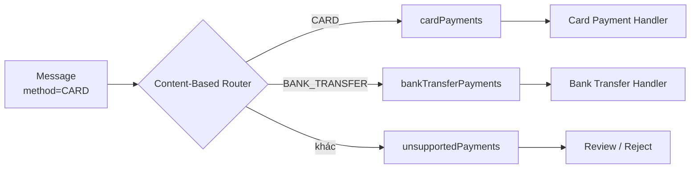
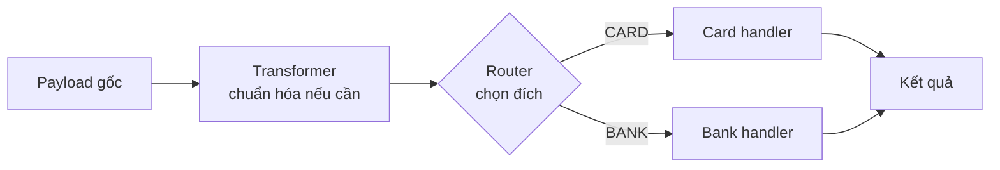
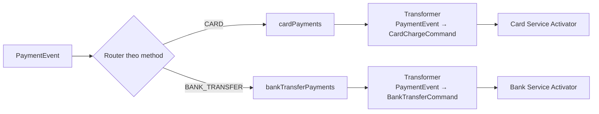
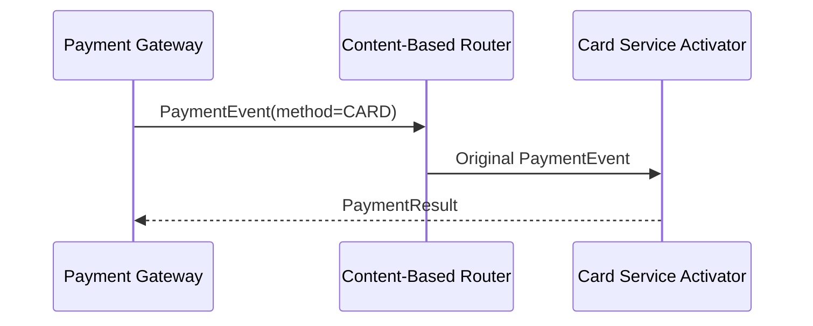
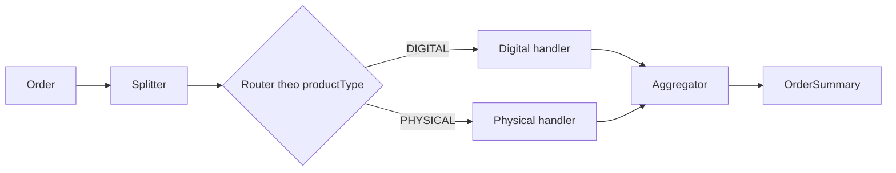

# Không làm thay đổi payload trong Content-Based Router của Spring Integration

> **Chương:** Content-based router  
> **Bài học:** Không làm thay đổi payload trong router  
> **Phạm vi:** Enterprise Integration Patterns (EIP) với Spring Integration; xây dựng luồng thông điệp ít phụ thuộc, kết hợp Router, Filter, Transformer, Splitter, Aggregator, Gateway, retry, error channel, correlation và khả năng quan sát.

## 1. Bài toán: chọn đúng nơi xử lý mà không sửa dữ liệu

Một hệ thống thanh toán nhận cùng một loại thông điệp từ nhiều kênh. Khi một yêu cầu đến, hệ thống cần chuyển nó sang nhánh xử lý thẻ, chuyển khoản hoặc nhánh kiểm tra thủ công. Mỗi nhánh có nghiệp vụ khác nhau, nhưng **dữ liệu của yêu cầu ban đầu phải được bảo toàn khi đi qua điểm định tuyến**.

Ví dụ payload:

```json
{
  "paymentId": "PAY-2048",
  "method": "CARD",
  "amount": 1250000,
  "currency": "VND"
}
```

Nếu Router nhận message này, nó chỉ cần đọc `method = CARD` rồi chọn channel `cardPayments`. Router không cần sửa `amount`, thêm tiền tố vào `paymentId` hay chuyển `PaymentEvent` thành `CardChargeCommand`. Những thay đổi đó thuộc trách nhiệm của Transformer hoặc handler ở nhánh thanh toán, nếu nghiệp vụ yêu cầu.



**Nguyên tắc chính:** Content-Based Router đọc nội dung (payload hoặc headers) để quyết định message đi đến đâu. Trong thiết kế bình thường, Router **giữ nguyên payload của message đầu vào**, còn việc thay đổi dữ liệu được đặt ở thành phần xử lý khác.

Sau bài học, bạn có thể:

1. Giải thích sự khác nhau giữa định tuyến và chuyển đổi payload.
2. Viết Content-Based Router bằng Spring Integration Java DSL.
3. Kiểm thử payload, headers và quyết định định tuyến trên từng nhánh.
4. Nhận ra những cách viết routing function làm thay đổi trạng thái ngoài ý muốn.
5. Giữ tính đúng đắn khi kết hợp Router với Splitter/Aggregator, Gateway, bất đồng bộ, retry và error channel.

## 2. Message, payload và headers là gì?

Trong Spring Integration, thông điệp thường được biểu diễn bởi `org.springframework.messaging.Message<T>` gồm hai phần:

| Thành phần | Vai trò | Ví dụ |
| --- | --- | --- |
| **Payload** | Dữ liệu nghiệp vụ cần xử lý | `PaymentEvent(paymentId, method, amount, currency)` |
| **Headers** | Metadata phục vụ vận chuyển, liên kết và điều phối | `id`, `timestamp`, `replyChannel`, `errorChannel`, `traceId` |
| **MessageChannel** | Ranh giới trao đổi message | `paymentInput`, `cardPayments` |
| **Router** | Xác định channel đầu ra phù hợp | `CARD → cardPayments` |

Khi nói “Router không làm thay đổi payload”, cần hiểu chính xác:

- **Không biến đổi kiểu dữ liệu:** message đi vào mang `PaymentEvent` thì sau bước Router vẫn mang `PaymentEvent`, nếu không có component khác thay payload.
- **Không sửa trường nghiệp vụ:** Router không cần chỉnh `amount`, `method` hay `paymentId` để chọn đích.
- **Không tạo một payload khác chỉ vì chuyển nhánh:** routing key có thể là `CARD`, nhưng payload đầu ra không trở thành chuỗi `"CARD"`.
- **Không cam kết bất biến tuyệt đối cho mọi đối tượng Java:** nếu payload là object có setter hoặc chứa collection mutable, code do bạn viết vẫn có thể sửa nó. Spring Integration không tự làm cho mọi payload thành immutable.
- **Không nhất thiết giữ nguyên toàn bộ message envelope:** những component khác, các cơ chế fan-out/sequence, header enrichment hoặc adapter có thể bổ sung/đổi metadata. Bài học tập trung vào **nội dung payload tại điểm định tuyến**.

### Ví dụ quan sát dữ liệu

```text
Trước Router
payload = PaymentEvent("PAY-2048", "CARD", 1250000, "VND")
headers = {traceId: "trace-42", businessKey: "PAY-2048"}

Router đọc payment.method() → "CARD"
Router quyết định "cardPayments"

Sau Router, tại cardPayments
payload = PaymentEvent("PAY-2048", "CARD", 1250000, "VND")
headers vẫn chứa traceId và businessKey
```

Điều kiện của ví dụ là flow chỉ có Router và channel ở đoạn đang xét. Nếu sau đó một Transformer chuyển payload thành `CardChargeCommand`, đó là thay đổi **có chủ đích của Transformer**, không phải do Router.

## 3. Content-Based Router làm gì trong Enterprise Integration Patterns?

EIP **Content-Based Router** định tuyến thông điệp theo một tiêu chí rút ra từ nội dung, ví dụ loại đơn hàng, phương thức thanh toán hoặc khu vực xử lý.

Mô hình logic:

```text
message
  |
  v
extract routing key
  |
  v
resolve target channel
  |
  v
send original message to target
```

Ví dụ, routing function có thể trả về một khóa:

```java
String routeKey(PaymentEvent payment) {
    return payment.method();
}
```

Hàm trả về `"CARD"` để Router chọn channel. Giá trị trả về này là **routing key**, không phải payload mới và cũng không phải kết quả nghiệp vụ của thanh toán.

### Phân biệt Router với các pattern liên quan

| Pattern | Câu hỏi chính | Có thể thay payload không? |
| --- | --- | --- |
| **Content-Based Router** | Message nên đi đến nhánh nào? | Bình thường không; chức năng là chọn đích |
| **Transformer** | Payload cần đổi sang dạng nào? | Có; đây là nhiệm vụ cốt lõi |
| **Filter** | Message có được đi tiếp không? | Thường không, chỉ quyết định cho qua/loại |
| **Header Enricher** | Cần bổ sung metadata nào? | Giữ payload, bổ sung headers |
| **Service Activator** | Cần gọi hành vi nghiệp vụ nào? | Có thể trả payload kết quả hoặc xử lý một chiều |
| **Splitter** | Tách một message thành những phần nào? | Có; tạo payload tương ứng từng phần |
| **Aggregator** | Ghép các kết quả trong nhóm thế nào? | Có thể tạo payload tổng hợp |

Một cách thiết kế sáng rõ là:



Transformer chịu trách nhiệm thay đổi hình dạng dữ liệu; Router chịu trách nhiệm lựa chọn đường đi. Nếu Router vừa chuyển đổi vừa điều hướng, logic dễ khó kiểm thử, khó tái sử dụng và phát sinh side effect khó quan sát.

## 4. Ví dụ Java DSL: chọn channel dựa trên payload

Ta xây một Router nhận `PaymentEvent`. Trạng thái đầu vào được chuẩn hóa trước đó và chỉ gồm những giá trị đã công bố trong hợp đồng. Router chọn một trong ba channel:

- `CARD` → `cardPayments`
- `BANK_TRANSFER` → `bankTransferPayments`
- Giá trị khác → `unsupportedPayments` để kiểm tra hoặc từ chối.

Trong ví dụ, đích là `QueueChannel` để có thể lấy message ra kiểm thử. Một ứng dụng thực có thể nối channel đến Service Activator hoặc adapter.

### 4.1. Cấu hình IntegrationFlow

```java
package example.integration;

import java.math.BigDecimal;

import org.springframework.context.annotation.Bean;
import org.springframework.context.annotation.Configuration;
import org.springframework.integration.channel.DirectChannel;
import org.springframework.integration.channel.QueueChannel;
import org.springframework.integration.config.EnableIntegration;
import org.springframework.integration.dsl.IntegrationFlow;
import org.springframework.messaging.MessageChannel;

@Configuration
@EnableIntegration
public class ContentBasedRouterConfiguration {

    public record PaymentEvent(
        String paymentId,
        String method,
        BigDecimal amount,
        String currency
    ) {}

    @Bean
    public MessageChannel paymentInput() {
        return new DirectChannel();
    }

    @Bean
    public QueueChannel cardPayments() {
        return new QueueChannel();
    }

    @Bean
    public QueueChannel bankTransferPayments() {
        return new QueueChannel();
    }

    @Bean
    public QueueChannel unsupportedPayments() {
        return new QueueChannel();
    }

    @Bean
    public IntegrationFlow paymentRoutingFlow() {
        return IntegrationFlow.from("paymentInput")
            .route(
                PaymentEvent.class,
                PaymentEvent::method,
                spec -> spec
                    .channelMapping("CARD", "cardPayments")
                    .channelMapping(
                        "BANK_TRANSFER", "bankTransferPayments")
                    .channelKeyFallback(false)
                    .defaultOutputChannel("unsupportedPayments")
                    .resolutionRequired(true)
            )
            .get();
    }
}
```

**Giải thích từng thành phần:**

- `IntegrationFlow.from("paymentInput")` bắt đầu từ kênh đầu vào.
- `.route(PaymentEvent.class, PaymentEvent::method, ...)` đọc `method` từ payload để tính khóa định tuyến.
- `channelMapping(...)` ánh xạ các khóa đã biết sang channel.
- `channelKeyFallback(false)` không cho phép một khóa lạ được dùng như tên channel nội bộ ngoài các mapping đã công bố.
- `defaultOutputChannel(...)` gửi message có phương thức không được hỗ trợ đến nhánh dự phòng.
- `resolutionRequired(true)` yêu cầu có thể giải quyết đích; vì đã có default channel hợp lệ, khóa lạ được gửi đến nhánh dự phòng thay vì tự động gây lỗi.

Không bước nào trong cấu hình Router gán lại `amount`, `paymentId`, `currency` hoặc tạo `PaymentEvent` khác. Hàm `PaymentEvent::method` chỉ **đọc** một thuộc tính.

### 4.2. Gửi message đến Router

Ví dụ từ một controller hoặc integration test có inject channel `paymentInput`:

```java
import java.math.BigDecimal;

import org.springframework.messaging.Message;
import org.springframework.messaging.support.MessageBuilder;

ContentBasedRouterConfiguration.PaymentEvent payment =
    new ContentBasedRouterConfiguration.PaymentEvent(
        "PAY-2048", "CARD", new BigDecimal("1250000"), "VND");

Message<?> message = MessageBuilder.withPayload(payment)
    .setHeader("businessKey", "PAY-2048")
    .setHeader("traceId", "trace-42")
    .build();

boolean accepted = paymentInput.send(message);
```

Khi `paymentInput` là `DirectChannel`, Router thường dispatch trong thread đang gọi. `accepted` chỉ nói về việc gửi/dispatch được chấp nhận ở mức message flow phù hợp, **không chứng minh thanh toán đã hoàn tất**.

Sau Router, message nằm ở `cardPayments` chờ consumer. Payload vẫn là đối tượng `PaymentEvent` chứa bốn giá trị ban đầu.

### 4.3. Vì sao dùng QueueChannel trong ví dụ?

`QueueChannel` giúp test xác định message đã đến đúng đích bằng `receive(...)` mà không phải khởi tạo service thanh toán thật. Nó là công cụ minh họa và kiểm thử tốt cho trường hợp một message được định tuyến đến channel.

Tuy nhiên, `QueueChannel` dùng trong bộ nhớ không tự bảo đảm message còn tồn tại khi ứng dụng bị tắt đột ngột. Trong hệ thống xử lý thanh toán, nếu cần bền vững, phải thêm broker hoặc persistent store phù hợp, cùng chính sách ack, retry và idempotency.

## 5. Chứng minh payload được giữ nguyên: kiểm thử JUnit 5

Unit test gọi riêng routing function `PaymentEvent::method` chưa đủ. Cần kiểm tra **toàn bộ message đi qua router** để xác định channel nhận, payload và metadata.

Các test dưới đây dùng cấu hình ở mục 4.

```java
package example.integration;

import static org.junit.jupiter.api.Assertions.*;

import java.math.BigDecimal;

import org.junit.jupiter.api.Test;
import org.springframework.beans.factory.annotation.Autowired;
import org.springframework.beans.factory.annotation.Qualifier;
import org.springframework.integration.channel.QueueChannel;
import org.springframework.messaging.Message;
import org.springframework.messaging.MessageChannel;
import org.springframework.messaging.support.MessageBuilder;
import org.springframework.test.context.junit.jupiter.SpringJUnitConfig;

@SpringJUnitConfig(ContentBasedRouterConfiguration.class)
class ContentBasedRouterTest {

    @Autowired
    @Qualifier("paymentInput")
    private MessageChannel paymentInput;

    @Autowired
    @Qualifier("cardPayments")
    private QueueChannel cardPayments;

    @Autowired
    @Qualifier("bankTransferPayments")
    private QueueChannel bankTransferPayments;

    @Autowired
    @Qualifier("unsupportedPayments")
    private QueueChannel unsupportedPayments;

    @Test
    void cardPaymentKeepsOriginalPayloadAndHeaders() {
        var event = new ContentBasedRouterConfiguration.PaymentEvent(
            "PAY-2048", "CARD", new BigDecimal("1250000"), "VND");

        Message<?> input = MessageBuilder.withPayload(event)
            .setHeader("businessKey", "PAY-2048")
            .setHeader("traceId", "trace-42")
            .build();

        assertTrue(paymentInput.send(input));

        Message<?> output = cardPayments.receive(1_000);
        assertNotNull(output);

        // Với flow tối giản chỉ có Router và QueueChannel,
        // payload vẫn là chính object đã gửi.
        assertSame(event, output.getPayload());

        assertEquals("PAY-2048",
            output.getHeaders().get("businessKey"));
        assertEquals("trace-42",
            output.getHeaders().get("traceId"));

        assertEquals("CARD",
            ((ContentBasedRouterConfiguration.PaymentEvent)
                output.getPayload()).method());
        assertNull(bankTransferPayments.receive(0));
        assertNull(unsupportedPayments.receive(0));
    }

    @Test
    void bankTransferReachesOtherChannelWithSamePayload() {
        var event = new ContentBasedRouterConfiguration.PaymentEvent(
            "PAY-2049",
            "BANK_TRANSFER",
            new BigDecimal("750000"),
            "VND");

        assertTrue(paymentInput.send(
            MessageBuilder.withPayload(event).build()));

        Message<?> output = bankTransferPayments.receive(1_000);
        assertNotNull(output);
        assertSame(event, output.getPayload());
        assertEquals(new BigDecimal("750000"),
            ((ContentBasedRouterConfiguration.PaymentEvent)
                output.getPayload()).amount());

        assertNull(cardPayments.receive(0));
        assertNull(unsupportedPayments.receive(0));
    }

    @Test
    void unknownMethodGoesToDefaultWithoutRewritingPayload() {
        var event = new ContentBasedRouterConfiguration.PaymentEvent(
            "PAY-2050",
            "CRYPTO",
            new BigDecimal("100000"),
            "VND");

        assertTrue(paymentInput.send(
            MessageBuilder.withPayload(event).build()));

        Message<?> output = unsupportedPayments.receive(1_000);
        assertNotNull(output);
        assertSame(event, output.getPayload());
        assertEquals("CRYPTO",
            ((ContentBasedRouterConfiguration.PaymentEvent)
                output.getPayload()).method());

        assertNull(cardPayments.receive(0));
        assertNull(bankTransferPayments.receive(0));
    }
}
```

Ý nghĩa của các assertion:

| Assertion | Kiểm tra điều gì? |
| --- | --- |
| `assertSame(event, output.getPayload())` | Trong flow mẫu, cùng một object payload được chuyển qua Router |
| `assertEquals(... amount())` | Giá trị nghiệp vụ không bị sửa |
| `assertEquals(... traceId)` | Metadata cần theo dõi vẫn được giữ |
| `assertNull(channel.receive(0))` | Không có message đi tới các kênh không được chọn |
| Kịch bản method lạ | Router chuyển tới default, không thay method thành một giá trị hợp lệ giả |

**Lưu ý về phạm vi của `assertSame`:** đây là phép kiểm tra phù hợp với flow nội bộ tối giản không có bước copy/serialization. Nếu message đi qua adapter HTTP/Kafka, Transformer tạo bản sao hoặc hệ thống sử dụng serialization, identity của object Java không còn là hợp đồng đúng. Khi đó, nên kiểm tra **giá trị payload và schema** ở đầu ra, không khăng khăng hai phía phải trỏ tới cùng một object.

## 6. Vì sao nên viết routing function như một hàm thuần?

Một hàm routing tốt chỉ tính khóa dựa trên input:

```java
public String routeByMethod(PaymentEvent event) {
    return event.method();
}
```

Với cùng một message và cùng một quy tắc, nó nên đưa ra cùng một quyết định mà không gây tác dụng phụ. Nhờ vậy, định tuyến dễ kiểm thử và có thể đánh giá lại khi retry.

### Ví dụ phản mẫu: sửa payload ngay trong Router

Giả sử ứng dụng dùng một class mutable:

```java
public final class MutablePayment {
    private String method;

    public String getMethod() {
        return method;
    }

    public void setMethod(String method) {
        this.method = method;
    }
}
```

Cách viết sau có vấn đề:

```java
public String chooseChannel(MutablePayment payment) {
    if (payment.getMethod() == null) {
        payment.setMethod("CARD"); // Tác dụng phụ lên payload
    }
    return payment.getMethod();
}
```

Hàm này không chỉ chọn tuyến; nó còn thay dữ liệu gốc. Nếu client gửi message thiếu phương thức thanh toán, việc tự sửa thành `CARD` sẽ che giấu lỗi đầu vào và có thể làm hệ thống xử lý sai nghiệp vụ.

Thay vào đó, xác định quy tắc hợp lệ ở bước trước:

```text
Adapter / Gateway
    |
    v
Validate / Transformer
    |
    v
Content-Based Router (chỉ đọc)
    |
    v
Handler theo nhánh
```

Ví dụ thuần:

```java
public String chooseChannel(MutablePayment payment) {
    String method = payment.getMethod();
    return method == null ? "UNSUPPORTED" : method;
}
```

Hàm chỉ trả về khóa `UNSUPPORTED`, không thay object. Cấu hình Router có thể map `UNSUPPORTED` sang channel xét duyệt hoặc reject, tùy chính sách.

### Hạn chế của payload mutable

Ngay cả khi Router không sửa payload, một downstream handler vẫn có thể gọi setter lên cùng object. Nếu message được phát sang nhiều nhánh hoặc có xử lý song song, điều này tạo lỗi race condition.

Ưu tiên:

- Java record hoặc DTO immutable.
- Trường chứa kiểu bất biến như `String`, `BigDecimal`, `Instant`.
- Tránh collection mutable được chia sẻ không có bảo vệ.
- Nếu cần thay dữ liệu, tạo object mới tại Transformer với contract rõ ràng.

Một Java record chỉ bất biến ở mức **tham chiếu các field**; nếu field chứa `List` có thể thay đổi, code khác vẫn có thể sửa nội dung list. Dùng defensive copy hoặc collection bất biến khi cần.

## 7. Router chọn tuyến; Transformer thay đổi payload

Đây là ranh giới trách nhiệm quan trọng.

Giả sử nhánh thẻ thanh toán yêu cầu `CardChargeCommand`, còn nhánh chuyển khoản yêu cầu `BankTransferCommand`. Cả hai dùng cùng input `PaymentEvent`.

Thiết kế rõ ràng:



Khi Router chọn `CARD`:

1. Payload tại output của Router vẫn là `PaymentEvent`.
2. Transformer của nhánh card nhận `PaymentEvent`.
3. Transformer tạo `CardChargeCommand` mới.
4. Service Activator xử lý command chuyên biệt.

Ví dụ một Transformer trong nhánh card:

```java
public record CardChargeCommand(
    String paymentId,
    BigDecimal amount,
    String currency
) {}

public CardChargeCommand toCardCommand(PaymentEvent event) {
    return new CardChargeCommand(
        event.paymentId(),
        event.amount(),
        event.currency()
    );
}
```

Trong đoạn ví dụ, `BigDecimal` đến từ `java.math.BigDecimal` và `PaymentEvent` là record đã khai báo ở mục 4 (hoặc một kiểu tương đương). Hàm `toCardCommand` thuộc Transformer của nhánh card, **không được đặt bên trong routing function**.

### Tại sao cách này dễ bảo trì?

- Khi bổ sung phương thức thanh toán mới, sửa mapping và thêm nhánh handler mới.
- Khi thay đổi chuẩn dữ liệu cho card, chỉ chỉnh Transformer của card.
- Khi cập nhật kiểm tra đầu vào chung, chỉnh validator hoặc Transformer trước Router.
- Khi cần kiểm tra quyết định định tuyến, test key và destination mà không phải khởi tạo service thanh toán thật.

## 8. Có thể định tuyến dựa trên headers không?

Có. Content-Based Router được hiểu rộng là quyết định dựa trên thông tin có trong message; trong Spring Integration, Router có thể đọc payload hoặc headers.

Ví dụ: một nhà vận chuyển cần chọn vùng xử lý theo `region` header:

```text
payload = ShipmentEvent("SHIP-101", ...)
headers = {region: "VN", traceId: "trace-101"}

Header-based routing:
VN → vietnamShipments
SG → singaporeShipments
```

Dù routing key đến từ header, payload nghiệp vụ vẫn không cần thay đổi.

Tuy nhiên, cần phân biệt:

- `region` do adapter nhận và xác thực có thể dùng cho định tuyến vận hành.
- `tenantId` hoặc quyền truy cập do client tùy ý gửi **không được tự động tin cậy**.
- Nếu cần bổ sung hoặc chuẩn hóa metadata, dùng Header Enricher, Gateway/adapter hoặc bước xác thực riêng.
- Không cần đổi payload chỉ để truyền thêm một thuộc tính routing tạm thời.

**Định tuyến dựa trên header không đồng nghĩa mọi header đều được bảo toàn qua transport**. HTTP/Kafka/AMQP có quy tắc ánh xạ headers riêng; cần kiểm tra adapter ở ranh giới hệ thống.

## 9. Dùng @Router: method trả channel key, không trả payload đã sửa

Ngoài DSL, Spring Integration hỗ trợ `@Router` để gắn một method vào input channel.

Ví dụ này là **phương án thay thế** cho Router DSL trong mục 4. Không đăng ký cả hai Router với cùng `paymentInput` nếu chỉ muốn một tuyến xử lý.

```java
package example.integration;

import org.springframework.integration.annotation.Router;
import org.springframework.messaging.handler.annotation.Payload;
import org.springframework.stereotype.Component;

@Component
public class PaymentRoutingEndpoint {

    @Router(inputChannel = "paymentInput")
    public String chooseChannel(
            @Payload ContentBasedRouterConfiguration.PaymentEvent event) {

        return switch (event.method()) {
            case "CARD" -> "cardPayments";
            case "BANK_TRANSFER" -> "bankTransferPayments";
            default -> "unsupportedPayments";
        };
    }
}
```

Khác với ví dụ DSL dùng `channelMapping`, phương thức này trả trực tiếp tên các channel đã được định nghĩa. Đây là các **giá trị nội bộ được chọn từ danh sách cố định**, không phải chuỗi tùy ý lấy từ client rồi coi như tên bean hợp lệ.

Trong thực tế cần bảo đảm payload và method không null; nếu null có thể gây lỗi trong `switch`. Có thể validate upstream hoặc thêm nhánh xử lý null bằng điều kiện rõ ràng. Một lỗi validation không nhất thiết nên được chuyển mặc định thành thanh toán thẻ.

Nếu dùng `@Router`, ứng dụng cần bật Spring Integration và component scanning/annotation infrastructure thích hợp. Cơ chế định tuyến có thể có các thuộc tính cấu hình default output và resolution tùy dạng Router; chọn theo API của phiên bản đang sử dụng.

## 10. Điều gì xảy ra với Message và headers sau Router?

Điểm dễ nhầm là **payload không thay đổi** không có nghĩa rằng mọi thứ xung quanh message đều phải giống hệt.

### 10.1. Trong flow đơn giản

Với `DirectChannel → Content-Based Router → QueueChannel` và không có bước biến đổi, payload đi tới kênh được chọn mang cùng đối tượng với input trong ví dụ.

Một số headers thông thường như `businessKey`, `traceId` cũng được chuyển cùng message. Có thể kiểm tra trong test ở mục 5.

### 10.2. Khi dùng recipient-list hoặc multicast

Một **Recipient List Router** có thể chuyển message tới nhiều channel. Khi có cơ chế áp dụng sequence metadata, framework có thể thêm/điều chỉnh headers như `correlationId`, `sequenceNumber`, `sequenceSize` để phục vụ downstream. Điều này không biến payload thành kiểu nghiệp vụ mới.

Nếu các nhánh nhận cùng object payload mutable rồi sửa field song song, có nguy cơ race condition. Chính sách an toàn là dùng payload immutable hoặc tạo bản sao có chủ đích ở component phù hợp.

### 10.3. Khi qua broker/HTTP

Một outbound adapter có thể serialize payload rồi hệ thống nhận deserialize thành object khác. Payload *về mặt giá trị* có thể tương đương, nhưng Java object identity khác.

Vì vậy, cần tách hai loại kiểm tra:

| Phạm vi | Điều có thể kiểm tra |
| --- | --- |
| Router nội bộ, không có Transformer | Object payload giữ nguyên (`assertSame`) và giá trị giữ nguyên |
| Flow có Mapper/Transformer | Giá trị đầu ra tuân theo schema/hợp đồng biến đổi |
| Qua broker hoặc HTTP | Payload deserialize có giá trị đúng; headers được map theo cấu hình |
| Flow multicast với payload mutable | Không có nhánh sửa dữ liệu ngoài ý muốn |

**Không dựa vào `MessageHeaders.id` hoặc `timestamp` làm chứng cứ rằng payload được giữ nguyên:** ID/message envelope có thể thay đổi khi có component tạo message mới, dù giá trị nghiệp vụ vẫn như cũ.

## 11. Routing function có được truy vấn DB hoặc gọi API không?

Về mặt kỹ thuật, routing function là Java code nên có thể gọi dependency. Nhưng nếu chỉ để chọn tuyến, một hàm phải chờ DB hoặc API bên ngoài làm tăng độ trễ và tạo thêm điểm lỗi.

Ví dụ phản mẫu:

```java
public String route(PaymentEvent event) {
    String merchantTier = remoteService.lookupTier(event.paymentId());
    return merchantTier.equals("VIP") ? "priority" : "standard";
}
```

Đoạn này không sửa payload nhưng đưa tác vụ I/O trực tiếp vào quyết định định tuyến. Nếu API chậm hoặc timeout, toàn bộ Router bị ảnh hưởng. Hơn nữa, cùng một message có thể được route khác nhau ở lần retry nếu dữ liệu từ dịch vụ ngoài thay đổi.

Có thể cân nhắc hai hướng:

1. **Enrichment trước Router:** lấy dữ liệu bổ sung tại bước riêng, đặt vào header hoặc payload đã chuẩn hóa, kiểm soát timeout/retry.
2. **Routing service có chính sách rõ ràng:** nếu bắt buộc lookup động, bọc logic bằng service được kiểm thử, có cache/fallback, theo dõi độ trễ và quyết định khi thiếu dữ liệu.

Một routing function thuần tính toán và không gây side effect thường dễ quan sát, tái hiện lỗi và kiểm thử hơn.

## 12. Router và Filter: giữ payload nhưng khác trách nhiệm

Cả Router lẫn Filter thường không biến đổi payload. Tuy nhiên:

- **Filter** quyết định một message có được tiếp tục trong flow hay không.
- **Router** quyết định message được gửi tới channel nào trong số các đích có thể.

Ví dụ:

```text
PaymentEvent
   |
   v
Filter: amount > 0?
   |  no → reject/error policy
   v
Router: payment.method
   | CARD                 | BANK_TRANSFER
   v                      v
cardPayments        bankTransferPayments
```

Nếu Filter loại message mà Gateway đang chờ reply, caller có thể gặp timeout nếu không có đường lỗi hoặc phản hồi từ chối phù hợp. Tương tự, Router không tìm được đích thì phải có chính sách `resolutionRequired`, `defaultOutputChannel` hoặc cách xử lý drop có chủ đích.

Không nên dùng Router để âm thầm sửa `method` sang một giá trị hợp lệ khi dữ liệu không hợp lệ. Nếu method sai, hãy báo lỗi validation hoặc đưa vào nhánh dự phòng.

## 13. Khi Router không tìm được channel đích

Giữ payload không đổi **không giải quyết** được bài toán key không được hỗ trợ. Router vẫn phải chọn chính sách rõ ràng.

Trong Spring Integration, ba lựa chọn liên quan:

| Cấu hình | Vai trò | Ảnh hưởng đến payload |
| --- | --- | --- |
| `channelMapping` | Ánh xạ routing key sang channel | Không cần đổi payload |
| `defaultOutputChannel` | Đích khi không chọn được channel theo quy tắc | Message đi default, payload vẫn như cũ |
| `resolutionRequired` | Có báo lỗi nếu không phân giải được đích hay không | Quyết định hành vi lỗi/drop, không chuyển đổi dữ liệu |
| `channelKeyFallback` | Có coi key như tên channel nếu thiếu mapping không | Không sửa payload, nhưng có thể chọn một đích ngoài mapping |

Ví dụ:

```text
event.method = "MOBILE_WALLET"

Mappings:
  CARD          → cardPayments
  BANK_TRANSFER → bankTransferPayments

Fallback by key = false
Default channel = unsupportedPayments

Kết quả:
  original PaymentEvent("PAY-2050", "MOBILE_WALLET", ...)
  → unsupportedPayments
```

Nhánh `unsupportedPayments` nên trả kết quả lỗi/đang chờ xử lý hoặc ghi lại message theo hợp đồng, không âm thầm xem như đã thanh toán.

Một số hệ thống quan trọng chọn `resolutionRequired(true)` và không đặt default channel để **fail fast** khi gặp key lạ. Trong trường hợp đó exception có thể xuất hiện tại Router, nhưng payload không bị biến đổi để “sửa” lỗi.

## 14. Request-reply Gateway: Router không tạo reply nghiệp vụ

Một `@MessagingGateway` có thể gọi vào flow rồi chờ kết quả:

```java
@MessagingGateway(defaultRequestChannel = "paymentInput")
public interface PaymentGateway {
    PaymentResult submit(PaymentEvent payment);
}
```

Đoạn này là minh họa hợp đồng; để chạy cần định nghĩa `PaymentResult`, cấu hình Gateway và các handler downstream thực sự trả reply. **Router chỉ chuyển message**. Nó không tự tạo `PaymentResult` và cũng không tự thanh toán.



Nếu một nhánh chỉ gửi message vào queue mà không có handler trả kết quả, Gateway request-reply có thể chờ đến timeout. Vì vậy cần thống nhất:

- Nhánh nào trả reply?
- Kiểu reply là gì?
- Reply timeout bao lâu?
- Nhánh method không hỗ trợ có trả lỗi nghiệp vụ hay phát exception?
- Với bất đồng bộ, caller cần chờ hay chỉ nhận trạng thái “đã tiếp nhận”?

Giữ payload qua Router giúp Gateway và các nhánh downstream hiểu cùng một input contract, nhưng không thay thế thiết kế reply.

## 15. Splitter, Router và Aggregator: vì sao cần bảo toàn correlation?

Một đơn hàng gồm nhiều dòng sản phẩm. Splitter tách đơn thành nhiều message con, Router chọn nhánh xử lý theo loại sản phẩm, rồi Aggregator gom các kết quả lại.



Tại **Router**, payload của từng message con thường giữ nguyên. Ví dụ một message con mang `OrderLine` thì Router chuyển đúng `OrderLine` sang nhánh digital hoặc physical.

Nhưng với Splitter/Aggregator, ngoài payload cần quan tâm tới:

- `correlationId`: chỉ ra các message con thuộc cùng nhóm.
- `sequenceNumber`: chỉ ra thứ tự của message con.
- `sequenceSize`: giúp xác định kích thước nhóm khi phù hợp.
- Chính sách release/timeout của Aggregator khi có kết quả thiếu hoặc đến muộn.

Nếu Router cố tình drop một message con không có route, Aggregator có thể đợi mãi đến khi timeout vì không nhận đủ phần tử. Nếu Router hoặc handler tạo message mới rồi làm mất headers cần cho correlation, kết quả cũng có thể không được nhóm đúng.

Đối với nhánh không được hỗ trợ, thay vì biến mất, có thể trả một kết quả dạng `LineFailed` để Aggregator biết phần tử đã thất bại và vẫn có dữ liệu ra quyết định cuối cùng.

**Không sửa `correlationId`, `sequenceNumber` hoặc `sequenceSize` tùy tiện trong routing function.** Nếu muốn group khác theo nghiệp vụ, định nghĩa correlation/release strategy ở đúng component.

## 16. Bất đồng bộ, ordering và payload mutable

Sau `ExecutorChannel`, các message có thể được xử lý song song trên nhiều thread. Router vẫn làm nhiệm vụ chọn channel, nhưng downstream có thể hoàn tất không theo thứ tự message gửi.

```text
ExecutorChannel
   |
   +--> Worker A -> Router -> cardPayments -> Card handler
   |
   +--> Worker B -> Router -> bankTransferPayments -> Bank handler
```

Rủi ro cần tính:

1. **Thứ tự:** hai message cùng `paymentId` có thể hoàn tất khác thứ tự phát sinh.
2. **Transaction:** transaction của thread gửi không tự đi theo worker thread.
3. **ThreadLocal:** MDC/security context/tracing cần propagation phù hợp.
4. **Mutable payload:** cùng object có thể bị nhiều thread thay đổi gây race condition.
5. **Quá tải:** executor hoặc channel đích có thể từ chối task, dù Router đã chọn đúng đích.

Tính bất biến của payload giúp tránh một nhóm lỗi đồng thời, nhưng **không bảo đảm business ordering hoặc transaction**. Nếu nghiệp vụ yêu cầu xử lý theo thứ tự, cần thiết kế channel/partition/keyed routing hoặc kiểm soát phiên bản dữ liệu ở nơi lưu trữ.

### Một message được gửi tới nhiều nhánh

Khi yêu cầu gửi một sự kiện tới nhiều nơi (ví dụ ghi audit, cập nhật dashboard), cân nhắc `PublishSubscribeChannel` hoặc Recipient List Router. Đừng cho nhiều subscriber sửa cùng payload mutable. Có thể dùng immutable DTO hoặc copy dữ liệu cho từng nhánh khi thật sự cần thay đổi riêng.

Không đồng nhất Content-Based Router unicast chọn một tuyến với broadcast gửi mọi tuyến; tính đúng đắn của downstream phụ thuộc loại channel/router được lựa chọn.

## 17. Error channel, retry và khả năng quan sát

Một Content-Based Router có thể gặp các loại lỗi:

| Lỗi | Ví dụ | Hướng xử lý |
| --- | --- | --- |
| Payload sai kiểu | Method reference cần `PaymentEvent` nhưng nhận `String` | Validate/Transformer trước Router |
| Routing key thiếu hoặc không hỗ trợ | `method = null` hoặc `UNKNOWN` | Default, reject hoặc fail-fast |
| Channel không resolve được | Mapping trỏ tới tên channel không tồn tại | Sửa cấu hình và thử lại có kiểm soát |
| Channel đã chọn nhưng không dispatch được | Không có subscriber, executor từ chối | Kiểm tra channel/handler/backpressure |
| Service downstream timeout | Payment provider không trả lời | Retry có giới hạn, idempotency |
| Message con thất lạc | Router drop phần tử của nhóm | Error result, release/expire policy cho Aggregator |

**Phân biệt lỗi routing với lỗi xử lý nghiệp vụ.** Nếu key không được map, retry nguyên message trong cùng cấu hình thường vẫn thất bại. Nếu đích đã chọn nhưng API thanh toán timeout, retry tại handler có thể hợp lý khi có idempotency key và giới hạn lượt thử.

Trong flow `DirectChannel` đồng bộ, exception có thể quay lại caller. Nếu Router/handler chạy sau `ExecutorChannel`, lỗi có thể xảy ra trên worker sau khi sender đã tiếp tục; cần error handler, error channel hoặc cơ chế thu lỗi phù hợp với endpoint/adapter.

### Log và metric cần gì?

Một dòng log có ích:

```text
payment-router
  businessKey=PAY-2048
  routeKey=CARD
  destination=cardPayments
  traceId=trace-42
```

Nên đo:

- Số message vào Router và số được gửi đến từng destination.
- Số routing key không hỗ trợ.
- Số message vào default channel.
- Số lỗi dispatch/delivery sau khi resolve channel.
- Độ trễ xử lý của nhánh downstream và số lần retry.
- Tỷ lệ hoàn tất nghiệp vụ theo business key khi cần đối soát.

Không log token xác thực, số thẻ hay toàn bộ payload nhạy cảm. Tracing/observation nên dựa trên cơ chế chuẩn của dự án (như Micrometer Observation/OpenTelemetry) thay vì tự tạo những identifier không thể liên kết.

## 18. Những lỗi thiết kế thường gặp

### 18.1. Dùng Router để “chỉnh nhanh” giá trị đầu vào

Ví dụ thấy `method = "card"` rồi sửa payload thành `"CARD"` ngay trong routing function. Cách này che giấu vị trí chuẩn hóa. Đặt Transformer hoặc validation trước Router, sau đó dùng routing function chỉ đọc dữ liệu chuẩn.

### 18.2. Trả nhầm payload từ routing method

Một method `@Router` có nhiệm vụ trả key/channel hoặc thông tin định tuyến, không phải trả payload nghiệp vụ mới. Nếu trả cả `PaymentEvent` rồi mong framework coi đó là payload mới, thiết kế bị sai trách nhiệm. Muốn đổi payload, dùng Transformer.

### 18.3. Giả định mọi Message object luôn giống hệt nhau

Một số component có thể xây message mới, bổ sung sequence headers hoặc serialize/deserialize. Khẳng định đúng là **Router không có trách nhiệm chuyển đổi payload**, không phải mọi tầng của toàn bộ hệ thống đều giữ cùng Java object instance.

### 18.4. Dùng payload mutable được nhiều nhánh chia sẻ

Cùng `PaymentEvent` mutable có thể được nhiều handler tác động, khiến kết quả khác theo thứ tự chạy. Dùng immutable payload hoặc tạo dữ liệu mới trong Transformer/handler.

### 18.5. Lấy key tùy ý từ client làm tên channel

Khi `channelKeyFallback` cho phép resolve tên channel từ key, một key ngoài mapping có thể vô tình trùng tên bean nội bộ. Dùng mapping tường minh, tắt fallback khi routing key là dữ liệu nghiệp vụ chưa tin cậy.

### 18.6. Không xử lý key lạ

Bỏ message âm thầm làm việc đối soát khó khăn, đặc biệt trong thanh toán và đơn hàng. Đặt default channel hoặc fail-fast phù hợp, ghi metric và có test cho key không được hỗ trợ.

### 18.7. Quên thiết kế reply cho Gateway

Router đưa message vào nhánh đúng nhưng nhánh không trả reply; Gateway chờ timeout. Xác định hợp đồng trả kết quả và error path cho mọi nhánh.

## 19. Bài thực hành: Router của hệ thống vận chuyển

**Bối cảnh:** hệ thống nhận `ShipmentRequest(shipmentId, serviceLevel, destination)`. Có ba loại dịch vụ:

- `EXPRESS` → `expressShipments`
- `STANDARD` → `standardShipments`
- Loại chưa hỗ trợ → `unsupportedShipments`

**Yêu cầu:**

1. Định nghĩa `ShipmentRequest` là Java record hoặc DTO immutable.
2. Tạo `IntegrationFlow` có Content-Based Router đọc `serviceLevel`, không sửa payload.
3. Đặt channel mapping tường minh, tắt `channelKeyFallback` và cấu hình default output.
4. Dùng `QueueChannel` để kiểm thử từng destination.
5. Tạo message có header `businessKey` và `traceId`; xác minh headers cần thiết còn ở destination.
6. Kiểm tra cùng payload object khi flow chỉ có Router và QueueChannel.
7. Thêm một Transformer **sau Router** ở nhánh express để tạo `ExpressShipmentCommand`; kiểm tra loại payload chỉ thay đổi từ bước này.
8. Tạo test cho `serviceLevel = "UNKNOWN"`; xác nhận vào nhánh unsupported và không bị tự sửa thành `STANDARD`.
9. Thảo luận tác động khi sau Router có `ExecutorChannel` hoặc khi dữ liệu đi qua Kafka.
10. Nêu phương án xử lý correlation nếu request được Splitter tách thành nhiều kiện hàng.

### Bảng kiểm thử mong đợi

| Input | Destination | Payload sau Router |
| --- | --- | --- |
| `ShipmentRequest("S-1", "EXPRESS", "HN")` | `expressShipments` | Vẫn là `ShipmentRequest("S-1", "EXPRESS", "HN")` |
| `ShipmentRequest("S-2", "STANDARD", "HCM")` | `standardShipments` | Không đổi `shipmentId`, `serviceLevel`, `destination` |
| `ShipmentRequest("S-3", "UNKNOWN", "DN")` | `unsupportedShipments` | Vẫn giữ `"UNKNOWN"` để điều tra |
| Input có `traceId` | Channel phù hợp | Header `traceId` được giữ trong flow nội bộ |
| Express đi qua Transformer riêng | Express handler | Payload thành `ExpressShipmentCommand` theo hợp đồng nhánh |

### Câu hỏi tự đánh giá

**Câu 1.** Khi `PaymentEvent::method` trả `"CARD"`, payload output của Router có trở thành chuỗi `"CARD"` không?

*Không. Giá trị `"CARD"` là routing key để tìm destination; payload vẫn là `PaymentEvent`.*

**Câu 2.** Nếu Router không tự biến đổi payload, có bảo đảm object bất biến không?

*Không. Immutable là đặc tính của kiểu dữ liệu/cách lập trình; một payload mutable vẫn có thể bị code của bạn sửa.*

**Câu 3.** Vì sao nên đặt Transformer sau Router khi từng nhánh cần một command khác nhau?

*Vì Router chịu trách nhiệm chọn nhánh, còn Transformer chịu trách nhiệm đổi hình dạng payload theo hợp đồng của nhánh đó.*

**Câu 4.** `assertSame(payload, output.getPayload())` có luôn đúng khi message đi qua HTTP hoặc Kafka không?

*Không. Serialization có thể tạo object mới. Nên kiểm tra giá trị và hợp đồng dữ liệu ở ranh giới transport.*

**Câu 5.** Nếu Router bỏ một message con trước Aggregator, hậu quả gì?

*Nhóm có thể thiếu phần tử và không thỏa release condition. Cần giữ correlation và thiết kế nhánh lỗi/timeout phù hợp.*

## 20. Checklist khi đưa Router vào hệ thống thực tế

- **Một trách nhiệm:** routing function chỉ đọc thông điệp và chọn destination.
- **Payload contract:** kiểu và ý nghĩa dữ liệu đầu vào/đầu ra của Router không bị đổi tùy tiện.
- **Transformation contract:** mọi thay đổi payload có vị trí Transformer/handler riêng.
- **Routing keys:** danh sách giá trị được hỗ trợ, mapping, default và chính sách khi key lạ.
- **Security:** key dùng cho tenant/quyền truy cập phải có nguồn xác thực đáng tin.
- **Message metadata:** giữ `businessKey`, trace và correlation headers cần thiết.
- **Concurrency:** tránh mutable shared state, xét ordering và transaction khi bất đồng bộ.
- **Error handling:** tách route không resolve, send failure và business failure.
- **Request-reply:** mọi nhánh được Gateway gọi phải trả kết quả hoặc báo lỗi đúng hợp đồng.
- **Testing:** xác nhận destination, payload không đổi, headers được giữ, key lạ và nhánh lỗi.
- **Observability:** metrics theo route, error, default channel và kết quả nghiệp vụ.

**Ghi nhớ:** Content-Based Router chọn **đường đi của message** dựa trên thông tin trong message. Việc lựa chọn đó không đòi hỏi thay đổi payload. Khi tách riêng định tuyến khỏi biến đổi dữ liệu, Spring Integration flow dễ kiểm thử, dễ mở rộng thêm nhánh và tránh các side effect khó đoán trong Router.
