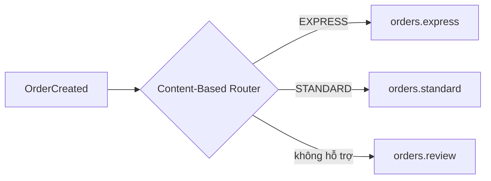
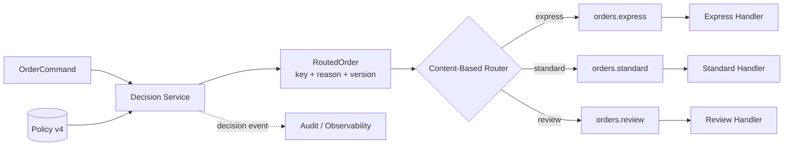
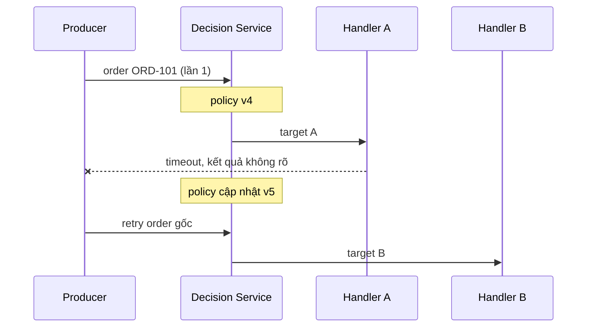
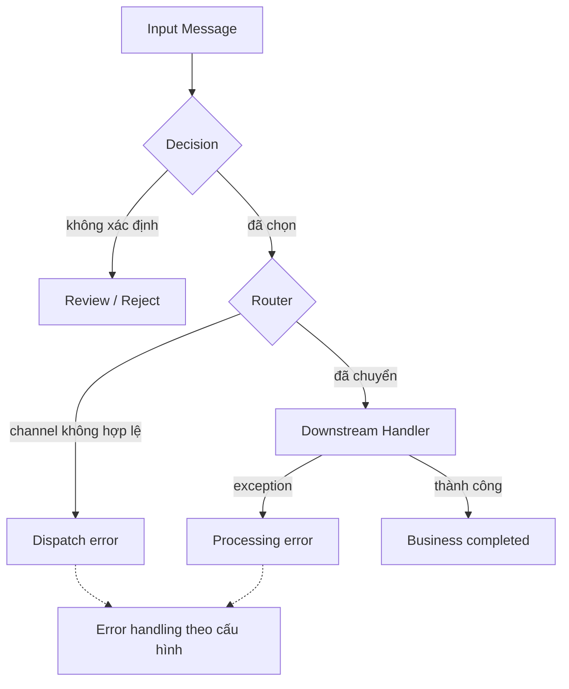
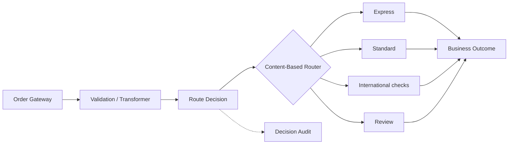

# Giữ quyết định route có thể quan sát

Trong Enterprise Integration Patterns (EIP), **Content-Based Router** chọn kênh đầu ra dựa trên nội dung của message, chẳng hạn loại đơn hàng, vùng giao hàng hoặc mức ưu tiên. Một router tốt không chỉ chuyển message đến đúng nơi mà còn giúp đội phát triển và vận hành **trả lời được vì sao message đi vào nhánh đó**.

Ví dụ, đơn `ORD-101` được gửi đến tuyến xử lý nhanh thay vì tuyến thông thường. Nếu vài phút sau khách hàng hỏi đơn đang ở đâu, log chỉ ghi `"Received order ORD-101"` không đủ. Ta cần biết **quy tắc nào khớp, dữ liệu nào được dùng, channel nào được chọn, chính sách ở phiên bản nào, message có được chuyển tiếp thành công hay không và handler downstream đã xử lý tới đâu**.

Bài học này thuộc chương **Content-based router** trong module **SPRING_INTEGRATION_PATTERN**: học xây dựng Enterprise Integration Patterns với Spring Integration để tạo luồng thông điệp ít phụ thuộc, dễ mở rộng, có thể kiểm thử và theo dõi. Những kỹ thuật ở đây liên kết Router với **Gateway, Filter, Transformer, Splitter, Aggregator**, cũng như retry, error channel và correlation.

Sau bài này, bạn có thể thiết kế một route decision có dấu vết, phân biệt log/metric/trace/audit, triển khai một ví dụ Spring Integration Java DSL và kiểm thử chính xác việc chọn nhánh, phát message, xử lý lỗi và replay.

## 1. Quan sát quyết định route nghĩa là gì?

Một Content-Based Router thường được trình bày bằng sơ đồ rất gọn:



Sơ đồ cho biết **các nhánh có thể xảy ra**, nhưng chưa cho biết vì sao một message cụ thể đã vào nhánh nào. Để quan sát một lần xử lý, cần tạo được chuỗi thông tin:

```text
Input được nhận
  -> Nội dung liên quan được đọc
  -> Quy tắc / phiên bản chính sách được áp dụng
  -> Route key được tính
  -> Destination/channel được xác định
  -> Việc chuyển tiếp được thực hiện
  -> Handler downstream nhận và xử lý
  -> Kết quả / lỗi / retry được ghi nhận
```

Đặc biệt, phải tách ba mốc:

| Mốc | Điều đã xảy ra | Điều chưa thể suy ra |
| --- | --- | --- |
| **Decision made** | Router hoặc decision service đã xác định route key/đích | Message đã được gửi hoặc consumer đã chạy |
| **Dispatch attempted/accepted** | Thành phần gửi đã thử chuyển hoặc channel/transport đã chấp nhận message theo ngữ nghĩa tương ứng | Nghiệp vụ downstream đã hoàn tất |
| **Business outcome recorded** | Handler đã ghi nhận kết quả nghiệp vụ thành công/thất bại | Mọi hệ thống khác đã nhận cùng kết quả, nếu không có xác nhận riêng |

Với `DirectChannel` và handler đồng bộ, việc chuyển message có thể kéo theo thực thi handler trước khi sender trở về; exception thường có thể lan ngược. Với `ExecutorChannel`, `QueueChannel` hoặc broker, producer có thể tiếp tục trong khi consumer chưa xử lý. Vì vậy **không thể lấy một dòng “routed successfully” để chứng minh nghiệp vụ đã hoàn thành**.

## 2. Những trường cần lưu cùng một quyết định định tuyến

Một bản ghi **route decision** nên đủ để giải thích lựa chọn, liên kết với message và so sánh giữa các lần retry. Bộ trường thường có:

| Trường | Ý nghĩa | Ví dụ |
| --- | --- | --- |
| `businessKey` hoặc `eventId` | Nhận diện công việc/sự kiện xuyên các lần truyền | `ORD-101` |
| `decisionId` | Nhận diện chính lần ra quyết định này | `dec-742` |
| `correlationId` | Gom các message thuộc cùng một yêu cầu/flow | `checkout-101` |
| `routeKey` | Kết quả logic mà router dùng để tra ánh xạ | `express` |
| `targetChannel` hoặc target ID | Đích thực tế đã chọn | `orders.express` |
| `ruleId`/`reasonCode` | Nêu **vì sao** chọn nhánh | `EXPRESS_REQUEST` |
| `policyVersion` | Quy tắc nào đã có hiệu lực | `routing-v4` |
| `decisionTimestamp` | Quyết định xảy ra khi nào | Timestamp UTC |
| `routerInstance` | Node/endpoint nào tính decision | `order-router-02` |
| `attemptNumber`/`isReplay` | Phân biệt tính lại route và phát lại decision đã lưu | `2`/`true` |
| `dispatchStatus` | Đã thử gửi, được chấp nhận hay thất bại | `ATTEMPTED` |
| `downstreamOutcome` | Kết quả xử lý, nếu đã nhận được | `COMPLETED` |

Đây là **gợi ý cho hợp đồng quan sát**, không phải danh sách header mà Spring Integration tự động cấp sẵn. Các hệ thống chỉ cần một tập con tùy yêu cầu, nhưng tối thiểu nên biết message nào được route, route key/đích là gì và vì sao.

Phân biệt thêm ba loại ID:

- **Spring Message ID** thường xác định một đối tượng Spring message; qua Transformer, adapter hoặc broker, message có thể được tạo lại với ID khác.
- **Business key/event ID** cần ổn định ở cấp hợp đồng nghiệp vụ để đối soát và chống xử lý trùng.
- **Correlation ID** liên kết các thông điệp trong cùng quy trình, chẳng hạn các phần do Splitter phát ra rồi Aggregator ghép lại.

Không mặc định một loại ID có thể thay thế mọi loại còn lại. Nếu phải bảo toàn ID xuyên ứng dụng, hãy đưa nó vào payload/header theo hợp đồng và kiểm tra header mapper/serializer tại các ranh giới.

### Nêu lý do ở mức nào?

Reason code nên là một tập giá trị có kiểm soát như `EXPRESS_REQUEST`, `STANDARD_REQUEST`, `UNSUPPORTED_DELIVERY_TYPE` hoặc `POLICY_FALLBACK`. Chuỗi “đã chọn express” chưa giải thích **quy tắc**; ngược lại, log toàn bộ predicate, nội dung nhạy cảm của khách hàng hoặc chi tiết nội bộ quá mức cũng không cần thiết.

Có thể ghi một **tập thuộc tính đã được chọn lọc** phục vụ giải thích, ví dụ `deliveryType=EXPRESS`, nhưng tránh log địa chỉ đầy đủ, thông tin thanh toán, token, payload nhạy cảm hoặc dữ liệu cá nhân không cần thiết.

## 3. Quyết định logic, ánh xạ channel và kết quả phải tách rời

Một Content-Based Router thường có hai thao tác dễ bị gộp chung:

1. **Đánh giá nội dung:** `OrderCommand.deliveryType` là `EXPRESS`, nên `routeKey = express`.
2. **Ánh xạ đích:** `express` được gắn với channel `orders.express`.

Việc tách hai thao tác cho phép thay đổi channel implementation hoặc adapter phía sau mà vẫn giữ ngữ nghĩa của `routeKey`. Quan trọng hơn, khi quan sát có thể phân biệt lỗi **đánh giá quy tắc** với lỗi **thiếu mapping hoặc subscriber**.



Trong sơ đồ, **audit của quyết định** được phát trước khi router chuyển tiếp. Nếu bước chuyển tiếp hoặc handler lỗi, bản ghi decision vẫn có thể tồn tại; do đó phải ghi nhận **outcome** riêng. Ngược lại, nếu audit chỉ là log đồng bộ và process chết, bản ghi có thể chưa được lưu bền. “Có audit” chỉ đúng khi có chiến lược ghi nhận và lưu trữ đạt yêu cầu.

### Phân biệt route key với channel name

Ví dụ một cấu hình có ánh xạ:

| Route key | Channel | Ý nghĩa |
| --- | --- | --- |
| `express` | `orders.express` | Đơn cần xử lý nhanh |
| `standard` | `orders.standard` | Đơn thông thường |
| `review` | `orders.review` | Không xác định/không hỗ trợ, chờ xử lý riêng |

Không cho phép một chuỗi bất kỳ do client gửi thẳng trở thành tên channel. Ánh xạ whitelist như bảng trên dễ kiểm soát, kiểm thử và phân quyền hơn. Nếu policy chưa có ánh xạ, cần đưa vào nhánh xử lý phù hợp hoặc ném lỗi có thể quan sát, tùy hợp đồng hệ thống.

## 4. Bốn lớp quan sát: log, metrics, trace và audit

Các công cụ quan sát bổ sung cho nhau nhưng có mục đích khác nhau:

| Lớp | Mục đích | Nên lưu/đo | Giới hạn |
| --- | --- | --- | --- |
| **Structured log** | Điều tra một lần route hoặc một lỗi | Event name, business key, reason, route key, policy version, error | Có thể mất nếu không tập trung/lưu trữ; tìm kiếm phụ thuộc retention |
| **Metrics** | Quan sát toàn hệ thống theo thời gian | Số route theo nhánh, tỷ lệ review/error, độ trễ quyết định | Tổng hợp, không giải thích một message cụ thể |
| **Distributed tracing** | Theo dõi đường đi qua endpoint, thread, adapter, service | Trace/span ID, quan hệ nhân quả, độ trễ từng chặng | Phụ thuộc instrumentation và sampling; trace có thể thiếu |
| **Audit record** | Bằng chứng quyết định đã được xác lập theo yêu cầu nghiệp vụ | Immutable decision ID, version, route key, timestamp, owner/reason | Cần cơ chế lưu bền, phân quyền, retention và đối soát riêng |

**Không nên gọi một dòng logger thông thường là audit bền vững.** Khi cần giải trình pháp lý hoặc chứng minh một order đã được chốt tuyến trước retry, phải có kho lưu quyết định đáp ứng yêu cầu durability và chính sách không sửa lịch sử.

### Metrics: chỉ gắn nhãn có số lượng giá trị thấp

Ví dụ nhóm metric:

```text
routing_decisions_total{route="express",result="selected"}  ...
routing_decisions_total{route="review",result="selected"}   ...
routing_dispatch_failures_total{route="standard"}         ...
routing_decision_duration_seconds{route="express"}       ...
```

Tên ở trên là **gợi ý thiết kế**, không khẳng định Spring Integration tự sinh những metric đó. Có thể instrument bằng Micrometer hoặc cơ chế monitoring đang có.

Không dùng `orderId`, `eventId` hoặc `correlationId` làm metric tag: chúng tạo số lượng time series rất lớn. Đặt ID trong log/trace/audit có kiểm soát; đặt route key, result, rule family hoặc phiên bản được giới hạn trong metrics.

### Trace: giữ ngữ cảnh qua thread và hệ thống ngoài

Trong luồng `DirectChannel`, message thường được xử lý trên cùng thread; khi sang executor, queue, Kafka hoặc HTTP, ngữ cảnh trace có thể cần được truyền rõ ràng. Header của Spring message không đảm bảo tự xuất hiện nguyên vẹn trong mọi transport.

Để truy vết đúng, cần xác định trace propagation ở adapter, kiểm tra span/log correlation, và biết rằng sampling có thể khiến một sự kiện không có trace. Khi cần bằng chứng đầy đủ cho từng lệnh, phải lưu audit record, không dựa vào trace có sampling.

## 5. Ví dụ Java: tách Content-Based Router khỏi decision record

Ta xây dựng quy trình định tuyến đơn hàng:

- `EXPRESS` → xử lý nhanh.
- `STANDARD` → xử lý thông thường.
- Giá trị khác → đưa vào `review` để xử lý có kiểm soát.
- Message thiếu mã đơn hoặc dữ liệu bắt buộc → ném lỗi validation trước khi tạo decision.

Dữ liệu được trả về từ decision service gồm **payload gốc và thông tin lựa chọn**. Router chỉ đọc `routeKey` đã xác định, nên có thể kiểm tra riêng logic và mapping.

### 5.1. Định nghĩa hợp đồng và service quyết định

```java
import java.time.Instant;
import java.util.Locale;
import java.util.UUID;

record OrderCommand(String orderId, String deliveryType) {}

record RouteDecision(
    String decisionId,
    String routeKey,
    String targetChannel,
    String reasonCode,
    String policyVersion,
    Instant decidedAt
) {}

record RoutedOrder(OrderCommand order, RouteDecision decision) {}

final class RoutingDecisionService {
    private static final String POLICY_VERSION = "delivery-v4";

    RoutedOrder decide(OrderCommand order) {
        if (order == null
                || order.orderId() == null
                || order.orderId().isBlank()
                || order.deliveryType() == null) {
            throw new IllegalArgumentException("Invalid order command");
        }

        String deliveryType =
            order.deliveryType().trim().toUpperCase(Locale.ROOT);

        String key;
        String reason;

        switch (deliveryType) {
            case "EXPRESS" -> {
                key = "express";
                reason = "EXPRESS_REQUEST";
            }
            case "STANDARD" -> {
                key = "standard";
                reason = "STANDARD_REQUEST";
            }
            default -> {
                key = "review";
                reason = "UNSUPPORTED_DELIVERY_TYPE";
            }
        }

        String channel = switch (key) {
            case "express" -> "orders.express";
            case "standard" -> "orders.standard";
            default -> "orders.review";
        };

        RouteDecision decision = new RouteDecision(
            UUID.randomUUID().toString(),
            key,
            channel,
            reason,
            POLICY_VERSION,
            Instant.now()
        );

        return new RoutedOrder(order, decision);
    }
}
```

Ví dụ dùng Java 17+ và cấu trúc bất biến `record`. Không có trường nào lấy tên channel trực tiếp từ dữ liệu client. Policy version là hằng số minh họa; nếu dùng cấu hình động, nên đọc **một snapshot policy bất biến** cho mỗi lần quyết định để không trộn rule từ hai phiên bản.

**Quan trọng:** `UUID` và `Instant.now()` tạo metadata cho **một lần quyết định mới**. Nếu gọi lại `decide` trên cùng `OrderCommand`, decision ID/timestamp mới được tạo. Trong yêu cầu cần giữ quyết định khi replay, phải **lưu và tái sử dụng `RoutedOrder` hoặc decision record đã chốt**, thay vì tính lại từ message gốc.

### 5.2. Gắn router, channel và wire tap bằng Spring Integration Java DSL

```java
import org.slf4j.Logger;
import org.slf4j.LoggerFactory;
import org.springframework.context.annotation.Bean;
import org.springframework.context.annotation.Configuration;
import org.springframework.integration.annotation.Gateway;
import org.springframework.integration.annotation.IntegrationComponentScan;
import org.springframework.integration.annotation.MessagingGateway;
import org.springframework.integration.channel.DirectChannel;
import org.springframework.integration.config.EnableIntegration;
import org.springframework.integration.dsl.IntegrationFlow;
import org.springframework.messaging.MessageChannel;

interface DispatchService {
    void handleExpress(RoutedOrder order);
    void handleStandard(RoutedOrder order);
    void handleReview(RoutedOrder order);
}

@MessagingGateway
interface OrderGateway {
    @Gateway(requestChannel = "orders.in")
    void submit(OrderCommand order);
}

@Configuration
@EnableIntegration
@IntegrationComponentScan
class OrderRoutingConfiguration {
    private static final Logger LOG =
        LoggerFactory.getLogger(OrderRoutingConfiguration.class);

    @Bean
    RoutingDecisionService routingDecisionService() {
        return new RoutingDecisionService();
    }

    @Bean("orders.in")
    MessageChannel ordersIn() {
        return new DirectChannel();
    }

    @Bean("orders.decided")
    MessageChannel ordersDecided() {
        return new DirectChannel();
    }

    @Bean("orders.audit")
    MessageChannel ordersAudit() {
        return new DirectChannel();
    }

    @Bean("orders.express")
    MessageChannel ordersExpress() {
        return new DirectChannel();
    }

    @Bean("orders.standard")
    MessageChannel ordersStandard() {
        return new DirectChannel();
    }

    @Bean("orders.review")
    MessageChannel ordersReview() {
        return new DirectChannel();
    }

    @Bean
    IntegrationFlow decideRoute(RoutingDecisionService decisions) {
        return IntegrationFlow.from("orders.in")
            .transform(OrderCommand.class, decisions::decide)
            .wireTap("orders.audit")
            .channel("orders.decided")
            .get();
    }

    @Bean
    IntegrationFlow applyRoute() {
        return IntegrationFlow.from("orders.decided")
            .route(RoutedOrder.class,
                routed -> routed.decision().routeKey(),
                spec -> spec
                    .channelMapping("express", "orders.express")
                    .channelMapping("standard", "orders.standard")
                    .channelMapping("review", "orders.review"))
            .get();
    }

    @Bean
    IntegrationFlow observeDecisions() {
        return IntegrationFlow.from("orders.audit")
            .handle(RoutedOrder.class, (routed, headers) -> {
                RouteDecision d = routed.decision();
                LOG.info(
                    "event=route_decided orderId={} decisionId={} " +
                    "routeKey={} destination={} reason={} policy={}",
                    routed.order().orderId(), d.decisionId(),
                    d.routeKey(), d.targetChannel(),
                    d.reasonCode(), d.policyVersion());
                return null;
            })
            .get();
    }

    @Bean
    IntegrationFlow express(DispatchService dispatch) {
        return IntegrationFlow.from("orders.express")
            .handle(RoutedOrder.class, (routed, headers) -> {
                dispatch.handleExpress(routed);
                return null;
            })
            .get();
    }

    @Bean
    IntegrationFlow standard(DispatchService dispatch) {
        return IntegrationFlow.from("orders.standard")
            .handle(RoutedOrder.class, (routed, headers) -> {
                dispatch.handleStandard(routed);
                return null;
            })
            .get();
    }

    @Bean
    IntegrationFlow review(DispatchService dispatch) {
        return IntegrationFlow.from("orders.review")
            .handle(RoutedOrder.class, (routed, headers) -> {
                dispatch.handleReview(routed);
                return null;
            })
            .get();
    }
}
```

Đây là cấu hình minh họa cho Spring Integration Java DSL. Ứng dụng cần các dependency Spring Integration tương ứng, `OrderGateway` thuộc phạm vi `@IntegrationComponentScan` hoặc được đăng ký tương đương, và một bean triển khai `DispatchService`.

**Đường đi của `OrderCommand("ORD-101", "EXPRESS")`:**

1. `OrderGateway` phát message vào `orders.in`.
2. Transformer gọi `RoutingDecisionService.decide`, tạo `RoutedOrder` chứa decision ID, key `express`, reason code và policy version.
3. `wireTap("orders.audit")` gửi một bản sao message cho nhánh quan sát; bản chính tiếp tục qua `orders.decided`.
4. Content-Based Router dùng `routeKey` để chọn `orders.express`.
5. Handler express nhận `RoutedOrder` và thực hiện nghiệp vụ.

Việc log được tạo **sau bước quyết định và trước bước dispatch**. Do đó log `route_decided` không chứng minh handler express đã hoàn tất. Handler hoặc adapter cần ghi nhận outcome của riêng mình.

### 5.3. Cẩn thận với wire tap đồng bộ

Trong ví dụ, `orders.audit` là `DirectChannel`. Nhánh wire tap có thể chạy trên thread gửi, làm tăng độ trễ; handler audit bị lỗi có thể ảnh hưởng đường xử lý chính tùy cách cấu hình channel và error handling. Đây là lựa chọn dễ minh họa, **không phải cơ chế audit bền vững**.

Khi observability không được phép làm chậm luồng chính, có thể đưa hoạt động ghi nhận sang executor, queue hoặc một pipeline riêng có giới hạn tài nguyên và chính sách lỗi. Nhưng chuyển sang `ExecutorChannel`/queue trong bộ nhớ không tự đảm bảo log hoặc audit sống sót sau crash. Với quyết định có giá trị nghiệp vụ, hãy lưu decision vào database/outbox theo transaction phù hợp, rồi mới phân phối cho hệ thống audit.

Một quan hệ nhân quả quan trọng: **ghi nhận decision đã xảy ra** và **ghi nhận đã dispatch/consumer hoàn tất** nên là những event khác nhau, có thể liên kết bằng `decisionId` và business key.

## 6. Thêm outcome mà không làm lẫn với decision

Một mô hình theo dõi có thể tách sự kiện:

```text
route_decided
    decisionId=dec-742 routeKey=express policy=v4
route_dispatch_attempted
    decisionId=dec-742 destination=orders.express
route_dispatch_accepted
    decisionId=dec-742 destination=orders.express
business_processing_started
    decisionId=dec-742 handler=ExpressHandler
business_processing_completed
    decisionId=dec-742 outcome=SUCCESS
```

Nếu handler ném lỗi hoặc broker redeliver message, những sự kiện cuối cùng có thể khác:

```text
business_processing_failed
    decisionId=dec-742 errorClass=InventoryTimeout
retry_scheduled
    decisionId=dec-742 attempt=2
business_processing_completed
    decisionId=dec-742 attempt=2 outcome=SUCCESS
```

Các event trên là **mô hình telemetry đề xuất**, không phải các event được Spring Integration tự tạo theo đúng tên. Cần quyết định chúng được phát ở đâu và thế nào: channel interceptor, advice quanh handler, gateway/adapter, error publisher, broker listener hoặc domain service.

Không nên biến log trước khi gửi thành `route_dispatch_accepted`. Với dispatch đồng bộ, thông tin đã được chấp nhận chỉ có thể xác định theo kết quả gửi thực tế; với queue/broker, acknowledgment có ngữ nghĩa riêng và **không** đồng nghĩa downstream thành công. Nếu listener báo đã nhận message nhưng database update bị rollback, phải có trạng thái outcome thật.

### Kiểm tra trạng thái đầy đủ

| Trạng thái quan sát | Ý nghĩa | Nên có bằng chứng |
| --- | --- | --- |
| `DECIDED` | Đã chọn route key | Decision record, rule/version |
| `DISPATCHING` | Bắt đầu thử phát vào đích | Attempt ID, target |
| `ACCEPTED` | Đích vận chuyển đã chấp nhận theo chính sách | Send result/publish ack |
| `PROCESSING` | Consumer bắt đầu công việc | Handler start/span |
| `COMPLETED` | Side effect nghiệp vụ đã hoàn tất | Domain result/transaction outcome |
| `FAILED` | Không hoàn tất theo nguyên nhân ghi nhận | Error class, retryability |
| `UNKNOWN` | Không rõ bên nhận đã làm xong hay chưa | Timeout/no response, cần đối soát |

Một timeout khi gọi hệ thống ngoài đặc biệt dễ gây sai: bên nhận có thể đã hoàn tất nhưng response mất. Đừng ghi `FAILED` chắc chắn hoặc chuyển sang đích khác nếu hợp đồng chưa cho phép.

## 7. Retry, replay và yêu cầu giữ route decision ổn định

Content-Based Router dựa trên nội dung có thể là hàm thuần. Tuy nhiên, kết quả vẫn có thể thay đổi giữa hai lần chạy khi **quy tắc routing đã đổi** hoặc khi phần content được chuẩn hóa/biến đổi khác đi.

Giả sử chính sách cũ định tuyến `EXPRESS` sang `orders.express`, chính sách mới điều hướng loại đơn này sang một dịch vụ khác. Nếu message được gửi lại từ trước decision service, một lệnh có thể đi hai nơi.



Phải xác định nghiệp vụ cần kiểu replay nào:

- **Replay quyết định gốc:** gửi lại chính `RoutedOrder` hoặc record có `routeKey`, `targetChannel`, `policyVersion` và `decisionId`. Đây là cách thường cần khi một lệnh chỉ được phép đi một đích đã chốt.
- **Định tuyến lại có chủ đích:** tính decision mới theo policy mới khi business cho phép đổi đích. Nên tạo sự kiện/record `reroute_decided` nêu quyết định cũ, quyết định mới, lý do và thẩm quyền.
- **Phân phối cho worker tương đương:** đôi khi không cần giữ nguyên một instance cụ thể, nếu tất cả worker xử lý cùng hợp đồng và side effect idempotent. Vẫn cần lưu message key và outcome để phát hiện xử lý trùng.

Nếu cần bảo toàn quyết định qua restart, phải dùng nơi lưu phù hợp như **database với unique constraint theo business key, durable queue chứa decision đã chốt, hoặc transactional outbox**. `RoutedOrder` nằm trong bộ nhớ không phải bằng chứng bền vững.

**Idempotency vẫn cần thiết.** Giữ cùng route không ngăn việc consumer nhận lại một message và ghi database hai lần. Một bản ghi quyết định chỉ giải quyết sự ổn định đích; consumer cần bảo vệ side effect theo business key/event ID ở ranh giới thực hiện nghiệp vụ.

## 8. Route không tìm thấy, fallback và error channel

Một trường hợp dễ quan sát thiếu là router **không chọn được đích hợp lệ**. Ví dụ `deliveryType = "DRONE"` chưa được hệ thống hỗ trợ.

Có các cách xử lý, mỗi cách mang ngữ nghĩa khác nhau:

| Cách xử lý | Khi nào hợp lý | Điều cần quan sát |
| --- | --- | --- |
| `review` hoặc quarantine route | Đầu vào có giá trị nhưng chưa hỗ trợ nghiệp vụ | Reason `UNSUPPORTED_DELIVERY_TYPE`, số lượng tồn đọng, SLA xử lý |
| Reject/exception | Hợp đồng yêu cầu từ chối ngay khi không có route | Thông báo lỗi và trạng thái caller/producer |
| Default route hợp lệ | Có đích dự phòng thực sự hỗ trợ cùng nghiệp vụ | Reason `FALLBACK_USED` và điều kiện kích hoạt |
| Retry tìm đích | Mapping/service tạm thời không sẵn sàng, có khả năng phục hồi | Attempt, timeout, backoff, phiên bản policy |
| Manual intervention | Routing có side effect rủi ro cao hoặc thông tin không rõ | Ai phê duyệt reroute, lịch sử quyết định |

Không nên âm thầm gửi mọi giá trị lạ sang tuyến thường rồi ghi “success”. Nếu tuyến thường không hỗ trợ giao hàng đặc biệt, đây là lỗi dữ liệu nghiệp vụ bị che giấu.

### Default channel không phải error channel

**Default output channel** là một đích xử lý khi router không có nhánh phù hợp (theo cấu hình). **Error channel** là nơi một cơ chế bắt và công bố lỗi gửi `ErrorMessage`. **Discard channel** trong Filter là nơi có thể nhận message bị lọc bỏ. Ba khái niệm có mục đích khác nhau.

Một giá trị chưa được hỗ trợ có thể là **quyết định nghiệp vụ `review`**, không phải exception. Ngược lại, lỗi không tìm thấy subscriber, mapping không hợp lệ hoặc handler ném exception có thể là lỗi kỹ thuật. Với `DirectChannel`, exception thường quay về caller; với executor/poller/adapter, phải kiểm tra error handler, error channel và transport-specific retry/redelivery. Chỉ tạo bean `orders.errors` không tự khiến mọi exception được công bố ở đó.

### Cần biết thất bại xảy ra ở đâu



Observability cần phân biệt **decision error**, **dispatch error** và **processing error**. Nếu tất cả được ghi chung thành “router failed”, người trực vận hành không biết sửa policy, channel mapping, capacity hay logic của handler.

## 9. Router kết hợp với Filter, Transformer, Splitter, Aggregator và Gateway

Content-Based Router không hoạt động tách biệt khỏi phần còn lại của integration flow.

### 9.1. Gateway và Filter ở trước Router

**Gateway** tạo giao diện nghiệp vụ, ví dụ `submitOrder`, che giấu việc gửi message. **Filter** có thể loại message sai trước khi chọn route. Nếu Filter loại message không hợp lệ, cần ghi nhận kết quả reject theo hợp đồng; một message không hề tới Router thì cũng **không có route decision**.

Do đó, metric `routing_decisions_total` không đại diện cho mọi input nhận vào hệ thống. Muốn tính tỷ lệ, phải đo thêm số input, rejection, parse/schema errors và biết mẫu số của phép đo.

### 9.2. Transformer đổi content thì route dựa trên phiên bản nào?

Một Transformer có thể chuẩn hóa `deliveryType = " express "` thành `EXPRESS` trước Router. Nếu logic route dựa vào dữ liệu đã chuẩn hóa, log nên ghi **trường được chuẩn hóa phục vụ quyết định** cùng reason code, thay vì chỉ ghi payload ban đầu.

Khi Transformer đổi kiểu payload, hãy kiểm tra message header quan trọng có được giữ hay ánh xạ đúng. Nếu cần replay chính xác, nên lưu **đầu vào thực tế của phép route** hoặc checksum/version của biểu diễn đã quyết định, không chỉ lưu một field rời rạc khó tái dựng.

### 9.3. Splitter tạo nhiều route decision

Nếu một đơn hàng có nhiều dòng hàng và Splitter tạo một message cho từng dòng, mỗi phần có thể được route tới kho khác nhau. Khi đó cần xác định:

- **Business key của đơn gốc** và **key từng phần** để phân biệt decision.
- `correlationId`/sequence metadata để liên kết các phần.
- Một đơn có thể tạo **N route decisions**, nên metric decisions không đồng nghĩa số đơn hàng.
- Việc retry một phần có dùng decision đã chốt của phần đó hay tính lại?
- Kết quả ở nhiều đích được ghép thế nào nếu một phần thất bại?

### 9.4. Aggregator và kết quả nhóm

**Aggregator** nhận nhiều message liên quan và tạo kết quả tổng hợp theo correlation/release strategy, timeout và trạng thái nhóm. Việc một message đã được route đến nhánh nào không đủ để kết luận Aggregator đã hoàn tất.

Để quan sát end-to-end, nối các route decision ID của từng phần với correlation ID của nhóm; phân biệt số message đã gửi, số phần thành công, số phần lỗi và thời điểm nhóm được release. Với nhóm không đủ kết quả, cần ghi rõ partial result hay timeout thay vì log “đã route tất cả” như thể nghiệp vụ hoàn tất.

## 10. Kiểm thử quyết định, đường đi và tính quan sát

Một test chỉ assert rằng phương thức `decide` trả `"express"` chứng minh được một phần của logic, chưa xác minh router dispatch đúng channel và log/audit thực sự nhận được message.

### 10.1. Ma trận kiểm thử tối thiểu

| Tình huống | Kỳ vọng decision | Điều cần kiểm tra downstream |
| --- | --- | --- |
| `deliveryType=EXPRESS` | `express`, reason `EXPRESS_REQUEST` | Chỉ handler express được gọi |
| `deliveryType=STANDARD` | `standard`, reason `STANDARD_REQUEST` | Chỉ handler standard được gọi |
| `deliveryType=UNKNOWN` | `review`, reason `UNSUPPORTED_DELIVERY_TYPE` | Không vô tình gọi handler express/standard |
| Thiếu `orderId` | Không tạo decision; validation exception | Không handler nào được gọi; lỗi được ghi nhận theo contract |
| Mapping channel thiếu subscriber | Decision vẫn có thể đã được tạo | Có dispatch failure riêng, không báo business success |
| Handler ném exception | Decision không biến mất | Ghi processing failure; xử lý đồng bộ/bất đồng bộ đúng |
| Replay `RoutedOrder` | Giữ nguyên route/decision ID khi nghiệp vụ yêu cầu | Không tính lại route với policy hiện tại |
| Retry cùng message tới handler | Route có thể vẫn đúng | Idempotency ngăn side effect lặp |
| Observability branch unavailable | Quyết định về ảnh hưởng đến luồng chính theo chính sách | Không mất audit quan trọng nếu cần bền vững |

### 10.2. Unit test logic lựa chọn bằng JUnit 5

```java
import static org.junit.jupiter.api.Assertions.*;
import org.junit.jupiter.api.Test;

class RoutingDecisionServiceTest {
    private final RoutingDecisionService decisions =
        new RoutingDecisionService();

    @Test
    void expressOrderHasExplainableDecision() {
        RoutedOrder result = decisions.decide(
            new OrderCommand("ORD-101", " express "));

        assertEquals("express", result.decision().routeKey());
        assertEquals("orders.express",
            result.decision().targetChannel());
        assertEquals("EXPRESS_REQUEST",
            result.decision().reasonCode());
        assertEquals("delivery-v4",
            result.decision().policyVersion());
        assertNotNull(result.decision().decisionId());
    }

    @Test
    void unsupportedTypeGoesToReview() {
        RoutedOrder result = decisions.decide(
            new OrderCommand("ORD-102", "DRONE"));

        assertEquals("review", result.decision().routeKey());
        assertEquals("UNSUPPORTED_DELIVERY_TYPE",
            result.decision().reasonCode());
    }

    @Test
    void blankOrderIdMustNotCreateDecision() {
        assertThrows(IllegalArgumentException.class,
            () -> decisions.decide(
                new OrderCommand(" ", "EXPRESS")));
    }
}
```

Các test này kiểm tra **decision contract**, không chứng minh message đã tới channel hay log đã được ghi. Chúng cũng không nên assert hai lần tính mới có cùng `decisionId` hoặc timestamp: đó là hai decision khác nhau.

### 10.3. Integration test tại router

Trong một integration test Spring Integration, có thể thay `DispatchService` bằng mock/spy rồi gửi vào `OrderGateway`:

1. Gửi `EXPRESS`; xác minh `handleExpress` được gọi đúng một lần, hai handler còn lại không được gọi.
2. Gửi `UNKNOWN`; xác minh chỉ `handleReview` được gọi.
3. Dùng một consumer/test sink tại `orders.audit` (hoặc test interceptor theo thiết kế) để kiểm tra cùng `decisionId`, `routeKey`, `reasonCode` và `policyVersion` xuất hiện trong decision được quan sát.
4. Cho handler express ném lỗi; xác minh decision vẫn đúng và exception/outcome đi theo ngữ nghĩa `DirectChannel`.
5. Với executor, queue hoặc broker, chờ điều kiện có giới hạn thời gian và kiểm tra việc chấp nhận message, xử lý downstream, retry/redelivery riêng.

Nếu hệ thống yêu cầu audit lưu bền, cần integration test với kho lưu thực tế: quyết định được commit trước lúc dispatch, đọc lại được sau restart và không phát sinh bản ghi cạnh tranh không kiểm soát cho cùng business key.

### 10.4. Kiểm thử thay đổi chính sách giữa các lần chạy

Với policy động, tạo kịch bản:

```text
T0: Decide ORD-101 với policy v4 -> target A
T1: Persist decision ORD-101 / target A / v4
T2: Policy chuyển sang v5 -> target B
T3: Retry cùng công việc
Expected: Tái sử dụng target A nếu yêu cầu sticky route
```

Một unit test với policy service bất biến có thể chứng minh mỗi snapshot cho cùng đầu vào kết quả ổn định. Nhưng test end-to-end phải chứng minh **điểm retry nằm sau nơi quyết định đã được lưu**, và consumer có idempotency hoặc quy trình đối soát phù hợp.

## 11. Các quy tắc vận hành để quan sát có giá trị

Các câu hỏi thực tế mà dashboard và log phải trả lời được:

1. Trong 15 phút vừa qua, tỷ lệ message vào `review` tăng do rule mới hay do dữ liệu đầu vào thay đổi?
2. Một đơn hàng cụ thể đã dùng phiên bản policy nào, route key nào, ai/điều gì kích hoạt fallback?
3. Những message đã có `route_decided` nhưng chưa có dispatch attempt/accept sau khoảng thời gian hợp lý nằm ở đâu?
4. Có bao nhiêu message đã được transport chấp nhận nhưng handler chưa hoàn thành?
5. Retry có đổi route key hoặc target ngoài chính sách hay không?
6. Các nhánh Router có bị mất cân bằng tải hoặc tăng lỗi downstream đột ngột không?
7. Có nhóm Splitter/Aggregator nào thiếu phần và không đạt release strategy trước timeout?
8. Khi tăng số instance, trace, correlation và audit có kết nối đủ các chặng không?

Nên thiết lập cảnh báo dựa trên **tỷ lệ lỗi, số lượng tồn đọng, độ trễ và thay đổi tỷ trọng route**, không chỉ dựa trên log exception. Nếu route `review` tăng mạnh mà vẫn trả lời thành công, đó có thể là vấn đề nghiệp vụ cần cảnh báo.

### Thực hành đặt tên và quản trị metadata

- Đặt tên channel/route key theo trách nhiệm rõ ràng, nhất quán giữa dashboard, log và source.
- Dùng reason code và policy version có tập giá trị được kiểm soát.
- Giữ `businessKey`, `decisionId` và `correlationId` trong dữ liệu quan sát phù hợp, nhưng tránh đưa chúng vào metrics tags.
- Xác định retention và quyền truy cập với audit/log; xóa hoặc ẩn payload nhạy cảm.
- Ghi riêng event `route_decided`, `dispatch_failed` và `business_completed` để tránh đánh tráo ý nghĩa.
- Khi thay chính sách, lưu phiên bản có hiệu lực và hỗ trợ giải thích quyết định cũ.

## 12. Những sai lầm thường gặp

**“Route đúng là đủ, không cần ghi lý do.”** Khi chính sách lớn dần, không có reason code/version sẽ khó phân biệt lỗi dữ liệu, lỗi rule hay lỗi channel mapping.

**“Log `route_decided` nghĩa là xử lý thành công.”** Nó chỉ cho thấy decision đã được tạo và điểm log chạy. Dispatch và nghiệp vụ có trạng thái riêng.

**“Message ID của Spring là business ID.”** ID của đối tượng message có thể thay đổi sau biến đổi/adapter; business key và correlation cần hợp đồng xuyên chặng.

**“Bật tracing là có audit đầy đủ.”** Trace có thể được sampling, context có thể đứt và retention có thể ngắn. Quyết định cần bằng chứng bền vững phải được lưu có chủ đích.

**“Gắn orderId vào metric tag sẽ dễ tìm.”** ID có số lượng giá trị lớn làm tăng cardinality và chi phí monitoring; cần để trong log/audit.

**“Wire tap không ảnh hưởng luồng chính.”** Tùy channel và cách xử lý, nhánh tap đồng bộ có thể tăng độ trễ hoặc tạo lỗi. Cần xác định policy khi nhánh quan sát không sẵn sàng.

**“Router đã chọn route nên retry được tùy ý.”** Retry từ trước decision service có thể tính lại đích; retry tới consumer có thể gây side effect trùng. Cần giữ route khi nghiệp vụ yêu cầu và có idempotency.

**“Nhánh default luôn an toàn.”** Default chỉ an toàn nếu đích hỗ trợ hợp đồng và được thiết kế cho tình huống không khớp. Nếu không, cần `review`/reject.

**“Một event `ErrorMessage` đủ để biết đã xảy ra gì.”** Không phải exception nào cũng tự đi qua error channel; cần biết nơi lỗi được bắt, cơ chế xuất ErrorMessage và mối liên hệ với decision.

**“Một quyết định có thể giải thích mà không cần dữ liệu đầu vào.”** Nếu route dựa trên trường đã chuẩn hóa hoặc phiên bản rule, cần đủ metadata để tái dựng vì sao branch được chọn. Bảo vệ dữ liệu nhạy cảm vẫn là yêu cầu song song.

## 13. Bài tập: điều tra một routing incident

Một hệ thống bán hàng xử lý các loại đơn `EXPRESS`, `STANDARD` và `INTERNATIONAL`. Router dùng phiên bản rule có thể thay đổi, trong đó một số đơn quốc tế cần được gửi sang dịch vụ kiểm tra bổ sung trước khi giữ hàng.

Sau một lần deploy, dashboard cho thấy số đơn ở `review` tăng từ ít lên nhiều, nhưng lỗi 5xx của API không tăng. Một khách hàng báo đơn `ORD-789` chưa giao, còn log chỉ cho thấy `"order accepted"`.

Hãy thiết kế lại phần quan sát cho flow:



Yêu cầu:

1. Xác định các field tối thiểu để giải thích `ORD-789` đã vào `review` vì lý do gì và theo rule version nào.
2. Đề xuất hai metric có nhãn ít cardinality để phát hiện route mix thay đổi, nhưng vẫn cho phép tra cứu một đơn cụ thể qua log/audit.
3. Nếu message đã được chuyển đến `international.checks` nhưng consumer chưa hoàn tất, bạn sẽ trình bày trạng thái nào? Vì sao không ghi `COMPLETED` ngay?
4. Nếu retry sau khi policy đổi làm `ORD-789` chuyển từ `review` sang `international.checks`, khi nào đây là một reroute hợp lệ và cần ghi lại điều gì?
5. Với một nhóm item do Splitter tạo, sẽ dùng correlation/decision ID ra sao để chứng minh mọi item đã được xử lý trước lúc Aggregator báo hoàn tất?
6. Viết một integration test chứng minh message `INTERNATIONAL` đến đúng nhánh và tạo audit reason code thích hợp; sau đó cho handler ném exception để kiểm tra đường lỗi.

Một thiết kế tốt phải nối được **input → lý do quyết định → đích được chọn → kết quả thực thi**, biết giới hạn của mỗi cơ chế quan sát và có cách xử lý message chưa rõ trạng thái.

## Ghi nhớ

**Giữ quyết định route có thể quan sát** nghĩa là Content-Based Router không chỉ chọn đúng channel mà còn tạo được bằng chứng về **message nào được chọn, route key/đích nào, quy tắc và phiên bản nào đã áp dụng, vì sao chọn như vậy**. Hãy phân biệt sự kiện quyết định với việc dispatch đã chấp nhận và nghiệp vụ đã hoàn thành.

Trong Spring Integration, có thể tách **decision service** khỏi Router, mang metadata trong một message bất biến, dùng wire tap/interceptor cho telemetry và lưu decision bền vững khi yêu cầu replay ổn định. Kết hợp structured logging, metrics ít cardinality, trace có correlation, audit theo mức bảo đảm cần thiết, cùng retry, error channel và idempotency. Khi đó Router kết hợp với Gateway, Filter, Transformer, Splitter và Aggregator sẽ vừa dễ mở rộng vừa có thể giải thích được đường đi của từng message.

