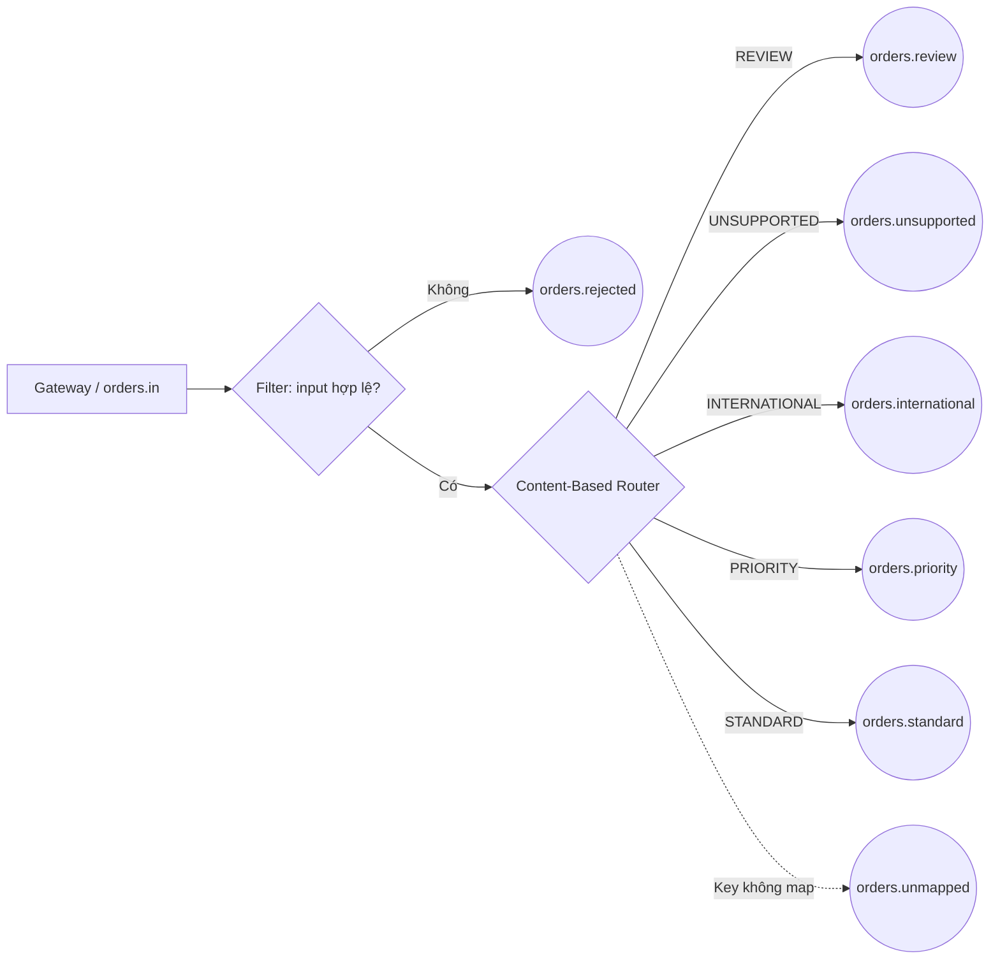
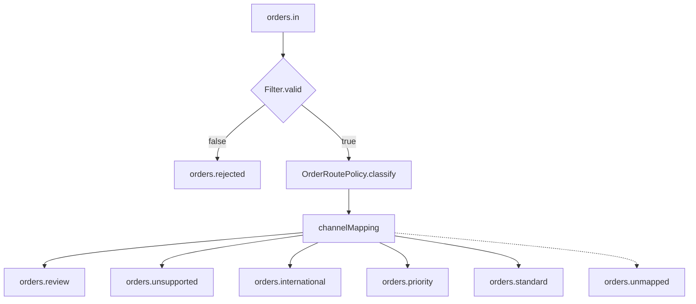
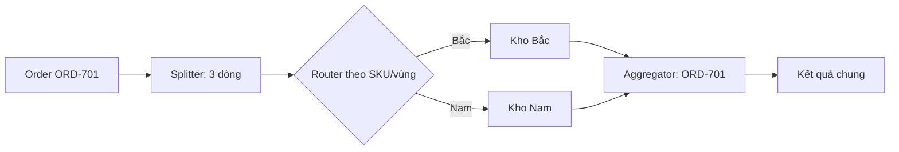

# Test từng nhóm nội dung và route tương ứng

> **Chương:** Content-based router  
> **Module:** `SPRING_INTEGRATION_PATTERN` — thực hành Enterprise Integration Patterns bằng Spring Integration để tạo luồng thông điệp ít phụ thuộc, dễ mở rộng; phối hợp Router, Filter, Transformer, Splitter, Aggregator, Gateway, retry, error channel, correlation cùng khả năng kiểm thử và quan sát từng nhánh. Bài này tập trung vào **kiểm chứng quyết định của Content-Based Router đối với từng nhóm nội dung**, không chỉ kiểm tra một trường hợp thành công.

## 1. Mục tiêu học tập

Sau bài này, bạn có thể:

1. Chuyển quy tắc định tuyến nghiệp vụ thành **các nhóm dữ liệu kiểm thử** độc lập, có điều kiện đầu vào và channel mong đợi rõ ràng.
2. Kiểm thử **đúng nhánh, không đi nhầm nhánh, số lần dispatch, payload và headers**, thay vì chỉ nhìn một dòng log.
3. Viết **unit test cho routing policy** và **integration test cho Router endpoint/channel mapping** bằng JUnit 5 và Spring Integration.
4. Phát hiện lỗi ở trường hợp **nhiều điều kiện cùng đúng**, giá trị biên, dữ liệu thiếu, metadata không đáng tin cậy và fallback không có mapping.
5. Thiết kế bài kiểm thử cho **đồng bộ/bất đồng bộ, handler lỗi, retry, correlation, Splitter/Aggregator** và giám sát các nhánh đã chọn.

## 2. Vấn đề: route đúng với một ví dụ chưa chứng minh route đúng

Giả sử một ứng dụng nhận đơn hàng từ Gateway. Router đọc quốc gia, hạng khách hàng, rủi ro, giá trị đơn và yêu cầu giao nhanh. Nếu chỉ test một đơn `GOLD` đi luồng ưu tiên, bạn **chưa biết**:

- Đơn thông thường có bị chuyển nhầm sang ưu tiên không?
- Đơn rủi ro cao **đồng thời** yêu cầu giao nhanh được ưu tiên theo quy tắc nào?
- Quốc gia không được hỗ trợ bị từ chối hay âm thầm gửi nhánh mặc định?
- Giá trị bằng đúng ngưỡng tiền có đi cùng nhánh với giá trị vừa vượt ngưỡng không?
- Header rủi ro do client cung cấp có thể khiến message vượt qua kiểm duyệt không?
- Message có đến **hai channel** cùng lúc khi nghiệp vụ chỉ cho phép **một** nơi nhận không?
- Quy tắc Java chọn đúng key nhưng `channelMapping` ánh xạ sai tên channel thì sao?

**Content-Based Router (CBR)** là mẫu EIP chọn đích của message dựa trên nội dung hoặc metadata nghiệp vụ. Nó chỉ đảm nhận **quyết định chọn đường**; Filter loại đầu vào không hợp lệ, Transformer/Enricher chuẩn hóa và bổ sung dữ liệu, handler xử lý tác vụ ở đích.



Một bài kiểm thử đúng cần xác nhận **đường đi thực tế**, kể cả các đường **không được phép đi**. Chỉ assert `RoutePolicy.classify(order) == PRIORITY` là kiểm tra quy tắc; nó **không** chứng minh Spring Integration đã gửi message đến `orders.priority`.

## 3. Xác định hợp đồng nghiệp vụ trước khi viết test

Ta đặt một chính sách đơn hàng **minh họa phục vụ học tập** (không phải SLA, chính sách giao hàng hoặc quy định pháp lý thực tế):

1. Đơn phải có `orderId`, `country` gồm hai chữ cái, `total > 0`, mức rủi ro và hạng khách hàng hợp lệ. Dữ liệu sai đi **`orders.rejected`** qua Filter.
2. `risk = HIGH` hoặc `UNKNOWN` đi **`orders.review`**. Không mặc định `UNKNOWN` là `LOW`.
3. Chỉ hỗ trợ `VN`, `SG`, `TH`. Quốc gia khác nhưng đúng định dạng đi **`orders.unsupported`**.
4. Đơn quốc tế (`SG` hoặc `TH`) có tổng tiền **lớn hơn 5.000.000** đi review; bằng ngưỡng vẫn đi **`orders.international`**.
5. Đơn nội địa `VN` yêu cầu express nhưng không có hạng `GOLD` đi review.
6. Đơn nội địa `GOLD` yêu cầu express đi **`orders.priority`**.
7. Các đơn nội địa hợp lệ còn lại đi **`orders.standard`**.

Ở đây giả định tất cả `total` đã được chuẩn hóa về **cùng một đơn vị tiền tệ**. Mức rủi ro và hạng khách hàng phải do nguồn được hệ thống tin cậy cung cấp; ví dụ tách riêng vấn đề xác thực nguồn ra khỏi chính policy.

### 3.1. Bảng quyết định và thứ tự ưu tiên

| Ưu tiên | Điều kiện (sau Filter) | Routing key | Channel |
| --- | --- | --- | --- |
| 1 | `risk = HIGH` hoặc `UNKNOWN` | `REVIEW` | `orders.review` |
| 2 | `country` ngoài `VN`, `SG`, `TH` | `UNSUPPORTED` | `orders.unsupported` |
| 3 | Quốc tế, `total > 5_000_000` | `REVIEW` | `orders.review` |
| 4 | Quốc tế, không vượt ngưỡng | `INTERNATIONAL` | `orders.international` |
| 5 | Nội địa, yêu cầu express, không phải `GOLD` | `REVIEW` | `orders.review` |
| 6 | Nội địa, `GOLD`, yêu cầu express | `PRIORITY` | `orders.priority` |
| 7 | Nội địa, không yêu cầu express | `STANDARD` | `orders.standard` |

Quy tắc được đọc từ trên xuống dưới theo **first match**: `risk=HIGH` và `country=FR` cùng đúng thì **REVIEW thắng UNSUPPORTED**. Nếu thay đổi thứ tự, hành vi nghiệp vụ thay đổi; vì vậy test cho **chồng lấn điều kiện** là bắt buộc.

### 3.2. Tách các trạng thái đừng đánh đồng

| Trạng thái | Ví dụ | Nên kiểm thử |
| --- | --- | --- |
| **Invalid input** | `orderId` trống, `total = 0`, `country = VNM` | Filter gửi `orders.rejected`; Router không xử lý |
| **Review theo nghiệp vụ** | Rủi ro cao, rủi ro không xác định, không đủ điều kiện express | `orders.review`; không gửi nhánh xử lý tự động |
| **Unsupported** | `country = FR` nhưng đúng định dạng hai ký tự | `orders.unsupported`, không đánh đồng với dữ liệu sai cấu trúc |
| **Unmapped route** | Policy trả key mới mà cấu hình chưa mapping | Có nhánh `orders.unmapped` hoặc lỗi cấu hình rõ ràng |
| **Downstream failure** | Handler đã được chọn nhưng ném exception | Xử lý lỗi/timeout/retry; không tự chuyển sang route khác |

`defaultOutputChannel` chỉ liên quan việc Router **không xác định được output channel theo cấu hình**; nó **không** là phương án failover mặc định khi handler của một channel đã chọn bị lỗi.

## 4. Chia dữ liệu thành nhóm test có mục đích

Đừng viết hàng chục test ngẫu nhiên rồi gọi đó là coverage. Mỗi nhóm sau nhằm bắt **một loại sai sót có thể xảy ra**.

| Nhóm | Input tiêu biểu | Nhánh mong đợi | Lỗi thường phát hiện |
| --- | --- | --- | --- |
| G1 — ưu tiên | `VN`, `LOW`, `GOLD`, `express=true` | `orders.priority` | Router không đọc đúng cờ express/tier |
| G2 — tiêu chuẩn | `VN`, `LOW`, `GOLD`, `express=false` | `orders.standard` | Mặc định mọi GOLD thành ưu tiên |
| G3 — khách thường | `VN`, `LOW`, `REGULAR`, `express=false` | `orders.standard` | Sai điều kiện tier |
| G4 — yêu cầu express không đủ điều kiện | `VN`, `LOW`, `REGULAR`, `express=true` | `orders.review` | Hạ cấp express mà không báo |
| G5 — quốc tế hợp lệ | `SG`, `LOW`, `total=4_999_999` | `orders.international` | Route theo tiền thay vì quốc gia |
| G6 — đúng ngưỡng | `SG`, `LOW`, `total=5_000_000` | `orders.international` | Nhầm `>` thành `>=` |
| G7 — vượt ngưỡng | `SG`, `LOW`, `total=5_000_001` | `orders.review` | Bỏ qua review giá trị cao |
| G8 — không hỗ trợ | `FR`, `LOW` | `orders.unsupported` | Fallback nhầm sang standard |
| G9 — điều kiện chồng lấn | `FR`, `HIGH` | `orders.review` | Sai thứ tự ưu tiên |
| G10 — risk không xác định | `VN`, `UNKNOWN`, `GOLD`, express | `orders.review` | Coi UNKNOWN như LOW |
| G11 — case/space | `" vn "`, `LOW`, `GOLD`, express | `orders.priority` | Thiếu chuẩn hóa quốc gia |
| G12 — input lỗi | `total=0` hoặc `orderId=" "` | `orders.rejected` | Filter không chặn đầu vào |
| G13 — thiếu metadata | `risk=null` hoặc `tier=null` | `orders.rejected` | Default không an toàn |

Một **nhóm nội dung** không chỉ có *một message*. Có thể tạo nhiều biến thể cho cùng một nhóm (ví dụ `SG` và `TH` đều là quốc tế). Nhưng trong mỗi case cần có **expected outcome độc lập** được viết trước, tránh lấy kết quả thực thi làm “đáp án”.

## 5. Bước một: kiểm thử quy tắc bằng Java thuần

Ta định nghĩa model, enum và một hàm phân loại **thuần**. Hàm không gửi message, không ghi database và không gọi API ngoài; nhờ đó unit test nhanh và ổn định.

```java
import java.math.BigDecimal;
import java.util.Locale;
import java.util.Set;

enum Risk { LOW, HIGH, UNKNOWN }

record Order(
    String id,
    String country,
    BigDecimal total,
    Risk risk,
    String tier,
    boolean express
) {}

enum Lane { REVIEW, UNSUPPORTED, INTERNATIONAL, PRIORITY, STANDARD }

final class OrderRoutePolicy {
    private static final Set<String> COUNTRIES = Set.of("VN", "SG", "TH");
    private static final Set<String> TIERS = Set.of("GOLD", "REGULAR");
    private static final BigDecimal REVIEW_THRESHOLD =
        new BigDecimal("5000000");

    private OrderRoutePolicy() {}

    static boolean valid(Order order) {
        return order != null
            && order.id() != null
            && !order.id().isBlank()
            && order.country() != null
            && order.country().trim().matches("[A-Za-z]{2}")
            && order.total() != null
            && order.total().signum() > 0
            && order.risk() != null
            && TIERS.contains(order.tier());
    }

    static Lane classify(Order order) {
        if (!valid(order)) {
            throw new IllegalArgumentException("Order must pass validation");
        }

        String country = order.country().trim()
            .toUpperCase(Locale.ROOT);

        // Quy tắc ưu tiên được thể hiện bằng thứ tự câu lệnh.
        if (order.risk() != Risk.LOW) {
            return Lane.REVIEW;
        }
        if (!COUNTRIES.contains(country)) {
            return Lane.UNSUPPORTED;
        }
        if (!"VN".equals(country)) {
            return order.total().compareTo(REVIEW_THRESHOLD) > 0
                ? Lane.REVIEW : Lane.INTERNATIONAL;
        }
        if (order.express() && !"GOLD".equals(order.tier())) {
            return Lane.REVIEW;
        }
        return order.express() ? Lane.PRIORITY : Lane.STANDARD;
    }
}
```

### 5.1. Kiểm thử các nhóm bằng `@ParameterizedTest`

JUnit 5 hỗ trợ một phương thức test chạy với nhiều nhóm đầu vào và expected lane. Mỗi dòng là một case độc lập trong báo cáo test:

```java
import static org.junit.jupiter.api.Assertions.assertEquals;
import static org.junit.jupiter.api.Assertions.assertFalse;
import static org.junit.jupiter.api.Assertions.assertThrows;

import java.math.BigDecimal;
import java.util.stream.Stream;

import org.junit.jupiter.api.Test;
import org.junit.jupiter.params.ParameterizedTest;
import org.junit.jupiter.params.provider.Arguments;
import org.junit.jupiter.params.provider.MethodSource;

class OrderRoutePolicyTest {
    private static Order order(String id, String country, String total,
                               Risk risk, String tier, boolean express) {
        return new Order(id, country, new BigDecimal(total),
            risk, tier, express);
    }

    static Stream<Arguments> validCases() {
        return Stream.of(
            Arguments.of("G1 priority", order("A", "VN", "100", Risk.LOW, "GOLD", true), Lane.PRIORITY),
            Arguments.of("G2 standard", order("B", "VN", "100", Risk.LOW, "GOLD", false), Lane.STANDARD),
            Arguments.of("G3 regular", order("C", "VN", "100", Risk.LOW, "REGULAR", false), Lane.STANDARD),
            Arguments.of("G4 express review", order("D", "VN", "100", Risk.LOW, "REGULAR", true), Lane.REVIEW),
            Arguments.of("G5 international", order("E", "SG", "4999999", Risk.LOW, "GOLD", false), Lane.INTERNATIONAL),
            Arguments.of("G6 threshold", order("F", "SG", "5000000", Risk.LOW, "GOLD", false), Lane.INTERNATIONAL),
            Arguments.of("G7 over threshold", order("G", "SG", "5000001", Risk.LOW, "GOLD", false), Lane.REVIEW),
            Arguments.of("G8 unsupported", order("H", "FR", "100", Risk.LOW, "GOLD", false), Lane.UNSUPPORTED),
            Arguments.of("G9 precedence", order("I", "FR", "100", Risk.HIGH, "GOLD", true), Lane.REVIEW),
            Arguments.of("G10 risk unknown", order("J", "VN", "100", Risk.UNKNOWN, "GOLD", true), Lane.REVIEW),
            Arguments.of("G11 normalization", order("K", " vn ", "100", Risk.LOW, "GOLD", true), Lane.PRIORITY)
        );
    }

    @ParameterizedTest(name = "{0}")
    @MethodSource("validCases")
    void choosesExpectedLane(String groupName, Order order, Lane expected) {
        assertEquals(expected, OrderRoutePolicy.classify(order), groupName);
    }

    @Test
    void invalidOrderIsRejectedBeforeRouting() {
        Order invalid = order("L", "VN", "0", Risk.LOW, "GOLD", true);
        assertFalse(OrderRoutePolicy.valid(invalid));
        assertThrows(IllegalArgumentException.class,
            () -> OrderRoutePolicy.classify(invalid));
    }
}
```

Trong một project thật, nên rút bớt phần fixture trùng và đặt tên case rõ ràng để khi CI thất bại, bạn biết **nhóm quy tắc nào** đang sai. Các phép thử này **chưa khẳng định** Spring đã route sang channel đúng; chúng chỉ cố định ý nghĩa của chính sách phân loại.

### 5.2. Tại sao phải test cả `5_000_000 - 1`, `5_000_000`, `5_000_000 + 1`?

Giá trị biên giúp phát hiện lỗi thường không xuất hiện với hai mẫu ngẫu nhiên `1_000_000` và `10_000_000`:

```text
4.999.999 -> INTERNATIONAL
5.000.000 -> INTERNATIONAL
5.000.001 -> REVIEW
```

Nếu yêu cầu nghiệp vụ đổi từ “**lớn hơn** ngưỡng” sang “**từ ngưỡng trở lên**”, cập nhật bảng và test trước khi sửa code. Dùng `BigDecimal` nhất quán với đơn vị tiền; đừng phụ thuộc vào `double` cho ngưỡng tài chính.

## 6. Bước hai: ghép Content-Based Router vào Spring Integration

Để kiểm thử channel thực tế, ta xây một `IntegrationFlow` có **Filter + Router**, mapping cố định và các channel đích. Ví dụ dùng **Java 17+**, Spring Integration Java DSL; các phiên bản thư viện phải tương thích trong ứng dụng thực tế.

```java
import org.springframework.context.annotation.Bean;
import org.springframework.context.annotation.Configuration;
import org.springframework.integration.channel.DirectChannel;
import org.springframework.integration.config.EnableIntegration;
import org.springframework.integration.dsl.IntegrationFlow;

@Configuration
@EnableIntegration
class ContentRoutingConfiguration {

    @Bean("orders.in")
    DirectChannel inputChannel() { return new DirectChannel(); }

    @Bean("orders.rejected")
    DirectChannel rejectedChannel() { return new DirectChannel(); }

    @Bean("orders.review")
    DirectChannel reviewChannel() { return new DirectChannel(); }

    @Bean("orders.unsupported")
    DirectChannel unsupportedChannel() { return new DirectChannel(); }

    @Bean("orders.international")
    DirectChannel internationalChannel() { return new DirectChannel(); }

    @Bean("orders.priority")
    DirectChannel priorityChannel() { return new DirectChannel(); }

    @Bean("orders.standard")
    DirectChannel standardChannel() { return new DirectChannel(); }

    @Bean("orders.unmapped")
    DirectChannel unmappedChannel() { return new DirectChannel(); }

    @Bean
    IntegrationFlow orderContentRouting() {
        return IntegrationFlow.from("orders.in")
            // Invalid message không đi vào quyết định routing.
            .filter(Order.class, OrderRoutePolicy::valid,
                f -> f.discardChannel("orders.rejected"))
            // Kết quả là routing key, không phải tên đích do client tự chọn.
            .route(Order.class,
                o -> OrderRoutePolicy.classify(o).name(),
                r -> r
                    .channelMapping("REVIEW", "orders.review")
                    .channelMapping("UNSUPPORTED", "orders.unsupported")
                    .channelMapping("INTERNATIONAL", "orders.international")
                    .channelMapping("PRIORITY", "orders.priority")
                    .channelMapping("STANDARD", "orders.standard")
                    .defaultOutputChannel("orders.unmapped"))
            .get();
    }
}
```

Ví dụ không khai báo handler production; **test sẽ đăng ký subscriber** lên những `DirectChannel` đích. Trong ứng dụng thật, mỗi channel cần có consumer hợp lệ (Service Activator, outbound adapter, Gateway...) và có chính sách lỗi/độ tin cậy tương ứng.



**Ranh giới trách nhiệm của test:** `OrderRoutePolicyTest` bắt lỗi bảng quy tắc; bài integration test tiếp theo bắt lỗi kết nối, tên channel, mapping, chuyển message và việc nhánh sai cũng nhận message.

## 7. Bước ba: assert chính xác channel đích bằng integration test

Để tránh phụ thuộc vào console log, bài test gắn một `MessageHandler` cho **từng** output channel, thu các message đã nhận, rồi xác minh một input chỉ đi đúng **một nhánh** theo policy minh họa.

Ví dụ dùng `@SpringJUnitConfig` (Spring Test + JUnit 5) và `@ParameterizedTest` (JUnit Jupiter Params). Các class `Order`, `Risk`, `Lane`, `OrderRoutePolicy` và `ContentRoutingConfiguration` được giả định nằm trong cùng package test có thể truy cập.

```java
import static org.junit.jupiter.api.Assertions.assertEquals;
import static org.junit.jupiter.api.Assertions.assertSame;
import static org.junit.jupiter.api.Assertions.assertTrue;

import java.math.BigDecimal;
import java.util.HashMap;
import java.util.LinkedHashMap;
import java.util.List;
import java.util.Map;
import java.util.concurrent.CopyOnWriteArrayList;
import java.util.stream.Stream;

import org.junit.jupiter.api.AfterEach;
import org.junit.jupiter.api.BeforeEach;
import org.junit.jupiter.params.ParameterizedTest;
import org.junit.jupiter.params.provider.Arguments;
import org.junit.jupiter.params.provider.MethodSource;
import org.springframework.beans.factory.annotation.Autowired;
import org.springframework.beans.factory.annotation.Qualifier;
import org.springframework.context.ApplicationContext;
import org.springframework.messaging.Message;
import org.springframework.messaging.MessageChannel;
import org.springframework.messaging.MessageHandler;
import org.springframework.messaging.SubscribableChannel;
import org.springframework.messaging.support.MessageBuilder;
import org.springframework.test.context.junit.jupiter.SpringJUnitConfig;

@SpringJUnitConfig(ContentRoutingConfiguration.class)
class ContentRoutingIntegrationTest {
    private static final List<String> OUTPUTS = List.of(
        "orders.rejected", "orders.review", "orders.unsupported",
        "orders.international", "orders.priority",
        "orders.standard", "orders.unmapped");

    @Autowired ApplicationContext context;

    @Autowired
    @Qualifier("orders.in")
    MessageChannel input;

    private final Map<String, List<Message<?>>> received =
        new LinkedHashMap<>();
    private final Map<String, MessageHandler> subscribers = new HashMap<>();

    @BeforeEach
    void subscribeToEveryOutcome() {
        for (String name : OUTPUTS) {
            List<Message<?>> messages = new CopyOnWriteArrayList<>();
            MessageHandler observer = messages::add;
            SubscribableChannel channel =
                context.getBean(name, SubscribableChannel.class);
            assertTrue(channel.subscribe(observer));
            received.put(name, messages);
            subscribers.put(name, observer);
        }
    }

    @AfterEach
    void removeTestSubscribers() {
        for (String name : subscribers.keySet()) {
            context.getBean(name, SubscribableChannel.class)
                .unsubscribe(subscribers.get(name));
        }
    }

    private static Order order(String country, String amount,
                               Risk risk, String tier, boolean express) {
        return new Order("ORD-701", country,
            new BigDecimal(amount), risk, tier, express);
    }

    static Stream<Arguments> routingCases() {
        return Stream.of(
            Arguments.of(order("VN", "100", Risk.LOW, "GOLD", true), "orders.priority"),
            Arguments.of(order("VN", "100", Risk.LOW, "GOLD", false), "orders.standard"),
            Arguments.of(order("VN", "100", Risk.LOW, "REGULAR", true), "orders.review"),
            Arguments.of(order("SG", "5000000", Risk.LOW, "REGULAR", false), "orders.international"),
            Arguments.of(order("SG", "5000001", Risk.LOW, "REGULAR", false), "orders.review"),
            Arguments.of(order("FR", "100", Risk.LOW, "GOLD", false), "orders.unsupported"),
            Arguments.of(order("FR", "100", Risk.HIGH, "GOLD", false), "orders.review"),
            Arguments.of(order("VN", "100", Risk.UNKNOWN, "GOLD", true), "orders.review"),
            Arguments.of(order("VN", "0", Risk.LOW, "GOLD", true), "orders.rejected")
        );
    }

    @ParameterizedTest
    @MethodSource("routingCases")
    void sendsExactlyOneMessageToExactlyOneExpectedChannel(
        Order order, String expectedChannel) {

        Message<Order> inbound = MessageBuilder.withPayload(order)
            .setHeader("businessCorrelationId", "ORD-701")
            .build();

        assertTrue(input.send(inbound));

        int delivered = received.values().stream()
            .mapToInt(List::size).sum();
        assertEquals(1, delivered, "One input, one chosen output");

        for (String channel : OUTPUTS) {
            int expectedCount = channel.equals(expectedChannel) ? 1 : 0;
            assertEquals(expectedCount, received.get(channel).size(), channel);
        }

        Message<?> actual = received.get(expectedChannel).get(0);
        assertSame(order, actual.getPayload());
        assertEquals("ORD-701",
            actual.getHeaders().get("businessCorrelationId"));
    }
}
```

### 7.1. Test trên kiểm chứng những gì?

1. **Đúng route:** channel kỳ vọng nhận một message.
2. **Không đi sai route:** *mọi* channel còn lại có số message bằng 0.
3. **Không nhân bản ngoài ý muốn:** tổng số message thu được bằng 1, phù hợp policy loại trừ nhau.
4. **Giữ message contract:** payload và business correlation header đến được output channel qua Router/Filter trong topology mẫu.
5. **Filter tách khỏi Router:** `total=0` đi `orders.rejected`; không bị đẩy vào `orders.standard` chỉ vì thiếu phân loại.

`assertSame` có ý nghĩa ở flow **nội bộ đồng bộ chưa chuyển đổi payload** của ví dụ. Nếu có Transformer, serialization hoặc adapter ngoài, thay bằng `assertEquals`/so sánh các trường nghiệp vụ theo contract; đừng buộc cùng object identity qua các ranh giới đó.

### 7.2. Cơ chế thu message của test có những giả định gì?

- Output là `DirectChannel`, các subscriber được đăng ký **trước khi gửi** và gỡ đi sau mỗi case.
- Mỗi output chỉ có **subscriber kiểm thử** trong context này. Nếu cùng channel có handler production khác, cách dispatch của point-to-point channel có thể khiến subscriber test không nhận tất cả message; cần **test channel/tap riêng** hoặc thay endpoint đích bằng fake theo phạm vi kiểm thử.
- Test hiện đồng bộ; sau `send()` có thể assert kết quả ngay. Với `ExecutorChannel`, `QueueChannel`, broker hoặc Gateway bất đồng bộ, cần chờ theo điều kiện với timeout và xử lý race, không sao chép test này rồi giả định kết quả luôn tức thời.
- Test không xác thực hệ thống bên ngoài đã commit nghiệp vụ. Đây là **integration test ở ranh giới channel nội bộ**, không phải end-to-end test qua ERP/kho thật.

## 8. Làm sao kiểm thử nhóm fallback `unmapped`?

Trong code mẫu, `Lane` chỉ có **năm** giá trị và cả năm đều được `channelMapping`. Vì vậy, `orders.unmapped` **không thể được kích hoạt bằng một `Order` hợp lệ hiện tại**. Việc viết test `country=FR -> orders.unmapped` sẽ sai, vì `FR` là **UNSUPPORTED có mapping rõ ràng**.

Để kiểm tra fallback một cách có ý nghĩa, dùng một **cấu hình thử nghiệm riêng** trong đó router có thể trả routing key không được mapping, chẳng hạn `EXPERIMENTAL_LANE`, sau đó assert message đến kênh fallback. Có thể dùng một Router độc lập, ngắn gọn:

```java
// Fragment cấu hình cho TEST RIÊNG, không thay thế production policy.
@Bean
IntegrationFlow unmappedKeyFixture() {
    return IntegrationFlow.from("test.routing.input")
        .route(String.class, payload -> payload,
            r -> r.channelMapping("KNOWN", "test.routing.known")
                .defaultOutputChannel("test.routing.unmapped"))
        .get();
}
```

Fixture cần khai báo các channel đích/handler test thích hợp trước khi gửi `EXPERIMENTAL_LANE`. Trong production, một key không ánh xạ có thể chỉ ra **configuration drift**; route fallback phải có monitoring, không dùng để âm thầm xử lý như trường hợp bình thường.

## 9. Nhóm test lỗi cấu hình khác với nhóm test nghiệp vụ

Việc `classify()` trả đúng `PRIORITY` nhưng `channelMapping("PRIORITY", "orders.standard")` vẫn có thể xảy ra. **Unit test policy sẽ PASS nhưng integration test sẽ FAIL.** Vì thế nên có hai nhóm test độc lập:

| Nhóm kiểm thử | Phạm vi | Ví dụ lỗi bắt được |
| --- | --- | --- |
| **Policy unit tests** | Điều kiện/precedence/boundary | HIGH bị ưu tiên sau GOLD; sai `>` thành `>=` |
| **Router/channel integration tests** | Mapping, subscriber, dữ liệu forwarded | `PRIORITY` bị map sang standard; thiếu channel; header bị mất |
| **Handler contract tests** | Hành vi của consumer khi nhận đúng message | Handler xử lý sai loại payload hoặc bỏ qua correlation |
| **End-to-end tests** | Kênh/adapter/hệ thống ngoài trong môi trường phù hợp | Publish thành công nhưng consumer không ghi kết quả |

### 9.1. Nếu không có subscriber thì sao?

`DirectChannel` cần consumer phù hợp. Nếu output đã được chọn nhưng không có subscriber xử lý, việc dispatch có thể báo lỗi; không được âm thầm xem đó là `UNSUPPORTED` hoặc `UNMAPPED`. Test lỗi cấu hình này **khác** với Router không tìm được key hợp lệ.

### 9.2. Nếu handler đích ném exception thì sao?

Với `DirectChannel`, handler chạy đồng bộ thường có thể làm exception lan ngược về caller. Test nên assert lỗi và không tự động giả định message sẽ được gửi sang một channel nghiệp vụ khác. Nếu muốn routing đến nhánh **compensation/error** cần cấu hình rõ cơ chế error handling.

### 9.3. Nếu mapping được sửa nhưng policy giữ nguyên?

Đây là lý do có integration test theo **nhóm nội dung**. Mỗi khi sửa tên channel, thêm route, thay đổi DSL, thay `DirectChannel` bằng `ExecutorChannel`, cần chạy lại test về đúng nhánh cùng test đặc tính thực thi mới.

## 10. Test tương tác nhiều điều kiện, dữ liệu biên và bất biến

Sau nhóm case đại diện, nên tăng độ tin cậy bằng các kỹ thuật sau.

### 10.1. Boundary-value analysis

Với các ngưỡng số, kiểm tra **ngay dưới, bằng, ngay trên** ngưỡng. Với chuỗi quốc gia, kiểm tra `VN`, `vn`, `" VN "`, mã không hỗ trợ `FR`, mã sai định dạng `VNM`, chuỗi rỗng và `null`. Với `tier`, kiểm tra `GOLD`, `REGULAR`, `null` và một giá trị ngoài allowlist.

### 10.2. Pairwise và tổ hợp nguy hiểm

Các field `risk`, `country`, `total`, `tier`, `express` tạo nhiều tổ hợp. Không nhất thiết kiểm thử mọi hoán vị nếu không có ràng buộc đặc biệt, nhưng **các cặp dễ va chạm** phải có test:

- `HIGH` + `GOLD express` → REVIEW, không PRIORITY.
- `HIGH` + unsupported country → REVIEW theo thứ tự chính sách mẫu.
- `LOW` + quốc tế + vượt ngưỡng → REVIEW.
- `UNKNOWN` + đơn giá trị thấp → REVIEW, không STANDARD.
- `REGULAR` + express nội địa → REVIEW, không tự hạ cấp.

### 10.3. Property-based / metamorphic testing

Ngoài một bảng input cụ thể, có thể kiểm chứng **bất biến**:

1. Với mọi input **hợp lệ**, policy trả **đúng một** `Lane` đã định nghĩa.
2. Nếu `risk = HIGH`, thay đổi `tier`, `express` hay `country` không làm mất ưu tiên REVIEW (sau validation).
3. Đổi `orderId` từ giá trị hợp lệ này sang giá trị hợp lệ khác không thay đổi lane, vì quy tắc hiện tại không phụ thuộc ID.
4. Trim/uppercase mã quốc gia không thay đổi lane tương ứng: `"vn"`, `" VN "` và `"VN"` là tương đương theo contract.
5. Với `SG`, `risk=LOW`, tăng `total` từ dưới ngưỡng lên trên ngưỡng không thể đưa message vào PRIORITY nội địa.

Các invariant có thể được hiện thực bằng property-based framework hoặc vòng sinh dữ liệu có seed cố định. Kết quả test phải có khả năng tái hiện: lưu seed/fixture của trường hợp thất bại, và không tạo dữ liệu vi phạm precondition mà vẫn mong Router xử lý như input hợp lệ.

### 10.4. Mutation testing để xem test có thật sự nhạy hay không

Một test chỉ assert log hoặc chỉ assert “có message ở đâu đó” có thể vẫn PASS nếu đổi nhầm mapping. Hãy tự thử các thay đổi nhỏ (không áp dụng lên mã production): đổi `>` thành `>=`, đảo thứ tự HIGH/unsupported, chuyển mapping PRIORITY sang STANDARD. Nếu suite không phát hiện, còn khoảng trống cần bổ sung trong unit hoặc integration test.

## 11. Async, retry, error channel: xác định lại điều test được

Sơ đồ định tuyến nghiệp vụ không chỉ ra thread, queue hay broker. Khi Router chọn channel, mức độ hoàn tất phụ thuộc cách channel chuyển giao message.

| Đích | Khi `send()` thành công thường chứng minh | Chưa chứng minh |
| --- | --- | --- |
| `DirectChannel` | Dispatch đồng bộ theo channel và handler nội bộ tương ứng | Hệ thống xa đã hoàn tất sau lời gọi API mà không có xác nhận nghiệp vụ |
| `ExecutorChannel` | Đã chuyển/lên lịch việc xử lý cho executor | Handler đã hoàn tất hay phát exception chưa |
| `QueueChannel` | Message đã được enqueue theo semantics channel | Consumer đã poll và xử lý; queue bền qua restart |
| Broker ngoài qua adapter | Có thể đã được chấp nhận ở tầng transport tùy ack | Consumer đã hoàn tất nghiệp vụ |

### 11.1. Kiểm thử bất đồng bộ theo tín hiệu, không theo thời gian ngủ tùy ý

Nếu `orders.priority` dùng executor, việc test kiểm tra `received.size()` ngay sau `input.send(...)` có thể gây **flaky test**. Dùng một cơ chế chờ có timeout hữu hạn (`CountDownLatch`, `BlockingQueue.poll(timeout)` hoặc thư viện chờ điều kiện), rồi assert output. Để chứng minh nhánh **không** được chọn không xử lý, cần quy ước điểm quan sát và thời hạn phù hợp; thiếu message ở một thời điểm rất sớm chưa phải bằng chứng chắc chắn.

### 11.2. Error channel không thay thế business route

`orders.review` là **quyết định nghiệp vụ**, không nhất thiết là channel báo lỗi kỹ thuật. Nếu downstream ném exception, Spring Integration có thể truyền lỗi ngược ở nhánh đồng bộ hoặc phát `ErrorMessage` qua cơ chế `errorChannel` phù hợp ở ranh giới async/poller. Test phải phân biệt:

- **Filter rejected:** input không đạt quy tắc.
- **Router chose REVIEW:** message hợp lệ, cần xử lý kiểm duyệt.
- **Router could not resolve key:** lỗi cấu hình/fallback.
- **Downstream failed after routing:** lỗi thực thi, cần retry/compensation/error flow.

Không được gọi `orders.standard` như tuyến cứu hộ tự động cho một command đã chọn `orders.review` chỉ vì handler review lỗi. Hành vi đó làm sai chính sách và có thể phát sinh tác dụng phụ trái phép.

### 11.3. Retry và message giao lại

Nếu broker giao lại cùng command, Router có thể phân loại và dispatch thêm lần nữa. Test “một input tạo một output” **không** đồng nghĩa “một business request chỉ được xử lý một lần bất chấp redelivery”. Cần kiểm thử riêng **idempotent consumer** tại handler nghiệp vụ, sử dụng một khóa ổn định như `orderId + operation` hoặc `commandId`, không dựa vào `MessageHeaders.id` có thể thay đổi giữa các lần gửi.

Nếu retry toàn flow từ đầu, lookup metadata hoặc policy có thể đổi giữa hai lần; cần thống nhất nên giữ **decision snapshot** hay đánh giá theo chính sách mới. Đối với yêu cầu kiểm toán, ghi lại `policyVersion`, `routingKey`, `reasonCode` và thời điểm ra quyết định.

## 12. Correlation, Splitter/Aggregator và kiểm thử nhiều message

Một đơn có ba dòng hàng được Splitter tách thành ba message. Router theo SKU/vùng kho có thể gửi từng dòng sang nhánh khác nhau, sau đó Aggregator gom kết quả trở lại theo `orderId`.



Lúc này, bất biến **một input → một output** của bài test Router **không còn đúng cho toàn flow**: một đơn bị tách thành ba message con, mỗi message con phải có chính xác một nhánh nếu policy dành cho từng item là loại trừ nhau. Test cần phân biệt **đơn gốc**, **item con** và **nhóm kết quả**.

| Kiểm thử | Điều cần xác minh |
| --- | --- |
| Splitter | Ba dòng tạo ba message con đúng payload và sequence nếu contract yêu cầu |
| Router từng item | Mỗi item chỉ đi đến kênh kho phù hợp; không nhân đôi item ngoài chính sách |
| Correlation | Mọi item/kết quả cùng đơn giữ khóa `orderId` hoặc correlation group hợp lệ |
| Aggregator | Release đúng khi đủ phần theo chiến lược; không gom lẫn ORD-701 với ORD-702 |
| Missing item | Có timeout/expiry hoặc hành vi nhóm thiếu đã định nghĩa |
| Duplicate/out-of-order | Không tính lặp hoặc release sai nếu item được redeliver |

Đừng dùng mỗi `messageId` để gom message con: từng message có thể mang ID khác nhau. `correlationId` giúp liên kết các phần, còn **idempotency key** phục vụ tránh xử lý lặp nghiệp vụ. Qua adapter/broker, phải kiểm chứng header correlation/sequence có được ánh xạ và giữ lại theo hợp đồng.

## 13. Quan sát coverage theo nhánh và tránh sai lệch khi logging

Để biết **nhóm nào đã được test** và sản phẩm thật đang đi những nhánh nào, nên tách **test report** khỏi **telemetry vận hành**:

| Tín hiệu | Dùng để | Lưu ý |
| --- | --- | --- |
| JUnit parameterized test report | Xác định nhóm input, expected lane, pass/fail | Đặt tên case theo quy tắc, không chỉ theo số thứ tự |
| Routing decision log | Giải thích vì sao một message chọn lane | Gồm `reasonCode`, `policyVersion`, `correlationId` khi cần |
| Channel metrics | Theo dõi throughput/latency/tỷ lệ lỗi mỗi nhánh | Tag `lane`, `channel`, `outcome` có cardinality thấp |
| ChannelInterceptor/Wire Tap | Quan sát trước/sau channel và nhánh audit | Không làm nghẽn hot path, không lộ payload nhạy cảm |
| Distributed tracing | Theo dõi flow qua Gateway, Router, handler và dịch vụ ngoài | Truyền context có chủ đích qua async/broker |

Một log `route=PRIORITY` **chưa đủ** để xác nhận message thực sự tới `orders.priority`; một `postSend(sent=true)` ở channel **chưa đủ** xác nhận ERP hoặc kho đã commit. Ghi nhận các mốc riêng: *policy decision*, *channel dispatch*, *handler result*, *business completion*.

### Gợi ý ma trận quan sát và cảnh báo

- Đếm số message theo **routing key** và **channel thực tế** để phát hiện mapping thay đổi ngoài dự kiến.
- Cảnh báo khi `UNMAPPED` xuất hiện vì đây thường là sai lệch cấu hình/policy cần chú ý.
- Theo dõi tỷ lệ `REVIEW`, `REJECTED`, `UNSUPPORTED` tăng đột biến; không mặc định sự tăng này là lỗi hạ tầng.
- Đo retry count và error count ở **handler/adapter**, không coi mọi message vào review là exception.
- Không dùng `orderId`, `messageId` làm metric tag thông thường vì cardinality cao; đặt ở log/trace có kiểm soát.

## 14. Những anti-pattern trong kiểm thử Content-Based Router

| Anti-pattern | Vì sao nguy hiểm | Cách sửa |
| --- | --- | --- |
| Chỉ kiểm tra `classify()` | Không phát hiện mapping hoặc channel đích sai | Thêm integration test qua channel thật |
| Chỉ assert “nhánh đúng có message” | Không phát hiện một message cũng đi nhánh khác | Assert tất cả nhánh không được chọn có 0 message |
| Dùng một input happy path | Không bao phủ invalid, overlap, boundary, fallback | Lập bảng nhóm G1–G13 theo policy |
| Lấy output thực tế làm expected | Test có thể luôn tự xác nhận bug | Viết quyết định kỳ vọng từ business rules trước |
| Xem `UNSUPPORTED` là `UNMAPPED` | Trộn nghiệp vụ với lỗi cấu hình | Tách nhánh và test hai contract riêng |
| Chờ bằng `Thread.sleep()` cố định | Async test dễ flaky hoặc chậm | Dùng latch/queue poll với timeout |
| Dùng cùng channel với nhiều subscriber giả | DirectChannel có thể chỉ dispatch cho một subscriber | Tách test handler hoặc dùng tap/test topology rõ ràng |
| Test `send=true` như nghiệp vụ hoàn tất | Sai khi có executor, queue, broker hoặc API ngoài | Assert outcome tại điểm xác nhận nghiệp vụ |
| Thay Route khi handler lỗi | Có thể vượt điều kiện nghiệp vụ hoặc xử lý trùng | Retry/error/compensation ở nhánh đã chọn |
| Bỏ qua header/correlation | Splitter/Aggregator ghép nhầm hoặc trace đứt đoạn | Assert metadata xuyên qua các bước cần thiết |
| Chỉ tính line coverage | Không biết rule priority/boundary đã được xác thực chưa | Decision coverage + branch/condition coverage |

## 15. Checklist review cho bộ test

- [ ] Có decision table phiên bản rõ ràng, mỗi rule có case đại diện.
- [ ] Có test riêng cho input sai, giá trị không hỗ trợ và metadata thiếu.
- [ ] Có kiểm thử các điều kiện đồng thời đúng và ưu tiên mong muốn.
- [ ] Các ngưỡng số có case dưới/bằng/trên ranh giới.
- [ ] Policy unit test và Router/channel integration test được phân biệt rõ.
- [ ] Mỗi integration test assert **đúng một nhánh** khi contract yêu cầu route loại trừ nhau.
- [ ] Payload và headers quan trọng được xác minh tại output channel.
- [ ] Đường fallback được kiểm thử bằng một key **thực sự chưa mapping**, không lấy một giá trị nghiệp vụ đã có route.
- [ ] Có test khi handler lỗi và khi không có consumer, không coi đó là route chưa map.
- [ ] Async test dùng cơ chế chờ có timeout và không khẳng định thành công quá sớm.
- [ ] Khi có Splitter/Aggregator, test theo message con, correlation, release, timeout và duplicate.
- [ ] Không log payload nhạy cảm trong test report/CI; fixtures không chứa dữ liệu cá nhân thật.
- [ ] Khi policy hoặc mapping đổi, test và tài liệu nghiệp vụ cùng được cập nhật.

## 16. Bài tập thực hành

Một công ty dùng `ContentBasedRouter` để phân phối yêu cầu hoàn tiền (`RefundRequest`). Dữ liệu có `paymentId`, `amount`, `currency`, `riskLevel`, `merchantTier` và `reason`. Quy tắc ví dụ:

- Thiếu mã giao dịch, số tiền không dương hoặc currency sai định dạng → **invalid**.
- Risk HIGH hoặc UNKNOWN → **manual review**.
- Reason `DUPLICATE_CHARGE` và chứng từ hợp lệ → **fast refund** nếu merchant đủ điều kiện.
- Currency chưa được hỗ trợ → **unsupported**.
- Những yêu cầu còn lại → **standard refund**.

**Yêu cầu:**

1. Viết decision table và làm rõ thứ tự giữa **risk review** với **unsupported currency**, đặc biệt khi cả hai cùng đúng.
2. Xây các nhóm test theo đường đi: invalid, review, fast, unsupported, standard, boundary, metadata thiếu và overlap.
3. Tạo `enum RefundLane` và hàm `classify` thuần, sau đó dùng Java DSL `.route(...)` với mapping tới channel tương ứng.
4. Viết parameterized unit tests cho policy, và integration test xác nhận mỗi refund chỉ vào **một channel có side effect**.
5. Thêm test lỗi adapter hoàn tiền, timeout và redelivery; giải thích vì sao kết quả Router không đủ chứng minh tiền đã hoàn.
6. Nêu `idempotencyKey` và `correlationId` cần gắn ở đâu; đề xuất metrics/tracing nhưng không làm lộ dữ liệu thanh toán.

**Gợi ý đánh giá:** Một bộ test tốt sẽ phát hiện cả bug **đảo precedence**, bug **mapping sai channel**, bug **nhân đôi command**, bug **nhầm dữ liệu unsupported thành fallback**, và bug **mất correlation khi qua ranh giới bất đồng bộ**.

## 17. Tổng kết

**Kiểm thử Content-Based Router theo từng nhóm nội dung** không dừng ở việc xác minh một biểu thức `if/else`. Cần bắt đầu từ **hợp đồng nghiệp vụ**, chia thành các nhóm với expected route độc lập, kiểm tra **đúng nhánh + không đi nhầm nhánh**, thử ngưỡng và điều kiện chồng lấn, rồi xác minh **channel mapping thực tế** trong Spring Integration.

Khi flow mở rộng sang Gateway, Filter, Transformer/Enricher, Splitter, Aggregator và hệ thống ngoài, hãy tách **đúng quyết định routing** khỏi **thành công tại handler**. Thiết kế thêm kiểm thử timeout, retry, error channel, correlation, idempotency và khả năng quan sát để mỗi message được xử lý **đúng đường, đúng trách nhiệm và có thể giải thích tại sao**.

**Tài liệu đọc thêm:** Gregor Hohpe & Bobby Woolf, *Enterprise Integration Patterns* (Content-Based Router, Message Router, Pipes and Filters); tài liệu Spring Integration về Routers, Java DSL, Message Channels, Testing và Error Handling; JUnit 5 User Guide về Parameterized Tests.
