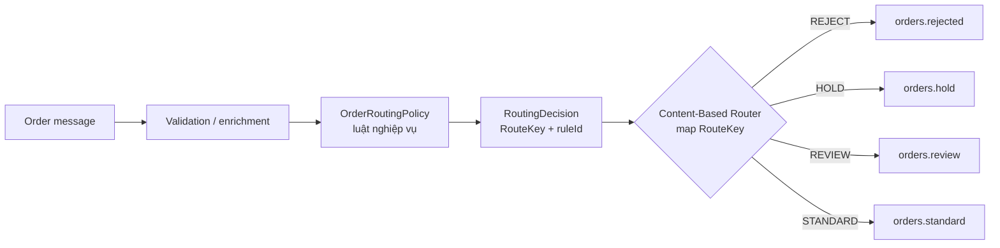
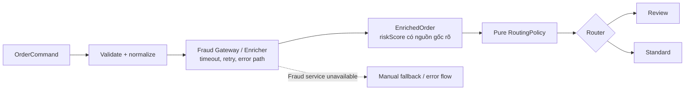

# Tránh nhúng nghiệp vụ lớn trong expression

## 1. Vì sao một Content-Based Router có thể trở nên khó bảo trì?

Trong **Enterprise Integration Patterns**, *Content-Based Router* đọc nội dung message để quyết định đưa message đến một hoặc nhiều nhánh xử lý. Chẳng hạn hệ thống nhận đơn hàng và định tuyến đến:

- `orders.standard`: đơn thông thường, xử lý tự động.
- `orders.review`: đơn rủi ro cao hoặc giá trị lớn, cần duyệt.
- `orders.hold`: đơn xuyên biên giới chưa đủ điều kiện xác minh.
- `orders.rejected`: dữ liệu đầu vào không hợp lệ.

Ban đầu, điều kiện định tuyến có thể rất đơn giản: `amount >= 5000` thì vào nhánh review. Sau vài tháng, sản phẩm bổ sung hạn mức theo khu vực, yêu cầu định danh, khung giờ, hạng khách hàng, danh sách hạn chế và các trường hợp ngoại lệ. Nếu tất cả được viết trực tiếp trong **SpEL expression** hoặc một lambda dài ngay trong `IntegrationFlow`, một thay đổi nhỏ có thể làm lệch quyết định của nhiều nhánh.

Trong module **SPRING_INTEGRATION_PATTERN**, chương **Content-based router** hướng đến xây dựng các luồng thông điệp ít phụ thuộc, dễ mở rộng với Spring Integration. Việc đưa quy tắc nghiệp vụ về đúng nơi giúp phối hợp Router, Filter, Transformer, Splitter, Aggregator, Gateway, retry, error channel và correlation; đồng thời tạo điều kiện kiểm thử và theo dõi quyết định định tuyến.

**Nguyên tắc cốt lõi:** phần cấu hình Router nên thể hiện **điểm ra quyết định và ánh xạ kết quả đến channel**. Các quy tắc nghiệp vụ phức tạp nên được đặt trong một **policy/service/strategy có kiểu dữ liệu rõ ràng và có thể kiểm thử độc lập**.

Sau bài này, bạn có thể:

1. Nhận biết khi một expression chứa quá nhiều trách nhiệm.
2. Tách quy tắc nghiệp vụ khỏi chi tiết channel và Spring Integration DSL.
3. Xác định thứ tự ưu tiên của các luật, quy tắc fallback và cách xử lý dữ liệu không hợp lệ.
4. Triển khai policy có kiểu, ánh xạ `RouteKey` sang channel, và quan sát được lý do routing.
5. Kiểm thử chính sách bằng bảng trường hợp, sau đó kiểm thử wiring của flow.
6. Giữ an toàn khi route dựa trên dữ liệu đến từ HTTP, broker hoặc nguồn không đáng tin cậy.

## 2. Vai trò đúng của expression trong Router

Spring Integration cho phép định tuyến theo nhiều cách, bao gồm biểu thức SpEL, header, payload type, method và Java DSL. Expression rất hữu ích khi quyết định chỉ gồm một phép truy cập hoặc điều kiện ngắn, ví dụ:

```text
headers['region']
```

Hoặc khi chọn kênh theo một trường đã được chuẩn hóa ở bước trước:

```text
payload.routingKey
```

Trong những tình huống này, người đọc có thể biết nhanh **đầu vào nào được đọc** và **giá trị nào được trả về**. Expression phù hợp như một lớp kết nối nhỏ giữa message và Router.

Ngược lại, một expression dài có thể trộn các công việc sau:

| Trách nhiệm | Nên nằm ở đâu? | Vì sao? |
| --- | --- | --- |
| Trích xuất một trường đã chuẩn hóa | Expression ngắn hoặc lambda ngắn | Là thao tác ánh xạ đơn giản. |
| Quyết định ưu tiên giữa các luật rủi ro | Domain policy/service | Cần test theo ma trận trường hợp và thay đổi độc lập. |
| Truy vấn database hoặc gọi HTTP để tính điểm | Bước enrichment/gateway riêng | Có timeout, retry, lỗi I/O và quan sát hiệu năng. |
| Ánh xạ `REVIEW` sang `orders.review` | Router configuration | Là topology, không phải luật nghiệp vụ. |
| Chuẩn hóa payload và header | Transformer/Header Enricher | Thực hiện một trách nhiệm riêng, giúp Router nhận dữ liệu đáng tin cậy. |
| Xử lý message bị từ chối hoặc không có nhánh khớp | Filter hoặc nhánh fallback/error | Cần chính sách rõ về thông báo, retry và mất message. |

Một expression phức tạp **không sai chỉ vì nó dùng SpEL**. Vấn đề xuất hiện khi nó giấu các quy tắc nghiệp vụ và side effect phía sau một cấu hình ngắn nhưng khó kiểm chứng. Độ phức tạp và phạm vi trách nhiệm là tiêu chí chính; số dòng chỉ là một dấu hiệu.

## 3. Ví dụ phản diện: quy tắc nghiệp vụ bị chôn trong expression

Giả sử yêu cầu nghiệp vụ như sau:

1. Thiếu mã đơn, số tiền âm hoặc điểm rủi ro nằm ngoài miền hợp lệ → từ chối.
2. Đơn xuyên biên giới chưa được xác minh → tạm giữ.
3. Điểm rủi ro từ 80 hoặc tổng tiền từ 5.000 → xét duyệt.
4. Các trường hợp còn lại → xử lý thông thường.

Một expression minh họa (giả mã theo phong cách SpEL, nhằm thể hiện độ phức tạp chứ không phải cấu hình để sao chép chạy trực tiếp):

```text
payload.orderId == null || payload.orderId.isBlank()
    || payload.amount == null || payload.amount < 0
    || payload.riskScore < 0 || payload.riskScore > 100
        ? 'REJECT'
        : (payload.crossBorder && !payload.identityVerified
            ? 'HOLD'
            : (payload.riskScore >= 80 || payload.amount >= 5000
                ? 'REVIEW'
                : 'STANDARD'))
```

Nếu sau đó xuất hiện “khách hàng doanh nghiệp hạng GOLD được ưu tiên review trong trường hợp A, nhưng loại trừ khu vực B”, expression nhanh chóng biến thành hàng loạt `?:`, `and/or` và truy cập thuộc tính lồng nhau.

Các vấn đề thường xuất hiện:

- **Thứ tự luật bị ẩn.** Đơn vừa chưa xác minh vừa rủi ro cao phải vào `HOLD` hay `REVIEW`? Người đọc phải phân tích cấu trúc toán tử để trả lời.
- **Nhánh `null` khó kiểm soát.** Một kiểu payload hoặc trường mới có thể gây lỗi evaluation thay vì trả quyết định có chủ đích.
- **Ràng buộc kiểu lỏng.** Tên property có thể sai hoặc số tiền được so sánh theo cách không phù hợp với schema thực tế.
- **Khó viết test nhanh cho từng luật.** Muốn kiểm tra một ngưỡng có thể phải dựng cả IntegrationFlow hoặc SpEL evaluation context.
- **Lý do định tuyến biến mất.** Output chỉ có chuỗi `"REVIEW"`, không biết do điểm rủi ro hay do hạn mức.
- **Rủi ro khi thêm I/O.** Expression bắt đầu gọi bean khác để truy vấn dữ liệu, nhưng retry, timeout và transaction không còn hiển thị ở flow.

SpEL có khả năng truy cập bean và gọi method. Khả năng đó hữu ích khi gọi một hàm đọc dữ liệu đơn giản, nhưng không nên dùng để giấu những thao tác mạng, ghi dữ liệu hoặc side effect trong một quyết định định tuyến.

### Dấu hiệu cần refactor

Nếu một người sửa luật phải hỏi *“ngưỡng này ở đâu, trường hợp nào được ưu tiên, nó có gọi dịch vụ bên ngoài không, và làm sao biết vì sao message vào nhánh đó?”*, đã đến lúc tách nghiệp vụ khỏi expression.

## 4. Thiết kế hợp đồng định tuyến trước khi viết DSL

Trước khi code, định nghĩa **bảng quyết định có thứ tự ưu tiên**. Đây là hợp đồng giữa sản phẩm, domain logic và topology.

Ví dụ đơn hàng với `amount` dạng `BigDecimal`, `riskScore` trong đoạn 0–100 và cờ xác minh danh tính:

| Ưu tiên | Điều kiện | `RouteKey` | Lý do ghi nhận |
| --- | --- | --- | --- |
| 1 | ID rỗng, số tiền thiếu/âm, riskScore ngoài 0–100 | `REJECT` | `INVALID_INPUT` |
| 2 | Xuyên biên giới **và** chưa xác minh | `HOLD` | `IDENTITY_REQUIRED` |
| 3 | Điểm rủi ro ≥ 80 | `REVIEW` | `HIGH_RISK` |
| 4 | Số tiền ≥ 5.000 | `REVIEW` | `LARGE_AMOUNT` |
| 5 | Không khớp điều kiện nào ở trên | `STANDARD` | `NORMAL_ORDER` |

**Thứ tự ưu tiên là một phần của nghiệp vụ.** Một đơn hàng xuyên biên giới chưa xác minh, đồng thời có `riskScore = 95`, sẽ vào `HOLD` do luật ưu tiên 2. Nếu yêu cầu đổi thành “rủi ro cao luôn được review trước”, cần thay bảng quyết định và kiểm thử — không nên sửa vội vị trí một toán tử trong expression.

Một cấu trúc kết quả có kiểu sẽ giúp mang theo cả **route key** và **lý do quyết định**:

```java
enum RouteKey {
    REJECT, HOLD, REVIEW, STANDARD
}

record RoutingDecision(RouteKey route, String ruleId) {}
```

Nhờ đó:

- Router chỉ cần đọc `decision.route()`.
- Log, metric hoặc audit có thể ghi `decision.ruleId()`.
- Policy độc lập với tên channel như `orders.review`.
- Khi đổi topology, domain policy không cần biết channel mới được đặt tên gì.

**Hạn chế nội dung trong `ruleId`:** mã lý do nên là một tập được quản lý (ví dụ `HIGH_RISK`); tránh ghi nguyên dữ liệu nhạy cảm vào lý do, log hoặc metric label.

## 5. Kiến trúc khuyến nghị: policy tạo quyết định, Router ánh xạ channel



Tách kiến trúc thành **ba câu hỏi**:

1. **Dữ liệu đã đủ và đáng tin chưa?** Ingress hoặc bước enrichment chuẩn hóa trường, xác minh tenant và lấy thông tin cần thiết. Đây là nơi xử lý I/O và lỗi nguồn dữ liệu.
2. **Quy tắc nào áp dụng?** Policy thuần Java trả về một quyết định. Chính sách nên xác định kết quả một cách có thể lặp lại với cùng input.
3. **Kết quả này đi tới channel nào?** Router ánh xạ giá trị `RouteKey` từ policy sang channel được khai báo trong flow.

Tách như vậy giúp thay đổi luật rủi ro mà không sửa topology, hoặc thay hệ thống downstream mà không viết lại luật nghiệp vụ.

### Dùng DTO cho quyết định khi cần truy vết

Có hai cách giao kết quả từ policy sang Router:

- **Cách gọn:** Router gọi `policy.decide(message)` trực tiếp rồi trả `RouteKey`. Phù hợp khi không cần lưu thêm lý do và policy thuần, nhanh.
- **Cách rõ ngữ cảnh:** Transformer tạo một `RoutedOrder` chứa đơn hàng gốc cùng `RoutingDecision`; Router chỉ đọc khóa. Phù hợp khi cần audit, kiểm tra lý do hoặc dùng quyết định ở endpoint tiếp theo.

Bài này chọn cách thứ hai để nhìn rõ ranh giới trách nhiệm. Việc tạo `RoutedOrder` có nghĩa payload sau bước phân loại **đổi kiểu**; các consumer downstream phải hiểu kiểu mới hoặc có Transformer chuyển lại payload gốc.

## 6. Ví dụ Java DSL: tách policy ra khỏi Router

Ví dụ dưới đây minh họa một flow hoàn chỉnh ở mức wiring Spring Integration. Các record và class được khai báo package-private để có thể đặt trong cùng một package khi học; ứng dụng thực nên tách thành file có tên rõ.

```java
import java.math.BigDecimal;

import org.springframework.context.annotation.Bean;
import org.springframework.context.annotation.Configuration;
import org.springframework.integration.channel.DirectChannel;
import org.springframework.integration.channel.QueueChannel;
import org.springframework.integration.config.EnableIntegration;
import org.springframework.integration.dsl.IntegrationFlow;

// Message đầu vào từ một nguồn đã xác định hợp đồng.
record OrderCommand(
        String orderId,
        BigDecimal amount,
        int riskScore,
        boolean crossBorder,
        boolean identityVerified) {}

enum RouteKey {
    REJECT, HOLD, REVIEW, STANDARD
}

record RoutingDecision(RouteKey route, String ruleId) {}

record RoutedOrder(OrderCommand original, RoutingDecision decision) {}

// Domain policy: không phụ thuộc channel, broker hay Spring Integration.
final class OrderRoutingPolicy {

    private static final BigDecimal REVIEW_AMOUNT =
            new BigDecimal("5000");

    RoutedOrder classify(OrderCommand order) {
        if (order == null
                || order.orderId() == null
                || order.orderId().isBlank()
                || order.amount() == null
                || order.amount().signum() < 0
                || order.riskScore() < 0
                || order.riskScore() > 100) {
            return new RoutedOrder(
                    order,
                    new RoutingDecision(
                            RouteKey.REJECT, "INVALID_INPUT"));
        }

        if (order.crossBorder() && !order.identityVerified()) {
            return new RoutedOrder(
                    order,
                    new RoutingDecision(
                            RouteKey.HOLD, "IDENTITY_REQUIRED"));
        }

        if (order.riskScore() >= 80) {
            return new RoutedOrder(
                    order,
                    new RoutingDecision(
                            RouteKey.REVIEW, "HIGH_RISK"));
        }

        if (order.amount().compareTo(REVIEW_AMOUNT) >= 0) {
            return new RoutedOrder(
                    order,
                    new RoutingDecision(
                            RouteKey.REVIEW, "LARGE_AMOUNT"));
        }

        return new RoutedOrder(
                order,
                new RoutingDecision(
                        RouteKey.STANDARD, "NORMAL_ORDER"));
    }
}

@Configuration
@EnableIntegration
class OrderRoutingConfiguration {

    @Bean
    OrderRoutingPolicy orderRoutingPolicy() {
        return new OrderRoutingPolicy();
    }

    @Bean("orders.input")
    DirectChannel ordersInput() {
        return new DirectChannel();
    }

    @Bean("orders.rejected")
    QueueChannel rejectedOrders() {
        return new QueueChannel();
    }

    @Bean("orders.hold")
    QueueChannel heldOrders() {
        return new QueueChannel();
    }

    @Bean("orders.review")
    QueueChannel reviewOrders() {
        return new QueueChannel();
    }

    @Bean("orders.standard")
    QueueChannel standardOrders() {
        return new QueueChannel();
    }

    @Bean
    IntegrationFlow routeOrders(OrderRoutingPolicy policy) {
        return IntegrationFlow.from("orders.input")
            .transform(OrderCommand.class, policy::classify)
            .route(RoutedOrder.class,
                routed -> routed.decision().route().name(),
                spec -> spec
                    .channelMapping("REJECT", "orders.rejected")
                    .channelMapping("HOLD", "orders.hold")
                    .channelMapping("REVIEW", "orders.review")
                    .channelMapping("STANDARD", "orders.standard"))
            .get();
    }
}
```

**Đọc code theo luồng:**

1. Message đi vào `orders.input` với payload `OrderCommand`.
2. Transformer gọi `policy.classify(...)`. Chính sách trả về `RoutedOrder` gồm dữ liệu gốc và quyết định có lý do.
3. Router đọc `routed.decision().route().name()` — một thao tác ngắn và không mang luật nghiệp vụ.
4. `channelMapping` chỉ rõ bốn key được đưa đến bốn đích. Đây là chi tiết topology có thể sửa mà không thay `OrderRoutingPolicy`.
5. Các đầu ra là `QueueChannel` để test có thể gọi `receive(timeout)`. Khi triển khai thực tế, thay chúng bằng channel/handler/adapter phù hợp với SLA, retry và nhu cầu lưu trữ.

**Điều được đảm bảo trong ví dụ:** mỗi input hợp lệ theo kiểu `OrderCommand` được phân loại theo một nhánh rõ ràng. **Điều chưa được đảm bảo:** xử lý ở consumer đầu ra đã hoàn tất, dữ liệu được lưu bền vững hoặc các side effect được thực hiện exactly-once. Gửi thành công vào `QueueChannel` chỉ cho biết message đã được chấp nhận vào queue.

### Vì sao các constant route key hữu ích?

Nếu Router trả chuỗi động như `"orders." + payload.destination`, đầu vào có thể vô tình chọn channel ngoài hợp đồng. Ngược lại, `RouteKey` giới hạn tập kết quả của policy và `channelMapping` tạo **allowlist đích**.

Việc gọi `name()` ở ranh giới Router chỉ là một cách chuyển enum sang routing key. Không dùng chuỗi của người dùng làm channel name, tên bean hoặc biểu thức động mà thiếu kiểm soát.

### Nếu downstream chỉ cần `OrderCommand`?

Trong ví dụ, payload sau `transform()` là `RoutedOrder`. Một consumer có thể đọc `routed.original()` và `routed.decision()`. Nếu một outbound adapter chỉ nhận `OrderCommand`, dùng Transformer trong nhánh tương ứng để lấy lại payload gốc, hoặc chọn mô hình **Header Enricher**:

```java
// Phương án khác: giữ payload OrderCommand, thêm header từ policy.
.enrichHeaders(spec -> spec
    .headerFunction("routeKey",
        message -> policy.classify(
            (OrderCommand) message.getPayload())
            .decision().route().name()))
.route("headers['routeKey']", spec -> spec
    .channelMapping("REJECT", "orders.rejected")
    .channelMapping("HOLD", "orders.hold")
    .channelMapping("REVIEW", "orders.review")
    .channelMapping("STANDARD", "orders.standard"))
```

Đoạn này là **một mảnh DSL thay thế** cho hai bước `transform + route`, không đặt nối thêm vào cuối flow trước đó. Nó giữ nguyên payload `OrderCommand` nhưng chỉ lưu `routeKey`, chưa lưu `ruleId`. Nếu cần cả hai, có thể tính `RoutingDecision` đúng một lần ở một stage trước rồi đưa vào header có kiểu hoặc DTO, tránh gọi policy lặp lại cho từng header.

Khi message đi qua HTTP, AMQP hoặc JMS, hãy quyết định rõ header ứng dụng nào được phép truyền qua transport. Một object Java như `RoutingDecision` không tự có biểu diễn an toàn trong mọi header mapper.

## 7. Khi expression nhỏ vẫn là lựa chọn tốt

Không phải Router nào cũng cần một policy class.

Ví dụ, sau khi một bước xác thực đã chuẩn hóa header `region` thành một enum hoặc chuỗi thuộc tập có kiểm soát, một Router đọc `headers['region']` là dễ hiểu. Tương tự, chọn theo payload type cũng có thể là việc định tuyến thuần túy.

Một quy tắc thực dụng:

| Tình huống | Cách viết phù hợp |
| --- | --- |
| Đọc một header tin cậy, một enum, một field có sẵn | Expression/lambda ngắn. |
| Hai điều kiện đơn giản, ít thay đổi, không có side effect | Lambda ngắn, tên rõ; test tại flow boundary. |
| Nhiều điều kiện có ưu tiên, ngưỡng, ngoại lệ hoặc biến thể theo sản phẩm | Policy/service có kiểu + unit tests. |
| Quy tắc do nhiều bộ phận sửa hoặc có phiên bản | Policy/decision table được quản lý; Router chỉ dùng quyết định. |
| Cần gọi dịch vụ mạng để ra quyết định | Tách enrichment/Gateway và retry/timeout; Router dùng kết quả đã có. |
| Một message phải đến nhiều đích độc lập | Cân nhắc Recipient List hoặc Publish-Subscribe, thay vì biểu thức router chứa nhiều side effect. |

Cần ưu tiên **tính dễ hiểu của quyết định** hơn việc tạo thêm class theo một quy tắc hình thức. Nếu policy chỉ trả về một trường đã có sẵn trong message, một lớp mới có thể khiến flow khó đọc hơn.

## 8. Nếu quy tắc cần dữ liệu từ API hoặc database

Một yêu cầu thường gặp là: “Muốn route đơn hàng, phải gọi fraud service lấy điểm rủi ro”. Không nên ẩn lời gọi này vào expression như một điều kiện:

```text
// Không nên để một expression routing che giấu lời gọi mạng:
@fraudClient.checkRisk(payload.customerId) > 80
    ? 'REVIEW'
    : 'STANDARD'
```

Bởi vì khi fraud service chậm hoặc lỗi, quyết định Router có thêm:

- Timeout và khả năng giữ thread gửi.
- Retry và nguy cơ gọi cùng một API nhiều lần.
- Cơ chế xác thực và circuit breaker.
- Quy tắc khi không lấy được điểm rủi ro.
- Tác dụng phụ (nếu API kiểm tra cũng ghi nhận việc truy vấn).
- Độ trễ không được thể hiện rõ trong sơ đồ flow.

Thay vào đó, thiết kế các stage:



Bước fraud enrichment được cấu hình riêng như Gateway, Transformer/service handler hoặc endpoint tích hợp tương ứng. Sau khi có dữ liệu, policy đánh giá **đồng bộ trên dữ liệu sẵn có**. Nếu dịch vụ chậm, metrics và error flow của enrichment cho biết điểm nghẽn ở đâu; policy vẫn kiểm thử được mà không cần gọi mạng.

**Không mặc định lỗi API đồng nghĩa với rủi ro bằng 0.** Nếu fraud service không khả dụng, nghiệp vụ có thể yêu cầu đưa vào `HOLD` hoặc `REVIEW` với lý do `RISK_UNAVAILABLE`, hoặc từ chối tạm thời. Đây là quyết định có chủ đích cần thể hiện trong bảng luật và kiểm thử.

### Với chính sách thay đổi theo tenant hay thời gian

Nếu từng tenant có ngưỡng riêng, hãy lấy cấu hình đã xác thực/phiên bản hóa **trước** khi đánh giá. Có thể truyền một `PolicyContext` chứa ngưỡng và phiên bản luật vào service; kết quả ghi `policyVersion` để audit. Cần tránh expression tùy ý do người dùng cung cấp được thực thi trong một evaluation context có quyền truy cập bean/hàm không kiểm soát.

Một ví dụ về khả năng tái lập quyết định:

```text
orderId:          O-204
policyVersion:    risk-v3
evaluatedAt:      2026-11-21T09:00:00Z
routeKey:         REVIEW
ruleId:           LARGE_AMOUNT
```

Các giá trị trên chỉ minh họa. Với luật thay đổi theo thời gian, lưu input đã chuẩn hóa hoặc tham chiếu dữ liệu đủ để giải thích quyết định khi cần điều tra, đồng thời tuân thủ chính sách lưu dữ liệu.

## 9. Routing là topology, nghiệp vụ là policy

Khi tách hai lớp, cần tránh đảo ngược trách nhiệm:

**Không đưa topology vào domain policy:**

```java
// Hạn chế kiểu trả về channel name trực tiếp từ nghiệp vụ:
String chooseDestination(OrderCommand order) {
    return order.amount().compareTo(new BigDecimal("5000")) >= 0
            ? "springIntegrationReviewChannel"
            : "springIntegrationStandardChannel";
}
```

Nếu thay tên channel hoặc chuyển nhánh review sang broker, logic nghiệp vụ lại phải đổi.

**Nên để policy trả giá trị có nghĩa nghiệp vụ:**

```java
RouteKey chooseRoute(OrderCommand order) {
    return order.amount().compareTo(new BigDecimal("5000")) >= 0
            ? RouteKey.REVIEW
            : RouteKey.STANDARD;
}
```

Đây là ví dụ rút gọn để minh họa sự khác biệt về interface; trong ứng dụng thật, dùng đầy đủ các điều kiện ưu tiên và validation như `OrderRoutingPolicy` ở mục 6.

`RouteKey` thể hiện một trạng thái quyết định. `channelMapping` thể hiện địa chỉ thực thi của trạng thái đó. Khi domain và infrastructure phát triển khác tốc độ, sự tách biệt này giảm phạm vi code cần sửa và làm test chính sách ổn định hơn.

## 10. Không có nhánh khớp: phải có chính sách rõ ràng

Nếu thêm `RouteKey.ESCALATED` vào policy mà quên ánh xạ đến channel, Router có thể không phân giải được destination hoặc hành xử theo cấu hình mặc định của loại router đang dùng. Không nên để một message quan trọng biến mất chỉ vì map thiếu.

Có ba cách thường gặp:

1. **Phát hiện cấu hình thiếu:** policy chỉ được trả key thuộc một tập cố định; test kiểm tra mọi key có mapping. Khi key chưa được hỗ trợ, coi đây là lỗi cấu hình và phát cảnh báo.
2. **Default output channel có theo dõi:** route sang channel `orders.unrouted`, ghi thông tin giải thích và quyết định xử lý hoặc từ chối tại đó.
3. **Fallback nghiệp vụ:** policy quyết định `HOLD` hoặc `REJECT` khi input không đủ điều kiện đánh giá; không coi fallback kỹ thuật là một quyết định nghiệp vụ hợp lệ.

Spring Integration cung cấp các tùy chọn router như default output channel và yêu cầu resolve destination (tùy router/API phiên bản). Khi triển khai, kiểm chứng cụ thể cấu hình `defaultOutputChannel`, `resolutionRequired` và hành vi `channelMapping`.

**Không dùng default channel để che lỗi typo trong key.** Một `REVEIW` viết sai có thể bị chuyển đến nhánh fallback mà không ai phát hiện. Test quy tắc + test wiring có mục đích riêng chính là để bắt loại sai sót này.

### Nếu không còn message hợp lệ?

Một Router chọn đường xử lý **khác** Message Filter quyết định giữ hoặc loại message. Nếu dữ liệu sai cần được báo cho người gửi, hãy dùng policy trả `REJECT` rồi route sang nhánh từ chối, hoặc Filter với discard/error phù hợp. Không tự động ném mọi message sai vào một channel âm thầm bỏ dữ liệu.

## 11. Kiểm thử policy độc lập với Spring

Lợi ích lớn nhất của việc tách policy là có thể kiểm thử **thứ tự và ranh giới của luật** bằng JUnit 5 mà không khởi động ApplicationContext.

Ví dụ sau dùng các kiểu được định nghĩa ở mục 6:

```java
import static org.assertj.core.api.Assertions.assertThat;

import java.math.BigDecimal;

import org.junit.jupiter.api.Test;

class OrderRoutingPolicyTest {

    private final OrderRoutingPolicy policy =
            new OrderRoutingPolicy();

    @Test
    void rejectsInvalidInputBeforeAllOtherRules() {
        OrderCommand invalid = new OrderCommand(
            "", new BigDecimal("-1"), 95, true, false);

        RoutingDecision decision =
            policy.classify(invalid).decision();

        assertThat(decision.route()).isEqualTo(RouteKey.REJECT);
        assertThat(decision.ruleId()).isEqualTo("INVALID_INPUT");
    }

    @Test
    void holdHasPrecedenceOverHighRisk() {
        OrderCommand order = new OrderCommand(
            "O-100", new BigDecimal("9000"), 95, true, false);

        RoutingDecision decision =
            policy.classify(order).decision();

        assertThat(decision.route()).isEqualTo(RouteKey.HOLD);
        assertThat(decision.ruleId())
            .isEqualTo("IDENTITY_REQUIRED");
    }

    @Test
    void highRiskWinsWhenIdentityIsVerified() {
        OrderCommand order = new OrderCommand(
            "O-101", new BigDecimal("100"), 80, true, true);

        RoutingDecision decision =
            policy.classify(order).decision();

        assertThat(decision.route()).isEqualTo(RouteKey.REVIEW);
        assertThat(decision.ruleId()).isEqualTo("HIGH_RISK");
    }

    @Test
    void amountThresholdIsInclusive() {
        OrderCommand order = new OrderCommand(
            "O-102", new BigDecimal("5000"), 20, false, true);

        RoutingDecision decision =
            policy.classify(order).decision();

        assertThat(decision.route()).isEqualTo(RouteKey.REVIEW);
        assertThat(decision.ruleId()).isEqualTo("LARGE_AMOUNT");
    }

    @Test
    void normalOrderRemainsStandard() {
        OrderCommand order = new OrderCommand(
            "O-103", new BigDecimal("4999.99"), 20, false, true);

        assertThat(policy.classify(order).decision().route())
            .isEqualTo(RouteKey.STANDARD);
    }
}
```

Các test này bảo vệ **ý nghĩa của policy**. Nếu thay đổi thứ tự luật, test `holdHasPrecedenceOverHighRisk` buộc người sửa nhận biết rằng đã đổi một quyết định có tác động nghiệp vụ.

### Ma trận trường hợp nên có

| Input | Expected route | Vì sao cần test? |
| --- | --- | --- |
| `amount == null` | `REJECT` | Tránh lỗi null khi so ngưỡng. |
| `amount < 0` | `REJECT` | Không phân loại dữ liệu vô hiệu như đơn thường. |
| `riskScore = -1` hoặc `101` | `REJECT` | Bảo vệ miền dữ liệu. |
| `crossBorder=true`, chưa xác minh, risk=95 | `HOLD` | Kiểm tra thứ tự ưu tiên. |
| Risk = 79, amount = 4.999 | `STANDARD` | Ranh giới ngay dưới ngưỡng. |
| Risk = 80, amount thấp | `REVIEW` | Ranh giới ngưỡng risk. |
| Risk thấp, amount = 5.000 | `REVIEW` | Ranh giới ngưỡng tiền. |
| Risk cao, amount cao | `REVIEW` với lý do ưu tiên đúng | Nhiều điều kiện cùng đúng. |

Nếu policy lớn, dùng parameterized tests hoặc dữ liệu kiểm thử dạng bảng để dễ mở rộng. Mỗi thay đổi quy tắc cần kèm trường hợp positive, negative và boundary. Đừng chỉ test một đơn hàng duy nhất đi đúng nhánh.

## 12. Kiểm thử wiring: RouteKey đến đúng channel

Unit test policy không phát hiện lỗi cấu hình như ánh xạ `REVIEW` đến nhầm channel `orders.standard`. Vì vậy cần ít nhất một kiểm thử integration của flow ở mức nội bộ, với các channel kiểm tra được.

Ví dụ dùng Spring Test, JUnit 5 và AssertJ:

```java
import static org.assertj.core.api.Assertions.assertThat;

import java.math.BigDecimal;

import org.junit.jupiter.api.Test;
import org.springframework.beans.factory.annotation.Autowired;
import org.springframework.beans.factory.annotation.Qualifier;
import org.springframework.integration.channel.QueueChannel;
import org.springframework.messaging.Message;
import org.springframework.messaging.MessageChannel;
import org.springframework.messaging.support.MessageBuilder;
import org.springframework.test.context.junit.jupiter.SpringJUnitConfig;

@SpringJUnitConfig(OrderRoutingConfiguration.class)
class OrderRoutingFlowTest {

    @Autowired
    @Qualifier("orders.input")
    MessageChannel input;

    @Autowired
    @Qualifier("orders.rejected")
    QueueChannel rejected;

    @Autowired
    @Qualifier("orders.hold")
    QueueChannel hold;

    @Autowired
    @Qualifier("orders.review")
    QueueChannel review;

    @Autowired
    @Qualifier("orders.standard")
    QueueChannel standard;

    private void assertRouted(OrderCommand order,
                              QueueChannel expected,
                              RouteKey route,
                              String ruleId) {
        Message<OrderCommand> request = MessageBuilder
            .withPayload(order)
            .setHeader("requestId", "req-" + order.orderId())
            .build();

        assertThat(input.send(request)).isTrue();

        Message<?> output = expected.receive(0);
        assertThat(output).isNotNull();

        RoutedOrder routed = (RoutedOrder) output.getPayload();
        assertThat(routed.original()).isEqualTo(order);
        assertThat(routed.decision().route()).isEqualTo(route);
        assertThat(routed.decision().ruleId()).isEqualTo(ruleId);
        assertThat(output.getHeaders().get("requestId"))
            .isEqualTo("req-" + order.orderId());
    }

    @Test
    void everyDecisionUsesItsMappedChannel() {
        assertRouted(
            new OrderCommand("bad", new BigDecimal("-1"),
                             20, false, true),
            rejected, RouteKey.REJECT, "INVALID_INPUT");

        assertRouted(
            new OrderCommand("held", new BigDecimal("9000"),
                             95, true, false),
            hold, RouteKey.HOLD, "IDENTITY_REQUIRED");

        assertRouted(
            new OrderCommand("review", new BigDecimal("100"),
                             80, false, true),
            review, RouteKey.REVIEW, "HIGH_RISK");

        assertRouted(
            new OrderCommand("normal", new BigDecimal("100"),
                             20, false, true),
            standard, RouteKey.STANDARD, "NORMAL_ORDER");

        // Không còn message nào ở các đích sau khi đọc 4 kết quả.
        assertThat(rejected.receive(0)).isNull();
        assertThat(hold.receive(0)).isNull();
        assertThat(review.receive(0)).isNull();
        assertThat(standard.receive(0)).isNull();
    }
}
```

Phần test này chứng minh channel mapping và header `requestId` được giữ qua Transformer/Router trong cấu hình ví dụ. Các QueueChannel chỉ dùng để quan sát kết quả. Test không chứng minh downstream đã ghi dữ liệu thành công, transport đã ack hay một quy trình nhiều service có thể rollback.

Nếu Router nằm sau asynchronous channel, adapter hoặc Gateway, hãy bổ sung test cho timeout, dispatch error, message đến trễ, retry, idempotency và trường hợp route key không resolve được.

## 13. Logging và observability: biết message vào nhánh nào *và vì sao*

Một expression chỉ trả `"REVIEW"` thường khiến vận hành hỏi: “Message này review vì số tiền, điểm rủi ro hay cấu hình?”.

Mô hình `RoutingDecision(route, ruleId)` làm câu trả lời trở nên có cấu trúc. Ở boundary phù hợp, có thể ghi:

```text
event=order_routed
requestId=req-102
route=REVIEW
ruleId=LARGE_AMOUNT
policyVersion=risk-v3
durationMs=2
```

Đây là **định dạng log minh họa**; `policyVersion` và `durationMs` cần được ứng dụng tạo và đo thực tế. Không nên đưa `orderId`, email, token, dữ liệu định danh hoặc giá trị quá chi tiết vào label của metrics có cardinality cao.

Một bộ metric gợi ý:

- `router.decisions.total{route,ruleId}`: số quyết định theo nhánh và mã luật.
- `router.decisions.error.total{reason}`: số lỗi trong phân loại.
- `router.decision.duration`: thời gian thực thi policy, để nhận biết khi một policy thuần bị mở rộng thêm thao tác tốn kém.
- `router.unrouted.total`: trường hợp thiếu channel mapping hoặc fallback.
- `router.downstream.failures.total{destination}`: lỗi ở từng đích xử lý.

Tên metric trên là **đề xuất thiết kế ứng dụng**, không khẳng định Spring Integration tạo sẵn đúng tên đó.

Giữ `requestId` hoặc trace context qua những stage cần quan sát. Nếu message đi qua nhiều hệ thống, cần có chính sách header mapping, bảo vệ dữ liệu và thời hạn lưu. Phân biệt rõ `MessageHeaders.ID` của framework, `correlationId` dùng trong Splitter/Aggregator và `requestId` nghiệp vụ; chúng không luôn đồng nghĩa.

## 14. Tác động tới các Enterprise Integration Patterns khác

Tách chính sách khỏi expression giúp ranh giới với pattern khác rõ hơn:

| Pattern | Quan hệ với Content-Based Router | Điểm cần giữ khi refactor |
| --- | --- | --- |
| **Filter** | Quyết định pass/reject trước khi route, hoặc đưa input sai sang nhánh loại | Không tự bỏ message quan trọng nếu cần phản hồi lỗi. |
| **Transformer** | Chuẩn hóa payload hoặc tạo `RoutingDecision` có kiểu | Giữ các header quan trọng, mô tả rõ payload sau transform. |
| **Header Enricher** | Bổ sung dữ liệu route đã được kiểm tra | Không tin header từ client chưa xác thực để bypass policy. |
| **Splitter** | Chia message thành nhiều phần có thể đi các nhánh khác nhau | Giữ correlation/sequence; mỗi phần có thể có route riêng. |
| **Aggregator** | Gom các kết quả sau routing/fan-out | Xác định group key, release và timeout; Filter/route có thể làm thiếu phần. |
| **Gateway** | Cung cấp dữ liệu từ bên ngoài trước policy hoặc chờ reply sau router | Phân biệt request timeout, reply timeout và retry. |
| **Retry/Error Channel** | Xử lý lỗi enrichment, phân loại hoặc downstream | Tránh retry làm side effect lặp và ghi rõ nguồn lỗi. |

Một trường hợp đặc biệt: khi muốn **gửi cùng một event cho nhiều nơi**, ví dụ audit + email + CRM, cần phân biệt:

- **Content-Based Router** thường chọn một tuyến xử lý chính theo loại đơn hàng; một số router vẫn có thể hỗ trợ nhiều đích.
- **Recipient List** hoặc **Publish-Subscribe Channel** thể hiện fan-out đến nhiều recipient độc lập.
- **Aggregator** mới là thành phần chờ nhiều kết quả và ghép thành một message khi cần fan-in.

Đừng cài nhiều lời gọi `send()` trong policy để mô phỏng fan-out: đó là side effect nằm sai chỗ, khó retry và khó kiểm soát thành công một phần.

## 15. Những lỗi thường gặp khi tách expression

| Triệu chứng | Nguyên nhân | Cách khắc phục |
| --- | --- | --- |
| Policy trả `null` và Router báo lỗi | Chưa định nghĩa fallback cho input không hợp lệ | Trả `REJECT`/`HOLD` có lý do hoặc ném lỗi có kiểm soát trước Router. |
| Quyết định mới không đến đúng kênh | Thêm enum key nhưng quên `channelMapping` | Test từng key và kiểm tra topology; theo dõi unrouted messages. |
| Message được route đúng nhưng mất `requestId` | Transformer tạo message mới mà không giữ header cần thiết | Kiểm tra hợp đồng header và transformer, assertion ở output. |
| Luật đúng ở unit test nhưng sai trong hệ thống | Dữ liệu trước policy chưa chuẩn hóa hoặc không đáng tin cậy | Test ingress/enrichment và route flow với schema, tenant, header thực tế. |
| Policy bắt đầu chậm đáng kể | Có thêm truy vấn database/HTTP ẩn trong method | Tách I/O sang bước enrichment có timeout, metrics và retry rõ. |
| Một input dẫn tới hai quyết định khác nhau | Policy đọc thời gian/trạng thái bên ngoài không ổn định trong mỗi lần gọi | Truyền context/phiên bản chính sách rõ và tránh đánh giá nhiều lần. |
| Log không giải thích được vì sao vào review | Quyết định chỉ là chuỗi channel | Dùng `RoutingDecision` với `ruleId` được quản lý. |
| Chỉ lỗi khi có nhiều thread | Shared mutable state trong policy hoặc rule cache không an toàn | Thiết kế policy stateless/immutable, kiểm tra cache và tính nhất quán. |
| Message của tenant này route sang tenant khác | Dùng header hoặc channel name do client tự đưa vào | Chuẩn hóa identity tại ingress, kiểm tra quyền và allowlist đích. |
| Cập nhật ngưỡng làm thay đổi quyết định cũ khi replay | Không lưu policy version và không có hợp đồng replay | Xác định chính sách tái xử lý theo phiên bản cũ/mới, ghi lý do quyết định. |

### Lưu ý về hiệu năng

Không nên kết luận “SpEL luôn chậm hơn Java” rồi refactor mọi expression. Với một phép đọc header đơn giản, chi phí routing có thể không đáng kể so với I/O. Vấn đề chính là **khả năng đọc, kiểm thử, an toàn và quản lý thay đổi**. Nếu latency là mối quan tâm thực sự, hãy đo bằng profiling/metrics trên cùng lưu lượng và môi trường.

## 16. Quy trình refactor một Router đang có expression dài

Có thể áp dụng trình tự sau để giữ hành vi:

1. **Chụp lại hợp đồng hiện tại.** Liệt kê toàn bộ route key, channel mapping, fallback và hành vi với input thiếu/sai. Ghi lại cách error flow hoạt động.
2. **Trích bảng quyết định.** Diễn giải mỗi nhánh expression thành một hàng, nêu rõ thứ tự ưu tiên và các trường hợp nhiều luật cùng đúng.
3. **Viết characterization tests.** Tạo các input đại diện cho hành vi hiện tại; ghi nhận output và các header cần giữ, kể cả các trường hợp không mong muốn nhưng đã tồn tại.
4. **Tạo policy độc lập.** Nhận DTO/context đã chuẩn hóa; trả enum hoặc decision record có lý do; tránh side effect.
5. **Giữ nguyên channel mapping.** Ban đầu chỉ thay phần tính route key, không đổi tên hoặc loại channel cùng lúc.
6. **Kiểm tra cả tầng policy lẫn tầng flow.** Unit test ma trận luật, integration test Router và các nhánh lỗi.
7. **Thêm observability đúng chỗ.** Ghi route, ruleId, policyVersion, correlation và latency mà không log dữ liệu nhạy cảm.
8. **Đối chiếu hành vi trước/sau.** So sánh routing, exceptions, timeout, thread, retry và side effect; chỉ sau đó mới thay topology nếu thật sự cần.

Không có một ngưỡng độ dài expression áp dụng cho mọi dự án. Điều quan trọng là khi thay đổi quy tắc nghiệp vụ, nhóm phát triển có thể **thấy được luật nào đổi, chứng minh các luật còn lại giữ nguyên và lần ngược quyết định ở production**.

## 17. Bài thực hành

### Bài 1 — Trích xuất policy từ expression

Cho logic giả định:

```text
riskScore >= 80 ? REVIEW :
    (amount >= 5000 ? REVIEW :
        (crossBorder && !identityVerified ? HOLD : STANDARD))
```

Yêu cầu:

- Viết bảng ưu tiên; chỉ ra khác biệt so với chính sách tại mục 4.
- Thêm quy tắc `REJECT` khi dữ liệu không hợp lệ.
- Cài thành một Java policy trả `RoutingDecision(route, ruleId)`.
- Viết test cho trường hợp một đơn vừa rủi ro cao vừa chưa xác minh.

### Bài 2 — Thay đổi topology nhưng giữ domain policy

Trong ví dụ mục 6, đổi đích `orders.review` thành một channel/adapter mới phục vụ workflow xét duyệt thủ công. Giữ nguyên `OrderRoutingPolicy`. Viết test xác nhận mọi input tạo cùng `RouteKey` trước và sau khi đổi topology.

### Bài 3 — Fraud service không sẵn sàng

Thiết kế flow nhận đơn chưa có `riskScore`, phải gọi fraud service. Yêu cầu:

- Tách việc gọi fraud service ra một Gateway/enrichment stage.
- Cấu hình deadline và đường lỗi riêng.
- Định nghĩa quyết định nghiệp vụ khi không lấy được điểm.
- Đảm bảo Router cuối cùng vẫn chỉ ánh xạ `RouteKey` đến channel.

### Bài 4 — Rules theo tenant và phiên bản

Giả định tenant A review từ 5.000, tenant B review từ 2.000. Thiết kế `PolicyContext` có tenant đã xác thực và `policyVersion`. Viết tests bảo vệ việc phân loại tenant A/B và nguyên tắc không dùng `tenantId` do client tự khai.

### Bài 5 — Phát hiện lỗi wiring

Cố tình đổi mapping `"HOLD" → "orders.standard"` rồi chạy test tích hợp. Giải thích vì sao unit tests của policy vẫn đạt và integration test phải phát hiện lỗi. Sau đó bổ sung một test xác minh mỗi giá trị của `RouteKey` có channel hợp lệ.

**Tiêu chí hoàn thành:** nêu được vì sao một rule thuộc policy, một mapping thuộc Router, một lệnh gọi mạng thuộc Gateway/enrichment; đưa ra mã dễ đọc và kiểm thử chứng minh cả quyết định lẫn đường đi của message.

## 18. Kết luận thực hành

Expression trong Content-Based Router phù hợp nhất khi **ngắn và diễn đạt việc trích xuất quyết định đã có**. Khi quy tắc chứa nhiều mức ưu tiên, ngưỡng, ngoại lệ, nguồn dữ liệu hoặc yêu cầu audit, hãy tách thành policy có kiểu và test độc lập.

Một thiết kế rõ ràng thường theo chuỗi:

**Ingress/Enrichment → RoutingPolicy → RoutingDecision → Router/ChannelMapping → Handler**.

Nhờ đó Spring Integration vẫn giữ vai trò kết nối các EIP, trong khi logic nghiệp vụ nằm ở nơi có thể kiểm thử và thay đổi riêng. Cấu trúc tốt không chỉ khiến flow dễ đọc mà còn giúp xử lý timeout, error channel, retry và correlation minh bạch hơn.

## Tài liệu tham khảo

- [Spring Integration Reference — Message Routing](https://docs.spring.io/spring-integration/reference/router.html)
- [Spring Integration Reference — Router Implementations](https://docs.spring.io/spring-integration/reference/router/implementations.html)
- [Spring Integration Reference — Java DSL](https://docs.spring.io/spring-integration/reference/dsl.html)
- [Spring Integration Reference — Message Transformation](https://docs.spring.io/spring-integration/reference/transformer.html)
- [Spring Integration Reference — Content Enrichment](https://docs.spring.io/spring-integration/reference/content-enrichment.html)
- [Spring Integration Reference — Error Handling](https://docs.spring.io/spring-integration/reference/error-handling.html)
- [Spring Integration Reference — Message Headers](https://docs.spring.io/spring-integration/reference/message.html)
- [Enterprise Integration Patterns — Content-Based Router](https://www.enterpriseintegrationpatterns.com/patterns/messaging/ContentBasedRouter.html)

Các ví dụ sử dụng Java records (Java 17 trở lên) và Spring Integration Java DSL. Khi áp dụng vào dự án cụ thể, hãy đối chiếu API, phiên bản Spring Framework/Spring Integration, cách route giải quyết channel và cấu hình error handling của ứng dụng.
