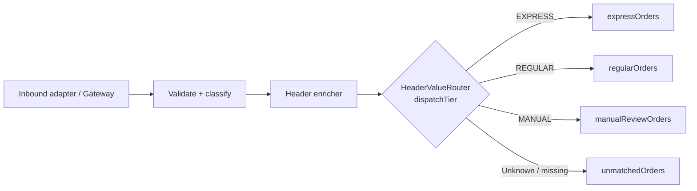
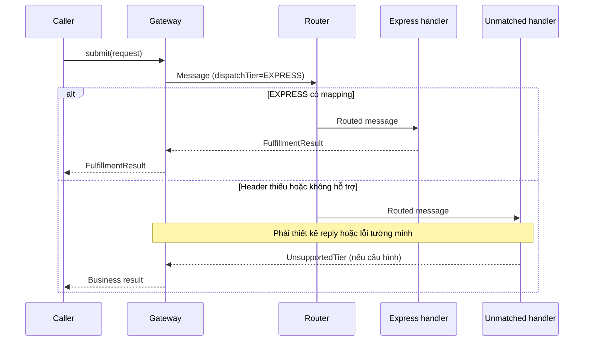
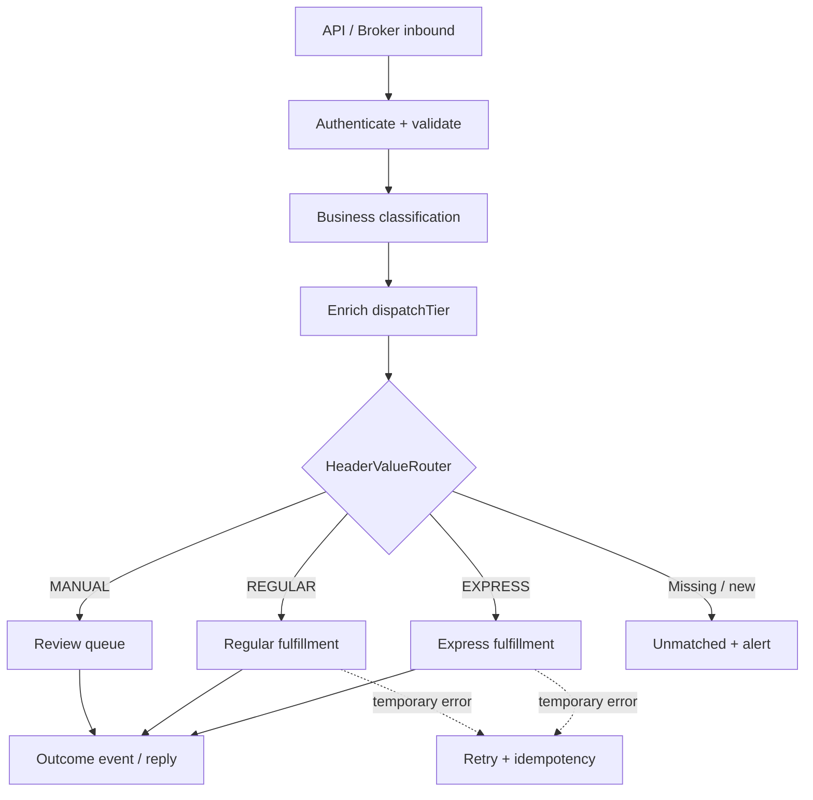

# Header Value Router và giá trị định tuyến

Trong **Spring Integration**, một `Message<?>` chứa **payload** và **headers**. Có những lúc hệ thống đã xác định được loại xử lý cần thực hiện trước khi message đến bước định tuyến: ví dụ, đơn hàng thuộc luồng giao nhanh (`EXPRESS`), giao tiêu chuẩn (`REGULAR`) hoặc cần kiểm tra thủ công (`MANUAL`). Thay vì đọc lại payload và lặp lại quy tắc phân loại ở mỗi nhánh, ta có thể gắn kết quả phân loại vào một **routing header** rồi sử dụng **`HeaderValueRouter`** để chọn channel đích.

Bài học thuộc chương **Header-based router** của module `SPRING_INTEGRATION_PATTERN`, với mục tiêu học triển khai **Enterprise Integration Patterns** bằng Spring Integration: tách trách nhiệm Router, Filter, Transformer, Splitter, Aggregator và Gateway, đồng thời quan tâm retry, error channel, correlation, kiểm thử và khả năng theo dõi các nhánh xử lý. Trọng tâm ở đây là **giá trị định tuyến được lấy, chuẩn hóa, ánh xạ và phân giải như thế nào**, cùng các trường hợp dễ làm message đi sai hoặc mất dấu.

Sau bài học, bạn có thể:

- Giải thích vai trò của **`HeaderValueRouter`** và phân biệt **header name**, **routing key**, **channel mapping** và **channel đích**.
- Cấu hình Router bằng Java DSL, sử dụng `channelMapping`, default output channel và chính sách **channel-key fallback**.
- Quy định cách xử lý header vắng mặt, khác kiểu, sai định dạng hoặc mang giá trị mới chưa hỗ trợ.
- Nhận diện rủi ro của việc lấy header do nguồn ngoài cung cấp để chọn channel, nhất là ở nhánh nhạy cảm.
- Phối hợp Router với Gateway, Filter, Splitter/Aggregator, error flow và idempotency mà không nhầm các loại ID.
- Viết integration test quan sát **message thực sự đến channel nào** và giữ nguyên dữ liệu cần thiết.

## 1. Header Value Router đứng ở đâu trong một IntegrationFlow?

**Message Router** quyết định channel sẽ nhận một message. `HeaderValueRouter` là một router chuyên biệt: thay vì dùng một chuỗi điều kiện trên nhiều thuộc tính payload, nó **đọc giá trị của một header được chỉ định** và dùng giá trị đó làm khóa xác định đích.



Ví dụ message được gửi tới Router:

```text
Message<FulfillmentRequest>
├── payload
│   ├── eventId     = "evt-1001"
│   ├── orderId     = "ORD-1001"
│   └── destination = "HCM"
└── headers
    ├── dispatchTier  = "EXPRESS"
    ├── traceId       = "trace-a91"
    ├── correlationId = "batch-42"
    └── id            = UUID của message
```

Router đọc `dispatchTier = "EXPRESS"` và chọn `expressOrders`. **Payload không phải đổi kiểu** chỉ để phục vụ chuyển nhánh. Các bước ở channel đích mới chịu trách nhiệm thực hiện nghiệp vụ và tạo kết quả nếu hợp đồng yêu cầu.

### Bốn tên gọi phải phân biệt

| Thuật ngữ | Ví dụ | Ý nghĩa |
| --- | --- | --- |
| **Header name** | `dispatchTier` | Tên khóa mà Router sẽ đọc từ `MessageHeaders`. |
| **Routing value / routing key** | `EXPRESS` | Giá trị header của message cụ thể, dùng để xác định đích. |
| **Channel mapping** | `EXPRESS` → `expressOrders` | Bảng ánh xạ khóa định tuyến sang tên channel. |
| **Target channel** | Bean `expressOrders` | Kênh mà message sẽ được chuyển tới. |

`dispatchTier` **không phải tên channel**, và `EXPRESS` cũng **không bắt buộc** trùng với tên bean. Ánh xạ tường minh cho phép thay topology bên trong mà không buộc producer sửa toàn bộ giá trị định tuyến.

## 2. Giá trị định tuyến phải có hợp đồng rõ ràng

Spring headers là tập metadata theo khóa, trong đó giá trị có thể thuộc nhiều kiểu Java. Tuy nhiên, đối với một **router có bảng ánh xạ tĩnh**, sử dụng các giá trị **chuỗi chuẩn hóa, hữu hạn và được tài liệu hóa** thường dễ vận hành nhất.

Đề xuất hợp đồng cho ví dụ giao vận:

| Giá trị `dispatchTier` | Ngữ nghĩa | Đích cấu hình |
| --- | --- | --- |
| `EXPRESS` | Giao vận ưu tiên sau khi đã kiểm tra điều kiện. | `expressOrders` |
| `REGULAR` | Giao vận thông thường. | `regularOrders` |
| `MANUAL` | Cần nhân viên xét duyệt trước khi giao. | `manualReviewOrders` |
| Giá trị ngoài tập trên | Chưa thể phân loại theo hợp đồng hiện tại. | `unmatchedOrders` hoặc lỗi có kiểm soát |

Một số giá trị **trông giống nhau nhưng không nên mặc định tương đương**:

```text
"EXPRESS"        ← chuỗi canonical
"express"        ← khác chữ hoa/thường
" EXPRESS "      ← có khoảng trắng thừa
DispatchTier.EXPRESS ← enum Java, không phải String
1                ← số nguyên, chưa có nghĩa trong contract
null / missing   ← không có giá trị định tuyến hợp lệ
```

Đừng dựa vào giả định framework sẽ tự ép mọi kiểu hoặc cắt mọi khoảng trắng giống nhau trong tất cả phiên bản và adapter. **Chuẩn hóa ngay tại ranh giới tạo header**, xác thực tập giá trị cho phép và kiểm thử kết quả thực tế. Không dùng một danh sách/collection làm routing key rồi mặc nhiên kỳ vọng Router sẽ fan-out; yêu cầu gửi tới nhiều nhánh phải được thiết kế tường minh bằng EIP tương ứng.

### Routing key khác khóa nghiệp vụ

Giả sử `eventId=evt-1001` đại diện cho một sự kiện cần phát lại chính xác, `orderId=ORD-1001` đại diện cho đơn hàng, còn `dispatchTier=EXPRESS` là quyết định điều phối. Dù chúng đều xuất hiện trong cùng message, không nên lấy `dispatchTier` làm khóa khử trùng lặp, khóa correlation của Aggregator hoặc định danh để xác nhận hoàn tất nghiệp vụ.

Khi replay, header có thể được tạo lại bằng chính sách mới. Nếu hợp đồng nghiệp vụ đòi hỏi quyết định phân tuyến **không được thay đổi theo thời gian**, cần lưu quyết định hoặc phiên bản chính sách trong dữ liệu bền vững, thay vì chỉ để trong header của một lượt truyền.

## 3. Tạo HeaderValueRouter bằng Java DSL

Ví dụ sau dùng **Java 17+**, Spring Integration và `QueueChannel` làm channel đích để dễ quan sát. Một ứng dụng thực thường dùng các flow hoặc endpoint tiêu thụ phía sau những channel này.

```java
import org.springframework.context.annotation.Bean;
import org.springframework.context.annotation.Configuration;
import org.springframework.integration.channel.DirectChannel;
import org.springframework.integration.channel.QueueChannel;
import org.springframework.integration.dsl.IntegrationFlow;
import org.springframework.integration.router.HeaderValueRouter;

@Configuration
class FulfillmentRouterConfiguration {

    @Bean
    DirectChannel dispatchInput() {
        return new DirectChannel();
    }

    @Bean
    QueueChannel expressOrders() {
        return new QueueChannel();
    }

    @Bean
    QueueChannel regularOrders() {
        return new QueueChannel();
    }

    @Bean
    QueueChannel manualReviewOrders() {
        return new QueueChannel();
    }

    @Bean
    QueueChannel unmatchedOrders() {
        return new QueueChannel();
    }

    @Bean
    HeaderValueRouter dispatchRouter() {
        HeaderValueRouter router = new HeaderValueRouter("dispatchTier");
        router.setChannelMapping("EXPRESS", "expressOrders");
        router.setChannelMapping("REGULAR", "regularOrders");
        router.setChannelMapping("MANUAL", "manualReviewOrders");

        // Không thử phân giải trực tiếp các giá trị lạ như tên channel.
        router.setChannelKeyFallback(false);

        // Đích xử lý khóa không khớp hoặc không định tuyến được.
        router.setDefaultOutputChannelName("unmatchedOrders");
        return router;
    }

    @Bean
    IntegrationFlow dispatchFlow(HeaderValueRouter dispatchRouter) {
        return IntegrationFlow.from("dispatchInput")
                .route(dispatchRouter)
                .get();
    }
}
```

Ý nghĩa từng bước:

1. `HeaderValueRouter("dispatchTier")` nói rằng **chỉ header có tên này** được dùng làm khóa định tuyến.
2. `setChannelMapping(...)` liên kết mỗi giá trị canonical với **một tên channel đích** trong application context.
3. `setChannelKeyFallback(false)` ngăn cơ chế sử dụng khóa chưa ánh xạ như **tên channel trực tiếp**. Đây là cách thu hẹp tập đích theo danh sách ánh xạ được phép.
4. `setDefaultOutputChannelName("unmatchedOrders")` đặt nơi nhận message khi không tìm được đích phù hợp theo chính sách minh họa.
5. `dispatchFlow` gắn Router vào channel `dispatchInput`, còn các `QueueChannel` phía sau là điểm quan sát/tiêu thụ.

### Vì sao cần quan tâm channel-key fallback?

Các router dựa trên mapping của Spring Integration có cơ chế **channel-key fallback**: khi không có mapping, một khóa có thể được thử dùng như **tên channel** để phân giải, tùy cấu hình. Điều này tạo sự thuận tiện khi producer phát thẳng tên channel, nhưng dễ mở ra đường đi ngoài dự kiến nếu routing header có thể bị nguồn không tin cậy kiểm soát.

Ví dụ, ứng dụng có bean `internalSettlementChannel` nhưng không thêm mapping cho khóa `internalSettlementChannel`. Nếu hệ thống cho phép fallback từ khóa thành tên bean mà không có bước kiểm tra, một upstream không đáng tin cậy có thể cố chọn nhánh này. **Tắt channel-key fallback** và sử dụng mapping allowlist giúp giảm rủi ro; việc xác thực/ủy quyền tại các endpoint vẫn là bắt buộc.

**Ghi chú:** API/cách phân giải chính xác có thể thay đổi theo phiên bản Spring Integration được dự án sử dụng. Với các quy tắc an toàn, cần xác minh bằng integration test ngay trên phiên bản thực tế; không thay thế việc kiểm tra quyền chỉ bằng một cấu hình Router.

## 4. Gửi message và đọc kết quả từ channel đích

Ví dụ producer gọi `dispatchInput.send(...)`. Đích mà message được chuyển đến phụ thuộc `dispatchTier` trên từng message, không phụ thuộc kiểu payload.

```java
import org.springframework.messaging.Message;
import org.springframework.messaging.MessageChannel;
import org.springframework.messaging.support.MessageBuilder;

record FulfillmentRequest(String eventId, String orderId, String destination) {}

class FulfillmentPublisher {

    void publish(MessageChannel dispatchInput) {
        FulfillmentRequest request =
                new FulfillmentRequest("evt-1001", "ORD-1001", "HCM");

        Message<FulfillmentRequest> message = MessageBuilder
                .withPayload(request)
                .setHeader("dispatchTier", "EXPRESS")
                .setHeader("traceId", "trace-a91")
                .setHeader("correlationId", "batch-42")
                .build();

        boolean sent = dispatchInput.send(message);
        // sent = true chỉ là kết quả gửi ở ranh giới channel;
        // không tự xác nhận đơn đã được giao hàng.
    }
}
```

Message đi vào `expressOrders` có cùng payload nghiệp vụ `FulfillmentRequest`. Các header như `traceId`, `correlationId` vẫn có thể được downstream dùng để quan sát và gom nhóm. Nếu message được một transformer hoặc adapter dựng lại hoặc chuyển sang broker, cần kiểm tra **header mapping** thay vì giả định mọi header được giữ nguyên qua mọi ranh giới.

### Một giá trị header không phải lệnh xử lý nghiệp vụ

Routing `EXPRESS` chỉ chọn **đường đi ưu tiên**. Nó không tự cấp quyền tăng SLA, xác nhận đã thanh toán hay biến đơn hàng thành đơn hợp lệ. Quy tắc chọn tier phải được thực hiện ở bước phân loại đáng tin cậy; bước xử lý nghiệp vụ đích vẫn phải kiểm tra tiền điều kiện cần thiết.

## 5. Nên tạo và chuẩn hóa routing header ở đâu?

Ba vị trí phổ biến:

| Nơi tạo header | Khi nào hợp lý | Điều cần lưu ý |
| --- | --- | --- |
| **Inbound adapter** | Thông tin nguồn/transport đã được xác minh và đủ để quyết định nhóm xử lý. | Header mapper có thể đổi tên, bỏ trường hoặc thay kiểu dữ liệu. |
| **Header Enricher** | Muốn tính khóa điều phối từ payload hoặc chính sách đã validate. | Không đưa logic nặng, blocking hoặc tính quyền tùy tiện vào biểu thức ngắn. |
| **Service phân loại** | Quyết định phụ thuộc nhiều quy tắc nghiệp vụ hoặc dữ liệu tham chiếu. | Phải xử lý timeout, lỗi và audit của quyết định phân loại. |

Ví dụ dùng **Header Enricher** trong một flow riêng: một `FulfillmentRequest` có tier nguồn do hệ thống nội bộ cung cấp sau validation. Phương thức trả chuỗi canonical để Router không phải cắt khoảng trắng hoặc so sánh enum tùy ý.

```java
import org.springframework.context.annotation.Bean;
import org.springframework.integration.dsl.IntegrationFlow;

@Bean
IntegrationFlow enrichDispatchTier() {
    return IntegrationFlow.from("validatedFulfillment")
            .enrichHeaders(headers -> headers
                    .headerFunction("dispatchTier", message -> {
                        FulfillmentRequest request =
                                (FulfillmentRequest) message.getPayload();
                        return classify(request); // EXPRESS / REGULAR / MANUAL
                    }))
            .channel("dispatchInput")
            .get();
}

// classify(...) do ứng dụng hiện thực, trả về giá trị chuẩn hóa
// hoặc báo một lỗi phân loại có thể xử lý; không trả giá trị tùy ý.
```

Đoạn trên là **mảnh cấu hình minh họa** được đặt trong một class `@Configuration` với `@Bean`; `classify` là phương thức ứng dụng, không phải API có sẵn của Spring Integration. Trong code chạy thật, cần định nghĩa `classify`, kiểu payload, channel `validatedFulfillment` và test tương ứng. Khi không thể phân loại, hãy chọn chính sách rõ ràng như `MANUAL`, kết quả `Unclassified` hoặc error flow, không tự động đưa tất cả vào `EXPRESS`.

### Một bước phân loại hay nhiều bước Router?

Nếu logic tính tier phức tạp, nên tách thành **validator/classifier** trả một giá trị có kiểu hoặc kết quả tường minh; Header Enricher chỉ gắn giá trị đã được chấp nhận. Router khi đó chỉ còn trách nhiệm **đọc khóa và chuyển nhánh**. Việc thay chính sách phân loại không nhất thiết yêu cầu sửa cấu hình các channel và ngược lại.

## 6. Khi routing value thiếu hoặc không hợp lệ

Thiết kế tốt phải trả lời trước khi production: message sẽ đi đâu nếu upstream phát `dispatchTier=VIP` mà ứng dụng hiện chỉ biết ba giá trị?

| Trường hợp | Nguyên nhân thường gặp | Ứng xử cần thiết |
| --- | --- | --- |
| **Header không tồn tại** | Producer quên gắn, header bị mất qua adapter. | Validate trước Router hoặc định tuyến vào fallback có xử lý. |
| **Giá trị mới** (`VIP`) | Producer nâng cấp trước consumer. | Đưa vào nhánh unknown/quarantine, cảnh báo và nâng cấp contract. |
| **Kiểu không đúng** (`Integer`, enum) | Mapping không nhất quán giữa các hệ thống. | Chuẩn hóa kiểu ở ingress, kiểm thử việc chuyển đổi. |
| **Sai chữ hoa/thường/khoảng trắng** | Nguồn phát không tuân quy ước. | Chuẩn hóa tại nguồn hoặc trước Router; không suy đoán tự động. |
| **Mapping tới channel không tồn tại** | Sai tên bean hoặc cấu hình chưa triển khai. | Kiểm tra khởi động/test; phát hiện lỗi phân giải/gửi. |
| **Có channel nhưng chưa có consumer** | Topology chưa nối endpoint hoặc lifecycle chưa hoạt động. | Kiểm tra cả channel và subscriber/handler, không chỉ bean tồn tại. |
| **Không cho phép tier được yêu cầu** | Upstream giả mạo `EXPRESS` hoặc thiếu điều kiện SLA. | Xác thực, phân quyền và tính lại tier ở thành phần tin cậy. |

### Fallback, lỗi hay bỏ qua?

**Default output channel** phù hợp khi message vẫn cần được ghi nhận và xử lý: ví dụ `unmatchedOrders` được nối tới một consumer có thể trả kết quả `UnsupportedTier`, lưu message vào quarantine hoặc phát cảnh báo. Fallback **không tự đảm bảo** nơi nhận thực sự có consumer hoặc nơi lưu bền vững.

**Fail fast** phù hợp với contract nghiêm ngặt: khi thiếu khóa định tuyến, hệ thống phát lỗi có kiểm soát thay vì tiếp tục sai nhánh. Lỗi có thể lan về caller qua flow đồng bộ hoặc qua cơ chế lỗi phù hợp nếu xử lý bất đồng bộ. Không kết luận rằng lỗi Router luôn tự vào một `errorChannel` chung.

**Drop có chủ đích** (ví dụ chuyển tới `nullChannel`) chỉ nên áp dụng khi nghiệp vụ thật sự cho phép bỏ qua và đã có thống kê. Với đơn hàng, thanh toán hay yêu cầu có thể phát lại, silent drop thường là lựa chọn nguy hiểm.

## 7. So sánh HeaderValueRouter với các Router khác

| Thành phần | Nguồn quyết định | Khi nên chọn |
| --- | --- | --- |
| **`HeaderValueRouter`** | Giá trị của **một header được chỉ định**. | Đã có routing key chuẩn hóa và bảng ánh xạ giá trị → channel. |
| **Expression-based Router** | Biểu thức (thường là SpEL) đọc headers, payload hoặc kết quả tính toán. | Quy tắc đơn giản nhưng cần kết hợp nhiều thông tin. |
| **Method-invoking Router / `@Router`** | Kết quả phương thức Java của ứng dụng. | Có logic cần unit test, chuẩn hóa hoặc kiểm tra phức tạp hơn. |
| **Recipient List Router** | Danh sách recipient được xác định theo quy tắc. | Một message cần đi tới **nhiều nhánh** thay vì chỉ một tier. |
| **Filter** | Predicate true/false. | Chấp nhận hoặc từ chối message, không phải chọn một channel từ nhiều đích. |

Ví dụ, nếu muốn cùng một `FulfillmentRequest` đi tới **luồng giao vận và luồng audit**, không nên cố biểu diễn hai đích bằng chuỗi `"EXPRESS,AUDIT"` rồi hy vọng `HeaderValueRouter` tự hiểu. Hãy dùng một mẫu fan-out được thiết kế rõ (`PublishSubscribeChannel`, Recipient List Router hoặc nhánh audit tường minh), kèm chính sách lỗi cho từng người nhận.

### Khi nào không nên dùng HeaderValueRouter?

Nếu route phải dựa trên 20 trường của payload và phải gọi cơ sở dữ liệu để quyết định, việc chỉ cấu hình `HeaderValueRouter` sẽ khiến bước tạo header trở nên quá tải hoặc ẩn toàn bộ chính sách. Khi ấy, **tách service phân loại** có kết quả rõ ràng và kiểm thử riêng, sau đó sử dụng Router phù hợp để chuyển message. Đừng gói điều kiện nghiệp vụ sâu vào metadata mà không có hợp đồng và dấu vết audit.

## 8. Gateway, reply channel và lỗi định tuyến

Một **Gateway** thường chuyển lời gọi Java hoặc giao thức request–reply thành message flow. Router có nhiệm vụ chọn channel đích, **không tự tạo reply** cho caller.



Nếu `unmatchedOrders` chỉ dùng để ghi log rồi bỏ message, Gateway **không mặc nhiên** nhận `UnsupportedTier`. Nó có thể rơi vào no-reply/timeout tùy cấu hình. Với API yêu cầu phản hồi, mọi nhánh quan trọng phải có **hợp đồng phản hồi và thời gian chờ** rõ ràng.

Các header có mục đích khác nhau:

- **`dispatchTier`** chọn đích chuyển message.
- **`replyChannel`** hỗ trợ nơi gửi phản hồi cho request–reply khi cơ chế cho phép.
- **`errorChannel`** có thể liên quan tới đường xử lý exception, tùy endpoint/cấu hình.
- **`correlationId`** liên kết message theo nhóm xử lý hoặc ngữ cảnh yêu cầu, không tự thay thế reply channel.

Đừng dùng `dispatchTier=EXPRESS` để ghép reply cho nhiều yêu cầu đồng thời: hàng nghìn đơn có thể cùng tier nhưng mỗi lời gọi phải nhận đúng kết quả tương ứng.

## 9. Splitter/Aggregator và correlation khi routing từng phần tử

Một đơn hàng có nhiều kiện có thể được Splitter tách thành nhiều message con. Một số kiện đi `EXPRESS`, số khác đi `REGULAR`, nhưng kết quả vẫn cần được **Aggregator** gom thành trạng thái của cùng một lượt xử lý.

```text
OrderBatch #B-42
      |
   Splitter
      +-- Item 1, tier=EXPRESS  --> Express flow --> Result 1 --+
      +-- Item 2, tier=REGULAR  --> Regular flow --> Result 2 --+--> Aggregator
      +-- Item 3, tier=EXPRESS  --> Express flow --> Result 3 --+

  correlationId = B-42 cho cả ba message, theo hợp đồng nhóm
```

`dispatchTier` có thể giống nhau hoặc khác nhau giữa các item, còn **`correlationId`** cần biểu diễn **đúng nhóm cần gom**. Khi Splitter gắn `sequenceNumber` và `sequenceSize`, Aggregator có thể dùng metadata đó theo release strategy. Nếu Item 2 có khóa mới `VIP` và bị bỏ qua, Aggregator có thể chỉ nhận **2/3** kết quả rồi chờ mãi nếu nó yêu cầu đủ ba phần tử.

Phương án an toàn hơn gồm:

1. **Validate khả năng định tuyến trước Splitter**, hoặc ngay trước khi phân nhánh và quyết định cả batch có được tiếp tục hay không.
2. Tạo kết quả có kiểu như `UnsupportedDispatchTier` cho item không thể định tuyến, **giữ correlation/sequence** để Aggregator biết đã có kết quả cho item đó.
3. Xác định timeout, release strategy, partial-result policy và lưu trạng thái nhóm nếu không thể bảo đảm mọi nhánh luôn trả lời.

**Không dùng tên channel/tier làm khóa correlation**: `EXPRESS` có thể xuất hiện ở mọi batch, còn mỗi nhóm có vòng đời riêng.

## 10. Retry, error channel và delivery semantics

Có ba thất bại thường bị nhập nhằng:

| Điểm thất bại | Ví dụ | Chính sách khả thi |
| --- | --- | --- |
| **Phân loại không hợp lệ** | Thiếu `dispatchTier`, không hỗ trợ `VIP`. | Fallback/quarantine hoặc lỗi contract, thường không retry mù. |
| **Không gửi được tới channel đích** | Tên bean sai, channel không có subscriber, flow chưa khởi động. | Kiểm tra topology, error propagation, cảnh báo triển khai. |
| **Handler sau Router thất bại** | Dịch vụ tạo vận đơn timeout, broker tạm ngắt. | Retry có giới hạn, backoff, idempotency và xử lý lỗi theo transport. |

Một routing key không được hỗ trợ sẽ không tự sửa sau hàng trăm lần retry; ngược lại, timeout mạng ở nhánh `expressOrders` có thể là lỗi tạm thời. **Đặt retry tại nơi có thể phục hồi** và bảo toàn định danh nghiệp vụ để phát lại không tạo side effect trùng.

`ErrorMessage`/`errorChannel` có thể tham gia xử lý lỗi của Spring Integration nhưng cách exception lan truyền phụ thuộc endpoint và channel (đồng bộ hay bất đồng bộ), poller và cấu hình error handling. Một message đi tới fallback bình thường **không tự biến thành exception**; nếu cần cảnh báo, phải tạo sự kiện/metric/lỗi có chủ đích.

### `send()` thành công có ý nghĩa gì?

Một `send(message)` trả `true` nói rằng thao tác gửi được chấp nhận ở ranh giới channel theo cơ chế sử dụng. Nó **không** chứng minh handler cuối đã hoàn tất, broker đã commit hoặc đơn hàng đã giao. Nếu nghiệp vụ yêu cầu xác nhận kết quả, cần reply hoặc trạng thái bền vững ở downstream; nếu broker có thể phát lại, cần khóa idempotency như `eventId`/command ID được hợp đồng quy định.

## 11. Header do nguồn ngoài cung cấp có đáng tin không?

**Không nên mặc định tin.** Header có thể đến từ HTTP client, metadata AMQP, Kafka record headers hoặc do một service trung gian tạo. Nếu bất kỳ bên nào có thể gửi `dispatchTier=EXPRESS`, Router trở thành con đường để người gửi cố chọn dịch vụ ưu tiên trái chính sách.

Cách phòng tránh:

- **Xác thực nguồn** ở inbound adapter/gateway, sau đó **kiểm tra quyền** của hành động hoặc tenant tương ứng trước khi quyết định tier.
- **Tính lại hoặc ghi đè `dispatchTier`** từ dữ liệu đã xác thực và chính sách nội bộ; không dùng header phía client làm chứng cứ đủ quyền.
- Giữ **allowlist** routing value và channel mapping; tắt cơ chế chuyển key chưa ánh xạ thành tên channel nếu không cần.
- Kiểm tra **header mapping qua adapter**; Spring headers không nhất thiết được Kafka, AMQP hoặc HTTP giữ nguyên tên, kiểu hay giá trị sau serialization/replay.
- Không ghi dữ liệu nhạy cảm vào headers hoặc logs để tiện theo dõi; giới hạn thông tin và che dữ liệu cần bảo vệ.

Đặc biệt với multi-tenant, nếu đích là một namespace hoặc service theo tenant, phải xác minh tenant dựa trên identity đã xác thực và hợp đồng nghiệp vụ. Việc một message được Router gửi vào channel của tenant A **không thay thế** kiểm tra phân quyền tại service của tenant A.

## 12. Kiểm thử HeaderValueRouter trên đúng đường đi

Unit test của bộ phân loại có ích, nhưng không đủ để phát hiện lỗi `channelMapping`, thiếu bean hoặc fallback sai. Với cấu hình ở mục 3, có thể viết **integration test** sử dụng Spring Test và JUnit 5 để gửi message thật qua Router và đọc queue đích.

```java
import static org.junit.jupiter.api.Assertions.assertEquals;
import static org.junit.jupiter.api.Assertions.assertNotNull;
import static org.junit.jupiter.api.Assertions.assertNull;
import static org.junit.jupiter.api.Assertions.assertTrue;

import org.junit.jupiter.api.Test;
import org.springframework.beans.factory.annotation.Autowired;
import org.springframework.beans.factory.annotation.Qualifier;
import org.springframework.integration.channel.QueueChannel;
import org.springframework.messaging.Message;
import org.springframework.messaging.MessageChannel;
import org.springframework.messaging.support.MessageBuilder;
import org.springframework.test.context.junit.jupiter.SpringJUnitConfig;

@SpringJUnitConfig(FulfillmentRouterConfiguration.class)
class HeaderValueRouterFlowTest {

    @Autowired
    @Qualifier("dispatchInput")
    MessageChannel input;

    @Autowired
    @Qualifier("expressOrders")
    QueueChannel express;

    @Autowired
    @Qualifier("regularOrders")
    QueueChannel regular;

    @Autowired
    @Qualifier("unmatchedOrders")
    QueueChannel unmatched;

    @Test
    void mapsExpressToTheExpectedChannel() {
        var request = new FulfillmentRequest("evt-1", "ORD-1", "HCM");
        assertTrue(input.send(MessageBuilder.withPayload(request)
                .setHeader("dispatchTier", "EXPRESS")
                .setHeader("traceId", "trace-1")
                .build()));

        Message<?> routed = express.receive(1_000);
        assertNotNull(routed);
        assertEquals(request, routed.getPayload());
        assertEquals("trace-1", routed.getHeaders().get("traceId"));
        assertNull(regular.receive(0));
        assertNull(unmatched.receive(0));
    }

    @Test
    void routesUnmappedValueToFallbackInsteadOfDropping() {
        var request = new FulfillmentRequest("evt-2", "ORD-2", "HN");
        assertTrue(input.send(MessageBuilder.withPayload(request)
                .setHeader("dispatchTier", "VIP")
                .build()));

        Message<?> routed = unmatched.receive(1_000);
        assertNotNull(routed);
        assertEquals(request, routed.getPayload());
        assertNull(express.receive(0));
        assertNull(regular.receive(0));
    }
}
```

Ví dụ dùng `QueueChannel` làm đích quan sát, không kết nối broker hoặc dịch vụ giao vận thật. Để thực thi, cần các dependency Spring Integration, Spring Test, JUnit 5 và cấu hình application context phù hợp. Hai bài test chỉ chứng minh hai nhánh minh họa; sản phẩm thực tế cần bổ sung kiểm tra `REGULAR`, `MANUAL`, header vắng mặt, tên channel sai và downstream failure.

### Ma trận kiểm thử tối thiểu

| Ca | Điều cần xác minh |
| --- | --- |
| `dispatchTier=EXPRESS` | Chỉ `expressOrders` nhận message, payload/trace còn đúng. |
| `dispatchTier=REGULAR` | Chỉ `regularOrders` nhận message. |
| `dispatchTier=MANUAL` | Chỉ `manualReviewOrders` nhận message. |
| Giá trị chưa ánh xạ (`VIP`) | Đi fallback hoặc báo lỗi đúng contract, không rơi vào channel có cùng tên ngoài allowlist. |
| Header bị thiếu | Có hành vi rõ ràng, không tự suy ra tier đặc quyền. |
| Header sai kiểu/format | Được chuẩn hóa hoặc từ chối theo policy, không routing ngẫu nhiên. |
| Đích sai tên/chưa có subscriber | Lỗi cấu hình/giao nhận được phát hiện; không báo hoàn tất nghiệp vụ. |
| Route từ transport ngoài | Header được ánh xạ/tái tạo đúng qua adapter; có kiểm thử replay. |
| Splitter và nhiều nhánh | Correlation, sequence, release/timeout của Aggregator đúng. |
| Handler lỗi và retry | Trạng thái lỗi, idempotency, reply và metrics phù hợp hợp đồng. |

### Theo dõi routing trong production

Nên đo số message vào Router, số theo từng tier, số chưa phân loại, thời gian xử lý của từng nhánh và số lỗi delivery. Tên metric minh họa: `router_received_total`, `router_selected_total{tier="EXPRESS"}`, `router_unmatched_total`, `router_delivery_failed_total`. Sử dụng **label hữu hạn** như tier/reason; không đưa `orderId` hoặc `eventId` vào nhãn metrics do nguy cơ **high cardinality**.

Log có cấu trúc có thể ghi `eventId`, `dispatchTier`, channel được chọn, kết quả và `traceId` đã kiểm soát. Khi chuyển qua async/reactive channel, không giả định MDC/`ThreadLocal` tự động đi theo; bảo đảm tracing context được truyền đúng công nghệ đang dùng.

## 13. Những sai lầm thường gặp

| Sai lầm | Hậu quả | Cách tránh |
| --- | --- | --- |
| Gắn giá trị `EXPRESS` từ client rồi tin ngay | Người gửi có thể chọn nhánh ưu tiên trái quy tắc. | Xác thực, kiểm tra quyền và tính lại header từ policy nội bộ. |
| Trộn header name, key và channel name | Mapping sai hoặc routing sang bean không mong muốn. | Dùng hợp đồng key → channel tường minh, có test topology. |
| Không tắt channel-key fallback khi cần allowlist | Khóa lạ có thể bị dùng làm tên channel. | Định nghĩa allowlist, cấu hình fallback phù hợp và test. |
| Chỉ hỗ trợ giá trị cũ, không có nhánh unknown | Message loại mới lỗi hoặc mất dấu. | Có `unmatchedOrders`/quarantine và cảnh báo thay đổi contract. |
| Dùng routing tier làm correlation ID | Aggregator gom nhầm các đơn khác nhau cùng tier. | Correlation theo batch/lượt xử lý riêng. |
| Biến giá trị route thành chuỗi nhiều đích | Không có bảo đảm fan-out đúng ý định. | Dùng Recipient List Router/Publish-Subscribe được thiết kế rõ. |
| Coi `send()` thành công là giao hàng xong | Báo sai trạng thái nghiệp vụ. | Dùng reply hoặc xác nhận kết quả downstream. |
| Retry mọi lỗi Router | Giá trị không hỗ trợ không tự được sửa sau retry. | Phân loại lỗi contract và lỗi tạm thời, có giới hạn thử lại. |
| Quên consumer cho channel fallback | Message nằm chờ không ai xử lý. | Tạo nơi tiếp nhận thực, đo backlog và kiểm thử recovery. |

## 14. Tình huống thực hành: chọn luồng giao vận theo cấp dịch vụ

**Bối cảnh:** Một ứng dụng thương mại điện tử nhận yêu cầu hoàn tất đơn hàng từ API và broker. Một thành phần tin cậy đã đánh giá khả năng giao vận và quyết định `dispatchTier`. Hệ thống có ba luồng `EXPRESS`, `REGULAR`, `MANUAL`; có thể thêm tier mới trong tương lai. Mỗi luồng có năng lực, timeout và chính sách retry riêng. Khi có lỗi, không được lặng lẽ làm mất đơn hoặc gửi trùng yêu cầu giao vận.



**Gợi ý triển khai:**

1. Định nghĩa hợp đồng sự kiện có `eventId`, `orderId` và trạng thái nghiệp vụ; quy định `dispatchTier` được tạo ở đâu, dựa trên quyền và chính sách nào.
2. Chuẩn hóa ba tier thành chuỗi canonical; đặt header tại bước phân loại đáng tin cậy.
3. Dùng `HeaderValueRouter`, mapping allowlist và **tắt channel-key fallback** nếu không muốn raw key trở thành tên channel; cấu hình channel dự phòng có consumer.
4. Mỗi nhánh dùng service/adapter phù hợp với SLA và giới hạn tải; Router chỉ chọn đường đi, không tự tạo ưu tiên tài nguyên.
5. Tách khóa **correlation** với **routing tier**; nếu split đơn thành nhiều kiện, quyết định cách Aggregator nhận đủ kết quả, kể cả phần tử không định tuyến được.
6. Nếu Gateway cần reply, quy định cả thành công, từ chối, không hỗ trợ tier và timeout. Nếu broker có thể phát lại, sử dụng idempotency key bền vững.
7. Kiểm thử route mới, header vắng mặt, serializer làm mất header, lỗi gửi/handler, retry và phục hồi sau restart. Đo số message theo nhánh cùng tỷ lệ unmatched.

**Câu hỏi tự đánh giá:** Khi message có `dispatchTier=EXPRESS` đến `expressOrders`, liệu đơn hàng đã được xử lý ưu tiên và giao thành công chưa? **Chưa thể kết luận.** Router chỉ chuyển message tới **channel được chọn**. Việc xử lý ưu tiên thực sự phụ thuộc consumer, tài nguyên, queue/broker, timeout và xác nhận kết quả nghiệp vụ của hệ thống giao vận.

## Tổng kết

- **`HeaderValueRouter`** đọc **một header được chỉ định** rồi dùng giá trị của nó làm khóa chọn channel.
- Phân biệt **header name**, **routing key**, **channel mapping** và **target channel** để tránh nhầm giá trị điều phối với tên bean hoặc định danh nghiệp vụ.
- Sử dụng **routing value chuẩn hóa**, mapping tường minh, **channel-key fallback được kiểm soát** và default channel/nhánh lỗi phù hợp cho giá trị lạ hoặc thiếu.
- Header đến từ adapter hoặc client **không tự đáng tin**; cần xác thực, kiểm tra quyền, chuẩn hóa và kiểm thử propagation qua ranh giới hệ thống.
- Khi phối hợp **Gateway, Filter, Splitter/Aggregator, retry và error channel**, cần giữ rõ reply, correlation, idempotency và trạng thái giao nhận.
- Kiểm thử **message thực sự đến channel nào** và khả năng xử lý nhánh fallback, không chỉ kiểm tra khóa trong header hay kết quả của một hàm phân loại.
