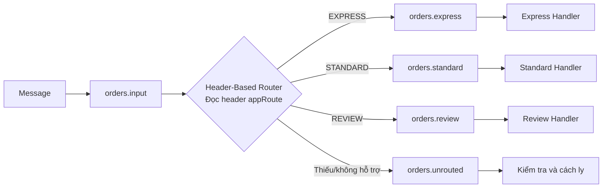
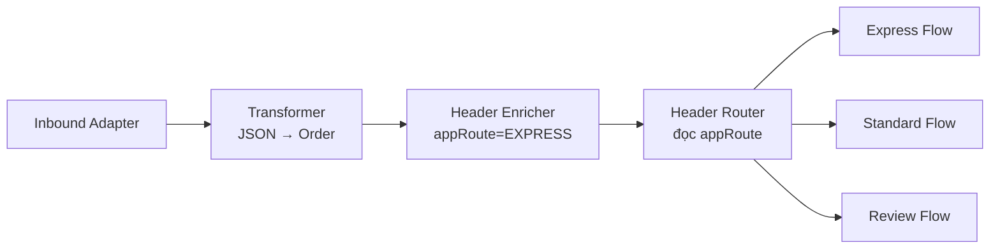

# Tên header cố định và quy ước header

## 1. Vì sao Header-Based Router cần một tên header rõ ràng?

Trong hệ thống tích hợp, một thông điệp (*message*) gồm **payload** chứa dữ liệu nghiệp vụ và **headers** chứa metadata. Khi cần định tuyến theo thông tin đã được xác định trước, Spring Integration có thể đọc một header cụ thể rồi chọn output channel tương ứng. Đây là cách sử dụng phổ biến của mẫu **Header-Based Router** (còn được gọi là **Header Value Router**).

Ví dụ, hệ thống tiếp nhận đơn hàng với payload `OrderRequest` và header `appRoute`:

```text
Message<OrderRequest>
  payload = OrderRequest(orderId="ORD-42", amountVnd=250000)
  headers = {
    appRoute: "EXPRESS",
    tenantId: "store-hcm",
    eventId: "evt-42",
    traceId: "trace-42"
  }
```

Router được cấu hình **đọc tên header cố định `appRoute`**. Giá trị của header có thể thay đổi theo từng message (`EXPRESS`, `STANDARD`, `REVIEW`), và chính giá trị đó được ánh xạ thành tên channel:



Trong chương **Header-based router** của module **SPRING_INTEGRATION_PATTERN**, mục tiêu là học cách triển khai Enterprise Integration Patterns bằng Spring Integration để tạo luồng thông điệp ít phụ thuộc, dễ mở rộng. Các quy ước header sẽ hỗ trợ Router, Filter, Transformer, Splitter, Aggregator, Gateway, retry, error channel và correlation; đồng thời khiến việc kiểm thử và theo dõi từng nhánh xử lý nhất quán hơn.

**Điểm phân biệt quan trọng:**

- **Tên header**: tên khóa mà Router tìm kiếm, ví dụ `appRoute`. Tên này **cố định trong cấu hình một Router**.
- **Giá trị header**: giá trị của khóa đó trong mỗi message, ví dụ `EXPRESS`; đây là dữ liệu **thay đổi theo message**.
- **Routing key**: giá trị đã được chuẩn hóa để tra bảng ánh xạ đích, trong ví dụ trùng với `appRoute`.
- **Output channel**: nơi chuyển message tiếp theo, ví dụ `orders.express`.

Không nên dùng giá trị của một message làm **tên header cần đọc**. Cách hiểu đó sẽ khiến Router phải tìm những khóa khác nhau trên mỗi message và phá vỡ hợp đồng của luồng.

## 2. Header-Based Router đọc dữ liệu theo hợp đồng nào?

Trong Spring Messaging, `Message<T>` cung cấp `getPayload()` và `getHeaders()`. `MessageHeaders` có hành vi tương tự một ánh xạ tên → giá trị; tên header là `String`, còn giá trị có thể thuộc nhiều kiểu Java.

```java
import org.springframework.messaging.Message;
import org.springframework.messaging.support.MessageBuilder;

record OrderRequest(String orderId, long amountVnd) {}

Message<OrderRequest> message = MessageBuilder
        .withPayload(new OrderRequest("ORD-42", 250_000L))
        .setHeader("appRoute", "EXPRESS")
        .setHeader("tenantId", "store-hcm")
        .build();

String routeKey = message.getHeaders().get("appRoute", String.class);
// routeKey = "EXPRESS"
```

Ví dụ này chỉ cho thấy cách tạo và đọc message; trong một class Java thực tế, các statement trên nằm trong phương thức hoặc test. Bản thân `MessageBuilder` không đăng ký Router, cũng không tự gửi message vào channel.

### 2.1. Vì sao tên header phải ổn định?

Giả sử producer đặt `appRoute`, nhưng Router lại đọc `routeKey`. Dù cùng mang ý nghĩa “đường đi”, hai khóa **không đồng nhất**:

```text
Producer: headers["appRoute"] = "EXPRESS"
Router:   đọc headers["routeKey"]  -> không thấy giá trị
```

Một khác biệt ký tự hoặc viết hoa có thể làm message rơi vào fallback. Ở trong JVM, tên header là khóa `String` và phải khớp chính xác; `appRoute`, `AppRoute` và `app-route` là ba tên khác nhau. Khi đi qua HTTP, Kafka, JMS hoặc broker, adapter có thể dùng quy tắc ánh xạ tên/kiểu riêng. Vì vậy, cần chọn **một hợp đồng tên khóa chuẩn ở biên hệ thống** và kiểm thử nó sau khi mapping.

### 2.2. Tên header cố định không có nghĩa giá trị cố định

Một instance `HeaderValueRouter` được cấu hình bằng **một tên header** để đọc. Router có thể nhận nhiều giá trị và ánh xạ tới nhiều channel:

| `appRoute` trong message | Routing key | Channel đích |
| --- | --- | --- |
| `EXPRESS` | `EXPRESS` | `orders.express` |
| `STANDARD` | `STANDARD` | `orders.standard` |
| `REVIEW` | `REVIEW` | `orders.review` |
| `SAME_DAY` chưa cấu hình | Không có mapping trực tiếp | `orders.unrouted` |
| Không có header `appRoute` | Không xác định | Chính sách fallback/lỗi |

Để thay đổi **giá trị được hỗ trợ**, ta bổ sung mapping và consumer; để thay đổi **tên khóa được đọc**, phải thay đổi hợp đồng của cả producer lẫn Router (hoặc có bước chuyển đổi tương thích trước Router).

## 3. Thiết lập quy ước đặt tên header

Không có một tên header tùy biến nào phù hợp cho mọi hệ thống, nhưng một dự án nên chọn bộ quy ước thống nhất. Dưới đây là gợi ý cho luồng đơn hàng:

| Nhóm | Tên đề xuất | Kiểu | Ý nghĩa |
| --- | --- | --- | --- |
| Định tuyến | `appRoute` | `String` | Key được Router sử dụng |
| Định danh nghiệp vụ | `eventId` | `String` | Nhận biết một sự kiện xuyên các lần gửi lại |
| Phân vùng dữ liệu | `tenantId` | `String` | Ngữ cảnh tenant đã xác thực |
| Truy vết | `traceId` | `String` | Liên kết các log/traces cùng tác vụ |
| Tương quan | `correlationId` | Theo hợp đồng/framework | Gắn kết các message của cùng một nhóm |
| Phân loại message | `eventType` | `String` | Loại sự kiện, nếu luồng cần |
| Phiên bản | `schemaVersion` | `String` hoặc số được quy định | Xác định version của hợp đồng |

Nguyên tắc thực hành:

1. **Đặt tên có nghĩa**: `appRoute` nói rõ đây là route của ứng dụng; `type`, `key`, `x1` khó hiểu khi có nhiều hệ thống.
2. **Chọn một kiểu chữ và giữ nguyên**: ví dụ `camelCase` cho header nội bộ; document cách ánh xạ sang tên header của giao thức ngoài.
3. **Dùng giá trị có tập hợp được kiểm soát**: `EXPRESS`, `STANDARD`, `REVIEW`; chỉ chấp nhận những giá trị trong hợp đồng.
4. **Phân biệt tên khóa và giá trị**: `appRoute` là khóa, `EXPRESS` là giá trị; không tạo các khóa `expressRoute`, `standardRoute` tùy message khi Router kỳ vọng một header chung.
5. **Có một nguồn khai báo**: dùng hằng Java hoặc một schema/hợp đồng chung, tránh rải tên literal ở nhiều lớp.
6. **Có quy tắc cho thiếu/sai giá trị**: reject, fallback, dead-letter/quarantine hoặc xử lý nghiệp vụ khác, không để message biến mất.
7. **Ghi rõ ranh giới tin cậy**: header do client ngoài gửi chưa chắc đáng tin; đặc biệt là thông tin tenant, quyền, mức ưu tiên và routing.

### 3.1. Dùng hằng số để tránh sai chính tả

Một cách đơn giản là đặt hằng string trong lớp chung của module:

```java
final class RoutingHeaders {
    private RoutingHeaders() {}

    static final String ROUTE = "appRoute";
    static final String TENANT_ID = "tenantId";
    static final String EVENT_ID = "eventId";
    static final String TRACE_ID = "traceId";
}

final class OrderRoutes {
    private OrderRoutes() {}

    static final String EXPRESS = "EXPRESS";
    static final String STANDARD = "STANDARD";
    static final String REVIEW = "REVIEW";
}
```

`RoutingHeaders.ROUTE` được dùng ở cả producer và Router. Nếu có nhiều ứng dụng hoặc ngôn ngữ lập trình, đừng xem một Java constants class là đủ: phải **công bố tên và kiểu giá trị ở hợp đồng tích hợp** để producer/consumer khác ngôn ngữ cũng tuân thủ.

### 3.2. Những tên header do framework quản lý

Spring Messaging và Spring Integration có sẵn metadata dùng cho cơ chế vận chuyển, reply, lỗi hoặc correlation. Không tái sử dụng tùy ý những tên này cho route riêng:

| Header thường gặp | Ý nghĩa phổ biến | Lưu ý |
| --- | --- | --- |
| `id`, `timestamp` | Định danh và thời điểm tạo message | Không phải event ID bền vững xuyên mọi lần tạo message |
| `replyChannel` | Đích trả lời của request-reply | Có thể mang đối tượng channel hoặc tên channel nội bộ |
| `errorChannel` | Đích phát hành `ErrorMessage` khi endpoint hỗ trợ | Không bảo đảm tự bắt tất cả exception |
| `correlationId` | Ghép các message cùng nhóm | Có thể được quản lý bởi Splitter/Aggregator |
| `sequenceNumber`, `sequenceSize` | Thứ tự và số phần trong chuỗi | Cần giữ đúng khi gom message |
| `contentType` | Gợi ý định dạng/kiểu nội dung | Có thể cần cập nhật sau Transformer |

Tên cụ thể và constants API tùy loại header và phiên bản framework. Nên tham khảo các constants tương ứng trong `MessageHeaders` hoặc `IntegrationMessageHeaderAccessor` khi viết mã, thay vì gán ý nghĩa mới cho header hệ thống.

## 4. Chuẩn hóa **giá trị** header trước khi định tuyến

Tên header cố định là điều kiện cần, nhưng Router còn đòi hỏi **giá trị khớp mapping**. Hãy quyết định rõ:

- Giá trị là `String`, enum, số hay đối tượng? Giá trị dùng qua broker nên ưu tiên kiểu serialize ổn định.
- Có phân biệt chữ hoa/chữ thường không? `EXPRESS` và `express` có được xem là một không?
- Chuỗi rỗng, khoảng trắng, `null`, sai kiểu hoặc giá trị chưa biết được xử lý ra sao?
- Producer có được tự chọn tuyến nhạy cảm như `REVIEW` hay `VIP` không?
- Khi cập nhật bộ giá trị route, producer và consumer có quy tắc tương thích version không?

Ví dụ, một service ở đầu vào có thể chuẩn hóa giá trị thành tập khóa đã công bố trước khi xây message:

```java
import java.util.Locale;
import java.util.Set;

final class RouteValueNormalizer {
    private RouteValueNormalizer() {}

    private static final Set<String> SUPPORTED =
            Set.of(OrderRoutes.EXPRESS,
                    OrderRoutes.STANDARD,
                    OrderRoutes.REVIEW);

    static String normalize(String raw) {
        if (raw == null || raw.isBlank()) {
            throw new IllegalArgumentException("Missing appRoute");
        }
        String normalized = raw.trim().toUpperCase(Locale.ROOT);
        if (!SUPPORTED.contains(normalized)) {
            throw new IllegalArgumentException(
                    "Unsupported appRoute: " + normalized);
        }
        return normalized;
    }
}
```

Hàm này áp dụng chính sách **từ chối giá trị không được hỗ trợ**. Nếu yêu cầu tích hợp cần đưa `SAME_DAY` vào nhánh theo dõi để bổ sung sau, đừng dùng hàm ném lỗi như trên ở đầu flow; hãy cho Router đưa giá trị không ánh xạ vào fallback có lưu trữ phù hợp. **Reject và fallback là hai lựa chọn hợp đồng khác nhau**.

Khi `routeKey` được tính từ payload (ví dụ đơn `manualReview=true` luôn đi `REVIEW`), hãy định nghĩa một **routing policy** có thể kiểm thử, sau đó ghi kết quả vào header `appRoute`. Không lấy header từ request bên ngoài làm kết quả cuối cùng nếu người gửi có thể lợi dụng để bỏ qua bước kiểm tra rủi ro.

## 5. Gắn header từ producer hoặc bước làm giàu

Producer tạo thông điệp có route và context trước khi gửi:

```java
import org.springframework.beans.factory.annotation.Qualifier;
import org.springframework.messaging.MessageChannel;
import org.springframework.messaging.support.MessageBuilder;
import org.springframework.stereotype.Component;

record OrderRequest(String orderId, long amountVnd) {}

@Component
class OrderProducer {
    private final MessageChannel input;

    OrderProducer(@Qualifier("orders.input") MessageChannel input) {
        this.input = input;
    }

    void submitExpressOrder() {
        OrderRequest order = new OrderRequest("ORD-42", 250_000L);
        input.send(MessageBuilder.withPayload(order)
                .setHeader(RoutingHeaders.ROUTE, OrderRoutes.EXPRESS)
                .setHeader(RoutingHeaders.TENANT_ID, "store-hcm")
                .setHeader(RoutingHeaders.EVENT_ID, "evt-42")
                .setHeader(RoutingHeaders.TRACE_ID, "trace-42")
                .build());
    }
}
```

Một bước **Header Enricher** có thể bổ sung `appRoute` khi producer chưa biết cách phân loại. Cách tổ chức thường gặp:

```text
Inbound Adapter -> Validation -> Transformer -> Header Enricher
  -> Header-Based Router -> Channel đã chọn -> Service Activator
```

Trong ví dụ này, Validation/Transformer bảo đảm payload có kiểu đúng; Header Enricher áp dụng chính sách phân loại để đặt `appRoute`. Router sau đó chỉ **đọc kết quả phân loại**. Việc tách hai việc giúp Router đơn giản và có thể dùng chung cho nhiều loại payload miễn mọi producer đáp ứng header contract.

Nếu header cần được sửa, hãy tạo message mới bằng `MessageBuilder.fromMessage(message).setHeader(...).build()` hoặc dùng Header Enricher của flow. `MessageHeaders` được thiết kế như metadata không nên sửa trực tiếp; tuy nhiên payload mutable vẫn có thể thay đổi trạng thái nếu ứng dụng cho phép.

## 6. Cấu hình `HeaderValueRouter` bằng Java

Spring Integration cung cấp `org.springframework.integration.router.HeaderValueRouter`. Khi khởi tạo, ta chọn **tên header cố định** để đọc và khai báo mapping từ **giá trị header** sang channel. Ví dụ dùng Spring Java configuration và các hằng ở phần 3.1:

```java
import org.springframework.context.annotation.Bean;
import org.springframework.context.annotation.Configuration;
import org.springframework.integration.annotation.Router;
import org.springframework.integration.channel.DirectChannel;
import org.springframework.integration.config.EnableIntegration;
import org.springframework.integration.dsl.IntegrationFlow;
import org.springframework.integration.router.HeaderValueRouter;
import org.springframework.messaging.MessageChannel;

interface OrderBranchService {
    void acceptExpress(OrderRequest order);
    void acceptStandard(OrderRequest order);
    void queueForReview(OrderRequest order);
    void quarantineUnrouted(OrderRequest order);
}

@Configuration
@EnableIntegration
class OrderHeaderRoutingConfig {

    @Bean("orders.input")
    MessageChannel input() {
        return new DirectChannel();
    }

    @Bean("orders.express")
    MessageChannel express() {
        return new DirectChannel();
    }

    @Bean("orders.standard")
    MessageChannel standard() {
        return new DirectChannel();
    }

    @Bean("orders.review")
    MessageChannel review() {
        return new DirectChannel();
    }

    @Bean("orders.unrouted")
    MessageChannel unrouted() {
        return new DirectChannel();
    }

    @Bean
    @Router(inputChannel = "orders.input")
    HeaderValueRouter orderHeaderRouter() {
        // Router luôn đọc cùng một tên header trong mỗi message.
        var router = new HeaderValueRouter(RoutingHeaders.ROUTE);
        router.setChannelMapping(OrderRoutes.EXPRESS, "orders.express");
        router.setChannelMapping(OrderRoutes.STANDARD, "orders.standard");
        router.setChannelMapping(OrderRoutes.REVIEW, "orders.review");
        router.setChannelKeyFallback(false);
        router.setDefaultOutputChannelName("orders.unrouted");
        return router;
    }

    @Bean
    IntegrationFlow expressOrders(OrderBranchService service) {
        return IntegrationFlow.from("orders.express")
                .handle(OrderRequest.class, (order, headers) -> {
                    service.acceptExpress(order);
                    return null;
                })
                .get();
    }

    @Bean
    IntegrationFlow standardOrders(OrderBranchService service) {
        return IntegrationFlow.from("orders.standard")
                .handle(OrderRequest.class, (order, headers) -> {
                    service.acceptStandard(order);
                    return null;
                })
                .get();
    }

    @Bean
    IntegrationFlow reviewOrders(OrderBranchService service) {
        return IntegrationFlow.from("orders.review")
                .handle(OrderRequest.class, (order, headers) -> {
                    service.queueForReview(order);
                    return null;
                })
                .get();
    }

    @Bean
    IntegrationFlow unroutedOrders(OrderBranchService service) {
        return IntegrationFlow.from("orders.unrouted")
                .handle(OrderRequest.class, (order, headers) -> {
                    service.quarantineUnrouted(order);
                    return null;
                })
                .get();
    }
}
```

Để chạy ví dụ, ứng dụng cần Spring Integration, các khai báo `OrderRequest`, `RoutingHeaders`, `OrderRoutes` ở trên và bean hiện thực `OrderBranchService`. Các handler nhánh chỉ làm việc sau khi nhận message; không cần biết Router đã ánh xạ key như thế nào.

**Giải thích các dòng quyết định:**

1. `new HeaderValueRouter(RoutingHeaders.ROUTE)`: tên header cần đọc được chọn **một lần lúc cấu hình** (trong ví dụ là `appRoute`).
2. `setChannelMapping(value, destination)`: ánh xạ giá trị sang tên channel, không dùng tên header làm destination.
3. `setChannelKeyFallback(false)`: không tự diễn giải giá trị header chưa ánh xạ thành **tên channel trực tiếp**; chỉ dùng các route được khai báo hoặc fallback.
4. `setDefaultOutputChannelName(...)`: quy định nơi tiếp nhận message không có route phù hợp theo cơ chế của router.
5. `@Router(inputChannel = "orders.input")`: đăng ký endpoint tiêu thụ message từ channel đầu vào.
6. Mỗi nhánh có consumer riêng, có thể thay bằng queue, adapter hoặc downstream flow theo nhu cầu.

Trong hệ thống thực, cần xác minh **cách framework xử lý header thiếu, giá trị không khớp và lỗi gửi message** bằng integration test với phiên bản Spring Integration đang dùng. Fallback có ích, nhưng không thay thế chính sách validation của producer hay nơi lưu message lỗi bền vững.

### 6.1. Tương đương bằng Java DSL với expression router

Nếu muốn viết trực tiếp bên trong `IntegrationFlow`, có thể trích giá trị từ một header bằng Spring Expression Language (SpEL):

```java
@Bean
IntegrationFlow orderRoutingFlow() {
    return IntegrationFlow.from("orders.input")
            .route("headers['appRoute']", mapping -> mapping
                    .channelMapping("EXPRESS", "orders.express")
                    .channelMapping("STANDARD", "orders.standard")
                    .channelMapping("REVIEW", "orders.review")
                    .defaultOutputChannel("orders.unrouted"))
            .get();
}
```

Đây là **phương án thay thế** với expression-based router đọc header `appRoute`; cần định nghĩa channel/consumer như ở ví dụ chính. Không đăng ký **cả** `@Router` và flow DSL này cùng lắng nghe `orders.input` trừ khi có chủ đích điều phối: `DirectChannel` có nhiều subscriber không mặc nhiên broadcast mỗi message đến tất cả.

Ưu điểm của `HeaderValueRouter` là hợp đồng **tên header cố định** hiển nhiên ngay trong constructor. DSL phù hợp khi xây cả flow và muốn cấu hình mapping tại một vị trí.

## 7. Header thiếu, sai tên và không khớp mapping

Ba lỗi này nhìn giống nhau ở cuối flow nhưng nguyên nhân khác biệt:

| Tình huống | Ví dụ | Điều cần làm |
| --- | --- | --- |
| **Thiếu header** | Producer không đặt `appRoute` | Quy định bắt buộc, fallback hoặc reject |
| **Sai tên header** | Producer viết `app_route`, Router đọc `appRoute` | Sửa hợp đồng tên hoặc ánh xạ ở biên |
| **Sai kiểu giá trị** | Router mong `String`, producer gửi object chưa có mapping | Chuẩn hóa kiểu tại ingress |
| **Khác quy ước chữ hoa** | `express` thay vì `EXPRESS` | Chuẩn hóa có chủ đích, kiểm thử |
| **Giá trị mới** | `SAME_DAY` chưa có channel mapping | Fallback để cách ly/giám sát, cập nhật rule theo version |
| **Tên đích sai** | Mapping trỏ `orders.expres` không tồn tại | Kiểm thử cấu hình channel, phát hiện lỗi triển khai |
| **Đích không xử lý được** | Handler lỗi, broker timeout | Retry/error channel/recovery của downstream |

Hãy phân biệt **route không khớp** với **handler sau khi route thất bại**. Default channel giúp xử lý trường hợp không tìm được recipient phù hợp; nó không phải cơ chế tự bắt exception của tất cả nhánh và không biến `DirectChannel` thành dead-letter queue.

### 7.1. Vì sao không nên gửi mặc định vào `nullChannel`?

`nullChannel` là endpoint của Spring Integration nhận và bỏ message có chủ đích. Nó hợp lý khi yêu cầu nghiệp vụ cho phép bỏ qua, ví dụ một sự kiện debug không cần xử lý. Với đơn hàng hoặc thanh toán, việc route mọi giá trị chưa biết tới `nullChannel` có thể tạo ra **mất dữ liệu khó phát hiện**.

Một nhánh `orders.unrouted` nên có trách nhiệm rõ: ghi đủ thông tin cần để điều tra hoặc replay (payload hoặc tham chiếu được bảo vệ, `eventId`, `tenantId`, route value, thời điểm và nguyên nhân), cảnh báo khi tỷ lệ message tăng, và xác định ai có quyền phát lại.

## 8. Header propagation qua các pattern và adapter

Một Router chỉ đọc được những gì **có trong message tại thời điểm đến**. Những endpoint trước đó có thể biến đổi payload, tạo message mới hoặc chuyển message qua giao thức khác. Vì vậy, tên header phải ổn định **suốt đoạn flow mà Router phụ thuộc vào nó**.



### 8.1. Transformer

Transformer có thể thay payload `byte[]` JSON thành `OrderRequest`. Nếu bước tiếp theo cần `appRoute`, hãy chắc rằng header đã được tạo hoặc được truyền theo quy tắc của transformer. Với biến đổi định dạng, header `contentType` ban đầu có thể không còn mô tả đúng payload; cần kiểm tra lại ở ranh giới outbound.

### 8.2. Splitter và Aggregator

Splitter tạo nhiều message con; ngoài `appRoute`, các message có thể cần `correlationId`, `sequenceNumber` và `sequenceSize` để Aggregator ghép nhóm. Không dùng `appRoute` làm correlation key nếu nhiều đơn hàng khác nhau cùng đi nhánh `EXPRESS`; route và correlation mang hai ý nghĩa khác nhau.

### 8.3. Gateway, reply channel và error channel

Gateway chuyển lời gọi ứng dụng thành message và có thể dùng `replyChannel` để nhận kết quả; `errorChannel` liên quan đến cơ chế báo lỗi. Đây là những header điều phối do framework hỗ trợ. Không đặt route nghiệp vụ vào `replyChannel` để tái sử dụng tên chỉ vì nó cũng chứa thông tin về channel: hành vi phản hồi và hành vi phân nhánh là hai hợp đồng độc lập.

### 8.4. Khi message đi qua broker/HTTP

Header của Spring trong JVM có thể chứa nhiều kiểu Java; adapter của Kafka, RabbitMQ, JMS hoặc HTTP có quy tắc mapping, lọc và serialize riêng. Do đó:

1. Xác định những header **bắt buộc được truyền qua biên**: ví dụ `eventId`, `tenantId`, `traceId`, `appRoute`.
2. Chọn kiểu wire phù hợp (`String`, số, bytes...) và quy tắc encoding.
3. Kiểm tra ánh xạ tên, chữ hoa/chữ thường, giới hạn kích thước và những header bị loại.
4. Sau khi deserialize, kiểm chứng header tồn tại và có kiểu mong đợi **trước khi Router sử dụng**.

Header không được bảo đảm truyền nguyên vẹn chỉ vì tên giống nhau ở hai đầu. Nếu một trường là bắt buộc đối với ý nghĩa nghiệp vụ xuyên hệ thống, cân nhắc đưa nó vào schema payload hoặc envelope có version, thay vì dựa hoàn toàn vào header nội bộ.

## 9. An toàn dữ liệu và độ tin cậy khi route theo header

Header định tuyến có vẻ chỉ là metadata, nhưng nó có thể quyết định một giao dịch được chạy bởi dịch vụ nào. **Đừng tin tuyệt đối giá trị header được truyền trực tiếp từ nguồn ngoài**. Ví dụ, client không nên được phép đặt `appRoute=STANDARD` để vượt qua nhánh chống gian lận nếu hệ thống yêu cầu kiểm tra rủi ro trước.

Một thiết kế an toàn:

```text
Request ngoài
  -> Xác thực và kiểm tra tenant
  -> Validation payload
  -> Chính sách phân loại đáng tin
  -> Header Enricher đặt appRoute
  -> Header-Based Router
  -> Handler nghiệp vụ
```

Các quyết định như quyền truy cập, tenant ownership hoặc bỏ qua xác minh không nên được thực hiện chỉ dựa vào header do caller tự chọn. Khi cần phát lại message, dùng `eventId` hoặc khóa nghiệp vụ ổn định cho idempotency; `MessageHeaders.ID` có thể thay đổi khi tạo message mới.

**Độ tin cậy** cần được thiết kế xuyên suốt: message được route tới `DirectChannel` không có nghĩa đã được lưu bền vững; retry nên áp dụng cho lỗi tạm thời, không áp dụng vô hạn cho tên header sai; recovery cần lưu đủ ngữ cảnh để sửa hợp đồng hoặc phát lại an toàn.

## 10. Kiểm thử quy ước header và luồng định tuyến

### 10.1. Unit test hợp đồng header

Một unit test đơn giản có thể xác minh producer luôn sử dụng đúng hằng tên header và giá trị đã chuẩn hóa:

```java
import org.junit.jupiter.api.Test;
import org.springframework.messaging.Message;
import org.springframework.messaging.support.MessageBuilder;

import static org.junit.jupiter.api.Assertions.*;

class RoutingHeaderContractTest {

    @Test
    void usesOneStableHeaderName() {
        var order = new OrderRequest("ORD-42", 250_000L);
        Message<OrderRequest> message = MessageBuilder
                .withPayload(order)
                .setHeader(RoutingHeaders.ROUTE, OrderRoutes.EXPRESS)
                .build();

        assertEquals("appRoute", RoutingHeaders.ROUTE);
        assertEquals("EXPRESS",
                message.getHeaders().get(RoutingHeaders.ROUTE, String.class));
        assertNull(message.getHeaders().get("routeKey"));
    }

    @Test
    void normalizesSupportedValue() {
        assertEquals("EXPRESS",
                RouteValueNormalizer.normalize(" express "));
    }

    @Test
    void rejectsUnsupportedValueUnderStrictPolicy() {
        assertThrows(IllegalArgumentException.class,
                () -> RouteValueNormalizer.normalize("SAME_DAY"));
    }
}
```

Test trên giúp kiểm tra quy ước hằng và normalize. Nhưng nó **chưa chứng minh Router đã được cấu hình đúng** hoặc handler đã nhận đúng message.

### 10.2. Integration test channel mapping

Khởi tạo Spring Test context chứa `OrderHeaderRoutingConfig` và một bean `OrderBranchService` giả lập; gửi message vào `orders.input` rồi xác minh chỉ handler ở nhánh phù hợp được gọi. Các kịch bản cần có:

| Đầu vào | Kết quả mong đợi |
| --- | --- |
| `appRoute=EXPRESS` | Chỉ `acceptExpress` được gọi |
| `appRoute=STANDARD` | Chỉ `acceptStandard` được gọi |
| `appRoute=REVIEW` | Chỉ `queueForReview` được gọi |
| `appRoute=SAME_DAY` | Vào `orders.unrouted`, theo contract fallback |
| Không có `appRoute` | Fallback hoặc lỗi rõ ràng, đúng cấu hình đã chọn |
| Có `routeKey=EXPRESS` nhưng không có `appRoute` | Không được hiểu nhầm là route hợp lệ |
| `appRoute=express` không được normalize | Không trùng mapping `EXPRESS`; cần kiểm tra chính sách |
| Message qua Transformer và adapter | Header còn đúng tên/kiểu trước khi tới Router |
| Handler `orders.express` ném exception | Lỗi downstream được quan sát theo sync/async contract |
| Gửi lại cùng `eventId` | Consumer chống xử lý nghiệp vụ trùng nếu đó là yêu cầu |

Với `DirectChannel`, integration test có thể gọi `send` và xác minh handler đồng bộ. Với executor, broker hoặc polling, phải chờ theo điều kiện có giới hạn và kiểm tra kết quả thực tế, không suy luận rằng `send` trả `true` đồng nghĩa nghiệp vụ đã hoàn tất.

### 10.3. Giám sát lỗi quy ước header

Các số liệu hữu ích gồm tỷ lệ message **thiếu `appRoute`**, **sai kiểu**, **unknown route**, số message vào mỗi branch, lỗi khi gửi sang channel, độ trễ downstream và backlog/quarantine. Có thể gắn route key đã chuẩn hóa vào metric nếu tập route hữu hạn; tránh gắn `eventId` hoặc `orderId` làm nhãn metric vì số giá trị quá lớn.

Log/traces nên bao gồm `traceId` và `eventId` để liên hệ các bước mà không phải ghi toàn bộ payload hoặc dữ liệu nhạy cảm.

## 11. Những lỗi thiết kế hay gặp

1. **Thay tên header tùy message** thay vì giữ một tên cố định và thay giá trị.
2. **Viết literal không nhất quán**: `appRoute`, `app_route`, `routeKey` được dùng như thể là một khóa.
3. **Lẫn routing key với channel name** và gắn trực tiếp tên bean channel vào dữ liệu nguồn ngoài.
4. **Quên default/failure policy** khiến message không có route phù hợp bị mất hoặc lỗi khó truy vết.
5. **Không thống nhất kiểu và chữ hoa**: `EXPRESS` khác `express` hoặc một enum không serialize được qua broker.
6. **Dùng header kỹ thuật sai mục đích**: lấy `replyChannel` hoặc `correlationId` làm khóa route tùy tiện.
7. **Tin header do client tự khai báo** để bỏ qua bước kiểm tra nghiệp vụ hoặc phân quyền.
8. **Làm mất header qua Transformer/adapter** nhưng chỉ kiểm thử hàm định tuyến độc lập.
9. **Coi fallback trong bộ nhớ là DLQ** mà không có nơi lưu và quy trình replay.
10. **Dùng message ID làm event ID**, dẫn đến khó chống xử lý trùng khi nhận lại message.

## 12. Bài tập thực hành và tự đánh giá

Thiết kế một hệ thống hỗ trợ khách hàng nhận `SupportTicket` với payload `ticketId`, `subject`, `priority`; header gồm `appRoute`, `tenantId`, `eventId` và `traceId`.

1. Chọn **một tên header cố định** để Router đọc. Định nghĩa hằng Java và hợp đồng giá trị cho `BILLING`, `TECHNICAL`, `GENERAL`.
2. Viết bước phân loại theo payload để tạo header đó; yêu cầu kiểm tra chứ không tin giá trị route tự do do caller gửi.
3. Cấu hình `HeaderValueRouter` với mapping tới ba channel và một fallback cho giá trị chưa hỗ trợ.
4. Viết Service Activator riêng cho từng branch; xác minh mỗi message chỉ đến branch mong đợi.
5. Thử message thiếu header, sai chữ hoa, sai tên hoặc giá trị mới `SECURITY`; chọn reject/fallback có giải thích.
6. Thêm Transformer trước Router; kiểm tra header cần thiết vẫn được bảo toàn.
7. Mô phỏng retry sau lỗi tạm thời; bảo đảm `eventId` ổn định và không tạo tác động nghiệp vụ trùng.
8. Thêm metric tỷ lệ unknown route và một quy trình điều tra/replay các message bị cách ly.

Khi tự kiểm tra, hãy trả lời: **Router luôn đọc tên header nào? Ai tạo giá trị header và có đáng tin không? Quy ước tên/kiểu được công bố ở đâu? Không có mapping sẽ xử lý như thế nào? Headers nào phải giữ khi qua Transformer hoặc broker?**

Một **Header-Based Router** có thể rất đơn giản khi cả hệ thống thống nhất tên header và các giá trị của nó. Dùng một khóa cố định, công bố hợp đồng giá trị, cấu hình mapping/fallback rõ ràng và kiểm thử propagation giúp Router tập trung chọn đường, các endpoint tập trung xử lý nghiệp vụ và các luồng EIP duy trì được tính nhất quán khi mở rộng.
