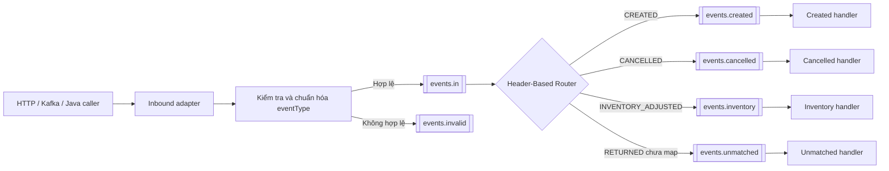
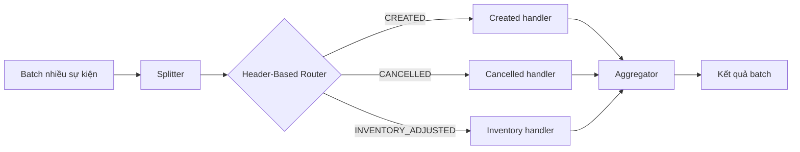

# Header type và chuyển đổi kiểu

Trong một hệ thống tích hợp, thông điệp có thể mang cùng một kiểu payload nhưng đại diện cho nhiều sự kiện khác nhau. Ví dụ, ba message đều chứa JSON hoặc một đối tượng `EventEnvelope`, song một message báo **đơn hàng được tạo**, một message báo **đơn hàng bị hủy**, message còn lại báo **tồn kho thay đổi**. Nếu metadata mô tả loại sự kiện nằm trong header, **Header-Based Router** có thể đọc header đó và chọn đúng **Message Channel** đích mà không cần phân tích toàn bộ payload.

Điểm dễ sai nằm ở chữ **type**. Một header trong Spring Messaging có thể giữ **giá trị Java thuộc nhiều kiểu**, chẳng hạn `String`, `Enum`, `Integer`, `UUID` hoặc `MimeType`; nó **không phải lúc nào cũng là chuỗi văn bản**. Cùng một loại sự kiện, nguồn HTTP có thể cung cấp `"CREATED"`, một đoạn Java nội bộ có thể cung cấp `EventType.CREATED`, còn adapter broker có thể đưa ra `byte[]` tùy cách ánh xạ. Nếu Router mong khóa `"CREATED"` nhưng nhận giá trị với kiểu hoặc định dạng khác, message có thể đi sai nhánh, rơi vào fallback hoặc phát sinh lỗi xử lý.

Bài **Header type và chuyển đổi kiểu** thuộc chương **Header-based router** của module `SPRING_INTEGRATION_PATTERN`. Mục tiêu là dùng **Enterprise Integration Patterns (EIP)** đúng ranh giới: chuẩn hóa dữ liệu ở đầu vào, định tuyến bằng header có hợp đồng rõ, phối hợp với Filter, Transformer, Gateway, Splitter, Aggregator, retry, error channel và correlation; đồng thời kiểm thử và quan sát từng nhánh mà không lan truyền bí mật.

> **Nguyên tắc trung tâm:** Hãy **xác định kiểu thực tế của header**, chuẩn hóa về **tập khóa định tuyến ổn định**, rồi mới ánh xạ khóa tới channel. Không mặc định `Header-Based Router` sẽ tự chuyển mọi object, byte array hay chuỗi đến từ đối tác sang kiểu bạn mong muốn.

## 1. Header-Based Router hoạt động như thế nào?

Mỗi Spring `Message<T>` bao gồm hai thành phần:

- **`payload`:** dữ liệu chính, ví dụ một JSON string hoặc DTO nghiệp vụ.
- **`headers`:** metadata gắn với message như `id`, `timestamp`, correlation, đường phản hồi và các header ứng dụng tự định nghĩa.

**Header-Based Router** lấy giá trị từ một header được chỉ định, dùng giá trị ấy làm **khóa định tuyến** rồi chọn channel dựa trên mapping.

Ví dụ một luồng xử lý sự kiện:

| Header `eventType` đã chuẩn hóa | Channel đích | Nhiệm vụ |
| --- | --- | --- |
| `CREATED` | `events.created` | Xử lý sự kiện tạo đơn hàng. |
| `CANCELLED` | `events.cancelled` | Xử lý sự kiện hủy đơn hàng. |
| `INVENTORY_ADJUSTED` | `events.inventory` | Đồng bộ tồn kho. |
| `RETURNED` (đã nhận diện nhưng chưa triển khai nhánh) | `events.unmatched` | Cách ly hoặc xử lý theo chính sách. |
| Thiếu/sai kiểu/giá trị không nằm trong hợp đồng | `events.invalid` | Từ chối tại biên chuẩn hóa, không để Router phỏng đoán. |



**Bước chuẩn hóa đứng trước Router** là quyết định quan trọng: Router không phải nơi thử đoán mọi cách biểu diễn của event type. Trong sơ đồ, `events.invalid` và `events.unmatched` có ý nghĩa khác nhau: **invalid** là giá trị không được chấp nhận; **unmatched** là giá trị thuộc hợp đồng đã biết nhưng nhánh hiện chưa hỗ trợ.

## 2. Header của Spring Messaging có kiểu dữ liệu gì?

`MessageHeaders` về bản chất là một tập ánh xạ **tên header → giá trị `Object`**. Một số header do framework cung cấp có kiểu quy ước; header do ứng dụng tự thêm giữ kiểu object đã truyền vào, trừ khi một thành phần khác thực hiện chuyển đổi.

```java
import java.util.UUID;
import org.springframework.messaging.Message;
import org.springframework.messaging.support.MessageBuilder;

enum EventType {
    CREATED, CANCELLED, INVENTORY_ADJUSTED, RETURNED
}

Message<String> message = MessageBuilder.withPayload("order-42")
    .setHeader("eventType", EventType.CREATED) // Enum
    .setHeader("attempt", 2)                    // Integer
    .setHeader("correlationId", UUID.randomUUID()) // UUID
    .build();

Object type = message.getHeaders().get("eventType");
Object attempt = message.getHeaders().get("attempt");

assert type instanceof EventType;
assert attempt instanceof Integer;
```

Không nên suy ra vì log in ra `CREATED` thì header phải có kiểu `String`. `EventType.CREATED.toString()`, `EventType.CREATED.name()` và chuỗi `"CREATED"` có thể **nhìn giống nhau trong log** nhưng là các giá trị khác kiểu ở runtime.

### 2.1. Các header khác nhau có thể mang các kiểu khác nhau

| Header | Giá trị thường gặp | Lưu ý |
| --- | --- | --- |
| `id` | `UUID` | Định danh message kỹ thuật, không phải idempotency key mặc định. |
| `timestamp` | `Long` (mốc thời gian) | Không phải thời hạn xử lý nghiệp vụ. |
| `replyChannel` | Tham chiếu `MessageChannel` hoặc dạng được cấu hình | Thông tin phục vụ đường trả lời, không nên tự ý serialize ra transport ngoài. |
| `errorChannel` | Tham chiếu/kênh lỗi theo cấu hình | Dùng trong luồng lỗi phù hợp; không tự bắt mọi ngoại lệ. |
| `contentType` | Có thể là `MimeType` hoặc biểu diễn tương ứng | Mô tả định dạng payload, **khác** loại sự kiện nghiệp vụ. |
| `eventType` | `String`, `Enum` hoặc kiểu ứng dụng định nghĩa | **Phải chuẩn hóa** trước khi dùng làm route key. |
| `attempt` | `Integer` hoặc giá trị đã deserialize | Cần kiểm tra kiểu và phạm vi nếu dùng trong logic. |
| `correlationId` | `String`/`UUID` hoặc giá trị ứng dụng quy định | Giữ đúng hợp đồng khi đi qua Splitter/Aggregator, adapter và tracing. |

Đặc biệt, `MessageHeaders` là một map metadata được bảo vệ khỏi việc sửa cấu trúc trực tiếp, **không có nghĩa mỗi object được đặt trong header đều tự bất biến**. Nếu đưa một mutable object vào header rồi sửa nó từ nơi khác, kết quả đánh giá Router có thể khó dự đoán. Nên ưu tiên giá trị metadata nhỏ, bất biến và có schema rõ.

### 2.2. Header tên `type` không phải lúc nào cũng có nghĩa giống nhau

Từ “type” có thể chỉ:

1. **Loại sự kiện nghiệp vụ:** `eventType=CREATED`.
2. **Kiểu Java của payload:** `OrderCreated.class`, thuộc phạm vi Payload Type Router.
3. **Định dạng dữ liệu:** HTTP `Content-Type: application/json` hoặc message `contentType`.
4. **Tên lớp/type metadata do serializer/adapter thêm:** phục vụ deserialization theo hợp đồng của transport.

Các khái niệm này **không thay thế nhau**:

| Câu hỏi | Nên dựa vào |
| --- | --- |
| Payload là class Java nào? | Payload Type Router hoặc cơ chế đọc runtime class. |
| Cùng một DTO có trạng thái nghiệp vụ nào? | Header `eventType` đã chuẩn hóa hoặc Content-Based Router theo payload. |
| Body là JSON hay XML? | Content type/media type và decoder thích hợp. |
| Bản ghi thuộc schema version nào? | Metadata phiên bản đã xác thực ở biên, không phải tên lớp Java tùy ý do client gửi. |

Chọn tên `eventType`, `schemaVersion`, `contentType` rõ nghĩa hơn một header mơ hồ tên `type` nếu hệ thống có nhiều tầng giao thức.

## 3. Vì sao header HTTP, Kafka và nội bộ không luôn cùng kiểu?

Khi một thông điệp đi qua adapter, dữ liệu có thể vượt qua **ranh giới kiểu**:

```text
HTTP request headers (thường biểu diễn dạng chuỗi)
    → HTTP inbound adapter / header mapper
    → Spring MessageHeaders (giá trị Object)
    → Transformer / Header Enricher hoặc bước normalize
    → Header-Based Router
    → Kafka / AMQP / JMS outbound adapter
    → Transport headers (biểu diễn phụ thuộc giao thức và mapper)
```

Vì vậy, không được mặc định:

- Header từ HTTP luôn giữ nguyên tên, hoa/thường và kiểu sau mapping.
- Header broker luôn là `String`; một số transport lưu dưới dạng bytes hay kiểu metadata riêng.
- `Content-Type` của HTTP tương ứng một-một với header ứng dụng `eventType`.
- Enum hoặc UUID trong message nội bộ sẽ được mọi adapter chuyển/khôi phục cùng kiểu.
- Tất cả header nội bộ đều nên được phát ra ngoài.

**Quy tắc:** ở **mỗi inbound boundary**, xác định tập header nào được chấp nhận và cách chuyển đổi kiểu. Ở **mỗi outbound boundary**, tạo tập header được phép, không xuất toàn bộ nội dung `MessageHeaders` một cách mù quáng.

### 3.1. Ví dụ ba cách biểu diễn cùng một loại

```java
Object fromHttp = "CREATED";               // String
Object fromJava = EventType.CREATED;       // Enum
Object fromBroker = new byte[] {67, 82, 69, 65, 84, 69, 68};
                                            // byte[] chứa UTF-8: CREATED
```

Ba object có thể mang ý nghĩa chung là “đơn được tạo”, nhưng **không có cùng runtime type**. Chỉ nhìn kết quả khi in ra log là không đủ.

Nếu dùng `byte[]` từ một adapter, việc giải mã phải dựa vào **hợp đồng encoding** và quy trình xác thực nguồn. Ví dụ dưới giả định UTF-8 chỉ để minh họa; không nên dùng `new String(bytes)` mà bỏ qua charset hoặc quy định transport.

### 3.2. Tránh chuyển kiểu bằng `toString()` không kiểm soát

Giả sử một bên gửi `eventType = 1` và một bên khác gửi `eventType = "1"`. Việc gọi `String.valueOf(raw)` sẽ làm hai giá trị trông giống nhau, nhưng có thể che một sai lệch schema. Ngược lại, Enum có thể override `toString()` để hiển thị nhãn thân thiện, khác `name()` dùng cho routing key.

Vì vậy:

- **Kiểm tra kiểu được cho phép trước** khi đổi thành routing key.
- Chuẩn hóa enum bằng **`name()`** khi hợp đồng chọn enum name.
- Chuẩn hóa string bằng trim/case normalization **nếu hợp đồng quy định**.
- Không nhận `Number`, `Boolean`, `byte[]` hay object bất kỳ chỉ vì có thể gọi `toString()`.
- Nếu contract thật sự cho phép numeric codes, định nghĩa bảng ánh xạ rõ (`1 → CREATED`), không dựa vào stringification tùy tiện.

## 4. Hợp đồng chuẩn hóa: kiểu nào được phép đi tới Router?

Một lựa chọn dễ kiểm thử là quy định **chỉ header `eventType` dạng `String` chuẩn hóa** được đưa tới Header-Based Router. Còn nguồn bên ngoài có thể gửi String hoặc một enum nội bộ hợp lệ; một hàm/adapter chuyển về dạng duy nhất **trước khi routing**.

Hợp đồng minh họa:

| Giá trị nguồn | Kết quả ở biên | Header nội bộ |
| --- | --- | --- |
| `"created"`, `" CREATED "` | Chuẩn hóa hợp lệ | `"CREATED"` |
| `EventType.CANCELLED` | Chuyển enum theo `name()` | `"CANCELLED"` |
| `"RETURNED"` | Giá trị hợp lệ nhưng nhánh chưa được hỗ trợ | `"RETURNED"` → Router fallback |
| `"UNKNOWN_X"` | Ngoài enum/schema | Từ chối, không gửi đến Router |
| `null` hoặc chuỗi trắng | Thiếu trường bắt buộc | Từ chối |
| `12`, `true`, `byte[]` | Kiểu không được phép theo hợp đồng này | Từ chối hoặc xử lý tại adapter chuyên biệt |

**Phân biệt hai lỗi:** `RETURNED` là giá trị **được schema nhận diện**, nhưng Router chưa có handler. `UNKNOWN_X` không thuộc schema mà bên nhận công bố. Có thể chọn một policy khác nếu nghiệp vụ yêu cầu, nhưng phải định nghĩa rõ, không để framework tự diễn giải.

### 4.1. Hàm normalize có kiểu rõ ràng

```java
import java.util.Locale;

enum EventType {
    CREATED,
    CANCELLED,
    INVENTORY_ADJUSTED,
    RETURNED
}

final class EventTypeNormalizer {

    private EventTypeNormalizer() {}

    static String normalize(Object raw) {
        if (raw instanceof EventType eventType) {
            return eventType.name();
        }

        if (raw instanceof String value) {
            String normalized = value.trim().toUpperCase(Locale.ROOT);

            if (normalized.isEmpty()) {
                throw new IllegalArgumentException("eventType is required");
            }

            try {
                return EventType.valueOf(normalized).name();
            } catch (IllegalArgumentException ex) {
                throw new IllegalArgumentException(
                    "Unsupported eventType value", ex);
            }
        }

        // Không tự chuyển số, boolean hoặc byte[] sang String.
        throw new IllegalArgumentException(
            "Unsupported eventType header type");
    }
}
```

Ưu điểm của cách này là:

1. Chỉ tập **giá trị hữu hạn** được chấp nhận; không có tên channel do đối tác tự chọn.
2. Enum nội bộ và String bên ngoài có thể dùng chung khóa chuẩn.
3. Không vô tình gộp số `1` và String `"1"` bằng `toString()`.
4. Lỗi sai kiểu được phát hiện **trước Router**, dễ trả lời/ghi nhận theo chính sách.
5. Không phải phụ thuộc vào cơ chế tự ép kiểu ngầm của SpEL hoặc từng adapter.

**Giới hạn:** Hàm này chỉ hỗ trợ String và `EventType` theo hợp đồng. Nếu nguồn thực sự phát `byte[]`, phải thêm bước **decode với encoding và schema xác định** ngay ở adapter trước khi gọi normalizer, không nới rộng cách nhận một cách tự phát.

### 4.2. Tạo message mới với header đã cho phép

Nếu nguồn ngoài gửi cả `Authorization`, `Cookie`, `x-api-key`, email hoặc metadata không liên quan, **không sao chép toàn bộ inbound headers** chỉ để giữ `eventType`. Có thể xây dựng message nội bộ mới với payload phù hợp và header được phép:

```java
import java.util.UUID;
import org.springframework.messaging.Message;
import org.springframework.messaging.support.MessageBuilder;

final class InboundEventFactory {

    private InboundEventFactory() {}

    static Message<String> create(String body, Object rawEventType) {
        String normalizedType = EventTypeNormalizer.normalize(rawEventType);

        return MessageBuilder.withPayload(body)
            .setHeader("eventType", normalizedType)
            .setHeader("correlationId", UUID.randomUUID().toString())
            .build();
    }
}
```

**Đây là ví dụ tạo message ở ranh giới mới, không phải quy tắc thay thế correlation của mọi hệ thống.** Khi một request có nhiều message con hoặc đi qua nhiều service, cần duy trì **correlation key ổn định** theo hợp đồng nghiệp vụ, không tạo UUID mới tại mỗi bước. Đồng thời, payload `body` vẫn có thể chứa dữ liệu nhạy cảm; chỉ thay đổi header không tự bảo đảm toàn bộ sự kiện an toàn.

## 5. Spring Integration Java DSL: route theo header đã chuẩn hóa

Ví dụ tiếp theo chỉ dùng Spring Integration nội bộ; các output channel là `QueueChannel` có dung lượng hữu hạn để tiện quan sát và kiểm thử. Trong sản phẩm thật, từng channel cần consumer/flow nghiệp vụ, cơ chế bền vững nếu cần và xử lý lỗi đầy đủ.

### 5.1. Cấu hình channel và header-based routing

```java
import org.springframework.context.annotation.Bean;
import org.springframework.context.annotation.Configuration;
import org.springframework.integration.channel.QueueChannel;
import org.springframework.integration.config.EnableIntegration;
import org.springframework.integration.dsl.IntegrationFlow;

@Configuration
@EnableIntegration
class HeaderEventRoutingConfiguration {

    @Bean("events.created")
    QueueChannel createdEvents() {
        return new QueueChannel(20);
    }

    @Bean("events.cancelled")
    QueueChannel cancelledEvents() {
        return new QueueChannel(20);
    }

    @Bean("events.inventory")
    QueueChannel inventoryEvents() {
        return new QueueChannel(20);
    }

    @Bean("events.unmatched")
    QueueChannel unmatchedEvents() {
        return new QueueChannel(20);
    }

    @Bean
    IntegrationFlow routeByEventHeader() {
        return IntegrationFlow.from("events.in")
            .route("headers['eventType']", spec -> spec
                .channelMapping("CREATED", "events.created")
                .channelMapping("CANCELLED", "events.cancelled")
                .channelMapping("INVENTORY_ADJUSTED", "events.inventory")
                .channelKeyFallback(false)
                .defaultOutputChannel("events.unmatched"))
            .get();
    }
}
```

**Giải thích từng dòng trọng tâm:**

1. `IntegrationFlow.from("events.in")` thiết lập điểm vào.
2. `.route("headers['eventType']", ...)` dùng **SpEL** đọc giá trị header từ `MessageHeaders`; vì đã normalize, nó được kỳ vọng là String trong tập tên enum.
3. `.channelMapping(...)` dịch khóa nghiệp vụ sang tên channel, tách nội dung header khỏi topology.
4. `.channelKeyFallback(false)` ngăn việc thử coi khóa chưa map là một tên channel trong cơ chế router hỗ trợ tùy chọn đó; đây là một rào chắn quan trọng khi metadata đến từ ngoài.
5. `.defaultOutputChannel("events.unmatched")` biểu đạt đường đi cho **giá trị hợp lệ nhưng chưa có mapping**.

Chú ý ngữ nghĩa chi tiết của `channelKeyFallback`, `resolutionRequired` và default channel có thể phụ thuộc cấu hình/phiên bản Spring Integration. **Bắt buộc có test** xác minh rằng `RETURNED` không trùng mapping sẽ vào `events.unmatched`, không bất ngờ đi theo tên channel do input cung cấp.

### 5.2. Tại sao không định tuyến trực tiếp `EventType` enum?

Có thể xây router Java typed cho enum, hoặc dùng expression chuyển thành `name()`. Nhưng nếu mapping được khai báo dưới dạng các khóa `"CREATED"`, `"CANCELLED"`, đừng mặc định mọi phiên bản Router/SpEL sẽ tự chuyển **mọi kiểu object** về cùng chuỗi khóa.

Hợp đồng “**đến Router chỉ còn String chuẩn hóa**” làm điều kiện route trở nên tường minh, test dễ hơn và giảm khả năng phụ thuộc vào quy tắc chuyển kiểu của thư viện.

### 5.3. Khi header thiếu hoặc không hợp lệ

Flow ở mục 5 **giả định đã qua bước chuẩn hóa**. Nếu gửi trực tiếp message thiếu `eventType` hoặc có kiểu `Integer` vào `events.in`, kết quả không còn thuộc phạm vi hợp đồng đó và có thể là fallback, lỗi định tuyến hoặc xử lý khác tùy cấu hình.

Không nên coi fallback là một **validator** cho mọi header sai kiểu. Đặt validation ở **inbound adapter/gateway/transformer** và, nếu nhiều producer có thể gọi trực tiếp channel đầu vào, cân nhắc thêm guard rõ ràng trong flow để ngăn bypass boundary.

### 5.4. Từ channel tới handler

Ví dụ đang dùng các `QueueChannel` chỉ để chứng minh route đúng; message được chấp nhận vào queue **chưa đồng nghĩa** xử lý nghiệp vụ hoàn thành. Trong triển khai thật, mỗi channel cần poller/handler thích hợp hoặc một kiến trúc subscriber phù hợp.

Nếu thay bằng `DirectChannel` và Service Activator, xử lý thường nằm trên thread gửi. Nếu chuyển qua `ExecutorChannel`, có ranh giới async nhưng không tự có persistence. Cần thiết kế riêng timeout, backpressure, retry và transaction theo từng loại.

## 6. Kiểm thử kiểu header và nhánh Router

Đây là ví dụ JUnit 5 + Spring Test cho cấu hình ở trên. Nó kiểm tra **đường đi chính xác**, fallback và **kiểu đầu vào bị cấm ngay tại normalizer**.

```java
import static org.junit.jupiter.api.Assertions.*;

import org.junit.jupiter.api.Test;
import org.springframework.beans.factory.annotation.Autowired;
import org.springframework.context.ApplicationContext;
import org.springframework.integration.channel.QueueChannel;
import org.springframework.messaging.Message;
import org.springframework.messaging.MessageChannel;
import org.springframework.test.context.junit.jupiter.SpringJUnitConfig;

@SpringJUnitConfig(HeaderEventRoutingConfiguration.class)
class HeaderEventRouterTest {

    @Autowired
    ApplicationContext context;

    private MessageChannel input() {
        return context.getBean("events.in", MessageChannel.class);
    }

    private QueueChannel output(String name) {
        return context.getBean(name, QueueChannel.class);
    }

    private void send(String payload, Object rawEventType) {
        Message<String> message =
            InboundEventFactory.create(payload, rawEventType);
        assertTrue(input().send(message));
    }

    @Test
    void routesStringAndEnumHeadersAfterNormalization() {
        send("order-1", " created ");
        send("order-2", EventType.CANCELLED);
        send("stock-7", "INVENTORY_ADJUSTED");
        send("return-1", EventType.RETURNED);

        assertEquals("order-1",
            output("events.created").receive(0).getPayload());
        assertEquals("order-2",
            output("events.cancelled").receive(0).getPayload());
        assertEquals("stock-7",
            output("events.inventory").receive(0).getPayload());
        assertEquals("return-1",
            output("events.unmatched").receive(0).getPayload());

        assertNull(output("events.created").receive(0));
        assertNull(output("events.cancelled").receive(0));
        assertNull(output("events.inventory").receive(0));
        assertNull(output("events.unmatched").receive(0));
    }

    @Test
    void rejectsUnexpectedHeaderTypesBeforeRouting() {
        assertThrows(IllegalArgumentException.class,
            () -> InboundEventFactory.create("payload", 12));
        assertThrows(IllegalArgumentException.class,
            () -> InboundEventFactory.create("payload", true));
        assertThrows(IllegalArgumentException.class,
            () -> InboundEventFactory.create("payload", new byte[]{1, 2}));
        assertThrows(IllegalArgumentException.class,
            () -> InboundEventFactory.create("payload", null));
        assertThrows(IllegalArgumentException.class,
            () -> InboundEventFactory.create("payload", "UNKNOWN_X"));
    }
}
```

**Những test này xác minh:** String `" created "` và enum `EventType.CANCELLED` chuyển thành route key hợp lệ; `RETURNED` được nhận diện nhưng chưa có mapping sẽ vào fallback; các kiểu `Number`, `Boolean`, `byte[]` và giá trị ngoài schema bị từ chối trước routing.

**Chúng chưa xác minh:** HTTP/Kafka header mapping thật, concurrency, persistence, broker redelivery, transaction, gateway reply hoặc dữ liệu nhạy cảm trong log. Cần bổ sung các lớp test tương ứng khi hệ thống có những ranh giới đó.

### 6.1. Đảm bảo test không bị phụ thuộc lịch chạy

Ví dụ dùng `QueueChannel` và luồng mặc định đơn giản để đọc kết quả bằng `receive(0)` ngay sau send. Nếu flow có `ExecutorChannel`, broker hoặc poller, message có thể đến trễ; khi đó cần dùng chờ theo điều kiện với timeout và kiểm tra tránh message dư giữa các test.

Ở test production, nên tạo fixture hoặc context độc lập, không dùng một queue toàn cục có message từ test trước làm sai kết quả. Test định tuyến phải có cả **khẳng định dương** (đúng channel) và **khẳng định âm** (không có message ở nhánh khác).

### 6.2. Test đúng header key và exact type

Ngoài `eventType`, cần test những trường hợp:

| Test case | Điều cần quan sát |
| --- | --- |
| Header viết `eventtype` thay `eventType` | Hợp đồng tên header có được tuân thủ không? Không mặc định Java `MessageHeaders` luôn case-insensitive. |
| `eventType="created"` | Có normalize về `CREATED` không? |
| `eventType=EventType.CREATED` | Có chuyển enum bằng `name()` trước Router không? |
| `eventType=byte[]` từ Kafka | Được giải mã theo schema/charset ở adapter chưa? |
| `eventType=1` | Bị từ chối hoặc map bằng bảng mã được thiết kế, không ép chuỗi mù. |
| `eventType=null` | Có lỗi validation rõ, không tự coi là một event hợp lệ. |
| `eventType="RETURNED"` | Fallback đã định nghĩa, không đi nhầm một channel có tên trùng key. |
| `eventType="events.admin"` | Không thể dùng dữ liệu ngoài để chọn channel đặc quyền. |
| `contentType=application/json` | Không bị lẫn với business event type. |
| Header có token/cookie | Không bị nhân bản ra message/adapter đích ngoài ý muốn. |

## 7. Chuyển kiểu bằng SpEL: khi nào phù hợp?

Spring Integration có thể dùng **SpEL** để tính routing key từ `headers`. Ví dụ:

```text
headers['eventType']
headers['eventType']?.toString()
headers['attempt']
headers['contentType']
```

Các biểu thức trên **không tương đương**:

- `headers['eventType']` trả lại object theo kiểu thực tế của header.
- `headers['eventType']?.toString()` có thể biến object thành chuỗi hiển thị nhưng **không xác thực** đó là một loại event được phép.
- `headers['attempt']` có thể trả Integer, hoàn toàn khác với String key được khai báo.
- `headers['contentType']` phản ánh format của payload, không nhất thiết xác định loại nghiệp vụ.

Nếu hệ thống đã có nguồn dữ liệu đáng tin cậy và một schema rất đơn giản, expression ngắn có thể phù hợp. Nhưng với dữ liệu qua nhiều adapter, **Java normalizer/Transformer có test** thường đáng tin hơn một biểu thức dài tự nhận diện kiểu, decode bytes, parse enum rồi quyết định xử lý lỗi.

### 7.1. Dùng typed Java routing policy

Khi quy tắc phức tạp, ta có thể tính route key bằng method Java đã kiểm soát:

```java
import org.springframework.messaging.Message;

final class EventRoutingPolicy {

    String routeKey(Message<?> message) {
        Object raw = message.getHeaders().get("eventType");
        return EventTypeNormalizer.normalize(raw);
    }
}
```

Sau đó nối method này vào điểm xử lý phù hợp (Router theo method/lambda hoặc bước normalize trước Router). Cách lựa chọn API DSL tùy kiểu Router và phiên bản đang dùng; nguyên tắc quan trọng là **chính sách chuyển đổi được viết riêng, có kiểu, có unit test, và không gây side effect**.

### 7.2. Conversion service không thay được validation contract

Spring có cơ chế **type conversion** ở nhiều tầng. Tuy nhiên, một conversion service có thể biết cách đổi String thành Enum hoặc Number thành String **không đồng nghĩa** doanh nghiệp cho phép những chuyển đổi đó.

Ví dụ, nếu API yêu cầu `eventType` phải là một trong bốn tên enum hợp lệ, giá trị `1` là **lỗi hợp đồng**, dù kỹ thuật có thể biến nó thành chuỗi `"1"`. Đừng dựa vào việc framework có converter để bỏ qua schema validation.

## 8. Ranh giới tin cậy: header dùng để định tuyến không phải bằng chứng phân quyền

Một đối tác có thể gửi:

```text
eventType=CREATED
priority=HIGH
role=ADMIN
tenant=some-other-tenant
```

Việc những giá trị này xuất hiện trong header **không chứng minh** caller có quyền đi vào nhánh ưu tiên, tenant khác hoặc một handler đặc quyền. Bất kỳ header từ biên ngoài nào cũng phải được coi là dữ liệu chưa tin cậy cho đến khi xác thực, kiểm tra schema và chính sách quyền.

Nên:

1. **Xác thực** nguồn ở inbound boundary (HTTP authentication, broker ACL hoặc cơ chế phù hợp).
2. **Kiểm tra thẩm quyền** cho hành động nghiệp vụ ở lớp bảo mật/application service; Router chỉ điều phối.
3. **Chuẩn hóa eventType** theo tập giá trị hữu hạn đã biết.
4. **Không xây tên channel từ header do client gửi** nếu không có allowlist; tắt channel-key fallback khi phù hợp.
5. **Không chuyển tiếp** `Authorization`, token, cookie, key hoặc PII qua mọi message chỉ để Router dễ truy cập.
6. **Gắn credential đích** ở adapter outbound an toàn, không dùng lại token nguồn tùy tiện.

### 8.1. Header type và serialization có rủi ro riêng

Nếu header nội bộ là object tùy biến hoặc Enum, một outbound adapter có thể không biết serialize nó; nếu biết, consumer khác có thể deserialize thành loại khác hoặc phụ thuộc tên class Java. Ở biên transport, nên dùng **schema và representation đã thống nhất** (chẳng hạn String key trong tập hữu hạn), không truyền object Java tùy ý.

Không giải mã tên class do đối tác cung cấp theo cách instantiate class không giới hạn. Nếu cần polymorphic deserialization, dùng allowlist kiểu và cấu hình an toàn ở adapter/serialization layer.

## 9. Gateway, Filter, Transformer và Router phối hợp thế nào?

### 9.1. Gateway đưa message vào flow nhưng không tự xác thực mọi header

Một `@MessagingGateway` có thể cung cấp facade Java để caller gửi sự kiện mà không biết channel đích:

```java
import org.springframework.integration.annotation.MessagingGateway;
import org.springframework.messaging.handler.annotation.Header;

@MessagingGateway(defaultRequestChannel = "events.in")
interface EventGateway {
    void publish(String payload, @Header("eventType") String eventType);
}
```

Đây là **ví dụ interface của một caller nội bộ đã tin cậy**, không phải API được phép chuyển nguyên `eventType` từ HTTP client tới channel. Nếu caller có dữ liệu ngoài, vẫn cần bước chuẩn hóa/truy cập quyền trước khi gọi gateway. Đồng thời, method `void` **không tự bảo đảm** bất đồng bộ, bền vững hoặc nghiệp vụ đã hoàn tất; điều này phụ thuộc channel và handler phía sau.

Nếu Gateway có kiểu trả về (request–reply), các nhánh Router phải có đường tạo reply phù hợp, bao gồm trường hợp unmatched/invalid; nếu không, caller có thể thiếu kết quả hoặc gặp reply timeout. Một QueueChannel chỉ giữ message không tự trả về kết quả nghiệp vụ.

### 9.2. Filter dùng để bảo vệ contract, Router chọn tuyến

```text
Inbound adapter
    -> Authenticate + decode headers
    -> Validate/normalize eventType (String chuẩn)
    -> Filter: thông điệp có được phép xử lý không?
    -> Header-Based Router theo eventType
    -> Handler theo nhánh
```

**Filter** trả lời message có được đi tiếp không; **Router** chọn kênh; **Transformer/Header Enricher** có thể chuẩn hóa dữ liệu hoặc metadata; **Service Activator** gọi nghiệp vụ thật. Phân tách này giúp thử từng bước và tránh một Router phải vừa đọc JSON, vừa kiểm tra quyền, vừa đổi kiểu và vừa gọi ERP.

### 9.3. Transformer thay đổi payload, không mặc nhiên thay `eventType`

Một Transformer có thể đổi `payload` từ JSON String thành `OrderCreated`. Header `eventType` vẫn có thể tồn tại theo quy tắc chuyển tiếp metadata của endpoint; nhưng cần **kiểm tra thực tế cách header được kế thừa hoặc tạo lại**, đặc biệt khi coder tự tạo `Message` mới. Đừng giả định header luôn được giữ xuyên tất cả adapter hoặc chuyển đổi.

Nếu payload type và `eventType` mâu thuẫn, chẳng hạn header `CREATED` nhưng payload là `OrderCancelled`, phải xác định hợp đồng nguồn chân lý (schema, type mapping hay validation). Không dùng header chưa tin cậy để “ghi đè” ý nghĩa payload.

## 10. Splitter, Aggregator và header dùng cho correlation

Một batch nhiều đơn có thể được Splitter tách thành các message con, mỗi message mang `eventType` để Router chọn nhánh:



Trong flow kiểu này, có **hai nhóm header với trách nhiệm khác nhau**:

| Header/metadata | Vai trò |
| --- | --- |
| `eventType` | Chọn nhánh theo loại sự kiện. |
| `correlationId` | Gắn các phần thuộc cùng nhóm/batch hoặc request. |
| `sequenceNumber`/`sequenceSize` hoặc metadata tương đương | Hỗ trợ xác định số/thứ tự thành phần trong các chiến lược nhóm. |
| `replyChannel` | Đường phản hồi khi cần kết quả request–reply. |
| `traceId` | Quan sát phân tán, khác với khóa nghiệp vụ/idempotency. |

**Không sửa hoặc stringify bừa bãi mọi header** khi muốn chuẩn hóa `eventType`. Ví dụ, biến tất cả header thành String có thể làm hỏng header `replyChannel`, `timestamp` hoặc metadata correlation/sequence mà các endpoint cần kiểu phù hợp.

Nếu một nhánh bị Filter loại hoặc Router gửi vào fallback mà không tạo kết quả, Aggregator có thể thiếu phần cần thiết. Cần thiết kế **release strategy**, timeout/expiry, xử lý late arrivals và chính sách partial result. Chỉ định tuyến đúng header type không tự giải quyết vòng đời nhóm.

## 11. Retry, error channel và timeout với header chuyển kiểu sai

Các thất bại có thể phát sinh **trước**, **trong** hoặc **sau** Router:

| Lỗi | Phát sinh ở đâu? | Nên xử lý thế nào? |
| --- | --- | --- |
| `eventType` thiếu | Inbound validation | Từ chối theo schema, mã lỗi rõ; retry y nguyên không giải quyết. |
| Header là `byte[]` nhưng hợp đồng cần String | Adapter/normalizer | Decode theo protocol nếu được phép, hoặc từ chối sai kiểu. |
| String không thuộc enum | Normalizer | Từ chối giá trị chưa được công bố, không tạo channel động. |
| `RETURNED` đã biết nhưng chưa có branch | Router mapping | Fallback hoặc quarantine có xử lý. |
| SpEL evaluation lỗi | Router runtime | Lỗi cấu hình/data shape; sửa hoặc phân loại trước khi retry. |
| Channel đích thiếu consumer hoặc đã đầy | Dispatch/channel | Backpressure, send timeout, báo lỗi có ý nghĩa. |
| Handler gọi ERP timeout | Outbound adapter | Retry có giới hạn, đối soát trạng thái và idempotency. |

**Lưu ý:** Một hàm normalizer ném `IllegalArgumentException` là lỗi validation tại bước đó; nó **không mặc nhiên** sinh `ErrorMessage` trên mọi flow. Lỗi đồng bộ có thể trả về caller; lỗi trong một số luồng async/adapter được chuyển đến error channel khi cấu hình phù hợp. Cần test cả hai kiểu thực thi.

### 11.1. Không đồng nhất các loại timeout

- `send(timeout)` trên channel có thể giới hạn chờ giao message nếu channel hỗ trợ.
- `receive(timeout)` trên `PollableChannel` giới hạn chờ nhận message.
- Reply timeout của Gateway giới hạn chờ reply trong mô hình request–reply có hỗ trợ chờ.
- Timeout HTTP/broker/database là ranh giới riêng.
- Group timeout của Aggregator liên quan đến việc nhóm có đủ message hay không.

Một message được route thành công chưa chứng minh handler đã hoàn tất; một gateway timeout cũng **không chứng minh** downstream chưa làm gì. Khi replay sự kiện, cần `eventId`/idempotency key ổn định và bảo vệ side effect, không dùng `eventType` làm idempotency key (vì rất nhiều event cùng type).

### 11.2. Không log giá trị header tùy ý khi lỗi

Nếu header chứa token hoặc dữ liệu cá nhân, câu lệnh `log.error("message={}", message)` có thể phát tán bí mật sang log hoặc Error Flow. Khi xảy ra lỗi chuyển kiểu, hãy ưu tiên:

```text
event=header_type_validation_failed
flow=eventIntake
header_name=eventType
expected_type=String_or_EventType
actual_type=Integer
reason_code=UNSUPPORTED_HEADER_TYPE
correlation_id=<opaque-id>
```

Đây là **format log minh họa**, không phải output mặc định. Có thể ghi **tên class kiểu** khi đã lọc/safe-list; đừng in nguyên giá trị header chưa tin cậy. Trong metrics nên dùng nhãn hữu hạn như `reason_code` hoặc `branch`, không dùng correlation ID của từng message làm metric label.

## 12. Observability: biết router phân nhánh do type hay do giá trị

Nếu không có chỉ số riêng, một hệ thống có thể nhìn thấy số `unmatched` tăng mà không biết nguyên nhân:

- Producer vừa đổi eventType từ String sang enum/bytes?
- Producer đổi quy tắc viết hoa/chữ thường?
- Có header key khác tên do adapter mapping?
- Có một sự kiện mới `RETURNED` chưa được triển khai?
- Có quá nhiều message chảy vào fallback mà không có consumer?

Nên đo ít nhất:

| Tín hiệu | Diễn giải |
| --- | --- |
| `header_type_invalid_total` | Header có kiểu ngoài hợp đồng trước Router. |
| `header_value_invalid_total` | Header là kiểu chấp nhận được nhưng giá trị ngoài schema. |
| `router_unmatched_total` | Giá trị hợp lệ nhưng không có nhánh xử lý. |
| `routed_messages_total{branch=...}` | Phân phối qua các nhánh đã biết. |
| `channel_send_failures_total` | Sự cố bàn giao message sang channel đích. |
| `handler_duration`/`handler_errors_total` | Chất lượng xử lý sau khi Router chọn nhánh. |
| Queue depth, queue age, retry count | Phát hiện nhánh chậm/quá tải và rủi ro backlog. |

Các tên metric là **gợi ý**, phải triển khai/cấu hình theo framework và hệ observability thật. Chỉ dùng nhãn hữu hạn; tránh nhãn bằng event ID, email, token hoặc nguyên giá trị header từ nguồn ngoài.

## 13. Các sai lầm thường gặp

### Sai lầm 1 — “Header là chuỗi giống HTTP header”

**Sai.** Spring `MessageHeaders` giữ object Java. Hãy kiểm tra runtime type và chuẩn hóa trước khi Router.

### Sai lầm 2 — “Enum và String cùng in `CREATED` thì Router sẽ hiểu như nhau”

**Không nên giả định.** `EventType.CREATED` khác `"CREATED"`. Dùng một quy tắc normalize rõ, ví dụ `EventType.name()`.

### Sai lầm 3 — “`toString()` của mọi object là đủ để route”

**Sai.** Cách này bỏ qua hợp đồng kiểu, có thể chấp nhận dữ liệu sai schema hoặc chuỗi hiển thị không ổn định.

### Sai lầm 4 — “Bất kỳ key nào chưa map cũng an toàn đi vào default”

**Không chắc nếu cấu hình cho phép channel-key fallback hoặc có cơ chế phân giải khác.** Định nghĩa fallback rõ, hạn chế mapping theo allowlist và kiểm thử khóa chưa map.

### Sai lầm 5 — “Header `type` giống HTTP `Content-Type` và payload class”

**Sai.** Đây là những loại metadata phục vụ quyết định khác nhau. Dùng tên `eventType`/`schemaVersion`/`contentType` rõ nghĩa.

### Sai lầm 6 — “Có thể chuyển mọi header thành String để dễ xử lý”

**Sai.** Những header kỹ thuật như reply channel, correlation/sequence và timestamp có kiểu/semantics riêng. Chỉ chuyển field ứng dụng được quy định.

### Sai lầm 7 — “Client đặt `role=ADMIN` thì Router có thể cho vào nhánh admin”

**Sai.** Header ngoài phải được xác thực/kiểm soát quyền; định tuyến không thay thế authorization.

### Sai lầm 8 — “Route đúng nghĩa là nghiệp vụ hoàn tất”

**Sai.** Router chỉ chọn channel. Handler có thể lỗi, timeout, bị retry hoặc xử lý lại sau restart; cần theo dõi kết quả thực tế.

## 14. Bài tập thực hành

**Bài 1 — Chuẩn hóa hai nguồn.** Gửi một message với `eventType=" created "` và một message với `eventType=EventType.CREATED`. Đảm bảo cả hai được normalize thành `"CREATED"` rồi vào đúng channel.

**Bài 2 — Header sai kiểu.** Thử `eventType=1`, `true` và `byte[]`. Viết test xác minh normalizer từ chối theo schema hiện tại, không tự biến thành tên channel.

**Bài 3 — Event đã biết nhưng chưa hỗ trợ.** Thêm `RETURNED` vào schema nhưng chưa thêm handler. Xác minh nó đi qua `events.unmatched`, có metric và chính sách vận hành; không drop im lặng.

**Bài 4 — Broker bytes.** Giả lập adapter nhận metadata dưới dạng `byte[]`. Hãy thiết kế bước decode UTF-8 có kiểm soát, validation và chuyển sang String eventType. Nêu cách xử lý invalid encoding.

**Bài 5 — Gateway request–reply.** Biến flow một chiều thành request–reply. Định nghĩa kết quả cho `CREATED` và `CANCELLED`, cũng như phản hồi lỗi cho giá trị invalid/unmatched thay vì trông cậy vào reply timeout.

**Bài 6 — Correlation sau Splitter.** Splitter tạo ba message con với eventType khác nhau. Hãy chuẩn hóa **chỉ eventType**, bảo toàn correlation/sequence cần thiết để Aggregator có thể gom kết quả và xử lý nhánh thiếu/đến muộn.

**Bài 7 — Quan sát khi triển khai phiên bản mới.** Sau khi một producer chuyển từ `String` sang `Enum`, metric unmatched tăng đột biến. Hãy xây dashboard phân biệt **sai kiểu**, **giá trị mới chưa map** và **handler downstream lỗi**, rồi đề xuất test hồi quy.

## 15. Checklist trước khi triển khai

| Câu hỏi | Điều cần xác nhận |
| --- | --- |
| Header `eventType` có được định nghĩa trong schema không? | Có tên, kiểu, tập giá trị và phiên bản rõ ràng. |
| Inbound adapters có đổi kiểu không? | Có test HTTP/Kafka/AMQP/JMS nếu được dùng. |
| Có bước normalize trước Router không? | Có; chỉ nhận nguồn/kiểu/giá trị đã định nghĩa. |
| Có nhầm `eventType` với `contentType` hoặc payload type không? | Không; mỗi loại metadata có trách nhiệm riêng. |
| Router mapping và fallback có an toàn không? | Có allowlist và test `channelKeyFallback`/default behavior. |
| Giá trị invalid và unmatched có được phân biệt không? | Có đường từ chối/chính sách xử lý và số liệu riêng. |
| Có tránh chuyển mọi header thành String không? | Có, giữ các header reply/correlation/sequence hợp lệ. |
| Các channel đích có consumer không? | Có handler, capacity/backpressure, timeout và lỗi phù hợp. |
| Có request–reply hoặc Aggregator không? | Có reply/correlation, release/expiry và xử lý late result. |
| Retry có thể gây side effect trùng không? | Có idempotency key và kiểm soát trạng thái nghiệp vụ. |
| Có bảo vệ thông tin bí mật và quyền truy cập? | Header ngoài được xác thực; không log token, cookie, PII. |
| Test đã bao phủ runtime type và negative cases chưa? | Có String/Enum/Number/byte[]/null/unmatched và mapping đúng/sai. |
| Quan sát được nhánh lỗi chính xác không? | Có metrics cho invalid type, invalid value, unmatched, downstream failure. |

## Kết luận

**Header type và chuyển đổi kiểu** là yếu tố quyết định độ tin cậy của **Header-Based Router**. Spring Integration có thể đọc `MessageHeaders` và ánh xạ giá trị header đến channel, nhưng **header của Spring chứa object Java**, trong khi header từ các giao thức bên ngoài có thể có dạng biểu diễn khác nhau. Cùng thông tin `CREATED` dưới dạng String, Enum hoặc bytes cần được xử lý theo **hợp đồng kiểu rõ ràng** trước khi đưa vào Router.

Một thiết kế tốt **chuẩn hóa đúng một header nghiệp vụ**, giữ nguyên metadata kỹ thuật cần thiết, dùng mapping/fallback an toàn, phân biệt dữ liệu invalid với loại event chưa hỗ trợ, và kiểm thử kết quả thực tế ở từng channel. Khi phối hợp với Filter, Transformer, Gateway, Splitter, Aggregator, retry, error channel, correlation và observability, hệ thống sẽ **ít phụ thuộc hơn, dễ mở rộng và vận hành được cả khi nguồn gửi thay đổi định dạng hoặc một nhánh gặp sự cố**.
