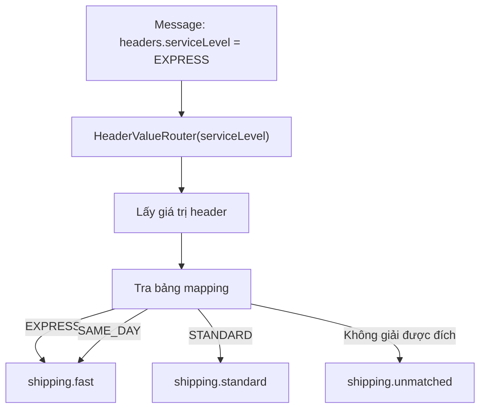
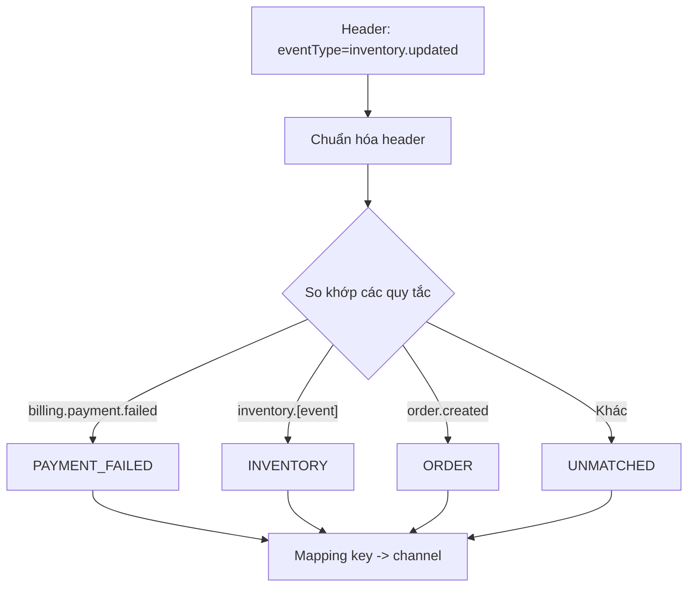
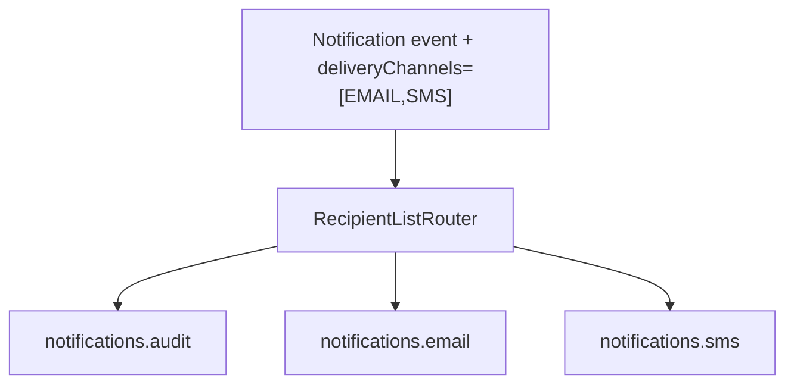
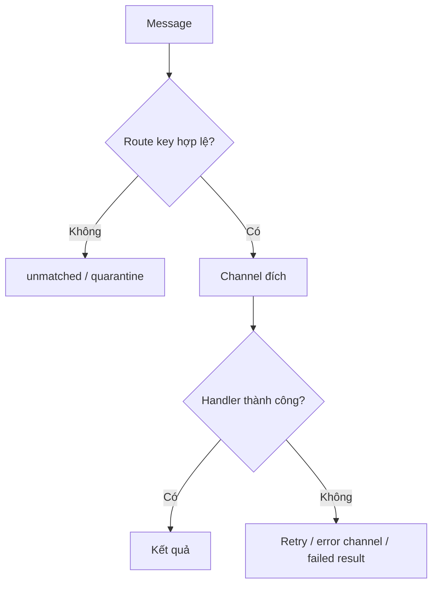

# Wildcard hoặc mapping nhiều giá trị trong Header-Based Router của Spring Integration

## Mục tiêu học tập

Trong hệ thống tích hợp, một message thường mang header như `serviceLevel`, `region`, `eventType` hoặc `deliveryChannels` để quyết định đường đi. Bài toán trở nên thú vị khi **nhiều giá trị header cần đi tới cùng một channel**, khi một nhóm giá trị phải được nhận diện bằng **wildcard/pattern**, hoặc khi **một message cần đến nhiều channel**.

Bài này thuộc chương **Header-based router** của module **SPRING_INTEGRATION_PATTERN**. Mục tiêu chung của module là triển khai Enterprise Integration Patterns (EIP) với Spring Integration để tạo luồng thông điệp ít phụ thuộc, dễ mở rộng; kết hợp Router, Filter, Transformer, Splitter, Aggregator, Gateway, retry, error channel và correlation; đồng thời kiểm thử và theo dõi các nhánh xử lý.

Sau bài học, bạn có thể:

1. Mô tả cơ chế ánh xạ **giá trị header → channel** của `HeaderValueRouter`.
2. Định nghĩa nhiều **giá trị chính xác** đi tới cùng một channel mà không lẫn với việc gửi message tới nhiều nơi.
3. Giải thích vì sao `channelMapping("inventory.*", ...)` **không mặc nhiên là wildcard**, và triển khai quy tắc pattern bằng hàm chọn route key có kiểm chứng.
4. Xử lý header dạng nhiều giá trị: phân biệt **một giá trị chứa dấu phẩy**, **Collection** và **nhiều recipient**.
5. Chọn `RecipientListRouter` khi thật sự cần fan-out có điều kiện.
6. Kiểm thử header thiếu, sai kiểu, khác chữ hoa/thường, pattern chồng lấn, fallback, header propagation và nhánh nhận không mong muốn.
7. Thiết kế an toàn cho header do client gửi, error handling, correlation, replay và quan sát vận hành.

## 1. Ba nghĩa khác nhau của “mapping nhiều giá trị”

Cụm từ “nhiều giá trị” có thể chỉ ba tình huống hoàn toàn khác:

| Tình huống | Đầu vào | Kết quả mong muốn | Cách triển khai |
| --- | --- | --- | --- |
| **Nhiều alias tới một đích** | `serviceLevel=EXPRESS` hoặc `serviceLevel=SAME_DAY` | Cả hai đều vào `shipping.fast` | Khai báo **hai** `channelMapping` cùng channel |
| **Một nhóm giá trị khớp pattern** | `eventType=inventory.created` hoặc `inventory.adjusted` | Cả nhóm vào `events.inventory` | Chuẩn hóa/kiểm tra bằng Java hoặc regex, rồi trả **một route key** |
| **Một message đến nhiều đích** | `deliveryChannels=[EMAIL,SMS]` | Một bản tới EMAIL, một bản tới SMS | `RecipientListRouter` hoặc Router trả **nhiều recipient** |

Ba trường hợp không thể thay cho nhau chỉ bằng việc thêm dấu `*` hoặc dấu phẩy vào một `channelMapping`.

### Ví dụ minh họa

```text
(A) Nhiều giá trị -> một channel
    EXPRESS -----\
                  +--> shipping.fast
    SAME_DAY ----/

(B) Pattern nhiều giá trị -> một channel
    inventory.created ----\
    inventory.updated -----+--> events.inventory
    inventory.deleted ----/

(C) Một message -> nhiều channel
    deliveryChannels=[EMAIL, SMS]
                  +----> notifications.email
                  |
                  +----> notifications.sms
```

**Cốt lõi:** mapping quyết định **đích của một route key**, wildcard định nghĩa **quy tắc tạo hoặc phân loại route key**, còn fan-out quyết định **số đích cùng nhận một message**.

## 2. HeaderValueRouter xử lý message như thế nào?

`HeaderValueRouter` là một Router có sẵn trong Spring Integration, nằm trong gói `org.springframework.integration.router`. Nó lấy giá trị của **một header đã chỉ định**, dùng giá trị ấy làm khóa định tuyến rồi ánh xạ đến channel.



Ví dụ bảng mapping:

| Giá trị `serviceLevel` | Channel |
| --- | --- |
| `EXPRESS` | `shipping.fast` |
| `SAME_DAY` | `shipping.fast` |
| `STANDARD` | `shipping.standard` |
| Khác hoặc thiếu | `shipping.unmatched`, nếu được cấu hình |

Giá trị header có thể là mã nghiệp vụ hoặc tên channel thật. Khi giá trị là mã nghiệp vụ như `EXPRESS`, bạn nên tạo ánh xạ rõ ràng. Khi giá trị trùng tên channel, framework có lựa chọn tìm channel trực tiếp từ key; đây là hành vi cần kiểm soát bằng `channelKeyFallback`.

### Thứ tự các bước

1. **Ingress** nhận message và xác thực header theo hợp đồng.
2. **HeaderValueRouter** đọc giá trị header cần xét.
3. **Mapping** tra khóa trong bảng và phân giải channel bean.
4. **Send** chuyển message đến channel đích.
5. **Consumer** phía sau xử lý nghiệp vụ của nhánh.

Router chỉ xác định nơi gửi message; nó không bắt buộc phải thay đổi payload. Những header nghiệp vụ như `traceId`, `tenantId` hoặc `orderId` thường vẫn cần đi cùng message qua nhánh.

## 3. Mapping nhiều giá trị chính xác vào cùng một channel

Giả sử có ba mức dịch vụ giao hàng:

- `SAME_DAY` và `EXPRESS` đều đi vào nhánh xử lý nhanh.
- `STANDARD` đi vào nhánh xử lý thường.
- Giá trị chưa hỗ trợ phải vào nhánh kiểm tra.

Hai ánh xạ khác key nhưng cùng destination là hợp lệ:

```java
HeaderValueRouter router = new HeaderValueRouter("serviceLevel");
router.setChannelMapping("SAME_DAY", "shipping.fast");
router.setChannelMapping("EXPRESS", "shipping.fast");
router.setChannelMapping("STANDARD", "shipping.standard");
```

Với mỗi message, Router sẽ đọc **một header `serviceLevel`**. Khi header là `EXPRESS`, Router chọn `shipping.fast` đúng **một lần**; việc `SAME_DAY` cùng trỏ đến channel đó không làm nhân đôi message.

### Ví dụ đầy đủ bằng Java DSL

```java
import org.springframework.context.annotation.Bean;
import org.springframework.context.annotation.Configuration;
import org.springframework.integration.channel.DirectChannel;
import org.springframework.integration.channel.QueueChannel;
import org.springframework.integration.config.EnableIntegration;
import org.springframework.integration.dsl.IntegrationFlow;
import org.springframework.integration.router.HeaderValueRouter;
import org.springframework.messaging.MessageChannel;
import org.springframework.messaging.PollableChannel;

@Configuration
@EnableIntegration
public class ShippingHeaderRouterConfig {

    @Bean("shipping.in")
    MessageChannel input() {
        return new DirectChannel();
    }

    @Bean("shipping.fast")
    PollableChannel fastQueue() {
        return new QueueChannel();
    }

    @Bean("shipping.standard")
    PollableChannel standardQueue() {
        return new QueueChannel();
    }

    @Bean("shipping.unmatched")
    PollableChannel unmatchedQueue() {
        return new QueueChannel();
    }

    @Bean
    IntegrationFlow shippingHeaderRoutingFlow() {
        HeaderValueRouter router = new HeaderValueRouter("serviceLevel");

        // Hai alias, cùng một destination.
        router.setChannelMapping("EXPRESS", "shipping.fast");
        router.setChannelMapping("SAME_DAY", "shipping.fast");
        router.setChannelMapping("STANDARD", "shipping.standard");

        // Không để key từ client trở thành tên channel tùy ý.
        router.setChannelKeyFallback(false);
        router.setDefaultOutputChannelName("shipping.unmatched");

        return IntegrationFlow.from("shipping.in")
            .route(router)
            .get();
    }
}
```

Trong ví dụ này, các output là `QueueChannel` để bài kiểm thử có thể gọi `receive()`. Chúng chưa có consumer/poller chạy nền; trong ứng dụng thật, phải nối tiếp một endpoint đọc queue hoặc chọn channel khác phù hợp.

`setDefaultOutputChannelName(...)` cấu hình channel nhận trường hợp Router không tìm được destination. Từ Spring Integration 6.0, việc đặt default output channel còn có hành vi tắt `channelKeyFallback`; ví dụ vẫn thể hiện ý định bằng `setChannelKeyFallback(false)` cho dễ đọc. Khi đổi phiên bản, hãy xác nhận các tùy chọn routing với dependency thực tế.

### Cấu hình tương đương bằng XML

```xml
<int:header-value-router
    input-channel="shipping.in"
    header-name="serviceLevel"
    default-output-channel="shipping.unmatched">

    <int:mapping value="EXPRESS" channel="shipping.fast"/>
    <int:mapping value="SAME_DAY" channel="shipping.fast"/>
    <int:mapping value="STANDARD" channel="shipping.standard"/>
</int:header-value-router>
```

Ví dụ XML giả định namespace `int` của Spring Integration đã được khai báo và các channel đã có bean tương ứng. Mỗi phần tử `mapping` thể hiện một giá trị chính xác. Nếu cần hạn chế channel-key fallback theo policy phiên bản, kiểm tra thuộc tính cấu hình tương ứng và kiểm thử key lạ.

**Không ghi:**

```xml
<!-- Không có nghĩa là EXPRESS hoặc SAME_DAY. -->
<int:mapping value="EXPRESS,SAME_DAY" channel="shipping.fast"/>

<!-- Không có nghĩa là bất cứ giá trị bắt đầu bằng EXPRESS. -->
<int:mapping value="EXPRESS*" channel="shipping.fast"/>
```

Theo mô hình ánh xạ giá trị thông thường, các chuỗi `EXPRESS,SAME_DAY` và `EXPRESS*` được xử lý như **một khóa**. Không mặc nhiên có cú pháp wildcard hoặc tách CSV trong `HeaderValueRouter`.

## 4. Kiểm thử mapping chính xác và header propagation

Kiểm thử cần chứng minh hai alias cùng tới đúng một channel, giá trị khác tới nhánh riêng, và giá trị lạ không lọt vào channel ngoài ý muốn.

```java
import static org.assertj.core.api.Assertions.assertThat;

import org.junit.jupiter.api.Test;
import org.springframework.beans.factory.annotation.Autowired;
import org.springframework.beans.factory.annotation.Qualifier;
import org.springframework.messaging.Message;
import org.springframework.messaging.MessageChannel;
import org.springframework.messaging.PollableChannel;
import org.springframework.messaging.support.MessageBuilder;
import org.springframework.test.context.junit.jupiter.SpringJUnitConfig;

@SpringJUnitConfig(ShippingHeaderRouterConfig.class)
class ShippingHeaderRouterTest {

    @Autowired
    @Qualifier("shipping.in")
    MessageChannel input;

    @Autowired
    @Qualifier("shipping.fast")
    PollableChannel fast;

    @Autowired
    @Qualifier("shipping.standard")
    PollableChannel standard;

    @Autowired
    @Qualifier("shipping.unmatched")
    PollableChannel unmatched;

    private void send(String serviceLevel) {
        assertThat(input.send(
            MessageBuilder.withPayload("order-42")
                .setHeader("serviceLevel", serviceLevel)
                .setHeader("traceId", "trace-42")
                .setHeader("tenantId", "tenant-a")
                .build()
        )).isTrue();
    }

    @Test
    void bothAliasesGoToFastChannel() {
        send("EXPRESS");
        send("SAME_DAY");

        Message<?> first = fast.receive(2_000);
        Message<?> second = fast.receive(2_000);

        assertThat(first).isNotNull();
        assertThat(second).isNotNull();
        assertThat(first.getHeaders().get("serviceLevel"))
            .isEqualTo("EXPRESS");
        assertThat(second.getHeaders().get("serviceLevel"))
            .isEqualTo("SAME_DAY");
        assertThat(first.getHeaders().get("traceId"))
            .isEqualTo("trace-42");
        assertThat(second.getHeaders().get("tenantId"))
            .isEqualTo("tenant-a");

        // Hai message đầu vào, đúng hai message đầu ra,
        // không có bản sao ở các channel khác.
        assertThat(fast.receive(0)).isNull();
        assertThat(standard.receive(0)).isNull();
        assertThat(unmatched.receive(0)).isNull();
    }

    @Test
    void standardUsesDedicatedChannel() {
        send("STANDARD");

        Message<?> result = standard.receive(2_000);
        assertThat(result).isNotNull();
        assertThat(result.getPayload()).isEqualTo("order-42");
        assertThat(fast.receive(0)).isNull();
        assertThat(unmatched.receive(0)).isNull();
    }

    @Test
    void unknownValueGoesToUnmatchedChannel() {
        send("PREMIUM");

        Message<?> result = unmatched.receive(2_000);
        assertThat(result).isNotNull();
        assertThat(result.getHeaders().get("serviceLevel"))
            .isEqualTo("PREMIUM");
        assertThat(fast.receive(0)).isNull();
        assertThat(standard.receive(0)).isNull();
    }

    @Test
    void prefixDoesNotMatchAnExactAlias() {
        send("EXPRESS_X");

        assertThat(unmatched.receive(2_000)).isNotNull();
        assertThat(fast.receive(0)).isNull();
    }

    @Test
    void commaSeparatedValuesAreNotTwoMappings() {
        send("EXPRESS,SAME_DAY");

        assertThat(unmatched.receive(2_000)).isNotNull();
        assertThat(fast.receive(0)).isNull();
        assertThat(standard.receive(0)).isNull();
    }
}
```

Các test giả định mỗi lớp test dùng queue ở trạng thái trống và không chạy song song trên cùng một context chưa được cách ly. Với `DirectChannel`, việc route diễn ra trong đường xử lý đồng bộ; khi chuyển sang executor hoặc broker, phải kiểm thử bằng cơ chế chờ và xác nhận phù hợp.

**Trường hợp header thiếu** cũng cần test:

```java
input.send(MessageBuilder.withPayload("order-without-level")
    .setHeader("traceId", "trace-missing")
    .build());
```

Không nên suy đoán giá trị `null` sẽ luôn được xử lý giống một alias cụ thể. Tùy cấu hình router, trường hợp không lấy được khóa có thể đi vào đường mặc định hoặc gây lỗi phân giải. Hãy dùng một bước validation/normalization tường minh trước Router nếu nghiệp vụ đòi hỏi hành vi thống nhất khi thiếu header.

## 5. Wildcard: vì sao phải phân loại trước khi mapping?

Giả sử message mang `eventType`:

```text
inventory.created
inventory.updated
inventory.adjusted
billing.payment.failed
order.created
unknown.type
```

Yêu cầu:

- Mọi event thuộc họ `inventory.<sự_kiện>` đi vào `events.inventory`.
- `billing.payment.failed` đi vào nhánh cảnh báo riêng.
- `order.created` đi vào `events.order`.
- Giá trị khác vào `events.unmatched`.

Việc thêm:

```java
router.setChannelMapping("inventory.*", "events.inventory");
```

**Không thực hiện pattern matching** theo ý nghĩa glob. Nó tạo một mapping có khóa chuỗi `inventory.*`. Để có wildcard, cần một bước tính **route key** dựa trên pattern hoặc thay bằng một Router tùy chỉnh hiểu quy tắc đó.



### Wildcard dạng glob khác regex

| Mẫu | Ngôn ngữ | Ý nghĩa |
| --- | --- | --- |
| `inventory.*` | Glob nếu bạn định nghĩa nó là glob | Bất kỳ chuỗi nào sau tiền tố `inventory.` |
| `inventory\.[a-z0-9_-]+` | Java regex | Tiền tố `inventory.` và ít nhất một ký tự hợp lệ ở phần sau |
| `inventory.*` | Java regex | `.` là một ký tự bất kỳ, `*` lặp ký tự trước đó; **khác glob** |
| `startsWith("inventory.")` | Java predicate | Kiểm tra tiền tố; có thể khớp cả chuỗi `inventory.` nếu không kiểm tra độ dài |

Nếu đang sử dụng regex Java, `matcher.matches()` kiểm tra **toàn bộ chuỗi** theo pattern. `find()` chỉ tìm một đoạn khớp, nên một dữ liệu có tiền tố không mong muốn vẫn có thể được chấp nhận nếu dùng sai phương thức.

### Định nghĩa thứ tự ưu tiên rõ ràng

Khi có quy tắc cụ thể và quy tắc rộng, xét **cụ thể trước, rộng sau**:

1. `billing.payment.failed` → `PAYMENT_FAILED`.
2. `inventory.<tên hợp lệ>` → `INVENTORY`.
3. `order.created` → `ORDER`.
4. Còn lại → `UNMATCHED`.

Nếu đồng thời có `inventory.deleted` cần gửi đi một nhánh riêng, hãy kiểm tra chính xác `inventory.deleted` **trước** quy tắc nhóm `inventory.*`. Router không tự suy ra “most specific wins” từ thứ tự khai báo `channelMapping`; thứ tự đó phải nằm trong logic xác định key.

## 6. Ví dụ Java DSL: route theo wildcard có kiểm soát

Ví dụ này dùng Java `Pattern` để phân nhóm event type. Mỗi lần nhận message, Router tính một khóa dạng enum chuỗi, rồi tra mapping.

```java
import java.util.Locale;
import java.util.regex.Pattern;

import org.springframework.context.annotation.Bean;
import org.springframework.context.annotation.Configuration;
import org.springframework.integration.channel.DirectChannel;
import org.springframework.integration.channel.QueueChannel;
import org.springframework.integration.config.EnableIntegration;
import org.springframework.integration.dsl.IntegrationFlow;
import org.springframework.messaging.Message;
import org.springframework.messaging.MessageChannel;
import org.springframework.messaging.PollableChannel;

@Configuration
@EnableIntegration
public class EventPatternRouterConfig {

    // Ít nhất một ký tự sau "inventory.", giới hạn tập ký tự.
    private static final Pattern INVENTORY_EVENT =
        Pattern.compile("inventory\\.[a-z0-9_-]+");

    @Bean("events.in")
    MessageChannel eventInput() {
        return new DirectChannel();
    }

    @Bean("events.inventory")
    PollableChannel inventoryQueue() {
        return new QueueChannel();
    }

    @Bean("events.order")
    PollableChannel orderQueue() {
        return new QueueChannel();
    }

    @Bean("events.paymentFailed")
    PollableChannel paymentFailedQueue() {
        return new QueueChannel();
    }

    @Bean("events.unmatched")
    PollableChannel unmatchedQueue() {
        return new QueueChannel();
    }

    @Bean
    IntegrationFlow eventRoutingFlow() {
        return IntegrationFlow.from("events.in")
            .route(Message.class,
                message -> classifyEventType(
                    message.getHeaders().get("eventType", String.class)),
                router -> router
                    .channelMapping("INVENTORY", "events.inventory")
                    .channelMapping("ORDER", "events.order")
                    .channelMapping("PAYMENT_FAILED", "events.paymentFailed")
                    .channelKeyFallback(false)
                    .defaultOutputChannel("events.unmatched"))
            .get();
    }

    static String classifyEventType(String raw) {
        if (raw == null || raw.isBlank()) {
            return "UNMATCHED";
        }

        String value = raw.trim().toLowerCase(Locale.ROOT);

        if (value.equals("billing.payment.failed")) {
            return "PAYMENT_FAILED";
        }
        if (INVENTORY_EVENT.matcher(value).matches()) {
            return "INVENTORY";
        }
        if (value.equals("order.created")) {
            return "ORDER";
        }
        return "UNMATCHED";
    }
}
```

**Tại sao dùng `.route(Message.class, ...)`?** Ví dụ cần xem header `eventType` của toàn bộ message thay vì chỉ payload. Hàm trả route key như `INVENTORY`; `channelMapping` ánh xạ key sang một bean channel. Đây là **generic Router tính khóa từ header**, không phải `HeaderValueRouter` thuần ánh xạ giá trị.

**Vì sao có `channelKeyFallback(false)`?** Để một giá trị hoặc khóa không được hỗ trợ không bị sử dụng làm tên bean channel ngoài bảng cho phép. `defaultOutputChannel` giúp giữ message không nhận diện tại kênh quan sát. Bản thân kênh chưa có handler, nên ứng dụng thật phải cấu hình consumer hoặc storage phù hợp.

Trong ví dụ này, `inventory.updated` khớp regex và đi vào `events.inventory`; `inventory.` không khớp vì thiếu phần tên event; `xinventory.updated` không khớp vì sử dụng `matches()` trên toàn chuỗi. `INVENTORY.CREATED` được chuẩn hóa thành chữ thường trước khi kiểm tra.

Nếu luật nghiệp vụ yêu cầu tên event phân biệt chữ hoa/thường, bỏ bước `toLowerCase(...)` và cập nhật test tương ứng. Không nên thay đổi quy tắc chuẩn hóa tùy tiện giữa producer và consumer.

### Kiểm thử riêng logic nhận diện pattern

```java
import static org.assertj.core.api.Assertions.assertThat;

import org.junit.jupiter.api.Test;

class EventPatternClassificationTest {

    @Test
    void matchesKnownInventoryEvents() {
        assertThat(EventPatternRouterConfig.classifyEventType(
            "inventory.created")).isEqualTo("INVENTORY");

        assertThat(EventPatternRouterConfig.classifyEventType(
            " INVENTORY.updated ")).isEqualTo("INVENTORY");
    }

    @Test
    void rejectsNearMissesInsteadOfMatchingAnySubstring() {
        assertThat(EventPatternRouterConfig.classifyEventType(
            "inventory.")).isEqualTo("UNMATCHED");

        assertThat(EventPatternRouterConfig.classifyEventType(
            "xinventory.created")).isEqualTo("UNMATCHED");

        assertThat(EventPatternRouterConfig.classifyEventType(
            "inventory.created.more")).isEqualTo("UNMATCHED");
    }

    @Test
    void choosesSpecificEventAndHandlesMissingHeader() {
        assertThat(EventPatternRouterConfig.classifyEventType(
            "billing.payment.failed")).isEqualTo("PAYMENT_FAILED");

        assertThat(EventPatternRouterConfig.classifyEventType(
            null)).isEqualTo("UNMATCHED");

        assertThat(EventPatternRouterConfig.classifyEventType(
            "order.created")).isEqualTo("ORDER");
    }
}
```

Các test này kiểm tra thuật toán phân loại độc lập với Spring context. Nên bổ sung integration test gửi message vào `events.in` và assert channel đầu ra tương ứng, tương tự cấu trúc kiểm thử ở mục 4.

### Kiểm soát chi phí của pattern

Nếu bạn cho phép cấu hình regex từ bên ngoài, hãy đặt ranh giới cho độ dài input và độ phức tạp biểu thức. Regex có backtracking tốn kém có thể tiêu thụ nhiều CPU trên dữ liệu do client kiểm soát. Với nhu cầu “cùng tiền tố”, đôi khi `startsWith` kết hợp kiểm tra độ dài/ký tự hợp lệ dễ đọc, dễ kiểm thử và ít rủi ro hơn.

Ví dụ thay thế:

```java
boolean isInventoryFamily(String type) {
    return type != null
        && type.startsWith("inventory.")
        && type.length() > "inventory.".length();
}
```

Hàm này rộng hơn regex đã dùng: nó chấp nhận ký tự và dấu chấm bổ sung. Chỉ áp dụng khi hợp đồng thực sự cho phép.

## 7. Một header mang nhiều giá trị: dữ liệu khác với nhiều recipient

Hãy xem header `deliveryChannels`:

```text
deliveryChannels = ["EMAIL", "SMS"]
```

Mục tiêu nghiệp vụ là gửi sự kiện tới **cả EMAIL và SMS**. Đầu tiên phải phân biệt cách biểu diễn:

| Biểu diễn | Ví dụ Java | Lưu ý |
| --- | --- | --- |
| Header đơn | `"EMAIL"` | Một khóa duy nhất |
| Chuỗi CSV | `"EMAIL,SMS"` | Vẫn là **một String** nếu chưa parse; phải xử lý khoảng trắng, trùng, giá trị lạ |
| `Collection<String>` | `List.of("EMAIL", "SMS")` | Mô hình danh sách rõ hơn trong tiến trình, nhưng phải xét serialization qua adapter |
| Nhiều message riêng | Mỗi message có `deliveryChannel="EMAIL"` hoặc `"SMS"` | Có thể tạo qua Splitter rồi route từng message |

Không được tự giả định `HeaderValueRouter` sẽ coi chuỗi `"EMAIL,SMS"` là hai key rồi phát đến hai channel. Với dữ liệu Collection, hãy xác định rõ chiến lược chuyển từng phần tử hay chọn nhiều recipient, đồng thời kiểm thử hành vi của phiên bản đang dùng.

### Một message phải tới nhiều channel: RecipientListRouter

`RecipientListRouter` là pattern phù hợp khi tập recipient được chọn dựa trên các điều kiện của message. Ví dụ, audit nhận **mọi** thông báo, còn Email và SMS chỉ nhận khi được chỉ định.



Một cách cấu hình Java dùng `RecipientListRouter` và `MessageSelector`:

```java
import java.util.Collection;

import org.springframework.integration.router.RecipientListRouter;
import org.springframework.integration.dsl.IntegrationFlow;
import org.springframework.messaging.Message;

class NotificationRecipientRouting {

    static boolean selected(Message<?> message, String channel) {
        Object raw = message.getHeaders().get("deliveryChannels");
        if (!(raw instanceof Collection<?> values)) {
            return false;
        }

        return values.stream().anyMatch(value ->
            channel.equals(value));
    }

    static IntegrationFlow flow() {
        RecipientListRouter router = new RecipientListRouter();

        // Audit luôn có mặt trong tập recipient.
        router.addRecipient("notifications.audit");
        router.addRecipient("notifications.email",
            message -> selected(message, "EMAIL"));
        router.addRecipient("notifications.sms",
            message -> selected(message, "SMS"));

        return IntegrationFlow.from("notifications.in")
            .route(router)
            .get();
    }
}
```

Đây là **trích đoạn cấu hình**, giả định các channel `notifications.in`, `notifications.audit`, `notifications.email`, `notifications.sms` đã được đăng ký; bạn cần khai báo `@Bean` cho flow trong lớp `@Configuration` thực tế. Mẫu dùng Java 17+ vì có pattern matching cho `instanceof`.

Nếu header là `List.of("EMAIL", "SMS")`, cả ba recipient (audit, email, sms) nhận message theo cấu hình, **không chỉ recipient đầu tiên khớp**. Nếu chỉ có EMAIL, audit và email nhận. Nếu không có EMAIL/SMS, audit vẫn nhận, nên đây không phải “không có recipient” ở cấp Router.

Hàm `selected` trên chỉ chấp nhận Collection chứa chính xác các chuỗi đã định nghĩa; bạn có thể thêm bước normalization/validation nếu nguồn bên ngoài được phép gửi chữ thường hoặc CSV. Không biến dữ liệu người dùng thành tên channel bằng cách nối chuỗi tự do.

### Cấu hình XML với selector-expression

```xml
<int:recipient-list-router input-channel="notifications.in">
    <int:recipient channel="notifications.audit"/>
    <int:recipient
        channel="notifications.email"
        selector-expression="headers['deliveryChannels'] != null
            and headers['deliveryChannels'].contains('EMAIL')"/>
    <int:recipient
        channel="notifications.sms"
        selector-expression="headers['deliveryChannels'] != null
            and headers['deliveryChannels'].contains('SMS')"/>
</int:recipient-list-router>
```

Đoạn XML trên minh họa `selector-expression` của recipient; ví dụ giả định `deliveryChannels` đã là Collection phù hợp trước khi vào Router. Nếu để nguyên chuỗi CSV, phép `contains('EMAIL')` có thể chỉ là tìm chuỗi con và tạo false positive; hãy parse thành tập giá trị đã kiểm tra trước.

### Mapping nhiều giá trị ≠ broadcasting

```text
EXPRESS -> shipping.fast
SAME_DAY -> shipping.fast
```

Đây là **nhiều key về một channel**; một message có `EXPRESS` không được nhân bản do có hai mapping.

```text
deliveryChannels=[EMAIL,SMS]
    -> notifications.email
    -> notifications.sms
```

Đây là **một message đến nhiều channel**. Cần thiết kế retry, lỗi từng nhánh và khả năng duplicate side effect. Hai bài toán có semantics, thông lượng và kiểm thử khác nhau.

## 8. Khi nào nên dùng Splitter thay cho RecipientListRouter?

Nếu header thực sự là một danh sách **đơn vị công việc riêng biệt**, bạn có thể dùng Splitter tạo message con rồi dùng `HeaderValueRouter` cho từng phần:

```text
Message:
  payload=Notification("order-42")
  header deliveryChannels=[EMAIL, SMS]
           |
           v
Splitter tùy chỉnh
   |                       |
   v                       v
Message EMAIL          Message SMS
header target=EMAIL    header target=SMS
   |                       |
   +----------+------------+
              v
       HeaderValueRouter("target")
         EMAIL -> notifications.email
         SMS   -> notifications.sms
```

Chọn cách này khi cần **retry/idempotency/correlation trên từng công việc con**. Mỗi message con cần `notificationId + channel` làm khóa idempotency để Email bị retry không khiến SMS chạy lại.

Nếu downstream cần Aggregator biết khi nào cả hai kênh đã hoàn thành, hãy dùng `correlationId` và sequence/release strategy phù hợp. Recipient-list router có tùy chọn `applySequence` (mặc định không bật) trong những tình huống cần metadata nhóm; không dựa vào sequence header nếu chưa cấu hình. Nếu chỉ cần phát sự kiện một chiều tới hai subscriber, một recipient list đơn giản có thể ít phức tạp hơn Splitter/Aggregator.

## 9. Wildcard chồng lấn và thứ tự ưu tiên quy tắc

Giả sử dữ liệu cần ba nhánh:

1. `inventory.deleted`: cần phê duyệt đặc biệt.
2. `inventory.*`: phần còn lại đi vào xử lý tồn kho.
3. `*`: mọi event khác vào unmatched.

Bạn phải thể hiện thứ tự kiểm tra:

```java
static String route(String rawType) {
    if (rawType == null) {
        return "UNMATCHED";
    }

    String type = rawType.trim().toLowerCase(java.util.Locale.ROOT);

    if (type.equals("inventory.deleted")) {
        return "INVENTORY_DELETE_REVIEW";
    }
    if (type.startsWith("inventory.")
        && type.length() > "inventory.".length()) {
        return "INVENTORY";
    }
    return "UNMATCHED";
}
```

Nếu đặt `startsWith("inventory.")` trước, message `inventory.deleted` sẽ bị quy tắc rộng lấy mất. **Chính sách first-match-wins nằm trong hàm phân loại**, không nằm trong thứ tự của các dòng `channelMapping`.

Với nhiều quy tắc, hãy xây **decision table**:

| Header eventType | Rule khớp | Route |
| --- | --- | --- |
| `inventory.deleted` | Exact đặc biệt và wildcard | `INVENTORY_DELETE_REVIEW` |
| `inventory.created` | Wildcard inventory | `INVENTORY` |
| `inventory.` | Không đủ phần event | `UNMATCHED` |
| `INVENTORY.updated` | Wildcard sau normalize | `INVENTORY` |
| `billing.payment.failed` | Exact billing | `PAYMENT_FAILED` |
| `other.created` | Không có rule | `UNMATCHED` |

Nếu ứng dụng có quy tắc do nhiều nhóm sở hữu, hãy bổ sung priority và tie-breaker tường minh, test overlap và lưu phiên bản chính sách để giải thích tại sao message được route như vậy trong lịch sử.

## 10. Header đến từ bên ngoài: normalize, validate, allowlist

Một header dùng để chọn channel có thể đến từ HTTP request, Kafka record, AMQP message, JMS property hoặc một Gateway nội bộ. Mỗi ranh giới có quy tắc mapping và độ tin cậy khác nhau.

**Không cho bên ngoài quyết định tùy ý tên channel hoặc quyền xử lý.** Ví dụ header do người dùng nhập `destination=adminApprovalChannel` không được phép làm Router gửi message tới channel này nếu người dùng không có quyền. Thiết kế an toàn hơn:

1. **Chỉ nhận giá trị thuộc tập đã định nghĩa**: `EXPRESS`, `SAME_DAY`, `STANDARD`.
2. **Chuẩn hóa ở ingress** theo hợp đồng: trim, quy tắc chữ hoa/thường, kiểu dữ liệu và giới hạn độ dài.
3. **Xác thực với danh tính**: `tenantId` hoặc `serviceLevel` dùng cho phân quyền/tính phí phải được kiểm tra với nguồn đáng tin.
4. **Ánh xạ qua allowlist** sang các channel nội bộ.
5. **Fallback có kiểm soát**: chưa hỗ trợ → reject/quarantine, có trace để điều tra; không tự chuyển về nhánh quan trọng khác.
6. **Ánh xạ header ra ngoài** qua HTTP/Kafka/AMQP/JMS adapter có allowlist; không chuyển tùy tiện `replyChannel`, `errorChannel` hoặc object Java nội bộ.

Khi dùng header tùy chỉnh qua broker, một số adapter chỉ hỗ trợ những kiểu giá trị nhất định hoặc cần serializer/header mapper. Việc header có mặt trong message trước outbound adapter không bảo đảm nó sẽ đến consumer với cùng kiểu.

### Các trường hợp đầu vào cần quyết định rõ

| Đầu vào | Rủi ro | Hành vi gợi ý |
| --- | --- | --- |
| Header thiếu | Không xác định được route | Validation hoặc unmatched có lý do |
| `null` | Biểu thức/predicate gây lỗi | Kiểm tra null trước |
| Giá trị sai kiểu như Integer | Không phù hợp header String | Reject và ghi mã lỗi, tránh ép kiểu âm thầm |
| `" express "` | Không khớp mapping chính xác | Normalize có chủ đích |
| `"EXPRESS,SAME_DAY"` | Tưởng là hai alias, thực chất là một String | Parse theo schema hoặc reject |
| Danh sách chứa giá trị trùng | Fan-out gửi lặp nếu không deduplicate | Deduplicate nếu yêu cầu một recipient một lần |
| `inventory...` quá dài | Tốn CPU/bộ nhớ, log bùng nổ | Giới hạn length và charset |
| Giá trị được client tự khai là `ADMIN` | Có thể vượt qua ranh giới tin cậy | Kiểm tra authorization và allowlist |

## 11. Default output channel, lỗi gửi và retry

Ba loại vấn đề sau **khác nhau**:

- **Unmatched route**: giá trị header không khớp mapping/pattern và Router không có đích.
- **Delivery failure**: Router tìm được channel nhưng `send()` thất bại, queue đầy hoặc channel không có consumer phù hợp.
- **Handler failure**: message đã đến nhánh nhưng xử lý nghiệp vụ ném exception.

`defaultOutputChannel` giúp xử lý **không tìm được destination**. Nó không tự nhận mọi exception từ handler hoặc lỗi gửi đến channel đã chọn. Với lỗi sau route, dùng retry, error flow, dead-letter handling hoặc phản hồi lỗi theo cách channel/adapter được cấu hình.



### Gateway có thể timeout

Nếu một Gateway đồng bộ gửi request vào Header-Based Router:

- Nhánh hợp lệ trả reply → caller nhận phản hồi.
- Nhánh unmatched chỉ lưu message vào QueueChannel nhưng không có consumer → caller có thể chờ đến timeout.
- Nhánh recipient-list fan-out có nhiều reply → phải có hợp đồng chọn/gom kết quả; không giả định Gateway tự tổng hợp mọi reply.

Khi dùng kênh unmatched để từ chối yêu cầu, hãy có handler tạo reply lỗi nghiệp vụ phù hợp hoặc ném exception được quản lý theo hợp đồng của caller.

### Retry và idempotency khi fan-out

Một message gửi tới audit và SMS; audit đã ghi thành công, SMS bị lỗi. Retry toàn bộ event có thể làm audit chạy lần hai. Thiết kế khóa idempotency như `eventId + recipientName`, retry ở mức nhánh khi có thể, và lưu trạng thái từng nhánh nếu yêu cầu đảm bảo delivery.

Đối với route key không hỗ trợ, retry liên tục cùng header và cùng mapping thường không tạo kết quả mới. Hợp lý hơn là quarantine, cập nhật policy rồi replay có kiểm soát và chống trùng.

## 12. Kết hợp với các Enterprise Integration Patterns khác

| Pattern / thành phần | Cách phối hợp | Điều cần kiểm tra |
| --- | --- | --- |
| **Filter** | Chặn header sai schema trước Router | Có discard/error response phù hợp |
| **Transformer** | Chuẩn hóa payload; header enricher chuẩn hóa route key | Không làm mất header định tuyến hoặc `traceId` |
| **Content-Based Router** | Chọn key qua logic từ nhiều trường payload/header | Quy tắc overlap và thứ tự xét |
| **RecipientListRouter** | Chọn nhiều nơi nhận dựa trên một hoặc nhiều header | Số recipient, lỗi từng nhánh, duplicate |
| **Splitter** | Biến danh sách giá trị/đơn vị công việc thành message con | Correlation và idempotency theo phần tử |
| **Aggregator** | Gom kết quả nhiều message theo nhóm | `correlationId`, release, timeout, xử lý thiếu phần |
| **Gateway** | Dùng header được khai báo trên method để route request | Mọi đường được phép có reply/error contract |
| **Retry / error channel** | Xử lý lỗi thực thi sau khi đã route | Không nhập nhằng với fallback khi không có route |
| **PriorityChannel** | Ưu tiên message đang chờ ở một nhánh | Routing không bảo đảm thứ tự hoàn thành |

### Routing theo header không bảo đảm thứ tự hoàn thành

Một message đi vào `shipping.fast` có thể hoàn thành sau message ở `shipping.standard` nếu handler nhanh đang bận hoặc nhánh thường rảnh. **Tên channel “fast” là lựa chọn nghiệp vụ, không phải cơ chế scheduling tự động.** Nếu cần SLA, hãy cấp tài nguyên, pool/queue riêng và giám sát từng nhánh.

### Correlation khi fan-out hoặc split

Một event phát tới EMAIL và SMS có hai kết quả cần theo dõi. Hãy đặt `eventId` hoặc `correlationId` bền vững; nếu dùng Aggregator, cần biết **số phần dự kiến**, cách release nhóm và chính sách khi một nhánh trả lỗi. Không coi một nhánh bỏ qua message là “đã xử lý đủ nhóm”.

## 13. Quan sát vận hành và kiểm thử tích hợp

Các chỉ số nên theo dõi:

| Metric minh họa | Câu hỏi cần trả lời |
| --- | --- |
| `header_router_received_total` | Có bao nhiêu message đến Router? |
| `header_router_route_total{route}` | Phân bố các route key sau normalize? |
| `header_router_unmatched_total` | Có bao nhiêu header chưa khớp? |
| `header_router_invalid_header_total{reason}` | Thiếu/sai kiểu/sai schema ở mức nào? |
| `recipient_router_fanout_total` | Mỗi event được phát tới bao nhiêu recipient? |
| `router_delivery_failures_total{channel}` | Kênh nào gửi thất bại? |
| `router_branch_latency{channel}` | Nhánh nào thực sự xử lý chậm? |
| `aggregation_pending_groups` | Có nhóm kết quả đang đợi phần thiếu? |

Đây là **tên metric do ứng dụng có thể định nghĩa**, không khẳng định Spring Integration tự tạo tất cả theo đúng tên trên. Có thể dùng Micrometer/observation và structured logging theo hệ thống.

Khi debug, nên log các trường được cho phép:

```text
traceId=trace-42 event=route_selected
headerName=serviceLevel headerValue=EXPRESS
routeKey=EXPRESS destination=shipping.fast

traceId=trace-43 event=route_unmatched
headerName=serviceLevel reason=unsupported_value
destination=shipping.unmatched
```

Tránh log toàn bộ header hoặc payload chứa token, thông tin cá nhân và dữ liệu xác thực.

### Ma trận kiểm thử cần có

| Trường hợp | Dữ liệu | Kỳ vọng |
| --- | --- | --- |
| Alias 1 | `EXPRESS` | `shipping.fast` một lần |
| Alias 2 | `SAME_DAY` | `shipping.fast` một lần |
| Mapping khác | `STANDARD` | `shipping.standard` |
| Unknown | `PREMIUM` | `shipping.unmatched` |
| Wildcard hợp lệ | `inventory.updated` | `events.inventory` |
| Near miss | `inventory.` hoặc `xinventory.updated` | `events.unmatched` |
| Case normalization | ` INVENTORY.created ` | `events.inventory` nếu policy cho phép |
| Một message, hai recipient | `[EMAIL,SMS]` | EMAIL và SMS đều nhận; audit nếu có quy định |
| Header thiếu/sai kiểu | `null`, `Integer` | Reject/unmatched theo hợp đồng, không gửi sai channel |
| Một recipient lỗi | SMS lỗi, audit thành công | Chính sách retry/idempotency rõ ràng |

Với channel đồng bộ trong bài học, test có thể dùng `QueueChannel.receive(0)` sau khi gửi. Với executor hoặc broker bất đồng bộ, cần chờ theo sự kiện/trạng thái và đặt khoảng quan sát trước khi kết luận một nhánh không nhận message.

## 14. Bài tập thực hành

### Bài 1 — Nhiều alias đi vào cùng một đích

Dựa vào `ShippingHeaderRouterConfig`, thêm `NEXT_DAY` vào `shipping.fast`. Viết test xác nhận `EXPRESS`, `SAME_DAY` và `NEXT_DAY` đều đi vào cùng channel, nhưng mỗi message chỉ có một bản.

### Bài 2 — Wildcard không phải mapping

Cố tình thêm `setChannelMapping("inventory.*", "events.inventory")` vào một `HeaderValueRouter` kiểm tra header `eventType`. Gửi `inventory.updated` và quan sát thất bại trong việc khớp pattern. Sau đó thay bằng `classifyEventType(...)` và kiểm thử hành vi được mong muốn.

### Bài 3 — Độ ưu tiên của pattern chồng lấn

Bổ sung route đặc biệt cho `inventory.deleted`. Viết test chứng minh message này vào nhánh review thay vì nhánh inventory chung. Đổi thứ tự các điều kiện trong hàm phân loại và giải thích sai khác.

### Bài 4 — Header CSV và Collection

Nhận `deliveryChannels="EMAIL,SMS"` từ một adapter, parse/validate thành `Set<String>`, loại giá trị lạ và giá trị trùng. Dùng RecipientListRouter phát message đến các channel tương ứng; kiểm thử `"EMAIL,EMAIL"` không làm Email nhận hai lần theo hợp đồng của bạn.

### Bài 5 — Fan-out với lỗi một nhánh

Thiết lập audit và SMS, giả lập SMS timeout sau khi audit hoàn tất. So sánh retry cả event với retry riêng SMS; đề xuất idempotency key và kiểm thử không lặp side effect audit.

### Bài 6 — Splitter/Aggregator

Từ một message có `deliveryChannels=[EMAIL,SMS]`, tạo hai message con bằng Splitter. Route theo header `target` của từng phần, rồi Aggregator gom kết quả. Kiểm tra `correlationId`, sequence, timeout và trường hợp SMS không trả kết quả.

### Bài 7 — Header không đáng tin

Gửi header `serviceLevel=ADMIN` hoặc giá trị trùng tên một bean channel nội bộ. Chứng minh policy whitelist và `channelKeyFallback(false)` không đưa message đến channel ngoài mapping.

### Bài 8 — Quan sát và replay

Thêm metric cho unmatched và lưu một số sự kiện có loại mới vào quarantine. Sau khi bổ sung mapping cho giá trị mới, replay có `eventId` để chống xử lý trùng; phân biệt unmatched với lỗi handler.

## 15. Checklist thiết kế

1. “Nhiều giá trị” là **nhiều alias cùng một đích**, **một mẫu wildcard**, hay **nhiều recipient**?
2. Có dùng đúng Router: `HeaderValueRouter` cho exact mapping, hàm phân loại cho pattern, `RecipientListRouter` cho fan-out?
3. Header đầu vào được xác thực về **nguồn, kiểu, độ dài, charset và giá trị hợp lệ** chưa?
4. Các mapping có trỏ đến **bean channel tồn tại**? Có ngăn key lạ tự trở thành channel name?
5. Có phân biệt **glob `*`, regex `.*` và literal string**?
6. Các mẫu chồng lấn đã có **thứ tự ưu tiên tường minh**, kiểm thử cụ thể trước pattern rộng?
7. Với Collection/CSV, đã có hợp đồng **parse, normalize, deduplicate, reject**?
8. Với nhiều recipient, đã xác định cách **retry, idempotency và xử lý một nhánh thất bại**?
9. Với Gateway/Scatter-Gather/Aggregator, đường unmatched hoặc lỗi có tạo reply/partial result đúng SLA?
10. Headers như `traceId`, `tenantId`, `correlationId` có được truyền và map qua giao thức phù hợp?
11. Có kiểm thử **exact match, alias, wildcard, near miss, unknown, thiếu header, sai kiểu, overlap và fan-out**?
12. Có log/metric cho quyết định route, unmatched, lỗi delivery, lỗi handler và tuổi message tồn đọng?

### Ghi nhớ

**Header-Based Router tách thông tin điều hướng khỏi payload.** Với `HeaderValueRouter`, bạn có thể ánh xạ **nhiều giá trị chính xác vào cùng một channel** bằng nhiều mapping. Khi muốn wildcard, hãy định nghĩa **logic nhận diện pattern trước bước mapping**; đừng giả định ký tự `*` trong key tự có ý nghĩa đặc biệt. Khi một message cần được gửi tới **nhiều recipient**, hãy dùng cơ chế fan-out rõ ràng và kiểm soát retry/idempotency riêng cho từng nhánh. Phân biệt ba nhu cầu này giúp luồng Spring Integration dễ kiểm thử, dễ quan sát và tránh gửi nhầm message đến xử lý nghiệp vụ không mong muốn.

### Tài liệu tham khảo

- [Spring Integration Reference — Router Implementations](https://docs.spring.io/spring-integration/reference/router/implementations.html)
- [Spring Integration Reference — Common Router Parameters](https://docs.spring.io/spring-integration/reference/router/common-parameters.html)
- [Spring Integration Reference — Changes between 5.5 and 6.0](https://docs.spring.io/spring-integration/reference/changes-5.5-6.0.html)
- [Spring Integration API — AbstractMappingMessageRouter](https://docs.spring.io/spring-integration/api/org/springframework/integration/router/AbstractMappingMessageRouter.html)
