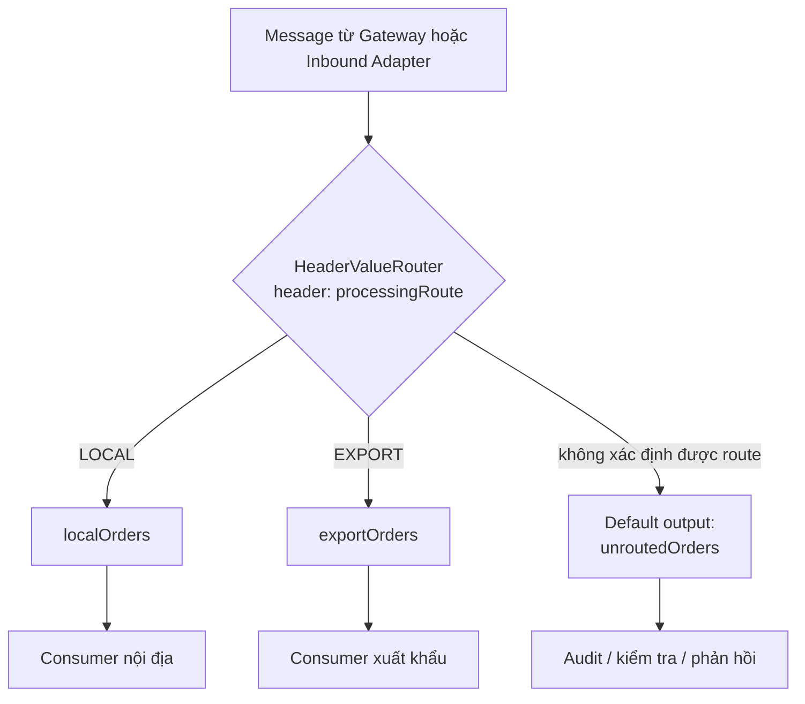
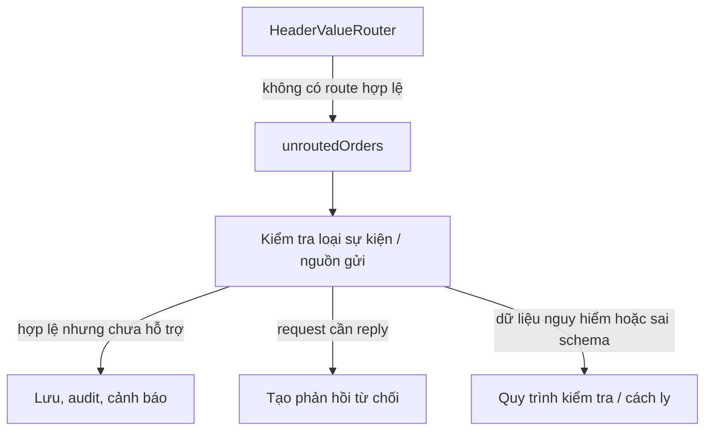
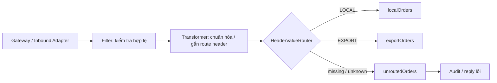
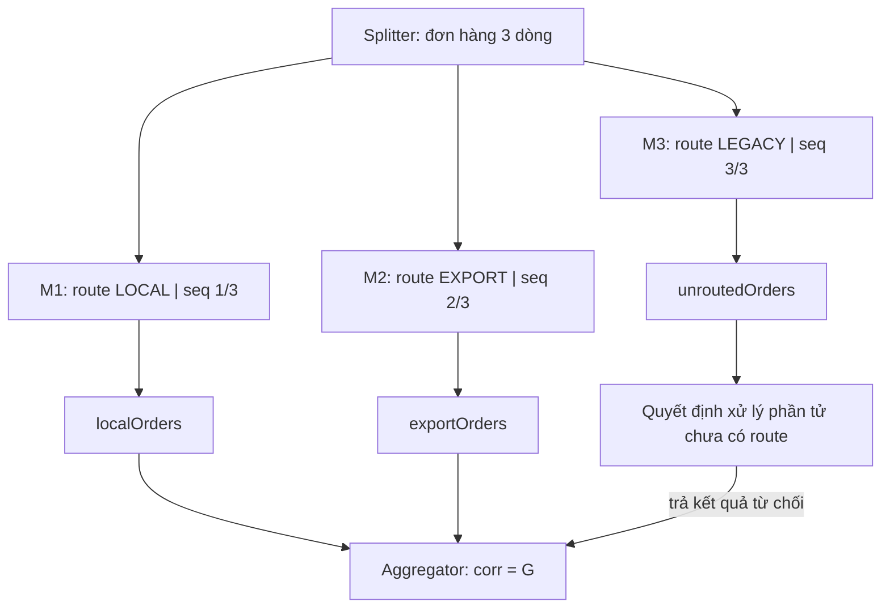

# Default output channel trong Header-Based Router

Một hệ thống nhận thông điệp từ nhiều nguồn thường sử dụng **Message headers** để quyết định bước xử lý tiếp theo. Chẳng hạn, producer gửi một sự kiện đơn hàng với header `processingRoute=LOCAL` để chuyển đến kênh nội địa hoặc `processingRoute=EXPORT` để chuyển đến kênh xuất khẩu. Nhưng điều gì xảy ra khi header không có, giá trị của header chưa được hỗ trợ hoặc cấu hình mapping bị sai?

Trong Spring Integration, **default output channel** là đích dự phòng dành cho Message mà Router **không xác định được channel đích** theo quy tắc cấu hình. Đối với **Header-Based Router**, việc định nghĩa một nhánh mặc định rõ ràng giúp xử lý thông điệp chưa nhận diện, giữ khả năng truy vết và tránh để Gateway chờ kết quả không xác định.

Bài này thuộc chương **Header-based router** trong module `SPRING_INTEGRATION_PATTERN`. Mục tiêu chung là thực hành Enterprise Integration Patterns bằng Spring Integration để tạo các luồng thông điệp ít phụ thuộc và dễ mở rộng, phối hợp Router, Filter, Transformer, Splitter, Aggregator, Gateway, retry, error channel, correlation và kiểm thử đường đi của Message. Trọng tâm của bài là **khi nào nhánh mặc định được dùng, cách cấu hình và cách kiểm chứng kết quả**.

## 1. Bài toán: header thiếu hoặc không khớp route

Giả sử một ứng dụng có ba luồng xử lý đơn hàng:

| Giá trị header `processingRoute` | Channel đích | Ý nghĩa |
| --- | --- | --- |
| `LOCAL` | `localOrders` | Xử lý giao hàng nội địa |
| `EXPORT` | `exportOrders` | Xử lý giao hàng xuất khẩu |
| Thiếu, không được hỗ trợ | `unroutedOrders` | Ghi nhận và phân loại để xử lý tiếp |

Các Message có thể mang payload giống nhau nhưng được điều hướng khác nhau dựa trên header:

```text
Message A: payload=ORD-101, processingRoute=LOCAL
Message B: payload=ORD-102, processingRoute=EXPORT
Message C: payload=ORD-103, processingRoute=LEGACY
Message D: payload=ORD-104, không có processingRoute
```

Nếu có cấu hình default output phù hợp, A và B đến channel được ánh xạ, còn C và D đến nhánh xử lý chưa định tuyến. Đây là **chính sách dự phòng có chủ đích**, không tự động đồng nghĩa với việc dữ liệu đã được xử lý thành công.



### Phân biệt ba tên gọi

- **Header name** là tên trường metadata được kiểm tra: `processingRoute`.
- **Route key** là giá trị lấy từ header: `LOCAL`, `EXPORT`, `LEGACY`.
- **Channel name** là tên bean `MessageChannel` mà Router gửi tới: `localOrders`, `exportOrders`, `unroutedOrders`.

Một route key không buộc phải trùng tên channel. `HeaderValueRouter` có thể dùng **channel mapping** để nối nhãn nghiệp vụ với tên channel cụ thể.

## 2. HeaderValueRouter hoạt động như thế nào?

`org.springframework.integration.router.HeaderValueRouter` là Router dùng giá trị của **một header được chỉ định** để xác định channel. Header có thể chứa trực tiếp một tên channel hoặc chứa khóa logic được ánh xạ sang channel.

Quá trình cơ bản:

1. Router nhận `Message<?>` từ input channel.
2. Đọc header được khai báo khi tạo `HeaderValueRouter`.
3. Tìm channel tương ứng theo bảng `channelMapping` hoặc quy tắc giải quyết channel được cấu hình.
4. Gửi Message đến channel tìm được.
5. Nếu không tìm được đích hợp lệ theo chính sách của Router, sử dụng `defaultOutputChannel` nếu có và nếu điều kiện fallback được thỏa mãn.

**Điều kiện “không tìm được đích” cần hiểu chính xác.** Một route key không nằm trong bảng mapping có thể được chuyển tới default channel. Ngược lại, một key đã được ánh xạ tới **tên channel sai hoặc không tồn tại** có thể dẫn đến lỗi giải quyết channel, tùy `resolutionRequired`. Mặc định output không phải cơ chế bắt mọi lỗi phát sinh ở toàn flow.

### Default output không phải một Router thứ hai

Default channel là một **channel đầu ra**, chẳng hạn `QueueChannel`, `DirectChannel` hoặc kênh được nối với một endpoint khác. Nó không tự kiểm tra, sửa lỗi hay gửi Message vào lại luồng chính. Nếu muốn thông điệp chưa nhận diện được tạo phản hồi, được lưu lại hoặc được phân tích, **phải có consumer/flow tại channel mặc định**.

## 3. Cấu hình HeaderValueRouter có default output bằng Java

Ví dụ dưới đây dùng Spring Integration Java DSL để nối `HeaderValueRouter` với input channel. `localOrders`, `exportOrders` và `unroutedOrders` là `QueueChannel` có dung lượng nhỏ để dễ quan sát khi chạy thử.

```java
package example.integration;

import org.springframework.context.annotation.Bean;
import org.springframework.context.annotation.Configuration;
import org.springframework.integration.channel.DirectChannel;
import org.springframework.integration.channel.QueueChannel;
import org.springframework.integration.config.EnableIntegration;
import org.springframework.integration.dsl.IntegrationFlow;
import org.springframework.integration.router.HeaderValueRouter;
import org.springframework.messaging.MessageChannel;
import org.springframework.messaging.PollableChannel;

@Configuration
@EnableIntegration
public class HeaderRouterConfiguration {

    @Bean
    public MessageChannel ordersInput() {
        return new DirectChannel();
    }

    @Bean
    public PollableChannel localOrders() {
        return new QueueChannel(20);
    }

    @Bean
    public PollableChannel exportOrders() {
        return new QueueChannel(20);
    }

    @Bean
    public PollableChannel unroutedOrders() {
        return new QueueChannel(20);
    }

    @Bean
    public IntegrationFlow ordersRoutingFlow() {
        HeaderValueRouter router = new HeaderValueRouter("processingRoute");
        router.setChannelMapping("LOCAL", "localOrders");
        router.setChannelMapping("EXPORT", "exportOrders");
        router.setDefaultOutputChannelName("unroutedOrders");

        return IntegrationFlow.from("ordersInput")
                .route(router)
                .get();
    }
}
```

Giải thích:

- `new HeaderValueRouter("processingRoute")` xác định **header sẽ được đọc**.
- `setChannelMapping("LOCAL", "localOrders")` và mapping tương tự cho `EXPORT` định nghĩa các tuyến hợp lệ.
- `setDefaultOutputChannelName("unroutedOrders")` khai báo **đích dự phòng**.
- `.route(router)` đưa Router vào một `IntegrationFlow` nhận Message từ `ordersInput`.
- Các output `QueueChannel` giữ Message chờ consumer lấy bằng `receive()`; ví dụ không tự tạo poller cho chúng.

Không cần một class `@ServiceActivator` khác để đưa Router vào input channel vì chính `.route(router)` đã gắn endpoint với flow. Nếu muốn dùng cách annotation hoặc XML, phải đảm bảo chỉ **một cơ chế Router được đăng ký cho input** trong bài thử này để không làm kết quả mơ hồ.

### 3.1. Gửi các trường hợp có mapping, lạ và thiếu header

```java
package example.integration;

import org.springframework.context.annotation.AnnotationConfigApplicationContext;
import org.springframework.messaging.Message;
import org.springframework.messaging.MessageChannel;
import org.springframework.messaging.PollableChannel;
import org.springframework.messaging.support.MessageBuilder;

public class HeaderRouterDemo {

    public static void main(String[] args) {
        try (var context = new AnnotationConfigApplicationContext(
                HeaderRouterConfiguration.class)) {

            MessageChannel input =
                    context.getBean("ordersInput", MessageChannel.class);
            PollableChannel local =
                    context.getBean("localOrders", PollableChannel.class);
            PollableChannel export =
                    context.getBean("exportOrders", PollableChannel.class);
            PollableChannel unrouted =
                    context.getBean("unroutedOrders", PollableChannel.class);

            Message<String> a = MessageBuilder.withPayload("ORD-101")
                    .setHeader("processingRoute", "LOCAL")
                    .setHeader("businessOrderId", "ORD-101")
                    .build();
            Message<String> b = MessageBuilder.withPayload("ORD-102")
                    .setHeader("processingRoute", "EXPORT")
                    .build();
            Message<String> c = MessageBuilder.withPayload("ORD-103")
                    .setHeader("processingRoute", "LEGACY")
                    .build();
            Message<String> d = MessageBuilder.withPayload("ORD-104")
                    .build(); // Thiếu header processingRoute

            input.send(a);
            input.send(b);
            input.send(c);
            input.send(d);

            printPayload(local.receive(0));    // ORD-101
            printPayload(export.receive(0));   // ORD-102
            printPayload(unrouted.receive(0)); // ORD-103
            printPayload(unrouted.receive(0)); // ORD-104
        }
    }

    private static void printPayload(Message<?> message) {
        System.out.println(message == null ? "<empty>" : message.getPayload());
    }
}
```

Trong cấu hình của ví dụ, A và B đi vào nhánh đã mapping, C và D đi đến nhánh mặc định. Phương thức `printPayload()` kiểm tra `null`, vì `receive(0)` trả `null` nếu channel chưa có Message.

`input.send()` cho biết quá trình gửi Message qua các channel/endpoint đồng bộ tương ứng có thành công hay không; với các queue đầu ra, điều đó **chưa chứng minh rằng công việc nghiệp vụ phía sau đã xử lý xong**. Trong hệ thống thực, consumer có thể chỉ lấy Message sau một khoảng thời gian.

## 4. Chuyện gì xảy ra nếu không cấu hình default output?

Khi không tìm được channel đầu ra và Router không có default output channel, hành vi tiêu biểu của Spring Integration là **ném ngoại lệ định tuyến** thay vì tự chọn một nhánh ngẫu nhiên.

```java
HeaderValueRouter router = new HeaderValueRouter("processingRoute");
router.setChannelMapping("LOCAL", "localOrders");
router.setChannelMapping("EXPORT", "exportOrders");
// Không khai báo default output channel
```

Một Message có `processingRoute=UNKNOWN` hoặc thiếu header không có tuyến hợp lệ theo bảng này. Tuy nhiên, cần nhớ rằng các mapping router có cơ chế **channel-key fallback**: nếu được bật và giá trị header tình cờ khớp tên một channel tồn tại, Router có thể thử giải quyết tên đó trực tiếp. Do đó, một giá trị “chưa mapping” không phải lúc nào cũng có nghĩa chắc chắn không có đường đi.

Từ Spring Integration **6.0**, khi cấu hình default output trên router dạng mapping, cơ chế `channelKeyFallback` được đặt về `false` theo mặc định của thao tác cấu hình này. Mục đích là tránh việc một key không có mapping được dùng như tên channel tùy ý trước khi tìm đến nhánh mặc định.

### Khi nào nên cố tình không có default?

Không có default phù hợp khi **tập route được quy định chặt** và bất kỳ giá trị ngoài tập đó đều phải được coi là lỗi hợp đồng, ví dụ một lệnh thanh toán chỉ chấp nhận `AUTHORIZE` hoặc `CAPTURE`. Trong trường hợp này, hãy thiết kế exception/error flow và phản hồi Gateway rõ ràng.

Có default phù hợp khi sự kiện đến từ nguồn có thể bổ sung loại mới, hoặc cần lưu Message chưa hỗ trợ để xử lý sau. Dù chọn cách nào, hãy kiểm thử các header thiếu, sai kiểu, sai chữ hoa/thường và giá trị chưa biết.

## 5. Phân biệt unmapped key với unresolved channel

Đây là điểm dễ hiểu sai nhất về `defaultOutputChannel`.

| Tình huống | Ví dụ | Hành vi cần biết |
| --- | --- | --- |
| Key có mapping hợp lệ | `LOCAL → localOrders` và channel tồn tại | Gửi tới `localOrders` |
| Header thiếu | Không có `processingRoute` | Không có route key; nếu Router dùng default, gửi tới default |
| Key chưa được mapping | `LEGACY` không có mapping | Nếu không có channel tương ứng được phép giải quyết, gửi tới default |
| Key đã mapping nhưng channel đích không tồn tại | `LOCAL → misspelledLocalOrders` | Có thể ném lỗi khi `resolutionRequired=true` |
| Channel tồn tại nhưng không nhận Message | `localOrders` đầy hoặc consumer/handler lỗi | Lỗi gửi/xử lý; không mặc nhiên chuyển tới default |
| Biểu thức/handler Router tự ném exception | Lỗi xử lý metadata hoặc custom router | Xử lý theo error flow, không coi như “unknown route” |

### `resolutionRequired` ảnh hưởng tới fallback thế nào?

Trong các router có ánh xạ, `resolutionRequired` mặc định là **`true`**. Nếu một key **đã mapping** tới tên channel không thể giải quyết, cấu hình có thể ném `MessagingException` ngay cả khi một default output channel đã tồn tại. Khi đặt `resolutionRequired=false`, trường hợp không giải quyết được đích có thể được chuyển tới default output theo quy tắc của Router.

Ví dụ khái niệm với Java:

```java
HeaderValueRouter router = new HeaderValueRouter("processingRoute");
router.setChannelMapping("LOCAL", "channelThatDoesNotExist");
router.setDefaultOutputChannelName("unroutedOrders");

// Chỉ dùng khi chính sách mong muốn cho phép lỗi giải quyết
// channel được chuyển sang nhánh dự phòng:
router.setResolutionRequired(false);
```

**Cảnh báo về ý nghĩa vận hành:** Nếu lỡ viết sai tên channel trong cấu hình, dùng `resolutionRequired=false` có thể che giấu một lỗi triển khai thực sự dưới dạng Message vào nhánh default. Với hệ thống quan trọng, thường nên **giữ `resolutionRequired=true` để lỗi cấu hình lộ rõ**, và chỉ dùng default cho header không có mapping hợp lệ.

### `channelKeyFallback` và route do client cung cấp

`channelKeyFallback` quyết định liệu một key không có mapping có được thử dùng **ngay như tên channel** hay không. Khi bật, header `processingRoute=adminChannel` có thể dẫn đến tìm một channel nội bộ tên `adminChannel` nếu cấu hình cho phép. Điều này nguy hiểm khi header được cấp bởi nguồn ngoài không tin cậy.

Vì vậy, với mô hình có mapping tường minh, nên **không dựa vào tên channel được gửi từ client**. Cấu hình default output trong các phiên bản Spring Integration mới giúp đưa key không được ánh xạ về nhánh dự phòng; đồng thời cần kiểm tra các tùy chọn của Router nếu ứng dụng tự bật `channelKeyFallback`.

Một tổ hợp có `defaultOutputChannel`, `channelKeyFallback=true` và `resolutionRequired=true` gây mâu thuẫn về ý nghĩa fallback và bị chặn khi khởi tạo router dạng mapping ở các phiên bản hỗ trợ kiểm tra này.

## 6. Default channel khác `nullChannel`, `errorChannel` và discard channel

Các loại channel này có thể xuất hiện trong một flow nhưng giải quyết **những tình huống khác nhau**:

| Channel/khái niệm | Khi được sử dụng | Có xử lý payload không? |
| --- | --- | --- |
| **Default output channel** | Router không xác định được đích đầu ra theo cấu hình | Có, nếu được nối tới consumer phù hợp |
| **`nullChannel`** | Muốn tiêu thụ và bỏ Message có chủ đích | Không phát tiếp nghiệp vụ |
| **`errorChannel`** | Hạ tầng/flow chuyển `ErrorMessage` khi có lỗi thực thi | Tùy error handler được cấu hình |
| **`discardChannel`** | Filter từ chối Message hoặc thành phần có chính sách discard | Tùy consumer ở nhánh discard |
| **Normal output channel** | Router chọn được tuyến hợp lệ | Có consumer/flow xử lý nghiệp vụ |

**Default output không tự động là error channel.** Một Message có header `LEGACY` có thể hoàn toàn hợp lệ về mặt cấu trúc nhưng chưa có rule tương ứng. Ngược lại, `localOrders` gửi thất bại do handler ném exception không phải tình huống “route chưa biết”; lỗi đó cần đi theo cơ chế error handling của flow.

### Có thể đặt default output là `nullChannel` không?

Có thể cấu hình Router chuyển Message không khớp đến `nullChannel` khi **chủ đích nghiệp vụ là bỏ qua**:

```java
HeaderValueRouter router = new HeaderValueRouter("processingRoute");
router.setChannelMapping("LOCAL", "localOrders");
router.setDefaultOutputChannelName("nullChannel");
```

Nhưng đây là lựa chọn cần được quyết định rõ. Với API request-reply, bỏ Message mà không tạo reply có thể khiến Gateway đợi đến timeout. Với các luồng yêu cầu audit hoặc phục hồi, dùng `nullChannel` sẽ không lưu lại Message để xử lý sau.

### Default tới `QueueChannel` có đảm bảo bền vững không?

Không. `QueueChannel` thông thường giữ Message **trong bộ nhớ**; nếu JVM dừng, các Message đang chờ có thể mất. Để lưu và xử lý lại Message chưa định tuyến, cần thiết kế một kho hoặc broker phù hợp cùng cơ chế xác nhận, retry, idempotency và giám sát.

## 7. Những chính sách xử lý Message ở default branch

Một nhánh `unroutedOrders` hữu ích khi nó có **trách nhiệm rõ ràng**. Tùy hợp đồng, có thể chọn:

1. **Audit và cảnh báo:** ghi `eventId`, header route, thời điểm nhận và lý do không hỗ trợ.
2. **Kiểm tra thủ công:** lưu Message vào kho có thể truy xuất, có công cụ gán lại route.
3. **Trả kết quả nghiệp vụ:** tạo `UnsupportedRoute` hoặc `RejectedOrder` để Gateway/API có câu trả lời.
4. **Cách ly dữ liệu từ nguồn ngoài:** nếu header chưa được tin cậy, dừng trước các endpoint nhạy cảm.
5. **Bỏ qua có chủ đích:** chỉ dùng khi sự kiện ngoài phạm vi được phép bỏ và không cần reply.

Một thiết kế sơ bộ cho nhánh fallback:



Không nên lập tức **gửi lại Message về input của cùng Router** khi header chưa thay đổi. Điều này có thể tạo vòng lặp vô hạn. Nếu có yêu cầu reprocess, phải có bước chuẩn hóa/sửa route, giới hạn số lần, tránh xử lý trùng và kiểm tra kết quả rõ ràng.

## 8. Kết hợp Gateway, Filter và Transformer

Xét một pipeline có Gateway nhận `OrderRequest`. Một Transformer có thể xác định `processingRoute` từ payload đã xác minh, sau đó Router chọn channel:



**Thứ tự quan trọng:** một request thiếu trường bắt buộc nên được xử lý bằng validation/Filter hoặc nhánh lỗi rõ ràng; không nhất thiết được xem là một đơn hàng hợp lệ chỉ vì Router có default.

Nếu Gateway theo kiểu request-reply, Message ở nhánh mặc định **cũng cần đường trả lời hoặc lỗi**. Đặt Message vào một queue và không có consumer tạo reply có thể làm lời gọi Gateway hết `replyTimeout`.

Nếu producer dùng Gateway một chiều và chỉ cần xác nhận đã tiếp nhận, việc Message vào default queue có thể là kết quả phù hợp. Tuy nhiên phải phân biệt các trạng thái:

| Trạng thái | Ý nghĩa |
| --- | --- |
| `RECEIVED` | Adapter/Gateway đã tạo Message |
| `ROUTED` | Router đã chọn và gửi Message tới channel |
| `UNROUTED` | Router dùng nhánh dự phòng vì không có tuyến phù hợp |
| `PROCESSED` | Consumer nghiệp vụ đã hoàn tất công việc |
| `FAILED` | Có lỗi thực thi trong routing/consumer |

Việc được chuyển sang default chỉ xác nhận một **quyết định định tuyến**, chưa phải kết quả nghiệp vụ cuối cùng.

## 9. Header được cấp từ đâu và có đáng tin không?

Header có thể do một Gateway, Transformer, inbound adapter hoặc producer bên ngoài cấp. Khả năng điều hướng Message phụ thuộc nguồn header:

- **Header nội bộ đáng tin:** được tính toán từ dữ liệu đã được xác thực, chẳng hạn `processingRoute` do một service nội bộ xác định.
- **Header từ client bên ngoài:** có thể bị sửa tùy ý; không nên được coi là quyền truy cập vào channel nhạy cảm.
- **Header đi qua broker/HTTP:** có thể bị đổi tên, chuyển kiểu hoặc không được truyền tiếp nếu header mapper không cấu hình phù hợp.

Nếu cần chống routing tùy ý, định nghĩa **tập route key được phép**, mapping tường minh, chính sách default và xác thực đầu vào ở biên hệ thống. Một `defaultOutputChannel` không thay thế authorization hoặc việc kiểm soát quyền truy cập.

Ví dụ, thay vì để client gửi `processingRoute=internalAdminChannel`, hệ thống có thể nhận `shippingMode=INTERNATIONAL`, xác minh giá trị này và Transformer nội bộ gắn `processingRoute=EXPORT`.

### Lỗi do sai kiểu header

Một `HeaderValueRouter` dựa trên giá trị header. Nếu producer gửi `processingRoute` dưới dạng khác với key mapping (ví dụ enum, số, hay chuỗi có khoảng trắng), kết quả có thể không như mong đợi. Đừng mặc định `"LOCAL"`, `"local"`, `" LOCAL "` và một enum `LOCAL` luôn được giải quyết giống nhau.

Khi hợp đồng cần chuẩn hóa, hãy làm ở một bước rõ ràng trước Router, sau đó kiểm thử các giá trị biên.

## 10. Default channel trong flow có Splitter/Aggregator

Default route cũng có ảnh hưởng tới mô hình xử lý **nhiều Message liên quan**. Giả sử Splitter tách một đơn hàng thành ba phần, mỗi phần mang `correlationId` và `sequenceNumber`; sau đó Router chọn nhánh xử lý theo header.



Nếu nhánh mặc định chỉ log hoặc lưu Message mà **không tạo kết quả trả về Aggregator**, Aggregator có thể chỉ nhận hai trong ba phần tử và chờ mãi nếu chiến lược giải phóng yêu cầu đủ `sequenceSize=3`.

Các lựa chọn cần thiết kế:

1. Tạo **kết quả từ chối** cho phần tử chưa định tuyến và trả về nhóm để Aggregator có đủ trạng thái.
2. Có **release strategy hoặc timeout** cho nhóm không hoàn chỉnh, cùng chính sách trả lỗi hoặc kết quả một phần.
3. Xử lý, chuẩn hóa và validate route **trước khi Splitter** khi quy tắc áp dụng cho toàn bộ yêu cầu.
4. Dùng khóa **correlation** ổn định theo một lần xử lý; xác định rõ cách tránh lẫn kết quả của hai lần thử khác nhau.

Đừng mặc định Router tự bổ sung sequence headers hoặc tự điều chỉnh số Message Aggregator đang chờ. `defaultOutputChannel` chỉ giải quyết **đường đi của Message chưa có route**, không giải quyết **điều kiện hoàn tất nhóm**.

## 11. Retry, error handling và idempotency

Một Message đến default vì header `LEGACY` chưa được hỗ trợ **không phải lỗi tạm thời**. Retry ngay cùng Message thường dẫn đến cùng kết quả. Ngược lại, lỗi ở consumer do timeout, database không khả dụng hoặc channel gửi thất bại có thể cần retry theo một chính sách riêng.

| Trường hợp | Cách xử lý gợi ý |
| --- | --- |
| Header thiếu do upstream chưa gửi | Xác thực hợp đồng, tạo phản hồi hoặc chuyển kiểm tra |
| Header có key chưa hỗ trợ | Default branch, audit và cập nhật mapping khi có yêu cầu |
| Mapping trỏ channel không tồn tại | Báo lỗi cấu hình, sửa tên bean; cân nhắc giữ `resolutionRequired=true` |
| Channel đích không tiếp nhận | Timeout/backpressure và error handling phù hợp |
| Consumer xử lý tạm thời thất bại | Retry có giới hạn, backoff, kiểm soát idempotency |
| Message được gửi lại sau khi cập nhật route | Giữ `eventId` hoặc khóa nghiệp vụ ổn định để chống xử lý trùng |

Với `DirectChannel`, lỗi có thể lan trực tiếp về bên gửi; với `QueueChannel`, executor hoặc broker, consumer có thể gặp lỗi ở một thời điểm khác. `errorChannel` và chính sách retry phải được cấu hình ở đúng ranh giới thực thi.

Chỉ dùng `MessageHeaders.ID` để theo dõi một Message là chưa đủ để chống xử lý trùng: khi cùng một sự kiện được phát lại, hệ thống có thể tạo Message ID mới. Có thể dùng `eventId` hoặc khóa nghiệp vụ ổn định kết hợp tên loại thao tác.

## 12. Kiểm thử default output channel

Một unit test chỉ kiểm tra giá trị header không chứng minh Router đã chuyển Message tới đúng channel. Nên dùng test tích hợp với channel thật để xác nhận **đường đi** của từng trường hợp.

Ví dụ JUnit 5 sử dụng cấu hình ở mục 3:

```java
package example.integration;

import static org.junit.jupiter.api.Assertions.*;

import org.junit.jupiter.api.Test;
import org.springframework.context.annotation.AnnotationConfigApplicationContext;
import org.springframework.messaging.Message;
import org.springframework.messaging.MessageChannel;
import org.springframework.messaging.PollableChannel;
import org.springframework.messaging.support.MessageBuilder;

class HeaderRouterIntegrationTest {

    @Test
    void shouldUseMappedChannelsAndDefaultForUnknownOrMissingHeader() {
        try (var context = new AnnotationConfigApplicationContext(
                HeaderRouterConfiguration.class)) {

            MessageChannel input =
                    context.getBean("ordersInput", MessageChannel.class);
            PollableChannel local =
                    context.getBean("localOrders", PollableChannel.class);
            PollableChannel export =
                    context.getBean("exportOrders", PollableChannel.class);
            PollableChannel fallback =
                    context.getBean("unroutedOrders", PollableChannel.class);

            Message<String> validLocal = MessageBuilder.withPayload("A")
                    .setHeader("processingRoute", "LOCAL")
                    .setHeader("eventId", "evt-A")
                    .build();
            Message<String> validExport = MessageBuilder.withPayload("B")
                    .setHeader("processingRoute", "EXPORT")
                    .build();
            Message<String> unknown = MessageBuilder.withPayload("C")
                    .setHeader("processingRoute", "LEGACY")
                    .build();
            Message<String> missing = MessageBuilder.withPayload("D").build();

            assertTrue(input.send(validLocal));
            assertTrue(input.send(validExport));
            assertTrue(input.send(unknown));
            assertTrue(input.send(missing));

            Message<?> a = local.receive(0);
            Message<?> b = export.receive(0);
            Message<?> c = fallback.receive(0);
            Message<?> d = fallback.receive(0);

            assertNotNull(a);
            assertNotNull(b);
            assertNotNull(c);
            assertNotNull(d);
            assertEquals("A", a.getPayload());
            assertEquals("B", b.getPayload());
            assertEquals("C", c.getPayload());
            assertEquals("D", d.getPayload());
            assertEquals("evt-A", a.getHeaders().get("eventId"));
            assertNull(local.receive(0));
            assertNull(export.receive(0));
            assertNull(fallback.receive(0));
        }
    }
}
```

Ví dụ sử dụng `DirectChannel` đầu vào và các `QueueChannel` chưa có polling consumer, nên sau khi `send()` đồng bộ hoàn tất, `receive(0)` có thể đọc ngay. Khi bổ sung executor, poller, broker hoặc handler bất đồng bộ, cần chờ một điều kiện có timeout hữu hạn thay vì giả định thứ tự hoàn tất.

### Các kịch bản kiểm thử tiếp theo

1. **Khớp mapping:** `LOCAL` và `EXPORT` đến đúng channel, không vào fallback.
2. **Header không có:** Message đi đến default theo hợp đồng hiện tại.
3. **Header chưa hỗ trợ:** `LEGACY`, chuỗi rỗng, chữ thường hoặc thừa khoảng trắng được xử lý nhất quán.
4. **Mapping trỏ bean không tồn tại:** có lỗi rõ ràng khi `resolutionRequired=true`.
5. **Chính sách cho phép unresolved channel:** nếu chọn `resolutionRequired=false`, xác minh Message thực sự được chuyển đến default.
6. **Không có default:** kiểm tra exception cho route không giải quyết được; không mất Message âm thầm.
7. **Fallback trỏ `nullChannel`:** chỉ dùng trong test dành riêng cho chính sách bỏ qua.
8. **Gateway:** Message chưa có route tạo reply hoặc lỗi đúng hợp đồng thay vì timeout không rõ nguyên nhân.
9. **Splitter/Aggregator:** phần tử vào default vẫn có cách kết thúc nhóm phù hợp.
10. **Backpressure:** default queue đầy hoặc consumer lỗi được giám sát, báo lỗi hoặc lưu lại theo chính sách.

Test nên xác minh các header nghiệp vụ và correlation còn cần thiết, nhưng không nên cố định vào một UUID/timestamp cụ thể do framework tạo tại thời điểm chạy.

## 13. Theo dõi nhánh mặc định khi vận hành

Số Message đi vào default channel thường là một chỉ số quan trọng về **chất lượng dữ liệu đầu vào** và **mức độ cập nhật hợp đồng tích hợp**. Nếu tần suất tăng đột biến, có thể một producer mới đã gửi route key chưa được hỗ trợ hoặc một mapping đã bị thay đổi.

Một bản ghi log nên chứa:

```json
{
  "stage": "header-based-router",
  "decision": "DEFAULT",
  "headerName": "processingRoute",
  "headerValue": "LEGACY",
  "defaultChannel": "unroutedOrders",
  "messageId": "<uuid>",
  "businessOrderId": "ORD-103",
  "reason": "UNMAPPED_ROUTE_KEY"
}
```

Đây là **schema log gợi ý**, không phải thông tin Spring Integration mặc định tạo đầy đủ. Các Message thiếu header có thể ghi `headerValue: null`; hãy phân biệt thiếu header với giá trị lạ khi phân tích.

| Chỉ số gợi ý | Ý nghĩa |
| --- | --- |
| `router.input.count` | Tổng số Message đi vào Router |
| `router.mapped.count` | Số Message đi qua route được mapping |
| `router.default.count` | Số Message vào fallback |
| `router.missing_header.count` | Số Message không có header để định tuyến |
| `router.unknown_route.count` | Số Message có key không được hỗ trợ |
| `router.resolution_error.count` | Lỗi giải quyết tên channel |
| `default.queue.depth` | Backlog ở channel dự phòng |
| `default.consumer.error` | Lỗi của consumer xử lý Message chưa định tuyến |

Các tên metric chỉ mang tính minh họa; có thể thực hiện bằng Micrometer, Spring Boot Actuator và điểm đo tùy chỉnh. Tránh đưa giá trị có cardinality rất lớn như `eventId`, `orderId` vào metric tags; những giá trị đó phù hợp hơn với log hoặc tracing.

## 14. Những lỗi thiết kế thường gặp

| Triệu chứng | Nguyên nhân có thể | Hướng xử lý |
| --- | --- | --- |
| Header lạ đi vào channel nhạy cảm | Dùng key như tên channel trực tiếp | Tắt fallback theo channel key, định nghĩa mapping tường minh |
| Message không khớp gây exception | Không có default output hoặc cấu hình resolution không phù hợp | Định nghĩa chính sách route không khớp và test |
| Message đi fallback dù lẽ ra đã mapping | Sai chữ hoa/thường, sai kiểu header hoặc mapping thiếu | Chuẩn hóa đầu vào, đối chiếu mapping và log |
| Mapping sai nhưng lỗi bị che khuất | `resolutionRequired=false` khiến lỗi giải quyết đi vào fallback | Giữ fail fast đối với lỗi cấu hình thực sự |
| Message ở fallback không được xử lý | Không có consumer/poller | Bổ sung endpoint tiêu thụ và giám sát backlog |
| Gateway chờ đến timeout | Nhánh mặc định không tạo reply | Tạo phản hồi hoặc exception theo hợp đồng |
| Aggregator chờ thiếu phần tử | Một Message con chuyển fallback rồi không có kết quả | Xử lý partial group hoặc tạo kết quả từ chối |
| Dữ liệu fallback bị mất sau restart | Chỉ lưu `QueueChannel` trong RAM | Dùng lưu trữ/transport bền vững nếu cần phục hồi |
| Retry làm lặp tác dụng nghiệp vụ | Phát lại Message không có khóa idempotency | Dùng `eventId` ổn định và ghi trạng thái theo nghiệp vụ |

## 15. Checklist khi sử dụng default output channel

- **Chọn header định tuyến rõ ràng:** thống nhất tên, kiểu dữ liệu và tập giá trị hợp lệ.
- **Ánh xạ tường minh:** route key nghiệp vụ phải dẫn đến đúng tên bean channel.
- **Quy định trường hợp thiếu/không khớp:** dùng fallback, fail fast hoặc bỏ qua có chủ đích.
- **Hiểu `resolutionRequired`:** lỗi channel đích không tồn tại là vấn đề khác key chưa có mapping.
- **Kiểm soát `channelKeyFallback`:** tránh để giá trị header không tin cậy tự chọn channel tùy ý.
- **Xây dựng consumer cho nhánh mặc định:** audit, trả lỗi, lưu tạm hoặc kiểm tra thủ công theo yêu cầu.
- **Không đánh đồng với `errorChannel`:** lỗi xử lý sau khi đã định tuyến có chính sách khác.
- **Thiết kế reply cho Gateway:** default không tự phát sinh kết quả nghiệp vụ.
- **Kiểm tra correlation:** một Message con vào default có thể ảnh hưởng thời điểm Aggregator hoàn tất nhóm.
- **Theo dõi và kiểm thử:** xác minh cả normal route, header thiếu, key lạ, mapping sai, retry và tải cao.

**Default output channel** giúp Header-Based Router có đường xử lý minh bạch cho thông điệp không tìm thấy tuyến phù hợp. Khi kết hợp mapping tường minh, chính sách giải quyết channel, consumer của nhánh mặc định và các bài kiểm thử phù hợp, một integration flow Spring Integration có thể vừa xử lý được loại sự kiện mới vừa phát hiện sớm lỗi cấu hình, mà vẫn theo dõi được toàn bộ hành trình của Message.
