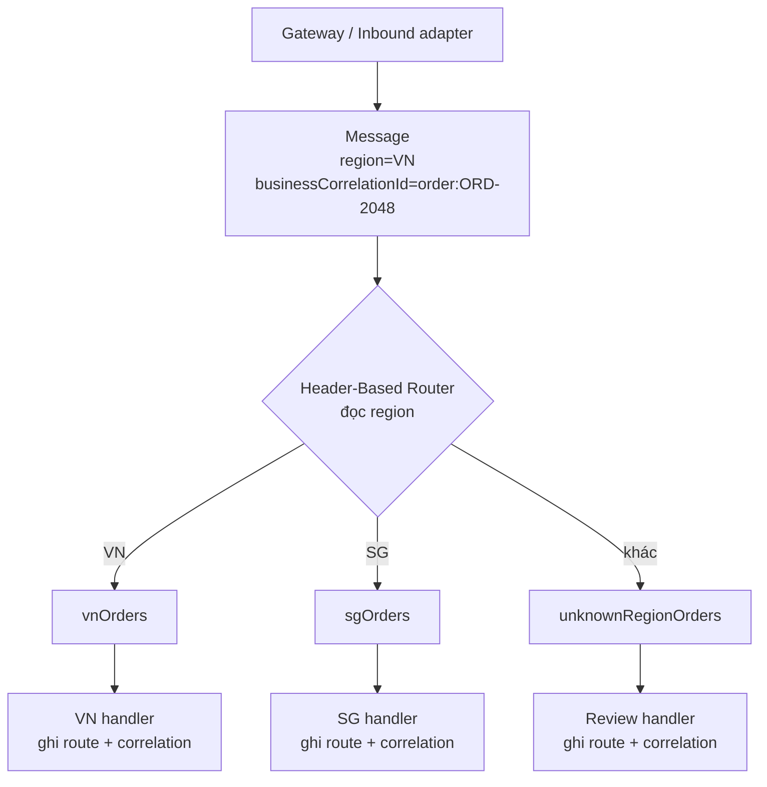
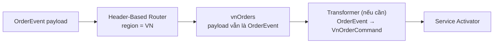
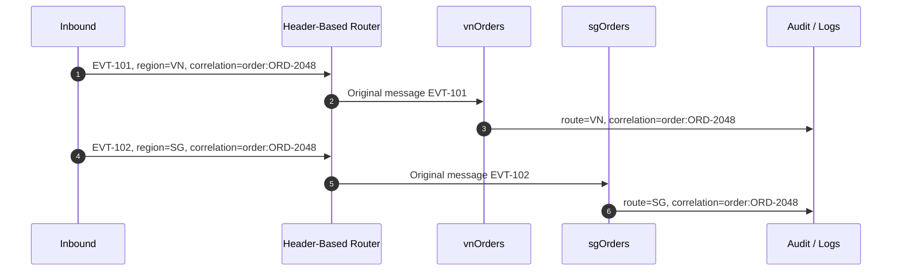
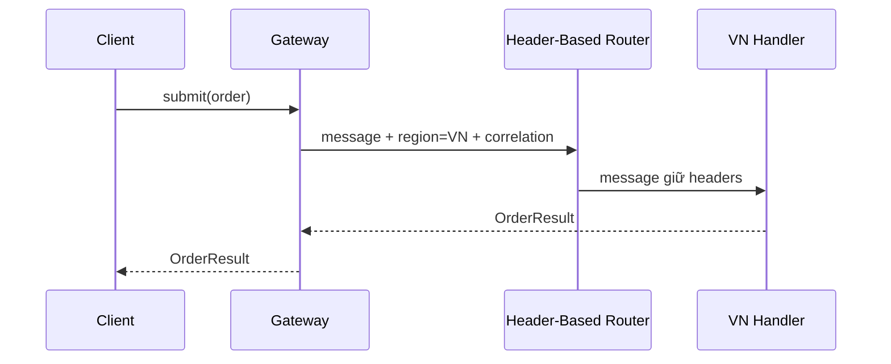
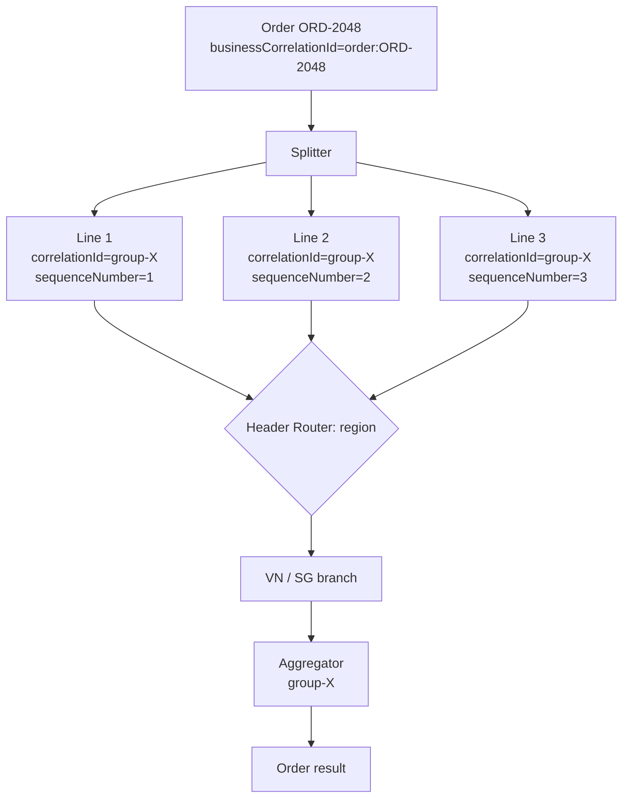
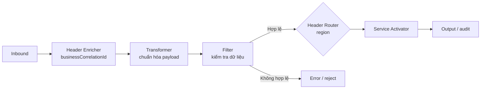

# Theo dõi route bằng correlation header trong Spring Integration

> **Chương:** Header-based router  
> **Bài học:** Theo dõi route bằng correlation header  
> **Bối cảnh:** Xây dựng Enterprise Integration Patterns với Spring Integration để liên kết các thành phần bằng thông điệp, điều phối Router, Filter, Transformer, Splitter, Aggregator và Gateway; theo dõi luồng, kiểm soát retry, error channel và correlation.

## 1. Bài toán: một message đã đi qua nhánh nào?

Một dịch vụ nhận sự kiện đơn hàng từ nhiều cửa hàng. Mỗi sự kiện có thể được chuyển sang kênh xử lý trong nước, khu vực quốc tế hoặc kênh kiểm tra thủ công. Đội vận hành cần trả lời:

- Yêu cầu `ORD-2048` đã được Router chuyển sang nhánh nào?
- Hai bản tin khác nhau có thuộc cùng đơn hàng không?
- Khi handler gặp lỗi và được retry, log của lần thử có nối được với sự kiện gốc không?
- Nếu Splitter chia một đơn thành nhiều dòng rồi Aggregator ghép lại, làm sao không nhầm correlation của nhóm với ID dùng cho truy vết nghiệp vụ?

Một Header-Based Router quyết định đích theo **message headers**, ví dụ `region=VN`. Để theo dõi các chặng, ta có thể truyền một header tương quan ổn định, chẳng hạn `businessCorrelationId=order:ORD-2048`, từ điểm tiếp nhận đến các kênh và handler.



**Ý chính:** header điều khiển định tuyến (`region`) và header giúp liên kết các bước (`businessCorrelationId`) có vai trò khác nhau. Router đọc `region` để chọn channel; các endpoint sau Router đọc cùng một `businessCorrelationId` để nối các dấu vết. Việc **chọn đích** không tự bảo đảm rằng handler đã xử lý thành công.

## 2. Phân biệt ba loại định danh trong message

Khi làm việc với Spring Integration, tên “correlation ID” dễ gây nhầm lẫn vì có nhiều ID phục vụ những mục đích khác nhau.

| Giá trị | Mục đích | Ai quản lý? |
| --- | --- | --- |
| `MessageHeaders.id` | Nhận diện một message cụ thể trong Spring Messaging | Framework khi tạo message |
| `businessCorrelationId` | Liên kết các event, log và kết quả thuộc cùng yêu cầu nghiệp vụ | Ứng dụng đặt theo hợp đồng |
| `traceId` | Liên kết các span trong hệ thống tracing phân tán | Hệ thống observability/tracing |
| `correlationId` | Thường dùng để **gom nhóm** message con cho Aggregator | Spring Integration/Splitter hoặc chiến lược correlation đã khai báo |
| `sequenceNumber`, `sequenceSize` | Xác định vị trí và số lượng message trong nhóm | Splitter/framework hoặc luồng được cấu hình tường minh |

### Ví dụ hai message cùng một đơn hàng

```text
Message A
  messageId             = 76c1...
  businessCorrelationId = order:ORD-2048
  traceId               = 4bf9...
  region                = VN
  payload               = OrderEvent(eventId=EVT-101, orderId=ORD-2048)

Message B
  messageId             = 8d32...
  businessCorrelationId = order:ORD-2048
  traceId               = 4bf9... hoặc một trace khác
  region                = SG
  payload               = OrderEvent(eventId=EVT-102, orderId=ORD-2048)
```

Hai message có **message ID khác nhau** nhưng cùng thuộc một đơn hàng, nên có thể mang cùng `businessCorrelationId`. `traceId` có thể giống nhau trong cùng một giao dịch phân tán hoặc khác nhau nếu hai event phát sinh ở hai trace riêng.

Không cố sửa `MessageHeaders.id` để biến nhiều message thành một. Cũng không gán tùy tiện `correlationId` chuẩn của framework để làm ID truy vết nghiệp vụ khi trong flow có Splitter/Aggregator.

**Quy ước dùng trong bài:** dùng `businessCorrelationId` làm header nghiệp vụ phục vụ audit và đối soát; giữ `correlationId` cho cơ chế gom nhóm nếu framework sử dụng. Tên header riêng có thể là `orderCorrelationId` hoặc `workflowId` tùy dự án, miễn nhất quán và không xung đột với header kỹ thuật.

## 3. Header-Based Router chọn đích như thế nào?

Header-Based Router là một Message Router đọc giá trị ở một header đã chỉ định và ánh xạ giá trị đó thành một hoặc nhiều kênh đích theo cấu hình.

Ví dụ:

```text
headers:
  region: "VN"
  businessCorrelationId: "order:ORD-2048"
  traceId: "4bf9..."

routing header = region
routing key    = VN
channelMapping = VN → vnOrders
destination    = vnOrders
```

Ở đây:

1. `region` là **routing header**.
2. `VN` là **routing key**.
3. `vnOrders` là **destination channel**.
4. `businessCorrelationId` là **metadata để truy vết**, không quyết định tuyến trong ví dụ.

Nếu sửa `businessCorrelationId` thành một ID khác nhưng giữ `region=VN`, Router vẫn chọn `vnOrders`. Ngược lại, nếu chuyển `region` sang `SG` mà giữ nguyên `businessCorrelationId`, message được điều hướng sang `sgOrders` nhưng vẫn có thể tra cứu theo cùng đơn hàng.

### Router không phải Transformer

Content-Based Router và Header-Based Router có thể khác nhau ở nguồn thông tin dùng để chọn đích, nhưng cùng chung nhiệm vụ định tuyến. Router không cần thay payload để thực hiện quyết định này:



Nếu đích cần một payload chuyên biệt, hãy dùng Transformer ở nhánh tương ứng. Nếu cần thêm correlation metadata, dùng Header Enricher hoặc bước tạo message tại ranh giới đáng tin cậy. Đừng ép routing function vừa chọn kênh vừa sửa đối tượng nghiệp vụ.

## 4. Hợp đồng metadata trước khi viết code

Một hệ thống dễ theo dõi cần quy ước rõ cách tạo, giữ và sử dụng headers.

| Header | Ví dụ | Quy tắc |
| --- | --- | --- |
| `region` | `VN` | Được chuẩn hóa trước Router; dùng để chọn đích |
| `businessCorrelationId` | `order:ORD-2048` | Ổn định giữa các message liên quan tới một đơn |
| `eventId` | `EVT-101` | Phân biệt từng event và hỗ trợ phát hiện event trùng |
| `sourceSystem` | `checkout-api` | Do adapter đáng tin cậy gán hoặc xác minh |
| `traceId` | `4bf9...` | Lấy từ hạ tầng tracing khi có |
| `correlationId` | ID nhóm của Splitter | Không ghi đè nếu Aggregator đang dùng |
| `replyChannel` | Channel do Gateway tạo | Để Gateway/framework quản lý |
| `errorChannel` | Channel nhận lỗi | Cấu hình theo đặc tính đồng bộ/bất đồng bộ |

Một ID liên kết cần có **nguồn đáng tin, ngữ nghĩa ổn định và vòng đời hợp lý**. Ví dụ `businessCorrelationId` dựa trên `orderId` đã được xác minh là đủ cho đối soát đơn hàng. Nếu định danh của hai tenant có thể trùng nhau, cần đặt namespace hoặc dùng cặp `tenantId + orderId` đã xác thực; không nên dùng một header tenant do client tự khai báo làm quyền truy cập.

Tránh đưa số thẻ thanh toán, access token, dữ liệu nhạy cảm hoặc toàn bộ payload vào correlation header. Header thường đi vào logging và message transport nên cũng cần chính sách bảo vệ.

## 5. Java DSL: định tuyến bằng region và giữ correlation

Ví dụ sử dụng Spring Integration Java DSL. Luồng nhận `OrderEvent`, đọc header `region` để phân tuyến và chuyển nguyên message đến một trong ba `QueueChannel`.

Ở bài học này `QueueChannel` dùng để **kiểm thử** đầu ra Router một cách rõ ràng. Trong ứng dụng thực tế, mỗi channel phải có consumer/poller hoặc có thể thay bằng `DirectChannel` nối Service Activator.

### 5.1. Cấu hình channel và flow

```java
package example.integration;

import org.springframework.context.annotation.Bean;
import org.springframework.context.annotation.Configuration;
import org.springframework.integration.channel.DirectChannel;
import org.springframework.integration.channel.QueueChannel;
import org.springframework.integration.config.EnableIntegration;
import org.springframework.integration.dsl.IntegrationFlow;
import org.springframework.messaging.MessageChannel;

@Configuration
@EnableIntegration
public class HeaderRoutingConfiguration {

    public record OrderEvent(
        String eventId,
        String orderId,
        String description
    ) {}

    @Bean
    public MessageChannel ordersInput() {
        return new DirectChannel();
    }

    @Bean
    public QueueChannel vnOrders() {
        return new QueueChannel();
    }

    @Bean
    public QueueChannel sgOrders() {
        return new QueueChannel();
    }

    @Bean
    public QueueChannel unknownRegionOrders() {
        return new QueueChannel();
    }

    @Bean
    public IntegrationFlow routeOrdersByRegion() {
        return IntegrationFlow.from("ordersInput")
            .route("headers['region']", spec -> spec
                .channelMapping("VN", "vnOrders")
                .channelMapping("SG", "sgOrders")
                .channelKeyFallback(false)
                .defaultOutputChannel("unknownRegionOrders")
                .resolutionRequired(true))
            .get();
    }
}
```

Giải thích những quyết định chính:

- `.route("headers['region']", ...)` dùng biểu thức SpEL đọc giá trị header `region` làm routing key.
- `channelMapping("VN", "vnOrders")` và mapping SG chỉ định kênh cho những key hợp lệ.
- `channelKeyFallback(false)` ngăn key chưa khai báo được tự dùng làm tên channel nội bộ.
- `defaultOutputChannel("unknownRegionOrders")` đưa thông điệp có region chưa hỗ trợ sang nơi xử lý riêng.
- `resolutionRequired(true)` thể hiện yêu cầu phải phân giải được đích; với default channel hợp lệ, key lạ có một đích dự phòng.
- Router không tạo hay ghi đè `businessCorrelationId`, `traceId` hoặc payload.

**Lưu ý API:** Java DSL cung cấp các overload của `route(...)` cho SpEL, payload và Router component. Ví dụ sử dụng overload biểu thức SpEL. Khi áp dụng vào dự án, kiểm tra đúng phiên bản Spring Integration đang sử dụng để chọn kiểu DSL phù hợp.

### 5.2. Gửi message có correlation header

Đầu vào có thể là Gateway, HTTP adapter hoặc listener từ message broker. Ví dụ trực tiếp dưới đây cho thấy cách xây một message khi điểm tiếp nhận đã xác minh dữ liệu:

```java
package example.integration;

import org.springframework.messaging.Message;
import org.springframework.messaging.support.MessageBuilder;

public final class OrderMessages {

    private OrderMessages() {}

    public static Message<HeaderRoutingConfiguration.OrderEvent> fromTrustedInput(
            HeaderRoutingConfiguration.OrderEvent event,
            String trustedRegion,
            String currentTraceId) {

        if (event == null || event.orderId() == null
                || event.orderId().isBlank()) {
            throw new IllegalArgumentException("Thiếu orderId hợp lệ");
        }
        if (trustedRegion == null || trustedRegion.isBlank()) {
            throw new IllegalArgumentException("Thiếu region");
        }

        return MessageBuilder.withPayload(event)
            .setHeader("region", trustedRegion)
            .setHeader("businessCorrelationId",
                "order:" + event.orderId())
            .setHeader("eventId", event.eventId())
            .setHeader("traceId", currentTraceId)
            .build();
    }
}
```

Ở đây `trustedRegion` phải đến từ nguồn đã chuẩn hóa/xác thực. `currentTraceId` chỉ minh họa giá trị trace do hệ thống observability cung cấp; dự án có Micrometer Observation hoặc OpenTelemetry nên dùng cơ chế propagation của hạ tầng thay vì tự sinh trace ID mới cho từng bước.

Vì `businessCorrelationId` được suy ra nhất quán từ `orderId`, hai sự kiện của cùng đơn có thể được truy vấn theo cùng một khóa, ngay cả khi chúng đi qua các nhánh khác nhau.

Ví dụ gửi:

```java
var event = new HeaderRoutingConfiguration.OrderEvent(
    "EVT-101", "ORD-2048", "Order accepted");

var message = OrderMessages.fromTrustedInput(
    event, "VN", "trace-42");

boolean accepted = ordersInput.send(message);
```

`ordersInput` trong đoạn gọi là `MessageChannel` đã được inject. Vì flow đi qua `DirectChannel`, thao tác định tuyến thường chạy đồng bộ ở thread gửi. Khi `accepted` là `true`, nó chưa chứng minh handler nghiệp vụ đã hoàn tất; trong demo message mới đến `QueueChannel` và có thể vẫn đang chờ consumer.

## 6. Luồng correlation khi hai message chọn hai nhánh khác nhau

Ta gửi hai event thuộc cùng đơn hàng:

```text
EVT-101 / ORD-2048 / region=VN / businessCorrelationId=order:ORD-2048
EVT-102 / ORD-2048 / region=SG / businessCorrelationId=order:ORD-2048
```

Kết quả mong đợi:



Một báo cáo audit theo `businessCorrelationId` có thể thấy hai route khác nhau thuộc cùng đơn hàng:

| eventId | businessCorrelationId | route | Kết quả quan sát |
| --- | --- | --- | --- |
| `EVT-101` | `order:ORD-2048` | `VN` | Message đã vào kênh VN |
| `EVT-102` | `order:ORD-2048` | `SG` | Message đã vào kênh SG |

Các dòng này mô tả **bước bàn giao đến channel**. Nếu muốn biết handler đã xử lý thành công, phải thêm tín hiệu từ service/adapter downstream, ví dụ `processingCompleted`, database status hoặc acknowledgement của broker.

### Correlation ID không phải routing key

Đừng cấu hình Router đọc `businessCorrelationId` chỉ vì muốn “theo dõi” route. Header này dùng để liên kết log. Router của ví dụ vẫn đọc `region`. Nếu muốn chia tải theo khóa đơn hàng để bảo đảm ordering, đó là bài toán routing theo khóa/phân vùng riêng và cần hợp đồng rõ ràng.

## 7. Ghi nhận route đã chọn ở đâu?

Nếu chỉ log tại **đầu vào Router**, ta biết message đến với `region=VN` nhưng chưa chứng minh nó đã được gửi đến `vnOrders`. Nếu log tại **channel đích**, ta có bằng chứng tốt hơn về quyết định dispatch.

### Cách 1: ghi log tại handler ở nhánh đích

Ví dụ một handler VN nhận message và ghi log kèm correlation:

```java
import org.slf4j.Logger;
import org.slf4j.LoggerFactory;
import org.springframework.messaging.Message;

public class RegionalOrderHandler {

    private static final Logger log =
        LoggerFactory.getLogger(RegionalOrderHandler.class);

    public void handleVn(
            Message<HeaderRoutingConfiguration.OrderEvent> message) {

        var headers = message.getHeaders();
        var event = message.getPayload();

        log.info("route=VN eventId={} businessCorrelationId={} messageId={}",
            event.eventId(),
            headers.get("businessCorrelationId"),
            headers.getId());

        // Thực thi nghiệp vụ.
        // Sau khi hoàn tất mới ghi một event/status success riêng.
    }
}
```

Để handler thực sự nhận được message, kênh `vnOrders` cần có consumer thích hợp. Trong demo dùng `QueueChannel`, bạn phải cấu hình polling consumer. Với luồng event-driven, có thể thay `vnOrders` bằng `DirectChannel` và nối Service Activator `.handle(regionalHandler, "handleVn")` ở flow tiêu thụ.

### Cách 2: dùng ChannelInterceptor ở kênh đích

Nếu cần quan sát **thời điểm message được gửi vào channel**, có thể gắn `ChannelInterceptor` cho channel đích. Ví dụ class độc lập:

```java
import org.slf4j.Logger;
import org.slf4j.LoggerFactory;
import org.springframework.messaging.Message;
import org.springframework.messaging.MessageChannel;
import org.springframework.messaging.support.ChannelInterceptor;

public final class RouteAuditInterceptor implements ChannelInterceptor {

    private static final Logger log =
        LoggerFactory.getLogger(RouteAuditInterceptor.class);

    private final String routeName;

    public RouteAuditInterceptor(String routeName) {
        this.routeName = routeName;
    }

    @Override
    public Message<?> preSend(
            Message<?> message,
            MessageChannel channel) {

        log.info(
            "routeDispatchAttempt={} businessCorrelationId={} messageId={}",
            routeName,
            message.getHeaders().get("businessCorrelationId"),
            message.getHeaders().getId());

        return message; // Không thay message đang được chuyển.
    }
}
```

Gắn interceptor cho bean channel cụ thể:

```java
@Bean
public QueueChannel vnOrders() {
    QueueChannel channel = new QueueChannel();
    channel.addInterceptor(new RouteAuditInterceptor("VN"));
    return channel;
}
```

Đoạn này là **phương án bổ sung cho bean `vnOrders` trong mục 5**, không phải tạo thêm bean thứ hai cùng tên.

`preSend(...)` được gọi **trước** khi channel thực hiện việc gửi. Vì thế log sử dụng nhãn `routeDispatchAttempt`: nó xác nhận message đang đi đến ranh giới channel đã chọn, **chưa chứng minh send thành công**. Nếu cần ghi sự kiện send đã hoàn tất, có thể dùng `postSend(...)` và kiểm tra cờ `sent` theo hợp đồng interceptor. Còn thành công nghiệp vụ phải được đo tại handler hoặc hệ thống đích.

### So sánh ba vị trí ghi nhận

| Vị trí | Biết chắc điều gì? | Chưa biết điều gì? |
| --- | --- | --- |
| Trước Router | Message đến với header điều kiện | Channel nào thực sự được chọn và gửi thành công |
| Channel đích | Router/flow đã thử chuyển message vào kênh này | Consumer có hoàn tất nghiệp vụ hay không |
| Cuối handler | Handler đã tới điểm ghi nhận; có thể báo success/failure | Kết quả của các hệ thống ngoài khác nếu chưa xác minh |

Một cách thiết kế log tốt là ghi **giai đoạn** rõ ràng: `ROUTING_RECEIVED` → `ROUTE_DISPATCHED` → `PROCESSING_COMPLETED` hoặc `PROCESSING_FAILED`, tất cả mang cùng `businessCorrelationId`. Nếu handler có retry, thêm attempt hoặc operation ID riêng để phân biệt từng lần thử.

## 8. Theo dõi bằng header khi đi qua Gateway request-reply

Gateway đưa lời gọi Java vào luồng thông điệp. Trong mô hình request-reply, Gateway cần reply chứa kết quả của nhánh đã xử lý, thường thông qua `replyChannel` được framework quản lý.



Khi thiết kế, cần phân biệt:

- `businessCorrelationId` liên kết các sự kiện nghiệp vụ.
- `replyChannel` chỉ đường phản hồi request-reply.
- `errorChannel` chỉ đường thông báo lỗi khi có cơ chế xử lý tương ứng.
- `correlationId` chuẩn của Spring Integration có thể được một pattern khác sử dụng để nhóm message.

**Không ghi đè `replyChannel` bằng correlation ID.** Cũng không tự đặt `correlationId` của framework chỉ để Gateway tìm lại caller. Gateway và các component request-reply có cơ chế riêng để gửi/nhận phản hồi.

Nếu nhánh đích chỉ đưa message vào queue rồi không có handler trả reply, Gateway vẫn có thể chờ đến timeout. Việc giữ đúng `businessCorrelationId` giúp tra cứu request, nhưng không tự tạo phản hồi.

### Bổ sung correlation khi source chưa có

Một adapter đầu vào có thể xây header từ ID nghiệp vụ đã xác minh, như `OrderMessages.fromTrustedInput(...)`. Nếu cần giữ giá trị đã được xác thực từ upstream, quy tắc nên là “dùng ID đáng tin đã có, nếu thiếu mới cấp ID theo hợp đồng”. Nếu mọi message tự sinh ID hoàn toàn mới tại từng hop, log không còn nối được.

Dùng Header Enricher ở ranh giới tiếp nhận để tập trung logic đó. Trong môi trường đa tenant, đặt namespace hoặc dùng ID toàn cục để tránh hai đơn trùng khóa làm lẫn audit.

## 9. Phân biệt business correlation với correlation cho Aggregator

Đây là điểm quan trọng nhất khi kết hợp Header-Based Router với **Splitter → Router → Aggregator**.

Một đơn có ba dòng sản phẩm:

```text
Order ORD-2048
  line-1: region=VN
  line-2: region=SG
  line-3: region=VN
```

Splitter tạo ba message con. Spring Integration có thể gắn những headers phục vụ ghép nhóm:

- `correlationId`: khóa nhóm của các message con.
- `sequenceNumber`: số thứ tự trong nhóm.
- `sequenceSize`: kích thước nhóm, khi được xác định.
- Các metadata bổ sung tùy flow và phiên bản.

Các message con cũng có thể giữ header `businessCorrelationId=order:ORD-2048` để vận hành tra cứu.



**Hai loại correlation cùng tồn tại:**

| Loại ID | Ví dụ | Dùng để làm gì? |
| --- | --- | --- |
| `businessCorrelationId` | `order:ORD-2048` | Truy vết toàn bộ vòng đời đơn hàng, có thể qua nhiều request |
| `correlationId` | `group-X` | Cho Aggregator biết các message con thuộc cùng nhóm hiện tại |

Không bắt buộc hai giá trị giống nhau. Một đơn hàng có thể được Splitter nhiều lần ở những chặng khác nhau; mỗi nhóm có vòng đời và release strategy riêng. Nếu cố thay `correlationId` thành `orderId` cho mọi lần split mà không tính đến nested groups, hai nhóm có thể bị trộn hoặc release sai.

### Những điều cần giữ ở Router

1. Routing function chỉ đọc `region` hoặc header chọn tuyến khác.
2. Không thay `correlationId`, `sequenceNumber`, `sequenceSize` để “ghi lại route”.
3. Không loại message con âm thầm nếu Aggregator đang đợi đủ kết quả.
4. Khi handler tạo message mới, cần bảo toàn metadata nhóm theo hợp đồng.
5. Aggregator có release/timeout/expiry strategy phù hợp với kết quả có thể thất bại hay đến muộn.

Nếu nhánh `unknownRegionOrders` nhận message con, nó nên tạo **kết quả lỗi có cấu trúc** và tiếp tục về Aggregator hoặc báo lỗi nhóm có kiểm soát; tránh để Aggregator chờ mãi vì thiếu một phần tử.

## 10. Correlation qua Router, Filter và Transformer

Một pipeline thực có thể gồm các bước:



Ở mỗi bước:

- **Header Enricher** bổ sung metadata ở nơi biết nguồn dữ liệu đáng tin.
- **Transformer** đổi payload nhưng cần giữ correlation metadata được yêu cầu ở message output.
- **Filter** quyết định cho qua hay loại; với message quan trọng, nhánh loại phải ghi nhận kết quả có tương quan.
- **Router** chọn channel theo header; không cần thay payload hay correlation.
- **Service Activator** xử lý nghiệp vụ và có thể dùng correlation để log, idempotency hoặc đối soát.

Có thể giữ payload một cách nhất quán mà vẫn mất correlation nếu một custom component tự xây message mới và bỏ qua các headers cần thiết. Vì vậy integration test nên kiểm tra **cả payload lẫn metadata** sau từng ranh giới quan trọng.

### Nếu một bước tạo Message mới

Ví dụ một custom Transformer làm việc với `Message<OrderEvent>`:

```java
import org.springframework.messaging.Message;
import org.springframework.messaging.support.MessageBuilder;

public Message<String> summarize(
        Message<HeaderRoutingConfiguration.OrderEvent> source) {

    String summary = "Order " + source.getPayload().orderId();

    return MessageBuilder.withPayload(summary)
        .copyHeaders(source.getHeaders())
        .build();
}
```

Đây chỉ là ví dụ cho thấy việc sao chép headers cần thiết khi tự dựng message mới. Trong ứng dụng thật, **không nên sao chép mù quáng mọi header qua ranh giới bên ngoài**: `replyChannel`, `errorChannel` và dữ liệu nhạy cảm có vòng đời riêng. Tại một adapter ra HTTP/Kafka/AMQP, phải áp dụng header mapper/whitelist phù hợp.

Khi Transformer trả về payload thuần (không tự dựng Message), Spring Integration thường có cơ chế đưa headers thích hợp sang message kết quả; vẫn nên test contract thay vì suy đoán mọi adapter đều giữ cùng headers.

## 11. Theo dõi correlation qua ranh giới bất đồng bộ

Giả sử Router chuyển vào `ExecutorChannel`, nơi handler chạy trên worker thread:

```text
Thread HTTP/Listener:
  messageId=A
  businessCorrelationId=order:ORD-2048
  -> Router: region=VN
  -> ExecutorChannel

Worker thread:
  receive message with businessCorrelationId=order:ORD-2048
  -> Handler
  -> Log/metric/business result
```

**Header nằm trong message** nên có thể được đọc ở worker nếu message được chuyển đúng. Nhưng `ThreadLocal` như MDC logging, transaction context hoặc security context **không tự động đi theo thread** chỉ vì message có correlation header.

Có hai lựa chọn thường kết hợp:

1. Ở handler, lấy `businessCorrelationId` trực tiếp từ `message.getHeaders()` và log tường minh.
2. Nếu dự án dùng tracing/MDC, cấu hình propagation phù hợp (`TaskDecorator` hoặc cơ chế quan sát do framework hỗ trợ), đồng thời làm sạch context sau mỗi lần xử lý.

Không truyền `SecurityContext` hoặc quyền truy cập chỉ dựa trên một string header do client tự gửi. Dữ liệu dùng để phân quyền phải được xác thực, và việc propagation security context cần giải pháp của tầng bảo mật.

### Mối quan hệ với retry

Một message có thể được xử lý lại sau timeout. Hai lần thử nên giữ cùng `businessCorrelationId` để biết chúng thuộc cùng yêu cầu, nhưng có thể thêm metadata attempt riêng:

```text
businessCorrelationId = order:ORD-2048
eventId               = EVT-101
route                 = VN
attempt               = 1
result                = TIMEOUT

businessCorrelationId = order:ORD-2048
eventId               = EVT-101
route                 = VN
attempt               = 2
result                = SUCCESS
```

Lưu ý ở tầng API thanh toán: retry có thể tạo tác dụng phụ trùng lặp nếu lần trước thực tế đã thành công nhưng phản hồi bị mất. Correlation để log **khác với cơ chế idempotency**; tuy có thể lấy khóa từ cùng ID nghiệp vụ, vẫn cần thiết kế chống trùng ở nơi thực thi side effect.

## 12. Message không có route và correlation

Một Router phải có chính sách khi `region` rỗng, không được hỗ trợ hoặc chưa có mapping. Ví dụ `region=TH` trong khi cấu hình chỉ có VN/SG:

```text
routingKey = TH
mappings   = {VN -> vnOrders, SG -> sgOrders}
fallback   = false
default    = unknownRegionOrders
```

Message đi vào `unknownRegionOrders` **với `businessCorrelationId` ban đầu**. Đây là lựa chọn hữu ích nếu yêu cầu cần được kiểm tra thủ công:

```text
route=UNKNOWN
businessCorrelationId=order:ORD-2048
eventId=EVT-103
region=TH
action=MANUAL_REVIEW
```

Nếu không có default channel và `resolutionRequired=true`, Router có thể phát lỗi khi không resolve được đích. Lỗi đó cũng cần gắn correlation trong log/error flow để không biến thành một exception không thể đối soát.

### Không nhầm lỗi routing với lỗi xử lý downstream

| Hiện tượng | Ý nghĩa | Chỗ cần xem |
| --- | --- | --- |
| `region` không map được | Không tìm thấy channel phù hợp | Mapping, default, `resolutionRequired` |
| Channel đã được chọn nhưng không có subscriber | Dispatch không được xử lý như mong đợi | Subscriber/poller và channel lifecycle |
| Queue nhận message nhưng consumer không đọc | Chậm hoặc tắc xử lý downstream | Poller/consumer/queue metrics |
| Handler đã chạy nhưng nghiệp vụ thất bại | Lỗi business/transport | Retry, error flow, idempotency |
| Correlation header bị mất sau broker | Ranh giới serialization/header mapping | Cấu hình adapter và contract |

Một correlation header giúp **tìm được lỗi**, nhưng không tự sửa lỗi định tuyến, bổ sung consumer hoặc đảm bảo message bền vững qua restart.

## 13. Correlation ID qua HTTP, Kafka và AMQP

Trong một JVM, Spring Integration có thể chuyển cùng message (hoặc message xây lại với headers thích hợp) qua nhiều channel. Khi ra một transport bên ngoài, cần kiểm tra các giới hạn và cơ chế ánh xạ header.

### HTTP

Một REST adapter có thể nhận header như `X-Correlation-Id` hoặc `traceparent`. Không nên tin mọi giá trị từ client cho mục đích bảo mật. Nếu sử dụng custom business correlation, xác định cách ánh xạ header HTTP sang `businessCorrelationId`, validate độ dài/ký tự và liên kết với dữ liệu đã được xác thực.

### Kafka

Header của Spring Messaging không mặc nhiên ánh xạ toàn bộ sang Kafka headers theo cách bạn mong đợi. Adapter và header mapper quyết định header nào được truyền, cách encode/decode và kiểu giá trị sau deserialize. Nên có integration test từ producer tới consumer để chứng minh `businessCorrelationId` thực sự còn ở phía nhận.

### AMQP

Tương tự, các message properties/headers của broker và Spring Messaging có quy ước riêng. Nếu môi trường cần broker-level correlation ID, hãy phân biệt nó với `correlationId` dùng cho Aggregator và với ID nghiệp vụ của ứng dụng. Chọn mapping tường minh để tránh xung đột tên và ý nghĩa.

**Không dùng Java object identity để truy vết qua transport.** Sau serialization và deserialize, message/payload có thể là đối tượng mới. Dùng giá trị correlation, event ID và metadata tracing nhất quán.

## 14. Kiểm thử JUnit 5: chứng minh route và correlation

Các test sau kiểm tra trực tiếp các channel của cấu hình `HeaderRoutingConfiguration`. Chúng xác nhận đúng route, correlation được giữ, và hai message khác nhau có thể cùng business correlation.

```java
package example.integration;

import static org.junit.jupiter.api.Assertions.*;

import org.junit.jupiter.api.Test;
import org.springframework.beans.factory.annotation.Autowired;
import org.springframework.beans.factory.annotation.Qualifier;
import org.springframework.integration.channel.QueueChannel;
import org.springframework.messaging.Message;
import org.springframework.messaging.MessageChannel;
import org.springframework.messaging.support.MessageBuilder;
import org.springframework.test.context.junit.jupiter.SpringJUnitConfig;

@SpringJUnitConfig(HeaderRoutingConfiguration.class)
class HeaderRoutingTest {

    @Autowired
    @Qualifier("ordersInput")
    private MessageChannel ordersInput;

    @Autowired
    @Qualifier("vnOrders")
    private QueueChannel vnOrders;

    @Autowired
    @Qualifier("sgOrders")
    private QueueChannel sgOrders;

    @Autowired
    @Qualifier("unknownRegionOrders")
    private QueueChannel unknownRegionOrders;

    @Test
    void routeVnPreservesCorrelation() {
        var event = new HeaderRoutingConfiguration.OrderEvent(
            "EVT-101", "ORD-2048", "Accepted");

        Message<?> input = MessageBuilder.withPayload(event)
            .setHeader("region", "VN")
            .setHeader("businessCorrelationId", "order:ORD-2048")
            .setHeader("eventId", "EVT-101")
            .setHeader("traceId", "trace-42")
            .build();

        assertTrue(ordersInput.send(input));

        Message<?> output = vnOrders.receive(1_000);
        assertNotNull(output);
        assertSame(event, output.getPayload());
        assertEquals("order:ORD-2048",
            output.getHeaders().get("businessCorrelationId"));
        assertEquals("trace-42",
            output.getHeaders().get("traceId"));
        assertEquals("VN", output.getHeaders().get("region"));

        assertNull(sgOrders.receive(0));
        assertNull(unknownRegionOrders.receive(0));
    }

    @Test
    void twoRoutesCanShareBusinessCorrelation() {
        var vn = new HeaderRoutingConfiguration.OrderEvent(
            "EVT-102", "ORD-2048", "VN step");
        var sg = new HeaderRoutingConfiguration.OrderEvent(
            "EVT-103", "ORD-2048", "SG step");

        assertTrue(ordersInput.send(
            MessageBuilder.withPayload(vn)
                .setHeader("region", "VN")
                .setHeader("businessCorrelationId", "order:ORD-2048")
                .build()));

        assertTrue(ordersInput.send(
            MessageBuilder.withPayload(sg)
                .setHeader("region", "SG")
                .setHeader("businessCorrelationId", "order:ORD-2048")
                .build()));

        Message<?> outVn = vnOrders.receive(1_000);
        Message<?> outSg = sgOrders.receive(1_000);

        assertNotNull(outVn);
        assertNotNull(outSg);
        assertSame(vn, outVn.getPayload());
        assertSame(sg, outSg.getPayload());
        assertEquals("order:ORD-2048",
            outVn.getHeaders().get("businessCorrelationId"));
        assertEquals("order:ORD-2048",
            outSg.getHeaders().get("businessCorrelationId"));
        assertNotEquals(outVn.getHeaders().getId(),
            outSg.getHeaders().getId());
    }

    @Test
    void unknownRegionKeepsCorrelationOnDefaultRoute() {
        var event = new HeaderRoutingConfiguration.OrderEvent(
            "EVT-104", "ORD-2050", "New region");

        assertTrue(ordersInput.send(
            MessageBuilder.withPayload(event)
                .setHeader("region", "TH")
                .setHeader("businessCorrelationId", "order:ORD-2050")
                .build()));

        Message<?> output = unknownRegionOrders.receive(1_000);
        assertNotNull(output);
        assertSame(event, output.getPayload());
        assertEquals("TH", output.getHeaders().get("region"));
        assertEquals("order:ORD-2050",
            output.getHeaders().get("businessCorrelationId"));

        assertNull(vnOrders.receive(0));
        assertNull(sgOrders.receive(0));
    }
}
```

Đây là **integration test cho Router và channel trong cùng Spring context**, không phải test việc gọi API thanh toán hoặc Kafka. Các test dùng `QueueChannel` không có poller nên message vẫn nằm trong queue để test tự đọc.

`assertSame` chứng minh cùng object payload được chuyển qua Router trong **flow nội bộ tối giản**. Khi thêm Transformer, serialization hoặc adapter bên ngoài, hãy so sánh giá trị theo hợp đồng dữ liệu thay vì identity của object.

### Kiểm thử thêm các trường hợp quan trọng

| Trường hợp | Điều cần kiểm chứng |
| --- | --- |
| Không có header `region` | Theo chính sách, vào default hoặc phát lỗi rõ ràng |
| `region` có giá trị không được hỗ trợ | Không tự đi vào bean channel trùng tên ngoài mapping |
| Hai event khác nhau cùng đơn | Cùng `businessCorrelationId`, event ID khác |
| Hai đơn khác nhau | Không trộn correlation và kết quả nghiệp vụ |
| Header correlation bị thiếu | Adapter/Enricher bổ sung hoặc reject theo contract |
| Service Activator thất bại | Lỗi có correlation và đi đến error flow đúng |
| Chuyển qua ExecutorChannel | Metadata còn nguyên ở worker thread |
| Message con từ Splitter | `correlationId`/sequence còn cho Aggregator |
| Đi qua broker | Header mapper và deserialize giữ giá trị correlation |

Không dùng `Thread.sleep(...)` cố định để kiểm tra flow bất đồng bộ. Dùng `CountDownLatch`, Awaitility hoặc cơ chế chờ có timeout và kiểm tra trạng thái cuối cùng.

## 15. Ví dụ thực hành: Splitter, route và trace của từng line

Giả sử đơn `ORD-3001` có ba dòng, cần đưa từng dòng đến handler theo `fulfillmentRegion`.

### Hợp đồng đầu vào

```text
Order
  orderId: ORD-3001
  businessCorrelationId: order:ORD-3001

Line-1: fulfillmentRegion=VN
Line-2: fulfillmentRegion=SG
Line-3: fulfillmentRegion=VN
```

Một thiết kế khả thi:

1. Tại điểm nhận, xác định `businessCorrelationId` dựa trên đơn hàng hợp lệ.
2. Splitter tạo các message con và metadata nhóm cần thiết.
3. Nếu Router dựa trên header, bổ sung/chuẩn hóa `fulfillmentRegion` cho **từng message con** trước Router.
4. Router chọn VN/SG mà không sửa `businessCorrelationId` hay các headers nhóm.
5. Mỗi handler trả một kết quả có cấu trúc, kể cả trường hợp thất bại cần Aggregator nhận.
6. Aggregator nhóm kết quả theo correlation strategy; phát một `OrderFulfillmentResult`.
7. Ghi audit/metrics theo `businessCorrelationId` và `eventId`, đồng thời ghi group ID cho xử lý nhóm.

Log ví dụ:

```text
stage=SPLIT    businessCorrelationId=order:ORD-3001 groupId=g-01 seq=1
stage=ROUTE    businessCorrelationId=order:ORD-3001 groupId=g-01 route=VN
stage=COMPLETE businessCorrelationId=order:ORD-3001 groupId=g-01 seq=1

stage=SPLIT    businessCorrelationId=order:ORD-3001 groupId=g-01 seq=2
stage=ROUTE    businessCorrelationId=order:ORD-3001 groupId=g-01 route=SG
stage=COMPLETE businessCorrelationId=order:ORD-3001 groupId=g-01 seq=2

stage=AGGREGATE businessCorrelationId=order:ORD-3001 groupId=g-01 status=COMPLETED
```

Chỉ là log minh họa; `groupId` đại diện cho metadata kỹ thuật của nhóm, không cần bằng chuỗi `order:ORD-3001`. Một hệ thống thực tế nên dùng formatter/logging policy chung để tránh log sai hoặc rò rỉ dữ liệu.

## 16. Những sai lầm hay gặp

### 16.1. Đặt tên mọi thứ là correlationId

Nếu một header vừa bị dùng làm order ID, trace ID, khóa Aggregator và reply matching, chỉ cần một bước thay đổi giá trị sẽ gây khó truy vết. Đặt tên riêng theo ý nghĩa: `businessCorrelationId` cho nghiệp vụ, `traceId` cho trace, `correlationId` theo cơ chế nhóm nếu framework đang dùng.

### 16.2. Tạo ID mới ở từng handler

Message đi qua Router có correlation A, sang Service Activator thành B, rồi khi retry thành C. Log của cùng nghiệp vụ bị tách thành nhiều chuỗi. Giữ correlation chính ổn định; có thể thêm `attemptId` hoặc `operationId` cho từng bước riêng.

### 16.3. Log “route thành công” trước khi channel gửi

`ChannelInterceptor.preSend` chạy trước dispatch, chưa chứng minh subscriber nhận hay handler xử lý. Ghi nhãn `dispatchAttempt` tại thời điểm đó, dùng `postSend` hoặc downstream event/metric cho những mức thành công cao hơn.

### 16.4. Tin correlation header do client gửi để cấp quyền

Correlation ID chỉ là metadata liên kết. Nó không chứng minh người gửi có quyền truy cập đơn hàng. Luôn kiểm tra principal, tenant và business ownership ở ranh giới được xác thực.

### 16.5. Header bị mất ở adapter bên ngoài

Một test nội bộ PASS không bảo đảm Kafka/HTTP/AMQP giữ `businessCorrelationId`. Cần kiểm tra mapper, serialization và test end-to-end giữa producer/consumer.

### 16.6. Thay đổi correlationId do Splitter tạo

Nếu Router hoặc handler ghi đè `correlationId`, Aggregator có thể gom sai nhóm hoặc không release. Giữ metadata nhóm và thiết kế correlation strategy tại Aggregator.

### 16.7. Cho rằng Router tự tạo correlation

Header-Based Router chỉ chọn destination theo header; nó không tự tạo business correlation ID phù hợp với mọi nghiệp vụ. Đặt ID tại gateway/adapter/Enricher ở ranh giới có đủ thông tin đáng tin cậy.

### 16.8. Bỏ message con khi region chưa hỗ trợ

Nếu Router drop một message con thuộc nhóm có `sequenceSize=3`, Aggregator có thể chỉ nhận 2 kết quả. Dùng default/error result hoặc chính sách timeout/expire có kiểm soát, giữ correlation để đối soát.

## 17. Bài tập tổng hợp

**Bối cảnh:** nền tảng xử lý yêu cầu hỗ trợ nhận `SupportTicket(ticketId, region, priority)` từ Gateway và message broker. Router chọn nhóm khu vực dựa trên `region`. Hai ticket event khác nhau có thể cùng một `ticketId`.

**Yêu cầu:**

1. Tạo input contract rõ ràng cho `SupportTicket` và header `region`.
2. Xác định `businessCorrelationId=ticket:<ticketId>` ở ranh giới đã xác minh.
3. Tạo Header-Based Router với mapping `VN`, `SG` và default channel cho region chưa hỗ trợ.
4. Thêm audit ở các destination channel; ghi `businessCorrelationId`, `eventId`, `route` và giai đoạn xử lý.
5. Viết test hai event cùng ticket đi qua hai route khác nhau nhưng giữ chung correlation.
6. Kiểm tra message có region lạ vẫn giữ correlation khi đi default.
7. Chuyển một nhánh sang `ExecutorChannel`, kiểm tra metadata ở worker và propagation của tracing.
8. Giả lập service timeout, thêm retry có giới hạn và idempotency; phân biệt attempt ID với business correlation.
9. Giả lập Splitter/Aggregator trên các bước con; chứng minh không ghi đè `correlationId` và sequence headers.
10. Nếu xuất message sang Kafka, viết integration test xác minh correlation ở consumer.

### Bảng kết quả kỳ vọng

| Input | Route | Header correlation đầu ra |
| --- | --- | --- |
| `TICKET-1, region=VN` | `vnTickets` | `ticket:TICKET-1` |
| `TICKET-1, region=SG` | `sgTickets` | `ticket:TICKET-1` |
| `TICKET-2, region=TH` | `unknownRegionTickets` | `ticket:TICKET-2` |
| Cùng ticket, lần retry thứ hai | Route theo policy | Vẫn cùng business ID, attempt khác |
| Dòng con từ Splitter | Route theo header riêng | Vẫn business ID và correlation nhóm hợp lệ |

### Câu hỏi tự đánh giá

**Câu 1:** `businessCorrelationId` có phải là routing key mặc định của Header-Based Router không?

*Không. Router dùng header được chỉ định trong cấu hình, ví dụ `region`. Correlation để liên kết những message/log liên quan.*

**Câu 2:** Vì sao không dùng `MessageHeaders.id` làm khóa chung cho mọi event của một đơn hàng?

*Mỗi message có ID riêng; những event khác nhau của cùng đơn cần một khóa liên kết nghiệp vụ ổn định.*

**Câu 3:** Tại sao không nên tự ghi đè `correlationId` khi có Splitter/Aggregator?

*Vì ID này có thể là khóa nhóm mà Aggregator dùng để gom kết quả; thay sai khiến message bị trộn nhóm hoặc không hoàn tất.*

**Câu 4:** Nếu có log ở `preSend` của channel VN, điều đó chứng minh nghiệp vụ đã hoàn tất chưa?

*Chưa. Nó chỉ ghi nhận một lần thử gửi vào channel. Cần theo dõi sau dispatch và trạng thái hoàn tất tại handler.*

**Câu 5:** Correlation header còn giúp truy vết sau khi message chuyển qua Kafka không?

*Có nếu adapter/mapper truyền nó qua transport và consumer đọc lại đúng; điều này cần được cấu hình và kiểm thử.*

## 18. Checklist triển khai trong hệ thống thực

- **Định danh:** có quy tắc rõ cho message ID, business correlation, tracing và correlation nhóm.
- **Nguồn metadata:** chỉ dùng giá trị được xác thực/chuẩn hóa tại ranh giới tin cậy.
- **Routing:** chọn header điều kiện phù hợp; mappings, default và fallback tường minh.
- **Bảo toàn:** giữ correlation cần thiết qua Router, Transformer, Gateway và adapter.
- **Quan sát:** log route được chọn tại điểm phù hợp và phân biệt dispatch với processing success.
- **Lỗi:** giữ correlation trong error flow, retry, reject và nhánh default.
- **Aggregation:** không phá `correlationId`, `sequenceNumber`, `sequenceSize` của nhóm.
- **Bất đồng bộ:** không dựa vào ThreadLocal không được propagation; dùng metadata message và tracing framework.
- **Vận chuyển:** kiểm tra header mapper/serializer khi đi qua HTTP/Kafka/AMQP.
- **Kiểm thử:** xác minh đúng destination, correlation xuyên nhiều event, lỗi, retry và message con.
- **Bảo mật:** không biến correlation ID thành chứng thực truy cập và không log dữ liệu nhạy cảm.

**Ghi nhớ:** Header-Based Router quyết định **điểm đến** theo một header; correlation header giúp ta liên kết **hành trình xử lý** của nhiều message. Dùng một business correlation ID ổn định để tra cứu nghiệp vụ, giữ correlation kỹ thuật của Splitter/Aggregator đúng vai trò và ghi nhận từng giai đoạn route/handler rõ ràng. Nhờ đó, các nhánh Spring Integration có thể được điều phối, kiểm thử và theo dõi mà không làm lẫn lộn định tuyến, tracing và nhóm message.
