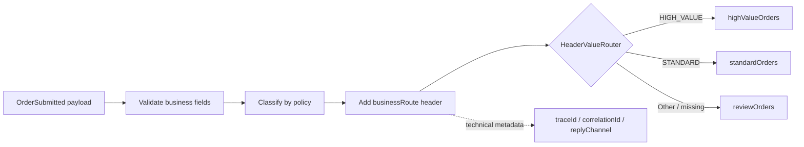
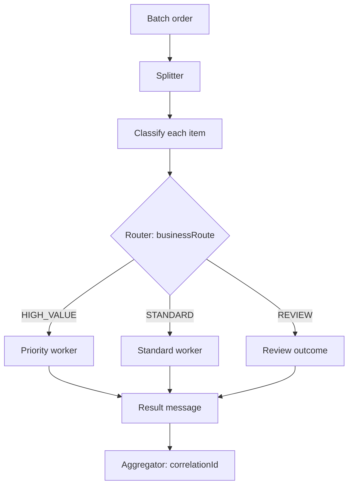
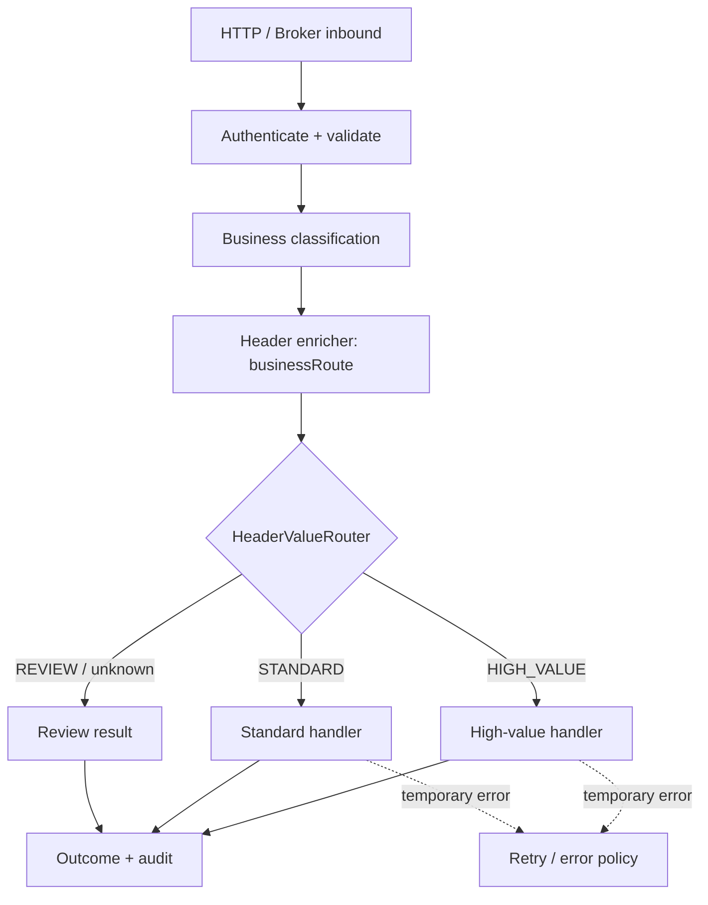

# Phân biệt header kỹ thuật với header nghiệp vụ

Trong **Spring Integration**, một message gồm **payload** và **headers**. Payload thường biểu diễn dữ liệu được xử lý; headers đi kèm giúp hệ thống phân phối, liên kết, quan sát và giải thích ngữ cảnh xử lý message. Tuy nhiên, **không phải mọi header đều thuần túy kỹ thuật**. Một số header mang thông tin phục vụ điều phối theo quy tắc nghiệp vụ, ví dụ `businessRoute=HIGH_VALUE`, `fulfillmentRegion=VN_SOUTH` hoặc `processingClass=MANUAL_REVIEW`.

Phân biệt **header kỹ thuật** và **header nghiệp vụ** giúp thiết kế đúng **Header-based Router**, bảo toàn dữ liệu khi đổi adapter, không nhầm routing key với correlation ID và không biến metadata do client tự gắn thành quyền truy cập hệ thống. Đây là chủ đề của chương **Header-based router** trong module `SPRING_INTEGRATION_PATTERN`: học triển khai Enterprise Integration Patterns (EIP) với Router, Filter, Transformer, Splitter, Aggregator, Gateway, retry, error channel và correlation, đồng thời kiểm thử và quan sát các nhánh xử lý sao cho luồng ít phụ thuộc, dễ mở rộng.

**Mục tiêu học tập:**

- Nêu được mục đích, vòng đời và nguồn tin cậy của header kỹ thuật so với header nghiệp vụ.
- Phân loại được các trường như `id`, `replyChannel`, `correlationId`, `traceId`, `businessRoute`, `tenantId` và `eventType` trong một tình huống cụ thể.
- Quyết định thông tin nào phải sống trong **hợp đồng dữ liệu bền vững**, thông tin nào chỉ cần ở metadata của một lần xử lý.
- Thiết lập một **routing header nghiệp vụ** từ payload đã được kiểm tra, sau đó dùng `HeaderValueRouter` chọn channel mà không phụ thuộc headers nội bộ của framework.
- Xử lý header thiếu, sai kiểu, bị giả mạo, bị mất qua adapter; viết kiểm thử chứng minh cả nhánh bình thường lẫn fallback.

## 1. Hai vai trò, không phải hai kiểu header riêng của Java

Spring Messaging cung cấp `org.springframework.messaging.Message<T>` với `getPayload()` và `getHeaders()`. Trong `MessageHeaders`, cả header kỹ thuật và header do ứng dụng tự định nghĩa đều là **các mục metadata dạng khóa–giá trị**. Spring không có một hệ phân loại tự động, phổ quát gọi là `TechnicalHeader` và `BusinessHeader` cho mọi ứng dụng.

Sự phân biệt nằm ở **ngữ nghĩa và chủ thể chịu trách nhiệm**:

| Khía cạnh | Header kỹ thuật | Header nghiệp vụ / điều phối theo nghiệp vụ |
| --- | --- | --- |
| Câu hỏi trả lời | “Message được vận chuyển, theo dõi hoặc xử lý trong flow như thế nào?” | “Message nên đi nhánh nào theo chính sách nghiệp vụ?” |
| Người thường tạo | Framework, endpoint, channel, adapter, tracing infrastructure hoặc chính ứng dụng phục vụ vận hành. | Thành phần nghiệp vụ phân loại hoặc bước **Header Enricher** dựa trên dữ liệu đã kiểm tra. |
| Ví dụ | `id`, `timestamp`, `replyChannel`, `errorChannel`, `correlationId`, `sequenceNumber`, `sequenceSize`. | `businessRoute`, `fulfillmentRegion`, `processingClass`, `riskBand` do ứng dụng định nghĩa. |
| Phạm vi sống | Thường gắn với một lần tạo/giao nhận message, một flow hoặc một nhóm xử lý. | Có thể chỉ sống trong một flow hoặc cần được lưu bền vững nếu quyết định có giá trị nghiệp vụ lâu dài. |
| Khi đổi transport | Có thể được tái tạo, thay thế hoặc không ánh xạ sang transport mới. | Phải **quy định rõ** sẽ được ánh xạ, tính lại hay lưu trong hợp đồng sự kiện. |
| Nguy cơ chính | Lạm dụng ID/metadata của framework như dữ liệu nghiệp vụ ổn định. | Tin giá trị do nguồn ngoài tự khai báo, dẫn đến chọn sai nhánh hoặc sai quyền. |

Không được hiểu bảng này là quy tắc “header kỹ thuật luôn do Spring tạo; header nghiệp vụ luôn do lập trình viên tạo”. `traceId` do ứng dụng tự thêm vẫn phục vụ **quan sát kỹ thuật**; `businessRoute` do một bước tự động tính vẫn mang **quyết định điều phối nghiệp vụ**. **Ai tạo header không phải tiêu chí duy nhất để phân loại.**

## 2. Ví dụ nhìn vào một message thực tế

Giả sử luồng nhận lệnh kiểm tra đơn hàng. Sau bước xác thực và phân loại, ứng dụng bổ sung một routing header để chọn handler:

```text
Message<OrderSubmitted>
├── payload
│   ├── eventId           = "evt-8101"
│   ├── orderId           = "ORD-8101"
│   ├── customerId        = "CUS-12"
│   ├── amountCents       = 1500000
│   └── occurredAt        = 2026-11-21T03:00:00Z
└── headers
    ├── id                = message UUID
    ├── timestamp         = thời điểm tạo message (nếu có)
    ├── businessRoute     = "HIGH_VALUE"
    ├── traceId           = "trace-abc"
    ├── correlationId     = "batch-52"
    ├── replyChannel      = channel phản hồi (nếu có)
    └── errorChannel      = channel lỗi (nếu có)
```

`eventId`, `orderId`, `customerId`, `amountCents`, `occurredAt` mô tả **sự kiện và trạng thái nghiệp vụ**. Chúng phải được bảo toàn trong payload hoặc event envelope được lưu/tuần tự hóa khi một consumer khác cần hiểu và phát lại sự kiện.

`businessRoute=HIGH_VALUE` có thể được tạo từ `amountCents` và chính sách của hệ thống. **Header này không làm thay đổi số tiền hay loại sự kiện**; nó diễn đạt **quyết định chuyển nhánh** tại thời điểm xử lý. Nếu chính sách được áp dụng lại khi replay, giá trị này có thể được tính khác đi; cần chọn chiến lược và ghi rõ trong hợp đồng.

Ngược lại, `correlationId=batch-52` giúp gom các message thuộc cùng một lượt xử lý; `traceId` hỗ trợ tìm log; `replyChannel` chỉ nơi trả lời. Những metadata này không nên được dùng thay thế cho `orderId` hoặc `eventId`.



## 3. Phân loại những header thường gặp

### 3.1. Các header thường phục vụ cơ chế kỹ thuật

| Header / trường metadata | Vai trò điển hình | Điểm cần tránh nhầm |
| --- | --- | --- |
| `id` | ID của Spring message (thường được framework cấp khi dựng message). | **Không phải** mã đơn hàng hoặc ID sự kiện bền vững khi replay. |
| `timestamp` | Thời điểm message được tạo, khi được cấp. | **Không phải** thời điểm nghiệp vụ `occurredAt`; có thể đổi khi message được tái tạo. |
| `replyChannel` | Chỉ kênh gửi phản hồi trong mẫu request–reply. | Không phải routing key cho business flow; có thể là tham chiếu channel nội bộ. |
| `errorChannel` | Chỉ kênh xử lý lỗi trong những cơ chế Spring Integration phù hợp. | Không phải giá trị “nghiệp vụ bị từ chối” để gửi cho mọi caller. |
| `correlationId` | Nhóm các message liên quan, đặc biệt trong Splitter/Aggregator. | Không tự đồng nghĩa `orderId`, `eventId` hoặc route key. |
| `sequenceNumber` | Thứ tự của một message trong nhóm khi pattern sinh sequence. | Không phải số lần thử lại hoặc thứ tự toàn hệ thống. |
| `sequenceSize` | Kích thước nhóm message theo metadata của pattern. | Không tự thay đổi khi một Filter loại message con. |
| `traceId` / trace context | Liên kết log và distributed traces theo quy ước hệ thống. | Chỉ là convention/framework-specific; không phải bằng chứng xác thực. |
| `contentType` | Gợi ý kiểu nội dung cho chuyển đổi/serialization trong phạm vi hỗ trợ. | Không đảm bảo mọi adapter đều giữ nguyên giá trị. |

Một số header như `id`, `timestamp`, `replyChannel`, `errorChannel` có tên và vai trò được Spring Messaging định nghĩa. Các header như correlation/sequence được Spring Integration sử dụng trong những EIP tương ứng. `traceId` ở dạng chuỗi trong ví dụ chỉ là **quy ước của ứng dụng**; các hệ tracing có thể dùng những trường/propagation format khác (ví dụ W3C Trace Context) và phải cấu hình tương ứng.

Không nên tự ghi đè những header framework quan trọng chỉ để “nhét” dữ liệu nghiệp vụ. Ví dụ, đặt `headers.id = orderId` phá vỡ sự phân biệt giữa vòng đời message và vòng đời đơn hàng; thay vào đó, lưu `orderId` trong payload, cần header phụ thì dùng tên riêng có ý nghĩa rõ ràng.

### 3.2. Header nghiệp vụ dùng để chọn nhánh

| Header tùy biến | Ngữ nghĩa giả định | Nhánh minh họa | Rủi ro cần xử lý |
| --- | --- | --- | --- |
| `businessRoute` | Kết quả phân loại loại xử lý cần thực hiện. | `HIGH_VALUE`, `STANDARD`, `REVIEW`. | Cần thống nhất enum/chuỗi và nguồn tạo đáng tin. |
| `fulfillmentRegion` | Khu vực thực hiện giao vận. | `VN_NORTH`, `VN_SOUTH`. | Có thể là dữ liệu hợp đồng phải lưu bền vững nếu dùng để quyết toán vận chuyển. |
| `processingClass` | Chính sách SLA hoặc mức độ kiểm tra. | `FAST`, `MANUAL_REVIEW`. | Không tin mức ưu tiên do client tự yêu cầu nếu phải trả phí hoặc qua kiểm duyệt. |
| `riskBand` | Nhóm rủi ro do mô hình/phương pháp nghiệp vụ phân loại. | `LOW`, `MEDIUM`, `HIGH`. | Cần phiên bản chính sách, xử lý bảo mật và khả năng giải thích khi audit. |
| `tenantRoute` | Chỉ dẫn chọn pipeline theo tenant đã được xác minh. | `TENANT_A_PIPELINE`, `TENANT_B_PIPELINE`. | Không thay thế authentication/authorization và cô lập dữ liệu tenant. |

**Những tên header ở bảng này do ứng dụng tự định nghĩa**, không phải danh sách header cố định có sẵn của Spring. Chúng là header nghiệp vụ vì **giá trị mang một quyết định hoặc phân loại thuộc miền bài toán**. Nếu một quyết định có ý nghĩa lâu dài, chỉ đặt nó trong header nội bộ có thể chưa đủ: cần lưu bằng một trường trong hợp đồng sự kiện, bản ghi quyết định hoặc metadata truyền bền vững theo schema đã thỏa thuận.

### 3.3. Các trường “lai” cần xét theo bối cảnh

Một trường không mặc nhiên thuộc duy nhất một nhóm trong mọi hệ thống:

**`tenantId`:** Nếu tenant là đối tượng sở hữu dữ liệu và bắt buộc để hiểu bản ghi, nó thuộc **ngữ cảnh nghiệp vụ và ranh giới bảo mật**; có thể được giữ trong hợp đồng dữ liệu. Một bản sao đã được xác minh trong header có thể hỗ trợ routing, nhưng giá trị do client tự gắn **không tự đáng tin**.

**`eventType`:** Đây thường là phần của **hợp đồng sự kiện bền vững** (ví dụ `OrderCreated`, `OrderCancelled`). Có thể sao chép sang header để Router dễ chọn nhánh, nhưng không nên chỉ lưu trong header nếu consumer cần đọc lại sự kiện từ broker hoặc database.

**`priority`:** Có thể là **quy tắc nghiệp vụ** (“khách mua gói giao nhanh”), hoặc **ưu tiên điều phối kỹ thuật** (“message này được xử lý trước trong một channel/queue”). Hai ngữ nghĩa liên quan nhưng không đồng nhất. Nên đặt tên tường minh như `serviceTier` và `dispatchPriority`, tránh để một header mơ hồ quyết định cả quyền lợi khách hàng lẫn chính sách hàng đợi.

**`sourceSystem`:** Có thể dùng để thống kê và điều phối kỹ thuật, hoặc là yếu tố xác định nguồn sự kiện nghiệp vụ. Dù dùng làm route key, nó vẫn cần được xác minh ở ranh giới tiếp nhận nếu ảnh hưởng quyền truy cập hay nhánh xử lý.

## 4. Hai câu hỏi quan trọng hơn tên header

Thay vì hỏi “header này có phải *business header* theo Spring không?”, hãy trả lời:

1. **Ý nghĩa của giá trị là gì?** Nó mô tả **sự thật nghiệp vụ phải bảo toàn** hay chỉ mô tả **cách xử lý một lượt message**?
2. **Ai có quyền tạo/sửa và giá trị sống đến đâu?** Nó có thể bị tái tạo ở gateway, bị đổi ở transformer, bị mất ở broker hoặc bị giả mạo bởi client không?

Một ma trận quyết định thực tế:

| Khi cần… | Thiết kế khuyến nghị |
| --- | --- |
| Lưu và replay chính xác `orderId`, `amountCents`, `occurredAt`. | Đặt trong payload/event contract, không phụ thuộc một Spring header nội bộ. |
| Giữ route theo SLA chỉ trong lần xử lý hiện tại. | Tính `businessRoute` ở bước phân loại tin cậy, gắn vào header, định tuyến bằng `HeaderValueRouter`. |
| Giải thích quyết định SLA nhiều tháng sau. | Lưu quyết định, thời gian và `policyVersion` trong dữ liệu audit/hợp đồng bền vững. |
| Gom kết quả Splitter/Aggregator. | Sử dụng correlation/sequence theo vòng đời nhóm; không dùng business route thay khóa nhóm. |
| Trả phản hồi cho request Gateway. | Giữ reply/correlation mechanism đúng mẫu request–reply; không dùng tên business route làm reply destination. |
| Chuyển request giữa các tenant. | Xác thực identity và đối chiếu tenant, rồi mới sinh routing metadata theo allowlist. |
| Theo dõi một message qua async/broker. | Dùng tracing/context propagation tương thích transport; không coi một custom header tự động đi qua mọi adapter. |

## 5. Java DSL: tạo header nghiệp vụ mà không can thiệp header kỹ thuật

Ví dụ này minh họa toàn bộ đường đi tối thiểu: **payload có dữ liệu nghiệp vụ**, **Header Enricher** tính `businessRoute`, **HeaderValueRouter** chọn channel. Framework tự quản lý những header kỹ thuật trong các endpoint liên quan; ứng dụng không sửa `id`, `replyChannel` hoặc `correlationId` để thực hiện định tuyến.

### 5.1. Mô hình dữ liệu và quy tắc phân loại

```java
record OrderSubmitted(String eventId, String orderId, long amountCents) {}

final class OrderRoutePolicy {

    private OrderRoutePolicy() {}

    static String route(OrderSubmitted order) {
        if (order.orderId() == null || order.orderId().isBlank()
                || order.amountCents() <= 0) {
            return "REVIEW";
        }
        return order.amountCents() >= 1_000_000 ? "HIGH_VALUE" : "STANDARD";
    }
}
```

`REVIEW`, `HIGH_VALUE`, `STANDARD` là **giá trị do ứng dụng quy định**, không phải trạng thái của Spring Integration. Để đơn giản, ví dụ phân loại dựa trên trường đã có; trong hệ thống thực cần validate `eventId`, nguồn tin cậy, tính hợp lệ của dữ liệu và chính sách quyền ưu tiên trước khi coi kết quả là quyết định chính thức.

### 5.2. Tạo flow với Header Enricher + HeaderValueRouter

```java
import org.springframework.context.annotation.Bean;
import org.springframework.context.annotation.Configuration;
import org.springframework.integration.channel.DirectChannel;
import org.springframework.integration.channel.QueueChannel;
import org.springframework.integration.dsl.IntegrationFlow;
import org.springframework.integration.router.HeaderValueRouter;

@Configuration
class BusinessHeaderRouterConfig {

    @Bean
    DirectChannel ordersInput() {
        return new DirectChannel();
    }

    @Bean
    QueueChannel highValueOrders() {
        return new QueueChannel();
    }

    @Bean
    QueueChannel standardOrders() {
        return new QueueChannel();
    }

    @Bean
    QueueChannel reviewOrders() {
        return new QueueChannel();
    }

    @Bean
    HeaderValueRouter businessRouteRouter() {
        HeaderValueRouter router = new HeaderValueRouter("businessRoute");
        router.setChannelMapping("HIGH_VALUE", "highValueOrders");
        router.setChannelMapping("STANDARD", "standardOrders");
        router.setChannelMapping("REVIEW", "reviewOrders");
        router.setChannelKeyFallback(false);
        router.setDefaultOutputChannelName("reviewOrders");
        return router;
    }

    @Bean
    IntegrationFlow orderRoutingFlow(HeaderValueRouter businessRouteRouter) {
        return IntegrationFlow.from("ordersInput")
                .enrichHeaders(headers -> headers.headerFunction(
                        "businessRoute",
                        message -> OrderRoutePolicy.route(
                                (OrderSubmitted) message.getPayload())))
                .route(businessRouteRouter)
                .get();
    }
}
```

**Diễn giải theo trách nhiệm:**

1. `ordersInput` là điểm nhận message vào flow.
2. Header Enricher đọc payload **đã được ứng dụng cho phép xử lý** và tính `businessRoute` theo `OrderRoutePolicy`.
3. `businessRouteRouter` đọc header đó, dùng bảng ánh xạ để chọn `highValueOrders`, `standardOrders` hoặc `reviewOrders`.
4. `setChannelKeyFallback(false)` tránh việc một giá trị lạ được thử dùng như **tên channel trực tiếp**, làm giảm nguy cơ thoát khỏi allowlist.
5. `setDefaultOutputChannelName("reviewOrders")` là phương án dự phòng khi không phân giải được route hợp lệ; ứng dụng phải bảo đảm nhánh này thực sự có consumer nếu cần lưu/giải quyết yêu cầu.

`QueueChannel` trong ví dụ giúp đọc message ở cuối nhánh khi kiểm thử. Nó **không phải broker bền vững** và không tự triển khai tính năng xử lý đơn hàng. Ở production, cần channel/endpoint và cơ chế giao nhận phù hợp với tính quan trọng của dữ liệu.

**Lưu ý về tên header:** `businessRoute` là header **tùy biến**. Không lạm dụng `id`, `timestamp`, `replyChannel`, `errorChannel` hoặc `correlationId` cho mục đích này vì những header đó có ngữ nghĩa kỹ thuật riêng.

### 5.3. Tạo một message đầu vào

```java
import org.springframework.messaging.Message;
import org.springframework.messaging.MessageChannel;
import org.springframework.messaging.support.MessageBuilder;

class OrderPublisher {

    void publish(MessageChannel ordersInput) {
        OrderSubmitted order = new OrderSubmitted(
                "evt-8101", "ORD-8101", 1_500_000);

        Message<OrderSubmitted> message = MessageBuilder.withPayload(order)
                .setHeader("traceId", "trace-abc")
                .build();

        ordersInput.send(message);
        // Không cần producer tự gắn businessRoute:
        // bước enrichment sẽ tính từ dữ liệu nghiệp vụ được xử lý.
    }
}
```

Khi đến `highValueOrders`, payload vẫn là `OrderSubmitted`; `businessRoute` đã được thêm bởi flow. `traceId` là metadata quan sát và **không** được dùng để quyết định khách hàng có thuộc nhóm giá trị cao hay không. Thành công của `send()` chỉ có ý nghĩa tại ranh giới channel đang sử dụng, **không phải** bằng chứng đơn hàng đã hoàn tất xử lý.

## 6. Phản ví dụ: dùng header kỹ thuật để route nghiệp vụ

### Sai lầm A — Dùng `correlationId` như mã nhóm khách hàng

```java
// Không nên dùng correlationId để đại diện nhóm giá trị đơn hàng.
Message<OrderSubmitted> message = MessageBuilder.withPayload(order)
        .setHeader("correlationId", "HIGH_VALUE")
        .build();
```

Một Splitter/Aggregator có thể sử dụng `correlationId` để **nhận diện một nhóm message thuộc cùng một lượt xử lý**. Nếu mọi đơn giá trị cao đều mang `correlationId=HIGH_VALUE`, Aggregator có nguy cơ gom nhầm các đơn hàng độc lập. Cần giữ ID nhóm xử lý đúng phạm vi và dùng header khác như `businessRoute` để chọn nhánh.

### Sai lầm B — Dùng `replyChannel` làm kênh đích nghiệp vụ

`replyChannel` có ngữ nghĩa kỹ thuật của **request–reply**. Gateway hoặc endpoint có thể dùng nó để gửi câu trả lời về đúng nơi. Nếu ứng dụng sửa `replyChannel` thành `highValueOrders` chỉ để định tuyến, phản hồi của một lời gọi Gateway có thể thất lạc hoặc vào nhầm đường. Dùng `HeaderValueRouter` với `businessRoute` để chọn nhánh chính, **không thay đổi contract phản hồi**.

### Sai lầm C — Dùng `headers.id` như ID sự kiện

`MessageHeaders.id` nhận diện một message theo framework, không thay thế `eventId` bền vững. Khi message được tái tạo, chuyển adapter hoặc phát lại, ID của message mới có thể khác. Nếu khử trùng lặp dựa vào `headers.id`, cùng một sự kiện có thể bị xử lý nhiều lần. `eventId` phải được đặt trong event contract hoặc nguồn dữ liệu có tính bền vững.

### Sai lầm D — Dùng `traceId` như bằng chứng được phép xử lý

Một header `traceId` có thể do client hoặc adapter cung cấp, có thể thiếu hoặc bị giả. Nó phục vụ **observability**, không phải authentication. Gửi message sang nhánh hoàn tiền chỉ vì `traceId` có tiền tố nào đó là thiết kế không an toàn. Với nghiệp vụ nhạy cảm, xác thực danh tính và kiểm tra quyền độc lập tại ingress và handler.

## 7. Header nghiệp vụ không đồng nghĩa sự thật nghiệp vụ bền vững

Đây là ranh giới dễ nhầm nhất: một header được dùng để route theo nghiệp vụ **không nhất thiết là nơi lưu trữ chuẩn của dữ liệu nghiệp vụ**.

Giả sử `OrderSubmitted` có `amountCents=1_500_000`, và chính sách phiên bản `v1` đặt `businessRoute=HIGH_VALUE`. Một tháng sau, chính sách `v2` thay ngưỡng. Nếu phát lại cùng sự kiện, hai mục tiêu có thể khác nhau:

| Mục tiêu replay | Cách thiết kế phù hợp |
| --- | --- |
| **Áp dụng chính sách mới** cho đơn hàng cũ. | Tính lại `businessRoute` từ payload sau khi xác minh, ghi version mới và kiểm soát side effects. |
| **Tái hiện chính xác quyết định cũ** phục vụ audit hoặc xử lý bù trừ. | Lưu `policyVersion`, kết quả phân loại, thời điểm quyết định trong event envelope/bản ghi bền vững. |
| **Chuyển message sang một ứng dụng khác** qua broker. | Định nghĩa rõ trường nào nằm trong payload/serialized envelope, trường nào phải ánh xạ thành transport headers. |

Ví dụ event envelope **được tuần tự hóa** có thể lưu quyết định và phiên bản khi đó là yêu cầu hợp đồng:

```json
{
  "eventId": "evt-8101",
  "eventType": "OrderSubmitted",
  "orderId": "ORD-8101",
  "amountCents": 1500000,
  "occurredAt": "2026-11-21T03:00:00Z",
  "routingDecision": {
    "businessRoute": "HIGH_VALUE",
    "policyVersion": "v1"
  }
}
```

Đây là **hợp đồng dữ liệu của ứng dụng**, không phải định dạng `MessageHeaders` do Spring tự tạo. Trong một flow, có thể trích `routingDecision.businessRoute` từ payload và gắn vào header tạm để HeaderValueRouter định tuyến. Như vậy **nguồn sự thật nằm trong dữ liệu bền vững**, còn header giúp các endpoint nội bộ hoạt động thuận tiện.

## 8. Header qua adapter và ranh giới hệ thống

Phân loại kỹ thuật/nghiệp vụ không thay thế câu hỏi **giá trị có thực sự vượt qua ranh giới giao thức không**. Spring `MessageHeaders` tồn tại trong ứng dụng; Kafka record headers, AMQP properties/headers và HTTP headers có schema, kiểu và hạn chế riêng.

```text
Spring Message
  payload = OrderSubmitted
  headers = {businessRoute, traceId, correlationId, replyChannel, ...}
       |
       v
Outbound adapter / serializer / header mapper
       |
       v
External transport (Kafka, AMQP, HTTP, ...)
       |
       v
Inbound adapter / deserializer / header mapper
       |
       v
Spring Message mới (payload + headers có thể khác)
```

Các tình huống cần xét:

- **Header nội bộ có đối tượng `MessageChannel`:** ví dụ `replyChannel` có thể là một tham chiếu kênh trong ứng dụng; không thể giả định nó sẽ được serialize nguyên vẹn sang service khác.
- **Header tùy biến không được ánh xạ:** `businessRoute` có thể không xuất hiện ở consumer nếu outbound/inbound mapper không chuyển tên/kiểu đó. Cần cấu hình và test mapping hoặc tái tạo route từ payload.
- **Đổi tên hoặc kiểu:** transport có thể truyền byte/string khác với kiểu Java lúc tạo. Router nên dùng tập giá trị canonical và validation cụ thể.
- **Tracing:** header `traceId` tự đặt không bảo đảm tracing context được propagate qua mọi thread hay adapter; dùng cơ chế context propagation/tracing được hỗ trợ.
- **Bảo mật:** các trường nhạy cảm không nên tự động sao chép vào logs hoặc transport headers. Quy định rõ trường nào được phép lộ ra bên ngoài.

**Quy tắc thực hành:** Bất cứ khi nào một routing header nghiệp vụ là điều kiện cần để consumer xử lý đúng, phải có **contract transport** hoặc **quy tắc tái tạo header** đáng tin, thay vì giả định `MessageHeaders` được giữ nguyên end-to-end.

## 9. Bảo mật: header nghiệp vụ có thể điều khiển một nhánh nhạy cảm

Một client có thể gửi `businessRoute=HIGH_VALUE`, `tenantRoute=TENANT_A_PIPELINE` hoặc `riskBand=LOW` với mục đích điều khiển đường đi. Nếu hệ thống chỉ đọc các giá trị đó mà không xác minh, một header điều phối có thể biến thành **đường vượt kiểm soát nghiệp vụ hoặc cô lập tenant**.

Những biện pháp quan trọng:

1. **Xác thực ở ingress** (HTTP, broker, gateway) và **kiểm tra quyền** đối với thao tác/tenant liên quan.
2. **Tính hoặc ghi đè routing header** dựa trên payload đã validate và chính sách máy chủ. Header người dùng gửi chỉ là dữ liệu đầu vào cần kiểm tra, không phải kết quả chính sách đáng tin.
3. **Dùng allowlist giá trị → channel**, không trực tiếp dùng tên channel tùy ý do client cung cấp. Với Mapping Router, cân nhắc tắt channel-key fallback khi không cần.
4. **Kiểm tra quyền lần nữa tại handler nhạy cảm**; tới đúng channel không tương đương được phép thực hiện hoàn tiền hoặc truy cập dữ liệu tenant.
5. **Audit quyết định quan trọng** với policy version, ID nghiệp vụ, kết quả và nguồn đã xác minh; tránh lộ PII/secret trong headers hoặc metrics.

Một header kỹ thuật như `sourceSystem` cũng không mặc nhiên đáng tin chỉ vì tên có vẻ “thuộc hạ tầng”. **Ranh giới tin cậy phụ thuộc nguồn phát và cơ chế xác minh**, không phụ thuộc tên gọi technical/business.

## 10. Tác động tới các Enterprise Integration Patterns

Khi một message đi qua nhiều pattern, mỗi loại header nên giữ đúng trách nhiệm:

| EIP / thành phần | Header liên quan | Lưu ý thiết kế |
| --- | --- | --- |
| **Header-based Router** | `businessRoute`, `fulfillmentRegion` | Đọc khóa từ policy tin cậy; fallback cho giá trị lạ, không tự chuyển thành quyền. |
| **Filter** | Có thể đọc header kỹ thuật hoặc nghiệp vụ theo điều kiện. | Predicate trả `false` không tự tạo `ErrorMessage`; discard khác exception. |
| **Transformer** | Thường đổi payload; có thể tạo/giữ/đổi headers theo endpoint. | Kiểm thử propagation, đừng đánh rơi correlation/reply metadata quan trọng. |
| **Splitter** | `correlationId`, `sequenceNumber`, `sequenceSize` theo pattern. | Không dùng `businessRoute` để phân biệt các nhóm con. |
| **Aggregator** | Correlation và release strategy. | Nếu Router/Filter làm mất message con, nhóm có thể chờ thiếu; có timeout hoặc kết quả bị từ chối rõ ràng. |
| **Gateway** | `replyChannel`, error/reply correlation. | Mọi nhánh cần reply phải trả đúng hợp đồng; Router không tự gửi phản hồi. |
| **Retry** | Metadata lần xử lý, event ID bền vững. | Không lấy message ID làm khóa idempotency qua các lần phát lại. |
| **Error flow** | `errorChannel`, `ErrorMessage`, exception context. | Không biến business rejection bình thường thành lỗi kỹ thuật nếu không có chủ ý. |

### Ví dụ: route theo nghiệp vụ nhưng gom theo correlation kỹ thuật



Trong một batch ba item, có thể hai item dùng `businessRoute=HIGH_VALUE` và một item dùng `STANDARD`; cả ba vẫn phải thuộc **cùng correlation group** nếu Aggregator cần gom thành một kết quả batch. Nếu một nhánh bị loại mà không phát kết quả, metadata `sequenceSize=3` vẫn có thể khiến Aggregator chờ đủ ba phần tử. Thiết kế một `ItemRejected`/`ItemSkipped` có correlation phù hợp, hoặc timeout/release policy có chủ đích; không sửa `correlationId` thành giá trị route chỉ để dễ định tuyến.

## 11. Kiểm thử: phân biệt đúng header và đúng nhánh

Ngoài unit test cho `OrderRoutePolicy`, một integration test cần chứng minh **routing header được sinh từ payload**, **header kỹ thuật không bị lạm dụng**, **message tới đúng channel**, và **fallback có đường xử lý**.

### 11.1. Unit test chính sách phân loại

```java
import static org.junit.jupiter.api.Assertions.assertEquals;

import org.junit.jupiter.api.Test;

class OrderRoutePolicyTest {

    @Test
    void classifiesValidAndInvalidOrders() {
        assertEquals("HIGH_VALUE", OrderRoutePolicy.route(
                new OrderSubmitted("evt-1", "ORD-1", 1_500_000)));
        assertEquals("STANDARD", OrderRoutePolicy.route(
                new OrderSubmitted("evt-2", "ORD-2", 500_000)));
        assertEquals("REVIEW", OrderRoutePolicy.route(
                new OrderSubmitted("evt-3", "ORD-3", -1)));
    }
}
```

### 11.2. Integration test luồng Router

Ví dụ dùng cấu hình `BusinessHeaderRouterConfig` ở mục 5, JUnit 5 và Spring Test:

```java
import static org.junit.jupiter.api.Assertions.assertEquals;
import static org.junit.jupiter.api.Assertions.assertNotNull;
import static org.junit.jupiter.api.Assertions.assertNull;
import static org.junit.jupiter.api.Assertions.assertTrue;

import org.junit.jupiter.api.Test;
import org.springframework.beans.factory.annotation.Autowired;
import org.springframework.beans.factory.annotation.Qualifier;
import org.springframework.integration.channel.QueueChannel;
import org.springframework.messaging.Message;
import org.springframework.messaging.MessageChannel;
import org.springframework.messaging.support.MessageBuilder;
import org.springframework.test.context.junit.jupiter.SpringJUnitConfig;

@SpringJUnitConfig(BusinessHeaderRouterConfig.class)
class BusinessHeaderRoutingFlowTest {

    @Autowired @Qualifier("ordersInput")
    MessageChannel input;

    @Autowired @Qualifier("highValueOrders")
    QueueChannel highValue;

    @Autowired @Qualifier("standardOrders")
    QueueChannel standard;

    @Autowired @Qualifier("reviewOrders")
    QueueChannel review;

    @Test
    void createsBusinessHeaderAndPreservesUnrelatedMetadata() {
        OrderSubmitted order = new OrderSubmitted("evt-1", "ORD-1", 1_500_000);
        assertTrue(input.send(MessageBuilder.withPayload(order)
                .setHeader("traceId", "trace-1")
                .build()));

        Message<?> routed = highValue.receive(1_000);
        assertNotNull(routed);
        assertEquals(order, routed.getPayload());
        assertEquals("HIGH_VALUE", routed.getHeaders().get("businessRoute"));
        assertEquals("trace-1", routed.getHeaders().get("traceId"));
        assertNull(standard.receive(0));
        assertNull(review.receive(0));
    }

    @Test
    void invalidAmountGoesToReviewInsteadOfBeingSilentlyDropped() {
        OrderSubmitted order = new OrderSubmitted("evt-2", "ORD-2", 0);
        assertTrue(input.send(MessageBuilder.withPayload(order).build()));

        Message<?> routed = review.receive(1_000);
        assertNotNull(routed);
        assertEquals(order, routed.getPayload());
        assertEquals("REVIEW", routed.getHeaders().get("businessRoute"));
        assertNull(highValue.receive(0));
        assertNull(standard.receive(0));
    }
}
```

`QueueChannel` làm đích quan sát nên ví dụ không cần gọi API nghiệp vụ thật. Để chạy trong dự án, cần các dependency Spring Integration/Spring Test/JUnit, application context phù hợp và các class ví dụ được đặt vào source tương ứng. Test trên chỉ chứng minh các nhánh chính được minh họa; không có ý nghĩa xác nhận delivery/ACK ở broker hay transaction nghiệp vụ.

### 11.3. Ma trận kiểm thử đầy đủ hơn

| Trường hợp | Điều phải xác minh |
| --- | --- |
| Có payload hợp lệ và không có `businessRoute` ban đầu. | Bước enrichment tạo đúng route, Router chuyển tới channel phù hợp. |
| Payload không hợp lệ. | Tới `REVIEW` hoặc nhánh lỗi đúng hợp đồng, không được mặc định thành công. |
| Client cố tự gắn `businessRoute=HIGH_VALUE` trái chính sách. | Thành phần tin cậy tính lại/ghi đè hoặc từ chối, không cho client tự chọn nhánh. |
| Thiếu `traceId`. | Business routing vẫn theo chính sách; observability áp dụng fallback phù hợp. |
| Header correlation và sequence hợp lệ. | Routing không dùng chúng làm route key hoặc làm sai grouping. |
| Header lạ/sai kiểu ở ingress. | Validation/normalization hoặc fallback được áp dụng, có metrics. |
| Transformer/adapter thay đổi message. | Các trường bắt buộc còn hoặc được ánh xạ/tái tạo đúng. |
| Gateway có request–reply. | Reply đến đúng caller; nhánh `REVIEW` trả kết quả/hành vi no-reply theo hợp đồng. |
| Splitter chia batch sang nhiều nhánh. | Aggregator gom đúng correlation, không chờ vô hạn nếu item bị loại. |
| Retry sau lỗi tạm thời. | Idempotency dựa vào khóa bền vững; không lặp side effect. |

## 12. Quan sát và vận hành: nên log điều gì?

Khi xảy ra sự cố “đơn hàng đi sai nhánh”, log chỉ ghi `messageId` hoặc `channel=highValueOrders` thường không đủ để tìm nguyên nhân. Cần biết **đầu vào nghiệp vụ**, **phiên bản chính sách**, **routing decision** và **kết quả giao nhận**.

Ví dụ một sự kiện log có cấu trúc:

```text
eventId=evt-8101 orderId=ORD-8101 policyVersion=v1
businessRoute=HIGH_VALUE selectedChannel=highValueOrders
traceId=trace-abc routingOutcome=ROUTED
```

Đây là **định dạng log minh họa của ứng dụng**, không phải output tự động được Spring tạo ra. Với metrics có thể theo dõi `router_received_total`, `router_routed_total{route="HIGH_VALUE"}`, `router_unmatched_total` và `router_delivery_failed_total`, nhưng phải tự instrument hoặc cấu hình observability tương ứng.

Không dùng `orderId`, `eventId`, `customerId` làm nhãn metrics do **high cardinality**; cũng không ghi payload hoặc headers chứa dữ liệu cá nhân một cách vô điều kiện. Khi cần tracing qua executor/reactive channel, kiểm tra propagation context; không giả định mọi `ThreadLocal`/MDC tự chuyển thread đúng.

## 13. Tình huống tổng hợp: phân tuyến yêu cầu hoàn tất đơn hàng

Một hệ thống thương mại điện tử nhận `OrderSubmitted` qua HTTP và broker. Quy tắc nghiệp vụ: các đơn có giá trị cao phải đi nhánh chuyên trách; đơn thông thường đi nhánh tiêu chuẩn; dữ liệu chưa hợp lệ đi nhánh rà soát. Đồng thời, các nhánh đều phải trả kết quả nếu yêu cầu đến từ Gateway, và khi một batch có nhiều đơn phải giữ correlation để Aggregator tổng hợp. Broker có thể phát lại message sau crash.

**Cách phân tách metadata hợp lý:**

| Dữ liệu | Nơi ưu tiên lưu/biểu diễn | Trách nhiệm |
| --- | --- | --- |
| `eventId`, `orderId`, `amountCents`, `occurredAt` | Payload/event contract bền vững | Hiểu sự kiện, replay, kiểm toán, idempotency theo hợp đồng. |
| `businessRoute`, `policyVersion` | Header tạm để route; lưu quyết định/version bền vững nếu yêu cầu audit. | Chuyển nhánh theo chính sách. |
| `correlationId`, `sequenceNumber`, `sequenceSize` | Metadata của nhóm split/aggregate. | Gom đúng các kết quả của cùng một lượt xử lý. |
| `replyChannel`, `errorChannel` | Metadata điều phối của message/endpoint. | Trả lời đúng request và định tuyến lỗi theo cơ chế hỗ trợ. |
| `traceId`/tracing context | Metadata quan sát được propagate rõ ràng. | Theo dõi các nhánh, không thay thế kiểm tra quyền. |

Đường đi tham khảo:



**Bài tập tự thực hành:**

1. Viết bảng định nghĩa **từng header** trong luồng: tên, người tạo, kiểu dữ liệu, có phải giá trị tin cậy không, có được lưu qua replay không.
2. Cho một client gửi `businessRoute=HIGH_VALUE` nhưng payload có `amountCents=100`. Điều gì phải xảy ra? **Bước phân loại tin cậy phải tính lại hoặc từ chối**, không cho header của client tự nâng quyền điều phối.
3. Cho Splitter tạo bốn message con, một message bị Router đưa sang `nullChannel`. Aggregator dựa vào `sequenceSize=4` có thể gặp vấn đề gì? **Có thể chỉ nhận ba kết quả và chờ mãi** nếu không có timeout/release policy hoặc kết quả thay thế.
4. Cho một adapter Kafka không truyền `businessRoute` sang consumer. Làm sao tránh định tuyến sai? **Thiết kế mapper phù hợp hoặc tái tạo route từ event contract bền vững**, rồi kiểm thử end-to-end.
5. Cho Gateway chờ kết quả trong khi nhánh `REVIEW` chỉ lưu log. Caller sẽ nhận gì? **Không có reply nghiệp vụ tự động**; cần kết quả từ chối hoặc no-reply/timeout policy được định nghĩa.

## Tổng kết

- **Header kỹ thuật** phục vụ vòng đời message, transport, reply, lỗi, correlation, sequence hoặc observability; **header nghiệp vụ** thường mang quyết định phân loại/định tuyến từ chính sách của ứng dụng. Đây là phân biệt về **ngữ nghĩa**, không phải hai kiểu Java riêng.
- **Tên và người tạo không quyết định tuyệt đối loại header**: `traceId` tùy biến vẫn chủ yếu kỹ thuật, còn `businessRoute` do máy tự tính vẫn thể hiện chính sách nghiệp vụ.
- **Dữ liệu nghiệp vụ cần lưu bền vững** thuộc payload/event contract hoặc bản ghi quyết định có schema; đừng trông cậy một header nội bộ luôn tồn tại sau replay hoặc đổi transport.
- **HeaderValueRouter** nên dùng routing header được tạo từ nguồn tin cậy, giá trị chuẩn hóa, mapping allowlist và nhánh fallback rõ ràng; không dùng `replyChannel`, `correlationId`, `id` hoặc `traceId` để thay khóa nghiệp vụ.
- Với **Gateway, Splitter/Aggregator, retry và error channel**, giữ nguyên trách nhiệm riêng của reply, correlation, idempotency và lỗi; đừng coi định tuyến thành công là nghiệp vụ đã hoàn tất.
- **Kiểm thử nhánh và ranh giới adapter**, theo dõi nguồn của quyết định route và bảo vệ headers khỏi giả mạo hoặc rò rỉ dữ liệu nhạy cảm.
