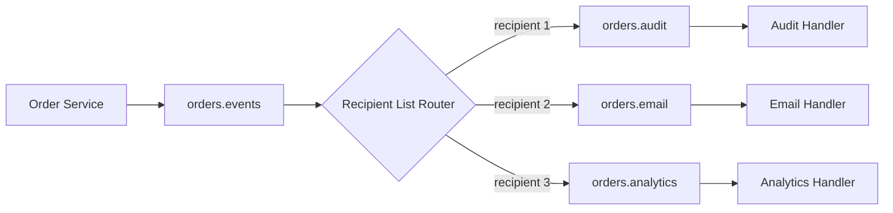
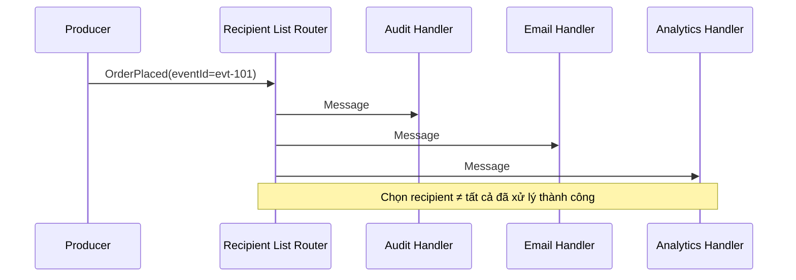
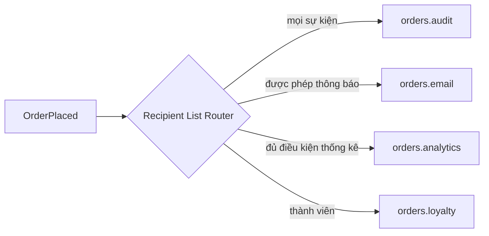
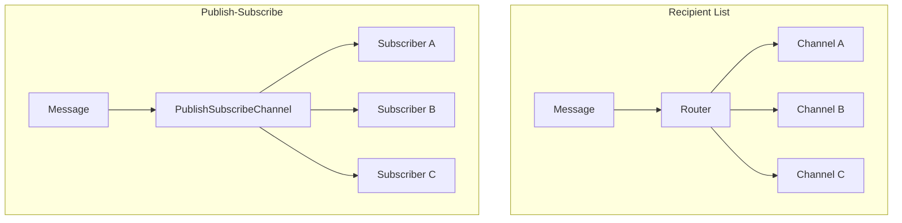
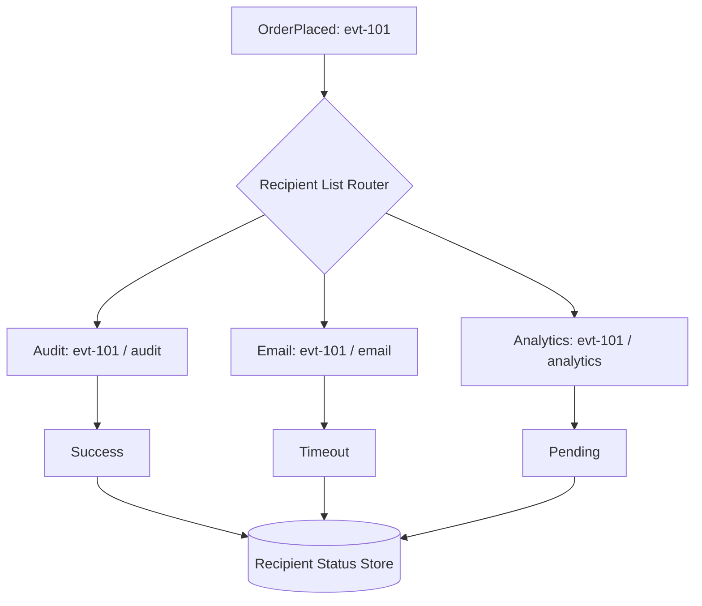
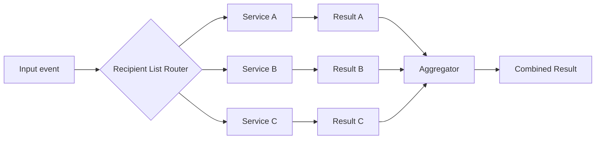
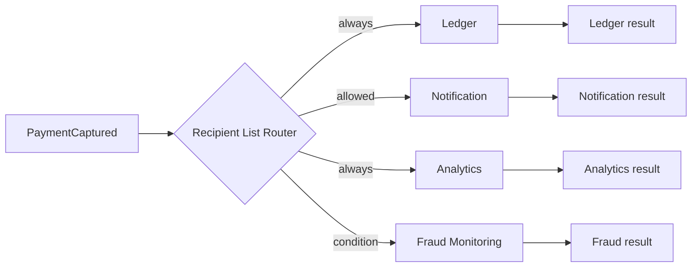

# Recipient List Router gửi một message đến nhiều đích

Trong Enterprise Integration Patterns (EIP), **Recipient List** là mẫu định tuyến giúp gửi **một message đến một danh sách đích nhận**. Thay vì chọn đúng một nhánh như một Content-Based Router đơn giản, Recipient List Router có thể phân phối cùng một sự kiện đến nhiều thành phần có trách nhiệm độc lập.

Ví dụ, sau khi đơn hàng được đặt thành công, hệ thống có thể cần:

- Ghi nhận sự kiện cho kiểm toán.
- Gửi email xác nhận.
- Cập nhật hệ thống phân tích.
- Thông báo cho chương trình khách hàng thân thiết nếu đơn đáp ứng điều kiện.

Tất cả những thành phần đó có thể quan tâm đến cùng sự kiện `OrderPlaced` nhưng thực hiện các công việc khác nhau. Producer không cần gọi trực tiếp từng service; một **Recipient List Router** giữ trách nhiệm quyết định danh sách đích cần gửi.

Trong module **SPRING_INTEGRATION_PATTERN**, đây là nền tảng để xây dựng luồng thông điệp ít phụ thuộc và dễ mở rộng bằng Spring Integration. Bài học tập trung vào cách **Recipient List Router gửi một message đến nhiều đích**, sau đó liên hệ với Filter, Transformer, Gateway, Splitter, Aggregator, retry, error channel, correlation, kiểm thử và quan sát từng nhánh xử lý.

Kết thúc bài, bạn cần giải thích được: Recipient List Router khác Router chọn một đích thế nào; danh sách người nhận được xác định ở đâu; gửi đến nhiều đích có bảo đảm tất cả thành công không; và làm sao kiểm chứng từng recipient đã thực sự xử lý message.

## 1. Recipient List là gì?

Mẫu **Recipient List** nhận một message, xác định **tập các recipient** phù hợp, rồi chuyển message đến từng recipient trong danh sách đó.



Một message `OrderPlaced(eventId="evt-101", orderId="O-101")` đi vào router. Theo cấu hình, ba recipient được chọn: audit, email và analytics. Mỗi nhánh nhận message để thực hiện công việc riêng.

**Một đầu vào có thể tạo nhiều lần phân phối**, nhưng số lượng người nhận không nhất thiết luôn bằng nhau. Danh sách đích có thể:

- **Cố định:** mọi sự kiện đều đến audit, email và analytics.
- **Có điều kiện:** thêm loyalty khi đơn hàng thuộc chương trình thành viên.
- **Thay đổi theo chính sách:** danh sách do một cấu hình được quản lý hoặc bước lựa chọn recipient cung cấp.

Tùy yêu cầu, danh sách có thể rỗng, có một hoặc có nhiều đích. Nếu một message bắt buộc phải tới ít nhất một nơi, hệ thống cần **định nghĩa và kiểm tra** điều kiện đó thay vì mặc định router luôn có recipient.

### Đối tượng nào được nhân lên?

Về ý nghĩa nghiệp vụ, **cùng một sự kiện** được phân phối đến nhiều nơi. Điều này không nhất thiết có nghĩa framework sẽ deep-copy payload thành những object độc lập. Khi các channel đều nằm trong một JVM, những message hoặc bản sao message được gửi có thể cùng tham chiếu một object payload.

Vì thế, nên dùng payload **bất biến** (ví dụ Java `record` với các trường bất biến thích hợp) hoặc tạo bản sao độc lập nếu mỗi handler cần chỉnh sửa dữ liệu. Một nhánh không nên thay đổi object được nhánh khác cùng sử dụng.

## 2. So sánh Recipient List Router với các pattern liên quan

| Pattern hoặc cơ chế | Câu hỏi chính | Ý nghĩa của việc phân phối |
| --- | --- | --- |
| **Content-Based Router** | Message này thuộc nhánh nghiệp vụ nào? | Thường chọn một đích theo điều kiện, dù router nói chung có thể có kiểu nhiều đích |
| **Recipient List Router** | Những recipient nào cần nhận message này? | Có thể gửi cùng message đến **nhiều đích được chọn từ danh sách** |
| **Publish-Subscribe Channel** | Những subscriber nào đang đăng ký với channel? | Phát message đến các subscriber của channel theo cách dispatch được cấu hình |
| **Splitter** | Một message gồm những phần tử nào cần tách? | Tạo **nhiều message con** từ nội dung một message |
| **Aggregator** | Những message nào thuộc cùng một nhóm để ghép? | Tập hợp message theo correlation/release strategy, thường ở downstream |

Recipient List Router và Publish-Subscribe Channel đều có thể tạo **fan-out**, nhưng mô hình điều khiển khác nhau:

- Với Recipient List Router, **danh sách đích** là một phần rõ ràng của quyết định định tuyến, có thể được khai báo hoặc chọn theo điều kiện của từng recipient.
- Với Publish-Subscribe Channel, producer gửi vào một channel; channel phân phối cho tập subscriber đã đăng ký theo cơ chế của nó.

Vì vậy, lựa chọn phụ thuộc vào nơi bạn muốn đặt trách nhiệm quản lý các đích nhận. Nếu chính sách nghiệp vụ quyết định người nhận trên từng message, Recipient List Router thể hiện chủ đích tốt. Nếu nhiều thành phần đăng ký nhận một sự kiện công bố chung, Publish-Subscribe Channel có thể đơn giản hơn.

**Recipient List Router không phải Splitter.** Trong trường hợp đơn đặt hàng `O-101`, audit và email cùng nhận thông tin về **một đơn**. Nếu đơn có 20 dòng hàng cần xử lý riêng, Splitter mới là thành phần chia thành 20 message con; mỗi message con đó sau này vẫn có thể qua Recipient List Router nếu cần fan-out.

## 3. Luồng xử lý thực tế và ba mốc thành công khác nhau

Khi gửi tới nhiều recipient, có ba câu hỏi khác nhau:

1. **Router đã chọn ai?** Danh sách recipient của message là gì?
2. **Message đã tới từng channel chưa?** Việc dispatch đến recipient nào thành công, bị từ chối hoặc ném exception?
3. **Mỗi handler đã hoàn tất chưa?** Đích email đã gửi, analytics đã ghi dữ liệu, audit đã lưu bản ghi hay chưa?



Ở các channel **`DirectChannel`**, handler có thể chạy đồng bộ trên thread gửi. Nếu một handler ném exception, việc thực thi nhánh tiếp theo và exception về phía producer sẽ phụ thuộc vào thứ tự dispatch và cấu hình xử lý lỗi; đừng mặc định mọi recipient còn lại vẫn được gọi.

Nếu dùng channel bất đồng bộ như `ExecutorChannel`, `QueueChannel` hoặc adapter đi qua broker, việc chấp nhận message thường **khác** với hoàn tất xử lý. Producer có thể trả về trong khi email hoặc analytics còn chưa chạy.

Đặc biệt, Recipient List Router **không tự tạo giao dịch nguyên tử** bao trùm toàn bộ recipient. “Audit thành công, email lỗi, analytics chưa xử lý” là trạng thái từng phần mà thiết kế cần dự liệu.

## 4. Ví dụ đầu tiên với Spring Integration Java DSL

Ta xây một integration flow nhận sự kiện `OrderPlaced` và gửi nó đến ba handler độc lập: audit, email và analytics.

### 4.1. Định nghĩa message và contract của các nhánh

```java
import java.math.BigDecimal;
import java.time.Instant;

record OrderPlaced(
    String eventId,
    String orderId,
    BigDecimal totalAmount,
    Instant occurredAt
) {}

interface AuditService {
    void recordOrderPlaced(OrderPlaced event);
}

interface EmailService {
    void sendConfirmation(OrderPlaced event);
}

interface AnalyticsService {
    void recordSale(OrderPlaced event);
}
```

`eventId` là khóa nhận diện **sự kiện** và nên giữ ổn định khi phát lại. `orderId` là khóa **nghiệp vụ**. Hai giá trị này phục vụ việc đối soát và chống xử lý lặp tại mỗi recipient.

Nếu các service chỉ cần cùng một tập thông tin, record này là hợp đồng đủ gọn. Trong hệ thống thật, có thể thêm trường theo một schema được quản lý; đừng đưa dữ liệu nhạy cảm vào mọi nhánh nếu recipient không cần.

### 4.2. Gateway, channel và Recipient List Router

```java
import org.springframework.context.annotation.Bean;
import org.springframework.context.annotation.Configuration;
import org.springframework.integration.annotation.Gateway;
import org.springframework.integration.annotation.IntegrationComponentScan;
import org.springframework.integration.annotation.MessagingGateway;
import org.springframework.integration.channel.DirectChannel;
import org.springframework.integration.config.EnableIntegration;
import org.springframework.integration.dsl.IntegrationFlow;
import org.springframework.messaging.MessageChannel;

@MessagingGateway
interface OrderEventGateway {
    @Gateway(requestChannel = "orders.events")
    void publish(OrderPlaced event);
}

@Configuration
@EnableIntegration
@IntegrationComponentScan
class OrderRecipientListConfiguration {

    @Bean("orders.events")
    MessageChannel orderEvents() {
        return new DirectChannel();
    }

    @Bean("orders.audit")
    MessageChannel auditChannel() {
        return new DirectChannel();
    }

    @Bean("orders.email")
    MessageChannel emailChannel() {
        return new DirectChannel();
    }

    @Bean("orders.analytics")
    MessageChannel analyticsChannel() {
        return new DirectChannel();
    }

    @Bean
    IntegrationFlow recipients() {
        return IntegrationFlow.from("orders.events")
            .routeToRecipients(spec -> spec
                .recipient("orders.audit")
                .recipient("orders.email")
                .recipient("orders.analytics"))
            .get();
    }

    @Bean
    IntegrationFlow auditOrders(AuditService audit) {
        return IntegrationFlow.from("orders.audit")
            .handle(OrderPlaced.class, (event, headers) -> {
                audit.recordOrderPlaced(event);
                return null;
            })
            .get();
    }

    @Bean
    IntegrationFlow notifyCustomer(EmailService email) {
        return IntegrationFlow.from("orders.email")
            .handle(OrderPlaced.class, (event, headers) -> {
                email.sendConfirmation(event);
                return null;
            })
            .get();
    }

    @Bean
    IntegrationFlow updateAnalytics(AnalyticsService analytics) {
        return IntegrationFlow.from("orders.analytics")
            .handle(OrderPlaced.class, (event, headers) -> {
                analytics.recordSale(event);
                return null;
            })
            .get();
    }
}
```

Ứng dụng cần dependency Spring Integration cùng các bean triển khai `AuditService`, `EmailService` và `AnalyticsService`. Gateway phải được quét bởi `@IntegrationComponentScan` hoặc đăng ký theo cơ chế tương đương. Đoạn mã minh họa cách dùng Java DSL có `routeToRecipients(...)` và danh sách recipient khai báo trực tiếp.

Có thể gọi gateway từ service nghiệp vụ:

```java
class OrderApplicationService {
    private final OrderEventGateway events;

    OrderApplicationService(OrderEventGateway events) {
        this.events = events;
    }

    void afterOrderCommitted(OrderPlaced event) {
        events.publish(event);
    }
}
```

Tên phương thức `afterOrderCommitted` biểu thị vị trí mong muốn sau khi nghiệp vụ đã ghi thành công; bản thân phương thức **không tự tạo** cơ chế bảo đảm publish sau commit hoặc atomicity giữa database và messaging. Nếu không được mất sự kiện, cần thiết kế transaction/outbox phù hợp ở upstream.

### 4.3. Luồng đi theo từng bước

1. `OrderEventGateway.publish(event)` gửi sự kiện đến `orders.events`.
2. Recipient List Router đọc danh sách ba recipient đã cấu hình.
3. Router chuyển message tới `orders.audit`, `orders.email` và `orders.analytics` theo cơ chế dispatch của nó.
4. Mỗi channel có một endpoint nhận message và gọi service tương ứng.
5. Vì các channel đang là `DirectChannel`, việc thực hiện thông thường diễn ra đồng bộ và lỗi handler có thể ảnh hưởng lời gọi gửi.

Các handler trả về `null` để kết thúc phần xử lý một chiều, không tạo reply payload. Đây là ví dụ *fire-and-forget về hợp đồng phản hồi*, nhưng **không đồng nghĩa với bất đồng bộ** khi channel bên trong vẫn đồng bộ.

## 5. Recipient cố định và recipient có điều kiện

Danh sách ở mục 4 **cố định**: ba recipient đều được chọn cho mọi `OrderPlaced`. Trong thực tế, số recipient có thể phụ thuộc vào nội dung.

Ví dụ:

- Audit nhận **mọi** `OrderPlaced`.
- Analytics nhận các đơn được ghi nhận hợp lệ.
- Email nhận sự kiện nếu khách hàng có kênh liên hệ và cho phép gửi.
- Loyalty nhận sự kiện nếu khách hàng tham gia chương trình.



Có hai cách thiết kế phổ biến:

**Khai báo predicate cho từng recipient.** Recipient List Router kiểm tra điều kiện tương ứng rồi thêm channel đó vào danh sách đích. API cấu hình predicate/biểu thức có thể khác giữa các phiên bản Spring Integration, vì vậy khi chuyển thành mã sản xuất cần dùng đúng overload DSL phù hợp với phiên bản đang chạy.

**Tách bước quyết định.** Một component thuần nghiệp vụ tính danh sách recipient trước; router hoặc bước phân phối đọc **quyết định đã tính**. Cách này dễ kiểm thử khi chính sách phức tạp, cần lưu phiên bản quy tắc hoặc cần tái sử dụng decision qua retry.

Pseudocode mô tả chính sách:

```text
recipients = ["orders.audit"]

if event.isEligibleForAnalytics:
    recipients += "orders.analytics"

if event.customerAllowsEmail:
    recipients += "orders.email"

if event.customerIsLoyaltyMember:
    recipients += "orders.loyalty"

dispatch(event, recipients)
```

Đây là **pseudocode về quy tắc**, không phải cú pháp DSL. Quy tắc cần sử dụng dữ liệu đáng tin cậy và có hợp đồng rõ ràng. Ví dụ, quyền nhận email có thể thay đổi theo thời gian; nếu yêu cầu pháp lý đòi áp dụng trạng thái hiện hành tại lúc gửi, hãy kiểm tra lại ngay trước side effect thay vì chỉ dựa vào cờ nằm trong sự kiện cũ.

### Thay đổi recipient list trong lúc hệ thống đang chạy

Có thể cho phép cấu hình recipient động, nhưng cần quản lý:

- **Phiên bản danh sách/quy tắc** đang áp dụng.
- Ai có quyền thêm hoặc bỏ một recipient.
- Danh sách có được đọc như **một snapshot nhất quán** hay có thể thay đổi giữa các lần dispatch.
- Retry dùng danh sách cũ hay danh sách mới.
- Các recipient có được phép xử lý message theo đúng hợp đồng payload/header không.

Nếu sự kiện `evt-101` đã gửi email thành công mà retry sau khi cập nhật recipient list lại gửi email lần nữa, hành vi đó cần được chống lặp ở email handler. Nếu retry chạy lại từ trước router sau khi bỏ một recipient, nhánh đó có thể không còn nhận được message dù lần trước đã thất bại.

## 6. So sánh Recipient List Router với Publish-Subscribe Channel

Cả hai hỗ trợ fan-out nhưng đặt sự thay đổi ở các vị trí khác nhau.



| Câu hỏi | Recipient List Router | Publish-Subscribe Channel |
| --- | --- | --- |
| Danh sách đích ở đâu? | Router/chính sách recipient | Tập subscriber của channel |
| Có chọn theo nội dung từng message? | Thuận tiện để cấu hình recipient có điều kiện | Có thể kết hợp selector/filter hoặc các bước khác, nhưng không phải trọng tâm của channel |
| Dễ thêm recipient độc lập? | Thêm recipient vào chính sách/router | Đăng ký subscriber mới trên channel theo cấu hình |
| Khả năng có nhiều đích | Có | Có |
| Tính bất đồng bộ | Phụ thuộc channel đích, executor và endpoint | Phụ thuộc cấu hình executor của PublishSubscribeChannel |
| Bảo đảm tất cả thành công | Không tự có | Không tự có |
| Khi muốn một recipient cụ thể nhận riêng loại sự kiện | Chính sách recipient diễn đạt rõ | Thường cần thêm logic lọc/chọn trong subscriber hoặc trước channel |

**Cách chọn:** nếu danh sách người nhận là **quy tắc nghiệp vụ** cần giải thích theo sự kiện, Recipient List Router phù hợp. Nếu mục tiêu chủ yếu là **phát sự kiện cho mọi subscriber** trong cùng ngữ cảnh ứng dụng, Publish-Subscribe Channel có thể gọn hơn.

Không có mẫu nào tự cung cấp broker bền vững, exact-once, độc lập tiến trình hoặc giao dịch nguyên tử qua nhiều subscriber. Những tính chất đó phải được thiết kế qua transport, message store và chính sách vận hành.

## 7. Rủi ro xử lý từng phần khi gửi tới nhiều đích

Đây là phần quan trọng nhất khi đưa Recipient List vào hệ thống thật.

Giả sử router phân phối theo ba nhánh audit, email, analytics:

```text
eventId = evt-101
    audit      -> SUCCESS
    email      -> TIMEOUT
    analytics  -> PENDING / UNKNOWN
```

Từ góc nhìn producer, không thể kết luận toàn bộ công việc đã thành công. Cũng không thể kết luận email chắc chắn chưa được gửi: timeout có thể xảy ra sau khi hệ thống email đã nhận hoặc đã thực hiện side effect.

### 7.1. Không có atomic multicast mặc định

Recipient List Router chuyển message đến nhiều recipient theo cơ chế channel và handler tương ứng. Nó **không biến mọi hành động downstream thành một transaction chung**. Với nhiều hệ thống ngoài, việc rollback toàn bộ tác vụ thường không khả thi.

Một ứng dụng nên phân biệt:

- **Mọi nhánh bắt buộc thành công trước response:** cần thiết kế điều phối/aggregation kết quả, timeout và chính sách bồi hoàn rõ ràng.
- **Nhánh chính bắt buộc, nhánh phụ best-effort:** chỉ nhánh chính quyết định trạng thái nghiệp vụ; nhánh phụ được quan sát và retry theo SLA riêng.
- **Các nhánh độc lập và có thể xử lý sau:** cân nhắc broker/event infrastructure, durable subscription hoặc queue riêng cho mỗi recipient.

Gửi thêm một message tới hai kênh không tự tạo một trong ba ngữ nghĩa trên.

### 7.2. Lỗi đồng bộ có thể chặn các recipient còn lại

Nếu `orders.audit`, `orders.email`, `orders.analytics` đều là `DirectChannel` và audit handler ném exception, quá trình router chuyển tới recipient tiếp theo có thể bị ảnh hưởng theo cơ chế gửi và xử lý exception. Không nên khẳng định rằng “dù một recipient lỗi, các recipient khác vẫn chắc chắn nhận”.

Cần quyết định **chính sách lỗi theo recipient** và xác minh bằng integration test. Tùy phiên bản/kiểu router có cấu hình liên quan đến xử lý send failure; còn lỗi handler, channel hoặc transport cần được xử lý đúng tại ranh giới thực thi. Một cấu hình bỏ qua lỗi gửi không tự biến mọi side effect downstream thành an toàn.

### 7.3. Tách nhánh bất đồng bộ giúp cô lập thời gian, nhưng thêm nghĩa vụ vận hành

Nếu email mất 5 giây và analytics mất 2 giây, xử lý tất cả bằng channel đồng bộ có thể kéo dài yêu cầu ban đầu. Có thể dùng `ExecutorChannel`, `QueueChannel` hoặc adapter đi qua broker cho nhánh phù hợp.

Tuy nhiên:

- `ExecutorChannel` chuyển việc sang executor; vẫn phải tính capacity và lỗi xảy ra ngoài thread gọi.
- `QueueChannel` trong bộ nhớ dùng poller nhận message; không tự giữ được message khi ứng dụng restart.
- Broker có thể cung cấp lưu bền, redelivery và phân phối nhiều consumer theo cấu hình; cần hiểu ack, retention, consumer group, dead-letter và khả năng duplicate.

**Asynchronous fan-out không tự đồng nghĩa với reliable fan-out.** Phải thiết kế riêng cả việc **giữ message**, **xử lý lỗi** và **xác nhận từng recipient**.

## 8. Retry, idempotency và trách nhiệm của từng recipient

Một sự kiện có thể được gửi lại vì producer timeout, router hoặc adapter retry, consumer restart, broker redeliver, hoặc người vận hành kích hoạt replay. Khi fan-out, retry có thể làm một số recipient nhận lại message dù chúng đã thành công.

Giả sử các trạng thái lần đầu là:

| Recipient | Lần 1 | Nếu toàn bộ message được fan-out lại |
| --- | --- | --- |
| Audit | Đã ghi thành công | Có nguy cơ tạo hai bản ghi |
| Email | Không rõ do timeout | Có nguy cơ gửi hai email |
| Analytics | Chưa xử lý | Có thể nhận lần đầu hoặc nhận trùng tùy cơ chế |

Nếu chỉ biết “event cần retry” mà không ghi nhận **trạng thái riêng cho từng recipient**, hệ thống khó gửi lại đúng nơi cần gửi.

### 8.1. Idempotency key phải tính theo phạm vi recipient

Một chiến lược phổ biến là dùng cặp:

```text
(eventId, recipientId)
```

Ví dụ `(evt-101, orders.email)` và `(evt-101, orders.analytics)` là hai công việc độc lập. Mỗi consumer lưu dấu đã xử lý hoặc bảo vệ side effect bằng khóa phù hợp tại database/API. Với database, bản ghi dedup và side effect nên được thực hiện trong transaction phù hợp nếu cùng một ranh giới giao dịch.

Chỉ giữ một `eventId` trong memory không đủ khi nhiều instance chạy song song hoặc tiến trình restart. Ngoài ra, đối với provider gửi email/thu tiền ở ngoài, bản ghi nội bộ không tự đảm bảo provider chưa thực hiện lệnh khi kết nối timeout; cần idempotency key được provider hỗ trợ hoặc cơ chế đối soát.

### 8.2. Phát lại toàn bộ hay chỉ recipient lỗi?

Hai lựa chọn có trade-off:

**Replay toàn bộ message:** đơn giản về phía producer, nhưng mọi recipient phải chịu được duplicate và cần nhận diện lần xử lý đã thành công.

**Replay theo recipient:** giữ record công việc hoặc trạng thái `PENDING/SUCCESS/FAILED/UNKNOWN` cho từng recipient; phát lại đúng recipient cần xử lý. Cách này tốn quản lý trạng thái nhưng giúp giảm tác động tới nhánh đã thành công.

Ví dụ record trạng thái:

```json
{
  "eventId": "evt-101",
  "recipients": {
    "orders.audit": "SUCCESS",
    "orders.email": "UNKNOWN",
    "orders.analytics": "PENDING"
  }
}
```

Đây là **mô hình nghiệp vụ minh họa**, không phải cấu trúc trạng thái Spring Integration tự tạo. Để nó có giá trị khôi phục sau restart, cần lưu bền và cập nhật trạng thái theo transaction/ack phù hợp.

### 8.3. Transactional Outbox trong trường hợp phát sự kiện sau commit

Nếu ứng dụng lưu đơn hàng vào database rồi ngay sau đó gửi sự kiện cho nhiều recipient, có rủi ro **đã commit đơn nhưng sự kiện chưa kịp gửi** khi tiến trình chết giữa hai bước.

Một giải pháp thường dùng là ghi bản ghi outbox cùng giao dịch với dữ liệu đơn; publisher đọc outbox rồi phát event. Cơ chế này giúp không bỏ sót sự kiện do dual-write theo thiết kế phù hợp, nhưng publisher có thể phát trùng. Recipient vẫn phải idempotent.

Nếu mục tiêu là chắc chắn mọi recipient đều nhận, cần thiết kế **fan-out bền vững**: có thể sử dụng sự kiện lưu trong broker với cách subscriptions/consumer groups thích hợp hoặc danh sách công việc lưu bền theo từng recipient. Chỉ có một outbox event và một router trong bộ nhớ chưa chứng minh mọi recipient đã xử lý.

## 9. Correlation, theo dõi đường đi và xác nhận hoàn tất

Khi một message đến nhiều đích, việc truy vết cần hai chiều thông tin:

- **Một ID chung** để biết tất cả nhánh cùng xuất phát từ sự kiện nào.
- **Một ID nhánh/recipient** để biết kết quả từng nhánh cụ thể.



Trong Spring Messaging, `MessageHeaders` có ID và timestamp; nhưng correlation ID, recipient ID và business event ID cần có **hợp đồng rõ ràng** nếu dùng để đối soát. Không nên giả định Spring message ID sẽ giữ nguyên qua mọi Transformer, adapter và broker.

### 9.1. Log có cấu trúc theo từng recipient

Một mẫu log hữu ích:

```json
{
  "event": "recipient_delivery_attempt",
  "eventId": "evt-101",
  "orderId": "O-101",
  "recipientId": "orders.email",
  "attempt": 2,
  "status": "STARTED",
  "correlationId": "checkout-101"
}
```

Khi có kết quả, ghi một event khác như `recipient_delivery_completed` hoặc `recipient_delivery_failed` với error code, thời gian và endpoint liên quan. Không log toàn bộ payload nhạy cảm chỉ để biết sự kiện nào được phát đi.

Một dòng `"router selected 3 recipients"` không chứng minh ba recipient đã **hoàn tất**. Nên có metrics số recipient được chọn, số send attempt, số delivery error, độ trễ và số công việc đang chờ. Giữ `eventId` trong log/trace hoặc audit, **không đưa event ID vào metrics tag** do cardinality cao.

### 9.2. Khi nào cần Aggregator?

Nếu nghiệp vụ cần **trả một kết quả tổng hợp sau khi tất cả recipient phản hồi**, có thể thiết kế thêm một Aggregator nhận các kết quả được liên kết bằng correlation ID.



Tuy nhiên, **Recipient List Router không tự tạo ba result message** chỉ vì đã gửi ba lần. Những service downstream phải được thiết kế để **phát kết quả** về nơi Aggregator tiêu thụ. Aggregator cần biết:

- Correlation ID của nhóm.
- Số recipient kỳ vọng hoặc điều kiện release.
- Cách biểu diễn thất bại, timeout, message trùng và missing result.
- Lưu trạng thái nhóm ở đâu khi xử lý kéo dài hoặc qua restart.

Nếu nhánh audit/email chỉ kết thúc với `void`, không có result để tự động ghép. Muốn tạo báo cáo tổng hợp, phải thay đổi hợp đồng và flow, không thể chỉ gắn Aggregator phía sau rồi mong nó biết tất cả recipient đã chạy.

## 10. Error channel và phân loại lỗi fan-out

Các trường hợp lỗi khác nhau phải được đối xử khác nhau:

| Lỗi | Vị trí | Hướng xử lý cần xem xét |
| --- | --- | --- |
| Payload thiếu `eventId` | Trước router hoặc validation | Reject theo hợp đồng, tránh phát ra nhiều nhánh |
| Danh sách recipient rỗng ngoài ý muốn | Bước chọn recipient | Báo lỗi chính sách hoặc đưa vào review |
| Channel không có subscriber | Dispatch | Ghi dispatch failure, sửa cấu hình/route |
| Audit handler lỗi đồng bộ | Một nhánh DirectChannel | Xác định tác động tới các recipient còn lại, kiểm tra exception |
| Email API timeout | Handler/adapter bên ngoài | Trạng thái UNKNOWN, retry/đối soát và idempotency |
| Queue consumer lỗi | Poller/listener | Retry/error channel/dead-letter theo cấu hình |
| Analytics nhận lại event | Consumer | Idempotency hoặc upsert theo key phù hợp |

**Error channel** là nơi một cơ chế xử lý lỗi công bố `ErrorMessage` theo cấu hình. Nó khác **recipient channel** (đích thực hiện nghiệp vụ) và **discard channel** (message bị Filter loại). Trong xử lý đồng bộ với `DirectChannel`, exception có thể lan ngược tới producer; việc tạo bean `orders.errors` không tự khiến mọi lỗi đi vào đó.

Khi dùng executor, poller hoặc adapter bên ngoài, cần xác định **ai bắt exception**, **ai công bố ErrorMessage**, **khi nào retry**, **lỗi nào chuyển dead-letter** và **cách cập nhật trạng thái recipient**. Một error handler ghi log rồi bỏ qua exception không phải là bảo đảm đã giải quyết xong yêu cầu của recipient.

### Quyết định nhánh nào là bắt buộc

Trong hệ thống gửi sự kiện đặt hàng:

- **Audit** có thể là nghĩa vụ bắt buộc theo chính sách nội bộ.
- **Email** có thể được xử lý trễ, miễn có khả năng khôi phục.
- **Analytics** có thể cho phép chậm và phát lại.

Nếu audit bắt buộc không được mất, không nên chỉ dùng một tap bộ nhớ best-effort và coi như đã lưu. Hãy xác định mức bền vững, phương án retry và trạng thái khi audit service ngừng hoạt động. Yêu cầu này là một phần của nghiệp vụ/vận hành, không được giải quyết bằng tên pattern.

## 11. Kiểm thử Recipient List Router

Bài test cần xác minh **đúng tập recipient được chọn**, **cách mỗi nhánh nhận message**, và **hành vi khi một recipient thất bại**.

### 11.1. Ma trận kiểm thử

| Trường hợp | Kỳ vọng |
| --- | --- |
| Sự kiện hợp lệ, danh sách cố định | Audit, email, analytics đều nhận cùng `eventId` |
| Gửi hai sự kiện khác nhau | Mỗi nhánh nhận đúng event tương ứng, không lẫn correlation |
| Recipient có điều kiện không khớp | Chỉ những nhánh đáp ứng điều kiện được chọn |
| Không có recipient nào khớp | Hành vi rỗng được xử lý theo chính sách, không giả định đã phát |
| Một handler ném exception | Xác minh tác động lên caller và nhánh còn lại theo cấu hình thật |
| Một nhánh bất đồng bộ đang chậm | Producer/nhánh khác không bị khẳng định hoàn tất sớm |
| Replay event đã xử lý ở audit | Audit không ghi hai bản cùng ý nghĩa nếu yêu cầu idempotency |
| Email timeout sau khi provider có thể đã gửi | Trạng thái UNKNOWN và cơ chế đối soát/retry an toàn |
| Thay đổi danh sách recipient giữa hai lần | Test chính sách replay với snapshot/version nếu cần |
| Có Aggregator tổng hợp kết quả | Chỉ release khi các điều kiện correlation/completion đã đạt |

### 11.2. Test đồng bộ với mock service

Với cấu hình `DirectChannel` tại mục 4, có thể viết integration test sử dụng các bean mock cho ba service. Khi gọi gateway với một `OrderPlaced` hợp lệ, xác minh:

```java
// Phác thảo phần assertion trong test với Mockito:
OrderPlaced event = new OrderPlaced(
    "evt-101",
    "O-101",
    new java.math.BigDecimal("125000"),
    java.time.Instant.parse("2026-11-21T04:00:00Z")
);

gateway.publish(event);

verify(auditService, times(1)).recordOrderPlaced(event);
verify(emailService, times(1)).sendConfirmation(event);
verify(analyticsService, times(1)).recordSale(event);
```

Đoạn trên là **phần thân minh họa của test**: `gateway` và các mock được cấp bởi Spring Test/JUnit/Mockito trong test fixture, không phải một test class độc lập có thể biên dịch ngay. Với các channel đồng bộ, assertion sau lời gọi thường phù hợp khi toàn bộ handler kết thúc bình thường.

Cũng cần test trường hợp handler ném exception. Đừng chỉ assert exception được ném: phải kiểm tra **nhánh nào đã chạy, nhánh nào chưa**, rồi so với chính sách nghiệp vụ. Việc thứ tự/dispatch cụ thể phụ thuộc cấu hình router và channel.

### 11.3. Test bất đồng bộ và broker

Với `ExecutorChannel` hoặc `QueueChannel`, nên chờ điều kiện trong thời hạn giới hạn thay vì assert tất cả handler đã chạy ngay sau `send`. Với broker và consumer độc lập, test trong môi trường tích hợp nên kiểm tra thêm:

- Serialization/schema và ánh xạ headers.
- Ack, redelivery, retry và dead-letter.
- Một message có được chuyển đến **mọi nhóm consumer cần nhận** theo semantics transport không.
- Idempotency khi cùng `eventId` xuất hiện lại.
- Recovery sau restart khi message còn chờ.
- Correlation/trace ID tồn tại xuyên ranh giới.
- Kết quả theo từng recipient được lưu đúng và có thể tra cứu.

## 12. Những sai lầm thường gặp

**“Recipient List Router chỉ gửi đến một nhánh.”** Đó là cách hiểu gần với router chọn một đích. Recipient List Router có mục tiêu gửi tới **danh sách recipient**; một message có thể vào nhiều nhánh.

**“Gửi đến ba channel nghĩa là ba handler đã hoàn tất.”** Số recipient được chọn không chứng minh số tác vụ đã hoàn thành, đặc biệt trong queue/broker.

**“Recipient List Router tự tạo một bản sao object an toàn cho mỗi nhánh.”** Trong một JVM, payload có thể được chia sẻ tham chiếu. Ưu tiên immutable payload hoặc copy theo nhu cầu.

**“Một handler lỗi thì router chắc chắn vẫn gửi cho mọi handler khác.”** Cần biết dispatch, exception, error handling và thứ tự recipient. Không có bảo đảm tổng quát như vậy.

**“Fan-out là giao dịch nguyên tử.”** Các recipient thường có side effect độc lập; cần chính sách partial failure, idempotency và bồi hoàn/đối soát khi phù hợp.

**“Publish-Subscribe Channel và Recipient List Router là một.”** Cả hai có thể fan-out nhưng khác vị trí quản lý người nhận và cách mô hình hóa điều kiện.

**“Splitter là một dạng Recipient List.”** Splitter tách một message thành nhiều message con; Recipient List phân phối một message đến nhiều đích.

**“Retry từ đầu không sao, vì chỉ là một event.”** Retry toàn bộ có thể gây gửi email hai lần hoặc cập nhật trùng. Theo dõi `eventId` cùng `recipientId` và thiết kế side effect idempotent.

**“Có error channel là mọi nhánh lỗi đều tự retry.”** Error channel vận chuyển thông tin lỗi khi được cấu hình; retry, dead-letter và lưu bền phải được thiết kế riêng.

**“Thêm một recipient chỉ là thêm một channel.”** Recipient mới phải hiểu hợp đồng dữ liệu, có quy tắc phân quyền/bảo mật phù hợp, monitoring, retry, capacity và test độc lập.

## 13. Bài tập thiết kế: một sự kiện, nhiều nghĩa vụ

Một nền tảng bán hàng phát sự kiện `PaymentCaptured` sau khi thanh toán đã được xác nhận. Các yêu cầu:

1. **Ledger:** ghi sổ kế toán, bắt buộc không được mất.
2. **Notification:** gửi thông báo cho khách, được phép xử lý sau.
3. **Analytics:** cập nhật báo cáo, có thể chậm.
4. **Fraud monitoring:** nhận sự kiện nếu số tiền vượt một ngưỡng hoặc thuộc nhóm cần theo dõi.

Hãy thiết kế Recipient List Router và các flow downstream:



Tự trả lời:

1. Điều kiện nào quyết định danh sách recipient? Khi không có recipient hợp lệ thì xử lý ra sao?
2. Có nên cho producer HTTP đợi đủ bốn nhánh hoàn tất không? Quyết định dựa trên hợp đồng nào?
3. Vì sao ledger cần bảo đảm lưu bền mạnh hơn analytics? Outbox hoặc broker phù hợp với ranh giới nào?
4. Nếu email đã gửi nhưng router retry sau timeout ledger, làm sao tránh email trùng?
5. Nếu fraud monitoring chỉ cần nhận những message lớn, bạn đặt điều kiện ở Recipient List Router hay ở một Filter riêng? Trade-off?
6. Nếu phải hiển thị trạng thái `PaymentCaptured` đã được cả các recipient xử lý, sẽ lưu và ghép kết quả nào? Aggregator cần correlation và completion policy gì?
7. Những metric/log/audit nào cho biết từng recipient đã nhận, đang chờ, xử lý lỗi hoặc đã hoàn thành?

Một lời giải tốt phải phân biệt **đã chọn recipient**, **đã dispatch**, và **đã hoàn tất side effect**, đồng thời có chính sách cho từng nhánh khi bị lỗi hoặc phát lại.

## Ghi nhớ

**Recipient List Router** nhận một message và phân phối nó tới **một danh sách đích**, có thể cố định hoặc dựa trên điều kiện. Đây là cách thể hiện rõ một sự kiện cần kích hoạt nhiều trách nhiệm độc lập trong mô hình Enterprise Integration Patterns.

Trong **Spring Integration**, `routeToRecipients(...)` là cách biểu diễn trực tiếp mẫu này bằng Java DSL. Khi thiết kế, hãy chọn rõ recipient list, tránh payload mutable dùng chung, phân biệt Recipient List với Publish-Subscribe Channel và Splitter, và xác định ngữ nghĩa đồng bộ/bất đồng bộ tại từng nhánh. Với hệ thống thực tế, cần kiểm thử **partial failure**, retry, idempotency, correlation, error channel và khả năng quan sát kết quả theo từng recipient; lúc đó luồng fan-out mới có thể mở rộng mà vẫn kiểm soát được hành vi.

