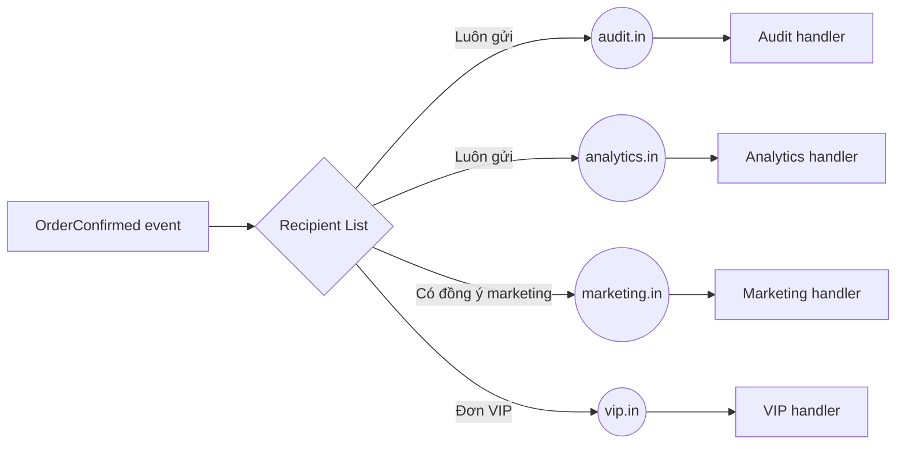
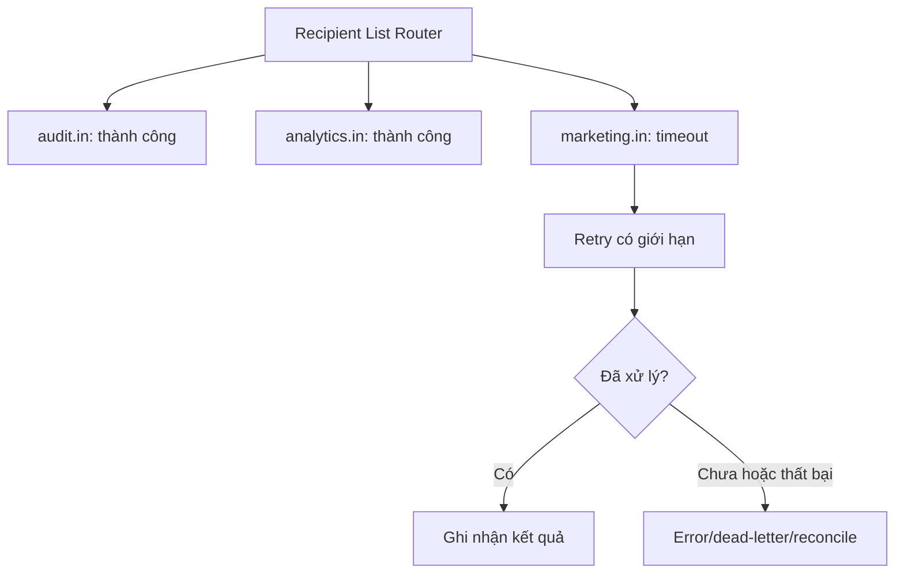

# Danh sách recipient cố định và động

> **Chương:** Recipient list  
> **Module:** `SPRING_INTEGRATION_PATTERN` — học triển khai Enterprise Integration Patterns với Spring Integration để xây dựng luồng thông điệp ít phụ thuộc, dễ mở rộng; thực hành Router, Filter, Transformer, Splitter, Aggregator, Gateway, retry, error channel, correlation, kiểm thử và theo dõi các nhánh. Bài này tập trung vào cách **chọn một tập người nhận (recipients)** cố định hoặc thay đổi theo từng message.

## 1. Mục tiêu học tập

Sau bài học, bạn có thể:

1. Giải thích **Recipient List** là gì và khi nào một message cần được gửi tới **nhiều đích** thay vì một channel.
2. Phân biệt **danh sách người nhận cố định**, **danh sách ứng viên cố định nhưng được chọn có điều kiện**, và **danh sách đích được tính động khi runtime**.
3. So sánh Recipient List với **Content-Based Router**, **Publish-Subscribe Channel**, **Splitter** và **Aggregator**.
4. Khai báo một Recipient List bằng **Spring Integration Java DSL**, rồi viết policy chọn recipient theo nội dung nghiệp vụ.
5. Xử lý các trường hợp không có recipient, recipient không tồn tại, một trong nhiều recipient thất bại, retry gây gửi trùng và metadata correlation qua từng nhánh.
6. Kiểm thử chính xác tập kênh nhận, số lần nhận và các nhánh **không** được chọn; theo dõi từng nhánh mà không làm lộ dữ liệu nhạy cảm.

## 2. Vấn đề: một sự kiện, nhiều bên liên quan

Khi đơn `ORD-801` được xác nhận, doanh nghiệp có thể cần:

- Ghi nhận một dấu vết **audit** cho mọi đơn.
- Cập nhật hệ thống **analytics** cho mọi đơn.
- Gửi **thông báo marketing** nếu khách đã đồng ý nhận loại thông báo đó.
- Cập nhật **dịch vụ chăm sóc khách VIP** nếu đơn thuộc nhóm VIP.

Một message đầu vào có thể cần đi đến **hai, ba hoặc bốn channel**. Nếu producer tự gọi trực tiếp từng service, nó phải biết danh sách đích, điều kiện gửi, retry và lỗi của mọi đích. Mỗi khi thêm một bên nhận, code producer phải thay đổi.

Mẫu **Recipient List** của Enterprise Integration Patterns (EIP) tách việc **xác định danh sách người nhận** khỏi việc **xử lý của từng người nhận**. Thành phần định tuyến xác định những channel nào cần nhận message; những endpoint phía sau đăng ký xử lý trên các channel riêng.



**Một message có thể được phân phối tới nhiều recipient, nhưng không mặc nhiên được xử lý song song hoặc giao thành công tới tất cả.** Cách dispatch, thời điểm xác nhận và xử lý lỗi phụ thuộc kiểu channel, handler và hạ tầng bên ngoài.

## 3. Recipient List hoạt động như thế nào?

Một Recipient List Router nhận message rồi xác định **tập đích nhận** cho message đó. Một recipient có thể là channel hoặc endpoint nhận message thông qua channel tương ứng.

```text
Message đầu vào
   payload = OrderConfirmed(orderId="ORD-801", marketingOptIn=true, vip=false)
   headers = { correlationId: "ORD-801", source: "order-service" }
        |
        v
Recipient List decision
   recipients = [audit.in, analytics.in, marketing.in]
        |
        +----> audit.in
        +----> analytics.in
        +----> marketing.in

Không gửi tới vip.in vì vip=false.
```

Mỗi nhánh có thể có riêng Filter, Transformer, Service Activator, outbound adapter, error channel và retry policy. **Recipient List chỉ quyết định đích**, không tự triển khai xử lý nghiệp vụ cho từng đích.

### 3.1. Một số khái niệm cần phân biệt

| Khái niệm | Ý nghĩa | Ví dụ |
| --- | --- | --- |
| **Recipient** | Đích mà Router định gửi message tới | `audit.in` |
| **Candidate recipient** | Đích nằm trong tập có thể được chọn | `marketing.in` |
| **Recipient selector** | Điều kiện quyết định một ứng viên có được chọn hay không | `marketingOptIn == true` |
| **Recipient list** | Tập đích thực tế được chọn cho message hiện tại | `[audit.in, marketing.in]` |
| **Channel mapping/resolution** | Cách khóa hoặc tên recipient được ánh xạ tới channel tồn tại | `AUDIT` → `audit.in` |
| **Delivery outcome** | Kết quả giao nhận của từng đích | Đã vào queue, handler thành công, hoặc lỗi |

Tại ranh giới nội bộ, một message thường được chuyển tiếp với payload/headers đang có. **Không nên giả định payload được deep-copy cho mỗi recipient**: nếu payload chứa object mutable, một handler có thể thay đổi dữ liệu mà nhánh khác cũng tham chiếu. Nên ưu tiên payload bất biến hoặc sao chép có chủ đích khi cần.

## 4. Ba cách hình thành danh sách recipient

### 4.1. Danh sách cố định: tất cả đích luôn nhận

Danh sách recipient được xác định sẵn trong cấu hình và **mọi message phù hợp flow đều đi tới cùng tập đích**:

```text
OrderConfirmed -> Recipient List
                   |- audit.in
                   |- analytics.in
                   `- search-index.in
```

**Khi phù hợp:** mọi sự kiện cần audit, thống kê và cập nhật chỉ mục. Cách này đơn giản, dễ đọc topology, dễ kiểm thử và ít logic quyết định. Tuy nhiên thêm/bớt đích vẫn cần thay đổi cấu hình hoặc triển khai theo phương án vận hành tương ứng.

### 4.2. Tập ứng viên cố định, chọn recipient theo điều kiện

Danh sách **các kênh có thể nhận** vẫn được khai báo trước, nhưng **tập thực sự nhận thay đổi theo payload/header**:

```text
Candidates: audit.in, analytics.in, marketing.in, vip.in

Event A: marketingOptIn=true,  vip=false
   -> audit.in, analytics.in, marketing.in

Event B: marketingOptIn=false, vip=true
   -> audit.in, analytics.in, vip.in

Event C: marketingOptIn=false, vip=false
   -> audit.in, analytics.in
```

Đây là **conditional Recipient List**: đích được chọn động **theo từng message**, nhưng không có channel lạ được tạo ra tùy ý. Đây thường là lựa chọn tốt nhất nếu danh sách đích hữu hạn và policy có thể biểu diễn bằng điều kiện rõ ràng.

### 4.3. Danh sách recipient tính động ở runtime

Trong một hệ thống multi-tenant, cấu hình đăng ký có thể lưu rằng tenant A muốn gửi sự kiện đến audit và webhook A, còn tenant B đến analytics và webhook B. **Tập recipient được tính lúc xử lý message**, có thể dựa trên một cấu hình/registry thay đổi theo thời gian.

```text
OrderConfirmed(tenant=A)
   -> Recipient resolver / policy
   -> [audit.in, tenant-A-events.in]

OrderConfirmed(tenant=B)
   -> Recipient resolver / policy
   -> [audit.in, analytics.in, tenant-B-events.in]
```

**Quan trọng:** “dynamic recipient” không có nghĩa nhận bất kỳ tên channel nào từ HTTP header rồi gửi thẳng tới bean đó. Registry phải do ứng dụng kiểm soát, cho phép **allowlist**, kiểm tra quyền của tenant và loại bỏ recipient bị vô hiệu hóa. Nếu số lượng channel thực sự thay đổi runtime, cần thêm cơ chế quản lý vòng đời, đăng ký/unregister, bộ nhớ và monitoring; không được giả định chỉ cần trả về một chuỗi tên là channel sẽ tự xuất hiện.

### 4.4. So sánh ba chiến lược

| Tiêu chí | Cố định | Chọn có điều kiện | Tính động từ policy/registry |
| --- | --- | --- | --- |
| Tập ứng viên | Khai báo trước | Khai báo trước | Có thể thay đổi theo cấu hình runtime |
| Quyết định từng message | Không đổi | Selector trên payload/header | Hàm/registry chọn tập đích |
| Mức độ phức tạp | Thấp | Trung bình | Cao |
| Khả năng kiểm thử | Tập kênh cố định | Ma trận điều kiện đúng/sai | Policy, quyền, registry, thay đổi cấu hình |
| Rủi ro chính | Mọi đích đều nhận dù không cần | Selector sai, thiếu metadata | Đích không tồn tại, lộ quyền tenant, cấu hình thay đổi giữa chừng |
| Lựa chọn điển hình | Audit + analytics bắt buộc | Thông báo chọn lọc theo sở thích | Subscription hoặc routing registry theo tenant |

## 5. Recipient List khác Router một đích, Publish-Subscribe và Splitter

| Pattern | Ý định | Số đầu ra điển hình | Ví dụ |
| --- | --- | --- | --- |
| **Content-Based Router** | Chọn nhánh phù hợp theo nội dung | Thường **một** channel | Đơn khẩn **hoặc** đơn thường |
| **Recipient List** | Chọn **tập recipient** phù hợp với message | **0..N** tùy policy | Audit + analytics + marketing nếu opt-in |
| **Publish-Subscribe Channel** | Phát message đến các subscriber đã đăng ký | Nhiều subscriber theo cấu hình channel | Phát event `OrderConfirmed` cho các consumer quan tâm |
| **Splitter** | Chia một payload thành **nhiều phần dữ liệu** | Nhiều message có payload con | Chia đơn hàng thành từng dòng sản phẩm |
| **Aggregator** | Gom các message cùng nhóm theo correlation/release | Thường một kết quả cho mỗi nhóm | Gom phản hồi kiểm tra tồn kho |

**Ví dụ:** Recipient List gửi **cùng một sự kiện** tới audit và marketing; Splitter lại tạo **hai message khác payload** từ hai dòng hàng. Nếu nhánh audit chỉ cần ID còn marketing cần tên khách và kênh liên hệ, mỗi nhánh có thể dùng Transformer riêng **sau khi đã chọn recipient**, thay vì yêu cầu Router biến đổi payload cho mọi đích.

`PublishSubscribeChannel` thích hợp khi muốn phát đến các subscriber của một channel, còn Recipient List thích hợp khi **quyết định chính xác recipient nào** được chọn là một phần quan trọng của nghiệp vụ. Hai kỹ thuật có thể kết hợp: Recipient List chọn một channel publish-subscribe, channel ấy tiếp tục phân phối đến các subscriber của nó.

**Đừng hiểu nhiều subscriber trên `DirectChannel` là broadcast:** channel này có semantics phân phối point-to-point theo dispatcher; cần chọn EIP/channel đúng mục tiêu fan-out.

## 6. Ví dụ Spring Integration: recipient cố định bằng Java DSL

Ví dụ dùng Java 17+ và Spring Integration Java DSL. Sau khi ứng dụng đã có dependency/cấu hình Spring Integration phù hợp, có thể định nghĩa event và hai integration flow: một để route, các flow còn lại làm consumer minh họa.

```java
record OrderConfirmed(String orderId, boolean marketingOptIn,
                      boolean vip) {}
```

```java
import org.springframework.context.annotation.Bean;
import org.springframework.context.annotation.Configuration;
import org.springframework.integration.annotation.Gateway;
import org.springframework.integration.annotation.IntegrationComponentScan;
import org.springframework.integration.annotation.MessagingGateway;
import org.springframework.integration.config.EnableIntegration;
import org.springframework.integration.dsl.IntegrationFlow;

@MessagingGateway
interface OrderEventGateway {
    @Gateway(requestChannel = "orders.events.fixed")
    void publishFixed(OrderConfirmed event);

    @Gateway(requestChannel = "orders.events.conditional")
    void publishConditional(OrderConfirmed event);
}

@Configuration
@EnableIntegration
@IntegrationComponentScan
class RecipientListConfiguration {

    @Bean
    IntegrationFlow fixedRecipients() {
        return IntegrationFlow.from("orders.events.fixed")
            // Cả ba recipient luôn được chọn.
            .routeToRecipients(r -> r
                .recipient("audit.in")
                .recipient("analytics.in")
                .recipient("search-index.in"))
            .get();
    }

    @Bean
    IntegrationFlow auditConsumer() {
        return IntegrationFlow.from("audit.in")
            .handle(message -> System.out.println(
                "AUDIT: " + message.getPayload()))
            .get();
    }

    @Bean
    IntegrationFlow analyticsConsumer() {
        return IntegrationFlow.from("analytics.in")
            .handle(message -> System.out.println(
                "ANALYTICS: " + message.getPayload()))
            .get();
    }

    @Bean
    IntegrationFlow searchIndexConsumer() {
        return IntegrationFlow.from("search-index.in")
            .handle(message -> System.out.println(
                "INDEX: " + message.getPayload()))
            .get();
    }

    @Bean
    IntegrationFlow conditionalRecipients() {
        return IntegrationFlow.from("orders.events.conditional")
            // Các ứng viên cố định, membership thay đổi theo message.
            .routeToRecipients(r -> r
                .recipient("audit.in")
                .recipient("analytics.in")
                .recipient("marketing.in", "payload.marketingOptIn()")
                .recipient("vip.in", "payload.vip()"))
            .get();
    }

    @Bean
    IntegrationFlow marketingConsumer() {
        return IntegrationFlow.from("marketing.in")
            .handle(message -> System.out.println(
                "MARKETING: " + message.getPayload()))
            .get();
    }

    @Bean
    IntegrationFlow vipConsumer() {
        return IntegrationFlow.from("vip.in")
            .handle(message -> System.out.println(
                "VIP: " + message.getPayload()))
            .get();
    }
}
```

Trong ứng dụng đã inject gateway:

```java
orderEventGateway.publishFixed(
    new OrderConfirmed("ORD-801", false, false));

orderEventGateway.publishConditional(
    new OrderConfirmed("ORD-802", true, false));

orderEventGateway.publishConditional(
    new OrderConfirmed("ORD-803", false, true));
```

Kết quả kỳ vọng theo **tập đích**, không bắt buộc theo thứ tự log giữa những hệ thống bất đồng bộ:

| Event | Tập recipient được chọn |
| --- | --- |
| `ORD-801` qua `publishFixed` | Audit, analytics, search-index |
| `ORD-802` qua `publishConditional` | Audit, analytics, marketing |
| `ORD-803` qua `publishConditional` | Audit, analytics, VIP |

### 6.1. Đọc đúng ý nghĩa DSL

- `.routeToRecipients(...)` khai báo một **Recipient List Router** trong flow.
- `.recipient("audit.in")` chọn channel audit **không kèm điều kiện**.
- `.recipient("marketing.in", "payload.marketingOptIn()")` dùng **SpEL** để quyết định có gửi đến channel marketing hay không; payload ví dụ là Java record có accessor tương ứng.
- Những tên channel là tên do ứng dụng cấu hình; chúng không phải endpoint bên ngoài được tạo tự động bởi Router.
- Mỗi consumer riêng biệt ở ví dụ chỉ ghi console, **không chứng minh nghiệp vụ ở dịch vụ ngoài đã hoàn tất**.

**Lưu ý bảo mật/nghiệp vụ:** `marketingOptIn` trong ví dụ giả định là thông tin đã được **xác nhận tại dịch vụ sở hữu quyền đồng ý** trước khi phát event. Không nên tin cờ opt-in do client tự đặt nếu flow gửi thông tin có ràng buộc quyền riêng tư.

### 6.2. Fixed không có nghĩa phải viết cứng mãi mãi

Trong triển khai thực tế, danh sách cố định có thể được khai báo qua cấu hình được kiểm soát thay vì hard-code. Điểm phân biệt là **membership đối với message trong một phiên cấu hình** có thay đổi không. Một danh sách cố định có thể được cập nhật khi triển khai phiên bản mới; còn một danh sách dynamic có thể thay đổi cho từng message trong cùng phiên chạy.

## 7. Recipient động: xây policy trả về tập channel

Khi điều kiện phức tạp hơn một vài selector, hãy tách việc chọn đích thành **hàm policy thuần**. Nó giúp kiểm thử độc lập, tái sử dụng và ghi lại lý do quyết định.

```java
import java.util.ArrayList;
import java.util.List;

final class RecipientPolicy {
    private RecipientPolicy() {}

    static List<String> select(OrderConfirmed event) {
        if (event == null || event.orderId() == null
                || event.orderId().isBlank()) {
            throw new IllegalArgumentException("Invalid order event");
        }

        List<String> channels = new ArrayList<>();
        channels.add("audit.in");
        channels.add("analytics.in");

        if (event.marketingOptIn()) {
            channels.add("marketing.in");
        }
        if (event.vip()) {
            channels.add("vip.in");
        }

        return List.copyOf(channels);
    }
}
```

Ví dụ một **Router method** trong Spring Integration trả về tập tên channel được chọn:

```java
import java.util.Collection;
import org.springframework.integration.annotation.Router;
import org.springframework.stereotype.Component;

@Component
class DynamicRecipientRouter {

    // Sử dụng thay cho flow routeToRecipients ở một input channel riêng.
    @Router(inputChannel = "orders.events.policy")
    public Collection<String> selectRecipients(OrderConfirmed event) {
        return RecipientPolicy.select(event);
    }
}
```

Với Spring Integration, một router có thể trả một collection các channel name để route tới nhiều recipient. Ví dụ trên giả định những channel `audit.in`, `analytics.in`, `marketing.in`, `vip.in` đã được đăng ký và có handler phù hợp như ví dụ trước. **Không** đồng thời đặt `@Router` và một Router DSL khác cùng cạnh tranh đọc `orders.events.policy` nếu không chủ đích thiết kế topology.

### 7.1. Dynamic theo nội dung khác dynamic theo registry

Hàm `RecipientPolicy.select` ở trên tạo **danh sách thực tế động**, nhưng các tên channel vẫn nằm trong mã nguồn. Nếu recipient thay đổi theo tenant/subscription registry, một service tra cứu có thể trả **khóa logic** như `AUDIT`, `ANALYTICS`, `TENANT_NOTIFICATION`; sau đó bước mapping an toàn ánh xạ khóa sang các channel đã được cấp quyền. Nên:

1. Xác minh quyền của tenant và nguồn dữ liệu đăng ký.
2. Giới hạn tập channel đích bằng allowlist hoặc registry tin cậy.
3. Loại trùng recipient nếu registry trả trùng.
4. Xác định hành vi khi subscription bị xóa trong lúc message đang nằm trong queue.
5. Có nhánh xử lý nếu không giải được channel hoặc không có recipient.
6. Ghi `policyVersion`/`subscriptionVersion` nếu phải tái hiện lịch sử quyết định.

**Không dùng một tên channel do người dùng tự nhập làm đích tùy ý.** Recipient List là cơ chế phân phối, không phải lớp cấp quyền truy cập cho mọi channel trong ứng dụng.

## 8. Số recipient bằng 0, 1 hoặc N

Một Recipient List có thể chọn nhiều kết quả. Trước khi triển khai, cần quyết định trường hợp **không có recipient** có hợp lệ hay không:

| Số recipient | Ví dụ | Hành vi cần xác định |
| --- | --- | --- |
| **0** | Không có subscriber đăng ký cho loại event | Drop có audit, lưu chờ, gửi fallback, hay coi là lỗi? |
| **1** | Chỉ audit cần nhận | Giao tới audit theo contract |
| **N** | Audit + analytics + marketing | Mỗi recipient nhận theo semantics channel; cần thống kê kết quả từng đích |

Trong ví dụ trước, audit và analytics luôn được chọn nên tập kết quả không rỗng. Với một Router hoàn toàn động, **đừng mặc định zero-recipient là một lỗi hay mặc định nó được bỏ qua im lặng**: hãy kiểm tra/cấu hình hành vi của phiên bản Spring Integration đang dùng và viết test theo chính sách nghiệp vụ.

## 9. Fan-out không tự động đồng nghĩa giao thành công đến mọi đích

Giả sử Recipient List gửi tới `audit.in`, `analytics.in`, `marketing.in`. Hai đích đầu xử lý xong nhưng đích marketing timeout. Có một **partial failure**: message đã tạo tác dụng ở một số bên nhưng chưa ở tất cả.



Các điểm quan trọng:

- **Thứ tự nhận và xử lý** có thể phụ thuộc cấu hình và kiểu channel. Không dựa vào thứ tự log ở ví dụ để cam kết thứ tự cross-service.
- Nếu các handler đồng bộ và một handler ném exception, những recipient khác **có thể chưa được dispatch**; hành vi thực tế cần được xác minh theo cấu hình/phiên bản.
- Nếu dùng executor hoặc broker, Router có thể chỉ giao/đặt lịch thành công ở tầng gần, còn downstream fail muộn hơn.
- Không có **transaction phân tán toàn cục** được bảo đảm chỉ vì dùng Recipient List.
- Retry **toàn bộ** thao tác fan-out có thể gửi lặp đến audit/analytics đã thành công; thường nên retry **riêng tại nhánh thất bại**.

### 9.1. Idempotency khi có redelivery

Event `OrderConfirmed` có thể được giao lại do timeout/restart hoặc retry. Mỗi consumer nên có cơ chế idempotency/dedup phù hợp, ví dụ theo `(eventId, consumerName)` hoặc một khóa nghiệp vụ có hợp đồng rõ ràng. `MessageHeaders.id` có thể thay đổi khi message được xây dựng lại hoặc đi qua broker, vì vậy **không nên coi nó là business idempotency key**.

Một downstream gửi email có side effect khác với analytics cộng số liệu: cả hai phải xác định hành vi nếu nhận lại cùng event. Dịch vụ email có thể lưu trạng thái gửi theo event ID; analytics có thể upsert theo khóa nghiệp vụ để không tăng đếm hai lần.

### 9.2. Khi cần độ tin cậy cao hơn

Đối với các recipient bắt buộc phải nhận, có thể cân nhắc message broker với queue/subscription riêng, outbox ở producer, retry từng consumer, dead-letter, replay và monitoring backlog. Mức đảm bảo giao nhận phụ thuộc thiết kế end-to-end, transaction và xác nhận của từng consumer; không thể suy ra **exactly-once business processing** từ một lời gọi route.

## 10. Correlation và reply khi gửi nhiều nhánh

Một message thường có `correlationId` liên kết toàn bộ hành trình của đơn; các thông điệp chuyển tới recipient nên giữ metadata cần thiết theo contract. Khi qua adapter/broker, header có thể cần ánh xạ và serialization rõ ràng.

```text
OrderConfirmed(eventId=evt-801, orderId=ORD-801)
    correlationId=ORD-801
         |
         +--> audit.in       (eventId=evt-801)
         +--> analytics.in   (eventId=evt-801)
         +--> marketing.in   (eventId=evt-801)
```

**Correlation không phải idempotency.** Correlation liên kết các message thuộc cùng quy trình; idempotency giúp một recipient tránh tạo side effect lặp khi nhận lại cùng nghiệp vụ.

### 10.1. Nếu các recipient đều trả kết quả thì sao?

Một Gateway theo mô hình request–reply thường mong đợi **một kết quả** theo hợp đồng. Recipient List có thể tạo **nhiều phản hồi độc lập**; không nên nghĩ Gateway sẽ tự gom tất cả thành một giá trị.

Nếu nghiệp vụ cần kết quả từ ba dịch vụ (ví dụ ba báo giá), hãy thiết kế tương ứng **request → fan-out → thu các replies có correlation → Aggregator** với release strategy, timeout và cách xử lý kết quả thiếu. Khi payload cần chia nhỏ thành các công việc độc lập, **Splitter + Router + Aggregator** có thể phù hợp hơn Recipient List gửi cùng một message đến các bên.

### 10.2. Audit/correlation cho từng recipient

Để truy vết cần phân biệt: `eventId` của sự kiện gốc, `correlationId` của quy trình, tên recipient, số lần gửi và kết quả xử lý của recipient. Không nên dùng `recipientName` làm một phần ngẫu nhiên của `eventId` nếu mục tiêu là nhận biết cùng một event được gửi tới nhiều đích; có thể dùng khóa xử lý `(eventId, recipientName)` tại consumer.

## 11. Kiểm thử fixed và dynamic recipient list

**Nguyên tắc kiểm thử:** không chỉ assert một channel đã nhận message, mà cần assert **tập channel chính xác**, **số lần nhận** và **những channel không được chọn phải không nhận**.

### 11.1. Ma trận kiểm thử

| Kịch bản | Audit | Analytics | Marketing | VIP |
| --- | --- | --- | --- | --- |
| Fixed list audit + analytics + search-index | 1 | 1 | 0 | 0 |
| Conditional: `optIn=false`, `vip=false` | 1 | 1 | 0 | 0 |
| Conditional: `optIn=true`, `vip=false` | 1 | 1 | 1 | 0 |
| Conditional: `optIn=false`, `vip=true` | 1 | 1 | 0 | 1 |
| Conditional: `optIn=true`, `vip=true` | 1 | 1 | 1 | 1 |

Với hàng fixed, `search-index` cũng phải nhận **1 message** dù không được đưa thành một cột trong bảng. Trong test thực tế nên bao gồm mọi recipient được cấu hình, không chỉ ba hoặc bốn channel đang được theo dõi.

### 11.2. Integration test dùng QueueChannel để thu kết quả

Ví dụ test sau dùng các `QueueChannel` như **bộ thu message nội bộ** để không cần consumer production. Nhờ đó test biết chính xác channel nào đã nhận, không cần phụ thuộc vào thứ tự ghi log.

```java
import org.springframework.context.annotation.Bean;
import org.springframework.context.annotation.Configuration;
import org.springframework.integration.channel.DirectChannel;
import org.springframework.integration.channel.QueueChannel;
import org.springframework.integration.config.EnableIntegration;
import org.springframework.integration.dsl.IntegrationFlow;

@Configuration
@EnableIntegration
class RecipientTestConfiguration {

    @Bean("test.events")
    DirectChannel input() { return new DirectChannel(); }

    @Bean("test.audit")
    QueueChannel audit() { return new QueueChannel(); }

    @Bean("test.analytics")
    QueueChannel analytics() { return new QueueChannel(); }

    @Bean("test.marketing")
    QueueChannel marketing() { return new QueueChannel(); }

    @Bean("test.vip")
    QueueChannel vip() { return new QueueChannel(); }

    @Bean
    IntegrationFlow recipientFlow() {
        return IntegrationFlow.from("test.events")
            .routeToRecipients(r -> r
                .recipient("test.audit")
                .recipient("test.analytics")
                .recipient("test.marketing", "payload.marketingOptIn()")
                .recipient("test.vip", "payload.vip()"))
            .get();
    }
}
```

```java
import static org.junit.jupiter.api.Assertions.assertEquals;
import static org.junit.jupiter.api.Assertions.assertNotNull;
import static org.junit.jupiter.api.Assertions.assertNull;
import static org.junit.jupiter.api.Assertions.assertTrue;

import org.junit.jupiter.api.Test;
import org.springframework.beans.factory.annotation.Autowired;
import org.springframework.beans.factory.annotation.Qualifier;
import org.springframework.messaging.Message;
import org.springframework.messaging.MessageChannel;
import org.springframework.messaging.PollableChannel;
import org.springframework.messaging.support.MessageBuilder;
import org.springframework.test.context.junit.jupiter.SpringJUnitConfig;

@SpringJUnitConfig(RecipientTestConfiguration.class)
class RecipientRoutingTest {

    @Autowired @Qualifier("test.events") MessageChannel input;
    @Autowired @Qualifier("test.audit") PollableChannel audit;
    @Autowired @Qualifier("test.analytics") PollableChannel analytics;
    @Autowired @Qualifier("test.marketing") PollableChannel marketing;
    @Autowired @Qualifier("test.vip") PollableChannel vip;

    @Test
    void selectsExactlyThreeRecipientsForOptedInNonVipOrder() {
        OrderConfirmed event = new OrderConfirmed("ORD-801", true, false);

        boolean accepted = input.send(MessageBuilder.withPayload(event)
            .setHeader("correlationId", "ORD-801")
            .build());

        assertTrue(accepted);

        Message<?> auditMessage = audit.receive(1000);
        Message<?> analyticsMessage = analytics.receive(1000);
        Message<?> marketingMessage = marketing.receive(1000);

        assertNotNull(auditMessage);
        assertNotNull(analyticsMessage);
        assertNotNull(marketingMessage);
        assertEquals("ORD-801", auditMessage.getHeaders().get("correlationId"));
        assertEquals(event, marketingMessage.getPayload());

        assertNull(vip.receive(50), "VIP is not selected");
        assertNull(audit.receive(0), "No duplicate at audit");
        assertNull(analytics.receive(0), "No duplicate at analytics");
        assertNull(marketing.receive(0), "No duplicate at marketing");
    }
}
```

`receive(timeout)` trả `null` nếu không có message trong khoảng chờ. Test fixture có thể thực thi **đồng bộ tại ranh giới `DirectChannel` → `QueueChannel`**; với executor hoặc broker cần thiết kế chờ có timeout và kiểm soát trạng thái queue giữa các test. Test ở đây chứng minh route/channel dispatch, **không** chứng minh consumer production đã xử lý thành công.

### 11.3. Test policy động thuần Java

Với `RecipientPolicy.select(...)`, nên test:

- Event cơ bản trả chính xác `audit.in`, `analytics.in`.
- `marketingOptIn=true` thêm đúng `marketing.in`, không thêm VIP.
- `vip=true` thêm đúng `vip.in`; cả hai cờ đúng thì nhận cả hai.
- Event không hợp lệ bị từ chối trước khi Router dùng danh sách.
- Nếu registry trả trùng hoặc kênh đã vô hiệu hóa, danh sách cuối được xử lý theo policy đã định.
- Không thể chọn một channel không nằm trong allowlist, dù message chứa header đặt tên channel đó.

Với policy sử dụng registry từ xa, cần mock dữ liệu cấu hình và tình huống timeout/permission denied riêng. Không coi lỗi registry là “không có subscriber” nếu thiếu dữ liệu tin cậy để quyết định.

## 12. Quan sát từng nhánh và vấn đề hiệu năng

Khi fan-out sang nhiều recipient, số message giao nhận nội bộ có thể lớn hơn số event nghiệp vụ ban đầu. Nếu 1.000 event và trung bình 3 recipient, hệ thống phải chịu khoảng 3.000 lượt dispatch ở những điểm tương ứng. Không được đọc số send theo channel như số đơn hàng duy nhất.

| Điểm đo | Tín hiệu gợi ý | Tránh suy luận sai |
| --- | --- | --- |
| Ingress | `eventId`, loại event, tổng events | Một event không tương đương một delivery |
| Recipient List decision | Tập recipient chọn, `policyVersion`, số recipient | Một quyết định đúng không chứng minh tất cả recipient thành công |
| Mỗi target channel | Send count, dispatch error, queue depth | Channel accepted không đồng nghĩa business completed |
| Mỗi consumer | Processing success/error, retry attempts, latency | Retry count khác số event duy nhất |
| Error/dead-letter | Recipient thất bại, nguyên nhân và số lần thử | Không coi thất bại ở một nhánh là thất bại của tất cả nhánh |

Có thể dùng **ChannelInterceptor**, **Wire Tap**, logs, metrics và tracing để quan sát, nhưng nhớ:

- `eventId`, `orderId`, `correlationId` phù hợp trong log/trace có kiểm soát; không nên là metric tag vì cardinality cao.
- Không ghi nguyên payload chứa PII hay token của khách hàng vào log của cả bốn recipient.
- Không gọi API giám sát chậm ngay trong Router hoặc callback nóng của channel; kiểm soát backpressure và retention.
- Các span của nhánh đồng thời có thể cần liên kết trace context; không mặc định header tracing tồn tại sau mọi adapter/broker.
- Audit flow có thể được tách qua queue phù hợp nếu audit chậm, nhưng cần xác định yêu cầu bền vững và tính nhất quán trước khi chọn.

## 13. Những anti-pattern thường gặp

| Anti-pattern | Hệ quả | Cách cải thiện |
| --- | --- | --- |
| **Producer gọi trực tiếp mọi consumer** | Phụ thuộc chặt, khó thêm recipient | Đưa lựa chọn đích vào Recipient List/contract |
| **Gửi command side effect tới nhiều logical owner** | Thực hiện trùng tác vụ như tạo vận đơn/thu tiền | Chọn một owner; event fan-out chỉ sau khi tác vụ hoàn tất |
| **Mọi channel đều có quyền nhận** | Rò rỉ dữ liệu giữa tenant hoặc tới đích không được phép | Allowlist, policy/registry tin cậy, xác thực source |
| **Xem `marketingOptIn` từ client là đáng tin** | Gửi thông tin ngoài quyền đồng ý | Xác minh consent tại nguồn có thẩm quyền |
| **Một recipient lỗi thì retry toàn fan-out** | Recipient thành công nhận trùng | Retry theo nhánh, idempotent consumer, outbox nếu phù hợp |
| **Tưởng fan-out luôn chạy song song** | Sai giả định latency/thứ tự | Chọn channel/executor/broker và đo đúng thực tế |
| **Không có chính sách cho zero recipients** | Message bị bỏ không có dấu vết hoặc lỗi bất ngờ | Chỉ định fallback, audit/drop hay fail rõ ràng |
| **Payload mutable dùng chung** | Nhánh này thay dữ liệu nhánh kia | Payload immutable hoặc copy có chủ đích |
| **Nhầm Recipient List với Splitter** | Không biết phân phối cùng event hay chia nhiệm vụ | Dùng đúng pattern theo contract payload |
| **Gateway chờ một reply từ nhiều recipient** | Reply không xác định hoặc thất lạc | Thiết kế Aggregator/reply correlation riêng |

## 14. Checklist trước khi triển khai

- [ ] Xác định rõ event hay command; có bao nhiêu logical recipient và ai sở hữu tác dụng phụ.
- [ ] Chọn **fixed**, **conditional** hoặc **runtime dynamic** dựa trên yêu cầu thực, không tăng độ phức tạp không cần thiết.
- [ ] Xác minh trường quyết định và metadata từ nguồn tin cậy, đặc biệt quyền của tenant và opt-in.
- [ ] Định nghĩa danh sách recipient rỗng, không tồn tại, bị vô hiệu hóa và duplicate.
- [ ] Kiểm tra channel đích tồn tại và có consumer/adapter phù hợp.
- [ ] Xác định semantics đồng bộ, hàng đợi, broker, ordering và cách quan sát partial failure.
- [ ] Đặt retry tại consumer/adapter có thể phục hồi, có idempotency key ổn định.
- [ ] Giữ `eventId`, correlation và trace context theo contract qua các ranh giới cần thiết.
- [ ] Có test từng tổ hợp điều kiện và assert **tập đích chính xác**, bao gồm những nhánh không được chọn.
- [ ] Giới hạn logging, metric cardinality, dữ liệu nhạy cảm và tải fan-out.

## 15. Bài tập vận dụng

Một nền tảng đào tạo phát event `CoursePublished` có `courseId`, `category`, `language`, `isPremium` và tenant phát hành. Các recipient có thể là `search-index`, `analytics`, `email`, `mobile-push` và `partner-feed`.

Hãy thiết kế hai phương án:

1. **Fixed list:** mọi event luôn đến `search-index` và `analytics`; viết Java DSL tương ứng.
2. **Conditional list:** email khi người nhận đã opt-in, mobile-push khi ứng dụng có subscription, partner-feed chỉ cho tenant và category được phép; viết decision table.
3. **Dynamic policy:** danh sách đối tác thay đổi qua một registry có version; nêu allowlist, xác thực tenant, cách xử lý recipient bị xóa trong lúc message chờ.
4. Viết ma trận test các trường hợp 0/1/N recipient, consent bị thu hồi, registry lỗi, duplicate event và một consumer thất bại.
5. Nếu cần tổng hợp ACK từ mọi partner-feed trước khi đánh dấu phát hành hoàn tất, hãy thiết kế correlation, timeout, release strategy và cơ chế Aggregator; tránh nhầm trạng thái `send=true` là ACK nghiệp vụ.

**Gợi ý:** `Gateway/Adapter → Validate/Enrich metadata → Recipient List → các channel đích → consumer riêng`. Nếu cần tổng hợp nhiều kết quả, thêm mô hình request–reply/aggregation có correlation rõ ràng; nếu chỉ thông báo sự kiện thì không cần đợi mọi consumer trả lời, nhưng vẫn cần khả năng retry và giám sát failure.

## 16. Tổng kết

**Recipient List** là mẫu EIP để **chọn một tập người nhận cho message**. Với danh sách **cố định**, mọi message đi đến cùng các channel đã cấu hình; với danh sách **có điều kiện**, mỗi message chọn một tập con trong những ứng viên cố định; với **danh sách động**, policy hoặc registry xác định tập đích tại runtime và cần kiểm soát quyền, cấu hình và khả năng tồn tại của các channel.

Trong Spring Integration, có thể dùng `.routeToRecipients(...)` cho danh sách recipient cố định hoặc có selector, và Router method trả về tập channel cho trường hợp lựa chọn động. Hãy phân biệt quyết định route với **thành công tại từng đích**, thiết kế retry/idempotency/error channel và correlation phù hợp, và kiểm thử **đúng tập recipient, không gửi nhầm, không gửi lặp**. Đây là cách xây dựng luồng fan-out ít phụ thuộc và dễ quan sát khi hệ thống được mở rộng.

**Tài liệu tham khảo:** Gregor Hohpe & Bobby Woolf, *Enterprise Integration Patterns* (Recipient List, Content-Based Router, Publish-Subscribe Channel); tài liệu Spring Integration về Recipient List Router, Routers, Java DSL, Message Channels, Error Handling và Testing.
