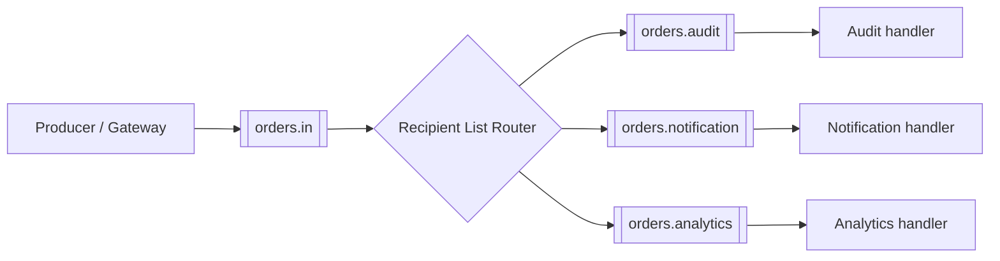
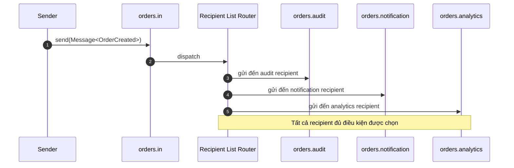
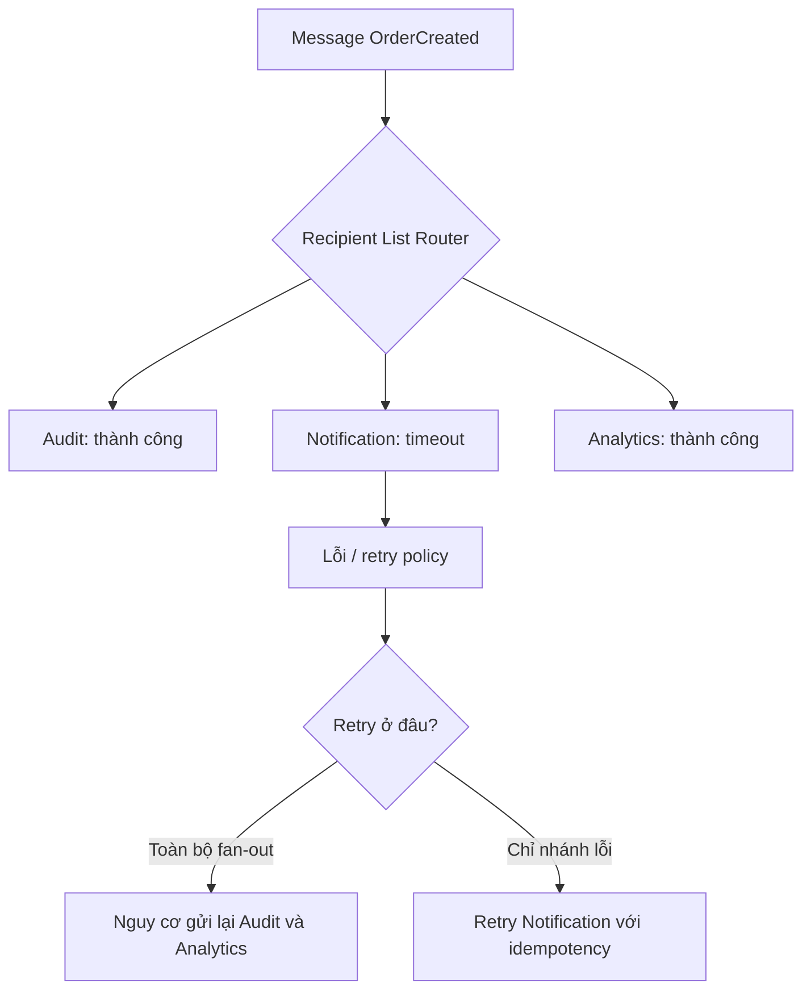

# Channel name trong recipient list

Một đơn hàng được tạo thành công có thể phải kích hoạt **nhiều tác vụ độc lập**: lưu sự kiện audit, gửi thông báo, cập nhật báo cáo và phát dữ liệu cho hệ thống kho. Nếu mỗi handler tự gọi các handler khác, một thay đổi trong nhánh thông báo có thể làm ảnh hưởng toàn bộ quy trình. **Recipient List Router** của Spring Integration giúp mô tả **danh sách những kênh nhận thông điệp** tại một điểm điều phối, qua đó tách producer khỏi từng consumer.

Trong mẫu **Recipient List** thuộc **Enterprise Integration Patterns (EIP)**, **channel name** không đơn giản là một chuỗi dùng để ghi chú: đó là **định danh để Spring Integration tìm đúng `MessageChannel` và gửi message tới recipient tương ứng**. Ghi sai một ký tự, nhầm tên bean với tên method hoặc dùng tên kênh do dữ liệu bên ngoài tùy ý quyết định có thể gây lỗi định tuyến, mất khả năng quan sát hoặc đưa message tới nơi không nên nhận.

Bài học **Channel name trong recipient list**, thuộc chương **Recipient list** của module `SPRING_INTEGRATION_PATTERN`, giải thích cách đặt và phân giải tên kênh, khai báo danh sách recipient cố định/có điều kiện, xử lý lỗi, fan-out, retry, correlation, Gateway, Filter, Transformer, Splitter/Aggregator và cách kiểm thử từng nhánh.

> **Ghi nhớ:** Recipient List Router quyết định **một message sẽ gửi tới những recipient nào**; `recipient("orders.audit")` yêu cầu có một **kênh được phân giải đúng tên** `orders.audit`. Nó không tự tạo consumer, không tự bảo đảm mọi recipient cùng thành công và cũng không biến message thành bản ghi bền vững trên broker.

## 1. Recipient list và channel name giải quyết bài toán gì?

Giả sử một ứng dụng nhận sự kiện `OrderCreated`. Mỗi sự kiện hợp lệ được chuyển đến:

| Recipient | Tên channel nội bộ | Mục đích |
| --- | --- | --- |
| Audit | `orders.audit` | Ghi dấu vết sự kiện theo chính sách. |
| Thông báo | `orders.notification` | Đề nghị gửi thông báo cho khách hàng. |
| Báo cáo | `orders.analytics` | Cập nhật số liệu tổng hợp. |

Thay vì bắt producer lần lượt gọi ba dịch vụ:

```text
Producer
  ├── auditService.save(...)
  ├── notificationService.send(...)
  └── analyticsService.record(...)
```

ta định nghĩa topology messaging:



Producer chỉ biết `orders.in` hoặc một facade Java ở phía trước. Khi cần thêm recipient báo cáo, ta cấu hình thêm kênh/handler và cập nhật policy của recipient list; không bắt caller biết chi tiết bên nhận.

**Điều quan trọng:** nhiều mũi tên từ Router biểu diễn **nhiều lần giao message tới recipient**, không phải phân chia message thành các phần. Recipient List khác Splitter ở chỗ **Splitter tạo các phần dữ liệu con theo một quy tắc**, còn Recipient List thường phân phối **cùng thông điệp hoặc thông điệp tương ứng** đến nhiều nơi nhận.

## 2. Channel name trong Spring Integration là gì?

`MessageChannel` là giao diện biểu diễn nơi producer gửi message và nơi consumer nhận/được dispatch. Trong một Spring application context, channel thường được đăng ký bằng **tên bean**. Recipient List Router dùng channel name để **phân giải một destination** thay vì cần tham chiếu trực tiếp đến từng implementation class.

Ví dụ:

```java
import org.springframework.context.annotation.Bean;
import org.springframework.context.annotation.Configuration;
import org.springframework.integration.channel.QueueChannel;

@Configuration
class OrderChannels {

    @Bean("orders.audit")
    QueueChannel auditChannel() {
        return new QueueChannel(32);
    }

    @Bean("orders.notification")
    QueueChannel notificationChannel() {
        return new QueueChannel(32);
    }

    @Bean("orders.analytics")
    QueueChannel analyticsChannel() {
        return new QueueChannel(32);
    }
}
```

Ở đây, tên bean thực tế là:

- `orders.audit` — **không phải** `auditChannel`;
- `orders.notification` — **không phải** `notificationChannel`;
- `orders.analytics` — **không phải** `analyticsChannel`.

Do `@Bean("...")` đã chỉ định **tên bean tường minh**, method Java `auditChannel()` chỉ là tên phương thức khai báo. Nếu dùng `@Bean` **không có tên**, tên mặc định thường dựa trên tên method; đây là lý do phải thống nhất **tên channel hợp đồng** và kiểm tra cách đăng ký bean thực tế.

### 2.1. Tên channel không phải tên broker topic

| Khái niệm | Ví dụ | Phạm vi |
| --- | --- | --- |
| Tên Spring `MessageChannel` | `orders.audit` | Định danh destination trong ứng dụng Spring/integration context. |
| Tên method `@Bean` | `auditChannel()` | Nơi khai báo bean Java; có thể khác tên channel. |
| Tên Kafka topic | `commerce.order.audit` | Định danh resource ngoài JVM của Kafka. |
| RabbitMQ exchange/routing key/queue | `order.exchange`, `audit.q` | Đối tượng transport với semantics riêng. |
| HTTP endpoint | `POST /api/orders` | Địa chỉ giao tiếp mạng. |

Một Spring channel tên `orders.audit` **không tự tạo Kafka topic cùng tên**. Muốn gửi ra broker phải nối channel đến outbound adapter hoặc endpoint tương ứng, với cấu hình xác thực, serialize, acknowledgment và retry phù hợp.

### 2.2. Vì sao dùng tên thay vì inject trực tiếp channel object?

Tên giúp định nghĩa **topology bằng cấu hình**:

- Các integration flow có thể tham chiếu một kênh bằng contract thống nhất.
- Router có thể phân phối tới nhiều channel đã đăng ký mà không cần giữ một trường Java cho từng handler.
- Test có thể lấy đúng bean bằng tên và đọc message từ `QueueChannel`.
- Khi thay implementation channel, các caller/flow dùng cùng tên có thể không cần sửa, miễn là semantics vẫn phù hợp.

Tuy vậy, **tên là một dependency**. Đổi `orders.notification` thành `orders.notify` mà quên recipient list là lỗi wiring. Nên quản lý tên như **hợp đồng nội bộ có kiểm thử**, tránh chuỗi rải rác ở hàng chục nơi.

## 3. Recipient List Router dùng channel name thế nào?

Spring Integration Java DSL hỗ trợ khai báo recipient list bằng `routeToRecipients(...)`. Mỗi lời gọi `recipient(...)` mô tả một kênh nhận; các recipient có thể là **không điều kiện** hoặc **được chọn theo một điều kiện**.

Ví dụ tĩnh:

```java
import org.springframework.context.annotation.Bean;
import org.springframework.context.annotation.Configuration;
import org.springframework.integration.config.EnableIntegration;
import org.springframework.integration.dsl.IntegrationFlow;

@Configuration
@EnableIntegration
class OrderRecipientListFlow {

    @Bean
    IntegrationFlow fanOutOrders() {
        return IntegrationFlow.from("orders.in")
            .routeToRecipients(spec -> spec
                .recipient("orders.audit")
                .recipient("orders.notification")
                .recipient("orders.analytics"))
            .get();
    }
}
```

Đọc đoạn DSL từ trên xuống:

1. Producer gửi vào `orders.in`, là input channel của flow.
2. `routeToRecipients(...)` tạo một endpoint Recipient List Router.
3. `recipient("orders.audit")` yêu cầu gửi đến kênh `orders.audit`.
4. `recipient("orders.notification")` yêu cầu gửi đến `orders.notification`.
5. `recipient("orders.analytics")` yêu cầu gửi đến `orders.analytics`.

**Ba chuỗi truyền vào `recipient(...)` là tên destination**, không phải method Java, kiểu payload, biểu thức đọc JSON hay event ID. Chúng phải được giải quyết thành channel/recipient hợp lệ trong cấu hình runtime.

### 3.1. Điều gì xảy ra khi gửi một message?



Sơ đồ mô tả **tuyến gửi logic**. Hành vi đồng bộ/bất đồng bộ, thời gian gửi, việc một recipient thất bại ảnh hưởng các recipient sau và cách exception được báo về **phụ thuộc cấu hình router/channel/endpoint**; không nên diễn giải thành bảo đảm nguyên tử cho ba thao tác nghiệp vụ.

### 3.2. Tên channel có thể chứa dấu chấm không?

Có. Một tên bean như `orders.notification` có dấu chấm có thể được dùng làm **tên channel** bình thường. Điều phải phân biệt là:

```text
"orders.notification"    ← tên channel / bean
"payload.notification"   ← có thể là biểu thức truy cập dữ liệu trong ngữ cảnh khác
"notification"           ← một routing key hoặc giá trị metadata
```

Đối với `recipient("orders.notification")`, mục tiêu là **channel được đặt tên**, không phải yêu cầu framework đọc property `notification` từ đối tượng `orders`.

## 4. Một ví dụ độc lập: định nghĩa và kiểm thử nhiều recipient

Để dễ kiểm tra, ta tạo một cấu hình Spring chứa **cả Router và các channel đích**. Tất cả recipient là `QueueChannel` giới hạn dung lượng; ví dụ không yêu cầu broker hay service bên ngoài.

### 4.1. Cấu hình đầy đủ

```java
import org.springframework.context.annotation.Bean;
import org.springframework.context.annotation.Configuration;
import org.springframework.integration.channel.QueueChannel;
import org.springframework.integration.config.EnableIntegration;
import org.springframework.integration.dsl.IntegrationFlow;

@Configuration
@EnableIntegration
public class RecipientListConfiguration {

    @Bean("orders.audit")
    QueueChannel auditOrders() {
        return new QueueChannel(16);
    }

    @Bean("orders.notification")
    QueueChannel notificationOrders() {
        return new QueueChannel(16);
    }

    @Bean("orders.analytics")
    QueueChannel analyticsOrders() {
        return new QueueChannel(16);
    }

    @Bean
    IntegrationFlow orderRecipients() {
        return IntegrationFlow.from("orders.in")
            .routeToRecipients(spec -> spec
                .recipient("orders.audit")
                .recipient("orders.notification")
                .recipient("orders.analytics"))
            .get();
    }
}
```

Ở cấu hình trên, `orders.in` là channel đầu vào của integration flow; các channel kết quả đã được định nghĩa bằng `@Bean("...")`. Khi chạy ứng dụng thật, ta cần **các consumer/poller** xử lý các queue này. `QueueChannel` giữ message trong bộ nhớ theo cấu hình ví dụ; nó không lưu bền và không tạo tác dụng phụ nghiệp vụ.

### 4.2. JUnit 5 test: một message đến đủ ba kênh

```java
import static org.junit.jupiter.api.Assertions.*;

import org.junit.jupiter.api.Test;
import org.springframework.beans.factory.annotation.Autowired;
import org.springframework.context.ApplicationContext;
import org.springframework.integration.channel.QueueChannel;
import org.springframework.messaging.Message;
import org.springframework.messaging.MessageChannel;
import org.springframework.messaging.support.MessageBuilder;
import org.springframework.test.context.junit.jupiter.SpringJUnitConfig;

@SpringJUnitConfig(RecipientListConfiguration.class)
class RecipientListConfigurationTest {

    @Autowired
    ApplicationContext context;

    private QueueChannel queue(String name) {
        return context.getBean(name, QueueChannel.class);
    }

    @Test
    void oneMessageIsDeliveredToAllThreeRecipients() {
        Message<String> input = MessageBuilder
            .withPayload("ORDER-1001")
            .setHeader("eventType", "ORDER_CREATED")
            .setHeader("correlationId", "corr-1001")
            .build();

        MessageChannel ingress = context.getBean("orders.in", MessageChannel.class);
        assertTrue(ingress.send(input));

        Message<?> audit = queue("orders.audit").receive(0);
        Message<?> notify = queue("orders.notification").receive(0);
        Message<?> analytics = queue("orders.analytics").receive(0);

        assertNotNull(audit);
        assertNotNull(notify);
        assertNotNull(analytics);

        assertEquals("ORDER-1001", audit.getPayload());
        assertEquals("ORDER-1001", notify.getPayload());
        assertEquals("ORDER-1001", analytics.getPayload());

        assertEquals("corr-1001", audit.getHeaders().get("correlationId"));
        assertEquals("corr-1001", notify.getHeaders().get("correlationId"));
        assertEquals("corr-1001", analytics.getHeaders().get("correlationId"));

        assertNull(queue("orders.audit").receive(0));
        assertNull(queue("orders.notification").receive(0));
        assertNull(queue("orders.analytics").receive(0));
    }
}
```

Test này kiểm tra:

- Chính xác ba **channel name** được khai báo là bean có thể phân giải.
- Producer gửi **một** message vào `orders.in`.
- Router chuyển dữ liệu tới **cả ba recipient**, không chỉ một nhánh.
- Header ứng dụng `correlationId` được giữ trong ví dụ, hỗ trợ đối chiếu dấu vết ở recipient.
- Không có message dư trong queue sau khi test đọc.

**Không nên khẳng định ba recipient nhận đúng cùng một reference object** hoặc có chung message ID trong mọi cấu hình. Điều cần quan sát là **dữ liệu/hợp đồng và số lần chuyển giao**. Thực tế việc xây message mới, thêm header sequence, chuyển payload qua adapter hoặc serialization có thể thay đổi đối tượng/hệ metadata.

### 4.3. Những điều ví dụ chưa bảo đảm

- Không có consumer nghiệp vụ hoặc hệ thống ngoài.
- Không có durable store, transaction phân tán hay broker acknowledgment.
- Không đo thứ tự xử lý giữa các recipient.
- Không xác minh tác vụ ở cả ba hệ thống đều thành công.
- Không mô phỏng retry, message trùng, queue đầy hoặc mất kết nối.

Đây là **test topology fan-out**, không phải bằng chứng về giao nhận exactly-once hoặc thành công nghiệp vụ end-to-end.

## 5. Recipient có điều kiện: tên channel cố định, quyết định gửi linh hoạt

Không phải message nào cũng cần tới mọi recipient. Ví dụ, mọi đơn phải đi audit, nhưng chỉ đơn có quyền nhận thông báo mới đi `orders.notification`, và chỉ đơn ưu tiên mới đi `orders.priority`.

Spring Integration DSL cho phép khai báo recipient **kèm biểu thức điều kiện**, ví dụ:

```java
@Bean
IntegrationFlow conditionalRecipients() {
    return IntegrationFlow.from("orders.conditional.in")
        .routeToRecipients(spec -> spec
            .recipient("orders.audit")
            .recipient("orders.notification",
                "headers['notificationAllowed'] == true")
            .recipient("orders.priority",
                "headers['priority'] == true"))
        .get();
}
```

**Đây là cấu hình thay thế để minh họa**, không phải phần thêm trực tiếp vào `RecipientListConfiguration` ở mục 4. Nó giả định đã có bean channel `orders.priority` cùng các channel liên quan và `notificationAllowed`, `priority` là **Boolean được kiểm tra/chuẩn hóa trước**. Nếu header từ bên ngoài đến dưới dạng String `"true"` hoặc bị thiếu, không nên phụ thuộc vào chuyển kiểu ngầm.

### 5.1. Hai quyết định tách biệt

Với mỗi recipient, có hai yếu tố:

| Quyết định | Ví dụ | Ý nghĩa |
| --- | --- | --- |
| **Có gửi hay không?** | `headers['notificationAllowed'] == true` | Điều kiện lựa chọn recipient. |
| **Gửi đến đâu?** | `orders.notification` | **Tên channel** đã đăng ký, là đích được cấu hình. |

Trong ví dụ, biểu thức điều kiện **không được dùng để tạo tên channel tùy ý**. Nó chỉ quyết định có bao gồm recipient đã được khai báo hay không. Đây là một cách hạn chế rủi ro dữ liệu ngoài điều khiển topology.

### 5.2. Một hoặc nhiều recipient

| Pattern | Quy tắc phân phối | Trường hợp điển hình |
| --- | --- | --- |
| **Content-Based Router** | Thường tính một route key rồi chọn đích theo quy tắc cấu hình. | Phân loại đơn ưu tiên so với đơn thường. |
| **Recipient List Router** | Chọn **danh sách** recipient; có thể có điều kiện riêng từng recipient. | Cùng sự kiện đi audit và analytics, thêm notification nếu được phép. |
| **PublishSubscribeChannel** | Fan-out cho các subscriber đã đăng ký của một channel. | Phát cùng message cho nhiều handler cùng subscribe một chủ đề nội bộ. |
| **Splitter** | Tách một payload thành các **phần dữ liệu con**. | Tách danh sách dòng hàng để kiểm tra kho từng dòng. |

Recipient List và PublishSubscribe đều có thể giúp **fan-out**, nhưng có ranh giới điều phối khác. Recipient List biểu diễn **danh sách đích ở router**, thuận tiện khi mỗi đích có điều kiện riêng. PublishSubscribeChannel điều phối **subscriber của một channel**; việc các subscriber đăng ký/quyền điều phối và đặc tính dispatch phụ thuộc cấu hình channel đó.

Không có một lựa chọn đúng cho mọi trường hợp: cân nhắc policy, nhu cầu fan-out, thay đổi recipient theo cấu hình, lỗi, backpressure và mức độ ghép nối.

## 6. Cách Spring Integration phân giải channel name

Khi recipient dùng một tên như `orders.audit`, router phải tìm một destination tương ứng trong cấu hình ứng dụng. Ở môi trường bean-based, cách phổ biến nhất là tìm **bean `MessageChannel` được đăng ký với tên đó**; cơ chế resolution có thể dùng channel resolver và hạ tầng Spring Integration.

### 6.1. Tên không tồn tại

Giả sử code dùng:

```java
.routeToRecipients(spec -> spec
    .recipient("orders.audit")
    .recipient("orders.notfication"))  // Sai chính tả: thiếu chữ i
```

Nhưng channel thực tế có tên `orders.notification`. Router sẽ không tự suy ra hai tên là một. Việc ứng dụng báo lỗi ngay khi khởi tạo hay khi xử lý message có thể phụ thuộc cách endpoint/channel được resolve và phiên bản Spring Integration; **không giả định mọi lỗi tên đều được bắt ở compile time**.

Nếu một recipient không thể được phân giải thành channel hợp lệ, sẽ có **lỗi cấu hình/định tuyến hoặc giao message** theo cơ chế runtime. Phải bắt lỗi bằng **integration test** gửi message thật vào flow, không chỉ kiểm tra Java compile.

### 6.2. Kênh tồn tại nhưng không có subscriber

Khi channel là `DirectChannel` mà không có subscriber nhận, việc dispatch có thể thất bại. Điều đó khác với `QueueChannel`: nó có thể **nhận và giữ message** ngay cả khi chưa có poller, cho tới khi đầy hoặc chạm giới hạn tài nguyên.

| Tình huống | Điều cần kiểm tra |
| --- | --- |
| Sai tên channel | Bean/resolver không tìm được đúng destination. |
| Channel đúng tên nhưng sai loại bean | Destination không có semantics `MessageChannel` mong muốn. |
| `DirectChannel` không có subscriber | Delivery có thể không thực hiện được. |
| `QueueChannel` không có poller | Message có thể tích tụ, cuối cùng đầy/bão hòa. |
| `ExecutorChannel` quá tải | Executor có thể từ chối tác vụ; cần chính sách rejection/backpressure. |
| Adapter outbound không kết nối được | Message đã tới channel nhưng bước ra transport có thể lỗi. |

Không nên xem `router gửi đến đúng tên channel` là điều kiện đủ để khẳng định người nhận đã xử lý thành công.

### 6.3. Tên channel có phải namespace toàn cục không?

Tên channel được phân giải **trong phạm vi integration context và cơ chế resolver** đang sử dụng; nó không tự là một định danh toàn cục xuyên tất cả ứng dụng hoặc service. Hai service khác nhau có thể có channel cùng tên nhưng không tự trao đổi dữ liệu. Muốn giao tiếp qua ranh giới service, cần adapter/protocol và hợp đồng transport rõ ràng.

### 6.4. Quản lý tên bằng quy ước

Không có định dạng bắt buộc cho mọi project. Một quy ước có thể là:

```text
<domain>.<event-or-flow>.<purpose>
orders.created.audit
orders.created.notification
orders.created.analytics
```

Tên tốt nên:

1. Nêu rõ miền và mục đích, tránh `channel1`, `foo`.
2. Ổn định khi method triển khai đổi tên.
3. Không nhúng dữ liệu nhạy cảm như email, token, ID khách hàng.
4. Dùng tập tên đã đăng ký/cho phép, không nhận tên tùy ý từ HTTP request.
5. Có test wiring cho từng recipient.
6. Không dựa vào tên mà suy ra tự có durability, retry, transaction hay quyền truy cập.

Nếu nhiều module cần dùng cùng tên, có thể dùng constants/config được kiểm soát và review thay vì sao chép string khắp nơi. Tuy vậy, việc tạo constants không thay thế **test bean resolution**.

## 7. Nếu một recipient lỗi, các recipient khác có còn nhận được không?

Đây là câu hỏi quan trọng hơn việc tên channel viết đúng.

Một Recipient List có thể gửi đến nhiều channel trong cùng chuỗi điều phối, nhưng **không tự là giao dịch phân tán**. Nếu Audit xử lý thành công còn Notification lỗi, không thể mặc định:

- tất cả recipient đã commit cùng nhau;
- Router sẽ tự rollback thành công của Audit;
- retry toàn bộ message không gây trùng Audit;
- ba recipient đều nhận cùng thứ tự và cùng thời điểm;
- lỗi ở một nhánh không ảnh hưởng việc dispatch các nhánh khác.

**Hành vi thực tế** phụ thuộc channel đồng bộ/bất đồng bộ, thứ tự/chiến lược dispatch, transaction scope, retry advice, adapter và chính sách lỗi.

### 7.1. Fan-out đồng bộ

Với các `DirectChannel` và handler đồng bộ, một recipient có thể xử lý trực tiếp trong caller thread. Nếu một handler ném exception, việc còn gửi tới các recipient khác hay không phụ thuộc đường xử lý lỗi/cấu hình Router. Do đó, đừng coi cấu hình recipient list là một cơ chế “thử tất cả nhánh cho tới hết dù nhánh trước lỗi” trong mọi trường hợp.

### 7.2. Fan-out qua queue hoặc broker

Với `QueueChannel` hoặc adapter gửi broker, Router có thể chấp nhận từng lần gửi trước khi nghiệp vụ hoàn tất. Nhưng:

- Queue trong bộ nhớ không mặc định tồn tại qua restart.
- Send thành công không đồng nghĩa message đã được một service xử lý.
- Nếu queue đầy, send có thể chờ rồi thất bại tùy cấu hình.
- Nếu broker redeliver, một recipient có thể nhận lại message.

Với các yêu cầu “không mất” hoặc “xử lý đúng một lần về mặt nghiệp vụ”, cần lưu bền, transaction/outbox khi phù hợp và **idempotency ở từng recipient có side effect**.

### 7.3. Gợi ý thiết kế khi tác vụ khác độ quan trọng

| Recipient | Độ quan trọng minh họa | Chính sách cần cân nhắc |
| --- | --- | --- |
| Audit bắt buộc | Cao | Ghi bền/transaction phù hợp và khả năng replay có kiểm soát. |
| Notification | Có thể thử lại | Retry/backoff riêng, không làm lặp tác vụ chính. |
| Analytics | Có thể eventual consistency | Buffer/broker và khả năng backfill. |

Nếu yêu cầu audit phải commit cùng nghiệp vụ nhưng notification có thể trễ, có thể cần **transactional outbox** hoặc một kiến trúc xuất sự kiện sau commit thay vì dùng Recipient List Router đơn thuần như cam kết giao dịch. Việc lựa chọn phụ thuộc tính chất dữ liệu và ràng buộc sản phẩm.

## 8. Retry, error channel và idempotency trong recipient list

Một lỗi phổ biến là **retry nguyên đầu vào** khi một recipient gặp timeout. Nếu nhánh Audit đã ghi thành công, lần retry có thể ghi một record Audit thứ hai nếu không có khóa chống trùng.

### 8.1. Mô hình thất bại minh họa



Sơ đồ không mô tả cơ chế auto-retry mặc định; nó minh họa **hai vị trí đặt retry** dẫn đến kết quả khác nhau. Nếu cần bảo đảm từng recipient nhận và xử lý độc lập, ưu tiên **trạng thái xử lý riêng từng recipient**, queue/broker phù hợp và idempotency key ổn định.

### 8.2. Error channel không tự đảm bảo mọi lỗi đều được gom

Khi một handler chạy đồng bộ trên `DirectChannel`, exception có thể truyền về caller. Với ranh giới async/poller/adapter, lỗi có thể đi thành `ErrorMessage` đến error channel **khi cấu hình phù hợp**. Lỗi sai tên channel, queue đầy, timeout outbound và nghiệp vụ từ chối đều có semantics khác nhau.

| Loại thất bại | Điểm phát hiện | Cách xử lý |
| --- | --- | --- |
| Tên recipient sai | Channel resolution | Sửa cấu hình, test wiring; retry y nguyên không giải quyết. |
| Recipient không có consumer | Dispatch/queue/poller | Bổ sung handler, kiểm tra backlog và capacity. |
| Notification API tạm lỗi | Outbound Gateway/client | Retry giới hạn tại nhánh, backoff và DLQ nếu được thiết kế. |
| Audit DB commit thất bại | Audit handler | Transaction/rollback hoặc lưu bền đúng hợp đồng. |
| Message bị gửi lại | Producer/broker/flow retry | Idempotency theo event + recipient, tránh side effect trùng. |
| Payload vi phạm policy | Filter/validation trước Router | Từ chối có mã rõ, không phát tán tới recipient. |

**Không để raw message hoặc credential vào log/error channel/DLQ không được bảo vệ**. Khi retry một nhánh, cần bảo toàn correlation/trace context hữu ích mà không phát tán dữ liệu cá nhân.

### 8.3. Một idempotency key dùng thế nào?

Giả sử một `OrderCreated` có `eventId = EVT-001`. Mỗi recipient có thể lưu một dấu vết xử lý theo **`(eventId, recipientId)`**. Khi broker/flow gửi lại message, recipient nhận ra cùng sự kiện đã được xử lý và tránh lặp tác dụng phụ.

Đây là chiến lược minh họa, không phải chức năng mặc định của Recipient List Router. Việc kiểm tra trùng phải **an toàn trước cạnh tranh**, có lưu trữ/transaction thích hợp; chỉ đặt `eventId` vào header mà không có nơi ghi nhận trạng thái chưa giải quyết được bài toán.

## 9. Recipient List và Gateway request–reply: cần hiểu rõ kỳ vọng

Một `@MessagingGateway` có thể cung cấp facade Java cho caller, ví dụ:

```java
import org.springframework.integration.annotation.MessagingGateway;

@MessagingGateway(defaultRequestChannel = "orders.in")
interface OrderEventGateway {
    void publish(OrderEvent event);
}

// OrderEvent là DTO do ứng dụng định nghĩa.
```

Interface trên **không trả giá trị nghiệp vụ**; nó phù hợp hơn khi caller muốn **phát một event**, còn những recipient xử lý độc lập. Tuy nhiên `void` không tự bảo đảm send bất đồng bộ, broker durability, retry hoặc tất cả recipient đã hoàn tất.

### 9.1. Nếu caller cần một kết quả trả về

Giả sử interface là:

```java
@MessagingGateway(defaultRequestChannel = "orders.in")
interface OrderProcessingGateway {
    OrderResult submit(OrderEvent event);
}
```

Khi một message được fan-out đến ba recipient, **không có một response duy nhất tự động đại diện cho cả ba kết quả**. Cần xác định:

1. Kết quả của recipient nào là reply chính?
2. Có phải chờ đủ tất cả recipient không?
3. Có chấp nhận kết quả một phần?
4. Timeout của Gateway và của từng downstream là bao lâu?
5. Nếu một recipient hoàn tất sau khi caller timeout thì làm gì?

Nếu yêu cầu thật sự cần gom nhiều kết quả, có thể thiết kế **scatter–gather** bằng Recipient List/Publish-Subscribe kết hợp **Aggregator** với correlation và release strategy. Đừng kỳ vọng một lời gọi `routeToRecipients(...)` tự trả về `List<Result>`.

### 9.2. Phân biệt Router với Aggregator

`Recipient List Router` quyết định **gửi đến ai**; `Aggregator` quyết định **khi nào đủ các phản hồi thuộc cùng nhóm** để phát kết quả. Nếu có recipient tùy chọn, số phản hồi kỳ vọng có thể khác nhau theo message. Cần thiết kế thông tin nhóm/số recipient và cách xử lý nhánh không được chọn, nhánh bị Filter từ chối hoặc nhánh timeout.

Một số router/flow có cơ chế gắn **correlation và sequence headers** khi phân phối tới nhiều recipient theo cấu hình; không nên giả định chúng luôn tự được thêm và luôn qua mọi adapter. Hãy xác minh những header thực sự xuất hiện và chiến lược Aggregator trong phiên bản sử dụng.

## 10. Hợp đồng bảo mật: không cho dữ liệu ngoài chọn channel tùy ý

Một header như `recipientChannel` do HTTP client gửi **không nên được đưa thẳng** vào cơ chế resolution để chọn bất kỳ bean/channel nào của ứng dụng. Nếu kẻ gửi có thể đoán tên một kênh có đặc quyền, họ có thể khiến thông điệp đi vào quy trình không được phép.

Thực hành tốt:

- Giữ **recipient names trong cấu hình đáng tin cậy**, hoặc giới hạn bằng allowlist rõ ràng.
- Dùng các **điều kiện được kiểm chứng**, ví dụ `notificationAllowed` do hệ thống xác định, thay vì tin header `role=ADMIN` từ client.
- Kiểm tra authorization ở biên và trong nghiệp vụ; router không thay thế kiểm tra quyền.
- Không tạo tên channel bằng email, token, số tài khoản hoặc identifier nhạy cảm.
- Không sao chép tất cả header đầu vào đến mọi recipient; chỉ giữ metadata cần thiết.
- Mỗi recipient chỉ nhận payload/phần dữ liệu được phép theo hợp đồng; nếu Audit và Notification cần dữ liệu khác nhau, cân nhắc **Transformer/adapters riêng** trước đích.

### 10.1. Nhiều recipient làm tăng phạm vi lộ dữ liệu

Khi `OrderCreated` chứa email và thông tin thanh toán, gửi cùng payload đó tới Analytics, Audit và Notification có thể khiến nhiều hệ thống nắm dữ liệu không cần thiết. Tính tiện lợi của fan-out không thay thế **data minimization**. Có thể để Router gửi một event tối thiểu, rồi mỗi nhánh lấy dữ liệu được phép hoặc chuyển thành DTO phù hợp.

Nếu một recipient bắt buộc cần dữ liệu nhạy cảm, phải xác định quyền truy cập, transport encryption, retention, masking, chính sách logging và cách xử lý error/DLQ. Một tên channel nội bộ không phải biên bảo mật tự động.

## 11. Kiểm thử channel name và chính sách recipient có điều kiện

Bộ kiểm thử nên đi xa hơn việc message xuất hiện trong ba queue.

| Test case | Kết quả cần xác minh |
| --- | --- |
| Ba channel khai báo đúng tên | Mỗi recipient được phân giải và nhận đúng message. |
| Tên một channel bị gõ sai | Test phát hiện lỗi wiring/dispatch, không bị bỏ qua. |
| Channel đúng tên nhưng không có consumer | Hệ thống có chính sách phù hợp; không báo hoàn tất giả. |
| `notificationAllowed=true` | Notification được chọn và nhận message. |
| `notificationAllowed=false` | Không có message tới Notification; Audit vẫn nhận. |
| `notificationAllowed="true"` (String) | Bị normalize/validate theo hợp đồng; không dựa vào coercion ngầm. |
| Một recipient bị lỗi | Quan sát được điều gì xảy ra với các recipient còn lại. |
| Queue recipient bị đầy | Backpressure/send timeout và error policy hoạt động. |
| Message được retry/replay | Recipient xử lý có idempotency, không phát sinh side effect trùng. |
| Message có dữ liệu nhạy cảm | Không bị log/phát tán ra nhánh không được phép. |
| Có Aggregator | Correlation, số recipient được chọn, timeout và late replies đúng. |
| Thay `QueueChannel` bằng async/broker | Test chờ theo điều kiện thay vì `receive(0)` ngay. |

### 11.1. Kiểm tra tên bean trực tiếp

Ở một integration test, có thể xác minh hạ tầng đã đăng ký channel với tên mong đợi:

```java
import static org.junit.jupiter.api.Assertions.assertNotNull;

import org.springframework.context.ApplicationContext;
import org.springframework.messaging.MessageChannel;

void assertChannelExists(ApplicationContext context, String name) {
    MessageChannel channel = context.getBean(name, MessageChannel.class);
    assertNotNull(channel);
}

// Ví dụ gọi:
// assertChannelExists(context, "orders.audit");
// assertChannelExists(context, "orders.notification");
// assertChannelExists(context, "orders.analytics");
```

Đây chỉ là **test existence**: tên channel tồn tại nhưng chưa chứng minh Router thật sự gửi đúng và consumer xử lý. Luôn có test end-to-end của **đường đi thông điệp** như ở mục 4.

### 11.2. Kịch bản sai tên cần chủ động thử

Thay một recipient `orders.notification` bằng `orders.notfication` trong một cấu hình test cô lập. Quan sát việc gửi message hoặc khởi tạo flow báo lỗi theo hành vi thực tế. Sau đó khôi phục tên và chạy lại.

Không dùng việc cố tình sai tên trong cấu hình production làm “fallback”. Nếu recipient có thể không được cài đặt trong một môi trường, hãy biểu diễn điều kiện bật/tắt recipient bằng **configuration/property được kiểm soát**, hoặc dùng topology tương thích môi trường đó. **Đừng im lặng gửi đến tên không tồn tại.**

## 12. Timeout, thứ tự và giới hạn năng lực của recipient

### 12.1. Send timeout chỉ kiểm soát bàn giao ở channel phù hợp

Nếu `orders.audit` là `QueueChannel(16)` và có 16 message chưa được đọc, một lần gửi tiếp có thể chờ hoặc thất bại tùy timeout và cách dispatch. `send(timeout)` giới hạn **chờ giao message**, không giới hạn việc audit DB ghi xong.

Nếu là `DirectChannel`, handler có thể chạy đồng bộ; send timeout **không tự cắt ngang** một method xử lý dài hoặc HTTP call bên ngoài. Nếu là `ExecutorChannel`, công việc có thể chạy trên thread khác nhưng không tự có lưu bền.

### 12.2. Thứ tự recipient không phải cam kết thứ tự hoàn tất

Giả sử router khai báo:

```text
recipient("orders.audit")
recipient("orders.notification")
recipient("orders.analytics")
```

Thứ tự dòng khai báo **không phải chứng chỉ** rằng audit trong DB luôn commit trước khi email được gửi, nhất là nếu có executor, queue hoặc broker. Khi nghiệp vụ yêu cầu phụ thuộc thời gian (ví dụ “chỉ gửi email sau khi giao dịch chính commit”), cần thiết kế **workflow/transaction/outbox hoặc tín hiệu hoàn tất rõ ràng**, không suy từ thứ tự tên recipient.

### 12.3. Recipient có thể là điểm nghẽn độc lập

Mỗi nhánh có tốc độ xử lý và giới hạn tài nguyên riêng. Thông báo có thể chậm do dịch vụ email, analytics có thể chậm do warehouse, audit có thể bão hòa DB. Hãy theo dõi queue depth, queue age, send failures và handler latency **theo từng channel name**, thay vì chỉ một chỉ số trung bình cho toàn flow.

## 13. Observability: tên channel là nhãn kỹ thuật tốt nếu có kiểm soát

Khi danh sách recipient được định nghĩa sẵn và số tên hữu hạn, `channelName` là một nhãn hữu ích để quan sát:

- Số message đi vào Recipient List Router.
- Số recipient được chọn trên mỗi loại event.
- Số lần gửi tới từng channel.
- Số lỗi resolution/dispatch/timeout theo channel.
- Queue depth, queue age và tỷ lệ xử lý của consumer.
- Retry và lỗi nghiệp vụ ở từng nhánh.
- Correlation/trace giúp liên hệ một sự kiện nguồn với các recipient downstream.

Ví dụ log dạng cấu trúc:

```text
event=recipient_dispatch
flow=orderCreatedFanout
recipient_channel=orders.notification
outcome=accepted_by_channel
event_type=ORDER_CREATED
correlation_id=8ef7ae3b-94b6-47f4-a903-73e346f379bb
```

Đây là **định dạng đề xuất**, không phải log tự sinh mặc định. `accepted_by_channel` chỉ diễn tả bước giao thông điệp tại ranh giới channel; không nên đổi nhãn thành `business_completed` nếu downstream chưa xác nhận.

**Bảo mật và cardinality:** chỉ đưa **tên channel đã được cấu hình** vào metric labels. Không đưa event ID, correlation ID, email hoặc channel name dựng từ dữ liệu không tin cậy vào nhãn metrics. Có thể dùng correlation ID mờ trong log/traces có phân quyền khi cần điều tra.

### 13.1. Khi một nhánh không có message

Nếu Analytics nhận được sự kiện nhưng Notification không nhận, hãy kiểm tra lần lượt:

1. Recipient `orders.notification` có được khai báo/chọn bởi điều kiện không?
2. Tên recipient có khớp bean/channel đã đăng ký không?
3. Channel có subscriber/poller không? Có đầy không?
4. Có lỗi trước khi dispatch recipient này không?
5. Có ranh giới async/adapter khiến message chưa tới hoặc đã đi DLQ không?
6. Lỗi xảy ra tại **bàn giao message** hay trong **handler nghiệp vụ**?

Truy vết theo từng ranh giới sẽ chính xác hơn việc chỉ xem log của producer và kết luận rằng Router “đã gửi tới tất cả”.

## 14. Bài tập thực hành

**Bài 1 — Thêm recipient mới.** Bổ sung channel `orders.search-index` vào cấu hình ở mục 4, rồi thêm `recipient("orders.search-index")`. Viết test chứng minh một event được gửi tới bốn queue và không còn message dư sau khi đọc.

**Bài 2 — Đổi tên có kiểm soát.** Đổi `@Bean("orders.notification")` thành `@Bean("orders.notify")` nhưng giữ nguyên Router. Quan sát lỗi từ integration test và giải thích vì sao compiler Java không nhất thiết phát hiện lỗi này.

**Bài 3 — Recipient có điều kiện.** Cho Audit luôn được nhận, Notification chỉ khi `notificationAllowed=true`. Viết test cho cả hai giá trị boolean và giá trị String `"true"` chưa được normalize.

**Bài 4 — Retry riêng từng nhánh.** Giả lập Notification lỗi tạm thời sau khi Audit đã hoàn tất. Thiết kế một chính sách không làm Audit ghi lại khi chỉ Notification cần retry.

**Bài 5 — Tên channel từ header.** Client gửi `recipientChannel="admin.command"`. Giải thích rủi ro và đề xuất mô hình allowlist/authorization để client không thể định tuyến trực tiếp đến một bean có đặc quyền.

**Bài 6 — Aggregator.** Một yêu cầu đi tới ba recipient, trong đó một recipient tùy chọn có thể không được chọn. Hãy mô tả correlation key, số reply dự kiến, group timeout và cách xử lý một reply đến muộn.

**Bài 7 — Dashboard theo recipient.** Xây các metric theo `recipient_channel` và `outcome`. Giải thích vì sao không dùng `correlation_id` làm nhãn metrics dù giá trị đó rất hữu ích khi truy vết trong log.

## 15. Checklist trước khi triển khai recipient list

| Câu hỏi | Điều cần kiểm tra |
| --- | --- |
| Mỗi recipient có một channel name rõ không? | Tên ổn định, có ý nghĩa, không lấy trực tiếp từ nguồn không tin cậy. |
| Bean/channel có thật với tên chính xác không? | Có `@Bean("...")` hoặc cấu hình tương đương và test resolution. |
| Có nhầm method name với bean name không? | Không; hiểu `@Bean(name)` quyết định tên đăng ký. |
| Có nhầm channel với broker topic không? | Không; adapter nối tới transport ngoài khi cần. |
| Một message phải đi một hay nhiều đích? | Đã chọn đúng Recipient List/Router/Publish-Subscribe/Splitter. |
| Recipient có điều kiện được định nghĩa rõ không? | Predicate kiểm tra dữ liệu đã chuẩn hóa và đáng tin cậy. |
| Có recipient nào thiếu handler/poller không? | Không, hoặc có chính sách giữ/xử lý chờ tường minh. |
| Một recipient lỗi sẽ ảnh hưởng những recipient khác ra sao? | Đã kiểm thử đúng channel, dispatch và transaction boundary. |
| Retry có thể gây trùng side effect không? | Có idempotency theo event + recipient và chiến lược retry riêng khi cần. |
| Có request–reply hoặc Aggregator không? | Có reply, correlation, release, timeout và xử lý partial/late reply. |
| Queue có thể đầy hoặc mất message khi restart không? | Capacity, backpressure, persistence và recovery đúng yêu cầu. |
| Có hạn chế dữ liệu/đặc quyền theo recipient không? | Có allowlist, data minimization, phân quyền và log an toàn. |
| Có test đúng/sai tên kênh và từng nhánh không? | Có, gồm negative cases, queue đầy và lỗi downstream. |
| Observability đủ phân biệt các nhánh không? | Có metrics/log theo channel/recipient hữu hạn, không lộ dữ liệu cá nhân. |

## Kết luận

Trong **Recipient List Router**, **channel name** là **định danh của destination** mà Spring Integration cần phân giải để chuyển message tới một hoặc nhiều recipient. Tên như `orders.audit` hoặc `orders.notification` phải khớp với kênh đã đăng ký; nó không phải tên method Java, tên Kafka topic, biểu thức truy cập payload hay một cam kết rằng downstream đã xử lý thành công.

Thiết kế Recipient List tốt cần **tên kênh có hợp đồng rõ, mapping tường minh, điều kiện chọn recipient được kiểm soát, consumer cho mỗi nhánh, quản lý timeout/backpressure và kiểm thử lỗi resolution**. Khi cần fan-out đáng tin cậy, phải bổ sung retry có idempotency, error flow, correlation, các ranh giới transaction/durability và observability. Kết hợp cùng Filter, Transformer, Gateway, Splitter và Aggregator, đó là cách xây dựng luồng thông điệp **ít phụ thuộc, dễ mở rộng và đủ minh bạch để vận hành khi một recipient gặp sự cố**.
