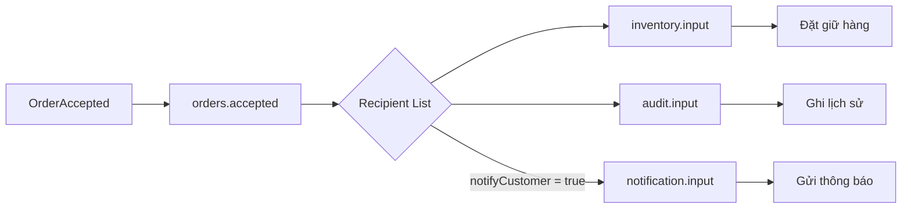
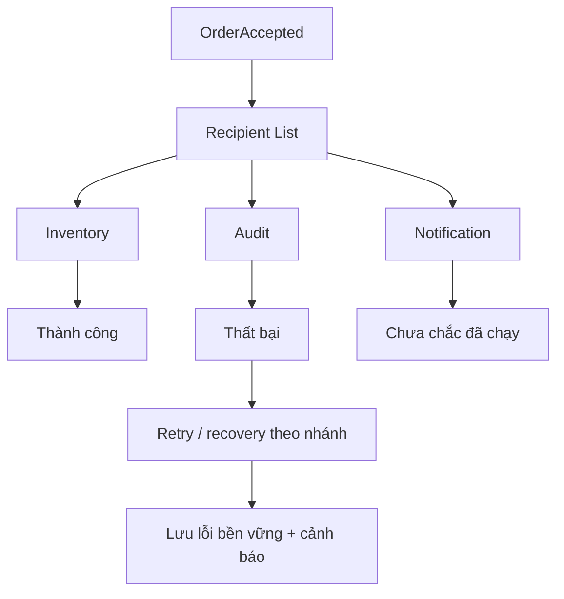
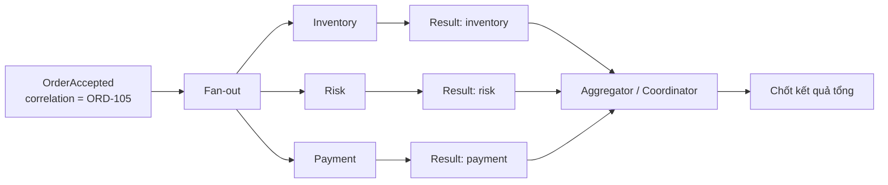

# Broadcast và fan-out

## 1. Vì sao một message cần gửi đến nhiều nơi?

Giả sử hệ thống thương mại điện tử phát sinh sự kiện `OrderAccepted` khi đơn hàng được chấp nhận. Cùng một sự kiện có thể cần kích hoạt ba hoạt động độc lập: cập nhật tồn kho, ghi nhật ký kiểm toán và gửi thông báo cho khách hàng. Nếu bên phát sự kiện gọi trực tiếp cả ba dịch vụ, nó phải biết các dịch vụ này, thứ tự gọi và cách xử lý lỗi của từng nơi. Mỗi khi thêm người nhận mới, mã của producer lại phải thay đổi.

**Recipient List** là mẫu *Enterprise Integration Patterns* (EIP) cho phép một thành phần điều phối thông điệp đến **một tập người nhận**. Tập này có thể cố định hoặc được tính dựa trên thông tin của message. Khi mọi recipient trong danh sách đều nhận message, đó là **broadcast**; khi một message được phân phối thành nhiều đường xử lý song song hoặc độc lập về mặt logic, ta thường gọi là **fan-out**.

Trong chương **Recipient list** của module **SPRING_INTEGRATION_PATTERN**, bài học giúp triển khai các mẫu EIP bằng Spring Integration để tạo luồng thông điệp ít phụ thuộc và dễ mở rộng. Những nhánh nhận message có thể tiếp tục dùng Router, Filter, Transformer, Splitter, Aggregator, Gateway, retry, error channel và correlation; việc kiểm thử, theo dõi từng nhánh cũng là phần thiết yếu của thiết kế.



Với một message hợp lệ có `notifyCustomer=true`, cả ba nhánh đều được chọn. Nếu `notifyCustomer=false`, chỉ hai nhánh tồn kho và kiểm toán nhận message. **Recipient List không mặc định chờ các nhánh hoàn thành hay tổng hợp phản hồi của chúng**; các hành vi đó phụ thuộc channel, endpoint và cấu hình riêng.

### 1.1. Ba khái niệm dễ nhầm

| Khái niệm | Ý nghĩa | Ví dụ |
| --- | --- | --- |
| **Broadcast** | Gửi cùng một thông tin tới toàn bộ người nhận trong phạm vi đã xác định | Cả audit, inventory và notification đều nhận `OrderAccepted` |
| **Fan-out** | Tách việc xử lý một sự kiện thành nhiều nhánh | Một sự kiện kích hoạt ba tác vụ khác nhau |
| **Fan-in / aggregation** | Gom các kết quả hoặc tín hiệu hoàn tất của nhiều nhánh | Chờ kiểm tra rủi ro, kho và thanh toán rồi xác nhận đơn |

Fan-out **không có nghĩa nhất thiết chạy đồng thời trên nhiều thread**. Với các channel đồng bộ như `DirectChannel`, nhiều recipient có thể được gọi nối tiếp trên thread gửi. Với queue hoặc executor, các nhánh có thể xử lý ở những thời điểm khác nhau.

## 2. Recipient List chọn người nhận như thế nào?

Mỗi recipient thường tương ứng với một `MessageChannel` hoặc một flow đích. Có hai cách tổ chức phổ biến:

1. **Recipient tĩnh:** cấu hình sẵn danh sách channel, chẳng hạn `inventory.input` và `audit.input`. Hai nhánh luôn được chọn.
2. **Recipient có điều kiện:** một predicate/expression kiểm tra message trước khi chọn nhánh, chẳng hạn chỉ gửi sang `notification.input` khi `notifyCustomer=true`.

Giả sử payload:

```java
record OrderAccepted(
        String orderId,
        long amountVnd,
        boolean notifyCustomer) {}
```

Quy tắc:

| Recipient | Điều kiện chọn | Trách nhiệm |
| --- | --- | --- |
| `inventory.input` | Luôn chọn | Đặt giữ hàng |
| `audit.input` | Luôn chọn | Ghi nhận sự kiện |
| `notification.input` | `notifyCustomer=true` | Thông báo cho khách |

Các điều kiện ở đây chỉ quyết định **có gửi đến recipient hay không**. Việc chấp nhận một recipient không đồng nghĩa nghiệp vụ ở recipient đó đã hoàn thành. Nếu notification bị lỗi sau khi inventory đã xử lý, hệ thống cần chính sách phục hồi riêng.

### 2.1. Payload và headers đóng vai trò gì?

```text
payload:
  OrderAccepted("ORD-105", 350000, true)
headers:
  eventId = "evt-105"
  tenantId = "shop-hcm"
  traceId = "trace-105"
```

Payload mang sự kiện nghiệp vụ. Headers mang ngữ cảnh như định danh sự kiện, tenant và trace. Các recipient có thể đọc cùng payload, nhưng từng nhánh chỉ sử dụng những trường mình cần. Ví dụ inventory cần `orderId`, audit cần `eventId`, còn notification cần thông tin liên hệ từ hệ thống nghiệp vụ.

**Không dùng `MessageHeaders.ID` làm khóa chống xử lý trùng xuyên hệ thống.** Khi message được tạo lại để replay, ID của envelope có thể đổi. Một `eventId` ổn định theo sự kiện mới là khóa thích hợp hơn để giúp các nhánh nhận lại mà không lặp tác động.

### 2.2. Có phải mỗi nhánh nhận một bản sao sâu của payload?

Không. Việc gửi message đến nhiều recipient **không tự bảo đảm deep-copy các đối tượng Java trong payload**. Các nhánh có thể thấy cùng một payload hoặc những message wrapper có cùng tham chiếu đến payload. Nếu một nhánh sửa đối tượng mutable, nhánh khác có thể quan sát dữ liệu đã bị sửa, nhất là khi xử lý đồng thời.

Vì vậy, với các sự kiện dùng để fan-out, ưu tiên **payload bất biến**, chẳng hạn `record` chỉ chứa những trường bất biến, cùng các giá trị header được xác định rõ. Với collection hoặc object mutable lồng nhau, `record` không tự biến các phần tử bên trong thành bất biến; cần sao chép/phòng vệ ở ranh giới phù hợp.

## 3. Recipient List, Publish-Subscribe và Splitter khác nhau ra sao?

Spring Integration có nhiều cơ chế phân phối message; lựa chọn phụ thuộc mục tiêu của hệ thống.

| Cơ chế | Chọn người nhận | Điều được phân phối | Khi phù hợp |
| --- | --- | --- | --- |
| **Recipient List Router** | Danh sách được cấu hình, mỗi recipient có thể có điều kiện | Thông điệp tới các recipient được chọn | Cần chọn nhiều đích theo rule riêng từng đích |
| **PublishSubscribeChannel** | Các subscriber đã đăng ký trên channel | Message được publish tới các subscriber theo cấu hình channel | Muốn mọi subscriber đều nhận sự kiện |
| **Content-Based Router** | Thông thường chọn một nhánh chính theo nội dung | Message tới nhánh được chọn | Đơn thường đi A, đơn ưu tiên đi B |
| **Splitter** | Chia một payload thành nhiều phần | Message con có payload khác nhau | Chia đơn hàng thành các dòng hàng |
| **Aggregator** | Gom thông điệp thuộc cùng nhóm | Một kết quả tổng hợp | Phải chờ/gom kết quả từ nhiều phần hoặc nhánh |

**Recipient List** nhấn mạnh tập recipient. **Publish-Subscribe** nhấn mạnh channel có nhiều subscriber. Cả hai có thể thực hiện broadcast, nhưng cơ chế lựa chọn và nơi khai báo các nhánh khác nhau. **Splitter** khác về mặt dữ liệu: nó thường tạo các message từ *những phần khác nhau* của payload; Recipient List thường gửi cùng sự kiện tới nhiều nơi.

Ví dụ:

```text
Recipient List:
  OrderAccepted(ORD-105) ─┬─> Inventory Handler: OrderAccepted(ORD-105)
                          ├─> Audit Handler:     OrderAccepted(ORD-105)
                          └─> Notify Handler:    OrderAccepted(ORD-105)

Splitter:
  Order(items=[A,B,C]) ───┬─> Item(A)
                          ├─> Item(B)
                          └─> Item(C)
```

Không dùng Aggregator chỉ vì có nhiều recipient. Nếu các nhánh **không cần trả kết quả chung**, cho chúng xử lý độc lập thường đơn giản và có khả năng phục hồi tốt hơn.

## 4. Triển khai Recipient List với Java DSL

Ta dùng Java 17+ và Spring Integration Java DSL. Dữ liệu và interface nghiệp vụ:

```java
record OrderAccepted(
        String orderId,
        long amountVnd,
        boolean notifyCustomer) {}

interface OrderFanoutEffects {
    void reserveInventory(OrderAccepted order, String eventId);
    void appendAudit(OrderAccepted order, String eventId);
    void notifyCustomer(OrderAccepted order, String eventId);
}
```

`eventId` được truyền cho mỗi tác vụ để implementation có cơ sở làm **idempotency** cho riêng nhánh của mình. Một `eventId` có thể xuất hiện ở ba nhánh: không nên dùng một bảng “đã xử lý event” toàn cục để làm cả ba tác vụ vô tình loại trừ nhau. Nếu cần chống trùng, khóa kiểm tra nên bao gồm **event ID và định danh tác vụ/recipient** hoặc được lưu riêng tại từng consumer.

### 4.1. Cấu hình các channel và route đến nhiều recipient

```java
import java.util.Map;
import org.springframework.context.annotation.Bean;
import org.springframework.context.annotation.Configuration;
import org.springframework.integration.channel.DirectChannel;
import org.springframework.integration.config.EnableIntegration;
import org.springframework.integration.dsl.IntegrationFlow;
import org.springframework.messaging.MessageChannel;

@Configuration
@EnableIntegration
class OrderFanoutConfig {

    @Bean("orders.accepted")
    MessageChannel acceptedOrders() {
        return new DirectChannel();
    }

    @Bean("inventory.input")
    MessageChannel inventoryInput() {
        return new DirectChannel();
    }

    @Bean("audit.input")
    MessageChannel auditInput() {
        return new DirectChannel();
    }

    @Bean("notification.input")
    MessageChannel notificationInput() {
        return new DirectChannel();
    }

    @Bean
    IntegrationFlow orderFanoutFlow() {
        return IntegrationFlow.from("orders.accepted")
                .routeToRecipients(recipients -> recipients
                        .recipient("inventory.input")
                        .recipient("audit.input")
                        .recipient(
                                "notification.input",
                                "payload.notifyCustomer()"))
                .get();
    }

    @Bean
    IntegrationFlow inventoryFlow(OrderFanoutEffects effects) {
        return IntegrationFlow.from("inventory.input")
                .handle(OrderAccepted.class, (order, headers) -> {
                    effects.reserveInventory(order, requireEventId(headers));
                    return null; // Nhánh một chiều, không gửi reply.
                })
                .get();
    }

    @Bean
    IntegrationFlow auditFlow(OrderFanoutEffects effects) {
        return IntegrationFlow.from("audit.input")
                .handle(OrderAccepted.class, (order, headers) -> {
                    effects.appendAudit(order, requireEventId(headers));
                    return null;
                })
                .get();
    }

    @Bean
    IntegrationFlow notificationFlow(OrderFanoutEffects effects) {
        return IntegrationFlow.from("notification.input")
                .handle(OrderAccepted.class, (order, headers) -> {
                    effects.notifyCustomer(order, requireEventId(headers));
                    return null;
                })
                .get();
    }

    private static String requireEventId(Map<String, Object> headers) {
        Object value = headers.get("eventId");
        if (!(value instanceof String eventId) || eventId.isBlank()) {
            throw new IllegalArgumentException("eventId is required");
        }
        return eventId;
    }
}
```

Giải thích:

1. `orders.accepted` là kênh đầu vào của flow broadcast.
2. `routeToRecipients(...)` chọn tập recipient; `inventory.input` và `audit.input` luôn nhận message.
3. Biểu thức `payload.notifyCustomer()` là điều kiện của `notification.input`: chỉ message có `notifyCustomer=true` được gửi đến nhánh này.
4. Mỗi output channel có consumer tương ứng, làm đúng một loại công việc.
5. `requireEventId(...)` bảo vệ hợp đồng dữ liệu. Trong flow thực tế nên kiểm tra header bắt buộc **trước fan-out**, để một recipient không xử lý thành công rồi recipient khác mới phát hiện message thiếu `eventId`.

Đây là ví dụ **synchronous in-memory** qua `DirectChannel`. Nó cho thấy cách chọn recipient nhưng chưa tự bảo đảm lưu bền vững, retry độc lập, transaction xuyên các nhánh hoặc ACK từ hệ thống bên ngoài. Mã ứng dụng cần cung cấp bean triển khai `OrderFanoutEffects`.

### 4.2. Gửi một sự kiện đầu vào

Một producer được inject `orders.accepted` có thể tạo message có payload bất biến và headers đủ ngữ cảnh:

```java
import org.springframework.beans.factory.annotation.Qualifier;
import org.springframework.messaging.MessageChannel;
import org.springframework.messaging.support.MessageBuilder;
import org.springframework.stereotype.Component;

@Component
class AcceptedOrderPublisher {
    private final MessageChannel acceptedOrders;

    AcceptedOrderPublisher(
            @Qualifier("orders.accepted") MessageChannel acceptedOrders) {
        this.acceptedOrders = acceptedOrders;
    }

    void publishExample() {
        var order = new OrderAccepted("ORD-105", 350_000L, true);
        acceptedOrders.send(MessageBuilder.withPayload(order)
                .setHeader("eventId", "evt-105")
                .setHeader("tenantId", "shop-hcm")
                .setHeader("traceId", "trace-105")
                .build());
    }
}
```

Kết quả mong đợi với `notifyCustomer=true`:

| Nhánh | Lệnh nghiệp vụ | Số lần gọi mong đợi |
| --- | --- | --- |
| Inventory | `reserveInventory(order, "evt-105")` | 1 |
| Audit | `appendAudit(order, "evt-105")` | 1 |
| Notification | `notifyCustomer(order, "evt-105")` | 1 |

Khi `notifyCustomer=false`, chỉ hai lệnh inventory và audit được gọi. Đây là **chính sách chọn recipient**, không phải kiểm tra lại nội dung bằng Filter ở từng nhánh.

### 4.3. Khi nào dùng Recipient List tĩnh?

Nếu mọi sự kiện `OrderAccepted` luôn cần hai tác vụ inventory và audit, một recipient list không có điều kiện cho hai tác vụ đó là đủ:

```java
.routeToRecipients(recipients -> recipients
        .recipient("inventory.input")
        .recipient("audit.input"))
```

Nếu tất cả subscriber của một kênh cần nhận mọi message và việc thêm subscriber là thao tác cấu hình channel, **PublishSubscribeChannel** có thể dễ biểu đạt hơn. Recipient List có lợi khi mỗi người nhận cần một điều kiện riêng hoặc người thiết kế flow muốn liệt kê các recipient ngay tại điểm định tuyến.

## 5. Broadcast có chạy song song hay bảo đảm thứ tự không?

Ba khái niệm cần tách biệt:

- **Fan-out logic:** một event được gửi đến nhiều nhánh.
- **Concurrency:** các nhánh có chạy trên nhiều thread hay không.
- **Reliability:** từng nhánh có lưu thông điệp, retry và phục hồi khi lỗi hay không.

Ví dụ `DirectChannel` có handler đồng bộ, nên khi producer gửi `OrderAccepted`, một nhánh có thể hoàn thành rồi Router mới tiếp tục gửi nhánh kế tiếp. Đừng xem fan-out là cơ chế tăng throughput tự động.

Nếu nhánh notification gọi email API chậm, việc dùng channel đồng bộ có thể khiến luồng gửi bị chặn. Để tách tốc độ, có thể thay đích bằng queue/consumer có executor hoặc broker riêng; nhưng khi đổi sang bất đồng bộ phải xem xét:

| Vấn đề | Channel đồng bộ trong bộ nhớ | Queue / broker bền vững được cấu hình |
| --- | --- | --- |
| Thời điểm xử lý | Thường trong lời gọi gửi | Có thể diễn ra về sau |
| Tải chậm của một nhánh | Có thể làm chậm producer và các lần gửi tiếp | Có thể tách tải, nhưng backlog có thể tăng |
| Lỗi handler | Có thể ném ngược về sender | Thường xử lý tại consumer/error handler riêng |
| Độ bền sau restart | Không tự có | Tùy storage, ACK và retry của nguồn |
| Thứ tự giữa các nhánh | Không nên giả định là hợp đồng nghiệp vụ | Không nên giả định các nhánh hoàn tất theo cùng thứ tự |

`ExecutorChannel` cung cấp bất đồng bộ trong process nhưng **không tự đảm bảo durability**. `QueueChannel` thông thường cũng chỉ giữ trong bộ nhớ trừ khi được gắn cơ chế lưu trữ bền vững. Broker có thể hỗ trợ persistence và retry, nhưng cần cấu hình và kiểm thử đúng semantics của broker.

### 5.1. Recipient có thứ tự trong danh sách thì có hoàn tất theo thứ tự đó?

Không nên dựa vào thứ tự khai báo recipient để xây dựng một **thứ tự nghiệp vụ xuyên nhánh**. Mỗi channel có kiểu dispatch khác nhau; queue, executor hoặc broker có thể khiến nhánh thứ ba hoàn thành trước nhánh thứ nhất.

Nếu nghiệp vụ yêu cầu `reserveInventory` **phải thành công trước** `notifyCustomer`, đây là **quan hệ phụ thuộc tuần tự**. Hãy thiết kế một flow điều phối có bước xác nhận hoàn tất, thay vì broadcast rồi hy vọng các handler tự hoàn thành theo thứ tự.

## 6. Một nhánh lỗi thì các nhánh còn lại ra sao?

Đây là vấn đề quan trọng nhất trong thiết kế fan-out. Giả sử nhánh inventory đã cập nhật thành công nhưng nhánh audit ném exception. Trong cấu hình đồng bộ, exception có thể lan về upstream và ảnh hưởng các lượt gửi tiếp theo; không có bảo đảm rằng tất cả recipient đã nhận và hoàn tất công việc.



Sơ đồ minh họa **một khả năng lỗi**, không khẳng định chính xác thứ tự dispatch của mọi channel. Một exception sau khi có side effect sẽ không tự hoàn tác công việc ở những hệ thống ngoài không thuộc transaction.

Một chính sách độ tin cậy có thể gồm:

1. **Lưu sự kiện gốc đủ bền vững** trước khi coi việc phát sự kiện đã hoàn tất; ví dụ transactional outbox cho hệ thống dùng database.
2. **Mỗi recipient có cơ chế nhận/ACK riêng** nếu cần phục hồi độc lập; thường dùng hàng đợi hoặc subscription bền vững cho từng loại tác vụ.
3. **Phân loại lỗi:** timeout dịch vụ có thể retry có giới hạn; payload sai schema hoặc thiếu định danh nên được cách ly và sửa dữ liệu.
4. **Idempotency theo recipient:** nếu inventory đã xử lý `evt-105`, lần giao lại không được đặt giữ hàng hai lần; audit và notification có trạng thái riêng.
5. **Dead-letter hoặc bảng lỗi theo nhánh:** lưu `eventId`, `recipient`, payload/tham chiếu, nguyên nhân, số lần thử và thời điểm để replay an toàn.

### 6.1. Vì sao retry toàn bộ fan-out có thể nguy hiểm?

Giả sử lần đầu inventory thành công, audit thất bại và notification chưa chạy. Nếu retry **cả sự kiện từ đầu** mà không có idempotency, inventory có thể đặt giữ hàng hai lần. Thông thường nên giảm phạm vi retry về **nhánh thất bại**, hoặc bảo đảm mọi nhánh đều idempotent khi event được gửi lại.

Một khóa thực tế cho bảng inbox/processed events là:

```text
(event_id, recipient_name)
("evt-105", "inventory")
("evt-105", "audit")
("evt-105", "notification")
```

Việc ghi dấu đã xử lý và cập nhật dữ liệu nghiệp vụ nên nằm trong cùng transaction khi cùng một database. Nếu nhánh gọi một API từ xa, giao dịch DB không bảo đảm rollback thao tác đó; cần idempotency key phía đích hoặc cơ chế đối soát.

### 6.2. Khi nào dùng transactional outbox?

Nếu hệ thống ghi trạng thái đơn hàng rồi cần phát `OrderAccepted` cho nhiều recipient, hãy cân nhắc:

```text
Transaction DB:
  UPDATE orders SET status = ACCEPTED
  INSERT INTO outbox(event_id, payload, event_type)
COMMIT

Outbox publisher:
  đọc event chưa phát
  -> publish tới broker / các luồng
  -> ghi trạng thái đã phát
```

Nếu publisher chết sau khi gửi nhưng trước khi đánh dấu đã phát, event có thể được gửi lại. Vì vậy outbox giúp tránh **mất event giữa DB và message transport**, nhưng bản thân nó không tự làm mọi recipient exactly-once. Các consumer vẫn cần idempotency và chính sách ACK/replay.

## 7. Fan-out và fan-in: khi nào phải tổng hợp kết quả?

Recipient List chỉ quyết định **những recipient nào được gửi message**. Nếu có yêu cầu “chỉ chốt đơn khi inventory, risk và payment đều xác nhận”, cần thiết kế thêm cơ chế thu thập kết quả.



Thiết kế fan-in phải trả lời:

- **Correlation key:** làm sao biết ba kết quả thuộc cùng đơn hàng, ví dụ `orderId` hoặc một `correlationId` ổn định?
- **Tập recipient mong đợi:** có ba nhánh bắt buộc hay notification là tùy chọn? Không nên luôn chờ đủ ba khi thực tế chỉ hai recipient được chọn.
- **Release strategy:** đủ các kết quả nào thì kết thúc? Có cho phép kết quả từng phần?
- **Timeout:** nếu một nhánh không trả lời, có phát kết quả lỗi, rollback/bù trừ, hoặc đưa vào quy trình xử lý thủ công?
- **Duplicate:** nếu một kết quả được gửi lại, Aggregator có đếm nó thành hai kết quả không?

Một số cơ chế của Spring Integration có thể hỗ trợ sequence/correlation headers khi fan-out nếu được cấu hình thích hợp. **Không mặc định rằng mọi Recipient List đều tự gắn đủ `correlationId`, `sequenceNumber`, `sequenceSize` cho yêu cầu fan-in**. Khi cần chờ N kết quả, hãy chủ động thiết kế hợp đồng message kết quả và kiểm thử với số recipient thực sự được chọn.

Một `Gateway` request-reply thường chờ một phản hồi logic. Nếu nhiều recipient cùng trả reply mà không có bước tổng hợp, có thể xảy ra reply thừa hoặc khó xác định kết quả đúng. Hãy đặt Aggregator/Coordinator trước nơi trả về Gateway nếu yêu cầu nghiệp vụ cần kết quả kết hợp.

## 8. Chọn recipient theo điều kiện và dữ liệu chưa đáng tin

Recipient List động giúp giảm xử lý không cần thiết. Ví dụ `notifyCustomer=false` thì không gửi vào nhánh thông báo. Tuy nhiên, điều kiện lựa chọn phải được xác định bằng **hợp đồng được kiểm soát**.

Giả sử request bên ngoài có header `skipFraudCheck=true`: nếu trực tiếp dùng header này để bỏ recipient chống gian lận, caller có thể né một bước an toàn. Những quyết định nhạy cảm cần được tính từ dữ liệu và policy đáng tin, hoặc xác thực header ở biên đầu vào.

Một pipeline phù hợp:

```text
External Request
  -> Authenticate / Validate
  -> Transformer chuẩn hóa payload
  -> Enricher tính các thuộc tính cần thiết
  -> Recipient List chọn các nhánh
  -> Consumer của từng nhánh
```

Phân biệt:

| Điều kiện | Hành vi mong đợi |
| --- | --- |
| Không cần thông báo cho khách | Bỏ recipient notification theo chính sách hợp lệ |
| Payload thiếu `orderId` | Validation từ chối trước fan-out |
| `eventId` thiếu | Không phát sự kiện chưa có khóa định danh cần thiết cho recovery |
| Recipient tùy chọn chưa khả dụng | Quy định rõ có bỏ qua, retry hay lưu để xử lý sau |
| Recipient bắt buộc thất bại | Theo dõi và phục hồi; không coi toàn bộ nghiệp vụ tự động thành công |

## 9. Kiểm thử broadcast và fan-out

Chỉ kiểm tra rằng `MessageChannel.send(...)` trả `true` là chưa đủ: kết quả đó không chứng minh mọi recipient đã xử lý xong, nhất là ở flow bất đồng bộ. Cần kiểm tra **tập recipient đã được chọn**, hành vi của từng nhánh và đường xử lý lỗi.

### 9.1. Integration test của ví dụ đồng bộ

Ví dụ sử dụng Spring Test + JUnit 5 + Mockito; `OrderFanoutConfig` là cấu hình ở mục 4. Với `DirectChannel`, các handler chạy đồng bộ nên có thể verify ngay sau khi gửi:

```java
import org.junit.jupiter.api.BeforeEach;
import org.junit.jupiter.api.Test;
import org.springframework.beans.factory.annotation.Autowired;
import org.springframework.beans.factory.annotation.Qualifier;
import org.springframework.context.annotation.Bean;
import org.springframework.context.annotation.Configuration;
import org.springframework.messaging.MessageChannel;
import org.springframework.messaging.support.MessageBuilder;
import org.springframework.test.context.junit.jupiter.SpringJUnitConfig;

import static org.mockito.Mockito.*;

@SpringJUnitConfig(classes = {
        OrderFanoutConfig.class,
        OrderFanoutIntegrationTest.Stubs.class
})
class OrderFanoutIntegrationTest {

    @Autowired
    @Qualifier("orders.accepted")
    MessageChannel ordersAccepted;

    @Autowired
    OrderFanoutEffects effects;

    @BeforeEach
    void resetEffects() {
        reset(effects);
    }

    @Test
    void broadcastsToAllSelectedRecipients() {
        var order = new OrderAccepted("ORD-105", 350_000L, true);
        ordersAccepted.send(MessageBuilder.withPayload(order)
                .setHeader("eventId", "evt-105")
                .build());

        verify(effects).reserveInventory(order, "evt-105");
        verify(effects).appendAudit(order, "evt-105");
        verify(effects).notifyCustomer(order, "evt-105");
        verifyNoMoreInteractions(effects);
    }

    @Test
    void skipsOptionalNotification() {
        var order = new OrderAccepted("ORD-106", 210_000L, false);
        ordersAccepted.send(MessageBuilder.withPayload(order)
                .setHeader("eventId", "evt-106")
                .build());

        verify(effects).reserveInventory(order, "evt-106");
        verify(effects).appendAudit(order, "evt-106");
        verify(effects, never()).notifyCustomer(order, "evt-106");
    }

    @Configuration
    static class Stubs {
        @Bean
        OrderFanoutEffects effects() {
            return mock(OrderFanoutEffects.class);
        }
    }
}
```

Các test trên kiểm tra **đúng tập recipient được gọi** trong cấu hình đồng bộ. `@BeforeEach` xóa lịch sử tương tác của mock giữa các ca kiểm thử để tránh test trước ảnh hưởng test sau. Với `ExecutorChannel`, queue hoặc broker, cần chờ điều kiện có giới hạn và kiểm tra output bền vững; không nên verify ngay vì tác vụ có thể chưa hoàn thành.

### 9.2. Ma trận trường hợp cần kiểm thử

| Kịch bản | Điều phải xác minh |
| --- | --- |
| Message hợp lệ, `notifyCustomer=true` | Inventory, audit, notification đều nhận đúng event |
| Message hợp lệ, `notifyCustomer=false` | Chỉ inventory và audit được chọn |
| Thiếu `eventId` | Chặn trước fan-out theo hợp đồng đầu vào, tránh xử lý một phần |
| Một recipient phát sinh exception | Xác định nhánh nào đã xử lý, nhánh nào chưa; lỗi được quan sát |
| Recipient xử lý chậm | Đo độ trễ producer và backlog theo channel thực tế |
| Process crash sau khi một nhánh thành công | Message được replay an toàn, không lặp tác động nghiệp vụ |
| Gửi lại cùng `eventId` | Mỗi recipient chống trùng độc lập; không “ăn mất” tác vụ của nhánh khác |
| Fan-in thiếu một kết quả | Coordinator timeout hoặc chuyển xử lý lỗi theo chính sách |
| Hai nhánh chạy đồng thời | Payload bất biến, headers cần thiết không bị mất hay rò giữa message |
| Thêm một recipient mới | Các test xác nhận tập recipient/điều kiện theo hợp đồng mới |

### 9.3. Theo dõi hoạt động fan-out

Nên đo **số message chọn cho mỗi recipient**, số xử lý thành công/thất bại, retry, độ trễ từng nhánh, backlog, tuổi message tồn đọng và số sự kiện đang ở khu vực dead-letter/quarantine. Với fan-in, theo dõi số nhóm đang chờ, nhóm timeout và độ trễ từ lúc fan-out đến khi release.

Gắn `eventId`, `traceId` và tên recipient vào log để lần theo một sự kiện qua nhiều tác vụ. Tránh sử dụng `orderId` hoặc `eventId` làm nhãn metric vì số lượng giá trị có thể tăng rất lớn; chỉ dùng chúng trong log/tracing có kiểm soát.

## 10. Những lỗi thiết kế thường gặp

1. **Cho rằng fan-out đồng nghĩa xử lý song song.** Recipient List chỉ chọn đích; kiểu channel quyết định cơ chế thực thi.
2. **Giả định mỗi recipient nhận payload deep-copy.** Mutable object dùng chung có thể gây sai dữ liệu.
3. **Đợi Gateway nhận tất cả reply nhưng không có Aggregator/Coordinator.** Recipient List không tự tổng hợp kết quả.
4. **Không xác định nhánh bắt buộc và nhánh tùy chọn.** Khi một dịch vụ lỗi, khó biết nghiệp vụ đã hoàn tất hay chưa.
5. **Retry lại toàn bộ event nhưng không có idempotency.** Nhánh đã thành công có thể thực hiện tác động hai lần.
6. **Coi `DirectChannel` là hàng đợi bền vững.** Process crash có thể khiến sự kiện chưa giao thành công bị mất.
7. **Không có default/error policy cho recipient rỗng.** Message có thể không có tác vụ nào thực hiện mà không ai nhận ra.
8. **Dùng một cờ đã xử lý chung cho mọi recipient.** Một nhánh đánh dấu xong có thể khiến các nhánh còn lại bị bỏ qua.
9. **Tin điều kiện chọn recipient do caller tự khai báo.** Có thể bỏ qua bước nghiệp vụ bắt buộc.
10. **Không giám sát từng nhánh.** Producer báo gửi thành công nhưng notification backlog tăng không được phát hiện.

## 11. Bài tập thực hành

Thiết kế flow khi ứng dụng nhận sự kiện `PaymentSettled` có `paymentId`, `amount`, `currency` và headers `eventId`, `tenantId`, `traceId`. Yêu cầu nghiệp vụ: luôn ghi sổ và audit; gửi email khi khách đã đồng ý nhận thông báo; đưa giao dịch số tiền lớn vào nhánh giám sát bổ sung.

1. Lập bảng **recipient / điều kiện chọn / hành vi**. Phân biệt nhánh bắt buộc với nhánh tùy chọn.
2. Cấu hình `routeToRecipients` với hai recipient không điều kiện và các recipient có selector.
3. Viết payload bất biến, xác định một `eventId` ổn định xuyên các lần gửi lại.
4. Thử một recipient báo lỗi sau khi nhánh khác đã thành công; mô tả vì sao cần idempotency theo từng recipient.
5. Thay một nhánh bằng consumer bất đồng bộ và đo thời gian hoàn thành; xác định nơi lưu message khi ứng dụng restart.
6. Nếu cần trả một kết quả tổng cho caller, đề xuất correlation key, release strategy và timeout của fan-in.
7. Viết test cho cả trường hợp được chọn và không được chọn, mất header, exception downstream và duplicate event.
8. Thiết kế metric/log theo từng recipient để phát hiện backlog, lỗi lặp và thời gian hồi phục dài.

Hãy tự trả lời: **Broadcast khác Splitter ở điểm nào? Recipient List có tự chạy song song hoặc tổng hợp reply không? Nếu một recipient thất bại, cách nào giúp các recipient đã thành công tránh lặp tác động?**

**Broadcast và fan-out** cho phép một sự kiện kích hoạt nhiều hành vi mà producer không phải gọi trực tiếp mọi dịch vụ. Để dùng Recipient List đáng tin cậy, cần quy định rõ tập người nhận, điều kiện chọn, độ bền của mỗi nhánh, cơ chế xử lý lỗi, idempotency và cách kiểm thử các tác vụ độc lập. Khi có nhu cầu gom kết quả, hãy thiết kế fan-in và correlation như một trách nhiệm riêng của flow.
