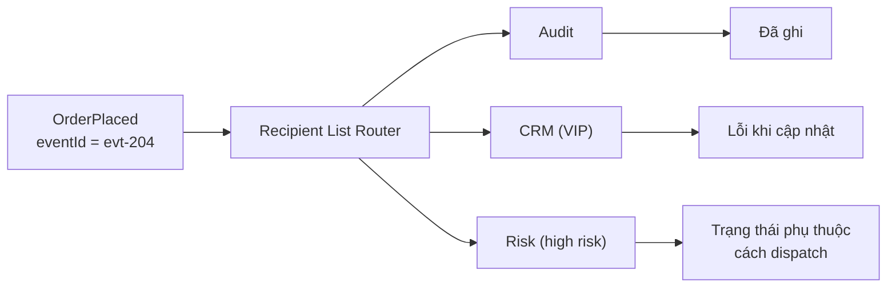
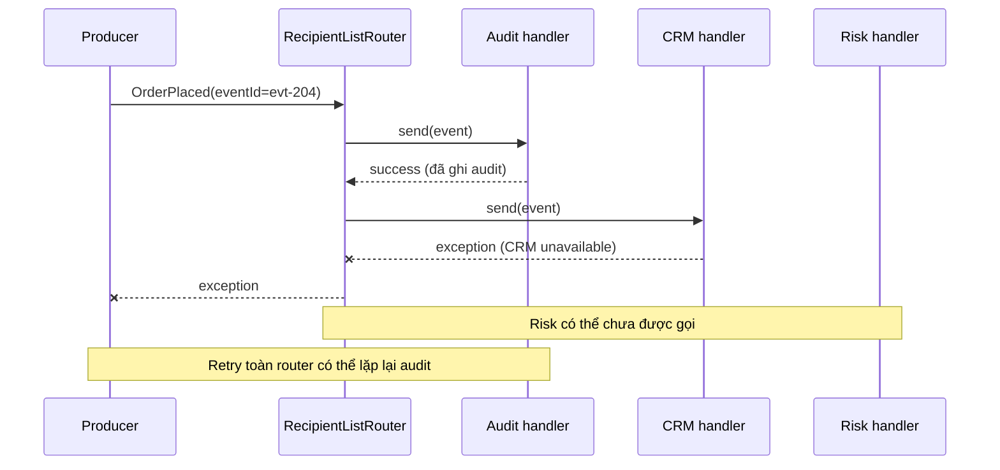
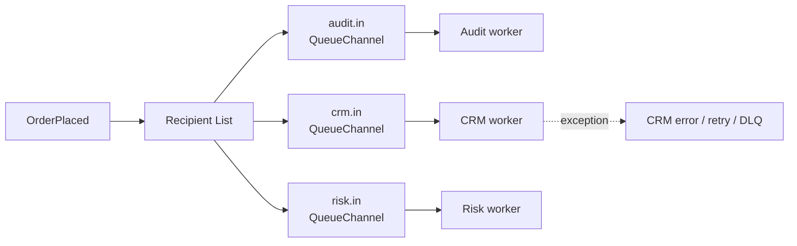
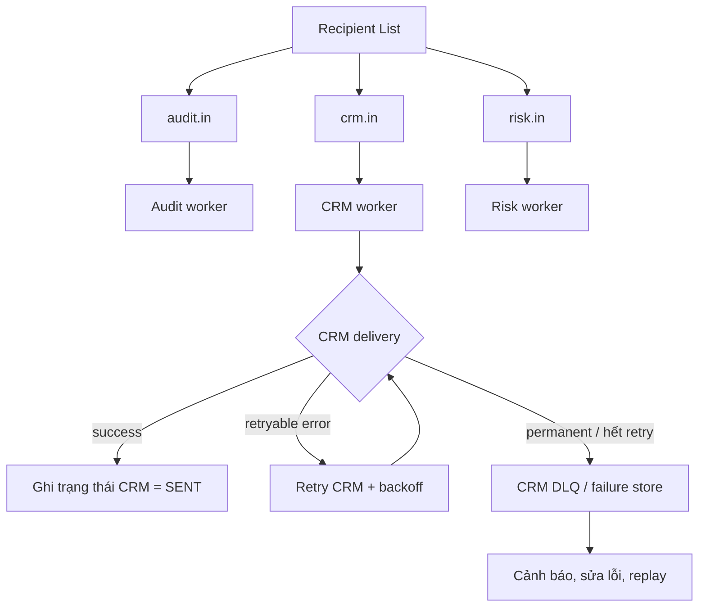
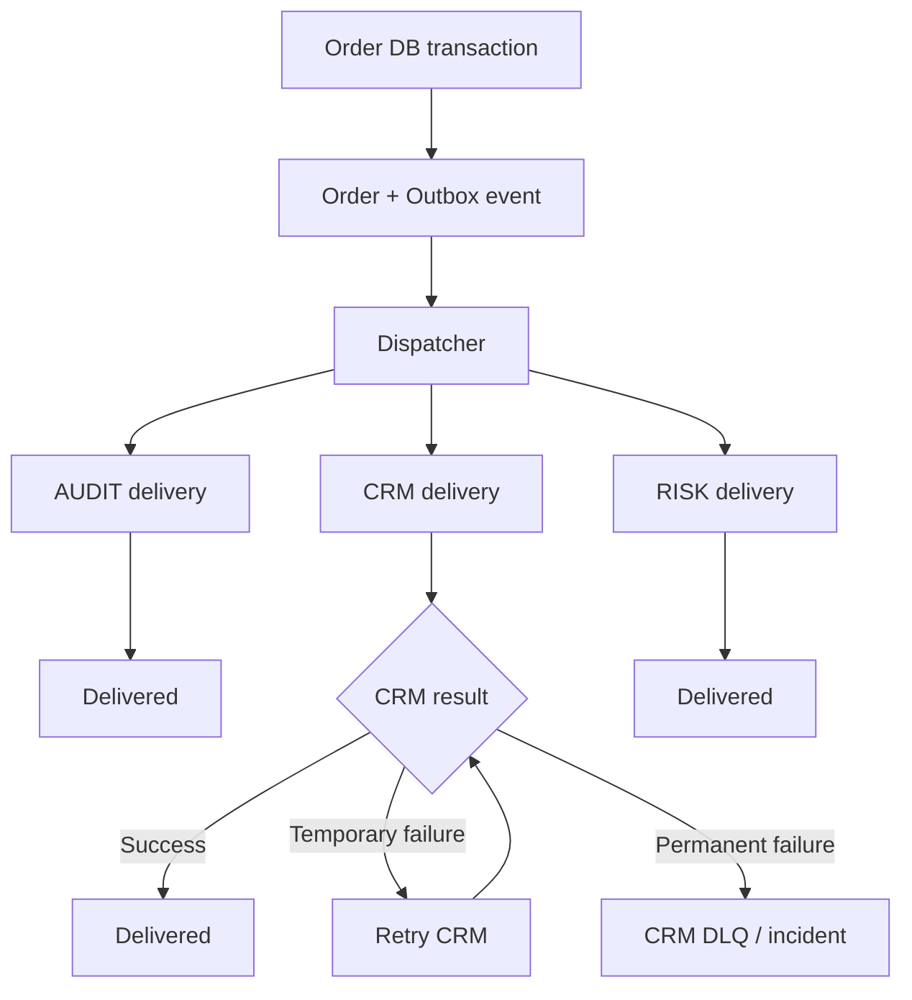

# Xử lý lỗi ở một recipient

## 1. Bài toán: cùng một message, nhiều người nhận, một người nhận bị lỗi

Một hệ thống thương mại điện tử vừa hoàn tất đơn hàng và cần phát một sự kiện `OrderPlaced` tới ba bộ phận:

1. **Audit** lưu dấu vết nghiệp vụ.
2. **CRM** cập nhật chương trình khách hàng thân thiết nếu đơn hàng thuộc khách VIP.
3. **Risk** nhận thông báo nếu đơn hàng có nguy cơ cao.

Trong **Recipient List** của Enterprise Integration Patterns (EIP), mỗi message được định tuyến tới một **danh sách recipient**, có thể kèm điều kiện cho từng recipient. Đối với sự kiện VIP rủi ro cao, cả ba recipient cùng đủ điều kiện nhận.

Nhưng điều gì xảy ra nếu Audit đã ghi thành công, còn CRM ném exception? Có nên gửi lại toàn bộ message? Risk có chắc vẫn được nhận? Làm sao biết đã gửi, đã nhận, đã xử lý hay đã thất bại? Nếu message được phát lại, Audit có bị ghi hai bản giống nhau không?

Đó là vấn đề trung tâm của bài **“Xử lý lỗi ở một recipient”**, thuộc chương **Recipient list** của module **SPRING_INTEGRATION_PATTERN**. Module này tập trung triển khai Enterprise Integration Patterns bằng Spring Integration, phối hợp Router, Filter, Transformer, Splitter, Aggregator, Gateway, retry, error channel và correlation để xây dựng các luồng ít phụ thuộc, có thể kiểm thử và theo dõi từng nhánh.

Sau bài học, bạn cần:

- Phân biệt **gửi vào channel thành công** với **recipient xử lý nghiệp vụ thành công**.
- Hiểu lỗi của một recipient tác động thế nào tới các recipient còn lại khi dùng channel đồng bộ hoặc bất đồng bộ.
- Chọn chính sách **fail-fast**, **best effort** hoặc **phục hồi độc lập cho từng recipient**.
- Đặt retry, error channel, idempotency và dead-letter xử lý ở đúng phạm vi.
- Biết khi nào cần broker, outbox, trạng thái giao sự kiện và bù trừ nghiệp vụ.
- Viết kiểm thử tình huống lỗi một phần, message phát lại và recipient đến trễ.

## 2. Recipient List bảo đảm điều gì?

Spring Integration có `RecipientListRouter` và Java DSL `routeToRecipients(...)` để mô tả fan-out theo danh sách người nhận. Mỗi recipient có thể nhận cùng một message hoặc chỉ nhận khi điều kiện tương ứng đúng.



**Điểm cần nhớ:** Recipient List là **cơ chế chọn và gửi message tới nhiều đích**. Bản thân nó không tạo một giao dịch nguyên tử xuyên nhiều channel, database hoặc dịch vụ ngoài, không tự lưu “recipient nào đã xử lý xong”, và không tự gom kết quả phản hồi.

Một lời gọi gửi có thể đi qua nhiều trạng thái:

| Mốc | Ý nghĩa | Chưa bảo đảm |
| --- | --- | --- |
| Router chọn recipient | Recipient có trong danh sách cần nhận | Channel tồn tại hoặc có subscriber đang hoạt động |
| Router gửi vào channel | Channel chấp nhận message theo quy tắc của nó | Handler đã chạy xong nếu channel tách thread hoặc có buffer |
| Handler bắt đầu xử lý | Consumer đã lấy được message | Database/API downstream đã commit |
| Handler trả thành công | Công việc trong phạm vi handler kết thúc | Nhiều hệ thống bên ngoài đã có trạng thái nhất quán |
| Recipient xác nhận kết quả theo hợp đồng | Có bằng chứng đã xử lý phần việc cụ thể | Recipient khác đã hoàn thành hoặc sẽ không phát lại |

Với `DirectChannel`, handler thường chạy trên chính thread gửi. Nếu handler ném exception, exception có thể lan ngược lên router/caller. Với `QueueChannel` hoặc `ExecutorChannel`, việc channel nhận message và việc handler hoàn tất diễn ra ở những thời điểm khác nhau. Vì vậy không nên suy từ `send() == true` rằng mọi recipient đã thực thi thành công.

### Recipient List khác Publish-Subscribe và Aggregator

| Pattern | Vai trò | Có tự xử lý lỗi một recipient không? |
| --- | --- | --- |
| **Recipient List** | Chọn tập đích bằng danh sách recipient và selector | Không; phải thiết kế policy dispatch/recovery |
| **Publish-Subscribe Channel** | Phát message đến các subscriber của channel | Phụ thuộc cơ chế dispatcher/channel và error policy; không phải commit đa subscriber |
| **Content-Based Router** | Thường chọn một tuyến nghiệp vụ dựa trên payload/header, nhưng một số router có thể chọn nhiều đích | Không |
| **Aggregator** | Gom các kết quả của nhiều message dựa trên correlation/release | Chỉ giải quyết fan-in khi được cấu hình; không tự sửa lỗi fan-out |

Nếu yêu cầu là **“gửi thông báo đến các hệ thống quan tâm”**, Recipient List phù hợp. Nếu yêu cầu là **“đợi đủ ba câu trả lời để tạo kết quả duy nhất”**, phải thiết kế thêm Gateway/Aggregator với correlation, release strategy và timeout.

## 3. Những kiểu lỗi thực tế

Không phải mọi lỗi đều đồng nghĩa với “recipient chưa nhận message”. Phân biệt đúng loại lỗi giúp chọn cách retry an toàn.

| Tình huống | Điều đã biết | Rủi ro nếu retry tùy tiện |
| --- | --- | --- |
| Selector hoặc expression đánh giá lỗi | Có thể chưa xác định xong danh sách recipient | Thay đổi rule hoặc dữ liệu khiến tập recipient khác đi giữa hai lần chạy |
| Không tìm thấy channel hoặc channel không có subscriber | Không dispatch được tới đích đó | Message vẫn có thể đã tới những recipient được gửi trước |
| `DirectChannel` handler ném exception | Có thể handler đã thực hiện một số side effect trước khi ném lỗi | Gọi lại handler hoặc toàn router có thể ghi trùng |
| `QueueChannel` chấp nhận message nhưng consumer xử lý lỗi | Handoff thành công, nghiệp vụ thất bại ở bước sau | Caller không thấy exception trực tiếp; nếu thiếu recovery, message có thể bị mất sau khi bị lấy ra khỏi queue |
| `ExecutorChannel` chấp nhận task nhưng worker lỗi | Gửi xong trước khi lỗi xuất hiện | Retry ở sender và worker có thể hoạt động độc lập, gây xử lý lặp |
| HTTP recipient timeout | Không rõ server đã nhận/commit hay chưa | Phát lại lệnh có side effect (đặc biệt thanh toán) có thể gây trùng |
| Broker nhận message nhưng producer không nhận ack | Trạng thái giao hàng chưa xác định | Retry có thể tạo bản sao dù gửi lần đầu đã thành công |
| Consumer crash sau commit, trước ack | Dữ liệu đã thay đổi nhưng broker có thể phát lại | Cần idempotency theo recipient |

Các trường hợp trên dẫn đến ba trạng thái cần phân biệt: **chưa gửi được**, **đã giao nhưng chưa biết kết quả**, và **đã xác nhận xử lý**. Một biến `boolean success` duy nhất thường không đủ để biểu diễn trạng thái giao tin đáng tin cậy qua nhiều hệ thống.

## 4. Lỗi đồng bộ: một recipient có thể đã xong trước khi recipient khác thất bại

Giả sử Recipient List Router gửi đến các `DirectChannel` hoặc kênh có handler xử lý đồng bộ. Một thứ tự thực thi có thể là:



Sơ đồ biểu diễn **một kịch bản khả dĩ** với Audit được gửi trước CRM. Không nên biến thứ tự recipient thành bảo đảm nghiệp vụ nếu không có hợp đồng và kiểm thử tương ứng. Điểm quan trọng là **không có rollback tự động** cho side effect Audit đã làm khi CRM thất bại.

Với dispatch đồng bộ, lỗi từ một recipient có thể **ngắt quá trình gửi cho các recipient tiếp theo**. Cũng có thể ứng dụng đã dùng advice, channel hoặc handler riêng để xử lý lỗi, khiến hành vi khác. Phải xác minh trên topology thực, không suy luận chỉ từ tên pattern.

### Vì sao retry toàn Recipient List nguy hiểm?

Giả sử router đã gửi thành công đến Audit và CRM bị lỗi. Nếu đặt retry quanh **toàn bộ lời gọi router**, lần retry có thể gửi lại tới Audit trước khi thử CRM. Kết quả:

- Audit có hai bản ghi cho một `eventId`.
- CRM có thể vẫn chưa thành công.
- Các recipient phía sau không được gửi nếu lỗi xảy ra trước khi đến lượt chúng.

Do đó, **đơn vị retry lý tưởng thường là một thao tác giao hàng cho một recipient**, kết hợp idempotency ở recipient đó. Retry toàn fan-out chỉ an toàn khi mọi side effect đều lặp lại được và hợp đồng xử lý trùng đã được kiểm chứng.

## 5. Lỗi bất đồng bộ: gửi thành công nhưng xử lý sau đó thất bại

Để các recipient tương đối độc lập, ứng dụng có thể cho Recipient List gửi vào các channel có buffer hoặc executor. Ví dụ:



Ở kiến trúc này, lỗi nghiệp vụ của CRM **xảy ra sau** khi router đưa message vào `crm.in`. Audit và Risk có thể tiếp tục xử lý mà không phải chờ CRM hoàn tất.

Tuy nhiên, cần hiểu giới hạn:

1. `QueueChannel` mặc định trong bộ nhớ **không phải broker bền vững**. Nếu process dừng hoặc consumer lấy message rồi lỗi, ứng dụng cần cơ chế retry/recovery cụ thể.
2. Queue có thể đầy. Khi `send` không thể đưa message vào queue, router vẫn có thể gặp lỗi dispatch ngay ở bước gửi.
3. Dù mỗi nhánh độc lập về xử lý, việc router gửi tới ba channel vẫn không mặc nhiên là một transaction nguyên tử.
4. `ExecutorChannel` thay đổi thread thực thi nhưng không tự cung cấp tính bền vững của message khi ứng dụng dừng.
5. Tốc độ tiêu thụ khác nhau có thể tạo backlog trên một nhánh; cần theo dõi queue depth, thời gian chờ và deadline.

Muốn **giao tin đáng tin cậy qua restart** hoặc qua nhiều ứng dụng, thường cần AMQP/JMS/Kafka, persistent store hoặc kiến trúc outbox phù hợp, cùng các quy tắc ack, retry và dead-letter có kiểm soát.

## 6. Ba chiến lược ứng phó khi một recipient lỗi

Không có một chính sách chung đúng cho mọi luồng. Hãy bắt đầu từ **ý nghĩa nghiệp vụ của từng recipient**.

| Chiến lược | Phản ứng khi một recipient lỗi | Khi phù hợp | Điều kiện quan trọng |
| --- | --- | --- | --- |
| **Fail-fast** | Báo lỗi và dừng hoặc trả trạng thái thất bại cho caller | Recipient là bắt buộc để hoàn tất request | Phải biết các side effect nào đã thành công trước lỗi |
| **Best effort** | Ghi nhận lỗi, cho những recipient còn lại tiếp tục | Thông báo ít quan trọng, telemetry hoặc cập nhật phụ | Có thể chấp nhận mất một số thông báo và có metric |
| **Independent recovery** | Lưu trạng thái từng recipient, retry riêng nhánh lỗi hoặc đưa vào DLQ | CRM, audit, đồng bộ dữ liệu, event nghiệp vụ cần tin cậy | Có idempotency, retention và quyền vận hành để xử lý lỗi tồn đọng |

Ví dụ:

- **Audit bắt buộc:** nếu sự kiện phải có audit trước khi hoàn tất giao dịch, nên xem xét ghi audit/outbox trong cùng transaction với dữ liệu gốc, sau đó phát đến các recipient còn lại.
- **CRM có thể chậm:** có thể xử lý bất đồng bộ, retry riêng và theo dõi backlog CRM mà không chặn việc hoàn tất đơn hàng.
- **Cảnh báo rủi ro quan trọng:** thường cần bảo đảm eventual delivery hoặc chuyển sang quy trình vận hành khi hết retry, thay vì im lặng bỏ message.

**Không dùng “bỏ qua exception” như định nghĩa duy nhất của best effort.** Ngay cả nhánh không bắt buộc cũng cần có metric, log có correlation và một chính sách rõ: bỏ vĩnh viễn, gửi lại có giới hạn hay chuyển vào hệ thống xử lý sự cố.

## 7. Ví dụ Spring Integration Java DSL: tách hàng nhận theo recipient

Ví dụ này tạo một **Recipient List Router** nhận `OrderPlaced` và chọn các QueueChannel độc lập. Nó minh họa giai đoạn **dispatch**; worker và chiến lược retry được thiết kế ở bước tiếp theo.

```java
import org.springframework.context.annotation.Bean;
import org.springframework.context.annotation.Configuration;
import org.springframework.integration.channel.DirectChannel;
import org.springframework.integration.channel.QueueChannel;
import org.springframework.integration.config.EnableIntegration;
import org.springframework.integration.dsl.IntegrationFlow;

record OrderPlaced(String eventId, String orderId) {}

@Configuration
@EnableIntegration
public class OrderEventFanoutConfig {

    @Bean("events.in")
    DirectChannel eventsIn() {
        return new DirectChannel();
    }

    @Bean("audit.in")
    QueueChannel auditInput() {
        return new QueueChannel(100);
    }

    @Bean("crm.in")
    QueueChannel crmInput() {
        return new QueueChannel(100);
    }

    @Bean("risk.in")
    QueueChannel riskInput() {
        return new QueueChannel(100);
    }

    @Bean
    IntegrationFlow orderFanout() {
        return IntegrationFlow.from("events.in")
            .routeToRecipients(spec -> spec
                .recipient("audit.in")
                .recipient("crm.in", "headers['notifyCrm'] == true")
                .recipient("risk.in", "headers['highRisk'] == true"))
            .get();
    }
}
```

**Cách hoạt động:**

- Tất cả message đi qua router có recipient Audit.
- Message được gắn header `notifyCrm=true` sẽ được gửi thêm đến CRM.
- Message có `highRisk=true` sẽ được gửi thêm tới Risk.
- Một message thỏa cả hai điều kiện có thể vào **cả ba queue**.
- Queue giới hạn 100 message là **ví dụ cấu hình**, không phải giá trị khuyên dùng cho mọi hệ thống. Phải có chính sách khi queue đầy và nhu cầu lưu qua restart.
- `notifyCrm` và `highRisk` giả định được tạo bởi bước nghiệp vụ đáng tin cậy. Không để HTTP client tự đặt header để kích hoạt hoặc bỏ qua thao tác nhạy cảm.

**Điều chưa có trong ví dụ:** không có polling consumer, error handler, dead-letter hoặc persistent storage. Queue nhận message **chưa chứng minh CRM/Audit/Risk đã xử lý thành công**. Đây là lý do cần tách bài toán dispatch và bài toán delivery/recovery.

### Kiểm thử fan-out trước khi đưa vào các worker

Có thể kiểm tra DSL ở mức channel nội bộ bằng JUnit 5 và AssertJ:

```java
import static org.assertj.core.api.Assertions.assertThat;

import org.junit.jupiter.api.Test;
import org.springframework.beans.factory.annotation.Autowired;
import org.springframework.beans.factory.annotation.Qualifier;
import org.springframework.integration.channel.QueueChannel;
import org.springframework.messaging.Message;
import org.springframework.messaging.MessageChannel;
import org.springframework.messaging.support.MessageBuilder;
import org.springframework.test.context.junit.jupiter.SpringJUnitConfig;

@SpringJUnitConfig(OrderEventFanoutConfig.class)
class OrderEventFanoutTest {

    @Autowired
    @Qualifier("events.in")
    MessageChannel input;

    @Autowired
    @Qualifier("audit.in")
    QueueChannel audit;

    @Autowired
    @Qualifier("crm.in")
    QueueChannel crm;

    @Autowired
    @Qualifier("risk.in")
    QueueChannel risk;

    @Test
    void matchingRecipientsReceiveOneCopyEach() {
        Message<OrderPlaced> event = MessageBuilder
            .withPayload(new OrderPlaced("evt-204", "order-204"))
            .setHeader("notifyCrm", true)
            .setHeader("highRisk", true)
            .build();

        assertThat(input.send(event)).isTrue();

        Message<?> auditMessage = audit.receive(1_000);
        Message<?> crmMessage = crm.receive(1_000);
        Message<?> riskMessage = risk.receive(1_000);

        assertThat(auditMessage).isNotNull();
        assertThat(crmMessage).isNotNull();
        assertThat(riskMessage).isNotNull();

        assertThat(auditMessage.getPayload()).isEqualTo(event.getPayload());
        assertThat(crmMessage.getPayload()).isEqualTo(event.getPayload());
        assertThat(riskMessage.getPayload()).isEqualTo(event.getPayload());

        assertThat(audit.receive(0)).isNull();
        assertThat(crm.receive(0)).isNull();
        assertThat(risk.receive(0)).isNull();
    }

    @Test
    void nonVipLowRiskEventGoesOnlyToAudit() {
        Message<OrderPlaced> event = MessageBuilder
            .withPayload(new OrderPlaced("evt-205", "order-205"))
            .setHeader("notifyCrm", false)
            .setHeader("highRisk", false)
            .build();

        assertThat(input.send(event)).isTrue();
        assertThat(audit.receive(1_000)).isNotNull();
        assertThat(crm.receive(0)).isNull();
        assertThat(risk.receive(0)).isNull();
    }
}
```

Các test này kiểm chứng **tập recipient được chọn**, chưa phải kiểm thử lỗi của consumer. Muốn kiểm tra lỗi một recipient, cần tạo một worker/handler thất bại có kiểm soát và quan sát kết quả tại hệ thống recovery. Nên cách ly trạng thái queue giữa các test để không lẫn message từ lần chạy trước.

## 8. Xử lý lỗi ở worker: đặt retry theo từng recipient

Một thiết kế dễ vận hành là mỗi recipient có handler và đường phục hồi riêng:



**Đơn vị xử lý:** cặp `(eventId, recipientId)`. Sự kiện `evt-204` đã xử lý ở Audit không phải xử lý lại chỉ vì CRM có lỗi. Nếu có delivery status store, một bản ghi có thể gồm:

| Trường | Ví dụ | Mục đích |
| --- | --- | --- |
| `eventId` | `evt-204` | Định danh ổn định của sự kiện nghiệp vụ |
| `recipientId` | `CRM` | Xác định chính xác hệ thống đang nhận |
| `status` | `PENDING / RETRYING / DELIVERED / DEAD` | Theo dõi tiến độ từng recipient |
| `attemptCount` | `3` | Giới hạn retry |
| `lastErrorCode` | `CRM_TIMEOUT` | Khoanh vùng lỗi; tránh lưu thông tin bí mật |
| `nextAttemptAt` | Thời điểm thử tiếp | Backoff và scheduling |
| `policyVersion` | `fanout-v2` | Giải thích tập recipient đã được chọn theo phiên bản nào |

Đây là **mô hình trạng thái đề xuất ở tầng ứng dụng**, không phải schema do Spring Integration tự sinh. Trạng thái phải được cập nhật với transaction và concurrency control phù hợp để nhiều worker không xử lý cùng một việc một cách không kiểm soát.

### Đặt retry ở đâu?

**Không nên dùng retry bao quanh toàn bộ Recipient List Router** nếu các recipient có side effect riêng và không được thiết kế lặp lại an toàn. Thay vào đó:

1. Router gửi các message vào những nơi nhận độc lập.
2. Mỗi recipient worker nhận message, giữ `eventId` cùng `recipientId`.
3. Worker thử thao tác của mình trong số lần hữu hạn.
4. Nếu lỗi có thể phục hồi, áp dụng backoff và retry có kiểm soát.
5. Nếu lỗi vĩnh viễn hoặc hết retry, chuyển message và nguyên nhân sang failure store/DLQ.
6. Audit và Risk vẫn tiếp tục theo chính sách của riêng mình.

Spring Integration cung cấp cơ chế advice cho message handler, ví dụ `RequestHandlerRetryAdvice` với Spring Retry, cùng các error flow và polling endpoint. **Cấu hình advice phải gắn vào endpoint/handler của recipient cần retry**, không tùy tiện gắn quanh router tổng nếu mục tiêu là phục hồi từng recipient. Khi sử dụng broker, cần hiểu việc nack/requeue, delayed retry, dead-letter và số lần delivery theo adapter thực tế.

### Ví dụ mô tả worker trong Java DSL

Các bước sau là **minh họa kiến trúc** khi bổ sung một consumer CRM cho channel `crm.in` của mục 7:

```java
import org.springframework.context.annotation.Bean;
import org.springframework.beans.factory.annotation.Qualifier;
import org.springframework.integration.dsl.IntegrationFlow;
import org.springframework.integration.dsl.Pollers;
import org.springframework.messaging.MessageHandler;

// crmDeliveryHandler là một MessageHandler được cấu hình riêng.
// Nó chịu trách nhiệm idempotency, gọi CRM và phát lỗi khi thất bại.
@Bean
IntegrationFlow crmWorker(
        @Qualifier("crm.in")
        org.springframework.integration.channel.QueueChannel crmInput,
        @Qualifier("crmDeliveryHandler")
        MessageHandler crmDeliveryHandler) {

    return IntegrationFlow.from(crmInput,
            endpoint -> endpoint.poller(
                Pollers.fixedDelay(250)
                    .maxMessagesPerPoll(1)
                    .receiveTimeout(100)))
        .handle(crmDeliveryHandler)
        .get();
}
```

Khi consumer CRM ném exception, lỗi từ polling endpoint cần được **thu thập qua error handling đã cấu hình cho poller/flow** và chuyển đến chính sách phục hồi CRM. Mảnh code trên **chưa cấu hình retry hay DLQ**, vì nó chỉ minh họa vị trí gắn worker; không được hiểu rằng một exception sẽ tự động làm `QueueChannel` phát lại message đã lấy ra.

Trong production, nên nối một trong hai mô hình rõ ràng:

- **Broker và consumer riêng:** mỗi recipient có queue/subscription và retry/dead-letter theo cơ chế của broker; worker đảm bảo xử lý lặp an toàn.
- **Persistent delivery store:** transaction tạo từng task giao tin, một scheduler lấy task đến hạn, worker cập nhật trạng thái thành công/lỗi và giới hạn số lần thử.

Cả hai cần giám sát thời gian tồn đọng, hạn cuối phải giao và phương án xử lý message lỗi không thể phục hồi.

## 9. Phân biệt retryable, permanent và ambiguous failure

Trước khi retry, phân loại lỗi:

| Nhóm lỗi | Ví dụ | Phản ứng thường hợp lý |
| --- | --- | --- |
| **Tạm thời** (*retryable*) | HTTP 503, timeout kết nối trước khi gửi, connection pool hết chỗ | Retry có giới hạn và backoff; có jitter để tránh đồng loạt |
| **Vĩnh viễn** (*permanent*) | Schema không hợp lệ, 400 do dữ liệu sai, quyền bị từ chối không thể sửa bằng thử lại | Không retry vô hạn; ghi dead-letter/failure và cảnh báo |
| **Không rõ kết quả** (*ambiguous*) | Client timeout sau khi request đã tới CRM, mất response sau commit | Trước retry phải có idempotency key hoặc API tra trạng thái |
| **Lỗi hạ tầng local** | Queue đầy, không resolve được channel, process shutdown | Xem lại capacity, lifecycle và cơ chế lưu trữ; có thể phải retry giai đoạn dispatch |
| **Lỗi logic/programming** | `NullPointerException` trong handler hoặc selector | Sửa code/contract và replay có kiểm soát sau khi sửa |

**Không gộp mọi exception vào một chính sách retry 3 lần.** Retry có ý nghĩa khi lỗi có cơ hội hết mà không cần thay đổi dữ liệu hoặc code. Đối với lỗi kết quả không chắc chắn, *idempotency* quan trọng hơn số lần retry.

Một chính sách minh họa cho CRM:

```text
Max attempts: 5 (tính cả lần đầu)
Backoff: 1s → 2s → 4s → 8s (có jitter)
HTTP 5xx / lỗi kết nối: retry nếu vẫn trong deadline
HTTP 4xx không hợp lệ: chuyển failure store và cảnh báo
Timeout sau khi gửi: kiểm tra trạng thái theo eventId,
  hoặc retry với cùng idempotency key
Sau lần cuối: chuyển CRM-specific DLQ, giữ eventId và nguyên nhân
```

Các con số chỉ để luyện tập thiết kế; production phải cân nhắc hạn chót, giới hạn upstream/downstream và chi phí.

## 10. Idempotency: điều kiện để phát lại an toàn

Khi lỗi xảy ra sau khi recipient đã ghi dữ liệu nhưng trước khi xác nhận, producer hoặc broker có thể phát lại event. Mọi recipient có side effect quan trọng nên xử lý **cùng một sự kiện nhiều lần mà kết quả nghiệp vụ không bị lặp**.

Ví dụ CRM nhận:

```text
eventId = evt-204
recipientId = CRM
orderId = order-204
```

Một khóa idempotency có thể là:

```text
CRM:evt-204
```

CRM lưu dấu đã xử lý sự kiện trong cùng phạm vi transaction với thay đổi điểm thưởng, nếu hạ tầng cho phép. Lần nhận lại sẽ nhận diện event đã xử lý và **không cộng điểm lần nữa**.

**Chú ý:** kiểm tra rồi ghi bằng hai thao tác không đồng bộ có thể bị race khi nhiều worker nhận cùng event. Cần unique constraint, transaction hoặc cơ chế đảm bảo tính nhất quán tương ứng. Nếu recipient gọi một API bên ngoài không có idempotency, phải thiết kế cơ chế tra cứu/trạng thái hoặc workflow bù trừ; không thể bảo đảm tránh xử lý trùng chỉ bằng `MessageHeaders.ID`.

### Phạm vi của idempotency key

Mã `eventId` cần đại diện **cho cùng một sự kiện nghiệp vụ qua các lần retry**. Đừng sinh `UUID.randomUUID()` ở từng lần giao hàng và rồi dùng nó để chống trùng, vì mỗi lần sẽ có khóa khác nhau.

Nếu cùng event gửi tới ba recipient, mỗi recipient có thể dùng `eventId` trong namespace riêng. Ở delivery store trung tâm, cặp `(eventId, recipientId)` giúp theo dõi độc lập mà không đánh đồng “Audit đã xử lý” với “CRM đã xử lý”.

## 11. Error channel: lỗi xuất hiện ở đâu?

Spring Integration sử dụng `ErrorMessage` để biểu diễn lỗi ở các đường xử lý phù hợp. Một lỗi bất đồng bộ có thể được đưa vào error channel được cấu hình cho endpoint/poller hoặc qua header `errorChannel` trong những tình huống tương ứng. Tuy nhiên **không có một bảo đảm chung rằng mọi exception ở mọi DirectChannel hoặc mọi adapter đều tự đi qua global `errorChannel`**.

Phân biệt:

| Bối cảnh | Nơi quan sát lỗi điển hình | Phạm vi cần phục hồi |
| --- | --- | --- |
| Handler đồng bộ trên `DirectChannel` | Exception lan tới caller/router nếu không được bắt | Recipient vừa lỗi; những side effect trước đó có thể tồn tại |
| Handler trên polling consumer | Error flow của polling endpoint theo cấu hình | Message đã nhận từ queue; cần kế hoạch retry/replay |
| Handler chạy qua executor | Error handler liên kết với executor/endpoint hoặc `errorChannel` nếu cấu hình phù hợp | Task trong thread khác; sender có thể đã kết thúc |
| Gateway gọi HTTP hoặc broker | Exception/timeout của adapter, reply/error flow | Phân biệt gửi thất bại với không rõ remote đã commit |
| Broker consumer | Nack/requeue/DLQ hoặc error flow của adapter | Kiểm soát ack và tái giao message |

### Giữ metadata để biết recipient nào lỗi

Một lỗi ghi `"CRM timeout"` nhưng không có `eventId` sẽ khó xử lý lại chính xác. Mỗi nhánh nên có thông tin:

- `eventId`: định danh sự kiện nghiệp vụ.
- `recipientId`: AUDIT, CRM hoặc RISK.
- `correlationId`/`requestId` theo quy ước truy vết.
- `attemptCount`, mã lỗi, thời điểm thử và deadline.
- Tham chiếu payload/schema version để replay an toàn.

Trong Spring Integration, exception xử lý message có thể cung cấp `failedMessage` để lấy metadata nguồn. Tuy nhiên không nên giả định mọi exception đều có đầy đủ message gốc. Hãy thiết kế envelope và tracking tại boundary trước khi gọi hệ thống ngoài.

Dùng error flow **riêng cho loại lỗi có chính sách khác nhau**, hoặc một error flow chung biết phân loại theo recipient. Tránh một handler tổng quát chỉ log rồi bỏ tất cả lỗi quan trọng.

## 12. Transactional outbox khi cần bảo đảm fan-out bền vững

Nếu việc phát sự kiện sang Audit/CRM/Risk là một phần quan trọng của quy trình nghiệp vụ, cần xem xét **transactional outbox**:

1. Cùng transaction với việc ghi đơn hàng, ghi một bản ghi sự kiện `OrderPlaced(evt-204)` vào outbox.
2. Một dispatcher đọc sự kiện chưa phát, xác định danh sách recipient cần nhận theo policy đã chọn.
3. Tạo trạng thái giao tin cho từng `(eventId, recipientId)` hoặc phát vào các queue/subscription của broker.
4. Mỗi recipient xử lý và ghi nhận thành công theo chính sách riêng.
5. Nếu CRM thất bại, dispatcher/CRM worker retry **riêng CRM**, trong khi Audit và Risk vẫn được xem là đã xong.
6. Khi lỗi vĩnh viễn, giữ bản ghi lỗi để cảnh báo, sửa dữ liệu hoặc replay có kiểm soát.



Outbox giúp **không bỏ sót ý định phát sự kiện** khi database commit thành công nhưng process chết trước khi gửi. Nó **không tự bảo đảm exactly-once tới hệ thống bên ngoài**: dispatcher có thể phát lại sau crash, và consumer vẫn cần idempotency.

### Tập recipient có thể thay đổi theo thời gian

Nếu điều kiện CRM chỉ áp dụng cho VIP tại thời điểm đặt hàng, retry ngày hôm sau không nên vô tình đánh giá lại trạng thái VIP mới rồi làm thay đổi các recipient đã được chọn.

Hai cách hợp lý:

- **Snapshot danh sách recipient** khi tạo sự kiện hoặc delivery tasks.
- **Phiên bản hóa routing policy** và lưu phiên bản/đầu vào đủ để tái lập quyết định.

Đừng để việc retry một recipient biến thành “chạy lại toàn bộ router với dữ liệu hiện tại” nếu yêu cầu nghiệp vụ là giao đúng tập recipient đã xác định lúc phát sự kiện.

## 13. Khi nào cần bù trừ nghiệp vụ?

Có những fan-out không thuần là thông báo độc lập. Ví dụ:

- Một recipient đặt trước hàng tồn kho.
- Một recipient thu tiền.
- Một recipient tạo vận đơn.

Nếu một hệ thống đã commit trong khi hệ thống khác lỗi, bạn đang xử lý **quy trình nghiệp vụ phân tán**. Recipient List không thể biến ba thay đổi này thành một transaction ACID chung.

Khi không thể chấp nhận kết quả một phần, cần một **workflow orchestration/saga** định nghĩa rõ:

1. Bước nào phải xảy ra trước bước nào.
2. Bước nào có thể chạy song song.
3. Thành công được xác nhận bằng sự kiện/response nào.
4. Khi lỗi, thực hiện retry, chờ can thiệp hay **compensation** (ví dụ hoàn tiền, hủy giữ hàng).
5. Cách bảo đảm idempotency của cả thao tác chính và thao tác bù.

Recipient List có thể là một phần của việc phát event, nhưng đừng đặt trách nhiệm điều phối toàn bộ giao dịch vào một chuỗi recipient mà không có trạng thái và quy trình lỗi rõ.

## 14. Kiểm thử tình huống một recipient thất bại

Để kiểm thử đúng hành vi, đừng chỉ assert rằng router gửi được ba message. Cần phân biệt:

- Lỗi **tại thời điểm dispatch** (channel không nhận).
- Lỗi **trong handler đồng bộ** (exception về router).
- Lỗi **sau khi queue/executor đã nhận** (downstream thất bại sau handoff).
- Lỗi **sau khi side effect đã commit nhưng trước ack** (ambiguous).
- **Replay** cùng `eventId` và **duplicate** ở một recipient.

### 14.1. Kiểm thử một handler CRM bị lỗi đồng bộ

Cấu hình nhỏ sau cố ý dùng `DirectChannel` cho CRM để exception xảy ra trong thread gửi. Audit dùng `QueueChannel` nhằm quan sát message mà router đã chuyển đến trước khi CRM thất bại.

```java
import org.springframework.context.annotation.Bean;
import org.springframework.context.annotation.Configuration;
import org.springframework.integration.channel.DirectChannel;
import org.springframework.integration.channel.QueueChannel;
import org.springframework.integration.config.EnableIntegration;
import org.springframework.integration.dsl.IntegrationFlow;
import org.springframework.messaging.MessageHandler;

@Configuration
@EnableIntegration
class SynchronousFailureDemoConfig {

    @Bean("sync.events.in")
    DirectChannel input() {
        return new DirectChannel();
    }

    @Bean("sync.audit.in")
    QueueChannel audit() {
        return new QueueChannel();
    }

    @Bean("sync.crm.in")
    DirectChannel crm() {
        return new DirectChannel();
    }

    @Bean
    IntegrationFlow sendToRecipients() {
        return IntegrationFlow.from("sync.events.in")
            .routeToRecipients(spec -> spec
                .recipient("sync.audit.in")
                .recipient("sync.crm.in"))
            .get();
    }

    @Bean
    IntegrationFlow failingCrm() {
        return IntegrationFlow.from("sync.crm.in")
            .handle((MessageHandler) message -> {
                throw new IllegalStateException("CRM unavailable");
            })
            .get();
    }
}
```

Ví dụ JUnit 5 + AssertJ:

```java
import static org.assertj.core.api.Assertions.assertThat;
import static org.assertj.core.api.Assertions.assertThatThrownBy;

import org.junit.jupiter.api.Test;
import org.springframework.beans.factory.annotation.Autowired;
import org.springframework.beans.factory.annotation.Qualifier;
import org.springframework.integration.channel.QueueChannel;
import org.springframework.messaging.MessageChannel;
import org.springframework.messaging.support.MessageBuilder;
import org.springframework.test.context.junit.jupiter.SpringJUnitConfig;

@SpringJUnitConfig(SynchronousFailureDemoConfig.class)
class SynchronousFailureDemoTest {

    @Autowired
    @Qualifier("sync.events.in")
    MessageChannel input;

    @Autowired
    @Qualifier("sync.audit.in")
    QueueChannel audit;

    @Test
    void oneFailedRecipientDoesNotUndoPreviousDelivery() {
        assertThatThrownBy(() -> input.send(
            MessageBuilder.withPayload("evt-204").build()))
            .isInstanceOf(RuntimeException.class);

        // Audit là recipient được khai báo trước CRM trong demo.
        // Kiểm tra rằng một bước dispatch đã hoàn tất vẫn còn.
        assertThat(audit.receive(1_000)).isNotNull();
    }
}
```

Kiểm thử này là **minh họa cho topology cụ thể** và kiểm tra rủi ro partial completion; không phải contract rằng toàn bộ phiên bản Recipient List luôn gửi theo cùng thứ tự hoặc rằng mọi failure ở recipient luôn dừng những recipient còn lại. Khi đổi sang executor, broker hoặc strategy có recovery, kỳ vọng về propagation và thứ tự cần được kiểm tra lại.

### 14.2. Kiểm thử phục hồi từng recipient

Với kiến trúc có delivery store và consumer độc lập, dựng fake CRM thất bại một lần rồi thành công:

| Lượt | Audit | CRM | Risk | Kỳ vọng |
| --- | --- | --- | --- | --- |
| Dispatch đầu tiên | Delivered | Lỗi tạm thời | Delivered | Chỉ CRM ở trạng thái retry |
| CRM retry #1 | Không chạy lại | Delivered | Không chạy lại | Cả ba hoàn tất |
| Replay cùng event sau đó | Được nhận diện đã xử lý | Được nhận diện đã xử lý | Được nhận diện đã xử lý | Không có side effect mới |

Các assertion nên có:

1. `eventId` và `recipientId` của lần retry CRM vẫn giữ nguyên.
2. Audit chỉ ghi một kết quả nghiệp vụ cho `evt-204`.
3. CRM được thử lại đúng số lần và đúng backoff (có thể dùng clock giả khi test scheduler).
4. Risk không bị trì hoãn vô hạn do CRM không khả dụng.
5. Sau khi hết retry, CRM đi vào failure store/DLQ có mã nguyên nhân và payload tham chiếu an toàn.
6. Message phát lại không làm nhân đôi side effect của recipient đã thành công.
7. Khi tiêu thụ cùng event đồng thời, unique key/transaction ngăn hai worker commit trùng.

Không nên dùng `Thread.sleep(...)` để “chứng minh” backoff hoặc ordering. Với asynchronous consumers, hãy dùng test support, latches, bounded wait và điều khiển clock/scheduler nếu hệ thống cho phép.

## 15. Vận hành: nhìn thấy lỗi của *từng* recipient

Một log `"Error sending event"` không đủ để điều tra một hệ thống nhiều recipient. Nên dùng **metadata theo từng đích** để quan sát.

Gợi ý trường log:

```text
event=recipient_delivery_failed
eventId=evt-204
recipientId=CRM
attempt=3
errorCode=CRM_TIMEOUT
nextAttemptAt=2026-11-21T09:05:00Z
correlationId=req-204
```

Các giá trị trên chỉ minh họa. Tránh log bearer token, thông tin riêng tư, payload toàn bộ hoặc nội dung exception có thể chứa bí mật.

Metric ứng dụng nên có:

- Số sự kiện được chọn theo `recipientId`.
- Số lần dispatch thất bại trước khi queue/broker nhận.
- Số lần xử lý thành công/thất bại của từng recipient.
- Số lần retry và số message đã vào dead-letter/failure store.
- Tuổi message lâu nhất chưa giao, số lượng backlog theo recipient.
- Thời gian từ tạo event đến khi recipient xác nhận xử lý.
- Số lần phát lại/duplicate được idempotency chặn.

Đây là **những nhóm metric đề xuất**, không khẳng định Spring Integration có sẵn tên metric tương ứng trong mọi phiên bản.

### Bảng khoanh vùng sự cố

| Triệu chứng | Khả năng cao | Cách kiểm tra |
| --- | --- | --- |
| Producer nhận exception khi CRM lỗi | CRM xử lý đồng bộ trên `DirectChannel` | Xác định thread và endpoint, xem exception path và recipient đã được gọi trước |
| Producer trả thành công nhưng CRM không cập nhật | Message mới vào queue/executor, worker lỗi sau đó | Theo dõi poller, error channel, retry store và CRM logs |
| Audit có bản ghi trùng sau khi CRM thất bại | Retry toàn Recipient List | Kiểm tra phạm vi retry và khóa idempotency của Audit |
| Risk không nhận message | Lỗi đồng bộ ở recipient trước đó, selector không đúng hoặc không resolve được đích | Xác minh danh sách recipient, channel, condition và thời điểm lỗi |
| CRM queue tăng liên tục | CRM chậm, hỏng hoặc retry quá dày | Đo backlog, failure rate, throughput và backoff |
| DLQ đầy nhưng không ai xử lý | Thiếu quy trình vận hành và replay | Có owner, cảnh báo, dashboard và runbook khôi phục |
| CRM cộng điểm hai lần | Commit thành công trước khi ack, message bị giao lại | Thêm idempotency key/transaction trên consumer |
| Replay thay đổi tập recipient | Điều kiện selector đánh giá lại dữ liệu thay đổi | Snapshot recipient hoặc dùng phiên bản routing policy |
| Không thể xác định recipient lỗi | ErrorMessage thiếu context định danh recipient | Gắn `eventId`/`recipientId` trước khi dispatch và giữ trong error envelope |

## 16. Bài thực hành

**Bài 1 — Dự đoán partial failure.** Tạo flow có Recipient List gửi Audit → CRM → Risk qua DirectChannel. Cho Audit ghi một counter, CRM ném exception. Xác định counter sau một lần gửi và sau một lần retry toàn flow. Giải thích vì sao kết quả không phải một giao dịch nguyên tử. Dùng test với topology xác định thay vì suy từ tên channel.

**Bài 2 — Tách retry.** Sử dụng cấu hình hàng nhận riêng ở mục 7, thêm CRM worker có retry giới hạn và ghi delivery status. Giả lập CRM thất bại hai lần rồi thành công; chứng minh Audit và Risk không bị gọi lại.

**Bài 3 — Idempotency.** Gửi hai lần cùng `eventId=evt-204` tới worker CRM. Dùng khóa unique `(recipientId, eventId)` và transaction phù hợp để mỗi event chỉ làm thay đổi điểm thưởng một lần. Kiểm thử hai consumer cùng xử lý sự kiện trùng.

**Bài 4 — Lỗi không rõ kết quả.** CRM đã nhận và ghi dữ liệu nhưng HTTP client timeout. Thiết kế API nhận idempotency key hoặc endpoint tra trạng thái để retry an toàn. Phân biệt lỗi này với HTTP 400 do payload không hợp lệ.

**Bài 5 — Kế hoạch vận hành.** Thiết kế dashboard và runbook cho sự cố CRM ngừng hoạt động 30 phút. Xác định backlog tối đa, retry policy, ngưỡng alert, cách xử lý DLQ, trách nhiệm operator và cách replay mà không phát lại Audit/Risk.

Một bài làm đạt yêu cầu phải giải thích được **loại lỗi**, **recipient nào đã thành công**, **phạm vi retry**, **trạng thái giao hàng**, **cách chống trùng**, và **cách xác nhận phục hồi thành công**.

## 17. Các nguyên tắc cần nhớ

- **Recipient List lựa chọn nhiều đích; không đồng nghĩa với transaction chung.** Một recipient lỗi có thể để lại kết quả đã commit ở recipient khác.
- **Lỗi đồng bộ và lỗi bất đồng bộ có đường quan sát khác nhau.** Đặc biệt, `send() == true` chỉ xác nhận một mức bàn giao nhất định, không chứng minh xử lý nghiệp vụ thành công.
- **Retry theo recipient** thường giúp tránh lặp side effect ở những recipient đã hoàn tất. Nếu retry cả fan-out, cần chứng minh mọi nhánh idempotent.
- **Idempotency key ổn định** như `(recipientId, eventId)` và xử lý transaction phù hợp là nền tảng của replay an toàn.
- **Error channel, broker retry và DLQ** cần được cấu hình có chủ đích. Chúng không tự biến một QueueChannel trong memory thành hàng đợi có độ tin cậy cao.
- **Outbox** giúp lưu ý định phát message cùng giao dịch nguồn, nhưng consumer vẫn cần idempotency khi xử lý giao hàng lặp.
- **Nếu các recipient thực hiện bước nghiệp vụ có phụ thuộc và cần bù trừ**, hãy thiết kế workflow/saga rõ ràng, không ép Recipient List gánh trách nhiệm điều phối.

## Tài liệu tham khảo

- [Spring Integration Reference — Message Routing](https://docs.spring.io/spring-integration/reference/router.html)
- [Spring Integration Reference — Router Implementations](https://docs.spring.io/spring-integration/reference/router/implementations.html)
- [Spring Integration Reference — Message Channels](https://docs.spring.io/spring-integration/reference/channel.html)
- [Spring Integration Reference — Error Handling](https://docs.spring.io/spring-integration/reference/error-handling.html)
- [Spring Integration Reference — Polling Consumer](https://docs.spring.io/spring-integration/reference/endpoint/polling-consumer.html)
- [Spring Integration Reference — Messaging Gateways](https://docs.spring.io/spring-integration/reference/gateway.html)
- [Enterprise Integration Patterns — Recipient List](https://www.enterpriseintegrationpatterns.com/patterns/messaging/RecipientList.html)
- [Enterprise Integration Patterns — Dead Letter Channel](https://www.enterpriseintegrationpatterns.com/patterns/messaging/DeadLetterChannel.html)
- [Enterprise Integration Patterns — Idempotent Receiver](https://www.enterpriseintegrationpatterns.com/patterns/messaging/IdempotentReceiver.html)

Các ví dụ mô tả Spring Integration Java DSL trong các phiên bản hiện đại. Khi áp dụng thực tế, hãy đối chiếu API của phiên bản đang chạy, mô hình thread của channel, cấu hình polling/error flow, transaction và semantics xác nhận xử lý của adapter đích.
