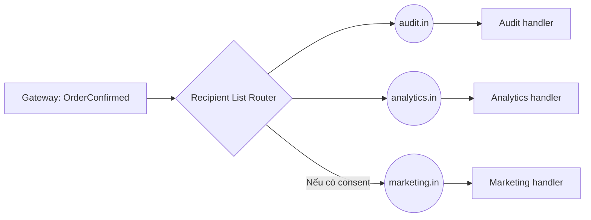
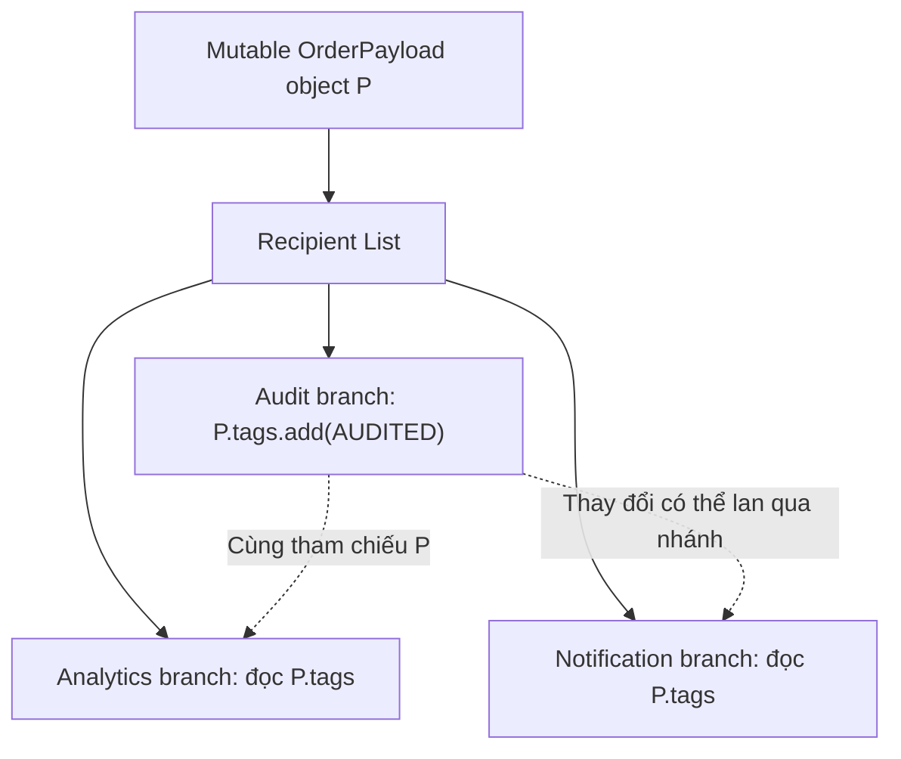

# Copy message và chia sẻ payload

> **Chương:** Recipient list  
> **Module:** `SPRING_INTEGRATION_PATTERN` — triển khai Enterprise Integration Patterns với Spring Integration để tạo luồng thông điệp ít phụ thuộc, dễ mở rộng; thực hành Router, Filter, Transformer, Splitter, Aggregator, Gateway, retry, error channel, correlation, kiểm thử và quan sát từng nhánh. Bài này tập trung vào **message copy và payload sharing khi Recipient List gửi cùng một thông điệp tới nhiều đích**.

## 1. Mục tiêu học tập

Sau bài học, bạn có thể:

1. Phân biệt **một message được gửi đến nhiều recipient** với **nhiều bản sao độc lập của dữ liệu**.
2. Hiểu khác nhau giữa **cùng tham chiếu message**, **bản sao envelope**, **shallow copy của payload** và **deep/defensive copy**.
3. Giải thích vì sao `MessageHeaders` gần như bất biến về cấu trúc không có nghĩa **mọi giá trị header và payload cũng bất biến**.
4. Dùng Java record/immutable DTO và các Transformer riêng cho từng nhánh để tránh thay đổi chéo dữ liệu.
5. Viết ví dụ Recipient List với Spring Integration Java DSL; kiểm thử danh sách recipient và chứng minh rủi ro chia sẻ payload mutable.
6. Thiết kế chính sách fan-out khi có executor, queue, broker, retry, lỗi từng recipient, correlation, bảo mật và tracing.

## 2. Một sự kiện, nhiều recipient: điều gì thật sự được copy?

Giả sử khi đơn hàng `ORD-901` được xác nhận, ứng dụng phát một event `OrderConfirmed`. Recipient List quyết định gửi thông điệp tới ba channel: audit, analytics, marketing (nhánh marketing chỉ được chọn nếu khách hàng đã đồng ý).



Tất cả các nhánh cần biết **cùng một sự kiện nghiệp vụ**, nhưng không nhất thiết cần **cùng một bộ dữ liệu**. Audit có thể cần `orderId` và thời điểm; analytics cần sản phẩm và số lượng; marketing chỉ cần dữ liệu được phép sử dụng.

Một hiểu nhầm dễ gặp là “Recipient List gửi đến ba đích, vậy Spring Integration chắc chắn đã deep-copy payload thành ba đối tượng độc lập”. **Điều đó không được bảo đảm.** Trong trường hợp fan-out nội bộ không có bước chuyển đổi/serialization, các recipient có thể nhận các message có **cùng đối tượng payload**. Framework có thể tạo hoặc điều chỉnh *message envelope* khi thêm các header phục vụ sequence/correlation, nhưng việc đó **không mặc nhiên sao chép sâu dữ liệu nghiệp vụ**.

### 2.1. Message gồm envelope và payload

```text
Message<T>
  +-- headers: id, timestamp, correlationId, ...
  +-- payload: T

Recipient A: envelope A ----+
                            +----> cùng một payload object P (có thể)
Recipient B: envelope B ----+
Recipient C: envelope C ----+
```

Ngay cả khi `envelope A != envelope B`, vẫn có thể `envelopeA.getPayload() == envelopeB.getPayload()` theo **object identity**. Việc dữ liệu có bị thay đổi chéo hay không tùy **tính bất biến của toàn bộ object graph** mà payload tham chiếu, không chỉ tùy số message được gửi đi.

## 3. Bốn tình huống copy cần phân biệt

| Tình huống | Envelope | Payload | Có độc lập khi bị mutate? |
| --- | --- | --- | --- |
| **Chuyển tiếp cùng message** | Có thể cùng object | Cùng object | **Không** nếu payload mutable |
| **Copy envelope/headers** | Object message mới | Thường vẫn cùng object payload | **Không** với dữ liệu payload mutable |
| **Shallow copy payload** | Có thể mới | Object chứa ngoài mới, object lồng nhau có thể dùng chung | **Chỉ một phần** |
| **Deep/defensive copy** | Có thể mới | Các phần dữ liệu mutable cần tách được tạo riêng | **Có**, nếu sao chép đúng mọi thành phần mutable cần bảo vệ |
| **Serialize rồi deserialize tại ranh giới ngoài** | Envelope có thể được tái tạo | Thường được tái tạo thành object ở tiến trình nhận | Thường tách khỏi bộ nhớ nguồn; **không** đảm bảo ngữ nghĩa copy, schema và delivery nếu chưa kiểm chứng |

Không tồn tại một quy tắc rằng “mỗi lần gọi `send` là có deep copy”. **Spring Integration Message Channel** là cơ chế giao nhận; việc payload được giữ nguyên, tạo mới hay chuyển đổi là trách nhiệm của contract, các endpoint và ranh giới công nghệ được sử dụng.

### 3.1. Copy envelope không copy payload

`MessageBuilder.fromMessage(original)` có thể tạo một message khác với bộ header được bổ sung. Phần payload của bản được xây dựng lại vẫn có thể là **cùng tham chiếu**:

```java
import java.util.ArrayList;
import java.util.HashMap;
import java.util.List;
import java.util.Map;

import org.springframework.messaging.Message;
import org.springframework.messaging.support.MessageBuilder;

List<String> labels = new ArrayList<>(List.of("NEW"));
Map<String, Object> mutablePayload = new HashMap<>();
mutablePayload.put("labels", labels);

Message<Map<String, Object>> original =
    MessageBuilder.withPayload(mutablePayload).build();

Message<Map<String, Object>> envelopeCopy =
    MessageBuilder.fromMessage(original)
        .setHeader("recipient", "analytics")
        .build();

System.out.println(original.getPayload() == envelopeCopy.getPayload());
// true: payload vẫn được dùng chung trong ví dụ này.

labels.add("UPDATED_BY_OTHER_BRANCH");
System.out.println(envelopeCopy.getPayload().get("labels"));
// [NEW, UPDATED_BY_OTHER_BRANCH]
```

Trong ví dụ, `recipient` chỉ là header do ứng dụng định nghĩa, không phải header bắt buộc của Spring Integration. Thao tác `MessageBuilder.fromMessage` không tự biến `Map` và `ArrayList` mutable thành object độc lập.

### 3.2. Shallow copy: object ngoài mới nhưng phần lồng nhau còn chung

```java
Map<String, Object> shallow = new HashMap<>(mutablePayload);

System.out.println(shallow != mutablePayload); // true
System.out.println(shallow.get("labels") == mutablePayload.get("labels"));
// true: hai Map vẫn tham chiếu chung một List.
```

Đây là lý do chỉ dùng `new HashMap<>(...)`, `new ArrayList<>(...)` hoặc copy constructor của DTO **không nhất thiết đủ** để bảo vệ các cấu trúc lồng nhau. Cần nhìn vào **toàn bộ dữ liệu mutable có thể bị truy cập bởi mỗi recipient**.

### 3.3. Defensive copy: tách đúng phần có thể thay đổi

```java
Map<String, Object> defensive = new HashMap<>();
defensive.put("labels", List.copyOf(labels));

labels.add("LATE_CHANGE");

System.out.println(defensive.get("labels"));
// Không chứa LATE_CHANGE; List copy không cho thêm/xóa phần tử.
```

Tuy nhiên, `List.copyOf` chỉ tạo **shallow copy của danh sách**. Nếu danh sách chứa đối tượng mutable (`List<MutableAddress>` chẳng hạn), việc thay đổi trường trên một phần tử vẫn có thể được nhìn thấy ở bản copy. Cần **DTO phần tử bất biến** hoặc chủ động copy từng phần tử mutable nếu yêu cầu tách biệt dữ liệu sâu.

## 4. Bẫy của payload mutable khi fan-out

Giả sử cả audit và analytics nhận payload có danh sách `lineItems`. Audit thêm một cờ xử lý vào một `Map` ngay trong payload; analytics đọc `Map` đó để tính báo cáo. Nếu chạy đồng bộ, kết quả có thể **phụ thuộc thứ tự gọi handler**. Nếu dùng executor, hai handler có thể chạy trên thread khác nhau; lúc này còn có rủi ro **data race**, giá trị không nhất quán hoặc exception khi duyệt collection.



### 4.1. Các giả định sai phổ biến

1. **“`MessageHeaders` immutable nên payload cũng immutable.”** Sai: header map không cho cập nhật cấu trúc trực tiếp không ảnh hưởng tính mutable của payload.
2. **“Record là deep immutable.”** Sai: record ngăn gán lại field, nhưng field là `List`, `Map`, mảng hoặc object mutable vẫn có thể bị sửa thông qua tham chiếu.
3. **“Mỗi recipient nhận một message ID riêng nên dữ liệu độc lập.”** Sai: ID/envelope khác nhau không chứng minh payload đã copy.
4. **“ExecutorChannel tự cô lập dữ liệu.”** Sai: tách thread không tự copy object; chia sẻ mutable state giữa thread thường nguy hiểm hơn.
5. **“Broker bảo đảm không chia sẻ mutable object nên không cần quan tâm.”** Chỉ đúng ở ranh giới tiến trình nếu serialization/deserialization thực sự tái tạo dữ liệu; vẫn cần schema, bảo mật, copy semantics khi có nhiều consumer **trong cùng tiến trình nhận**, và idempotency khi redelivery.

### 4.2. Nếu hai handler chỉ đọc dữ liệu?

**Chia sẻ payload bất biến thường là lựa chọn tốt**: không phải deep-copy toàn bộ dữ liệu cho mỗi recipient, tránh tăng cấp phát bộ nhớ và chi phí GC. Nhiều subscriber đọc một đối tượng bất biến là một hình thức fan-out hiệu quả. Điều kiện là object graph không bị mutate sau khi gửi, kể cả bởi producer, adapter hoặc một handler khác.

Nếu gửi message chứa một `List` có thể bị producer tiếp tục cập nhật, ngay cả khi các recipient đều chỉ đọc, hệ thống vẫn có thể quan sát dữ liệu thay đổi sau thời điểm phát sự kiện. Vì vậy **đóng băng dữ liệu tại thời điểm phát** là một phần của contract.

## 5. Khuyến nghị: thiết kế payload bất biến từ đầu

Một phương án dùng Java 17+ là định nghĩa `record` cho event và từng dòng hàng, và copy danh sách đầu vào ngay khi tạo event:

```java
import java.math.BigDecimal;
import java.util.List;
import java.util.Objects;

record OrderLine(String sku, int quantity, BigDecimal unitPrice) {
    OrderLine {
        Objects.requireNonNull(sku, "sku");
        Objects.requireNonNull(unitPrice, "unitPrice");
        if (sku.isBlank() || quantity <= 0 || unitPrice.signum() < 0) {
            throw new IllegalArgumentException("Invalid order line");
        }
    }
}

record OrderConfirmed(
    String orderId,
    List<OrderLine> lines,
    boolean marketingConsent
) {
    OrderConfirmed {
        if (orderId == null || orderId.isBlank()) {
            throw new IllegalArgumentException("orderId is required");
        }
        lines = List.copyOf(Objects.requireNonNull(lines, "lines"));
    }
}
```

Ở đây, `OrderLine` chỉ chứa `String`, `int` và `BigDecimal` (đều không cho mutate nội dung theo cách dùng thông thường), còn `OrderConfirmed` giữ một bản `List` không chỉnh sửa được từ bên ngoài.

```java
import java.util.ArrayList;
import java.util.List;
import java.math.BigDecimal;

List<OrderLine> source = new ArrayList<>();
source.add(new OrderLine("SKU-A", 2, new BigDecimal("100000")));

OrderConfirmed event = new OrderConfirmed("ORD-901", source, true);
source.clear(); // Không làm thay đổi lines bên trong event.

System.out.println(event.lines().size()); // 1
// event.lines().add(...); // Sẽ ném UnsupportedOperationException.
```

**Giới hạn:** Record và `List.copyOf` chưa đủ nếu `OrderLine` chứa `Date`, `byte[]`, `Map` mutable hoặc các object lồng nhau còn có thể bị sửa. Cần thiết kế **deep immutability** theo schema hoặc defensive copy cho từng trường tương ứng. Đồng thời không được bỏ qua validation, quyền truy cập hoặc ngữ nghĩa sự kiện chỉ vì DTO bất biến.

## 6. Ví dụ Recipient List với Spring Integration Java DSL

Ví dụ sau dùng các channel nội bộ để kiểm tra fan-out theo **số lượng recipient và tính chia sẻ của payload**. Một flow gửi event tới audit và analytics; marketing chỉ nhận khi `marketingConsent=true` đã được hệ thống có thẩm quyền xác nhận.

### 6.1. Khai báo flow và các channel thu message

```java
import org.springframework.context.annotation.Bean;
import org.springframework.context.annotation.Configuration;
import org.springframework.integration.channel.DirectChannel;
import org.springframework.integration.channel.QueueChannel;
import org.springframework.integration.config.EnableIntegration;
import org.springframework.integration.dsl.IntegrationFlow;

@Configuration
@EnableIntegration
class RecipientCopyDemoConfiguration {

    @Bean("events.input")
    DirectChannel input() {
        return new DirectChannel();
    }

    @Bean("recipients.audit")
    QueueChannel audit() {
        return new QueueChannel();
    }

    @Bean("recipients.analytics")
    QueueChannel analytics() {
        return new QueueChannel();
    }

    @Bean("recipients.marketing")
    QueueChannel marketing() {
        return new QueueChannel();
    }

    @Bean
    IntegrationFlow distributeOrderEvents() {
        return IntegrationFlow.from("events.input")
            .routeToRecipients(r -> r
                .recipient("recipients.audit")
                .recipient("recipients.analytics")
                .recipient("recipients.marketing", "payload.marketingConsent()"))
            .get();
    }
}
```

`QueueChannel` được dùng ở đây **như điểm thu phục vụ bài học/test**, không phải khuyến nghị cứ fan-out production là phải dùng queue in-memory. Không có consumer/poller production nào được khai báo; một test chủ động `receive()` trên từng queue để đọc message.

### 6.2. Những gì framework bảo đảm và không bảo đảm

- Recipient List Router quyết định **tập channel đích** dựa trên cấu hình và selector.
- Message được gửi tới **từng channel được chọn** theo semantics của endpoint/channel.
- Ví dụ **không yêu cầu hoặc cấu hình deep copy payload**; các nhánh nội bộ có thể chia sẻ tham chiếu `OrderConfirmed`.
- Framework có thể bổ sung hoặc thay đổi các header phục vụ message sequence/correlation tùy cấu hình và phiên bản; **không lấy object identity hay message ID của envelope làm hợp đồng copy**.
- Việc `input.send(message)` trả `true` không có nghĩa ba consumer đã xử lý nghiệp vụ; trong ví dụ, message mới nằm ở những queue đích.
- Nếu đổi `QueueChannel` sang `DirectChannel` và handler đồng bộ, tác dụng phụ của một handler có thể ảnh hưởng luồng điều phối hoặc các handler được gọi sau đó nếu chúng cùng đọc payload mutable.

### 6.3. Kiểm thử tập recipient và chia sẻ payload

```java
import static org.junit.jupiter.api.Assertions.*;

import java.math.BigDecimal;
import java.util.List;

import org.junit.jupiter.api.Test;
import org.springframework.beans.factory.annotation.Autowired;
import org.springframework.beans.factory.annotation.Qualifier;
import org.springframework.messaging.Message;
import org.springframework.messaging.MessageChannel;
import org.springframework.messaging.PollableChannel;
import org.springframework.messaging.support.MessageBuilder;
import org.springframework.test.context.junit.jupiter.SpringJUnitConfig;

@SpringJUnitConfig(RecipientCopyDemoConfiguration.class)
class RecipientCopyDemoTest {

    @Autowired @Qualifier("events.input") MessageChannel input;
    @Autowired @Qualifier("recipients.audit") PollableChannel audit;
    @Autowired @Qualifier("recipients.analytics") PollableChannel analytics;
    @Autowired @Qualifier("recipients.marketing") PollableChannel marketing;

    @Test
    void fanOutSharesImmutablePayloadAndPreservesBusinessHeader() {
        OrderConfirmed payload = new OrderConfirmed(
            "ORD-901",
            List.of(new OrderLine("SKU-A", 2, new BigDecimal("100000"))),
            true);

        Message<OrderConfirmed> message = MessageBuilder.withPayload(payload)
            .setHeader("businessCorrelationId", "ORD-901")
            .build();

        assertTrue(input.send(message));

        Message<?> audited = audit.receive(1000);
        Message<?> analyzed = analytics.receive(1000);
        Message<?> marketed = marketing.receive(1000);

        assertNotNull(audited);
        assertNotNull(analyzed);
        assertNotNull(marketed);

        // Test này quan sát tham chiếu payload trong topology nội bộ.
        assertSame(payload, audited.getPayload());
        assertSame(payload, analyzed.getPayload());
        assertSame(payload, marketed.getPayload());

        assertEquals("ORD-901",
            analyzed.getHeaders().get("businessCorrelationId"));
        assertEquals("ORD-901", marketed.getHeaders()
            .get("businessCorrelationId"));

        // Không có recipient bị nhân đôi trong fixture này.
        assertNull(audit.receive(0));
        assertNull(analytics.receive(0));
        assertNull(marketing.receive(0));
    }

    @Test
    void marketingRecipientIsNotSelectedWithoutConsent() {
        OrderConfirmed payload = new OrderConfirmed(
            "ORD-902", List.of(), false);

        assertTrue(input.send(MessageBuilder.withPayload(payload).build()));

        assertNotNull(audit.receive(1000));
        assertNotNull(analytics.receive(1000));
        assertNull(marketing.receive(0));
    }
}
```

**Điểm tinh tế:** `assertSame(payload, received.getPayload())` chỉ phù hợp cho topology nội bộ **không có bước copy payload/serialization/Transformer** của fixture này. Các adapter qua mạng có thể tạo object mới mang dữ liệu tương đương, khi đó kiểm thử bằng **giá trị nghiệp vụ và schema**, không bắt buộc `assertSame`.

Test nên chạy với mỗi phương thức có trạng thái queue sạch. Ví dụ trên có hai test với mỗi test tiêu thụ hết các message của nó; nếu mở rộng fixtures hoặc chạy test song song, cần tách context/queue theo test hoặc reset có kiểm soát để tránh rò state giữa các case.

## 7. Chuyển đổi riêng cho từng recipient để giảm coupling

Không phải mọi bên nhận đều cần toàn bộ `OrderConfirmed`. Khi audit chỉ cần mã đơn và số dòng hàng, còn analytics cần số lượng sản phẩm, hãy tạo **projection riêng ở mỗi nhánh** sau khi Recipient List phân phối event.

```java
record AuditRecord(String orderId, int lineCount) {}
record AnalyticsRecord(String orderId, int quantity) {}
record MarketingNotice(String orderId) {}

static AuditRecord toAudit(OrderConfirmed event) {
    return new AuditRecord(event.orderId(), event.lines().size());
}

static AnalyticsRecord toAnalytics(OrderConfirmed event) {
    int quantity = event.lines().stream()
        .mapToInt(OrderLine::quantity)
        .sum();
    return new AnalyticsRecord(event.orderId(), quantity);
}

static MarketingNotice toMarketing(OrderConfirmed event) {
    return new MarketingNotice(event.orderId());
}
```

Có thể dùng Transformer tại đầu mỗi nhánh **sau** Recipient List:

```text
                          +--> recipients.audit
                          |        -> Transformer(OrderConfirmed -> AuditRecord)
OrderConfirmed -> Router -+        -> Audit handler
                          |
                          +--> recipients.analytics
                          |        -> Transformer(OrderConfirmed -> AnalyticsRecord)
                          |        -> Analytics handler
                          |
                          +--> recipients.marketing (chỉ nếu consent)
                                   -> Transformer(OrderConfirmed -> MarketingNotice)
                                   -> Notification gateway
```

Các hàm trên tạo **payload mới cho từng nhánh** và không sửa event gốc. Nếu ghi file/network, mỗi nhánh còn cần outbound adapter/gateway và error handling phù hợp. Khi chuyển đổi trong Spring Integration, nên xác minh header nào được bảo toàn; qua giao thức ngoài, phải cấu hình mapping headers nếu downstream cần correlation hoặc schema version.

### 7.1. Vì sao không copy toàn bộ payload sang mọi nhánh?

- **Bảo mật:** audit không cần thông tin liên hệ; analytics không cần token; marketing phải có căn cứ quyền đồng ý.
- **Coupling:** mỗi consumer chỉ phụ thuộc schema mình cần, không phải mọi thay đổi trong Order aggregate.
- **Kích thước:** payload lớn nhân với nhiều recipient gây thêm chi phí bộ nhớ, băng thông, serialization.
- **Thử nghiệm:** projection riêng dễ xác minh không có trường nhạy cảm đi lạc sang nhánh không phù hợp.

**Copy và redact là hai việc khác nhau:** deep-copy nguyên vẹn dữ liệu nhạy cảm tới một bên không có quyền **vẫn là rò rỉ**. Cần tạo view/projection đúng phạm vi dữ liệu và kiểm soát quyền của recipient, không chỉ tạo bản sao kỹ thuật.

## 8. Headers, correlation và sequence khi fan-out

Spring Messaging `MessageHeaders` cung cấp một tập metadata có cấu trúc không cho chỉnh sửa trực tiếp theo cách dùng thông thường. Nhưng **object được đặt làm giá trị header vẫn có thể mutable** nếu ứng dụng đưa một `List`, `Map` hay DTO mutable vào header.

```java
// Không nên nghĩ header values luôn được deep-freeze.
Map<String, String> options = new HashMap<>();
Message<String> m = MessageBuilder.withPayload("ORD-901")
    .setHeader("unsafeOptions", options)
    .build();

options.put("route", "changed-later");
// Một code khác đọc m.getHeaders().get("unsafeOptions")
// có thể thấy cùng Map đã bị sửa.
```

Khuyến nghị: header phục vụ routing/correlation nên là **scalar/immutable value** (`String`, `UUID`, enum được chuẩn hóa) hoặc DTO bất biến; tránh nhét cả hồ sơ khách hàng hoặc cấu trúc mutable phức tạp vào header.

### 8.1. Correlation cần giữ nhưng không phải idempotency

| Trường | Vai trò | Lưu ý |
| --- | --- | --- |
| `eventId` | Định danh sự kiện nghiệp vụ gốc | Hỗ trợ dedup tại mỗi consumer |
| `messageId` | ID của message/envelope theo framework | Có thể thay đổi qua xây dựng lại message/adapters |
| `correlationId` | Liên kết các message thuộc một quy trình | Không đủ để chống xử lý trùng |
| `recipientKey` | Nhãn logic của recipient khi audit | Hỗ trợ ghi nhận kết quả riêng từng nhánh |
| `sequenceNumber`/`sequenceSize` | Thông tin thứ tự/tổng phần trong một nhóm nếu cấu hình | Không tự đảm bảo các reply đã về đầy đủ |

Với Recipient List, một bản sự kiện được gửi tới ba đích có thể tạo ba **lần xử lý** khác nhau. Một consumer cần idempotency theo `(eventId, consumerName)` hoặc khóa nghiệp vụ phù hợp; không dùng riêng `MessageHeaders.id` để bảo đảm mỗi nghiệp vụ chỉ diễn ra một lần.

Khi cần **thu phản hồi từ tất cả recipient**, cần thiết kế request–reply với **Aggregator**, correlation strategy, release strategy, timeout/expiry và xử lý reply trễ/thiếu. Việc đặt sequence headers (nếu cấu hình hỗ trợ) không tự gom reply hoặc đảm bảo thành công của từng recipient.

### 8.2. Có nên thay đổi headers riêng cho mỗi recipient?

Có thể thiết kế một bước làm giàu header **trong từng nhánh** để gắn `recipientKey`, `deliveryAttempt` hoặc nhãn trace tương ứng. Không được cố mutate cùng một header map đã gửi cho nhiều nơi; dùng các cơ chế `MessageBuilder`/Header Enricher tạo message thích hợp. Các field như `replyChannel`, `errorChannel`, trace/security context có semantics riêng; **không copy bừa hoặc ghi đè** khi chưa hiểu hợp đồng.

## 9. Đồng bộ, bất đồng bộ và các trường hợp chia sẻ dữ liệu nguy hiểm

| Cấu hình | Cách phân phối gần nhất | Nguy cơ liên quan tới copy |
| --- | --- | --- |
| `DirectChannel` + handler đồng bộ | Gọi handler theo dispatch trên thread gửi | Handler trước mutate payload có thể làm handler sau thấy giá trị khác |
| `ExecutorChannel` | Gửi công việc sang executor | Recipient có thể chạy đồng thời, xảy ra data race nếu payload mutable |
| `QueueChannel` in-memory | Đưa tham chiếu message vào queue cho poller nhận | Object mutable có thể bị thay đổi **sau khi enqueue, trước khi dequeue** |
| Broker ngoài qua adapter | Serialize và publish theo giao thức broker | Bản dữ liệu qua mạng có thể tách tham chiếu, nhưng cần quản lý schema/header/ack/redelivery |
| `PublishSubscribeChannel` | Phân phối tới các subscriber của cùng channel | Cũng có thể chia sẻ payload; fan-out không đồng nghĩa tự copy sâu |

### 9.1. Vấn đề producer tiếp tục mutate sau send

Một lỗi ít được chú ý: producer phát message rồi tiếp tục sửa DTO/list mà nó vừa gửi. Nếu channel bất đồng bộ, consumer có thể đọc dữ liệu đã sửa, chứ không phải snapshot lúc phát.

```text
Producer tạo mutable payload P
   -> send(P) vào QueueChannel
   -> producer thay P.status="CANCELLED"
   -> poller mới receive message

Consumer có thể đọc P.status="CANCELLED", mặc dù lúc gửi là "CONFIRMED".
```

Giải pháp ưu tiên là tạo immutable snapshot trước khi gửi. Deep copy bằng serialization, nếu có, phải được xem xét rõ chi phí và các rủi ro schema; không dùng như cách che giấu thiết kế dữ liệu mutable thiếu kiểm soát.

### 9.2. Cùng một event, nhiều handler có side effect

Recipient List phù hợp fan-out **event** đến nhiều bên quan tâm. Nếu payload là **command tạo vận đơn**, gửi cùng command tới ba logical owner có thể tạo ba vận đơn. Đây là lỗi **ngữ nghĩa nghiệp vụ**, không được giải quyết chỉ bằng cách copy payload. Chọn một owner chịu trách nhiệm thực thi command; sau khi thành công mới phát event cho các subscriber liên quan.

### 9.3. Partial failure và retry

Giả sử audit và analytics đã xử lý xong, marketing timeout. Retry toàn Recipient List có thể gửi lặp audit/analytics. Cần phân biệt trạng thái từng recipient và đặt retry **tại nhánh thất bại**, kết hợp idempotent consumer hoặc cơ chế outbox/broker/subscription độc lập khi yêu cầu độ tin cậy cao.

**Recipient List không tự cấp transaction phân tán cho tất cả đích.** `send=true` tại đầu vào chỉ chứng minh ranh giới send theo loại channel; không khẳng định mọi recipient đã commit nghiệp vụ.

## 10. Copy, quan sát và dữ liệu nhạy cảm

Với nhiều recipient, cùng một message có thể bị ghi log hoặc wiretap ở nhiều vị trí. Điều này làm tăng nguy cơ lộ thông tin hơn so với một flow một đích.

| Điểm quan sát | Nên ghi | Tránh ghi |
| --- | --- | --- |
| Recipient List decision | `eventId`, `correlationId`, tập recipient logic | Payload đầy đủ chứa PII |
| Target channel | Tên channel, kết quả dispatch, số lần nhận | Token, địa chỉ, thông tin thanh toán |
| Mỗi consumer | Kết quả nghiệp vụ, latency, attempts | Raw object dump của event nếu không cần |
| Error channel | Lỗi, loại exception, recipient, mã tra cứu an toàn | Exception message chứa bí mật hoặc toàn bộ request |
| Distributed tracing | Trace/span ID, các boundary, thời gian | Dữ liệu định danh chi tiết dưới tag công khai |

Với metrics, `recipientName`, `channel`, `outcome` thường là tag có cardinality kiểm soát được; `orderId`, `messageId`, `eventId` có cardinality cao nên **không dùng làm tag cho metric tổng hợp**. Correlation ID nên đặt ở log/trace có phân quyền.

**Wire Tap không phải deep copy:** Nếu gắn Wire Tap để làm audit, nhánh tap có thể nhận dữ liệu tham chiếu chung theo semantics hiện thực. Thiết kế một projection an toàn và đẩy tới channel audit, tránh một nhánh quan sát vô tình mutate event gốc hoặc tạo vòng lặp quan sát.

## 11. Kiểm thử bổ sung cho copy và isolation

Ngoài case JUnit ở mục 6, cần kiểm tra hành vi trong những tình huống dễ bị bỏ sót:

| Kịch bản | Kỳ vọng |
| --- | --- |
| Consent `true` | Audit, analytics, marketing đều nhận đúng event |
| Consent `false` | Audit/analytics nhận; marketing **không** nhận |
| Cùng payload mutable qua hai nhánh | Test mô tả/phát hiện aliasing; production không mutate object chung |
| DTO record có `List.copyOf` | Sửa danh sách nguồn sau lúc xây dựng không ảnh hưởng event |
| DTO có phần tử mutable lồng nhau | Unit test phải phát hiện rủi ro shallow immutability |
| Audit projection | Không chứa email/địa chỉ/token nếu contract audit không cần |
| Queue nhận message sau khi producer sửa object | Immutable snapshot không đổi qua thời gian chờ |
| Executor dispatch đồng thời | Không có data race do payload dùng chung mutable |
| Recipient lỗi giữa chừng | Kết quả ở recipient khác được ghi nhận; retry/dedup theo nhánh |
| Redelivery cùng event ID | Không thực hiện trùng side effect ở consumer |
| Qua broker hoặc adapter | Payload/schema tương đương, correlation headers được truyền theo cấu hình |
| Splitter/Aggregator sau fan-out | Correlation, release strategy và timeout đúng hợp đồng |

### 11.1. Một test minh họa shallow-copy failure

```java
import static org.junit.jupiter.api.Assertions.*;

import java.util.ArrayList;
import java.util.HashMap;
import java.util.List;
import java.util.Map;

import org.junit.jupiter.api.Test;

class MutablePayloadSharingTest {
    @Test
    void copyingOuterMapDoesNotCopyNestedList() {
        List<String> originalTags = new ArrayList<>(List.of("NEW"));
        Map<String, Object> origin = new HashMap<>();
        origin.put("tags", originalTags);

        Map<String, Object> shallow = new HashMap<>(origin);
        originalTags.add("AUDIT_CHANGED");

        assertSame(origin.get("tags"), shallow.get("tags"));
        assertEquals(List.of("NEW", "AUDIT_CHANGED"),
            shallow.get("tags"));
    }

    @Test
    void immutableElementsAndListSnapshotRemainStable() {
        List<String> mutable = new ArrayList<>(List.of("NEW"));
        List<String> snapshot = List.copyOf(mutable);
        mutable.add("LATER");

        assertEquals(List.of("NEW"), snapshot);
        assertThrows(UnsupportedOperationException.class,
            () -> snapshot.add("SHOULD_FAIL"));
    }
}
```

Hai test này chứng minh cơ chế **copy trong Java**, không phải kiểm thử toàn bộ Spring Integration. Ghép với integration test các channel và test có executor/queue để chứng minh rủi ro trong topology thực tế.

### 11.2. Kiểm thử việc không lộ payload sang nhánh khác

Ở production, analytics có thể được phép nhận chi tiết sản phẩm nhưng marketing chỉ được nhận một projection tối thiểu khi consent hợp lệ. Hãy assert **tên/kết cấu DTO ở output** và **không tồn tại field ngoài allowlist** sau bước Transformer. Test này khác với test aliasing: payload có thể đã copy sâu nhưng vẫn chứa dữ liệu không được phép gửi.

## 12. Quyết định thiết kế: chia sẻ, copy hay serialize?

| Mục tiêu | Hướng lựa chọn | Đánh đổi |
| --- | --- | --- |
| Nhiều nhánh **chỉ đọc** event cùng process | Immutable payload chia sẻ tham chiếu | Hiệu quả, nhưng phải đảm bảo bất biến sâu |
| Mỗi nhánh có schema riêng | Transformer tạo recipient-specific DTO | Thêm mapping, giảm coupling và rò rỉ dữ liệu |
| Consumer bắt buộc sửa dữ liệu | Copy đúng các phần mutable trước khi sửa | Tốn cấp phát, cần unit test deep/shallow copy |
| Nhánh cần cô lập thread/time | Executor/Queue/Broker kèm immutable DTO | Có backlog, timeout, delivery và error policy riêng |
| Nhánh ở ứng dụng khác | Serialization/adapter có contract schema + headers | Chi phí mạng, versioning, ack/retry/redelivery |
| Yêu cầu xử lý bền và replay độc lập | Broker subscriptions/queues, outbox nếu phù hợp | Vận hành phức tạp hơn; idempotency vẫn cần |

**Không phải mọi message đều cần deep copy**. Với immutable payload, copy toàn bộ mỗi lần fan-out thường tốn chi phí mà không tạo thêm lợi ích. Ngược lại, **không bao giờ lấy “copy envelope” làm bằng chứng đã cô lập dữ liệu mutable**. Quyết định copy phải gắn với contract và ranh giới chia sẻ thực tế.

## 13. Anti-pattern và cách cải thiện

| Anti-pattern | Hậu quả | Cách cải thiện |
| --- | --- | --- |
| Giả định Recipient List luôn deep-copy payload | Nhánh mutate làm sai nhánh khác | Immutable payload hoặc defensive copy |
| `record` chứa `ArrayList` mutable nhận trực tiếp từ caller | Caller sửa list sau khi publish | `List.copyOf` + element bất biến |
| Shallow-copy `Map` chứa nested mutable object | Dữ liệu lồng nhau vẫn bị chia sẻ | Deep-copy có chủ đích hoặc immutable DTO |
| Dùng chung payload mutable qua ExecutorChannel | Race condition và kết quả không ổn định | Snapshot bất biến trước async boundary |
| Header map bất biến nên tin mọi header value | Header value mutable hoặc bị giả mạo | Chỉ đặt metadata chuẩn hóa/tin cậy và immutable |
| Deep-copy cả event cho mọi recipient | Chi phí lớn, vẫn có thể lộ PII | Projection tối thiểu theo quyền của recipient |
| Recipient marketing nhận event bất kể consent | Vi phạm quyền riêng tư | Selector dựa trên consent đã được xác minh |
| Retry toàn bộ fan-out khi một đích lỗi | Các đích đã thành công bị gửi lặp | Retry theo nhánh + idempotent consumer |
| Coi correlation ID là dedup key duy nhất | Nhiều hoạt động trong một quy trình bị gộp sai | Event/operation ID và recipient key ổn định |
| Dùng Wire Tap để “backup” message bền vững | Nhầm giám sát với lưu trữ đáng tin | Chọn message store/outbox/broker theo yêu cầu |

## 14. Checklist trước khi triển khai

- [ ] Biết rõ trong topology hiện tại **payload có thể được chia sẻ tham chiếu** hay không.
- [ ] Tránh mutate message payload ở bất kỳ recipient nào, trừ khi đã tạo bản sao độc lập phù hợp.
- [ ] Kiểm tra cả object lồng nhau, `List`, `Map`, `byte[]` và header values.
- [ ] Định nghĩa immutable event DTO và copy input mutable tại lúc xây dựng.
- [ ] Tạo DTO/Transformer riêng cho recipient có quyền và nhu cầu dữ liệu khác nhau.
- [ ] Có điều kiện chọn recipient rõ ràng, đặc biệt với consent và tenant authorization.
- [ ] Phân biệt recipient list 0/1/N và kiểm thử tập recipient chính xác.
- [ ] Xác định ranh giới synchronous, executor, queue hoặc broker; không suy luận `send=true` là business success.
- [ ] Có idempotency/retry/error policy tại từng recipient và correlation khi cần tổng hợp replies.
- [ ] Kiểm thử aliasing, mutation sau publish, dữ liệu nhạy cảm và trạng thái async.
- [ ] Đo dispatch count, latency, failure count và backlog cho từng nhánh, không gắn ID duy nhất làm metric tags.

## 15. Bài tập vận dụng

Một ứng dụng thương mại điện tử phát `InvoiceIssued` tới `audit`, `accounting`, `analytics`, `customer-notification`. Payload có `invoiceId`, `customerEmail`, `items`, `amount`, `taxDetails` và `apiToken` (token chỉ dành cho adapter riêng). Chỉ nhánh kế toán cần tax details; analytics chỉ cần tổng tiền và nhóm hàng; notification chỉ được gửi email nếu có quyền liên hệ hợp lệ.

**Yêu cầu:**

1. Thiết kế event DTO bất biến; xác định trường nào **không được** đưa vào event chia sẻ rộng.
2. Xây Recipient List cố định audit/accounting/analytics và recipient notification có điều kiện theo quyền liên hệ.
3. Tạo projection riêng cho mỗi recipient; chỉ ra dữ liệu bắt buộc và dữ liệu phải loại bỏ.
4. Viết unit test chứng minh một shallow copy `Map` vẫn chia sẻ `List` mutable, và test chứng minh immutable snapshot không đổi khi producer sửa nguồn.
5. Viết integration test kiểm tra đúng tập channel khi consent có/không; assert số lần nhận và không có payload bị mutate giữa các nhánh.
6. Nếu accounting timeout sau khi audit thành công, đặt retry ở đâu? Dùng khóa idempotency nào? Thiết kế error channel và cảnh báo thế nào?
7. Khi các recipient dùng executor hoặc broker, bạn sẽ quan sát `correlationId`, trace context, queue wait và business completion ra sao?

**Gợi ý:** `Gateway/Adapter → Validate/Enrich consent → Recipient List → (Transformer riêng từng branch) → Consumer/Outbound Gateway`. Đưa `apiToken` vào cấu hình bí mật của adapter có thẩm quyền, **không** nằm trong event phát tới mọi subscriber. Nếu cần ghép ACK, thiết kế thêm Aggregator có correlation/release/timeout rõ ràng.

## 16. Tổng kết

**Recipient List chọn nhiều đích nhận message; nó không phải một cơ chế deep-copy dữ liệu.** Các recipient có thể nhận cùng tham chiếu payload hoặc các envelope khác nhau vẫn trỏ tới cùng object. Vì vậy, một event immutable có thể được chia sẻ hiệu quả, còn payload/header chứa dữ liệu mutable có thể gây sai lệch chéo giữa các nhánh, đặc biệt khi xử lý bất đồng bộ.

Thiết kế vững chắc với Spring Integration là **đóng băng dữ liệu lúc phát**, dùng **projection/Transformer riêng khi mỗi recipient có contract khác nhau**, chỉ copy phần mutable thực sự cần cách ly, và kiểm thử cả *đúng tập recipient* lẫn *không bị mutate/rò rỉ dữ liệu*. Kết hợp với retry theo nhánh, idempotency, error channel, correlation, trace và kiểm thử async để fan-out vừa an toàn vừa có thể quan sát.

**Tài liệu tham khảo:** Gregor Hohpe & Bobby Woolf, *Enterprise Integration Patterns* (Recipient List, Message, Publish-Subscribe Channel); tài liệu chính thức Spring Integration về Recipient List Router, Message Channels, Transformers, Message Headers, Java DSL và Error Handling; tài liệu Spring Messaging về `Message<T>` và `MessageBuilder`.
