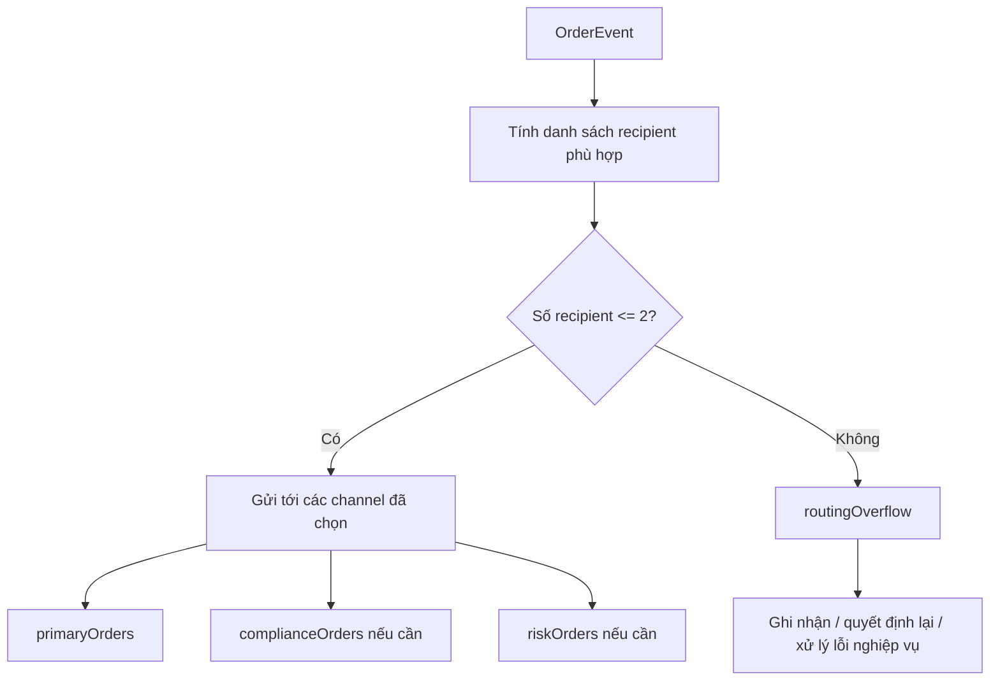
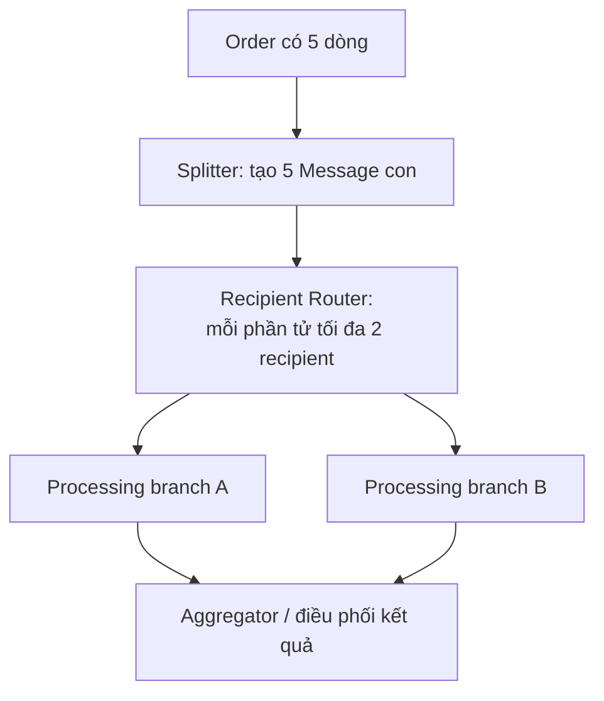

# Giới hạn số nhánh được tạo trong Recipient List

Trong kiến trúc tích hợp, một Message có thể cần được gửi đến nhiều bộ xử lý: lưu đơn hàng, kiểm tra gian lận, tính thuế, gửi thông báo hoặc ghi audit. Mẫu **Recipient List** của Enterprise Integration Patterns (EIP) cho phép xác định **danh sách những nơi sẽ nhận một Message**. Với Spring Integration, **Recipient List Router** có thể chọn các recipient theo điều kiện, nên một Message thỏa nhiều điều kiện có thể được chuyển tới nhiều channel.

Tuy nhiên, số recipient được chọn có thể tăng khi hệ thống bổ sung quy tắc hoặc khi cấu hình lấy từ nguồn động. **Giới hạn số nhánh được tạo** là việc quy định và thực thi *tối đa bao nhiêu đích được phép nhận một Message trong một lượt định tuyến*. Việc này giúp kiểm soát chi phí fan-out, tránh những lượt phát tán ngoài ý muốn và làm rõ cách phản hồi khi yêu cầu có quá nhiều công việc.

Bài này thuộc chương **Recipient list** của module `SPRING_INTEGRATION_PATTERN`, nơi học cách triển khai Enterprise Integration Patterns bằng Spring Integration để xây dựng luồng thông điệp ít phụ thuộc, dễ mở rộng. Chủ đề liên hệ trực tiếp với Router, Filter, Transformer, Splitter, Aggregator, Gateway, retry, error channel, correlation, kiểm thử và quan sát từng nhánh.

## 1. Một Message có thể tạo bao nhiêu nhánh?

Giả sử hệ thống có ba yêu cầu nghiệp vụ đối với đơn hàng:

| Điều kiện | Nhánh nhận Message | Trách nhiệm |
| --- | --- | --- |
| Mọi đơn hợp lệ | `primaryOrders` | Xử lý đơn chính |
| Đơn xuyên biên giới | `complianceOrders` | Kiểm tra tuân thủ |
| Đơn cần đánh giá rủi ro | `riskOrders` | Phân tích rủi ro |

Một Message có thể thỏa cả ba quy tắc. Nếu Router gửi đến cả ba recipient, số nhánh của lần gửi đó là **3**. Nếu hệ thống chỉ cho phép tối đa **2 recipient**, cần một chính sách xử lý trường hợp vượt ngưỡng.



Trong sơ đồ, nhánh `routingOverflow` nhận **Message gốc**, để ứng dụng có thể giữ thông tin, đưa yêu cầu vào hàng đợi xem xét hoặc trả một kết quả nghiệp vụ rõ ràng. Đây là **một chính sách ví dụ**, không phải hành vi tự động khi dùng `RecipientListRouter`.

### “Nhánh” ở đây được đếm như thế nào?

Một cách đếm hữu ích là **số channel đích khác nhau được Router chọn cho cùng một lần xử lý Message**. Ví dụ:

```text
Message ORD-101
  recipients = [primaryOrders, complianceOrders]
  số nhánh = 2

Message ORD-102
  recipients = [primaryOrders, complianceOrders, riskOrders]
  số nhánh = 3
```

Đếm channel đích khác nhau giúp tránh tính một channel hai lần do danh sách chứa trùng. Tuy nhiên, chính sách phải được triển khai trước khi gửi; nếu router đang có hai entry cùng một channel, không được mặc định mọi triển khai tự loại entry trùng.

## 2. Giới hạn nhánh khác giới hạn đồng thời và bộ đệm

Một giới hạn fan-out **không đồng nghĩa** với giới hạn tốc độ tiêu thụ hoặc giới hạn số thread.

| Khái niệm | Giới hạn cái gì? | Ví dụ |
| --- | --- | --- |
| **Recipient limit** | Số channel được chọn cho một Message | Tối đa 2 nhánh/Message |
| **Concurrency limit** | Số công việc thực thi đồng thời | Tối đa 4 worker xử lý cùng lúc |
| **Queue capacity** | Số Message chờ trong một queue | `new QueueChannel(100)` |
| **Polling batch size** | Số Message được lấy trong một lượt poll | `maxMessagesPerPoll=10` |
| **Rate limit** | Số yêu cầu được tiếp nhận trong một khoảng thời gian | 100 Message/giây |
| **Timeout** | Thời gian chờ chuyển giao hoặc xử lý | `send(..., 500)` |

Giả sử chỉ định tuyến tối đa hai nhánh/Message nhưng mỗi giây có 2.000 Message. Router vẫn có thể tạo ra tới 4.000 lượt chuyển giao tới các channel trong một giây, trước khi tính retry. Vì vậy **giới hạn số recipient không tự giải quyết bài toán quá tải**. Cần kết hợp giới hạn queue, công suất consumer, retry có kiểm soát và cảnh báo.

Ngược lại, một `ExecutorChannel` chỉ có hai thread vẫn có thể nhận Message được gửi tới nhiều channel khác nhau. Thread pool không thay Router quyết định số recipient.

## 3. Cần giới hạn khi nào?

Giới hạn nhánh hữu ích trong một số bối cảnh:

1. **Danh sách recipient động:** người dùng, cấu hình tenant hoặc một registry tạo ra nhiều đích có thể nhận Message.
2. **Chi phí mỗi nhánh cao:** mỗi recipient kích hoạt một API bên ngoài, tác vụ tính toán hoặc giao dịch có chi phí riêng.
3. **Fan-out là đầu vào cho bước gom kết quả:** Aggregator/Gateway phải chờ nhiều câu trả lời và thời gian xử lý tăng theo số nhánh.
4. **Quy định giới hạn nghiệp vụ:** chỉ được yêu cầu tối đa một số loại kiểm tra trên mỗi lượt xử lý.
5. **Phòng ngừa cấu hình sai:** một thay đổi khiến gần như tất cả điều kiện trở thành `true` có thể làm tăng số lượt gửi đột ngột.

Tuy nhiên, giới hạn cũng có thể làm mất nghiệp vụ bắt buộc nếu thực hiện bằng cách cắt danh sách tùy tiện. Ví dụ, không thể bỏ kiểm tra tuân thủ chỉ vì nó là nhánh thứ ba trong danh sách.

**Nguyên tắc:** xác định *nhánh nào là bắt buộc, nhánh nào tùy chọn, và điều gì xảy ra khi vượt hạn mức* trước khi chọn thuật toán.

## 4. Các chính sách khi số recipient vượt ngưỡng

Giả sử giới hạn là `MAX_RECIPIENTS = 2`, trong khi một Message cần ba bộ xử lý.

| Chính sách | Hành vi | Phù hợp khi |
| --- | --- | --- |
| **Reject hoặc overflow** | Không gửi vào các nhánh chính; chuyển yêu cầu tới kênh xử lý quá ngưỡng | Không được bỏ bất cứ công việc bắt buộc nào |
| **Ưu tiên** | Chọn tối đa hai recipient theo thứ tự ưu tiên được công bố | Các nhánh thấp hơn là tùy chọn và được phép hoãn hoặc bỏ |
| **Chia theo đợt** | Gửi tối đa hai nhánh trong mỗi đợt, sau đó gửi các nhánh còn lại | Nghiệp vụ yêu cầu đủ các công việc, nhưng có thể điều tiết theo thời gian |
| **Giới hạn trước khi phát sinh công việc** | Filter/validator từ chối yêu cầu chứa quá nhiều loại xử lý | Có thể báo lỗi ngay cho phía gửi |
| **Thay đổi mô hình** | Dùng queue, scheduler hoặc quy trình orchestration cho các công việc phát sinh | Số recipient lớn hoặc không biết trước |

**Reject/overflow** là chính sách dễ kiểm tra tính đúng đắn khi mọi nhánh khớp đều bắt buộc. Thay vì phát hai trong ba Message và để một nhánh thất lạc, hệ thống chuyển **nguyên yêu cầu** sang `routingOverflow` để được xử lý theo hợp đồng.

Nếu chọn **ưu tiên**, cần ghi nhận các recipient đã được chọn và những recipient bị hoãn/bỏ qua; phía nghiệp vụ phải chấp nhận lựa chọn đó. Nếu chọn **chia đợt**, cần quản lý tiến độ các đợt, phục hồi sau lỗi và chống gửi trùng; một lần gọi `RecipientListRouter` không tự tạo cơ chế chia đợt bền vững.

## 5. Cách thực thi giới hạn trước khi gửi Message

Điều quan trọng là **kiểm tra số recipient trước khi thực hiện bất kỳ lần gửi nào**. Nếu chỉ đếm sau khi Message đã được phát tới các channel, thao tác giới hạn đã quá muộn.

Trong Spring Integration, `RecipientListRouter` cho phép khai báo các recipient kèm selector/condition. Khi có ba điều kiện độc lập cùng đúng, nó có thể chọn cả ba. **Không nên giả định có một thuộc tính cấu hình phổ quát như `maxRecipients=2` để tự động cắt mọi danh sách recipient**. Với chính sách giới hạn tùy nghiệp vụ, có thể dùng **method-based router** để tính danh sách channel rồi quyết định có chấp nhận phát hay không.

Quy trình lựa chọn:

```text
1. Validate Message
2. Tính đầy đủ danh sách recipient đúng điều kiện
3. Loại trùng tên channel
4. Đếm số recipient được chọn
5. Nếu <= MAX_RECIPIENTS: gửi tới danh sách đó
6. Nếu > MAX_RECIPIENTS: xử lý overflow theo hợp đồng
```

### Trường hợp cần giữ mọi nhánh bắt buộc

Ví dụ, một đơn luôn cần `primaryOrders`. Nếu vừa cần `complianceOrders`, vừa cần `riskOrders`, hệ thống phải xử lý yêu cầu quá ngưỡng; **không chỉ lấy hai phần tử đầu** vì phần thứ ba cũng là một công việc bắt buộc.

## 6. Ví dụ Java: giới hạn tối đa hai recipient cho một đơn hàng

Ví dụ sử dụng Java 17+, Spring Integration và Spring Messaging. `@Router` trả về danh sách tên channel. Mọi channel đầu ra trong ví dụ đều là `QueueChannel` để dễ quan sát thông điệp được chuyển giao.

```java
package example.integration;

import java.util.LinkedHashSet;
import java.util.List;
import java.util.Set;

import org.springframework.context.annotation.Bean;
import org.springframework.context.annotation.Configuration;
import org.springframework.integration.annotation.Router;
import org.springframework.integration.channel.DirectChannel;
import org.springframework.integration.channel.QueueChannel;
import org.springframework.integration.config.EnableIntegration;
import org.springframework.messaging.MessageChannel;
import org.springframework.messaging.PollableChannel;

@Configuration
@EnableIntegration
public class LimitedRecipientsConfiguration {

    private static final int MAX_RECIPIENTS = 2;

    public record OrderEvent(
            String eventId,
            String orderId,
            boolean requiresCompliance,
            boolean requiresRiskCheck) {
    }

    @Bean
    public MessageChannel ordersInput() {
        return new DirectChannel();
    }

    @Bean
    public PollableChannel primaryOrders() {
        return new QueueChannel(20);
    }

    @Bean
    public PollableChannel complianceOrders() {
        return new QueueChannel(20);
    }

    @Bean
    public PollableChannel riskOrders() {
        return new QueueChannel(20);
    }

    @Bean
    public PollableChannel routingOverflow() {
        return new QueueChannel(20);
    }

    @Bean
    public PollableChannel invalidOrders() {
        return new QueueChannel(20);
    }

    @Router(inputChannel = "ordersInput")
    public List<String> selectRecipients(OrderEvent order) {
        if (order.eventId() == null || order.eventId().isBlank()
                || order.orderId() == null || order.orderId().isBlank()) {
            return List.of("invalidOrders");
        }

        Set<String> selected = new LinkedHashSet<>();
        selected.add("primaryOrders");

        if (order.requiresCompliance()) {
            selected.add("complianceOrders");
        }
        if (order.requiresRiskCheck()) {
            selected.add("riskOrders");
        }

        if (selected.size() > MAX_RECIPIENTS) {
            // Bảo toàn yêu cầu: chuyển toàn bộ Message sang một nhánh
            // xử lý quá ngưỡng, không âm thầm bỏ công việc bắt buộc.
            return List.of("routingOverflow");
        }

        return List.copyOf(selected);
    }
}
```

### Phân tích hành vi

| Điều kiện | Recipient phù hợp | Kết quả khi `MAX_RECIPIENTS=2` |
| --- | --- | --- |
| Không cần kiểm tra thêm | `primaryOrders` | Gửi một nhánh |
| Chỉ cần compliance | `primaryOrders`, `complianceOrders` | Gửi hai nhánh |
| Chỉ cần risk check | `primaryOrders`, `riskOrders` | Gửi hai nhánh |
| Cần cả compliance và risk | `primaryOrders`, `complianceOrders`, `riskOrders` | Chỉ gửi tới `routingOverflow` |
| Thiếu `eventId` hoặc `orderId` | Dữ liệu không hợp lệ | Chỉ gửi tới `invalidOrders` |

Việc gửi tới `routingOverflow` **không có nghĩa công việc đã hoàn thành**. Consumer của channel này có thể tạo phản hồi từ chối, lưu yêu cầu để xử lý khi tăng hạn mức hoặc đưa ra quy trình phê duyệt riêng. Dù giải pháp sau đó là gì, **không được để Message bị xem là đã xử lý thành công chỉ vì queue overflow nhận nó**.

Ở ví dụ, `LinkedHashSet` giữ thứ tự tên channel được thêm và loại trùng. Điều này giúp số nhánh có nghĩa rõ ràng. Thứ tự danh sách **không bảo đảm thứ tự hoàn tất tác vụ** khi mỗi nhánh sử dụng poller, executor hoặc broker khác nhau.

### Vì sao dùng method router thay cho việc đặt giới hạn sau `routeToRecipients`?

Khi viết trực tiếp nhiều `.recipient(...)`, Router có thể bắt đầu gửi đến các recipient khớp theo cơ chế của nó. Nếu chính sách yêu cầu **biết toàn bộ danh sách trước khi gửi**, method router là cách đơn giản để tạo quyết định nguyên khối ở tầng lựa chọn đích.

Lưu ý rằng “quyết định nguyên khối” ở đây chỉ nói đến **quyết định danh sách recipient**. Việc chuyển Message đến nhiều channel sau đó **không mặc nhiên là một giao dịch phân tán nguyên tử**.

## 7. Gửi thử các trường hợp trong ứng dụng

Đoạn chạy thử sau gửi một Message có hai recipient và một Message vượt ngưỡng; các queue không có consumer nên có thể đọc ngay sau khi `send()` đồng bộ hoàn tất.

```java
package example.integration;

import org.springframework.context.annotation.AnnotationConfigApplicationContext;
import org.springframework.messaging.Message;
import org.springframework.messaging.MessageChannel;
import org.springframework.messaging.PollableChannel;
import org.springframework.messaging.support.MessageBuilder;

import example.integration.LimitedRecipientsConfiguration.OrderEvent;

public class LimitedRecipientsDemo {

    public static void main(String[] args) {
        try (var context = new AnnotationConfigApplicationContext(
                LimitedRecipientsConfiguration.class)) {

            MessageChannel input =
                    context.getBean("ordersInput", MessageChannel.class);
            PollableChannel primary =
                    context.getBean("primaryOrders", PollableChannel.class);
            PollableChannel compliance =
                    context.getBean("complianceOrders", PollableChannel.class);
            PollableChannel risk =
                    context.getBean("riskOrders", PollableChannel.class);
            PollableChannel overflow =
                    context.getBean("routingOverflow", PollableChannel.class);

            OrderEvent accepted = new OrderEvent(
                    "evt-101", "ORD-101", true, false);
            OrderEvent tooMany = new OrderEvent(
                    "evt-102", "ORD-102", true, true);

            input.send(MessageBuilder.withPayload(accepted)
                    .setHeader("businessOrderId", "ORD-101")
                    .build());
            input.send(MessageBuilder.withPayload(tooMany)
                    .setHeader("businessOrderId", "ORD-102")
                    .build());

            Message<?> first = primary.receive(0);
            Message<?> second = compliance.receive(0);
            Message<?> third = risk.receive(0);
            Message<?> deferred = overflow.receive(0);

            System.out.println(first == null ? "empty" : first.getPayload());
            System.out.println(second == null ? "empty" : second.getPayload());
            System.out.println(third == null ? "risk empty" : third.getPayload());
            System.out.println(deferred == null ? "empty" : deferred.getPayload());
        }
    }
}
```

Với cấu hình trên, `ORD-101` đến `primaryOrders` và `complianceOrders`; `riskOrders` rỗng. `ORD-102` chỉ đến `routingOverflow`. Để đưa đoạn mã vào ứng dụng thực, cần thêm dependencies Spring Integration/Spring Context phù hợp, các consumer thực tế và quy tắc xử lý lỗi.

**Không nên đặt `receive(-1)` trong ví dụ khi chưa chắc có Message**, vì nó có thể chờ vô thời hạn. `receive(0)` thích hợp cho thử nghiệm đồng bộ đã biết cấu hình; nếu có luồng bất đồng bộ, cần chờ theo điều kiện với timeout hữu hạn.

## 8. Nếu vẫn muốn dùng Recipient List Router theo điều kiện?

**Recipient List Router** phù hợp khi một tập recipient được khai báo và từng recipient có selector riêng. Ví dụ ý tưởng dùng Java DSL:

```java
// Flow minh họa; là lựa chọn thay thế cho @Router ở mục 6,
// không đăng ký đồng thời vào cùng ordersInput.
@Bean
public IntegrationFlow conditionalRecipientFlow() {
    return IntegrationFlow.from("ordersInput")
            .routeToRecipients(spec -> spec
                    .recipient("primaryOrders")
                    .recipient("complianceOrders",
                            "payload.requiresCompliance")
                    .recipient("riskOrders",
                            "payload.requiresRiskCheck"))
            .get();
}
```

Trong ví dụ này, **cả ba điều kiện có thể dẫn đến ba recipient**. Đoạn DSL không tự giới hạn tối đa hai đích. Trước khi chọn mô hình, cần xác định:

- Có thể loại bỏ một recipient mà không vi phạm nghiệp vụ hay không?
- Có muốn từ chối toàn bộ Message khi số điều kiện khớp vượt ngưỡng hay không?
- Có cần một quyết định được tính tập trung trước khi phát tới bất kỳ channel nào không?
- Có cần cập nhật danh sách recipient theo tenant, cấu hình hoặc loại sự kiện không?

Nếu cần tính tổng số recipient trước khi phát, có thể đặt một **bước lập kế hoạch định tuyến** tính danh sách được phép và lý do; sau đó route theo danh sách đã xác nhận. Đó là cách giữ các selector/điều kiện ở một nơi có thể kiểm thử, thay vì hy vọng từng recipient tự biết toàn bộ hạn mức.

Một số phiên bản Spring Integration/Spring Framework có cách truy cập record trong SpEL khác nhau tùy property accessor; nên xác minh cú pháp predicate theo phiên bản dự án. Trong ví dụ chính ở mục 6, điều kiện được viết bằng Java để thể hiện rõ cách kiểm tra số lượng trước khi gửi.

## 9. Ưu tiên và phân bổ nhánh trong trường hợp có công việc tùy chọn

Nếu mọi nhánh không có cùng mức bắt buộc, có thể giới hạn bằng **quy tắc ưu tiên**. Ví dụ:

| Mức | Recipient | Quy định |
| --- | --- | --- |
| Bắt buộc | `primaryOrders` | Luôn chọn |
| Bắt buộc khi có yêu cầu pháp lý | `complianceOrders` | Không được bỏ qua |
| Tùy chọn | `analyticsOrders` | Có thể hoãn hoặc ghi nhận để xử lý sau |
| Tùy chọn | `notificationOrders` | Có thể tách sang pipeline khác |

Với `MAX_RECIPIENTS=2`, một đơn xuyên biên giới có thể chọn `primaryOrders` và `complianceOrders`, còn analytics/notification có thể gửi qua một kiến trúc event publication riêng. Tuy nhiên, nếu mọi nhánh đều bắt buộc, **không thể giải bài toán bằng việc tăng thứ tự ưu tiên rồi bỏ các nhánh còn lại**.

Một quy tắc lựa chọn ưu tiên cần có tính quyết định:

1. Lập đầy đủ danh sách recipient khớp và phân loại bắt buộc/tùy chọn.
2. Nếu số nhánh bắt buộc lớn hơn hạn mức, chuyển sang overflow hoặc từ chối.
3. Nếu còn ngân sách, thêm các nhánh tùy chọn theo thứ tự ưu tiên ổn định.
4. Ghi lại danh sách được chọn, bị hoãn và lý do.
5. Có cách xử lý phần việc bị hoãn nếu nghiệp vụ yêu cầu.

Đừng đặt tên chính sách là “giới hạn nhánh” nếu nó âm thầm **mất những công việc phải thực hiện**.

## 10. Rủi ro khi gửi đồng thời tới nhiều channel

Mỗi lần route đến nhiều recipient tạo ra nhiều **chuyển giao Message**. Dù danh sách chỉ có hai channel, vẫn phải xử lý trường hợp:

- Channel A đã nhận Message nhưng channel B hết dung lượng.
- Handler A đã ghi database, handler B ném exception.
- Retry toàn bộ Message khiến A nhận lại cùng sự kiện.
- Một channel xử lý rất nhanh, channel còn lại chậm và tạo backlog.
- Một nhánh chạy trên thread khác nên hoàn tất sau lời gọi `send()` ban đầu.

**Giới hạn recipient giảm quy mô fan-out nhưng không khiến fan-out trở thành giao dịch nguyên tử.** Cần định nghĩa chính sách nhận thành công một phần, lỗi một phần, retry từng nhánh và idempotency.

Một khóa idempotency cấp nhánh có thể là:

```text
idempotencyKey = eventId + ":" + branchType

evt-101:PRIMARY
evt-101:COMPLIANCE
```

Một lần phát lại của `evt-101` vẫn dùng cùng khóa cho nhánh tương ứng. Hệ thống cần lưu/truy vấn khóa bằng cơ chế đủ nguyên tử; chỉ ghép chuỗi khóa mà không kiểm soát side effect chưa đảm bảo chống xử lý trùng.

### Giới hạn recipient có giảm tải cho queue không?

Có thể giảm lượng chuyển giao tối đa trên một Message, nhưng nếu nhánh overflow nhận quá nhiều Message hoặc consumer chậm, queue vẫn đầy. Với `QueueChannel`, cần đặt capacity và timeout phù hợp. Với broker, cần tính dung lượng, retry, consumer group và chính sách lưu trữ; **Recipient Limit không phải Backpressure**.

## 11. Gateway, Splitter, Aggregator và correlation

### 11.1. Gateway cần một kết quả có ý nghĩa

Một messaging Gateway có thể chờ reply. Router phát tới hai channel nhưng hai consumer trả về hai kết quả độc lập thì không mặc nhiên có **một phản hồi tổng hợp**. Nếu yêu cầu phải đợi cả hai, cần cơ chế điều phối/gom kết quả phù hợp, chẳng hạn Scatter-Gather hoặc Aggregator được cấu hình rõ.

Khi route sang `routingOverflow`, một consumer nên tạo phản hồi lỗi hoặc trạng thái chờ có cấu trúc nếu API yêu cầu trả lời. Nếu chỉ đưa Message vào queue không có người đọc, Gateway có thể hết thời gian chờ.

### 11.2. Giới hạn recipient không thay thế giới hạn Splitter

**Recipient List Router** quyết định Message được gửi tới những channel nào; **Splitter** chia một payload thành nhiều Message con. Một luồng có thể có cả hai:



Giới hạn hai recipient **trên mỗi Message con** không có nghĩa toàn đơn hàng chỉ tạo tối đa hai công việc: năm Message con, mỗi Message có thể được chuyển đến hai channel, tạo tối đa mười lượt chuyển giao.

Tùy cách fan-out, những Message được Router chuyển tới nhiều channel có thể mang cùng headers ban đầu. Router không tự xác định `sequenceNumber=1/2`, `2/2` chỉ vì nó gửi tới hai recipient. Muốn Aggregator chờ đủ các kết quả theo nhánh, cần một **correlation key** và **điều kiện hoàn tất** rõ ràng.

### 11.3. Kỳ vọng bao nhiêu kết quả?

Nếu `ORD-101` được gửi đến `PRIMARY` và `COMPLIANCE`, Aggregator chỉ nên chờ **hai kết quả tương ứng** nếu chính sách yêu cầu cả hai. Nếu `ORD-102` bị chuyển sang overflow, không nên chờ kết quả từ ba nhánh chính không hề nhận Message.

Để tránh nhầm lẫn, một bản ghi kế hoạch có thể giữ:

```json
{
  "eventId": "evt-101",
  "correlationKey": "attempt-101",
  "expectedBranches": ["PRIMARY", "COMPLIANCE"],
  "expectedResultCount": 2
}
```

Đây là ví dụ về **metadata nghiệp vụ có thể lưu hoặc truyền tiếp**, không phải schema chuẩn bắt buộc của Spring Integration. Khi dùng Aggregator, `correlationId`, release strategy, MessageGroupStore, timeout và xử lý duplicate phải được thiết kế để khớp số nhánh thực sự được phát.

## 12. Kiểm thử giới hạn nhánh bằng JUnit 5

Kiểm thử cần xác nhận **những channel thực sự nhận Message**, không chỉ xác nhận kích thước danh sách do hàm `selectRecipients()` trả về. Ví dụ dưới đây dùng cấu hình ở mục 6:

```java
package example.integration;

import static org.junit.jupiter.api.Assertions.*;

import org.junit.jupiter.api.Test;
import org.springframework.context.annotation.AnnotationConfigApplicationContext;
import org.springframework.messaging.Message;
import org.springframework.messaging.MessageChannel;
import org.springframework.messaging.PollableChannel;
import org.springframework.messaging.support.MessageBuilder;

import example.integration.LimitedRecipientsConfiguration.OrderEvent;

class LimitedRecipientsIntegrationTest {

    @Test
    void twoRequiredRecipientsReceiveTheSameEvent() {
        try (var context = new AnnotationConfigApplicationContext(
                LimitedRecipientsConfiguration.class)) {
            MessageChannel input =
                    context.getBean("ordersInput", MessageChannel.class);
            PollableChannel primary =
                    context.getBean("primaryOrders", PollableChannel.class);
            PollableChannel compliance =
                    context.getBean("complianceOrders", PollableChannel.class);
            PollableChannel risk =
                    context.getBean("riskOrders", PollableChannel.class);
            PollableChannel overflow =
                    context.getBean("routingOverflow", PollableChannel.class);

            OrderEvent event = new OrderEvent(
                    "evt-201", "ORD-201", true, false);
            assertTrue(input.send(MessageBuilder.withPayload(event)
                    .setHeader("businessOrderId", event.orderId())
                    .build()));

            Message<?> p = primary.receive(0);
            Message<?> c = compliance.receive(0);
            assertNotNull(p);
            assertNotNull(c);
            assertEquals(event, p.getPayload());
            assertEquals(event, c.getPayload());
            assertEquals("ORD-201", p.getHeaders().get("businessOrderId"));
            assertNull(risk.receive(0));
            assertNull(overflow.receive(0));
            assertNull(primary.receive(0));
            assertNull(compliance.receive(0));
        }
    }

    @Test
    void threeRequiredRecipientsAreRoutedToOverflowOnly() {
        try (var context = new AnnotationConfigApplicationContext(
                LimitedRecipientsConfiguration.class)) {
            MessageChannel input =
                    context.getBean("ordersInput", MessageChannel.class);
            PollableChannel primary =
                    context.getBean("primaryOrders", PollableChannel.class);
            PollableChannel compliance =
                    context.getBean("complianceOrders", PollableChannel.class);
            PollableChannel risk =
                    context.getBean("riskOrders", PollableChannel.class);
            PollableChannel overflow =
                    context.getBean("routingOverflow", PollableChannel.class);

            OrderEvent event = new OrderEvent(
                    "evt-202", "ORD-202", true, true);
            assertTrue(input.send(MessageBuilder.withPayload(event).build()));

            Message<?> deferred = overflow.receive(0);
            assertNotNull(deferred);
            assertEquals(event, deferred.getPayload());
            assertNull(primary.receive(0));
            assertNull(compliance.receive(0));
            assertNull(risk.receive(0));
            assertNull(overflow.receive(0));
        }
    }
}
```

Các test dùng `DirectChannel` và các `QueueChannel` chưa có consumer nên sau khi `send()` trả về, có thể kiểm tra ngay bằng `receive(0)`. Nếu bổ sung executor, poller hoặc broker, test cần đợi điều kiện có timeout hữu hạn; **đừng dựa vào thứ tự hoàn tất của các nhánh bất đồng bộ**.

### Các kịch bản nên bổ sung

1. **Không nhánh phụ:** chỉ `primaryOrders` nhận Message.
2. **Một nhánh phụ:** nhận đúng hai Message chuyển giao, không có recipient ngoài danh sách.
3. **Hai nhánh phụ:** chỉ `routingOverflow` nhận Message; không âm thầm gửi một phần.
4. **Thiếu khóa định danh:** chỉ `invalidOrders` nhận Message.
5. **Danh sách có trùng tên channel:** kết quả đếm đúng theo chính sách unique recipient.
6. **Giới hạn thay đổi:** các giá trị sát ngưỡng, chẳng hạn 1, 2, 3 recipient.
7. **Nhánh bị đầy hoặc lỗi:** xác minh chính sách ghi nhận chuyển giao một phần.
8. **Retry:** phát lại cùng `eventId`, không tạo side effect lặp ở nhánh đã thành công.
9. **Gateway/Aggregator:** số kết quả chờ khớp số branch thực sự được chọn.
10. **Thử tải:** hạn mức recipient không khiến queue hoặc consumer bị quá tải khi lượng Message tăng.

## 13. Theo dõi số nhánh khi vận hành

Các log/metric nên cho biết **bao nhiêu recipient được đề xuất, bao nhiêu recipient được chọn, Message có vượt ngưỡng hay không**.

Một bản ghi theo cấu trúc:

```json
{
  "stage": "limited-recipient-router",
  "eventId": "evt-202",
  "businessOrderId": "ORD-202",
  "maxRecipients": 2,
  "matchedRecipients": [
    "primaryOrders",
    "complianceOrders",
    "riskOrders"
  ],
  "selectedRecipients": ["routingOverflow"],
  "decision": "OVERFLOW"
}
```

Schema log trên do ứng dụng tự thiết kế, không phải trường metadata Spring Integration luôn tự sinh. Không đưa nguyên payload nhạy cảm vào log; các `eventId`/`orderId` thích hợp cho log và trace hơn là metric tags.

| Chỉ số gợi ý | Mục tiêu |
| --- | --- |
| `routing.recipient.candidates` | Phân bố số recipient phù hợp trước khi áp giới hạn |
| `routing.recipient.selected` | Phân bố số recipient thực sự được chọn |
| `routing.overflow.count` | Số yêu cầu vượt hạn mức |
| `routing.invalid.count` | Số Message không hợp lệ |
| `routing.dispatch.failure` | Lỗi chuyển giao tới channel |
| `routing.branch.process.duration` | Phát hiện nhánh xử lý chậm |
| `routing.branch.retry.count` | Phát hiện lỗi lặp và gánh nặng retry |
| `routing.aggregation.timeout` | Nhóm kết quả chưa hoàn tất đúng thời hạn |

Đây là **gợi ý metric**, không phải cam kết mọi giá trị đều có sẵn từ Spring Integration. Có thể instrument bằng Micrometer, Spring Boot Actuator, logging/tracing và code đo ở endpoint phù hợp.

## 14. Các lỗi thường gặp

| Hiện tượng | Nguyên nhân | Cách xử lý |
| --- | --- | --- |
| Hạn mức hai nhánh nhưng ba channel vẫn nhận Message | Chỉ kiểm tra số lượng sau dispatch | Kiểm soát danh sách recipient trước khi route |
| Bỏ sót kiểm tra bắt buộc | Cắt danh sách bằng `limit(2)` không xét ý nghĩa nghiệp vụ | Reject/overflow nếu số nhánh bắt buộc vượt hạn mức |
| Tưởng đã giới hạn nhánh vì chỉ có hai thread | Nhầm concurrency với fan-out | Giới hạn ngay ở danh sách recipient |
| Một channel nhận hai bản sao | Thêm trùng tên channel hoặc retry | Loại trùng recipient; dùng idempotency |
| Message overflow mất sau restart | Chỉ có queue trong bộ nhớ | Dùng cơ chế lưu trữ bền vững nếu yêu cầu phục hồi |
| Gateway timeout | Nhánh overflow không tạo reply | Thiết kế phản hồi chờ hoặc từ chối |
| Aggregator chờ sai số kết quả | Hardcode số branch, không dùng danh sách thực tế | Lưu expected branches và correlation phù hợp |
| Một nhánh xử lý lại khi nhánh khác lỗi | Retry toàn fan-out | Retry theo phạm vi và khóa idempotency |
| Capacity queue đủ nhưng hệ thống vẫn chậm | Consumer không theo kịp lượng Message | Đo throughput, xử lý backlog và backpressure |

## 15. Nguyên tắc thiết kế giới hạn recipient

- **Định nghĩa rõ đơn vị giới hạn:** tối đa bao nhiêu channel đích khác nhau cho **mỗi Message** hay cho cả một yêu cầu gồm nhiều Message con?
- **Xác định nhánh bắt buộc:** không bỏ một trách nhiệm nghiệp vụ chỉ vì đã hết ngân sách recipient.
- **Đếm trước khi phát:** dùng một bước tính recipient nhất quán rồi mới chuyển Message.
- **Chọn chính sách overflow rõ ràng:** từ chối, hoãn hoặc điều phối thêm, đi kèm consumer và giám sát.
- **Phân biệt recipient, concurrency, capacity và rate:** cần kiểm soát chúng độc lập theo yêu cầu tải.
- **Quy định lỗi một phần và retry:** fan-out không tự bảo đảm tất cả channel nhận thành công cùng lúc.
- **Giữ idempotency và correlation:** phục vụ chống trùng và gom đúng số kết quả theo nhánh đã chọn.
- **Kiểm thử thực tế:** với 0, 1, 2, 3 điều kiện khớp, test những channel thật sự nhận dữ liệu.
- **Quan sát quyết định:** log matched recipients, selected recipients, hạn mức và lý do overflow.

Giới hạn số nhánh trong Recipient List là một **quy tắc điều phối công việc**. Khi biết trước danh sách recipient, phân loại được các trách nhiệm bắt buộc và có phương án overflow minh bạch, Spring Integration có thể kiểm soát fan-out mà vẫn giữ được tính đúng đắn, khả năng kiểm thử và khả năng theo dõi luồng thông điệp.
