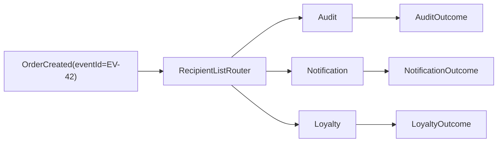
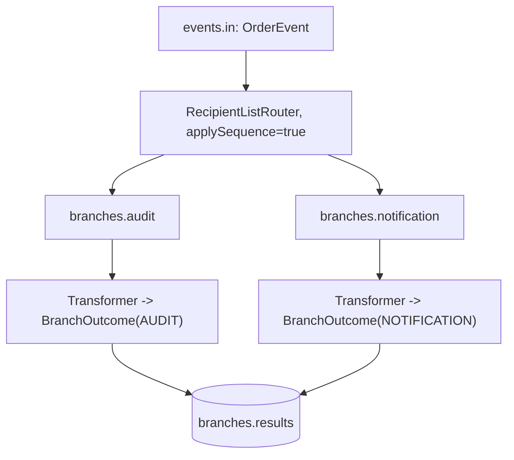
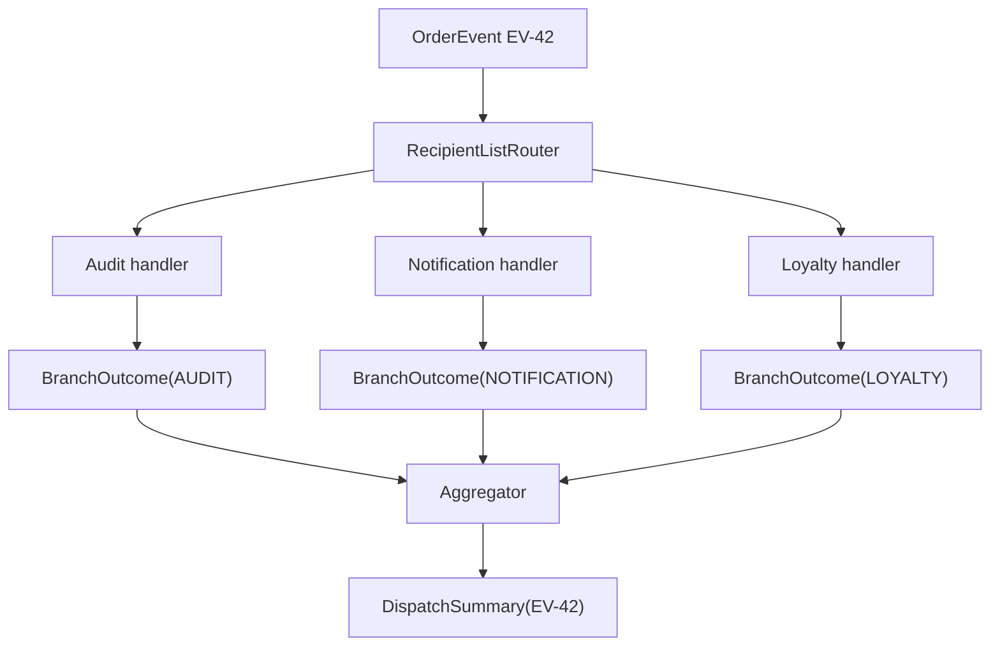

# Theo dõi kết quả từng nhánh với Recipient List trong Spring Integration

## Mục tiêu bài học

Khi một sự kiện đi đến nhiều nơi nhận, câu hỏi quan trọng không dừng ở “Router đã gửi đến những channel nào?”. Hệ thống còn cần biết **nhánh nào đã được chọn, nhánh nào nhận message, nhánh nào xử lý xong, nhánh nào thất bại hoặc quá hạn**. Ví dụ, sự kiện tạo đơn hàng phải ghi audit, gửi thông báo và cập nhật điểm thưởng. Audit thành công không có nghĩa SMS thành công; timeout ở SMS cũng không có nghĩa message chưa từng được gửi.

Bài này thuộc chương **Recipient list** của module **SPRING_INTEGRATION_PATTERN**, nơi chúng ta học triển khai Enterprise Integration Patterns (EIP) bằng Spring Integration để tạo các luồng thông điệp ít phụ thuộc, dễ mở rộng. Bài học kết nối Recipient List với Router, Filter, Transformer, Splitter, Aggregator, Gateway, retry, error channel và correlation, đồng thời chú trọng kiểm thử và quan sát từng nhánh xử lý.

Hoàn thành bài, bạn có thể:

1. Phân biệt **recipient được chọn**, **message đã chuyển đến channel**, **handler hoàn tất thành công** và **kết quả đã được gom**.
2. Thiết kế một `BranchOutcome` rõ ràng cho mỗi nhánh, có khóa nghiệp vụ, trạng thái, thời gian và mã lỗi.
3. Dùng Java DSL `routeToRecipients(...)` và `applySequence(true)`, hiểu giá trị của `correlationId`, `sequenceNumber` và `sequenceSize`.
4. Theo dõi kết quả bằng message đầu ra của từng handler, hoặc dùng Aggregator/Scatter-Gather khi caller cần một kết quả chung.
5. Xử lý trường hợp không chọn recipient nào, một nhánh lỗi, một nhánh quá hạn, retry trùng và xử lý bất đồng bộ.
6. Viết kiểm thử để xác minh **cả số nhánh lẫn kết quả nghiệp vụ**, không chỉ số lần gửi vào Router.

## 1. Recipient List gửi một message đến nhiều nhánh

**Recipient List** là mẫu EIP trong đó một message được gửi tới **một danh sách người nhận**. Trong Spring Integration, `RecipientListRouter` là một triển khai của mẫu này. Danh sách recipient có thể cố định hoặc có **selector** quyết định recipient nào được chọn cho từng message.



Giả sử với sự kiện `EV-42`, hệ thống yêu cầu:

- Audit luôn phải nhận sự kiện.
- Notification chỉ nhận nếu người dùng đã bật nhận thông báo.
- Loyalty chỉ nhận nếu đơn hàng đủ điều kiện tính điểm.

Vì vậy một event có thể được gửi tới **một, hai hoặc ba** recipient. Khi cần tổng hợp, số kết quả cần chờ phải khớp với **số recipient thực sự được chọn**, không phải luôn cố định bằng ba.

### Recipient List khác các pattern liên quan

| Pattern | Hành vi | Ví dụ |
| --- | --- | --- |
| **Content-Based Router** | Chọn route theo nội dung; thiết kế phổ biến dùng một khóa cho một đích | Chuyển đơn hàng sang VIP hoặc STANDARD |
| **Recipient List** | Chọn một tập recipient; một message có thể gửi tới nhiều channel | Audit + Notification + Loyalty |
| **Publish/Subscribe** | Phát event tới các subscriber của một channel, tùy cấu hình | Các component cùng nghe `OrderCreated` |
| **Splitter** | Tách một payload thành nhiều message mang các phần dữ liệu khác nhau | Đơn hàng thành các dòng hàng |
| **Aggregator** | Gom các message liên quan thành một kết quả | Gom kết quả từ ba nhánh |
| **Scatter-Gather** | Kết hợp phát message tới nhiều nơi và chờ/gom reply | Hỏi nhiều dịch vụ báo giá và lấy kết quả |

Recipient List **không tự động tạo bản tổng kết kết quả nghiệp vụ** của từng recipient. Nếu mục tiêu chỉ là fan-out sự kiện một chiều, bạn có thể không cần Aggregator. Nếu caller muốn biết nhánh nào thành công, ứng dụng cần cơ chế tạo và thu nhận kết quả.

## 2. Bốn mốc trạng thái cần phân biệt

Một thông điệp đi qua nhiều lớp. Mỗi lớp có một ý nghĩa thành công riêng.

| Mốc | Bằng chứng | Có chứng minh nghiệp vụ đã thành công? |
| --- | --- | --- |
| **Selected** | Selector của Router chọn recipient | **Không**. Chỉ chứng minh nhánh nằm trong danh sách đích |
| **Dispatched / accepted** | Message đã được gửi tới channel theo cơ chế send của nó | **Không nhất thiết**. Queue/broker có thể nhận message nhưng chưa có handler nào thực thi |
| **Processed** | Handler của nhánh chủ động báo kết quả cuối cùng | **Có**, nếu hợp đồng kết quả được thiết kế và ghi nhận đúng |
| **Aggregated / acknowledged** | Bộ gom đã thấy đủ kết quả theo một completion policy | **Phụ thuộc policy**: có thể là all-success, all-completed hoặc partial |

Ví dụ `input.send(message)` trả `true` nghĩa là phía gửi đã hoàn tất thao tác gửi theo hợp đồng channel. Với `DirectChannel`, handler thường được gọi đồng bộ; với `QueueChannel`, send thành công chủ yếu chứng minh message đã vào queue. Vì vậy **không dùng kết quả `send()` làm cờ “Notification SUCCEEDED”**.

Một audit log có thể ghi:

```text
eventId=EV-42 recipient=AUDIT state=SELECTED
eventId=EV-42 recipient=AUDIT state=STARTED
eventId=EV-42 recipient=AUDIT state=SUCCEEDED

eventId=EV-42 recipient=SMS state=SELECTED
eventId=EV-42 recipient=SMS state=STARTED
eventId=EV-42 recipient=SMS state=FAILED errorCode=PROVIDER_TIMEOUT
```

Các trạng thái như `SELECTED` và `FAILED` là **hợp đồng do ứng dụng xây dựng**, không phải những header tự động được `RecipientListRouter` phát sinh.

## 3. Hợp đồng kết quả cho từng nhánh

Để theo dõi một sự kiện xuyên nhiều nhánh, một DTO kết quả nên mang đủ dữ liệu nhận diện.

```java
import java.time.Instant;

public record BranchOutcome(
    String eventId,         // Khóa nghiệp vụ ổn định
    String recipient,       // AUDIT, NOTIFICATION, LOYALTY...
    String status,          // SUCCEEDED, FAILED, SKIPPED...
    String errorCode,       // null khi không có lỗi
    Instant finishedAt
) {}
```

Một số nguyên tắc:

- `eventId` liên kết các nhánh của cùng một yêu cầu nghiệp vụ; đây là khóa xuyên retry.
- `recipient` phân biệt các nhánh, kể cả khi mọi nhánh nhận cùng một payload.
- `status` mô tả **kết quả nghiệp vụ**; nên dùng enum/giá trị xác định trước thay vì chuỗi tự do khi triển khai thật.
- `errorCode` dùng để hỗ trợ retry/điều tra; tránh đưa exception stacktrace hoặc dữ liệu nhạy cảm vào message trả cho client.
- `finishedAt` hỗ trợ đo độ trễ; đồng hồ các node có thể lệch, nên hệ thống theo dõi độ trễ chuẩn còn cần quan sát riêng.
- Nếu cần chống trùng, lưu thêm `attemptId` và/hoặc khóa `eventId + recipient` để quyết định khi nào một kết quả đã được tính.

### Ví dụ tổng kết theo nhánh

```json
{
  "eventId": "EV-42",
  "overallStatus": "PARTIAL_FAILURE",
  "branches": [
    {"recipient": "AUDIT", "status": "SUCCEEDED"},
    {"recipient": "NOTIFICATION", "status": "FAILED", "errorCode": "PROVIDER_TIMEOUT"},
    {"recipient": "LOYALTY", "status": "SUCCEEDED"}
  ]
}
```

Payload này phải được **tạo từ kết quả thật**, ví dụ qua Aggregator hoặc một workflow tracker. Recipient List không tự cung cấp `overallStatus`.

## 4. Java DSL: gửi đến hai recipient và thu nhận kết quả của từng nhánh

Ví dụ hoàn chỉnh sau sử dụng:

1. `DirectChannel` nhận event đầu vào.
2. `RecipientListRouter` gửi tới hai recipient là `audit` và `notification`.
3. Mỗi nhánh dùng Transformer tạo `BranchOutcome`.
4. Hai kết quả được đưa vào chung một `QueueChannel` để kiểm thử chủ động đọc.
5. `applySequence(true)` bổ sung metadata giúp nhận biết các message được phát cùng lượt.

Đây là ví dụ **thu kết quả từng nhánh**, chưa phải workflow thật gửi SMS hoặc ghi database. Các handler giả lập thành công để kiểm tra cấu trúc luồng; mục xử lý lỗi sẽ xây tiếp hợp đồng cho failure.



### Cấu hình

```java
import org.springframework.context.annotation.Bean;
import org.springframework.context.annotation.Configuration;
import org.springframework.integration.channel.DirectChannel;
import org.springframework.integration.channel.QueueChannel;
import org.springframework.integration.config.EnableIntegration;
import org.springframework.integration.dsl.IntegrationFlow;
import org.springframework.messaging.MessageChannel;
import org.springframework.messaging.PollableChannel;

@Configuration
@EnableIntegration
public class RecipientOutcomeFlowConfig {

    public record OrderEvent(String eventId) {}

    public record BranchOutcome(
        String eventId,
        String recipient,
        String status
    ) {}

    @Bean("events.in")
    MessageChannel input() {
        return new DirectChannel();
    }

    @Bean("branches.audit")
    MessageChannel auditChannel() {
        return new DirectChannel();
    }

    @Bean("branches.notification")
    MessageChannel notificationChannel() {
        return new DirectChannel();
    }

    @Bean("branches.results")
    PollableChannel resultsChannel() {
        return new QueueChannel();
    }

    @Bean
    IntegrationFlow recipientFlow() {
        return IntegrationFlow.from("events.in")
            .routeToRecipients(r -> r
                .applySequence(true)
                .recipient("branches.audit")
                .recipient("branches.notification"))
            .get();
    }

    @Bean
    IntegrationFlow auditFlow() {
        return IntegrationFlow.from("branches.audit")
            .transform(OrderEvent.class, event ->
                new BranchOutcome(event.eventId(), "AUDIT", "SUCCEEDED"))
            .channel("branches.results")
            .get();
    }

    @Bean
    IntegrationFlow notificationFlow() {
        return IntegrationFlow.from("branches.notification")
            .transform(OrderEvent.class, event ->
                new BranchOutcome(
                    event.eventId(), "NOTIFICATION", "SUCCEEDED"))
            .channel("branches.results")
            .get();
    }
}
```

Mã dùng Java DSL, `@EnableIntegration` và các API `DirectChannel`/`QueueChannel` của Spring Integration. Nếu tích hợp vào Spring Boot, cấu hình phải được component scan/import đúng và có dependency Spring Integration.

### Điều gì xảy ra khi gửi message?

```java
import org.springframework.messaging.Message;
import org.springframework.messaging.support.MessageBuilder;

Message<RecipientOutcomeFlowConfig.OrderEvent> request =
    MessageBuilder.withPayload(
        new RecipientOutcomeFlowConfig.OrderEvent("EV-42"))
        .setHeader("traceId", "trace-42")
        .setHeader("tenantId", "tenant-a")
        .build();

eventsIn.send(request);
```

`eventsIn` là bean `MessageChannel` tên `events.in` được inject từ context. Khi không có lỗi trong ví dụ đồng bộ này, hai nhánh tạo ra hai `BranchOutcome` độc lập ở `branches.results`.

**Điểm cần hiểu:** `applySequence(true)` gắn metadata correlation và sequence cho các message phát đến recipient, giúp việc gom kết quả dễ hơn nếu các handler chuyển tiếp headers phù hợp. Nó **không ghi nhận** một handler đã thành công hay thất bại.

### Vì sao dùng Transformer trả payload?

Hai nhánh trên trả một `BranchOutcome` như payload thuần. Spring Integration thường dựng reply message và chuyển tiếp request headers thích hợp, bao gồm correlation/sequence, sang reply của một Transformer. Nếu handler tự trả `Message<?>`, bạn cần quản lý rõ headers nào được giữ. Không nên kỳ vọng mọi handler/adapter đều có hành vi giống nhau; hãy kiểm tra bằng test tại điểm thu kết quả.

Khi tạo reply thủ công, một cách giữ các header cần thiết là:

```java
import org.springframework.messaging.Message;
import org.springframework.messaging.support.MessageBuilder;

Message<BranchOutcome> outcomeMessage(
    Message<?> request,
    BranchOutcome outcome
) {
    return MessageBuilder.withPayload(outcome)
        .copyHeaders(request.getHeaders())
        .build();
}
```

`BranchOutcome` ở ví dụ trích này là kiểu DTO tương ứng trong ứng dụng. Chỉ sao chép các header được phép khi message rời khỏi tiến trình hoặc đi qua vùng tin cậy khác.

## 5. Kiểm thử: xác nhận đủ nhánh, đủ kết quả và đúng correlation

Với cấu hình ở mục 4, có thể viết kiểm thử tích hợp. Chúng ta **gửi một message rồi chờ đúng hai kết quả**; không nên kết luận chỉ từ `send()`.

```java
import static org.assertj.core.api.Assertions.assertThat;

import java.util.List;

import org.junit.jupiter.api.Test;
import org.springframework.beans.factory.annotation.Autowired;
import org.springframework.beans.factory.annotation.Qualifier;
import org.springframework.messaging.Message;
import org.springframework.messaging.MessageChannel;
import org.springframework.messaging.PollableChannel;
import org.springframework.messaging.support.MessageBuilder;
import org.springframework.test.context.junit.jupiter.SpringJUnitConfig;

@SpringJUnitConfig(RecipientOutcomeFlowConfig.class)
class RecipientOutcomeFlowTest {

    @Autowired
    @Qualifier("events.in")
    MessageChannel input;

    @Autowired
    @Qualifier("branches.results")
    PollableChannel results;

    @Test
    void recordsAnOutcomeForEachSelectedRecipient() {
        var event = new RecipientOutcomeFlowConfig.OrderEvent("EV-42");

        assertThat(input.send(
            MessageBuilder.withPayload(event)
                .setHeader("traceId", "trace-42")
                .build()
        )).isTrue();

        Message<?> first = results.receive(2_000);
        Message<?> second = results.receive(2_000);

        assertThat(first).isNotNull();
        assertThat(second).isNotNull();

        var one = (RecipientOutcomeFlowConfig.BranchOutcome)
            first.getPayload();
        var two = (RecipientOutcomeFlowConfig.BranchOutcome)
            second.getPayload();

        assertThat(List.of(one.recipient(), two.recipient()))
            .containsExactlyInAnyOrder("AUDIT", "NOTIFICATION");
        assertThat(one.eventId()).isEqualTo("EV-42");
        assertThat(two.eventId()).isEqualTo("EV-42");
        assertThat(one.status()).isEqualTo("SUCCEEDED");
        assertThat(two.status()).isEqualTo("SUCCEEDED");

        Object correlation = first.getHeaders().get("correlationId");
        assertThat(correlation).isNotNull();
        assertThat(second.getHeaders().get("correlationId"))
            .isEqualTo(correlation);

        assertThat(first.getHeaders().get("sequenceSize")).isEqualTo(2);
        assertThat(second.getHeaders().get("sequenceSize")).isEqualTo(2);
        assertThat(List.of(
            first.getHeaders().get("sequenceNumber"),
            second.getHeaders().get("sequenceNumber")))
            .containsExactlyInAnyOrder(1, 2);

        assertThat(first.getHeaders().get("traceId"))
            .isEqualTo("trace-42");
        assertThat(second.getHeaders().get("traceId"))
            .isEqualTo("trace-42");

        assertThat(results.receive(0)).isNull();
    }
}
```

Kiểm thử áp dụng cho **hai recipient cố định**, `applySequence(true)`, output queue không có consumer khác và các nhánh dùng channel đồng bộ. Nó xác minh hai kết quả nghiệp vụ cùng trace/correlation. Thứ tự lấy từ `branches.results` không được sử dụng để suy rằng Audit luôn được gọi hoặc hoàn thành trước Notification.

Nếu đổi sang executor/broker và chạy nhiều event đồng thời, cần tách kết quả theo `eventId`/correlation key trong test. Không nên dùng queue chung rồi mặc định hai message nhận liên tiếp luôn thuộc cùng một event khi có nhiều producer đang gửi.

## 6. Chọn recipient theo điều kiện: đếm đúng những nhánh thực sự được chọn

Một `RecipientListRouter` có thể có recipient luôn được chọn và recipient có selector. Chẳng hạn:

- `audit`: luôn chọn.
- `notification`: chỉ chọn khi header `sendNotification=true`.
- `loyalty`: chỉ chọn khi header `eligibleForPoints=true`.

Cách xây Router trực tiếp:

```java
import org.springframework.integration.router.RecipientListRouter;

RecipientListRouter router = new RecipientListRouter();
router.setApplySequence(true);

router.addRecipient("branches.audit");
router.addRecipient("branches.notification", message ->
    Boolean.TRUE.equals(
        message.getHeaders().get("sendNotification")));
router.addRecipient("branches.loyalty", message ->
    Boolean.TRUE.equals(
        message.getHeaders().get("eligibleForPoints")));
```

Những channel trong ví dụ phải tồn tại. Khi đăng ký Router vào flow, có thể dùng `IntegrationFlow.from("events.in").route(router).get()` nếu tương thích cấu hình ứng dụng. Các selector chỉ quyết định recipient có được chọn hay không; chúng không tự gọi xử lý nghiệp vụ.

### Ma trận expected recipients

| `sendNotification` | `eligibleForPoints` | Recipient cần chờ | Tổng số |
| --- | --- | --- | ---: |
| false | false | AUDIT | 1 |
| true | false | AUDIT, NOTIFICATION | 2 |
| false | true | AUDIT, LOYALTY | 2 |
| true | true | AUDIT, NOTIFICATION, LOYALTY | 3 |

Khi `applySequence(true)`, Router có thể tạo `sequenceSize` theo số recipient thực sự được chọn. Tuy nhiên, **số nhánh được chọn** và **số kết quả đã hoàn thành** là hai số khác nhau. Một recipient có thể đã được chọn nhưng chưa báo kết quả, thất bại hoặc quá hạn.

### Không có recipient nào khớp

Nếu các recipient đều có selector và không cái nào khớp, Router không có đích để gửi. Cần chính sách rõ ràng: `defaultOutputChannel` để xử lý trường hợp không có recipient, hoặc lỗi định tuyến. Không diễn giải “0 message gửi đi” là “toàn bộ nhánh thành công”.

Một kết quả nghiệp vụ hợp lý có thể là `NO_RECIPIENT` cùng mã lý do, hoặc `SKIPPED` khi yêu cầu cho phép bỏ qua. Cần thống nhất với caller và lưu audit của quyết định.

## 7. Gom kết quả: Aggregator cần hiểu correlation và release strategy

Nếu caller chỉ cần kiểm tra hai `BranchOutcome` bằng công cụ nội bộ, việc ghi từng kết quả vào queue/DB là đủ. Nhưng nếu caller muốn nhận **một `DispatchSummary`**, cần một bước gom.



Hai khái niệm quan trọng:

- **Correlation strategy**: xác định những message nào thuộc cùng một nhóm. Với sequence headers do Router tạo, Aggregator có thể dựa vào `correlationId`.
- **Release strategy**: xác định khi nào nhóm được phát. Một chính sách là đợi đủ số phần theo `sequenceSize`; chính sách khác là đủ kết quả theo tập recipient đã đăng ký, hoặc timeout chấp nhận partial result.

Spring Integration có Aggregator để lưu nhóm message và áp dụng logic release. Cấu hình minh họa ở mức DSL:

```java
@Bean
IntegrationFlow aggregateBranchOutcomes() {
    return IntegrationFlow.from("branches.outcomes.forAggregation")
        .aggregate()
        .channel("branches.summaries")
        .get();
}
```

Đây là **đoạn trích** cần định nghĩa các channel và cách gửi `BranchOutcome` vào `branches.outcomes.forAggregation`. Với default aggregator, payload tổng hợp thường là tập kết quả, còn ứng dụng có thể định nghĩa custom `MessageGroupProcessor` để tạo `DispatchSummary` và phân loại `SUCCEEDED / PARTIAL_FAILURE / FAILED` theo quy tắc nghiệp vụ.

**Không thể chỉ đổi `branches.results` từ `QueueChannel` thành Aggregator và cho rằng toàn bộ bài toán đã xong.** Phải thiết kế nơi lưu trạng thái, hợp đồng reply, timeout, duplicate, các nhánh không gửi kết quả và cách xử lý group còn thiếu.

### Vì sao `applySequence(true)` quan trọng?

`RecipientListRouter` mặc định **không bật** `applySequence`. Khi bật, Router bổ sung headers phục vụ correlation/sequence cho những message được phát đi, hỗ trợ Aggregator sử dụng chiến lược mặc định. Trong flow có Selector, `sequenceSize` cần phản ánh **số recipient đã chọn**.

Nếu không bật sequence, bạn có thể dùng **custom correlation strategy** dựa trên `eventId` và **custom release strategy** dựa trên tập recipient mong đợi được ghi nhận theo hợp đồng. Chỉ đặt `eventId` không tự khiến Aggregator biết đã nhận đủ kết quả.

### Kết quả thất bại phải được biểu diễn như một message khi muốn chờ “mọi nhánh kết thúc”

Giả sử ba recipient được chọn, nhưng Notification ném exception và không phát `BranchOutcome`:

```text
AUDIT        -> BranchOutcome(SUCCEEDED)
NOTIFICATION -> exception, không có outcome
LOYALTY      -> BranchOutcome(SUCCEEDED)

Aggregator: chỉ nhận 2/3 -> chưa thể kết luận tất cả đã hoàn thành.
```

Nếu chính sách là “đợi từng nhánh **kết thúc, thành công hoặc thất bại**”, error flow của Notification cần **phát một BranchOutcome(FAILED)** mang đúng correlation/sequence, hoặc bộ điều phối cần có cơ chế ghi nhận failure riêng và phát summary khi mọi nhánh đã kết thúc.

Một nhánh không nhận message vì selector không khớp thì không được đếm là thất bại, trừ khi đó là yêu cầu nghiệp vụ được định nghĩa. Nhánh được chọn nhưng không bao giờ trả result cần được đánh dấu `TIMED_OUT` khi hết hạn.

## 8. Scatter-Gather: khi cần request-reply tổng hợp

Spring Integration hỗ trợ **Scatter-Gather** như một endpoint kết hợp phân phối tới nhiều nơi và tổng hợp các reply. Đây là lựa chọn phù hợp khi caller **phải chờ kết quả tổng hợp** của các nhánh.

Trong kiểu *distribution*, Scatter-Gather có thể dùng `RecipientListRouter` làm scatterer và một Aggregator làm gatherer. Các supplier trả reply, sau đó gatherer phát kết quả chung.

```text
Gateway / Caller
       |
       v
Scatter-Gather
       |------> Recipient AUDIT ------> Reply
       |------> Recipient NOTIFY -----> Reply
       |------> Recipient LOYALTY ----> Reply
       |
       v
Gatherer / Aggregator
       |
       v
Reply tổng hợp tới caller
```

Điểm cần nhớ từ cơ chế này:

1. Với Recipient List dạng distribution, `applySequence(true)` hỗ trợ correlation/release mặc định; từ Spring Integration 6.0, cấu hình Scatter-Gather qua XML/Java DSL có cơ chế bật sequence thuận tiện, nhưng vẫn cần kiểm tra cấu hình và phiên bản dự án.
2. Supplier cần **thực sự tạo reply**, mặc định có thể gửi theo `replyChannel` được Scatter-Gather cung cấp; ứng dụng cũng có thể dùng `gatherChannel` theo cấu hình.
3. `gatherTimeout` giới hạn thời gian chờ; `requiresReply` quyết định yêu cầu phải có kết quả hay không khi timeout.
4. Scatter-Gather **không tự biến một handler ném exception thành một kết quả thất bại nghiệp vụ**. Nếu muốn báo cáo partial failure, cần thiết kế error flow hoặc outcome cho nhánh lỗi.
5. Nếu chỉ cần ghi audit hoặc gửi notification bất đồng bộ và không chờ reply, dùng recipient list cùng cơ chế theo dõi trạng thái riêng có thể phù hợp hơn.

### Khi nào chọn mỗi cơ chế?

| Yêu cầu | Thiết kế phù hợp |
| --- | --- |
| Chỉ phát sự kiện, mỗi nhánh tự chịu trách nhiệm | Recipient List + retry/observability theo nhánh |
| Cần biết nhánh nào hoàn tất sau một khoảng thời gian | Recipient List + BranchOutcome + tracker bền vững |
| Cần reply đồng bộ khi mọi supplier báo kết quả | Scatter-Gather / Aggregator có timeout |
| Chấp nhận kết quả một phần | Custom release/completion policy + trạng thái partial |
| Cần chỉ một nhánh chính nhưng audit mọi message | Content-Based Router + wire tap/audit riêng, nếu hợp đồng cho phép |

## 9. Xử lý lỗi từng nhánh và `ignoreSendFailures`

**Lỗi phân phối** và **lỗi xử lý nghiệp vụ** có ý nghĩa khác nhau:

| Lỗi | Ví dụ | Cách quan sát |
| --- | --- | --- |
| **Routing/selection** | Không có recipient nào được chọn | Default route hoặc lỗi theo chính sách |
| **Send/delivery** | Channel đích đầy, thiếu subscriber, send timeout | Metric send failure/exception của Router và channel |
| **Handler** | Gửi SMS thất bại, ghi DB lỗi, remote API timeout | Error flow, retry và `BranchOutcome(FAILED)` |
| **Reply/aggregation** | Handler xử lý xong nhưng không reply; group thiếu phần | Timeout, pending group, incomplete result |
| **Duplicate** | Retry khiến Audit được ghi thêm lần nữa | Idempotency key, trạng thái xử lý từng recipient |

`RecipientListRouter` có các tùy chọn `ignoreSendFailures(...)` và `sendTimeout(...)`. Chúng liên quan đến hành vi **gửi tới các channel**, nhưng không thay thế một cơ chế ghi nhận thành công/thất bại của từng handler. Đặc biệt, bật `ignoreSendFailures(true)` mà không có theo dõi lỗi riêng có thể khiến ứng dụng bỏ sót nhánh đã thất bại trong việc nhận message.

### Khi gửi qua `DirectChannel`

Handler thường thực thi ngay trong call stack của producer. Exception có thể truyền ngược, và tùy Router/channel/cấu hình, một lỗi có thể ảnh hưởng quá trình gửi tới các recipient khác. Không nên khẳng định “nếu Notification lỗi thì Audit và Loyalty chắc chắn đã chạy hết”.

### Khi gửi qua `QueueChannel` hoặc broker

`send()` có thể thành công sau khi message được enqueue, trong khi handler phía sau còn chưa được chạy. Error flow xảy ra **sau đó**; caller không thể suy trạng thái nghiệp vụ từ kết quả gửi ban đầu. Theo dõi cần tồn tại ở phía consumer hoặc một workflow tracker chung.

### Một ví dụ xử lý lỗi thành kết quả tường minh

```java
BranchOutcome performBranch(String eventId, String branch) {
    try {
        // Thực hiện thao tác idempotent và xác nhận kết quả.
        performBusinessOperation(eventId, branch);

        return new BranchOutcome(
            eventId, branch, "SUCCEEDED", null, Instant.now());
    } catch (KnownBusinessException ex) {
        // Lưu mã lỗi/nhánh để báo cáo; tuyệt đối không ẩn lỗi ngầm.
        return new BranchOutcome(
            eventId, branch, "FAILED", ex.errorCode(), Instant.now());
    }
}
```

`KnownBusinessException` và `performBusinessOperation` là những thành phần **minh họa** do ứng dụng định nghĩa; `BranchOutcome` ở đây là DTO năm trường ở mục 3. Trong thực tế, cần quyết định rõ exception nào được chuyển thành `FAILED` và exception nào phải retry; không nuốt mọi exception thành “thành công”. Với lỗi không biết chắc side effect đã xảy ra hay chưa, cần idempotency và cơ chế kiểm tra trạng thái trước khi retry.

### Retry theo nhánh

Giả sử Audit đã hoàn tất nhưng Notification thất bại. Nếu replay **toàn bộ event** qua Recipient List, Audit có thể được gọi thêm lần nữa. Hai phương án phổ biến:

- Retry **riêng nhánh Notification**, dùng khóa `eventId + recipient` để tránh gửi trùng.
- Nếu bắt buộc replay cả event, mọi handler phải idempotent và trạng thái kết quả theo nhánh phải có cơ chế cập nhật thống nhất.

Một report nên phân biệt `FAILED` còn có thể retry với `PERMANENT_FAILURE` hoặc một trạng thái terminal rõ ràng. Nếu status `FAILED` chỉ là lỗi tạm thời, Aggregator không nên kết luận vĩnh viễn nếu nghiệp vụ vẫn còn lượt retry hợp lệ.

## 10. Correlation, thứ tự và định danh

Khi nhiều message được phát từ một input, cần phân biệt các định danh:

| Định danh | Mục đích | Tính ổn định |
| --- | --- | --- |
| `MessageHeaders.ID` | ID của từng Spring Message | Có thể khác khi dựng message mới |
| `traceId` | Theo dõi luồng xử lý qua endpoints và dịch vụ | Ổn định theo trace nếu cấu hình đúng |
| `eventId` / `requestId` | Khóa nghiệp vụ dùng cho idempotency và tra cứu kết quả | Ổn định qua retry theo thiết kế |
| `correlationId` | Gom các message thuộc một nhóm kết quả | Có thể do Router/flow tạo hoặc do ứng dụng chỉ định |
| `sequenceNumber` | Thứ tự trong chuỗi khi apply sequence | Không đồng nghĩa thứ tự hoàn thành |
| `sequenceSize` | Số phần dự kiến trong một đợt fan-out | Phải phù hợp tập recipient đã chọn |

Không dùng thứ tự message tới Aggregator làm thay thế cho `recipient`. Trong hệ thống chạy đồng thời, Notification có thể xong trước Audit; report nên là map/danh sách **theo tên nhánh**, không phải giả định “kết quả thứ nhất là Audit”.

### Xử lý kết quả đến lặp hoặc đến muộn

Một workflow tracker cần có trạng thái cho mỗi cặp:

```text
(eventId, recipient) -> status, attempt, updatedAt
```

Nếu nhận cùng kết quả nhiều lần do retry/redelivery, tracker phải có chính sách idempotent. Khi đã phát summary `TIMED_OUT`, kết quả đến muộn nên được lưu để cập nhật trạng thái/lịch sử theo quy định, hoặc được đánh dấu `LATE`; không âm thầm thay kết luận đã trả cho caller nếu hợp đồng không cho phép.

Khi ứng dụng có nhiều instance, không dùng một map in-memory duy nhất làm “nguồn sự thật” nếu yêu cầu đảm bảo kết quả còn được truy vấn sau khi restart. Hãy cân nhắc storage bền vững và cập nhật có điều kiện để tránh race condition.

## 11. Timeout, partial result và completion policy

Kết quả cuối cùng phụ thuộc **định nghĩa hoàn thành**. Ba policy thường gặp:

| Policy | Điều kiện phát summary | Ưu / nhược |
| --- | --- | --- |
| **All-success** | Mọi nhánh bắt buộc báo `SUCCEEDED` | Chặt chẽ, nhưng cần xử lý nhánh lỗi/quá hạn để không chờ vô hạn |
| **All-terminal** | Mọi nhánh được chọn đã ở `SUCCEEDED`, `FAILED` hoặc `SKIPPED` | Có thể trả summary thành công một phần |
| **Deadline / partial** | Đã hết hạn hoặc đủ điều kiện tối thiểu; các nhánh còn lại là `TIMED_OUT`/`PENDING` | Có hồi đáp đúng SLA nhưng phải công bố phần chưa hoàn tất |

Ví dụ một hệ thống có ba nhánh:

```text
AUDIT         SUCCEEDED  09:00:01
NOTIFICATION  FAILED     09:00:02
LOYALTY       PENDING    09:00:05
Deadline      09:00:10
```

Khi đến deadline, report có thể là `PARTIAL_FAILURE` với Loyalty `TIMED_OUT`. Tuy nhiên, cần tránh ghi “Loyalty thất bại” nếu chưa xác minh kết quả; timeout chỉ chứng minh **không thấy kết quả trong thời hạn**, không chứng minh tác vụ chưa xảy ra.

Một Aggregator chờ số lượng message bằng `sequenceSize` có thể không bao giờ release nếu một nhánh không phát reply. Vì vậy cần cấu hình expiry/timeout, chính sách xử lý nhóm thiếu và lưu trữ kết quả theo yêu cầu. Không coi timeout mặc định là đủ để báo cáo chính xác mọi kết quả.

### Cần phân biệt recipient không được chọn

Khi `eligibleForPoints=false`, Loyalty **không nằm trong tập recipient được chọn**. Tùy giao diện báo cáo, có thể bỏ Loyalty khỏi danh sách hoặc thể hiện `NOT_SELECTED`. Không đếm `NOT_SELECTED` vào mẫu số của phần trăm xử lý thành công nếu hợp đồng chỉ xét các recipient đã chọn.

## 12. Observability: theo dõi từng nhánh bằng log và metric

Với Recipient List, tổng số message đầu vào ít thông tin hơn số **nhánh được chọn** và **nhánh hoàn tất**.

Các metric minh họa do ứng dụng có thể định nghĩa:

| Metric | Câu hỏi cần trả lời |
| --- | --- |
| `recipient_selected_total{recipient}` | Có bao nhiêu message được Router chọn cho nhánh này? |
| `recipient_send_failed_total{recipient}` | Có bao nhiêu lần gửi đến channel thất bại? |
| `recipient_processing_started_total{recipient}` | Có bao nhiêu lần handler bắt đầu chạy? |
| `recipient_processing_completed_total{recipient,status}` | Thành công/thất bại theo từng nhánh? |
| `recipient_processing_duration{recipient}` | Nhánh nào xử lý chậm? |
| `recipient_pending_age{recipient}` | Task nào còn chờ và đã chờ bao lâu? |
| `recipient_retry_total{recipient}` | Nhánh nào bị retry nhiều? |
| `recipient_summary_partial_total` | Có bao nhiêu event kết thúc với thiếu/thất bại một phần? |
| `recipient_duplicate_outcome_total{recipient}` | Có bao nhiêu kết quả đến trùng? |

Các tên metric trên **không phải bộ metric có sẵn với tên cố định** của Spring Integration. Có thể kết hợp Spring Integration management/observation, Micrometer, structured logging và storage kết quả của ứng dụng.

Ví dụ log chọn lọc:

```text
traceId=trace-42 eventId=EV-42 recipient=AUDIT
stage=completed status=SUCCEEDED durationMs=25

traceId=trace-42 eventId=EV-42 recipient=NOTIFICATION
stage=completed status=FAILED errorCode=PROVIDER_TIMEOUT

traceId=trace-42 eventId=EV-42
stage=summary status=PARTIAL_FAILURE
completed=2 expected=2
```

Không log toàn bộ payload, token, thông tin cá nhân hoặc dữ liệu thanh toán. Dùng event ID, mã lỗi an toàn và tags có số lượng giá trị giới hạn. Không dùng `eventId` làm nhãn metric nếu cardinality quá lớn; để nó trong log/trace hoặc lưu trữ truy vấn theo khóa.

### Mốc thời gian cần quan sát

Một nhánh có thể bị chậm ở nhiều nơi:

```text
selectedAt -> enqueuedAt -> startedAt -> finishedAt -> outcomeRecordedAt
```

Nhờ đó ta phân biệt chờ queue lâu với handler chạy lâu hoặc kết quả ghi nhận bị chậm. Nếu chỉ đo từ khi event vào Router đến khi summary xong, ta dễ bỏ sót nhánh nghẽn cụ thể.

## 13. Các lỗi thiết kế phổ biến

| Triệu chứng | Nguyên nhân có thể | Hướng xử lý |
| --- | --- | --- |
| `send()` thành công nhưng SMS không được gửi | Channel mới nhận message, handler còn chờ hoặc provider lỗi | Theo dõi outcome trong handler, tách trạng thái accepted và processed |
| Chỉ có một result dù Router gửi ba nhánh | Các nhánh còn lại không tạo reply, Filter loại hoặc xử lý lỗi | Định nghĩa kết quả terminal cho từng nhánh, kiểm tra selector |
| Aggregator chờ vô hạn | `sequenceSize` kỳ vọng nhiều hơn số reply đã nhận | Bật sequence, dùng reply có correlation, cấu hình timeout/partial |
| Báo cáo gán nhầm “nhánh thứ hai = SMS” | Dựa vào thứ tự hoàn thành thay vì recipient ID | Gắn `recipient` vào DTO, kiểm tra theo khóa |
| Duplicate audit khi retry notification | Replay toàn event thay vì retry đúng nhánh | Idempotency `eventId+recipient` và checkpoint theo nhánh |
| Lỗi một nhánh làm các nhánh khác không chạy | Dispatch đồng bộ và exception ảnh hưởng chuỗi gửi | Cách ly nhánh, error handling và retry, kiểm thử partial failure |
| Bật `ignoreSendFailures` nhưng không thấy cảnh báo | Đã bỏ qua lỗi gửi mà không có metric/status | Ghi nhận send failure và chọn policy rõ |
| Người dùng bị Gateway timeout | Có nhánh không reply hoặc gather không hoàn tất | Reply/error contract, timeout và summary partial rõ |
| Kết quả đến sau deadline ghi đè summary | Thiếu chính sách late outcome | Trạng thái terminal/version và quy tắc cập nhật lịch sử |
| Không có kết quả khi không nhánh nào khớp | Router không có recipient và không có default | Default route hoặc phản hồi `NO_RECIPIENT` |
| Nhánh không được chọn bị tính là thất bại | Nhầm selection với completion | Lưu tập recipient đã chọn và chỉ chờ những nhánh ấy |

## 14. Bài tập thực hành

### Bài 1 — Theo dõi hai recipient cố định

Dùng `RecipientOutcomeFlowConfig` ở mục 4. Gửi một event `EV-100`, thu hai `BranchOutcome`. Kiểm thử tập recipient bằng `containsExactlyInAnyOrder`, correlation giống nhau, `sequenceSize=2` và header `traceId` được giữ.

### Bài 2 — Chọn recipient theo header

Thêm Loyalty có selector `eligibleForPoints` và Notification có selector `sendNotification`. Với bốn tổ hợp boolean, ghi lại tập recipient đã chọn, kiểm tra số kết quả mong đợi, tránh đợi cố định ba kết quả.

### Bài 3 — Một nhánh thất bại

Cho Notification ném lỗi có kiểm soát. So sánh hai cấu hình: dispatch qua `DirectChannel` và qua queue với consumer độc lập. Quan sát lỗi ở điểm nào, Audit có tiếp tục hay không, và làm sao tạo `BranchOutcome(FAILED)`.

### Bài 4 — Aggregator và partial result

Dùng `applySequence(true)`, chuyển outcome về một channel chung rồi Aggregator gom. Thử ba tình huống: đủ tất cả, một nhánh gửi `FAILED`, và một nhánh không phản hồi. Thiết kế `gatherTimeout` hoặc group timeout và nêu rõ summary khi thiếu kết quả.

### Bài 5 — Retry một recipient

Audit hoàn tất, SMS lỗi. Thiết kế replay chỉ SMS hoặc idempotency ở cả hai nhánh. Kiểm thử tổng số side effect cho từng `eventId + recipient` không vượt quá một lần thành công theo hợp đồng.

### Bài 6 — Kết quả đến muộn

Cho Loyalty hoàn tất sau deadline. Phát summary `TIMED_OUT` trước, sau đó nhận `SUCCEEDED` muộn. Thiết kế quy tắc lưu lịch sử và xử lý khác biệt giữa trạng thái đã trả cho caller và trạng thái cuối thực tế.

### Bài 7 — Gateway và Scatter-Gather

Tạo một Gateway request-reply gọi Scatter-Gather với hai supplier. Kiểm tra caller nhận summary khi đủ hai reply. Sau đó bỏ reply ở một nhánh và xác nhận hành vi timeout/error theo cấu hình.

### Bài 8 — Chỉ số theo nhánh

Đếm message `selected`, `started`, `succeeded`, `failed` và thời gian xử lý theo mỗi recipient. Thử tải khi Notification chậm hơn Audit và giải thích sự khác biệt giữa queue latency và handler latency.

## 15. Checklist thiết kế vận hành

1. Mỗi recipient có **tên/ID ổn định** trong outcome chưa?
2. Tập recipient được chọn có được ghi nhận, đặc biệt khi dùng selector không?
3. Có phân biệt **đã gửi đến channel**, **bắt đầu xử lý** và **thành công nghiệp vụ** không?
4. Handler nào chỉ thực hiện side effect, handler nào phải **trả BranchOutcome**?
5. Nếu cần tổng hợp, correlation và release strategy có phù hợp số recipient được chọn không?
6. `applySequence` có được bật nếu muốn dùng sequence metadata mặc định?
7. Nếu một nhánh lỗi hoặc không reply, có **timeout/FAILED/TIMED_OUT** rõ ràng?
8. Retry ở cấp recipient hay toàn event, có idempotency key `eventId + recipient` không?
9. Một nhánh đến muộn hoặc gửi outcome trùng được xử lý theo quy tắc nào?
10. Nếu dùng Gateway, mọi đường đi hợp lệ có phản hồi hoặc lỗi đúng SLA không?
11. Channel/adapter có truyền đúng headers và trace context qua thread/broker không?
12. Có metric/log theo từng recipient, giảm dữ liệu nhạy cảm và kiểm soát cardinality không?
13. Có test cho 0, 1, nhiều recipient, exception, timeout, duplicate và partial success không?

### Ghi nhớ

**Theo dõi kết quả từng nhánh đòi hỏi một hợp đồng kết quả riêng cho từng recipient.** `RecipientListRouter` giải quyết phần **chọn và gửi message**; trạng thái xử lý thực tế được xác nhận ở phía handler và được biểu diễn bằng `BranchOutcome` hoặc workflow tracker. Khi caller cần một kết quả chung, hãy dùng Aggregator/Scatter-Gather với correlation, sequence, release và timeout được thiết kế rõ ràng. Tách bạch **recipient được chọn, message được chấp nhận, nhánh hoàn tất và summary đã phát** là nền tảng để kiểm soát partial failure, retry và quan sát các luồng Spring Integration nhiều nhánh.

### Tài liệu tham khảo

- [Spring Integration Reference — RecipientListRouter và các Router implementations](https://docs.spring.io/spring-integration/reference/router/implementations.html)
- [Spring Integration Reference — Scatter-Gather](https://docs.spring.io/spring-integration/reference/scatter-gather.html)
- [Spring Integration Reference — Common Router Parameters](https://docs.spring.io/spring-integration/reference/router/common-parameters.html)
