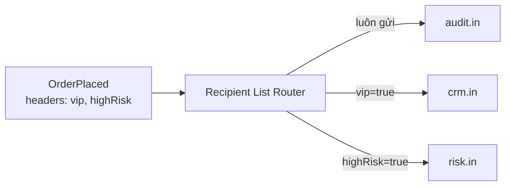
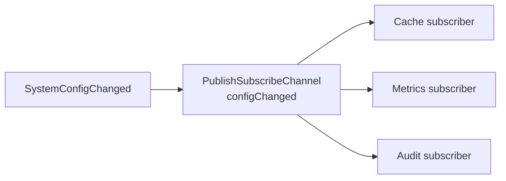
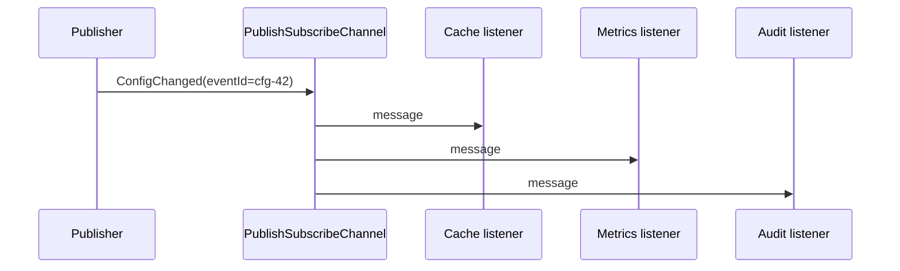
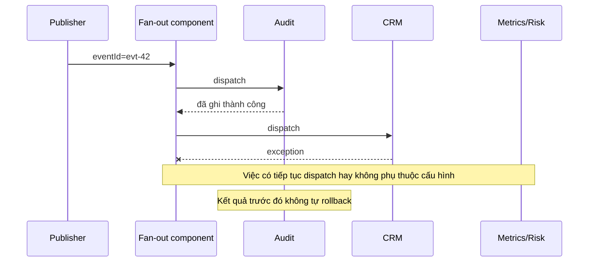
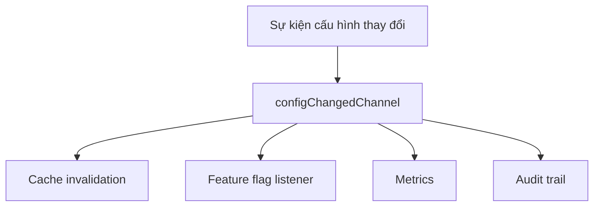
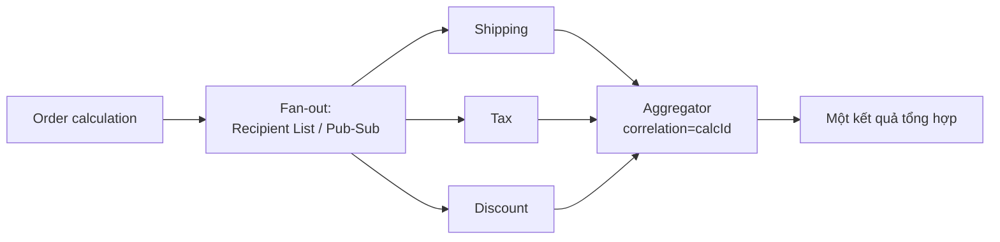

# Phân biệt recipient list với publish-subscribe channel

## 1. Cùng gửi một message tới nhiều đích, vì sao có hai cách?

Trong một hệ thống xử lý đơn hàng, khi có sự kiện `OrderPlaced`, hệ thống có thể cần:

- **Audit** nhận mọi sự kiện để ghi nhật ký nghiệp vụ.
- **CRM** chỉ nhận sự kiện của khách VIP.
- **Risk** chỉ nhận sự kiện được đánh dấu rủi ro cao.

Ở một hệ thống khác, một thông báo `SystemConfigChanged` cần được phát tới **mọi thành phần đang đăng ký lắng nghe**. Một thành phần có thể được thêm hoặc gỡ khỏi danh sách lắng nghe mà bên phát sự kiện không cần biết danh tính của từng thành phần.

Hai bài toán đều có hình thức *một message đến nhiều consumer* nhưng mang ý định khác nhau:

- **Recipient List** chọn **danh sách recipient cho từng message**, thường dựa trên tập đích do quy tắc định tuyến quản lý; mỗi recipient có thể có điều kiện riêng.
- **Publish-Subscribe Channel** phát **mỗi message tới các subscriber hiện đang đăng ký trên channel**; sự tham gia của subscriber là một phần của cấu hình topology.

Bài học thuộc chương **Recipient list** của module **SPRING_INTEGRATION_PATTERN**, nơi chúng ta học triển khai Enterprise Integration Patterns bằng Spring Integration để tạo luồng ít phụ thuộc và dễ mở rộng. Việc chọn đúng pattern tác động trực tiếp tới cách phối hợp Router, Filter, Transformer, Splitter, Aggregator, Gateway, retry, error channel và correlation, cũng như việc kiểm thử và theo dõi từng nhánh.

Mục tiêu sau bài học:

1. Phân biệt **recipient được router chọn** và **subscriber của một channel**.
2. Hiểu rằng cả hai mô hình có thể fan-out đến nhiều consumer nhưng mức độ linh hoạt, cách cấu hình và semantics khác nhau.
3. Cấu hình `routeToRecipients(...)` và `PublishSubscribeChannel` bằng Java DSL.
4. Đánh giá điều kiện lọc, topology, số thread, thứ tự giao, lỗi một phần, retry và idempotency.
5. Kiểm thử được tập recipient/subscriber và chọn được giải pháp phù hợp theo yêu cầu nghiệp vụ.

## 2. Hai sơ đồ để nhìn thấy khác biệt

### Recipient List: Router quyết định ai nhận từng message



Một sự kiện có `vip=true` và `highRisk=false` sẽ được gửi tới Audit và CRM. Với sự kiện `vip=false` và `highRisk=true`, tập recipient trở thành Audit và Risk. **Cùng một router, tập người nhận thay đổi theo từng message.**

### Publish-Subscribe: Channel phát cho những subscriber đang đăng ký



Nếu ba subscriber được đăng ký và đang hoạt động, cả ba đều nhận message được channel dispatch. Channel đóng vai trò phát tới những subscriber của nó; thông thường **không quyết định theo nội dung nghiệp vụ rằng subscriber A được nhận còn subscriber B không**.

Nếu một subscriber chỉ muốn nhận message có điều kiện, có thể đặt một `Filter` trong flow của subscriber, hoặc chuyển sang Recipient List khi việc chọn recipient theo từng message là trách nhiệm trung tâm của hệ thống.

## 3. Bảng so sánh cốt lõi

| Tiêu chí | Recipient List Router | Publish-Subscribe Channel |
| --- | --- | --- |
| Thành phần quyết định đích | **Router** cùng danh sách recipient/selector | **Channel** dispatch tới các subscriber đã đăng ký |
| Tập người nhận của một message | Có thể khác nhau giữa các message, theo điều kiện của từng recipient | Thường là tập subscriber hiện có trên channel |
| Cấu hình đặc trưng | `routeToRecipients(...)`, `recipient(channel, selector)` | `PublishSubscribeChannel`, subscriber endpoint hoặc DSL `publishSubscribeChannel(...)` |
| Mục tiêu chính | **Conditional fan-out**: chọn các đích thích hợp | **Broadcast**: phát tới các listener của một channel |
| Mỗi consumer có điều kiện riêng? | Có thể gắn selector ngay khi khai báo recipient | Thường dùng `Filter` trong flow subscriber nếu cần |
| Bổ sung người nhận | Chỉnh/cập nhật chính sách recipient; có thể dùng danh sách recipient động | Đăng ký thêm subscriber vào channel theo cơ chế quản lý subscription |
| Mức độ phụ thuộc của publisher | Publisher gửi vào router/input channel; Router biết các địa chỉ recipient | Publisher gửi vào một pub-sub channel; không cần liệt kê subscriber |
| Thread mặc định trong cấu hình phổ biến | Phụ thuộc channel đích; gửi tới `DirectChannel` thường đồng bộ | Không có executor thì dispatch tới subscriber thường đồng bộ trên thread gửi |
| Xử lý bất đồng bộ | Dùng channel/adapter đích, executor hoặc polling consumer phù hợp | Có thể cấp `TaskExecutor` cho `PublishSubscribeChannel` |
| Một subscriber/recipient lỗi | Có thể ảnh hưởng việc gửi tới đích khác nếu dispatch đồng bộ | Cũng có thể ảnh hưởng subscriber khác nếu dispatch đồng bộ |
| Bền vững khi process dừng? | Không tự có; tùy các channel/adapter phía sau | Không tự có; in-memory pub-sub không đồng nghĩa broker topic bền vững |
| Phù hợp nhất | CRM theo VIP, risk theo độ rủi ro, thông báo tới tập recipient động | Sự kiện nội bộ cần phát cho mọi listener hiện được đăng ký |

**Khác biệt chính nằm ở cách quyết định tập đích, không nằm ở số lượng message đầu ra.** Một Recipient List có thể gửi đến một hoặc nhiều recipient; một Publish-Subscribe Channel cũng có thể chỉ có một subscriber. Số lượng tại thời điểm chạy không làm thay đổi bản chất mô hình.

## 4. Recipient List: điều kiện được đánh giá theo từng recipient

Trong Spring Integration, `RecipientListRouter` thường được cấu hình bằng Java DSL `routeToRecipients(...)`. Ta có thể khai báo recipient luôn nhận và recipient chỉ nhận khi biểu thức/selector trả đúng:

```java
@Bean
public IntegrationFlow recipientListFlow() {
    return IntegrationFlow.from("orders.recipient.in")
        .routeToRecipients(spec -> spec
            .recipient("orders.audit")
            .recipient("orders.crm", "headers['vip'] == true")
            .recipient("orders.risk", "headers['highRisk'] == true"))
        .get();
}
```

Hãy đọc đoạn này theo ba quy tắc **độc lập**:

1. Mọi message được gửi tới `orders.audit`.
2. Nếu header `vip` có giá trị `true`, message còn được gửi tới `orders.crm`.
3. Nếu header `highRisk` có giá trị `true`, message còn được gửi tới `orders.risk`.

Khi cả hai điều kiện cùng đúng, các recipient đều có thể được chọn. Đây **không phải** chuỗi `if/else if` chỉ lấy nhánh đầu tiên khớp.

### Khi nào thay đổi tập recipient?

Có hai loại thay đổi:

- **Thay đổi theo message:** `vip`/`highRisk` khác nhau nên recipient được chọn cũng khác nhau; đây là hành vi tự nhiên của Recipient List.
- **Thay đổi theo chính sách:** bổ sung `orders.marketing` khi có chương trình khuyến mại; có thể cần thay cấu hình hoặc cơ chế cập nhật danh sách/selector có kiểm soát.

Với yêu cầu mỗi tenant có tập recipient khác nhau, policy định tuyến cần dùng **tenant đã xác thực**. Không dùng trực tiếp header do client tự khai để gửi dữ liệu sang recipient thuộc tenant khác.

### Không có recipient nào phù hợp

Nếu chỉ dùng các recipient có điều kiện và không điều kiện nào đúng, hệ thống phải quy định hành vi: bỏ message có giám sát, phát sang nhánh mặc định, hay báo lỗi nghiệp vụ. Cách router xử lý trường hợp không resolve được destination phụ thuộc cấu hình và phiên bản API. **Không nên coi “không phát tới đâu” là kết quả thành công khi sự kiện bắt buộc phải được giao.**

Đặt ít nhất một recipient luôn nhận như Audit có thể phù hợp ở một số hệ thống, nhưng không phải giải pháp chung. Điều quan trọng là tập recipient được định nghĩa theo yêu cầu và có thể kiểm thử.

## 5. Publish-Subscribe Channel: người gửi không cần chọn từng consumer

`PublishSubscribeChannel` của Spring Integration là một `SubscribableChannel`. Các endpoint handler **subscribe** vào channel; khi một message được gửi vào, channel dispatch message đến những subscriber theo cơ chế của nó.

Ví dụ công bố một thay đổi cấu hình cho mọi listener trong một ứng dụng:



Điểm quan trọng là publisher chỉ biết `configChangedChannel`. Nó không cần đổi logic khi một listener mới được đăng ký. Khi listener mới tham gia đúng cách, nó có thể nhận các message được phát **kể từ khi nó là subscriber hoạt động**.

Đây không phải cơ chế replay sự kiện cũ: một `PublishSubscribeChannel` in-memory không tự lưu lại message cho subscriber tham gia muộn. Nếu cần giữ sự kiện cho consumer mới hoặc consumer offline, nên đánh giá broker topic/subscription bền vững hoặc event store; đó là bài toán delivery khác.

### Một Pub-Sub Channel có thể dùng Filter không?

Có. Mỗi subscriber có thể có flow riêng, ví dụ:

```text
configChangedChannel
  ├── Cache subscriber: luôn chạy
  ├── Metrics subscriber: luôn chạy
  └── Partner subscriber: Filter theo tenant/loại thay đổi
```

Tuy nhiên khi bạn phải tạo rất nhiều Filter chỉ để quyết định **một message nên được gửi tới ai**, Recipient List có thể thể hiện trực tiếp ý định hơn. Pub-Sub hợp lý khi **mọi listener đều được quyền quan sát event** và mỗi listener tự quyết định có thực hiện công việc hay không.

## 6. Phân biệt với DirectChannel và Content-Based Router

Ba mô hình thường bị nhầm:

| Thành phần | Số handler được gọi cho một message theo ý định phổ biến | Cách chọn |
| --- | --- | --- |
| `DirectChannel` | Một subscriber được dispatcher chọn để xử lý | Point-to-point dispatch giữa các subscriber |
| Content-Based Router | Thường một nhánh nghiệp vụ; có thể hỗ trợ nhiều đích tùy router | Dựa trên nội dung/header/route key |
| Recipient List Router | Một tập recipient, có thể nhiều đích cùng lúc | Danh sách và các selector |
| `PublishSubscribeChannel` | Các subscriber đã đăng ký | Channel dispatch cho danh sách subscriber |

**Đăng ký ba handler trên `DirectChannel` không có nghĩa message được broadcast tới cả ba.** Với DirectChannel, các subscriber là những handler cùng cạnh tranh để xử lý từng message theo chiến lược dispatcher; trong khi Pub-Sub chủ đích phát tới tất cả subscriber.

Ngược lại, tạo ba channel đích trong Recipient List không làm publisher phải đăng ký trực tiếp với ba handler. Router đóng vai trò **trung gian chọn đích**. Nó có thể route tới cả `DirectChannel`, `QueueChannel`, outbound adapter hoặc hạ tầng messaging khác.

### “Publish-subscribe” ở đây khác broker topic như thế nào?

Đừng đánh đồng `PublishSubscribeChannel` của Spring Integration với topic trong Kafka hoặc exchange trong RabbitMQ:

- `PublishSubscribeChannel` thường kết nối những endpoint đang hoạt động **trong một application context/process**.
- Kafka/RabbitMQ/JMS có protocol, storage, ack, consumer group/subscription, retry và khả năng giao tiếp qua nhiều process tùy cấu hình.
- Cả hai có thể diễn đạt ý tưởng fan-out, nhưng **delivery guarantee, ordering, replay và lỗi hạ tầng** rất khác.

Một refactor từ channel in-memory sang broker topic là thay đổi kiến trúc, cần kiểm thử semantics thay vì chỉ giữ tên “pub-sub”.

## 7. Ví dụ Java DSL đặt hai pattern cạnh nhau

Ví dụ sau dùng một ứng dụng Spring Integration với hai đường gửi tách biệt:

- `orders.recipient.in` đi vào **Recipient List**, chọn Audit và CRM theo `vip`.
- `orders.broadcast.in` là **PublishSubscribeChannel**, có hai subscriber Audit và Metrics. Mỗi lần gửi vào channel này, cả hai subscriber hiện diện đều nhận.

Các `QueueChannel` dùng để kiểm tra nội dung trong unit/integration test, không phải thiết kế lưu trữ production.

```java
import org.springframework.beans.factory.annotation.Qualifier;
import org.springframework.context.annotation.Bean;
import org.springframework.context.annotation.Configuration;
import org.springframework.integration.channel.DirectChannel;
import org.springframework.integration.channel.PublishSubscribeChannel;
import org.springframework.integration.channel.QueueChannel;
import org.springframework.integration.config.EnableIntegration;
import org.springframework.integration.dsl.IntegrationFlow;
import org.springframework.messaging.Message;
import org.springframework.messaging.MessageHandler;

record OrderEvent(String eventId, String orderId) {}

@Configuration
@EnableIntegration
public class FanoutPatternsConfig {

    // Input cho Recipient List.
    @Bean("orders.recipient.in")
    public DirectChannel recipientInput() {
        return new DirectChannel();
    }

    @Bean("recipient.audit")
    public QueueChannel recipientAudit() {
        return new QueueChannel();
    }

    @Bean("recipient.crm")
    public QueueChannel recipientCrm() {
        return new QueueChannel();
    }

    @Bean
    public IntegrationFlow recipientListOrders() {
        return IntegrationFlow.from("orders.recipient.in")
            .routeToRecipients(spec -> spec
                .recipient("recipient.audit")
                .recipient("recipient.crm",
                    "headers['vip'] == true"))
            .get();
    }

    // Input trực tiếp là một PublishSubscribeChannel.
    @Bean("orders.broadcast.in")
    public PublishSubscribeChannel broadcastInput() {
        return new PublishSubscribeChannel();
    }

    @Bean("broadcast.audit")
    public QueueChannel broadcastAudit() {
        return new QueueChannel();
    }

    @Bean("broadcast.metrics")
    public QueueChannel broadcastMetrics() {
        return new QueueChannel();
    }

    // Hai IntegrationFlow này subscribe vào cùng pub-sub channel.
    @Bean
    public IntegrationFlow auditBroadcastSubscriber(
            @Qualifier("orders.broadcast.in")
            PublishSubscribeChannel broadcast,
            @Qualifier("broadcast.audit")
            QueueChannel audit) {

        return IntegrationFlow.from(broadcast)
            .handle((MessageHandler) message -> {
                if (!audit.send(message)) {
                    throw new IllegalStateException(
                        "Audit output rejected message");
                }
            })
            .get();
    }

    @Bean
    public IntegrationFlow metricsBroadcastSubscriber(
            @Qualifier("orders.broadcast.in")
            PublishSubscribeChannel broadcast,
            @Qualifier("broadcast.metrics")
            QueueChannel metrics) {

        return IntegrationFlow.from(broadcast)
            .handle((MessageHandler) message -> {
                if (!metrics.send(message)) {
                    throw new IllegalStateException(
                        "Metrics output rejected message");
                }
            })
            .get();
    }
}
```

**Cách đọc ví dụ:**

- Trong `recipientListOrders()`, Router **biết tên** `recipient.audit` và `recipient.crm`. Có thể route tới 1 hoặc 2 channel tùy header.
- `orders.broadcast.in` là một channel có subscriber. Hai flow `auditBroadcastSubscriber()` và `metricsBroadcastSubscriber()` đăng ký handler riêng vào cùng channel đó.
- Sender chỉ cần biết `orders.broadcast.in`; gửi cùng một message vào channel sẽ dispatch tới cả hai subscriber đang hoạt động.
- Cấu hình `PublishSubscribeChannel()` trong ví dụ không truyền `TaskExecutor`, nên mô hình dispatch được dùng ở đây là **đồng bộ theo mặc định**. Nếu gắn executor, hành vi thread và error handling sẽ thay đổi.
- Dấu `if (!queue.send(message))` giúp bài học không giả định rằng mọi lần gửi sang channel đích đều thành công; với queue không giới hạn và ứng dụng hoạt động bình thường, các gửi trong ví dụ thường thành công.

Ví dụ có một `record OrderEvent` khai báo độc lập với `IntegrationFlow`. Khi dùng production, payload có thể là Java record/DTO khác và mỗi recipient cần consumer thực thi hoặc outbound adapter tương ứng.

### Một cấu hình Pub-Sub DSL ngắn hơn

Nếu chỉ cần hai subscriber ngay trong một flow, Spring Integration Java DSL còn có kiểu khai báo nội tuyến bằng `publishSubscribeChannel(...)`:

```java
@Bean
public IntegrationFlow inlineBroadcast() {
    return IntegrationFlow.from("config.events.in")
        .publishSubscribeChannel(spec -> spec
            .subscribe(sub -> sub.handle(
                (MessageHandler) message ->
                    System.out.println("Cache: " + message.getPayload())))
            .subscribe(sub -> sub.handle(
                (MessageHandler) message ->
                    System.out.println("Metrics: " + message.getPayload()))))
        .get();
}
```

Mục đích ví dụ là cho thấy **hai subscriber** của channel, không phải đề xuất dùng `System.out.println` trong production. Khi subscriber làm I/O hoặc chứa nghiệp vụ đáng kể, nên đưa vào service/flow riêng, gắn tên và có error handling riêng.

**Chú ý:** Khai báo subscriber nội tuyến và khai báo subscriber bằng nhiều flow riêng là hai cách tổ chức. Không cần dùng cả hai trên cùng một channel nếu không có chủ đích phát thêm số lần xử lý.

## 8. Kiểm thử sự khác nhau bằng cùng một event

Với cấu hình `FanoutPatternsConfig`, ta có thể dùng JUnit 5 + AssertJ để kiểm chứng:

- Recipient List chọn Audit với mọi message và CRM chỉ khi VIP.
- Pub-Sub dispatch cùng message đến cả Audit và Metrics vì cả hai flow đã subscribe.
- Header ứng dụng để truy vết không bị mất khi gửi tới các endpoint này.

```java
import static org.assertj.core.api.Assertions.assertThat;

import org.junit.jupiter.api.Test;
import org.springframework.beans.factory.annotation.Autowired;
import org.springframework.beans.factory.annotation.Qualifier;
import org.springframework.integration.channel.PublishSubscribeChannel;
import org.springframework.integration.channel.QueueChannel;
import org.springframework.messaging.Message;
import org.springframework.messaging.MessageChannel;
import org.springframework.messaging.support.MessageBuilder;
import org.springframework.test.context.junit.jupiter.SpringJUnitConfig;

@SpringJUnitConfig(FanoutPatternsConfig.class)
class FanoutPatternsTest {

    @Autowired
    @Qualifier("orders.recipient.in")
    MessageChannel recipientsInput;

    @Autowired
    @Qualifier("recipient.audit")
    QueueChannel recipientAudit;

    @Autowired
    @Qualifier("recipient.crm")
    QueueChannel recipientCrm;

    @Autowired
    @Qualifier("orders.broadcast.in")
    PublishSubscribeChannel broadcast;

    @Autowired
    @Qualifier("broadcast.audit")
    QueueChannel broadcastAudit;

    @Autowired
    @Qualifier("broadcast.metrics")
    QueueChannel broadcastMetrics;

    private Message<OrderEvent> event(boolean vip) {
        return MessageBuilder.withPayload(
                new OrderEvent("evt-42", "order-42"))
            .setHeader("vip", vip)
            .setHeader("requestId", "req-42")
            .build();
    }

    @Test
    void recipientListSelectsRecipientsForEachMessage() {
        assertThat(recipientsInput.send(event(false))).isTrue();

        assertThat(recipientAudit.receive(0)).isNotNull();
        assertThat(recipientCrm.receive(0)).isNull();

        assertThat(recipientsInput.send(event(true))).isTrue();

        Message<?> audit = recipientAudit.receive(0);
        Message<?> crm = recipientCrm.receive(0);
        assertThat(audit).isNotNull();
        assertThat(crm).isNotNull();
        assertThat(crm.getHeaders().get("requestId"))
            .isEqualTo("req-42");

        assertThat(recipientAudit.receive(0)).isNull();
        assertThat(recipientCrm.receive(0)).isNull();
    }

    @Test
    void publishSubscribeDeliversToBothSubscribers() {
        assertThat(broadcast.send(event(false))).isTrue();

        Message<?> audit = broadcastAudit.receive(0);
        Message<?> metrics = broadcastMetrics.receive(0);

        assertThat(audit).isNotNull();
        assertThat(metrics).isNotNull();
        assertThat(audit.getPayload())
            .isEqualTo(new OrderEvent("evt-42", "order-42"));
        assertThat(metrics.getHeaders().get("requestId"))
            .isEqualTo("req-42");

        assertThat(broadcastAudit.receive(0)).isNull();
        assertThat(broadcastMetrics.receive(0)).isNull();
    }
}
```

Đây là **kiểm thử dispatch trong cùng ApplicationContext**, chưa chứng minh recipient đã ghi database, subscriber đã gọi API thành công hoặc message được lưu bền vững qua restart. Nếu đổi từ channel đồng bộ sang executor, cần dùng bounded wait/đồng bộ test phù hợp thay vì mặc định kết quả xuất hiện ngay lập tức.

### Ma trận hành vi để kiểm thử thêm

| Tình huống | Recipient List | Publish-Subscribe Channel |
| --- | --- | --- |
| `vip=false`, không có điều kiện khác | Chỉ recipient luôn nhận | Mọi subscriber hiện tại nhận message |
| `vip=true` | Recipient luôn nhận + CRM | Vẫn mọi subscriber hiện tại; VIP không tự ảnh hưởng topology |
| Thêm recipient marketing có selector | Router/policy cần biết mapping mới | Thêm subscriber marketing nếu muốn broadcast cho mọi message |
| Gỡ CRM khỏi hệ thống | Cập nhật router hoặc xử lý destination thiếu | Hủy subscription/không triển khai flow CRM |
| Không có nơi nhận hoạt động | Phụ thuộc chính sách no-match/channel resolution | Phụ thuộc quy tắc min-subscribers và cấu hình channel |
| Một consumer ném exception | Có thể ảnh hưởng recipient khác nếu dispatch đồng bộ | Có thể ảnh hưởng subscriber khác nếu dispatch đồng bộ |
| Một consumer chậm | Ảnh hưởng tùy channel đích | Với dispatch đồng bộ có thể giữ thread publisher |
| Cần lưu message cho consumer offline | Phải bổ sung lưu trữ/broker | Phải bổ sung lưu trữ/broker |

## 9. Thread và thứ tự: cả hai đều có thể đồng bộ hoặc bất đồng bộ

### Recipient List không đồng nghĩa với chạy song song

Trong Recipient List, mỗi destination có thể là:

- `DirectChannel`: handler nhận message thường thực thi trên thread gửi.
- `QueueChannel`: message vào buffer; polling consumer xử lý sau.
- `ExecutorChannel`: dispatch tới executor; việc gửi và việc xử lý có thể tách thread.
- Outbound adapter: gửi qua HTTP, AMQP, JMS hoặc Kafka với semantics của transport.

Việc route tới ba nơi **không bảo đảm** ba handler chạy đồng thời. Nếu cả ba là `DirectChannel` và mỗi handler gọi dịch vụ chậm, sender có thể chờ các handler theo cơ chế dispatch hiện tại.

### PublishSubscribeChannel không đồng nghĩa với chạy song song

Một `PublishSubscribeChannel` không có executor được dùng theo mô hình synchronous dispatch. Publisher có thể chờ callback xử lý ở subscriber; một subscriber chậm hoặc ném lỗi có thể ảnh hưởng lời gọi `send`.

Có thể cấu hình một `TaskExecutor` để dispatch bất đồng bộ:

```java
import java.util.concurrent.Executor;

import org.springframework.context.annotation.Bean;
import org.springframework.integration.channel.PublishSubscribeChannel;

// Executor cần được quản lý phù hợp với Spring context và shutdown policy.
@Bean
public PublishSubscribeChannel asynchronousBroadcast(Executor executor) {
    return new PublishSubscribeChannel(executor);
}
```

Đây là ví dụ về **cách truyền executor**, giả định ứng dụng đã cung cấp bean `Executor` phù hợp. Khi dùng worker pool, cần thêm giới hạn queue, chính sách từ chối task, cách xử lý exception và shutdown. Chuyển sang executor không tạo độ bền dữ liệu: nếu process chết khi task còn trong pool, message có thể mất.

### Ordering và delivery

Đừng dựa vào một thứ tự bất biến giữa các recipient/subscriber khi kiến trúc chưa quy định và kiểm thử thứ tự đó. Khi chạy với executor, thứ tự bắt đầu và kết thúc của các subscriber có thể khác; nhiều event chạy đồng thời có thể tiếp tục làm thứ tự quan sát thay đổi.

Nếu downstream cần xử lý event theo thứ tự của một `orderId`, hãy dùng hợp đồng ordering và partition/key phù hợp, hoặc thiết kế tuần tự hóa ở consumer. **Fan-out không tự tạo thứ tự nghiệp vụ end-to-end.**

## 10. Lỗi ở một recipient hoặc subscriber

Vấn đề chung của cả hai pattern là **partial completion**: Audit có thể lưu thành công, CRM lỗi, trong khi Metrics hoặc Risk chưa được xử lý. Một router hoặc channel gửi nhiều đích không tự biến các side effect thành một transaction nguyên tử.



Trong Recipient List, lỗi phát sinh khi route tới một destination có thể lan về caller hoặc bị xử lý theo cấu hình lỗi gửi. Trong Pub-Sub, lỗi tại một subscriber đồng bộ cũng có thể ảnh hưởng quá trình dispatch. Với executor, lỗi thường xuất hiện ở thread khác và phải được theo dõi thông qua error handling phù hợp.

| Rủi ro | Cách tiếp cận |
| --- | --- |
| Retry toàn fan-out làm Audit ghi hai lần | Dùng `eventId` ổn định, idempotency theo recipient và retry có phạm vi rõ |
| Một recipient offline làm nghẽn publisher | Tách giao hàng qua queue/broker, giới hạn timeout và backlog |
| Subscriber lỗi nhưng publisher đã trả thành công | Quan sát lỗi tại executor/poller/consumer, có failure store hoặc DLQ phù hợp |
| Một destination không tồn tại | Kiểm tra cấu hình topology ở startup và test mapping/subscription |
| Lỗi ở recipient bắt buộc | Định nghĩa chính sách fail-fast, báo lỗi hoặc xử lý bù trừ nếu cần |
| Lỗi ở recipient không bắt buộc | Best effort có giám sát, retry có giới hạn hoặc chấp nhận mất theo hợp đồng |

### Chọn phạm vi retry

Giả sử cả Audit và CRM đã được chọn, Audit ghi xong nhưng CRM timeout. Nếu retry **toàn Recipient List** hoặc phát lại **toàn Pub-Sub event**, Audit có thể nhận thêm một lần.

Thiết kế tin cậy thường dùng:

1. Một mã sự kiện nghiệp vụ bền vững như `eventId=evt-42`.
2. Trạng thái giao tin theo `(eventId, recipientId)` khi cần kiểm soát từng người nhận.
3. Retry với backoff theo recipient/consumer hoặc qua broker.
4. Idempotency khi recipient ghi database hoặc gọi API có side effect.
5. Error flow, dead-letter/failure store và khả năng replay có kiểm soát.

Nếu các recipient chỉ cập nhật biểu đồ hoặc log không quan trọng, chính sách đơn giản hơn có thể phù hợp. Nếu chúng thu tiền, trừ kho hoặc tạo vận đơn, có thể cần workflow/saga và bước bù trừ, vì fan-out không điều phối được giao dịch phân tán.

## 11. Có nên dùng Filter ở mỗi subscriber?

Khi một Publish-Subscribe Channel gửi tất cả event cho mọi subscriber, mỗi subscriber vẫn có thể đặt một `Filter` ngay sau channel:

```text
orders.broadcast
  ├── Audit subscriber: xử lý mọi message
  ├── CRM subscriber: Filter(vip == true) → CRM handler
  └── Risk subscriber: Filter(highRisk == true) → Risk handler
```

Cấu trúc đó **có thể đúng**, đặc biệt khi từng subscriber sở hữu logic và muốn tự quyết định event có liên quan đến mình.

Nhưng nó khác Recipient List ở vài điểm:

- Message ban đầu vẫn được channel dispatch đến CRM và Risk dù Filter sau đó loại chúng.
- Logic chọn nhận phân tán trong các subscriber, thay vì tập trung tại Router.
- Quan sát số lần “được publish” và số lần “được xử lý sau filter” sẽ khác nhau.
- Khi thêm subscriber mới, publisher thường không cần biết; subscriber mới chịu trách nhiệm thiết lập Filter của mình.
- Nếu subscriber Filter ném lỗi hoặc bị chậm trong mô hình đồng bộ, publisher có thể bị ảnh hưởng dù cuối cùng message bị loại.

**Chọn Filter tại subscriber khi quyết định quan tâm là trách nhiệm của subscriber.** Chọn Recipient List khi nghiệp vụ cần một nơi chủ động quyết định danh sách đích, ví dụ tập nhà cung cấp nhận cảnh báo theo loại đơn hoặc một chính sách giao tin đã được phê duyệt.

## 12. Khi nào chọn Recipient List?

Recipient List đặc biệt phù hợp khi:

- Tập recipient **khác nhau theo từng message**.
- Mỗi recipient có điều kiện riêng và điều kiện có thể cùng đúng.
- Cần lưu lại lý do “đã chọn ai” để audit hoặc replay.
- Hệ thống sở hữu chính sách chọn người nhận và muốn kiểm thử một decision table.
- Cần truyền cùng event vào nhiều integration flow/adapter đích cụ thể.

Ví dụ một routing policy:

| Event | Audit | CRM | Risk |
| --- | --- | --- | --- |
| Khách thường, rủi ro thấp | Có | Không | Không |
| Khách VIP, rủi ro thấp | Có | Có | Không |
| Khách thường, rủi ro cao | Có | Không | Có |
| Khách VIP, rủi ro cao | Có | Có | Có |

Lưu ý rằng `vip` và `highRisk` phải được lấy từ **dữ liệu được xác thực hoặc policy đã tính toán**. Không cho client tự khai header để lựa chọn đích nhạy cảm hoặc truy cập dữ liệu của tenant khác.

Khi lượng recipient và policy tăng lớn, nên tách việc tính tập recipient ra một service có kiểu và kiểm thử riêng, thay vì nhúng toàn bộ nghiệp vụ vào các biểu thức SpEL dài.

## 13. Khi nào chọn Publish-Subscribe Channel?

Publish-Subscribe Channel phù hợp khi:

- Publisher cần phát một event cho **mọi listener đăng ký**.
- Các listener có thể thêm/bớt độc lập với logic của publisher.
- Subscriber có trách nhiệm tự xử lý event và có thể tự lọc khi cần.
- Use case mang tính **notification/broadcast nội bộ**.
- Muốn tạo một điểm tích hợp rõ: `domainEvents`, `cacheInvalidationEvents`, `configChangedEvents`.

Ví dụ:



Ở đây, subscriber mới có thể tham gia mà người phát sự kiện không cần cập nhật một bảng điều kiện `vip`/`risk`. Nhưng người vận hành vẫn phải kiểm soát **subscription lifecycle, độ trễ, error handling và bảo mật dữ liệu** của toàn bộ listener.

Nếu một ứng dụng phát event chứa dữ liệu bí mật lên Pub-Sub Channel mà mọi subscriber đều được xem payload, hãy xem lại ranh giới tin cậy. Pub-sub in-memory không tự phân quyền đọc payload theo tenant hoặc vai trò.

## 14. Cách chọn khi cần durable messaging và nhiều ứng dụng

Trong hệ thống nhiều process, câu hỏi “Recipient List hay Publish-Subscribe Channel?” có thể chưa đủ. Cần thêm câu hỏi về **mục tiêu delivery**:

- Consumer có cần nhận event sau khi offline trở lại không?
- Có cần ack, replay, dead-letter, retry và retention không?
- Cùng một event gửi cho nhiều dịch vụ độc lập có được phép xử lý trùng không?
- Có cần giới hạn thứ tự theo `orderId` hay partition?
- Ai sở hữu bộ nhớ, lưu trữ và trạng thái của từng subscription?

Một mô hình hợp lý là **Recipient List định tuyến tới các queue chuyên biệt**, hoặc **broker topic đưa event tới các subscription của từng dịch vụ**. Đây là những cách triển khai có semantics khác với `PublishSubscribeChannel` trong một JVM.

| Mục tiêu | Hướng thiết kế cần xem xét |
| --- | --- |
| Conditional fan-out trong một ứng dụng | Recipient List |
| Broadcast trong một application context | `PublishSubscribeChannel` |
| Tất cả dịch vụ đều cần bản sao event và có thể offline | Broker pub-sub với subscription/queue phù hợp |
| Có quy tắc chọn một số dịch vụ theo thuộc tính message | Recipient List hoặc router có policy, có thể kết hợp broker |
| Phải lưu trạng thái gửi thành công theo recipient | Delivery store/outbox + idempotent consumer |
| Phải ghép kết quả phản hồi từ nhiều dịch vụ | Aggregator với correlation/release/deadline, không chỉ fan-out |

### Kết hợp hai pattern được không?

Có. Chẳng hạn Recipient List chọn **nhóm dịch vụ được phép nhận** sự kiện, sau đó mỗi dịch vụ dùng Pub-Sub Channel nội bộ để phát thông báo cho nhiều module bên trong. Khi kết hợp, cần phân biệt **routing key ở lớp ngoài** và **subscription ở lớp trong**, cùng cách quan sát lỗi tại từng ranh giới.

## 15. Correlation, Splitter và Aggregator khi có nhiều nhánh

Cả Recipient List và Publish-Subscribe đều có thể phát cùng event đến nhiều nhánh, nhưng **không tự ghép kết quả**.

Giả sử một đơn hàng cần tính ba thông tin: phí vận chuyển, thuế và ưu đãi. Chọn ba đích chỉ là bước **fan-out**. Để chờ ba kết quả và ghép thành một response, cần thêm:

1. **Correlation key** xác định các phản hồi thuộc cùng yêu cầu; ví dụ `calculationId` không bị thay giữa các nhánh.
2. **Release strategy** quy định cần đủ ba loại kết quả hay có thể chấp nhận partial.
3. **Timeout** cho nhóm kết quả và cho Gateway chờ reply; hai timeout có thể khác nhau.
4. **Deduplication** nếu một dịch vụ retry và phát lại cùng phản hồi.
5. **Error flow** giải quyết trường hợp một dịch vụ không trả lời hoặc trả lỗi.



Không nên suy ra rằng `MessageHeaders.ID`, `JMSCorrelationID` và `correlationId` dùng cho Aggregator luôn tương đương. Phải định nghĩa rõ metadata cho từng lớp để không ghép lẫn hai request hoặc giữ nhóm thiếu message mãi.

Nếu một Filter trong subscriber loại một nhánh mà Aggregator vẫn chờ đủ ba, nhóm sẽ không release theo cấu hình count mặc định. Khi đó cần thiết kế nhóm kết quả dự kiến, tín hiệu “không áp dụng”, hoặc chính sách timeout/partial result.

## 16. Quan sát hệ thống: đo tập người nhận và tập subscriber

Cùng một con số “messages sent” có thể mang ý nghĩa khác nhau trong hai mô hình.

Với Recipient List, nên theo dõi:

- Số message đầu vào router.
- Số recipient được chọn theo từng message và theo loại recipient.
- Số lần gửi tới destination thành công/thất bại.
- Số message không chọn được recipient, bị loại hoặc chuyển fallback.
- Số lỗi và số lần retry của từng recipient.

Với Publish-Subscribe Channel, nên theo dõi:

- Số subscriber đang hoạt động tại các thời điểm quan trọng.
- Số message được publish.
- Số message được từng subscriber tiếp nhận/xử lý.
- Độ trễ hoặc backlog ở từng subscriber khi dùng executor/buffer.
- Lỗi trong một subscriber và ảnh hưởng tới các subscriber khác.

Nên ghi `eventId` hoặc `requestId` có nguồn tin cậy ở các stage chính, kết hợp trace context khi luồng vượt qua thread hoặc process. Các metric như `fanout.recipient.selected`, `broadcast.subscriber.failed` là **tên gợi ý để ứng dụng thiết kế**, không khẳng định Spring Integration xuất sẵn đúng các tên đó.

### Bảng chẩn đoán nhanh

| Triệu chứng | Khả năng có thể xảy ra | Hướng kiểm tra |
| --- | --- | --- |
| VIP không nhận event | Selector sai, thiếu `vip` hoặc channel CRM chưa đúng | Kiểm tra header trước router, SpEL, channelMapping/recipient |
| Một event được gửi hai lần tới cùng consumer | Chạy cả recipient router và pub-sub tới cùng đích, hoặc retry không idempotent | Xem topology, eventId và retry scope |
| Pub-sub chỉ có một listener nhận | Các endpoint khác chưa subscribe/không active hoặc gửi nhầm sang DirectChannel | Kiểm tra bean channel và lifecycle subscription |
| Publisher bị chặn vì một listener chậm | Dispatch đồng bộ, handler làm I/O dài | Đo thời gian handler; xem xét executor và policy tải |
| Publisher báo thành công nhưng downstream thất bại | Async handoff hoàn tất trước khi handler xử lý | Theo dõi error flow/consumer, không dùng send result làm business ack |
| Không nhận event sau khi restart | Channel in-memory không có retention | Dùng broker/store nếu cần durable delivery |
| Hai subscriber có dữ liệu nhạy cảm không được phép xem | Broadcast quá rộng, không có ranh giới truy cập | Thu hẹp topic/channel, kiểm soát quyền và lọc trước khi phát |
| Aggregator chờ mãi | Thiếu một kết quả, sai correlation hoặc release strategy | Theo dõi group, expectedCount, timeout và duplicate |

## 17. Bài tập thực hành

**Bài 1 — So sánh tập người nhận.** Với bốn event, gồm `vip=true/false` và `highRisk=true/false`, liệt kê tập recipient được chọn của Recipient List (Audit, CRM, Risk). Sau đó so sánh với Pub-Sub Channel có ba subscriber Audit, CRM, Risk. Giải thích vì sao tập người nhận ở hai mô hình khác nhau dù số handler giống nhau.

**Bài 2 — Cài hai cách và kiểm thử.** Dựa trên mã ở mục 7, thêm `orders.risk` vào Recipient List; kiểm tra bằng JUnit rằng event VIP rủi ro cao đến đúng ba channel. Thêm một subscriber mới vào Pub-Sub Channel và chứng minh publisher không cần đổi payload hoặc logic gửi để subscriber mới nhận được message.

**Bài 3 — Lỗi một nhánh.** Giả lập Audit ghi thành công, CRM ném exception. Chạy trong mô hình đồng bộ rồi trong mô hình bất đồng bộ. Ghi nhận caller nhận gì, các consumer khác có được gọi hay không, và cần retry ở đâu để Audit không ghi trùng.

**Bài 4 — Consumer offline.** Giả sử Risk subscriber phải nhận được mọi sự kiện kể cả khi dịch vụ dừng 30 phút. Giải thích vì sao `PublishSubscribeChannel` in-memory chưa đáp ứng. Thiết kế một broker/topic/subscription hoặc persistent delivery store và chính sách replay có idempotency.

**Bài 5 — Fan-out/fan-in.** Ba dịch vụ Shipping, Tax, Discount nhận cùng yêu cầu nhưng trả kết quả độc lập. Thiết kế fan-out phù hợp và Aggregator ở phía nhận. Xử lý tình huống Discount không trả lời, Shipping trả hai lần và Tax đến sau deadline.

**Bài 6 — Quyết định ownership.** Một nhóm vận hành muốn mọi thay đổi cấu hình được các module quan sát; một nhóm kinh doanh muốn chỉ gửi voucher event tới CRM của khách VIP. Chọn pattern cho hai nhu cầu, nêu nơi đặt policy, nơi đặt Filter, những gì phải log và cách kiểm thử mỗi nhánh.

Một bài làm tốt cần giải thích được **ai sở hữu quyết định gửi**, **có bao nhiêu đích với mỗi message**, **cách subscriber tham gia**, **lỗi/timeout truyền đi như thế nào** và **khi nào cần một broker hoặc Aggregator**.

## 18. Những nguyên tắc cần nhớ

- **Recipient List** thể hiện tập người nhận do router/policy lựa chọn, thường khác nhau giữa các message; một recipient có thể có selector riêng.
- **PublishSubscribeChannel** phát message tới các subscriber đã đăng ký của channel; publisher thường không cần biết các subscriber đó.
- Cả hai đều có thể fan-out tới nhiều consumer, và cả hai đều có rủi ro **partial failure** khi một consumer có side effect rồi consumer khác lỗi.
- **Không mặc định pub-sub là bất đồng bộ**: với Spring Integration, channel không có executor thường dispatch đồng bộ.
- **Không mặc định pub-sub là bền vững**: channel in-memory không tự có retention, replay hay ack như broker.
- Khi cần điều kiện theo message, Recipient List có thể diễn đạt trực tiếp; khi cần mọi listener quan sát event, Pub-Sub rõ ý định hơn.
- Retry phải tính đến `eventId`, idempotency và trạng thái giao của từng recipient/subscriber; không hiểu `send() == true` là nghiệp vụ đã hoàn thành.
- Nếu nhiều nhánh cần trả kết quả và ghép lại, hãy thiết kế correlation, release strategy và timeout với Aggregator hoặc workflow phù hợp.

## Tài liệu tham khảo

- [Spring Integration Reference — Router implementations](https://docs.spring.io/spring-integration/reference/router/implementations.html)
- [Spring Integration Reference — Message Routing](https://docs.spring.io/spring-integration/reference/router.html)
- [Spring Integration Reference — Message Channels](https://docs.spring.io/spring-integration/reference/channel.html)
- [Spring Integration Reference — Channel Implementations](https://docs.spring.io/spring-integration/reference/channel/implementations.html)
- [Spring Integration Reference — Java DSL](https://docs.spring.io/spring-integration/reference/dsl.html)
- [Spring Integration Reference — Error Handling](https://docs.spring.io/spring-integration/reference/error-handling.html)
- [Spring Integration Reference — Aggregator](https://docs.spring.io/spring-integration/reference/aggregator.html)
- [Enterprise Integration Patterns — Recipient List](https://www.enterpriseintegrationpatterns.com/patterns/messaging/RecipientList.html)
- [Enterprise Integration Patterns — Publish-Subscribe Channel](https://www.enterpriseintegrationpatterns.com/patterns/messaging/PublishSubscribeChannel.html)

Các ví dụ dùng Java records (Java 17 trở lên) và Java DSL của Spring Integration phiên bản hiện đại. Khi đưa vào ứng dụng thực, hãy kiểm tra các overload API, subscription lifecycle, thread/executor, error handling và delivery semantics theo phiên bản đang chạy.
