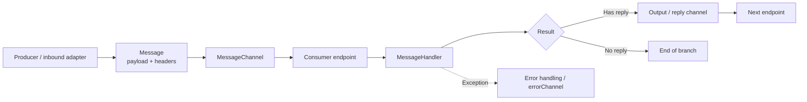

# Message flow from when the producer sends a message until the handler finishes

In Spring Integration, a message passes through multiple Spring-managed components: the producer creates the message, the channel transfers or stores the message, the consumer endpoint retrieves the message, and the endpoint invokes the handler. `IntegrationFlow` describes how those components are wired into a processing pipeline.

What determines how the flow executes is the channel type and the poller or executor configuration. With `DirectChannel`, the handler usually runs immediately on the thread calling `send()`. With `QueueChannel` or `ExecutorChannel`, the producer's send call may complete before the handler starts or finishes. Understanding this boundary helps you read logs accurately, design transactions, and handle errors.

## 1. Components participating in the message flow

| Component | Role in the runtime |
|---|---|
| Producer | Creates and emits messages. This can be application code calling `MessageChannel.send()`, an inbound channel adapter receiving data from an external system, or a message source polled periodically. |
| Message | A data envelope consisting of payload and headers. Payload holds business data; headers carry metadata for routing, correlation, replies, and error handling. |
| Message channel | The communication point between producer and consumer. The channel decides whether messages are dispatched immediately, broadcast, or queued. |
| Consumer endpoint | The Spring-managed component that receives messages from an input channel and invokes the handler. An endpoint can consume in an event-driven or polling manner. |
| Message handler | The component that performs work on the message: invoking a service, transforming payloads, filtering, routing, splitting, or aggregating messages. |
| Output/reply channel | Delivers the handler's result to the next endpoint or returns the result to the caller. |
| Error channel | Receives an `ErrorMessage` when an error is routed to message-based error handling. |

These roles are decoupled so that the producer does not need to know which specific bean is the consumer, which thread it runs on, or which service implements it. The producer only needs to send the message to a channel it knows.

### A message is an envelope, not just a payload

A message has two parts:

- **Payload**: the data object the handler needs to process, such as an `Order`, `String`, byte array, or another domain object.
- **Headers**: metadata such as message ID, timestamp, correlation ID, priority, reply channel, and error channel.

`Message` and `MessageHeaders` are designed to be immutable once created. To change the payload or headers, create a new message using `MessageBuilder`. However, envelope immutability does not automatically make the payload object immutable: if the payload is a mutable object and multiple consumers hold references to it, the application must still manage concurrent access.

Example of creating a message with metadata for correlation:

```java
Message<Order> message = MessageBuilder.withPayload(order)
        .setHeader("correlationId", requestId)
        .setHeader("sourceSystem", "checkout-api")
        .build();
```

`correlationId` helps link logs or messages belonging to the same business operation. When a flow has a splitter and an aggregator, correlation along with sequence headers also helps the framework identify which messages belong to the same group.

## 2. Lifecycle from producer to handler

A simple flow can be read in the following sequence:

1. **The producer has input data.** Data can come from an application call, an inbound adapter, or a message source.
2. **The producer creates a `Message<?>`.** The payload holds the data; headers add required metadata.
3. **The producer sends the message to a channel.** The call is typically `send(message)`. The channel applies its dispatch or buffering policy.
4. **The consumer endpoint receives the message.** For a subscribable channel, the endpoint is invoked when the channel dispatches. For a pollable channel, the polling consumer calls `receive()` on a schedule.
5. **The endpoint invokes the handler.** The endpoint connects the message to the corresponding `MessageHandler` and applies surrounding processing configurations such as advice, transactions, or retries if present.
6. **The handler executes business logic.** The handler may end the flow, produce a reply, or pass the result to the next endpoint.
7. **The flow handles the result or error.** Replies travel along the output/reply channel; exceptions propagate back or are converted into an `ErrorMessage` depending on the execution model.

Overview diagram:



`IntegrationFlow` helps define these components and connections. When the application context initializes, Spring registers the required channels, endpoints, and handlers as runtime beans. Therefore, a flow DSL should not be understood as a single Java call running from start to finish; the actual runtime is a collection of components collaborating through channels.

## 3. Channels determine how messages are transferred

`MessageChannel` is the common abstraction. Actual behavior depends on the implementation the flow uses.

| Channel | How messages are transferred | What the producer can infer from `send()` |
|---|---|---|
| `DirectChannel` | Dispatches directly to one subscriber. The handler usually runs on the producer's thread. | In a synchronous flow, the send call returns only after synchronous dispatch and processing complete. |
| `PublishSubscribeChannel` | Broadcasts the same message to all subscribers. Without an executor configured, subscribers run on the sending thread. | If running synchronously, subscriber dispatch happens within the send call; if an executor is present, processing may continue asynchronously. |
| `QueueChannel` | Stores the message in a queue; a polling consumer retrieves the message later. | Success usually means only that the message was accepted into the queue. The handler may not have run yet. |
| `ExecutorChannel` | Dispatches to a subscriber via a `TaskExecutor`. | The producer may receive the send result before the handler finishes. |

### DirectChannel: synchronous dispatch

`DirectChannel` implements `SubscribableChannel` and has point-to-point semantics: each message is dispatched to one subscriber. If there are multiple subscribers, the dispatcher uses round-robin load balancing by default; failover configuration can allow trying the next subscriber when the chosen subscriber fails to process successfully.

The most important point is threading. When the producer calls `send()`, the channel invokes the handler directly on the same thread. Therefore:

- The handler can execute before `send()` returns.
- Synchronous exceptions can propagate back to the caller.
- A transaction bound to the current thread can continue wrapping the handler invocation, provided the transaction boundary was opened on the producer side.

This is a suitable choice when you need a synchronous processing chain and want to preserve the transaction context across channels. In return, the duration of `send()` includes the execution time of synchronous downstream steps.

### PublishSubscribeChannel: one message, many subscribers

`PublishSubscribeChannel` broadcasts messages to multiple subscribers. Without a configured executor, invoking the subscribers happens on the sending thread. When an executor is attached, dispatch can be asynchronous.

Do not confuse this channel with `DirectChannel`: DirectChannel chooses one subscriber per message; PublishSubscribeChannel broadcasts to all subscribed handlers. If parallel processing is needed, inspect the executor, pool limits, and error handling of each branch.

### QueueChannel: decoupling send time from processing time

`QueueChannel` implements `PollableChannel` and stores messages in a queue. The producer can finish sending while the message is still waiting for a consumer to pick it up.

By default, the queue is in-memory; if no capacity is set, the queue can be unbounded. For systems under real load, consider a bounded capacity to prevent unbounded backlog growth and memory exhaustion. When the queue is full, whether `send()` waits or fails depends on the timeout and channel configuration.

An in-memory queue also does not provide durability across process restarts on its own. If persistent message storage is required, configure an appropriate message store and understand the transaction as well as store/receive semantics of that store.

### ExecutorChannel: offloading dispatch to a thread pool

`ExecutorChannel` still dispatches to a subscriber, but invoking the handler is handed off to a `TaskExecutor`. This is an explicit asynchronous boundary:

- The sending thread can continue once the task has been accepted by the executor.
- The handler runs on a thread owned by the executor.
- A transaction context bound to the producer's thread does not automatically follow the task.
- Handler exceptions cannot be thrown directly back to the already-completed `send()` call.

You must monitor the executor's queue, active thread count, and task rejection policy. If the executor saturates, the latency and message ingestion capacity of the flow will change.

## 4. Consumer endpoints and how messages are retrieved

Channels describe how communication occurs; consumer endpoints are responsible for connecting channels to handlers. Spring Integration has two primary consumption models.

### Event-driven consumer

When the input channel is a `SubscribableChannel`, the endpoint registers the handler as a subscriber. When the channel dispatches a message, the handler is invoked immediately. `EventDrivenConsumer` is the standard implementation for this model.

This model commonly accompanies `DirectChannel`, `ExecutorChannel`, or `PublishSubscribeChannel`. Whether execution is synchronous still depends on the channel and executor, not just the endpoint name.

### Polling consumer

When the input channel is a `PollableChannel`, the endpoint must actively call `receive()` to retrieve messages. `PollingConsumer` performs this on a schedule managed by a poller.

Poller parameters directly affect latency and load:

- **Trigger / fixed delay / cron** determines when a poll cycle starts.
- **`maxMessagesPerPoll`** limits how many messages are received in one poll cycle. This value affects backlog drain rate and how long a single cycle occupies a thread.
- **`receiveTimeout`** determines how long to wait when calling `receive()` if no message is available yet.
- **`taskExecutor`** allows handing off handler execution to a separate executor.

If the poller has no task executor, the handler is usually invoked on a task scheduler thread. If a task executor is present, handler invocation happens on a thread from that executor. Avoid letting long-running business logic occupy shared scheduler threads, especially when there are many polling endpoints.

Distinguish `PollingConsumer` from `SourcePollingChannelAdapter`. PollingConsumer pulls messages from a PollableChannel. SourcePollingChannelAdapter invokes a `MessageSource` on a schedule and then sends the received message to an output channel. Both use a poller, but they sit at different positions in the flow.

## 5. What work does a handler perform?

A consumer endpoint is not synonymous with business logic. The endpoint manages how messages are received; the handler is the callback that performs processing. Many Spring Integration components are built on the `MessageHandler` abstraction, with its core method:

```java
public interface MessageHandler {
    void handleMessage(Message<?> message);
}
```

Common endpoints map to different operations:

| Operation in the flow | Meaning |
|---|---|
| `transform()` | Creates a new payload or transforms the message for downstream use. |
| `filter()` | Decides whether a message continues along the current branch. |
| `route()` | Selects the next channel based on payload or headers. |
| `split()` | Splits one message into multiple messages. |
| `aggregate()` | Combines related messages into a single result. |
| `handle()` | Invokes a service or performs a business action, usually via a service activator. |

A flow can have multiple chained endpoints, multiple router branches, or split/aggregate steps. Therefore, one initial message does not necessarily correspond to exactly one handler invocation: a filter may discard the message, a splitter produces multiple messages, publish-subscribe creates multiple branches, and an aggregator may wait for multiple messages before emitting a result.

## 6. Example: producer sending an Order to a service activator

The following example uses the Java DSL with a DirectChannel as input. Endpoints in the flow do not declare separate channels, so the DSL uses appropriate internal channels to connect the steps; with this synchronous configuration, processing continues on the sending thread.

```java
@Configuration
@EnableIntegration
class OrderFlowConfiguration {

    @Bean
    MessageChannel ordersInput() {
        return new DirectChannel();
    }

    @Bean
    IntegrationFlow ordersFlow(OrderHandler handler) {
        return IntegrationFlow.from(ordersInput())
                .transform(Order.class, order -> order.normalize())
                .handle(handler, "save")
                .get();
    }
}
```

Business handler:

```java
@Component
class OrderHandler {

    private final OrderRepository repository;

    OrderHandler(OrderRepository repository) {
        this.repository = repository;
    }

    public void save(Order order) {
        repository.save(order);
    }
}
```

Producer sending the message:

```java
@Component
class OrderProducer {

    private final MessageChannel ordersInput;

    OrderProducer(@Qualifier("ordersInput") MessageChannel ordersInput) {
        this.ordersInput = ordersInput;
    }

    public void publish(Order order, String requestId) {
        Message<Order> message = MessageBuilder.withPayload(order)
                .setHeader("correlationId", requestId)
                .build();

        boolean sent = ordersInput.send(message, 1_000);
        if (!sent) {
            throw new IllegalStateException("ordersInput did not accept the message");
        }
    }
}
```

Runtime sequence in the example:

1. `publish()` creates a message with an Order payload and a correlation ID header.
2. `send()` dispatches the message into `ordersInput`.
3. `DirectChannel` invokes the registered consumer endpoint.
4. The endpoint runs the transformer to produce a normalized Order.
5. The service activator calls `OrderHandler.save()`.
6. When `save()` finishes, the synchronous processing branch completes and the send call can return.

The `save()` method returns `void`, so the example produces no business reply. If the handler returns an object, the service activator can convert that return value into a reply message and send it along the appropriate output/reply channel. Whether anything receives the reply depends on how the flow and gateway are configured.

If you replace the input with a `QueueChannel` or add an `ExecutorChannel`, revisit the conclusion about when `publish()` returns: the producer can finish before `OrderHandler.save()` begins.

## 7. Does `send()` returning mean the handler has finished?

There is no single universal answer for every flow. The meaning of a send result depends on the channel and downstream asynchronous boundaries.

| Scenario | When `send()` returns | Has the handler finished? |
|---|---|---|
| DirectChannel, synchronous flow | After synchronous dispatch finishes | Usually yes, for the synchronous processing chain invoked during that dispatch. |
| QueueChannel | After the message is accepted into the queue | Not necessarily; the consumer may not have polled the message yet. |
| ExecutorChannel | After the task is handed off to the executor | Not necessarily; the handler may not have started yet. |
| PublishSubscribeChannel without executor | After synchronous subscribers are dispatched | Usually yes for subscribers running synchronously. |
| PublishSubscribeChannel with executor | After dispatch is handed off to the executor | Not necessarily; subscribers may still be processing. |

Even in a synchronous flow, `send()` is not a universal guarantee that all external business work is durable. For instance, a transaction may commit only after the handler invocation returns and the transaction interceptor finishes. An external system may also continue processing after the handler has sent a request.

If the producer needs to know the business outcome, use an appropriate feedback mechanism:

- Use a messaging gateway for a request-reply model, with an explicit timeout.
- Return a reply message via `replyChannel` or a configured output channel.
- Emit an acknowledgment or completion event carrying the correlation ID.
- Persist processing status in a queryable store when work is long-running or asynchronous.

Do not rely solely on the boolean return value of `send()` to conclude that business processing succeeded. It reports the send outcome according to the channel's semantics.

## 8. Threading and transactions change by channel

Threading directly affects transactions because many transaction contexts in Spring are bound to the current thread.

| Model | Processing thread | Consequence for transactions |
|---|---|---|
| DirectChannel | Thread calling `send()` | Can keep the same thread-bound transaction from producer through handler. |
| ExecutorChannel | Thread supplied by TaskExecutor | The producer's transaction does not propagate automatically to the handler thread. |
| QueueChannel + PollingConsumer | Poller thread or poller's executor | A transaction is typically opened around the poll/handler according to poller advice configuration. |
| PublishSubscribeChannel without executor | Sending thread | Synchronous subscribers share the same thread; consider ordering and failures between subscribers. |
| PublishSubscribeChannel with executor | Executor thread | Branches can run asynchronously; the producer's transaction does not automatically cover them. |

If you need a transaction on the consumer side, establish the transaction boundary at the appropriate endpoint or poller. For a polling consumer, you can configure an advice chain to wrap the poll operation. For handlers running in an executor, define a new transaction on the processing side if business logic requires it.

A transaction across a DirectChannel also does not create a distributed transaction with external systems. If a handler both updates a database and calls HTTP or another broker, design consistency, retry, and idempotency based on the actual capabilities of each system.

## 9. Where do exceptions go?

How exceptions are observed also depends on the execution thread.

### Errors in a synchronous flow

With DirectChannel and synchronous steps, the handler runs on the producer's call stack. If the handler throws an exception, it can propagate back to the caller. When the producer calls `MessageChannel` or `MessagingTemplate` directly, the caller is usually where the exception is caught synchronously.

### Errors in an asynchronous flow

With tasks running in a `TaskExecutor` or polling tasks, the original send call may have already completed, so exceptions cannot be thrown back to the producer thread along a normal call stack. Spring Integration provides a mechanism to publish an `ErrorMessage` to an error channel:

1. If the message being processed has an `errorChannel` header, the error message is sent to that channel.
2. If there is no dedicated header, error handling can send to the global channel named `errorChannel`.
3. An error flow can receive, classify, log, or route the error to subsequent handling steps.

This mechanism depends on the configured task and error handler. An error thrown on the same thread as the producer does not automatically become an `ErrorMessage` merely because the application has an `errorChannel` bean.

For polling tasks, also check the task scheduler's error handler. If you supply your own scheduler, verify that the configuration includes `MessagePublishingErrorHandler` when you want scheduler errors routed through the error channel.

## 10. Correlation, replies, and processing state

Headers help maintain context across endpoints:

- **Message ID** identifies a specific message.
- **Correlation ID** links messages belonging to the same request or business operation.
- **Sequence number / sequence size** describe the position and count of messages in a group, typically useful with splitters and aggregators.
- **Reply channel** specifies where to send the return result.
- **Error channel** specifies where to send errors for the message.
- **Priority** applies when the channel supports priority, such as PriorityChannel.

When a handler creates a new message, decide which headers should be preserved and which must change. `MessageBuilder.fromMessage()` or header-copying methods help create a new message while retaining necessary metadata. Do not keep the same correlation ID if the new message starts an independent business operation.

With asynchronous flows, correlation IDs are especially valuable because logs from the producer, poller, and handler can appear on different threads and far apart in time.

## 11. How to diagnose a message not reaching the handler

When you see that the producer sent a message but the handler did not run, trace each runtime boundary instead of checking only the business method.

1. **Verify what the producer actually sent.** Check the injected channel bean, payload type, key headers, and `send()` result.
2. **Verify the exact channel instance.** Check bean names and flow configuration. Two flows can accidentally send to and listen on two different channels if they do not share the same bean.
3. **Verify channel semantics.** DirectChannel requires a subscriber; QueueChannel requires a consumer/poller; ExecutorChannel requires an active executor with capacity to accept tasks.
4. **Verify the endpoint is running.** Check lifecycle state, `autoStartup`, start/stop status, and the endpoint's input channel.
5. **If polling, check the poll schedule.** Inspect trigger, `maxMessagesPerPoll`, `receiveTimeout`, backlog, and scheduler threads.
6. **If using an executor, check the pool.** Inspect active threads, executor queue, rejected tasks, and wait time before the handler starts.
7. **Check the handler and downstream branches.** A filter might drop the message; a router might send it to a different channel; a transformer might produce a different payload; the handler might not emit a reply.
8. **Check the error flow.** Look for `ErrorMessage`, the `errorChannel` header, and subscribers on the global error channel.

To measure latency, record at a minimum the correlation ID, message ID, producer send timestamp, consumer receive timestamp, thread name, and handler start/end timestamps. Do not log sensitive payloads without appropriate requirements and controls.

When Spring Integration management tools are enabled, Integration Graph can help inspect channels, endpoints, and registered connections in the application context. Specific visibility and management endpoints depend on the version and application configuration.

### Common symptoms

| Symptom | Causes to check first |
|---|---|
| `send()` returns but handler has not run | Message entered a QueueChannel or task was handed off to an executor; check consumer, poller, and executor. |
| Queue grows continuously | Consumer is not running, poller is too slow, handler takes too long, or processing capacity is lower than producer rate. |
| Handler runs on a different thread | Flow has an ExecutorChannel, an executor on PublishSubscribeChannel, or a poller's task executor. |
| Producer does not receive the handler's exception | Exception occurred past an asynchronous boundary; check errorChannel and error handler. |
| Handler is not invoked even though channel receives messages | Endpoint is not started, subscribed to the wrong channel, has no subscriber, or polling consumer is not triggered. |
| Producer transaction does not cover the handler | Flow crossed to another thread or the transaction boundary is on a different component. |

## 12. Principles to remember when reading the runtime

- Producers send to channels; producers generally do not invoke handlers directly.
- Channels determine dispatch, fan-out, or buffering.
- Consumer endpoints connect input channels to handlers and decide whether consumption is event-driven or polling.
- Pollers govern the cadence of receiving messages from a source or pollable channel; task executors determine the execution thread when configured.
- A handler finishes when its processing completes; that can occur after the producer has already received the send result.
- Replies and errors are separate paths that must be configured and observed independently.
- Asynchronous boundaries change threads, transactions, exception propagation, and how completion is measured.

When investigating a flow, trace the chain **producer → message → channel → endpoint/consumer → handler → output/reply or error**. At each segment, identify the component type, the execution thread, and the point at which the component considers its work complete. Those three questions are usually enough to explain why a message is waiting, why a handler runs on a different thread, or why a producer does not see an exception.

## References

- [Message](https://docs.spring.io/spring-integration/reference/message.html) — Message structure, headers, and MessageBuilder.
- [Message Channel Implementations](https://docs.spring.io/spring-integration/reference/channel/implementations.html) — DirectChannel, QueueChannel, and channel implementations.
- [Configuring Message Channels](https://docs.spring.io/spring-integration/reference/channel/configuration.html) — configuring channels, executors, and queues.
- [Message Endpoints](https://docs.spring.io/spring-integration/reference/endpoint.html) — event-driven consumers, polling consumers, and MessageHandler.
- [Error Handling](https://docs.spring.io/spring-integration/reference/error-handling.html) — exception propagation, ErrorMessage, and errorChannel.
- [Java DSL Basics](https://docs.spring.io/spring-integration/reference/dsl/java-basics.html) — how the IntegrationFlow DSL maps to endpoints and runtime components.

Configuration details may vary across Spring Integration versions. When applying to a project, cross-check the documentation for the exact version managed by the application's dependency BOM.
