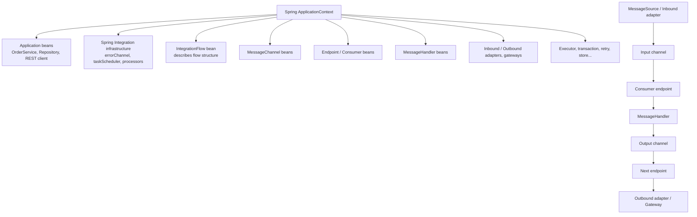
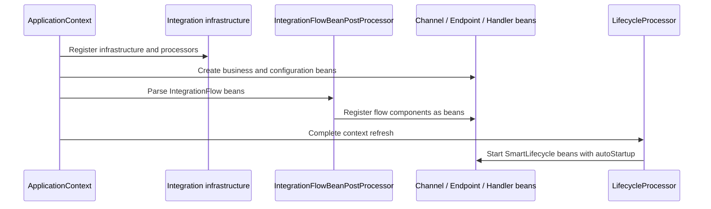
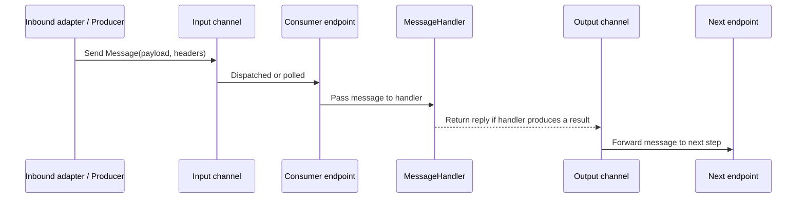

# ApplicationContext, IntegrationContext, and related integration beans

Spring Integration does not build an independent IoC container to run message flows. It extends Spring's container with messaging beans, endpoints, and infrastructure. In a typical application, `ApplicationContext` remains the place that creates, wires, manages lifecycles, and provides dependencies for both business beans and integration beans.

The name `IntegrationContext` can easily cause confusion. In Spring Integration's current public API, there is no second container named `IntegrationContext` standing alongside `ApplicationContext`. The two APIs with the closest names but different roles are `IntegrationFlowContext`, used to dynamically register and manage flows while the application is running, and `IntegrationContextUtils`, a utility class for looking up certain integration beans from `BeanFactory`. If an older example or another library uses an `IntegrationContext` type, verify the full package and dependency version before applying it.

## 1. Big picture: one container, many bean types

Think of `ApplicationContext` as the application's management scope. Inside it, the following can coexist:

- Application business beans, such as `OrderService`, repositories, or REST clients.
- Spring Integration infrastructure beans, such as the error channel, task scheduler, converters, and configuration processors.
- Beans describing and executing integration flows: `IntegrationFlow`, `MessageChannel`, endpoints, handlers, message sources, and adapters.
- Runtime supporting beans such as executors, transaction managers, retry advice, message stores, or metadata stores when flows need them.

The diagram below shows ownership relationships. Components inside the Spring container are managed by Spring as beans; arrows in the message flow represent the path of messages when the application runs.



A flow can use many different beans, yet they do not need to live in a separate runtime container. They are registered in the appropriate application context's bean factory, receive dependency injection, and follow Spring's lifecycle management.

## 2. Distinguishing similarly named concepts

| Concept | Role | Is it an independent container? |
|---|---|---|
| `ApplicationContext` | Spring container: manages beans, dependency injection, events, resources, and lifecycle | Yes. This is the application's actual container |
| Spring Integration infrastructure | Foundational beans supporting channels, endpoints, pollers, error handling, and integration configuration | No. They are beans inside `ApplicationContext` |
| `IntegrationFlow` | Describes a message flow using the Java DSL or equivalent configuration | No. It is a bean describing/composing a flow |
| `IntegrationFlowContext` | API to dynamically register, look up, and remove `IntegrationFlow` instances while the application runs | No. It operates on the application's bean factory |
| `IntegrationContextUtils` | Utility methods to retrieve common integration beans from `BeanFactory` | No. It is a utility class |
| `MessageChannel`, endpoint, handler, adapter | Concrete components that transfer and process messages | No. They are beans participating in the runtime |

### 2.1. ApplicationContext is the management hub

`ApplicationContext` inherits `BeanFactory`'s bean lookup capabilities and adds application-level features such as publishing application events, resource loading, and environment configuration integration. For Spring Integration, it handles:

1. Creating beans declared via component scan, `@Bean`, messaging annotations, or XML.
2. Injecting business beans into handlers, gateways, adapters, and flow configuration components.
3. Providing the `BeanFactory` so integration components can look up channels, services, schedulers, and supporting beans.
4. Managing startup, shutdown, and destruction of lifecycle-aware components.
5. Publishing Spring events so the application can react to context state.

Therefore, saying a flow "lives in the application context" specifically means that the beans composing the flow are registered and managed by that context's bean factory. `ApplicationContext` is not a message store; certain channels like `QueueChannel` can buffer messages, while messages flow through and are processed within the message flow.

Spring supports parent-child contexts. Beans in a child context can look up beans from the parent context, whereas the parent context does not look up beans declared only in a child context. This pattern can be useful when multiple child contexts share part of the integration infrastructure, though typical applications only need a single primary context.

### 2.2. How Spring Integration infrastructure is added to the context

With Java configuration, `@EnableIntegration` is the standard annotation for registering Spring Integration infrastructure. This annotation imports the required configuration, adds `BeanFactoryPostProcessor`, `BeanPostProcessor`, and annotation processors, and registers several default beans. Common examples include `errorChannel` and `taskScheduler` used for pollers.

```java
@Configuration
@EnableIntegration
@ComponentScan(basePackageClasses = IntegrationConfiguration.class)
public class IntegrationConfiguration {
    // Declare channels, IntegrationFlow, and integration beans here.
}
```

In projects using the XML namespace, corresponding infrastructure can be enabled via XML configuration. With Spring Boot, starters and auto-configuration also depend on the version; check the application's actual configuration before assuming which infrastructure beans were created automatically.

Infrastructure beans are not a new "IntegrationContext". They are dependencies that endpoints, pollers, expressions, error handlers, or other components can use within the same application context.

## 3. From IntegrationFlow to runtime beans

The Java DSL lets you declare a flow using a fluent API. For example, the following `IntegrationFlow` describes a pipeline that receives an order ID, normalizes the string, calls a service, and forwards the result to an output channel:

```java
@Configuration
@EnableIntegration
public class OrderIntegrationConfiguration {

    @Bean
    public MessageChannel ordersIn() {
        return new DirectChannel();
    }

    @Bean
    public QueueChannel ordersOut() {
        return new QueueChannel(100);
    }

    @Bean
    public IntegrationFlow orderFlow(OrderService orderService) {
        return IntegrationFlow.from("ordersIn")
                .<String, String>transform(String::trim)
                .handle(String.class,
                        (orderId, headers) -> orderService.accept(orderId))
                .channel("ordersOut")
                .get();
    }
}
```

The business bean is injected like a normal dependency:

```java
@Service
public class OrderService {

    public String accept(String orderId) {
        // Execute business logic; this example returns a result for illustration.
        return "accepted:" + orderId;
    }
}
```

You can send and receive messages through the declared channels:

```java
@Autowired
@Qualifier("ordersIn")
private MessageChannel ordersIn;

@Autowired
@Qualifier("ordersOut")
private PollableChannel ordersOut;

public void submit() {
    ordersIn.send(new GenericMessage<>("  order-42  "));

    Message<?> result = ordersOut.receive(1_000);
    // Resulting payload is "accepted:order-42" if the flow processes successfully.
}
```

In this example:

- `ordersIn` is a `DirectChannel`. When sending a message, the channel delivers it to the consumer registered on the channel on the same calling thread.
- `orderFlow` is the bean describing the chain of operations. It references the input channel, transformer, handler, and output channel.
- `OrderService` remains a standard business bean. Spring injects the service into the flow factory method; the handler invokes the service when a message arrives.
- `ordersOut` is a `QueueChannel`. The result is placed into the queue and the example retrieves it via `receive()`.

### 3.1. What turns the DSL into endpoints and channels?

`IntegrationFlowBuilder` collects the components described in the flow, such as `MessageChannel`, endpoints, and handlers. `IntegrationFlowBeanPostProcessor` parses `IntegrationFlow` beans and registers the necessary components as beans in the `BeanFactory`.

Therefore, a DSL flow is not a single block of code executed sequentially like a plain Java method. When the context initializes, the flow definition is transformed into concrete runtime beans with specific wiring. Depending on how it is declared, an endpoint typically comprises a consumer endpoint connecting an input channel to a message handler. Bean names of components generated by the DSL may be auto-generated; assigning explicit IDs to important flows or endpoints makes management and observability easier.

Other declaration styles such as the XML namespace, `@ServiceActivator`, `@Transformer`, `@Router`, or `@MessagingGateway` are likewise translated into corresponding bean definitions and endpoints. The declaration syntax differs, but the result is still components managed inside the Spring container.

### 3.2. Relationship between channel, endpoint, consumer, and handler

| Component | Responsibility | Questions when debugging |
|---|---|---|
| `Message` | Encapsulates payload and headers | Which payload/headers are being carried? |
| `MessageChannel` | Transfers messages from producer to consumer | Does the channel have the right name and type? |
| `MessageHandler` | Performs operations on the message | Is the handler created and receiving the expected payload? |
| Consumer endpoint | Connects input channel to handler; decides how messages are received | Is the endpoint subscribing or polling properly? |
| `MessageSource` | Produces messages from a data source when read/polled | Is the source returning data? |
| Inbound adapter | Brings data from an external system into a message flow | Are the external source connection and receive configuration working? |
| Outbound adapter | Sends messages from a flow out to an external system | Is the outbound handler invoked and free of connection errors? |
| Gateway | Provides an integration entry point, typically supporting request-reply | Are there replies, timeouts, or errors occurring? |

An endpoint is the bridge between a channel and a handler. For a subscribable channel, the endpoint can register a consumer to receive messages as they arrive. For a pollable channel or a `MessageSource`, the endpoint needs a poller to retrieve messages on a schedule.

## 4. Startup flow and message processing flow

### 4.1. When ApplicationContext starts up

An outline sequence is as follows:



Interpreted by responsibility:

1. Spring reads configuration and prepares the bean factory.
2. Spring Integration configuration registers infrastructure and required processors.
3. Spring creates business beans, channels, and flow declaration beans; dependencies are injected.
4. `IntegrationFlowBeanPostProcessor` parses flows and registers concrete components in the bean factory.
5. When the context finishes refreshing, the lifecycle processor starts `SmartLifecycle` components configured for auto-startup.

Endpoints and adapters have their own lifecycles. `autoStartup` controls whether a component starts automatically with the context; `phase` orders startup and shutdown among components supporting `SmartLifecycle`. When the context closes, Spring stops running components and triggers bean destruction to release resources.

Do not send messages from a bean's constructor, `@PostConstruct`, or `afterPropertiesSet()` if the message relies on endpoints that have not started yet. If you need to emit messages after the application is ready, use an appropriate lifecycle event, such as `ApplicationReadyEvent` in a Spring Boot application, or `ContextRefreshedEvent` when tying directly to the Spring context.

### 4.2. When a message traverses a flow



The channel is the connection point, while the endpoint determines how the consumer receives the message and invokes the handler. A handler can merely produce side effects, or return a value to create a reply message. Replies normally go to the configured output channel; otherwise, the framework can use the return address in the message header when appropriate.

Not every flow runs on a single thread. The actual thread depends on the channel type, poller, executor, adapter, and endpoint configuration. Thus, when diagnosing processing order or latency, identify the exact dispatch point and where thread handoff occurs.

## 5. How channels, pollers, and executors affect the runtime

Channel beans have distinct behaviors. Choosing a channel affects synchronicity, buffering, and how consumers receive messages.

| Channel type | How messages are transferred | Common consequences |
|---|---|---|
| `DirectChannel` | Invokes subscriber on the message-sending thread | Simple and synchronous; a slow handler can slow down the caller |
| `QueueChannel` | Places messages into a queue for consumers to retrieve | Buffered; requires a consumer to fetch messages, typically via a poller |
| `PublishSubscribeChannel` | Broadcasts messages to multiple subscribers | Suitable when multiple branches need to receive the same message |
| `ExecutorChannel` | Uses a `TaskExecutor` to dispatch | Can offload processing to another thread; must consider ordering, concurrency, and error propagation |

A poller is a scheduled reading configuration, not a channel type. It is typically attached to a polling consumer or a source polling channel adapter. `taskScheduler` schedules poller triggers; a `TaskExecutor` can execute work on a thread pool if the endpoint configuration specifies one. Do not assume that merely declaring a poller makes the entire flow run asynchronously.

For example:

- An inbound adapter polling files periodically uses a poller to check the file source.
- A `DirectChannel` connects a handler that runs synchronously on the message-sending thread.
- An `ExecutorChannel` delegates dispatch to an executor, which can increase parallel throughput but changes ordering and how errors propagate back to the caller.
- A `QueueChannel` holds messages waiting for a consumer to read; without an appropriate consumer or poller, messages can remain stuck in the queue.

Transactions, retries, error channels, message stores, and correlation are also attached to specific runtime components. They do not replace `ApplicationContext`; they are dependencies or configurations used by endpoints, handlers, aggregators, and integration components. When a message fails, determine whether the error occurred at the source, channel dispatch, handler, or outbound adapter to know which error channel, retry advice, or transaction boundary applies.

## 6. Dynamic flow registration: the role of IntegrationFlowContext

Flows declared with `@Bean` are typically created at context startup. If the application needs to create or remove flows at runtime, Spring Integration provides `IntegrationFlowContext`.

`IntegrationFlowContext` is a framework-provided bean. It registers an `IntegrationFlow` along with its dependent beans into the running bean factory, returns a registration handle for managing the flow, and supports removing flows by ID.

```java
@Component
public class PartnerFlowRegistry {

    private final IntegrationFlowContext flowContext;

    public PartnerFlowRegistry(IntegrationFlowContext flowContext) {
        this.flowContext = flowContext;
    }

    public String register(String partnerId, MessageChannel inputChannel) {
        IntegrationFlow flow = IntegrationFlow.from(inputChannel)
                .<String, String>transform(String::trim)
                .handle(String.class,
                        (payload, headers) -> "partner-" + partnerId + ":" + payload)
                .get();

        IntegrationFlowContext.IntegrationFlowRegistration registration =
                this.flowContext.registration(flow)
                        .id("partner-" + partnerId)
                        .autoStartup(true)
                        .register();

        return registration.getId();
    }

    public void unregister(String flowId) {
        this.flowContext.remove(flowId);
    }
}
```

In the example, `inputChannel` is a channel already created and properly managed in the application. Upon registration, the flow is added to the running context; upon removal by ID, the framework destroys the flow along with the dependent beans managed by that registration and cleans up the registry accordingly. You can use the registration to access the flow, input channel, or messaging template as needed.

A few principles for managing dynamic flows:

- Choose an ID that is stable and unique within the context scope. The ID helps look up, observe, and remove the right flow.
- Explicitly decide `autoStartup`; if auto-startup is disabled, the application must manually start the registration or associated components.
- Remove flows when no longer needed so associated endpoints and resources are stopped and destroyed.
- If a flow needs additional connection factories, serializers, or supporting beans not yet in the context, register them alongside the flow using the registration builder options.
- Avoid creating a new `ApplicationContext` for every flow if the requirement is simply adding/removing flows. `IntegrationFlowContext` is designed for dynamic flow registration inside an existing context.

### 6.1. What role does IntegrationContextUtils play?

`IntegrationContextUtils` belongs to the `org.springframework.integration.context` package. It is a utility class providing lookup methods for common integration beans from `BeanFactory`, such as the error channel, task scheduler, metadata store, or evaluation context.

Example:

```java
MessageChannel errorChannel =
        IntegrationContextUtils.getErrorChannel(beanFactory);

TaskScheduler taskScheduler =
        IntegrationContextUtils.getTaskScheduler(beanFactory);
```

This class does not hold the entire runtime state and does not register flows. In normal application code, prefer type-based and name-based dependency injection where appropriate; this utility is useful when an infrastructure component needs to look up beans from `BeanFactory`.

## 7. Checking bean relationships when a flow does not run

When a flow does not work as expected, trace relationships from the container down to the message instead of looking only at the lambda expression in the DSL.

| Symptom | Where to check | Common causes |
|---|---|---|
| Channel missing in context | `ApplicationContext` and bean names | Channel not declared, wrong name, or flow references the wrong context |
| Flow bean exists but no messages | Source, inbound adapter, and input channel | Source has not emitted messages, adapter not connected, or messages go to another channel |
| Messages reach channel but handler does not run | Consumer endpoint and subscription | Endpoint not created/started, channel has no subscriber, or endpoint uses the wrong channel |
| Polling source does not read data | `MessageSource`, poller, and `TaskScheduler` | Missing poller, unsuitable polling schedule, or source returns empty |
| Handler runs on unexpected thread | Channel type and `TaskExecutor` | Synchronous dispatch via `DirectChannel`, or flow switches threads via an executor |
| Dynamic flow remains after disuse | Registration ID and `IntegrationFlowContext` | Remove/destroy not called with the right ID or application still holds references to beans/resources |
| Flow stops on application shutdown | `SmartLifecycle`, `autoStartup`, `phase` | This may be normal lifecycle behavior; inspect context and endpoint state |

You can quickly inspect beans by type from the application context:

```java
Map<String, MessageChannel> channels =
        applicationContext.getBeansOfType(MessageChannel.class);

Map<String, AbstractEndpoint> endpoints =
        applicationContext.getBeansOfType(AbstractEndpoint.class);

endpoints.forEach((name, endpoint) ->
        log.info("endpoint={}, running={}", name, endpoint.isRunning()));
```

When using this approach, remember that bean names generated by the DSL can be long or include the flow's ID. For applications with many flows, assign clear IDs to important endpoints so logs and lookup results can be traced back to configuration.

A practical diagnostic workflow:

1. Confirm the right `ApplicationContext` contains the expected channels and endpoints.
2. Confirm the input channel has the expected name and implementation.
3. Confirm the inbound adapter or producer actually sends a `Message`.
4. Confirm the endpoint is running and subscribed to or polling the channel.
5. Inspect dispatch thread, handler, output channel, and error channel.
6. If it is a dynamic flow, inspect the registration ID and registration state.

## 8. Key relationships to remember

- `ApplicationContext` is the only Spring container an application normally needs to care about for managing integration beans.
- Spring Integration adds infrastructure and messaging beans into that container.
- `IntegrationFlow` describes flow structure; the Java DSL processor registers concrete channels, endpoints, and handlers as runtime beans.
- Channels transport messages; endpoints connect channels to handlers and define how consumers receive messages.
- Pollers, schedulers, and executors determine how work is triggered and distributed across threads.
- `IntegrationFlowContext` manages dynamic flow registration/removal in the running context.
- `IntegrationContextUtils` is strictly a bean lookup utility. Do not treat it as a context container.

Once you understand this boundary, reading logs, inspecting beans, managing lifecycles, and diagnosing threading becomes systematic: start from the application context, identify which flow beans were created, and then trace messages through channels, endpoints, and handlers.

## References

- [Spring Integration — Overview and infrastructure configuration](https://docs.spring.io/spring-integration/reference/overview.html)
- [Spring Integration — Java DSL](https://docs.spring.io/spring-integration/reference/dsl.html)
- [Spring Integration — Dynamic and Runtime Integration Flows](https://docs.spring.io/spring-integration/reference/dsl/java-runtime-flows.html)
- [Javadoc — IntegrationFlowContext](https://docs.spring.io/spring-integration/api/org/springframework/integration/dsl/context/IntegrationFlowContext.html)
- [Javadoc — IntegrationFlowBeanPostProcessor](https://docs.spring.io/spring-integration/api/org/springframework/integration/dsl/context/IntegrationFlowBeanPostProcessor.html)
- [Javadoc — IntegrationContextUtils](https://docs.spring.io/spring-integration/api/org/springframework/integration/context/IntegrationContextUtils.html)
