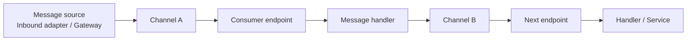
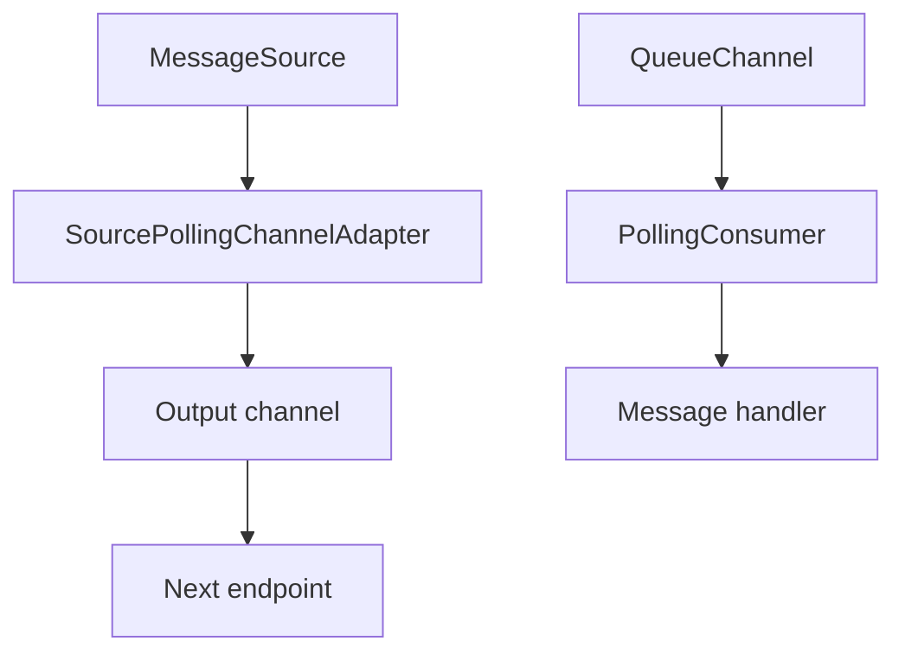

# Channels, endpoints, dispatchers, and executors at runtime

In **SPRING_INTEGRATION_RUNTIME**, a message flow should be viewed as a graph of active components inside the Spring container. A **channel** connects steps and decides how messages are forwarded or buffered; an **endpoint** brings a handler or data source into the flow; a **dispatcher** selects which subscriber receives a message; and an **executor** determines which thread runs the task. These four concepts are closely related yet solve four distinct responsibilities.

This article focuses on how these components collaborate at runtime: how messages traverse channels, by what mechanism endpoints receive messages, how dispatchers select handlers, and how executors introduce thread boundaries that affect ordering, transactions, errors, and performance. This forms the foundation for reading runtime state and diagnosing message flows in Spring Integration.

## 1. Starting from Message and message flow

Spring Integration exchanges data using `Message<?>`. A message consists of:

- **Payload**: business data, such as an `Order`, a JSON string, or a byte array.
- **Headers**: metadata such as `id`, `timestamp`, `correlationId`, `replyChannel`, `errorChannel`, or application-defined headers.

Example of creating a message:

```java
Message<Order> message = MessageBuilder
    .withPayload(order)
    .setHeader("source", "checkout")
    .setHeader("correlationId", requestId)
    .build();
```

A Message is the data envelope that components in the flow pass to one another. Channels themselves generally do not transform the payload; transformers, filters, routers, service activators, or handlers perform business processing. The Message object and headers are designed to be immutable, though this does not automatically make a mutable payload object immutable.

A typical flow looks like:



When reading the diagram, separate three questions:

1. Where is the message currently located or passing through? That is the responsibility of the **channel**.
2. Which component connects the handler to the flow and manages how the handler is invoked? That is the **endpoint**.
3. If the channel has subscribers, which subscriber is selected and on which thread is the invocation executed? That is the job of the **dispatcher** and **executor**.

## 2. Channel: connection point and message transfer mechanism

`MessageChannel` is the abstraction for sending messages. The producer calls `send(message)`; the consumer receives messages according to the channel type's capabilities. A channel can transfer messages directly, broadcast to multiple subscribers, or store messages for consumers to retrieve later.

Two key interface groups:

- **SubscribableChannel**: consumers register as subscribers. When a producer sends a message, the channel triggers dispatch to subscribers.
- **PollableChannel**: consumers actively call `receive()` to retrieve messages. The channel can hold messages until a consumer polls.

Common channels:

| Channel | How messages are received | Primary behavior | Processing model |
|---|---|---|---|
| `DirectChannel` | Subscriber is invoked during `send()` | Transfers to one subscriber | Event-driven, synchronous by default |
| `ExecutorChannel` | Subscriber is dispatched via an executor | Transfers to one subscriber | Event-driven, can be asynchronous |
| `PublishSubscribeChannel` | Subscribers are invoked during `send()` | Broadcasts message to multiple subscribers | Broadcast; synchronous if no executor is configured |
| `QueueChannel` | Consumer calls `receive()` | Holds messages in a queue | Polling, decouples send and receive timing |

### 2.1 DirectChannel

`DirectChannel` is an event-driven, point-to-point channel. When a producer calls `send()`, the channel selects one subscriber and invokes that subscriber directly on the current execution thread. Therefore, unless another asynchronous boundary exists, the handler runs on the same thread as the sender.

If a `DirectChannel` has multiple subscribers, the dispatcher picks one subscriber per message. By default, the channel uses a round-robin load-balancing strategy; it does not send copies of the message to all subscribers. If broadcast is needed, use `PublishSubscribeChannel`.

The advantage of `DirectChannel` is a simple path, minimal thread-switching overhead, and keeping a processing chain on the same call stack. This is helpful when results or exceptions need to return to the caller, or when steps must participate in the same transaction bound to the current thread.

### 2.2 ExecutorChannel

`ExecutorChannel` is also an event-driven, point-to-point channel, but it uses an `Executor` to execute the dispatch. Once a message is sent successfully to the channel, the processing work is handed off to the executor; the handler typically runs on a worker thread.

The key difference is that **a thread boundary appears at this channel**. The caller can continue after the work is accepted by the executor, while the handler is still running. Consequently, completion timing, completion order, and where exceptions surface can differ from `DirectChannel`.

`ExecutorChannel` is not a `QueueChannel`. The thread pool's internal queue holds tasks waiting for a worker to execute; it does not expose a `PollableChannel.receive()` interface for the application to pull individual messages, nor does it carry the message-store semantics of a queue channel.

### 2.3 PublishSubscribeChannel

`PublishSubscribeChannel` broadcasts messages to registered subscribers. Each subscriber receives the same published message, which suits independent branches such as writing audit logs, updating metrics, and sending notifications.

Without a configured executor, subscribers are typically invoked synchronously on the message-sending thread. With an executor configured, subscriber invocations can run asynchronously. Therefore, looking only at the channel name is insufficient to conclude whether a flow runs synchronously or asynchronously; you must check the channel's executor configuration.

### 2.4 QueueChannel

`QueueChannel` is a `PollableChannel`: the producer sends messages into a queue, and the consumer retrieves messages via `receive()`. Sending and processing do not necessarily occur at the same time or on the same thread.

The queue creates a buffer between producer and consumer. When the queue has a bounded capacity, the application can control the number of pending messages; if the queue is full, the send outcome depends on the timeout and send configuration. A queue does not process messages on its own: a polling consumer or another component must read messages out.

If messages must survive restarts or state must be shared across multiple nodes, you must choose an appropriate message store and storage configuration. An in-memory queue does not automatically become a durable queue just because it has a large capacity.

## 3. Endpoint: bringing handlers into the flow and managing invocation

An endpoint is the runtime component that connects a processing function to the message flow. It manages subscribing to receive messages or scheduling polls, while coordinating calls to the handler. The handler is where the concrete logic executes.

Examples of handlers commonly seen in the Java DSL:

- `transform(...)`: transforms the payload.
- `filter(...)`: decides whether a message continues.
- `route(...)`: chooses the target channel.
- `split(...)`: splits one message into multiple messages.
- `aggregate(...)`: combines multiple messages into a single result.
- `handle(...)`: invokes a service or message handler.

Annotations such as `@ServiceActivator`, `@Transformer`, `@Filter`, `@Router`, and `@Aggregator` also declare corresponding endpoints. An endpoint is not synonymous with a handler: the same handler can be managed by endpoints using different message-receiving mechanisms.

### 3.1 Event-driven consumer

With a `SubscribableChannel`, the consumer endpoint registers the handler as a subscriber. When the channel dispatches a message, the endpoint invokes the handler without needing a periodic poller.

For example, a service activator receiving messages from a `DirectChannel` is invoked directly on the message-sending thread, unless there is an executor or another asynchronous boundary along the path.

### 3.2 Polling consumer

With a `PollableChannel`, the consumer endpoint needs a poller to call `receive()` on a schedule. The poller defines the polling cadence and limits how many messages are processed in one cycle. Common properties include:

- `fixedDelay`, `fixedRate`, or `cron`: polling schedule.
- `maxMessagesPerPoll`: maximum number of messages retrieved in one poll cycle.
- `receiveTimeout`: wait time when receiving a message.
- `taskExecutor`: executor used for poll/dispatch work according to configuration.
- `adviceChain`: advices wrapping the poll or processing operation, commonly used for transactions, retries, and cross-cutting concerns.

If the poller does not specify a dedicated executor for processing, the poll task and handler call typically run on a thread used by the scheduler. When adding an executor, account for the number of pollers, worker count, and concurrency capacity.

### 3.3 Source polling channel adapter

A `SourcePollingChannelAdapter` periodically invokes a `MessageSource` to create or retrieve messages from an external source, then sends those messages to an output channel. It differs from a polling consumer: a polling consumer retrieves messages from a `PollableChannel`; a source polling adapter actively reads from a data source such as a directory, database, or another integration source.

You can visualize this as:



Distinguishing these two models helps pinpoint where to inspect when a message fails to appear: the source has not been polled, the poller has not run, the queue has no messages, or the consumer cannot pull messages.

## 4. Dispatcher: selecting the subscriber to receive a message

A dispatcher is a channel's internal mechanism for delivering messages to subscribers. Applications usually do not create dispatchers directly; the channel type determines the dispatch style, and channel configuration controls how it behaves.

Two main models:

- **Unicast dispatch**: picks one subscriber. `DirectChannel` and `ExecutorChannel` use this model. If there are multiple subscribers, a load-balancing strategy decides which subscriber receives the message.
- **Broadcast dispatch**: invokes subscribers. `PublishSubscribeChannel` uses this model.

`QueueChannel` works differently: messages are placed into a queue; consumers poll to retrieve them. Do not assume that every channel dispatches messages immediately to subscribers.

Example with three subscribers A, B, and C:

| Channel | One message is sent to |
|---|---|
| `DirectChannel` | One selected subscriber, e.g., A |
| `ExecutorChannel` | One selected subscriber; invocation is handed to the executor |
| `PublishSubscribeChannel` | A, B, and C |
| `QueueChannel` | Queue holds the message; a consumer pulls it later |

A common design mistake is registering multiple service activators on a `DirectChannel` expecting all of them to run. The actual behavior is distributing messages across the subscribers. If every subscriber must receive a copy of the message, use a broadcast channel or explicitly split the flow into separate branches.

## 5. Executor: controlling the execution thread

`Executor` and `TaskExecutor` are task execution abstractions. An executor does not decide which business endpoint a message goes to; the dispatcher does that. The executor decides whether a task runs on the current thread or is handed off to another execution mechanism.

A commonly used configuration is `ThreadPoolTaskExecutor`:

Place the `@Bean` methods below inside a `@Configuration` class; imports are omitted to focus on runtime configuration.

```java
@Bean
ThreadPoolTaskExecutor orderExecutor() {
    ThreadPoolTaskExecutor executor = new ThreadPoolTaskExecutor();
    executor.setCorePoolSize(4);
    executor.setMaxPoolSize(8);
    executor.setQueueCapacity(200);
    executor.setThreadNamePrefix("si-order-");
    executor.setWaitForTasksToCompleteOnShutdown(true);
    executor.setAwaitTerminationSeconds(30);
    return executor;
}

@Bean
MessageChannel ordersInput() {
    return new DirectChannel();
}

@Bean
MessageChannel ordersAsync() {
    return new ExecutorChannel(orderExecutor());
}

@Bean
IntegrationFlow orderFlow(OrderService orderService) {
    return IntegrationFlow.from(ordersInput())
        .channel(ordersAsync())
        .handle(orderService, "process")
        .get();
}
```

The example above has two execution segments:

1. The producer sends a message to `ordersInput`. The first endpoint is triggered on the message-sending thread because `ordersInput` is a `DirectChannel`.
2. The flow forwards the message through `ordersAsync`. `ExecutorChannel` submits a task to `orderExecutor`; the `orderService.process` handler runs on a worker thread when the executor executes the task.

Thread pool parameters have operational significance:

| Parameter | Meaning | What to monitor |
|---|---|---|
| `corePoolSize` | Baseline number of workers | Normal level of concurrency |
| `maxPoolSize` | Maximum worker limit | Ability to scale workers under load |
| `queueCapacity` | Number of tasks that can wait | Queue depth and wait time |
| `threadNamePrefix` | Thread name prefix | Thread traces in logs |
| Rejection policy | How saturation is handled when both pool and queue are full | Exceptions, caller running the task, or chosen rejection strategy |

Use a bounded queue and monitor for saturation. An unbounded queue can cause latency and memory usage to climb steadily when the producer rate exceeds the processing rate. With a bounded queue, when the pool cannot accept more tasks, the executor applies its rejection policy; by default, it rejects the task and throws an exception. If `CallerRunsPolicy` is chosen, the sending thread may have to run the task itself, applying backpressure to the producer while also altering expectations around asynchronicity.

### 5.1 Executor and poller are not the same concept

A poller answers the question **when to fetch messages**. An executor answers the question **which thread executes the task**.

- `TaskScheduler` schedules poller execution by fixed delay, fixed rate, or cron.
- `TaskExecutor` executes tasks, optionally backed by a thread pool.
- A polling endpoint can combine a scheduler and an executor; the specific configuration determines which threads run the poll operation and the handler.
- An `ExecutorChannel` can create an asynchronous boundary without needing a poller.

Therefore, when diagnosing a slow flow, check both the poll schedule and executor capacity. Increasing worker threads will not fix a poller that is not running on schedule; increasing poll frequency will not fix a saturated thread pool.

## 6. Thread boundaries affect transactions, errors, and ordering

### 6.1 Transactions

Spring transactions are normally bound to the current thread. With `DirectChannel`, the handler runs synchronously on the message-sending call stack and can participate in an active transaction on that thread, provided transaction and resource configurations align.

With `ExecutorChannel`, the handler runs on a worker thread. A transaction bound to the sending thread does not propagate automatically to the worker thread. If the handler needs its own transaction, place a transaction boundary at the corresponding endpoint/handler, such as using transaction advice in the poller or endpoint configuration.

One scenario to watch out for: a service writes data inside a transaction and then sends a message via `ExecutorChannel`. The worker may begin processing before the producer's transaction commits; nor can the worker's transaction see that uncommitted transaction. If processing depends on the newly written data, schedule message emission after commit or use an appropriate outbox pattern.

### 6.2 Exceptions and error flows

On a synchronous path, exceptions from a handler can propagate back to the sending thread and be observed directly by the caller. This allows the caller to decide on rollback or error handling within the same control flow.

On an asynchronous path, the sender may have already completed the `send()` call before the handler throws an exception. The exception happens on a worker thread, so it cannot be thrown back to the caller as in a synchronous call. You must configure and monitor an error flow, usually via `errorChannel` and `ErrorMessage`, while placing retry/advice where the handler actually executes.

Also distinguish message-sending errors from message-processing errors:

- **Send error**: the channel could not accept the message, e.g., full queue or executor task rejection.
- **Processing error**: the handler was invoked but processing failed.
- **Poll error**: the poller or data source failed while fetching messages.

These three errors occur at three different stages; logs and metrics should indicate which stage failed.

### 6.3 Ordering and concurrent processing

`DirectChannel` processes messages on the sending thread, so a producer sending sequentially generally observes sequential processing order along that path. `ExecutorChannel` with multiple workers allows multiple messages to be processed concurrently; completion order can differ from send order.

Even when an executor uses a FIFO queue, multiple workers can still finish tasks in different orders due to varying processing times. If business logic requires ordering per key such as `orderId`, design partitioning or per-key serialization rather than relying on a shared thread pool.

With `PublishSubscribeChannel`, branches can take different amounts of time to finish. Do not assume all branches have completed simply because the publish operation returned, especially when the channel uses an executor.

## 7. Lifecycle of IntegrationFlow and endpoints

The Java DSL describes flow structure; when the Spring ApplicationContext initializes, Spring Integration registers the required channels, endpoints, handlers, and adapters as runtime beans. Endpoints participate in Spring's lifecycle mechanism, so an endpoint's start/stop state directly affects its ability to receive messages.

For flows declared as `IntegrationFlow` beans, components are created and managed alongside the ApplicationContext. When the context starts, endpoints start according to lifecycle rules; when the context stops, endpoints stop and associated resources close according to container management.

When dynamic flow registration at runtime is needed, `IntegrationFlowContext` can be used. The flow registration object lets you control the dynamic flow's lifecycle, such as starting, stopping, or destroying it when no longer needed. Ensure the flow is stopped before releasing resources used by handlers or executors.

When investigating a flow that is not processing messages, check in order:

1. Has the ApplicationContext initialized successfully?
2. Have the IntegrationFlow and related channels been registered?
3. Is the corresponding endpoint running or stopped?
4. Is a subscriber registered on the channel, or does the polling endpoint have a running schedule?
5. Is the executor still accepting tasks and does it have active workers?

A channel existing as a bean does not mean the downstream endpoint is necessarily running. Likewise, an IntegrationFlow declared in source code does not guarantee every endpoint is active if its lifecycle is stopped or a dynamic registration was destroyed.

## 8. Choosing a model by runtime requirements

| Requirement | Usually suitable component | Reason |
|---|---|---|
| Immediate processing on sending thread, synchronous call stack needed | `DirectChannel` | Minimal thread-switching cost, exceptions can return to caller |
| Distributing messages to one of multiple consumers | `DirectChannel` or `ExecutorChannel` | Unicast dispatch |
| Every branch must receive the message | `PublishSubscribeChannel` | Broadcast to subscribers |
| Buffer messages for consumers to pull later | `QueueChannel` + polling consumer | Decouples send and receive timing |
| Offload processing to worker threads | `ExecutorChannel` | Executor runs handler asynchronously |
| Periodic reading from an external source | `MessageSource` + `SourcePollingChannelAdapter` | Polls source on a schedule |
| Transaction/retry needed around each poll or processing step | Appropriate poller/endpoint advice | Wraps the exact operation to manage |

There is no single best channel for every flow. Choose based on requirements for synchronicity, broadcast, buffering, ordering, transactions, and load resilience. Every asynchronous boundary alters how exceptions, transactions, and ordering are observed; factor those changes into the business design.

## 9. Diagnosing state and performance

When messages fail to reach their destination or throughput drops, trace each boundary in the flow rather than looking only at the final service's logs.

### 9.1 Observing channels and endpoints

- Verify the exact channel bean and channel type being used.
- For `SubscribableChannel`, check subscriber count and the state of endpoints subscribed to the channel.
- For `QueueChannel`, monitor pending message count, enqueue/dequeue rates, and queue-full occurrences.
- For polling endpoints, check whether the poller runs on schedule, receives messages, and is constrained by `maxMessagesPerPoll`.
- Check whether endpoints are stopped or a dynamic flow has been destroyed.

### 9.2 Observing executors

- Use meaningful `threadNamePrefix` values to identify each flow's threads in logs and thread dumps.
- Track pool size, active workers, queue size, task wait times, and rejected task counts.
- If active workers stay at the limit and the queue grows continuously, handlers are processing slower than tasks arrive.
- If workers are idle yet messages are not processed, check channels, subscribers, and pollers before increasing pool size.
- If CPU is low while latency is high, inspect I/O operations, locks, transactions, and external wait times.

### 9.3 Tracing messages

When logging, include useful identifiers such as `id` (`MessageHeaders.ID`), `correlationId`, payload type, and thread name. For multi-step flows, message history can help identify which components a message passed through if that feature is enabled. Spring Integration also provides integration graph information and management metrics when the application configures the corresponding management/Actuator support.

A practical investigation workflow:

1. Find ingress logs by `correlationId` or `id`.
2. Identify the next channel and its channel type.
3. Verify whether the endpoint has subscribed or is polling.
4. If an executor is present, check whether the task was accepted, queued, or rejected.
5. Search for exceptions on the right thread and error flow.
6. Compare send time, processing start time, and completion time to locate whether latency sits in the queue, executor, or handler.

## 10. Pitfalls to avoid

- **A channel is not an endpoint**: a channel connects/transfers messages; an endpoint manages attaching a handler or source to the flow.
- **A dispatcher is not an executor**: a dispatcher selects a subscriber; an executor runs tasks on threads.
- **Multiple subscribers do not imply broadcast**: `DirectChannel` and `ExecutorChannel` pick one subscriber; `PublishSubscribeChannel` broadcasts to multiple subscribers.
- **ExecutorChannel is not QueueChannel**: an executor queue holds tasks waiting for workers; QueueChannel holds messages for consumers to poll.
- **Having an IntegrationFlow does not mean asynchronous**: a flow becomes asynchronous only at components that create a thread boundary, such as ExecutorChannel or an executor configured on a channel/poller.
- **Increasing thread pool size does not automatically increase throughput**: if handlers are bottlenecked on a database, external API, locks, or connection pool limits, adding workers can worsen resource contention.
- **Transactions do not automatically cross threads**: when adding an executor, define a new transaction boundary.
- **Successful send does not mean successful processing**: for asynchronous paths, monitor dispatch errors, executor errors, and handler errors.

## 11. Self-check

1. If two service activators must both receive the same message, which channel type should you choose? Why does `DirectChannel` not satisfy the broadcast requirement?
2. A flow using `ExecutorChannel` returns quickly, but the handler fails later. Why does the caller not receive the exception as with `DirectChannel`? Which error flow should be observed?
3. A `QueueChannel` builds up a backlog continuously while the executor still has idle workers. Where would you inspect the poller, consumer, and receive configuration?
4. A service writes data inside a transaction and then sends a message via `ExecutorChannel`. What can happen if a worker reads the data before the producer transaction commits?
5. When multiple workers process messages concurrently, why can completion order differ from send order? If business logic requires ordering by `orderId`, what mechanism should be added?

## Conclusion

When reading the Spring Integration runtime, trace the chain **message → channel → endpoint → handler**, then identify which **dispatcher** selects the consumer and which **executor/poller** decides when and on which thread the work executes. From there, you can explain why a flow is synchronous or asynchronous, whether messages are broadcast or distributed, where queues grow, where exceptions appear, and whether transactions cover the processing step.
